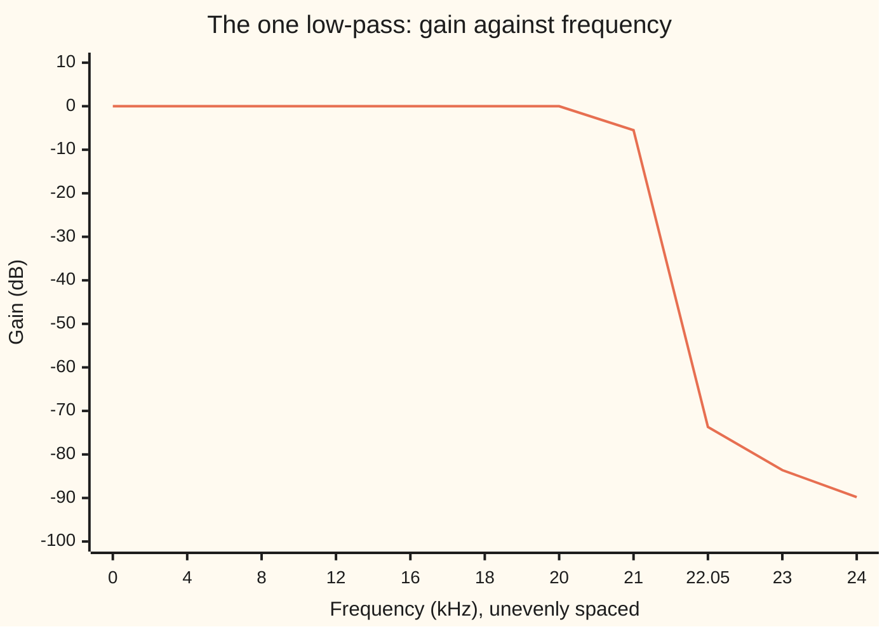

# Changing rate: filter then drop samples, or pad with zeros then smooth

[Syllabus](../../../SYLLABUS.md) → [Engineering mathematics](../README.md) → [Signals](../README.md#s05) → Changing rate

---

## General Overview

A studio records a guitar track at 48,000 samples a second, the video and broadcast rate. The CD master needs 44,100 samples a second. Only one new sample in 147, 300 a second, falls at a time where an old sample was taken, so the file cannot be converted by picking samples. It has to be rebuilt.

The test file here holds four steady tones: 440 Hz at amplitude 0.5, 3,000 Hz at 0.25, a 15,000 Hz shimmer at 0.1, and a 23,000 Hz tone at 0.1 that nobody can hear, the kind a synthesiser or a cheap microphone leaves behind. At 48 kHz all four are legal: the top tone is under the 24 kHz limit. At 44.1 kHz the limit drops to 22,050 Hz. Convert carelessly and the 23 kHz tone folds down to 21,100 Hz, and stays in the file for good as a fake tone.

Two moves do all rate changes. **Decimation** lowers the rate by a whole number M: low-pass filter first, then keep one sample in M. **Interpolation** raises it by a whole number L: put L − 1 zeros after every sample, then smooth with a low-pass filter whose gain is L. A ratio such as 44,100/48,000 = 147/160 is one up by 147, one filter, and one down by 160. Done properly, the 21,100 Hz fake comes out at 6.6249 millionths, 83.6 dB (decibels: 20 times the base-10 logarithm of the amplitude ratio) below the tone that caused it.

**To change a sampling rate, remove everything the new rate cannot hold before you drop samples, and remove the copies that zero-padding creates after you add them; one low-pass filter at the lower of the two limits does both.**

**What kind of fact this is:** two theorems and a method. The folding of dropped samples and the copies made by zero-padding are proved on this card in Why it works; the filter is an engineering design, good to a stated number of decibels, never perfect.

### The picture: 48 kHz to 44.1 kHz in three moves


The middle rate is imagined, never stored. Step 5 of Why it works shows how to compute only the slots that are kept, which is 129 multiplies per CD sample.

---

## The formula

Reminder from [Sampling](01-sampling-and-the-nyquist-theorem.md): a stream at R samples a second cannot tell a tone at f from one at f + R or R − f, so it shows each tone at its folded frequency, and only tones below R/2 (the **Nyquist frequency**: half the rate) show truthfully.

Reminder from [Digital filters](04-digital-filters-fir-and-iir.md): an FIR filter (finite impulse response: a weighted sum of nearby inputs) with taps h[j] that read the same either side of the centre delays every frequency equally.

New here is how to pick the taps of a low-pass. The ideal low-pass passes every frequency below the cutoff f_c at full strength and nothing above it. Adding up the cosines of all those frequencies, equally weighted, gives its taps, h[j] = sin(2π f_c j / f_s) / (π j), a **sinc** curve (a sine divided by its own angle). It runs on forever; tapering it to a finite length with a window from [Windows](03-windows-and-spectral-leakage.md) gives a real filter, the **windowed sinc**.

$$f_{\text{alias}} = \bigl|\,f - R\cdot\operatorname{round}(f/R)\,\bigr|$$

$$\text{decimate by } M:\quad y[n] = \sum_j h[j]\,x[nM - j],\qquad f_c \le \frac{f_s}{2M}$$

$$\text{interpolate by } L:\quad v[i] = \begin{cases} x[i/L] & L \text{ divides } i\\ 0 & \text{otherwise}\end{cases},\qquad y[i] = L\sum_j h[j]\,v[i - j],\qquad f_c \le \frac{f_s}{2}$$

$$\text{change by } L/M:\quad y[n] = \sum_k x[k]\;h[nM - kL],\qquad f_c \le \min\Bigl(\frac{f_s}{2},\ \frac{L f_s}{2M}\Bigr),\quad \text{gain } L$$

**Read it aloud:** each output sample is a weighted sum of the input samples near it in time, the weights read off one low-pass curve at the time gap between them, with the curve cut off below the smaller of the two Nyquist frequencies.

| Symbol | Plain meaning | In our example | Push it up and the answer… |
| --- | --- | --- | --- |
| $x[k]$ | the input: sample number k of the studio file | four tones at 48 kHz | the output scales with it |
| $y[n]$ | the output: sample number n at the new rate | the 16 kHz file, or the CD file | — |
| $v[i],\ c[i]$ | the zero-padded stream, and the comb that is 1 in every L-th slot and 0 elsewhere | 0.0833 at 3, 13 and 19 kHz | — |
| $k,\ n,\ i,\ j,\ r$ | counters: input sample, output sample, in-between slot, filter tap, and copy number (the fold under Step 1, and Step 3); on this card j is only a counter, not the square root of −1 | — | — |
| $f_s$ | the input rate, samples a second | 48,000; 16,000 for the trip back up | every Nyquist frequency rises |
| $M$ | the drop factor: keep one sample in M | 3, then 160 | the new rate falls, more tones must be removed |
| $L$ | the stuff factor: L slots per old sample, L − 1 of them zeros | 3, then 147 | more copies appear, all removed by the same filter |
| $L f_s$ | the in-between rate, imagined, never stored | 7,056,000 Hz | the filter needs more taps |
| $h[j]$ | the low-pass filter's taps, centred on j = 0 | 265 taps; 18,963 taps | more taps give a sharper cut |
| $f_c$ | the filter's cutoff frequency | 7,500 Hz; 21,025 Hz | above the limit, aliases leak in |
| $R,\ f,\ a,\ f_{\text{alias}}$ | a sampling rate, a tone's true frequency, its amplitude (Step 3), and where the tone shows at that rate | 44,100; 23,000 → 21,100 Hz; 0.1 | tones fold to different places |
| $X(\omega),\ Y(\omega),\ \omega$ | in the fold under Step 1: the spectra of input and output, and frequency in radians per sample | — | — |

### When it holds

- **The ratio of rates is a fraction of whole numbers.** 44,100/48,000 = 147/160 exactly. Two independent clocks drift, so their ratio is not a fixed fraction, and the converter has to track a moving ratio instead.
- **The filter acts before any sample is dropped.** After dropping, a folded tone sits on top of real music at the same frequency, and no filter can separate them.
- **Interpolation gets the gain L.** Zero-padding divides every tone by L; without the gain the 3,000 Hz tone comes out at 0.0833, not 0.25.
- **What you want lies below the new Nyquist frequency.** Decimating 48 kHz by 3 throws away the 15 kHz shimmer for good; interpolating back up does not restore it.
- **The filter is symmetric about its centre tap.** Then every frequency is delayed by the same amount, half the filter's length, which can be subtracted; centred on j = 0 as here, the delay is zero. A lopsided filter delays different frequencies by different amounts, smearing drum hits and shifting sound against video.

---

## Why it works

### Step 0: the rate decides which tones are ambiguous

A sample stream at rate R gives a tone at f and a tone at R − f exactly the same samples, up to a sign. That is the folding rule from [Sampling](01-sampling-and-the-nyquist-theorem.md). Change R, and tones that were safe at the old rate can land in the ambiguous zone of the new one. So a rate changer has two duties: remove those tones while the rate is still high enough to see them, and remove any fake copies that the change itself creates. Both duties fall to a low-pass filter.

### Step 1: dropping samples folds the spectrum

Keep every third sample of the 48 kHz file. Sample n of the result is sample 3n of the original, so a tone sin(2π f k / 48,000) becomes sin(2π f · 3n / 48,000) = sin(2π f n / 16,000): the same tone, now sampled at 16 kHz. At 16 kHz the Nyquist frequency is 8 kHz. The 15,000 Hz tone gives the samples sin(2π n − 2π · 1,000 n / 16,000) = −sin(2π · 1,000 n / 16,000): a 1,000 Hz tone with its sign flipped. The 23,000 Hz tone lands on 7,000 Hz the same way.

The check scans every 10 Hz step of the dropped file and finds exactly four tones: 440, 1,000, 3,000 and 7,000 Hz. The folding rule predicted 1,000 and 7,000 before any scan.

<details>
<summary>The general statement, for any signal</summary>

Write the input as a sum of tones. Dropping to every M-th sample keeps each tone's amplitude and replaces its frequency by its folded frequency at the rate f_s/M. In the language of [The DFT and the FFT](02-discrete-fourier-transform-and-the-fft.md), the spectrum of y[n] = x[nM] is the average of M shifted copies of the stretched spectrum of x:

$$Y(\omega) = \frac{1}{M}\sum_{r=0}^{M-1} X\!\left(\frac{\omega - 2\pi r}{M}\right),$$

where ω is frequency in radians per sample. The copies with r ≠ 0 are the aliases; they overlap the wanted copy unless X is zero above π/M, which is what the filter arranges.

</details>

### Step 2: filter first, and compute only what you keep

Low-pass the 48 kHz file with a cutoff of 7,500 Hz, below the new Nyquist frequency of 8,000 Hz, then drop. The 440 and 3,000 Hz tones pass at 0.5000 and 0.2500.

The 15,000 Hz tone is multiplied by the filter's gain at 15 kHz before it folds, so the 1,000 Hz alias should be 0.1 times that gain. The check computes the gain from the 265 taps alone, and gets 0.0189 millionths; it measures the alias in the decimated file, and gets 0.0189 millionths. That is 134.5 dB below the tone that caused it.

A lone 9,000 Hz probe at 0.1, just above the new 8 kHz Nyquist frequency, tests the cutoff where it is tightest: it would fold to 7,000 Hz, and comes out at 2.3345 millionths, matching 0.1 times the gain from the taps. A cutoff at 9,000 Hz, above the limit, would let the probe through, and the check stops.

Filtering every 48 kHz sample and then throwing two in three away wastes two thirds of the work. Since y[n] uses only x[3n − j], compute just the outputs you keep: 265 multiplies per 16 kHz sample instead of 795.

### Step 3: padding with zeros makes copies

Now go back up from 16 kHz to 48 kHz. Put two zeros after every sample. The padded stream is the full-rate signal multiplied by a comb that is 1 in every third slot and 0 elsewhere. That comb is itself a constant plus one 16 kHz cosine:

$$c[i] = \tfrac13\bigl(1 + 2\cos(2\pi \cdot 16{,}000\, i / 48{,}000)\bigr),$$

which is 1 when 3 divides i and 0 otherwise. Multiplying a tone of amplitude a at frequency f by c[i] gives, by the product-to-sum rule, a/3 at f and a/3 at each of 16,000 − f and 16,000 + f. Those extra tones are the **images**: spectral copies made by the padding.

The same holds for any L. The comb is

$$c[i] = \frac1L\sum_{r=0}^{L-1}\cos(2\pi r i/L).$$

When L divides i every cosine is 1, and the sum is 1. Otherwise the angles 2πri/L fall evenly round a circle, so the cosines balance out to 0. Each cosine runs at r times the old rate f_s, so a tone of amplitude a at f keeps a/L at f and gains images of a/L at r f_s − f and r f_s + f, for r = 1, 2, …, counted below the padded Nyquist frequency L f_s/2.

The check measures them: the 3,000 Hz tone (0.25) becomes 0.0833 at 3,000, 13,000 and 19,000 Hz, and the 440 Hz tone (0.5) becomes 0.1667 at 440, 15,560 and 16,440 Hz.

### Step 4: smooth, with gain L

A low-pass below the old Nyquist frequency of 8 kHz, the same 7,500 Hz filter, keeps the original copy and removes the images. Its gain must be L = 3, to undo the 1/3 from Step 3. The check gets the 3,000 Hz tone back at 0.2500, the 13,000 Hz image down to 0.1206 millionths, and the whole round trip within 0.5073 millionths of the 440 + 3,000 Hz part of the original. The 15 and 23 kHz tones did not survive the trip down; nothing in the trip up can bring them back.

Two in three padded slots are zero, so skipping them changes nothing. This is the **polyphase** form (one short filter per slot position): about 88.3 multiplies per 48 kHz sample instead of 265.

### Step 5: a fraction is up, one filter, down

Divide 48,000 and 44,100 by their greatest common divisor, 300: up by L = 147, down by M = 160. Padding to 7,056,000 slots a second creates images; dropping to 44,100 would fold anything above 22,050 Hz.

One low-pass at 7,056,000 slots a second handles both, with its cutoff below the smaller limit, at 21,025 Hz, midway between 20,000 Hz (the top of hearing, kept) and 22,050 Hz, and gain 147. Stopping by 22,050 Hz is the strict choice, made so that the 23 kHz tone leaves no fake at all.

The guard band of [Sampling](01-sampling-and-the-nyquist-theorem.md) would let the stop edge rise to 44,100 − 20,000 Hz, since anything folding down from below that edge lands above 20,000 Hz, out of hearing; a transition twice as wide needs half the taps.

How many taps? The window smears the sinc's sharp edge across its main lobe. Blackman's lobe runs out to 3 bins either side of centre ([Windows](03-windows-and-spectral-leakage.md)), where a bin is the rate divided by the number of taps. A rule of thumb for the Blackman windowed sinc is that the gain falls from flat to deep stopband (the band of frequencies the filter blocks) across about 5.5 bins, a little under the lobe's full width. A 2,050 Hz fall at 7,056,000 slots a second then needs 5.5 × 7,056,000 / 2,050 = 18,930.7 taps; the code rounds up to 129 × 147 = 18,963. The rule is only a rule, so the code measures the result.



The line is the filter's gain in decibels, computed from its 18,963 taps. It is flat to 20 kHz, falls through −5.5 dB at 21 kHz, and is at −73.7 dB by 22,050 Hz.

Of the 18,963 taps, a given output meets only those that land on real samples, one in 147. Output n sits at time n/44,100 s and input k at k/48,000 s; the gap between them, counted in ticks of 1/7,056,000 s, is exactly nM − kL. So the converter is a weighted sum of about 129 nearby inputs, each weight read off the filter curve at its time gap. The literal route, which filters all 160 in-between slots per output including the zeros, costs 3,034,080 multiplies per CD sample. The check runs both on the first 25 outputs and they agree to 1e-12.

---

## Worked numbers, by hand

The conversion from 48 kHz to 44.1 kHz, with the 23,000 Hz tone as the test.

| Step | Arithmetic | Value |
| --- | --- | --- |
| common divisor | gcd(48,000, 44,100) | 300 |
| up and down factors | 44,100 / 300 and 48,000 / 300 | L = 147, M = 160 |
| in-between rate | 48,000 × 147 | 7,056,000 Hz |
| new Nyquist frequency | 44,100 / 2 | 22,050 Hz |
| where 23 kHz folds | 44,100 − 23,000 | 21,100 Hz |
| filter length, Blackman rule | 5.5 × 7,056,000 / (22,050 − 20,000) | 18,930.7 → 18,963 taps (129 × 147) |
| taps per output | 18,963 / 147 | 129 |
| filter gain at 23 kHz | from the taps | −83.6 dB |
| alias left over | 0.1 × the gain at 23 kHz, from the taps | **6.6249 millionths** |
| alias from straight lines instead | 0.1 × (sin(π · 23/48) / (π · 23/48))² | 0.04394 |

The fake 21,100 Hz tone ends 83.6 dB below the tone that caused it, under the noise of any real recording; drawing straight lines between samples leaves it at 0.04394, close to half the tone that caused it.

```
amplitude in the CD file, 20 marks = 0.5
  440 Hz, straight lines    ████████████████████  0.4999
  440 Hz, one low-pass      ████████████████████  0.5000
 3000 Hz, straight lines    ██████████            0.2468
 3000 Hz, one low-pass      ██████████            0.2500
15000 Hz, straight lines    ███                   0.0717
15000 Hz, one low-pass      ████                  0.1000
11100 Hz fake, straight     ▌                     0.0148
11100 Hz fake, low-pass     ▏                     0.0000
21100 Hz fake, straight     ██                    0.04394
21100 Hz fake, low-pass     ▏                     6.6249 millionths
```

Straight lines dull the 15 kHz shimmer from 0.1000 to 0.0717 and let fakes through. Drawing them is a filter too, with triangle-shaped taps, and a weak one. Besides the 21,100 Hz fake, it passes the images at 48,000 − f of the 23 and 15 kHz tones, which fold to 19,100 Hz at 0.0372 and to an audible 11,100 Hz at 0.0148. The one low-pass keeps every real tone and removes the fakes. Across the whole 0.1 s slice, the low-pass output is within 7.5862 millionths of the ideal 44.1 kHz recording of the three real tones.

### What breaks if you drop a piece

| Mistake | Comes out at | What went wrong |
| --- | --- | --- |
| Drop two samples in three, no filter | a 1,000 Hz fake at 0.1000 | 15 kHz folded to 1 kHz at full strength |
| Pad with zeros, no smoothing | 13,000 and 19,000 Hz images at 0.0833 | the comb's copies of the 3,000 Hz tone stay in |
| Smooth with gain 1, not 3 | 3,000 Hz at 0.0833, not 0.2500 | the padding's 1/3 was never undone |
| 48 → 44.1 kHz by straight lines | fakes at 21,100 Hz (0.04394) and 11,100 Hz (0.0148); 15 kHz at 0.0717 | a triangle is a poor low-pass: it lets 23 kHz and the images through and dulls the treble |

The code prints all four.

---

## Code, from first principles, and it actually runs

The script builds the four-tone studio file, designs both low-pass filters as Blackman-windowed sincs, and runs the three jobs: down by 3, up by 3, and 48 to 44.1 kHz. A sine-wave meter (a single-frequency DFT over 0.1 s) measures every tone. It reaches the answers by five independent roads: the folding rule against a scan of every 10 Hz step; each measured alias against the filter's gain computed from its taps alone; the polyphase sums against the literal padded-and-filtered ones; the converted file against the ideal 44.1 kHz recording computed directly; and the straight-line fake against the triangle's gain formula.

### Python

```python
# Changing rate -- the check behind the card.  Standard library only: the
# filters, the sine-wave meter and the rate changers are all written out below.
from math import sin, cos, pi, sqrt, log10, gcd
FS = 48000                                          # the studio rate, samples a second
TONES = [(440, 0.5), (3000, 0.25), (15000, 0.1), (23000, 0.1)]   # hertz, amplitude
def add(vals):                                      # plain left-to-right sum
    s = 0.0
    for v in vals:
        s += v
    return s
def x(k):                                           # the studio recording at sample k
    return add(a * sin(2 * pi * f * k / FS) for f, a in TONES)
def lowpass(fc, fs, taps, gain):                    # windowed sinc, centred on tap 0
    c = (taps - 1) // 2
    g = []
    for j in range(-c, c + 1):
        s = 2 * fc / fs if j == 0 else sin(2 * pi * fc * j / fs) / (pi * j)
        w = 0.42 + 0.5 * cos(pi * j / c) + 0.08 * cos(2 * pi * j / c)   # Blackman window
        g.append(s * w)
    t = add(g)
    return [gain * v / t for v in g], c
def resp(g, c, f, fs, gain):                        # filter's gain at f, from its taps
    return abs(add(v * cos(2 * pi * f * (j - c) / fs) for j, v in enumerate(g))) / gain
def amp(sig, f, fs):                                # size of the f-hertz sine in sig
    re = add(v * cos(2 * pi * f * n / fs) for n, v in enumerate(sig))
    im = add(v * sin(2 * pi * f * n / fs) for n, v in enumerate(sig))
    return 2 * sqrt(re * re + im * im) / len(sig)
def fold(f, fs):                                    # where f lands after sampling at fs
    f = f % fs
    return min(f, fs - f)
def db(a): return 20 * log10(a)
def show(name, v): print(f"{name:<52}{v:>12}")
# ---- 1. decimate by 3: 48 kHz down to 16 kHz -------------------------------
g3, c3 = lowpass(7500, FS, 265, 1.0)
X0 = 400
xs = [x(k) for k in range(-X0, 5200)]               # x(k) is xs[k + X0]
naive = [xs[3 * n + X0] for n in range(1600)]       # drop two samples in three, 0.1 s
D0 = 60
dec = [add(g3[j] * xs[3 * n - (j - c3) + X0] for j in range(2 * c3 + 1)) for n in range(-D0, 1660)]
dec_s = dec[D0:D0 + 1600]
found = [(10 * b, amp(naive, 10 * b, 16000)) for b in range(800)]
found = [(f, a) for f, a in found if a > 0.01]
print("tones in the 16 kHz signal, samples simply dropped:")
print("  " + ", ".join(f"{f} Hz {a:.4f}" for f, a in found))
print(f"folding predicts 15000 -> {fold(15000, 16000)} Hz and 23000 -> {fold(23000, 16000)} Hz")
show("filtered first: 440 Hz", f"{amp(dec_s, 440, 16000):.4f}")
show("filtered first: 3000 Hz", f"{amp(dec_s, 3000, 16000):.4f}")
a1k = amp(dec_s, 1000, 16000)
show("filtered first: 1000 Hz alias, millionths, measured", f"{a1k * 1e6:.4f}")
show("  0.1 x filter gain at 15 kHz, predicted", f"{0.1 * resp(g3, c3, 15000, FS, 1) * 1e6:.4f}")
show("  the alias in decibels below 0.1", f"{db(a1k / 0.1):.1f}")
xp = [0.1 * sin(2 * pi * 9000 * k / FS) for k in range(-X0, 5200)]   # a lone probe just above 8 kHz
a7k = amp([add(g3[j] * xp[3 * n - (j - c3) + X0] for j in range(2 * c3 + 1)) for n in range(1600)], fold(9000, 16000), 16000)
show("9000 Hz probe at 0.1: 7000 Hz alias, millionths", f"{a7k * 1e6:.4f}")
show("  0.1 x filter gain at 9 kHz, predicted", f"{0.1 * resp(g3, c3, 9000, FS, 1) * 1e6:.4f}")
show("multiplies per 16 kHz sample: filter all, then drop", f"{3 * len(g3)}")
show("multiplies per 16 kHz sample: only the kept ones", f"{len(g3)}")
# ---- 2. interpolate by 3: 16 kHz back up to 48 kHz -------------------------
stuffed = [dec[i // 3 + D0] if i % 3 == 0 else 0.0 for i in range(-3 * D0, 4980)]
S0 = 3 * D0                                         # stuffed[i + S0] is sample i
st = stuffed[S0:S0 + 4800]
print("zero-stuffed 48 kHz signal, before smoothing:")
print("  " + ", ".join(f"{f} Hz {amp(st, f, FS):.4f}" for f in (440, 3000, 13000, 15560, 16440, 19000)))
up = [3 * add(g3[j] * stuffed[i - (j - c3) + S0] for j in range(2 * c3 + 1)) for i in range(4800)]
up_pp = []                                          # polyphase: skip the zeros
for i in range(4800):
    lo, hi = -((c3 - i) // 3), (i + c3) // 3       # k with |i - 3k| <= c3
    up_pp.append(3 * add(dec[k + D0] * g3[i - 3 * k + c3] for k in range(lo, hi + 1)))
d_up = max(abs(a - b) for a, b in zip(up, up_pp))
show("smoothed, gain 3: 3000 Hz", f"{amp(up, 3000, FS):.4f}")
show("smoothed, gain 3: 13000 Hz image, millionths", f"{amp(up, 13000, FS) * 1e6:.4f}")
show("smoothed, gain 1 by mistake: 3000 Hz", f"{amp(up, 3000, FS) / 3:.4f}")
low = [0.5 * sin(2 * pi * 440 * i / FS) + 0.25 * sin(2 * pi * 3000 * i / FS) for i in range(4800)]
err_rt = max(abs(a - b) for a, b in zip(up, low))
show("round trip vs the 440 + 3000 Hz part, worst, millionths", f"{err_rt * 1e6:.4f}")
show("multiplies per 48 kHz sample: through the zeros", f"{len(g3)}")
show("multiplies per 48 kHz sample: polyphase, about", f"{len(g3) / 3:.1f}")
# ---- 3. 48 kHz to 44.1 kHz: up by L, one low-pass, down by M --------------
F2 = 44100
L, M = F2 // gcd(FS, F2), FS // gcd(FS, F2)
FH = FS * L                                         # the imagined in-between rate
print(f"gcd {gcd(FS, F2)} Hz, so L = {L}, M = {M}, in-between rate {FH} Hz")
g, c = lowpass(21025, FH, 129 * L, L)
show("Blackman rule: 5.5 x rate / (22050 - 20000) Hz", f"{5.5 * FH / (22050 - 20000):.1f}")
show("taps in the one low-pass, 129 per phase", f"{len(g)}")
def rate_pp(n):                                     # polyphase: y[n] = sum x[k] g(nM - kL)
    lo, hi = -((c - n * M) // L), (n * M + c) // L
    return add(xs[k + X0] * g[n * M - k * L + c] for k in range(lo, hi + 1))
def rate_literal(n):                                # stuff 146 zeros, filter, keep 1 in 160
    s = 0.0
    for j in range(-c, c + 1):
        i = n * M - j                               # in-between sample index
        if i % L == 0:
            s += g[j + c] * xs[i // L + X0]
        else:
            s += g[j + c] * 0.0
    return s
cd = [rate_pp(n) for n in range(4410)]
d_rate = max(abs(cd[n] - rate_literal(n)) for n in range(25))
lin = []
for n in range(4410):                               # the shortcut: draw straight lines
    k, r = divmod(n * M, L)
    lin.append(xs[k + X0] * (L - r) / L + xs[k + 1 + X0] * r / L)
ideal = [add(a * sin(2 * pi * f * n / F2) for f, a in TONES[:3]) for n in range(4410)]
err_cd = max(abs(a - b) for a, b in zip(cd, ideal))
for name, sig in (("one low-pass", cd), ("straight lines", lin)):
    print(f"{name}: " + ", ".join(f"{f} Hz {amp(sig, f, F2):.4f}" for f in (440, 3000, 15000, 11100, 19100)))
a21 = amp(cd, fold(23000, F2), F2)
show(f"one low-pass: {fold(23000, F2)} Hz alias, millionths, measured", f"{a21 * 1e6:.4f}")
show("  0.1 x filter gain at 23 kHz, predicted", f"{0.1 * resp(g, c, 23000, FH, L) * 1e6:.4f}")
show("  the alias in decibels below 0.1", f"{db(a21 / 0.1):.1f}")
sinc2 = lambda f: (sin(pi * f / FS) / (pi * f / FS)) ** 2
al = amp(lin, 21100, F2)
show("straight lines: 21100 Hz alias, measured", f"{al:.5f}")
show("  0.1 x triangle gain at 23 kHz, predicted", f"{0.1 * sinc2(23000):.5f}")
GRID = [0, 4000, 8000, 12000, 16000, 18000, 20000, 21000, 22050, 23000, 24000]
print("low-pass gain in dB at " + ", ".join(f"{f // 1000}k" if f % 1000 == 0 else f"{f / 1000}k" for f in GRID) + ":")
print("  " + ", ".join(f"{db(resp(g, c, f, FH, L)):.1f}".replace("-0.0", "0.0") for f in GRID))
show("worst error vs the ideal 44.1 kHz recording, millionths", f"{err_cd * 1e6:.4f}")
show("multiplies per 44.1 kHz sample: literal", f"{M * len(g)}")
show("multiplies per 44.1 kHz sample: polyphase", f"{-(-len(g) // L)}")
assert [f for f, a in found] == sorted([440, 3000, fold(15000, 16000), fold(23000, 16000)])
assert abs(a1k - 0.1 * resp(g3, c3, 15000, FS, 1)) < 1e-12 and a1k < 1e-6
assert abs(a7k - 0.1 * resp(g3, c3, 9000, FS, 1)) < 1e-12 and a7k < 1e-5
assert abs(al - 0.1 * sinc2(23000)) < 1e-5 and a21 < 1e-4
assert abs(a21 - 0.1 * resp(g, c, 23000, FH, L)) < 1e-12
assert d_up < 1e-12 and d_rate < 1e-12 and err_rt < 0.01 and err_cd < 0.01
print("ALL CHECKS PASS")
```

**Ran 2026-11-11 on macOS, Python 3.14.10, standard library only. All checks passed. Output, pasted from the run:**

```
tones in the 16 kHz signal, samples simply dropped:
  440 Hz 0.5000, 1000 Hz 0.1000, 3000 Hz 0.2500, 7000 Hz 0.1000
folding predicts 15000 -> 1000 Hz and 23000 -> 7000 Hz
filtered first: 440 Hz                                    0.5000
filtered first: 3000 Hz                                   0.2500
filtered first: 1000 Hz alias, millionths, measured       0.0189
  0.1 x filter gain at 15 kHz, predicted                  0.0189
  the alias in decibels below 0.1                         -134.5
9000 Hz probe at 0.1: 7000 Hz alias, millionths           2.3345
  0.1 x filter gain at 9 kHz, predicted                   2.3345
multiplies per 16 kHz sample: filter all, then drop          795
multiplies per 16 kHz sample: only the kept ones             265
zero-stuffed 48 kHz signal, before smoothing:
  440 Hz 0.1667, 3000 Hz 0.0833, 13000 Hz 0.0833, 15560 Hz 0.1667, 16440 Hz 0.1667, 19000 Hz 0.0833
smoothed, gain 3: 3000 Hz                                 0.2500
smoothed, gain 3: 13000 Hz image, millionths              0.1206
smoothed, gain 1 by mistake: 3000 Hz                      0.0833
round trip vs the 440 + 3000 Hz part, worst, millionths      0.5073
multiplies per 48 kHz sample: through the zeros              265
multiplies per 48 kHz sample: polyphase, about              88.3
gcd 300 Hz, so L = 147, M = 160, in-between rate 7056000 Hz
Blackman rule: 5.5 x rate / (22050 - 20000) Hz           18930.7
taps in the one low-pass, 129 per phase                    18963
one low-pass: 440 Hz 0.5000, 3000 Hz 0.2500, 15000 Hz 0.1000, 11100 Hz 0.0000, 19100 Hz 0.0000
straight lines: 440 Hz 0.4999, 3000 Hz 0.2468, 15000 Hz 0.0717, 11100 Hz 0.0148, 19100 Hz 0.0372
one low-pass: 21100 Hz alias, millionths, measured        6.6249
  0.1 x filter gain at 23 kHz, predicted                  6.6249
  the alias in decibels below 0.1                          -83.6
straight lines: 21100 Hz alias, measured                 0.04394
  0.1 x triangle gain at 23 kHz, predicted               0.04394
low-pass gain in dB at 0k, 4k, 8k, 12k, 16k, 18k, 20k, 21k, 22.05k, 23k, 24k:
  0.0, 0.0, 0.0, 0.0, 0.0, 0.0, 0.0, -5.5, -73.7, -83.6, -89.8
worst error vs the ideal 44.1 kHz recording, millionths      7.5862
multiplies per 44.1 kHz sample: literal                  3034080
multiplies per 44.1 kHz sample: polyphase                    129
ALL CHECKS PASS
```

### Rust

Same numbers, same labels, built with `rustc --edition 2021 -O`.

```rust
// Changing rate -- the same check as the Python, in Rust.  No crates: the
// filters, the sine-wave meter and the rate changers are all written out below.
use std::f64::consts::PI;
const FS: i64 = 48000;                              // the studio rate, samples a second
const TONES: [(i64, f64); 4] = [(440, 0.5), (3000, 0.25), (15000, 0.1), (23000, 0.1)];
fn add<I: Iterator<Item = f64>>(vals: I) -> f64 {   // plain left-to-right sum
    let mut s = 0.0;
    for v in vals { s += v; }
    s
}
fn x(k: i64) -> f64 {                               // the studio recording at sample k
    add(TONES.iter().map(|&(f, a)| a * (2.0 * PI * f as f64 * k as f64 / FS as f64).sin()))
}
fn lowpass(fc: i64, fs: i64, taps: i64, gain: f64) -> (Vec<f64>, i64) {   // windowed sinc
    let c = (taps - 1) / 2;
    let mut g = Vec::new();
    for j in -c..=c {
        let s = if j == 0 { (2 * fc) as f64 / fs as f64 }
                else { (2.0 * PI * fc as f64 * j as f64 / fs as f64).sin() / (PI * j as f64) };
        let w = 0.42 + 0.5 * (PI * j as f64 / c as f64).cos() + 0.08 * (2.0 * PI * j as f64 / c as f64).cos();
        g.push(s * w);                              // Blackman window
    }
    let t = add(g.iter().cloned());
    (g.iter().map(|v| gain * v / t).collect(), c)
}
fn resp(g: &[f64], c: i64, f: i64, fs: i64, gain: f64) -> f64 {   // filter's gain at f
    add(g.iter().enumerate().map(|(j, v)| v * (2.0 * PI * f as f64 * (j as i64 - c) as f64 / fs as f64).cos())).abs() / gain
}
fn amp(sig: &[f64], f: i64, fs: i64) -> f64 {       // size of the f-hertz sine in sig
    let ph = |n: usize| 2.0 * PI * f as f64 * n as f64 / fs as f64;
    let re = add(sig.iter().enumerate().map(|(n, v)| v * ph(n).cos()));
    let im = add(sig.iter().enumerate().map(|(n, v)| v * ph(n).sin()));
    2.0 * (re * re + im * im).sqrt() / sig.len() as f64
}
fn fold(f: i64, fs: i64) -> i64 { let f = f.rem_euclid(fs); f.min(fs - f) }
fn db(a: f64) -> f64 { 20.0 * a.log10() }
fn show(name: &str, v: String) { println!("{:<52}{:>12}", name, v); }
fn gcd(a: i64, b: i64) -> i64 { if b == 0 { a } else { gcd(b, a % b) } }
fn maxdiff(a: &[f64], b: &[f64]) -> f64 { a.iter().zip(b).map(|(p, q)| (p - q).abs()).fold(0.0, f64::max) }
fn main() {
    // ---- 1. decimate by 3: 48 kHz down to 16 kHz ----
    let (g3, c3) = lowpass(7500, FS, 265, 1.0);
    let x0: i64 = 400;
    let xs: Vec<f64> = (-x0..5200).map(x).collect();               // x(k) is xs[k + X0]
    let xi = |k: i64| xs[(k + x0) as usize];
    let naive: Vec<f64> = (0..1600).map(|n| xi(3 * n)).collect();  // drop two in three
    let d0: i64 = 60;
    let dec: Vec<f64> = (-d0..1660).map(|n| add((0..2 * c3 + 1).map(|j| g3[j as usize] * xi(3 * n - (j - c3))))).collect();
    let dec_s = &dec[d0 as usize..d0 as usize + 1600];
    let found: Vec<(i64, f64)> = (0..800).map(|b| (10 * b, amp(&naive, 10 * b, 16000))).filter(|p| p.1 > 0.01).collect();
    println!("tones in the 16 kHz signal, samples simply dropped:");
    println!("  {}", found.iter().map(|(f, a)| format!("{} Hz {:.4}", f, a)).collect::<Vec<_>>().join(", "));
    println!("folding predicts 15000 -> {} Hz and 23000 -> {} Hz", fold(15000, 16000), fold(23000, 16000));
    show("filtered first: 440 Hz", format!("{:.4}", amp(dec_s, 440, 16000)));
    show("filtered first: 3000 Hz", format!("{:.4}", amp(dec_s, 3000, 16000)));
    let a1k = amp(dec_s, 1000, 16000);
    show("filtered first: 1000 Hz alias, millionths, measured", format!("{:.4}", a1k * 1e6));
    show("  0.1 x filter gain at 15 kHz, predicted", format!("{:.4}", 0.1 * resp(&g3, c3, 15000, FS, 1.0) * 1e6));
    show("  the alias in decibels below 0.1", format!("{:.1}", db(a1k / 0.1)));
    let xp: Vec<f64> = (-x0..5200).map(|k| 0.1 * (2.0 * PI * 9000.0 * k as f64 / FS as f64).sin()).collect();   // a lone probe
    let probe: Vec<f64> = (0..1600).map(|n| add((0..2 * c3 + 1).map(|j| g3[j as usize] * xp[(3 * n - (j - c3) + x0) as usize]))).collect();
    let a7k = amp(&probe, fold(9000, 16000), 16000);
    show("9000 Hz probe at 0.1: 7000 Hz alias, millionths", format!("{:.4}", a7k * 1e6));
    show("  0.1 x filter gain at 9 kHz, predicted", format!("{:.4}", 0.1 * resp(&g3, c3, 9000, FS, 1.0) * 1e6));
    show("multiplies per 16 kHz sample: filter all, then drop", format!("{}", 3 * g3.len()));
    show("multiplies per 16 kHz sample: only the kept ones", format!("{}", g3.len()));
    // ---- 2. interpolate by 3: 16 kHz back up to 48 kHz ----
    let stuffed: Vec<f64> = (-3 * d0..4980).map(|i| if i.rem_euclid(3) == 0 { dec[(i.div_euclid(3) + d0) as usize] } else { 0.0 }).collect();
    let s0 = 3 * d0;                                // stuffed[i + S0] is sample i
    let st = &stuffed[s0 as usize..s0 as usize + 4800];
    println!("zero-stuffed 48 kHz signal, before smoothing:");
    println!("  {}", [440, 3000, 13000, 15560, 16440, 19000].iter().map(|&f| format!("{} Hz {:.4}", f, amp(st, f, FS))).collect::<Vec<_>>().join(", "));
    let up: Vec<f64> = (0..4800i64).map(|i| 3.0 * add((0..2 * c3 + 1).map(|j| g3[j as usize] * stuffed[(i - (j - c3) + s0) as usize]))).collect();
    let up_pp: Vec<f64> = (0..4800i64).map(|i| {    // polyphase: skip the zeros
        let (lo, hi) = (-((c3 - i).div_euclid(3)), (i + c3).div_euclid(3));
        3.0 * add((lo..=hi).map(|k| dec[(k + d0) as usize] * g3[(i - 3 * k + c3) as usize]))
    }).collect();
    let d_up = maxdiff(&up, &up_pp);
    show("smoothed, gain 3: 3000 Hz", format!("{:.4}", amp(&up, 3000, FS)));
    show("smoothed, gain 3: 13000 Hz image, millionths", format!("{:.4}", amp(&up, 13000, FS) * 1e6));
    show("smoothed, gain 1 by mistake: 3000 Hz", format!("{:.4}", amp(&up, 3000, FS) / 3.0));
    let low: Vec<f64> = (0..4800).map(|i| 0.5 * (2.0 * PI * 440.0 * i as f64 / FS as f64).sin() + 0.25 * (2.0 * PI * 3000.0 * i as f64 / FS as f64).sin()).collect();
    let err_rt = maxdiff(&up, &low);
    show("round trip vs the 440 + 3000 Hz part, worst, millionths", format!("{:.4}", err_rt * 1e6));
    show("multiplies per 48 kHz sample: through the zeros", format!("{}", g3.len()));
    show("multiplies per 48 kHz sample: polyphase, about", format!("{:.1}", g3.len() as f64 / 3.0));
    // ---- 3. 48 kHz to 44.1 kHz: up by L, one low-pass, down by M ----
    let f2: i64 = 44100;
    let (l, m) = (f2 / gcd(FS, f2), FS / gcd(FS, f2));
    let fh = FS * l;                                // the imagined in-between rate
    println!("gcd {} Hz, so L = {}, M = {}, in-between rate {} Hz", gcd(FS, f2), l, m, fh);
    let (g, c) = lowpass(21025, fh, 129 * l, l as f64);
    show("Blackman rule: 5.5 x rate / (22050 - 20000) Hz", format!("{:.1}", 5.5 * fh as f64 / (22050 - 20000) as f64));
    show("taps in the one low-pass, 129 per phase", format!("{}", g.len()));
    let rate_pp = |n: i64| {                        // polyphase: y[n] = sum x[k] g(nM - kL)
        let (lo, hi) = (-((c - n * m).div_euclid(l)), (n * m + c).div_euclid(l));
        add((lo..=hi).map(|k| xi(k) * g[(n * m - k * l + c) as usize]))
    };
    let rate_literal = |n: i64| {                   // stuff 146 zeros, filter, keep 1 in 160
        let mut s = 0.0;
        for j in -c..=c {
            let i = n * m - j;                      // in-between sample index
            if i.rem_euclid(l) == 0 { s += g[(j + c) as usize] * xi(i.div_euclid(l)); }
            else { s += g[(j + c) as usize] * 0.0; }
        }
        s
    };
    let cd: Vec<f64> = (0..4410).map(rate_pp).collect();
    let d_rate = (0..25).map(|n| (cd[n as usize] - rate_literal(n)).abs()).fold(0.0, f64::max);
    let lin: Vec<f64> = (0..4410i64).map(|n| {      // the shortcut: draw straight lines
        let (k, r) = ((n * m).div_euclid(l), (n * m).rem_euclid(l));
        xi(k) * (l - r) as f64 / l as f64 + xi(k + 1) * r as f64 / l as f64
    }).collect();
    let ideal: Vec<f64> = (0..4410).map(|n| add(TONES[..3].iter().map(|&(f, a)| a * (2.0 * PI * f as f64 * n as f64 / f2 as f64).sin()))).collect();
    let err_cd = maxdiff(&cd, &ideal);
    for (name, sig) in [("one low-pass", &cd), ("straight lines", &lin)] {
        println!("{}: {}", name, [440, 3000, 15000, 11100, 19100].iter().map(|&f| format!("{} Hz {:.4}", f, amp(sig, f, f2))).collect::<Vec<_>>().join(", "));
    }
    let a21 = amp(&cd, fold(23000, f2), f2);
    show(&format!("one low-pass: {} Hz alias, millionths, measured", fold(23000, f2)), format!("{:.4}", a21 * 1e6));
    show("  0.1 x filter gain at 23 kHz, predicted", format!("{:.4}", 0.1 * resp(&g, c, 23000, fh, l as f64) * 1e6));
    show("  the alias in decibels below 0.1", format!("{:.1}", db(a21 / 0.1)));
    let sinc2 = |f: i64| ((PI * f as f64 / FS as f64).sin() / (PI * f as f64 / FS as f64)).powi(2);
    let al = amp(&lin, 21100, f2);
    show("straight lines: 21100 Hz alias, measured", format!("{:.5}", al));
    show("  0.1 x triangle gain at 23 kHz, predicted", format!("{:.5}", 0.1 * sinc2(23000)));
    let grid = [0, 4000, 8000, 12000, 16000, 18000, 20000, 21000, 22050, 23000, 24000];
    println!("low-pass gain in dB at {}:", grid.iter().map(|&f| if f % 1000 == 0 { format!("{}k", f / 1000) } else { format!("{}k", f as f64 / 1000.0) }).collect::<Vec<_>>().join(", "));
    println!("  {}", grid.iter().map(|&f| format!("{:.1}", db(resp(&g, c, f, fh, l as f64))).replace("-0.0", "0.0")).collect::<Vec<_>>().join(", "));
    show("worst error vs the ideal 44.1 kHz recording, millionths", format!("{:.4}", err_cd * 1e6));
    show("multiplies per 44.1 kHz sample: literal", format!("{}", m as usize * g.len()));
    show("multiplies per 44.1 kHz sample: polyphase", format!("{}", (g.len() as i64 + l - 1) / l));
    let mut want = vec![440, 3000, fold(15000, 16000), fold(23000, 16000)];
    want.sort();
    assert!(found.iter().map(|p| p.0).collect::<Vec<_>>() == want);
    assert!((a1k - 0.1 * resp(&g3, c3, 15000, FS, 1.0)).abs() < 1e-12 && a1k < 1e-6);
    assert!((a7k - 0.1 * resp(&g3, c3, 9000, FS, 1.0)).abs() < 1e-12 && a7k < 1e-5);
    assert!((al - 0.1 * sinc2(23000)).abs() < 1e-5 && a21 < 1e-4);
    assert!((a21 - 0.1 * resp(&g, c, 23000, fh, l as f64)).abs() < 1e-12);
    assert!(d_up < 1e-12 && d_rate < 1e-12 && err_rt < 0.01 && err_cd < 0.01);
    println!("ALL CHECKS PASS");
}
```

**Ran 2026-11-11 on macOS, rustc 1.98.1, no crates. All checks passed. Output, pasted from the run:**

```
tones in the 16 kHz signal, samples simply dropped:
  440 Hz 0.5000, 1000 Hz 0.1000, 3000 Hz 0.2500, 7000 Hz 0.1000
folding predicts 15000 -> 1000 Hz and 23000 -> 7000 Hz
filtered first: 440 Hz                                    0.5000
filtered first: 3000 Hz                                   0.2500
filtered first: 1000 Hz alias, millionths, measured       0.0189
  0.1 x filter gain at 15 kHz, predicted                  0.0189
  the alias in decibels below 0.1                         -134.5
9000 Hz probe at 0.1: 7000 Hz alias, millionths           2.3345
  0.1 x filter gain at 9 kHz, predicted                   2.3345
multiplies per 16 kHz sample: filter all, then drop          795
multiplies per 16 kHz sample: only the kept ones             265
zero-stuffed 48 kHz signal, before smoothing:
  440 Hz 0.1667, 3000 Hz 0.0833, 13000 Hz 0.0833, 15560 Hz 0.1667, 16440 Hz 0.1667, 19000 Hz 0.0833
smoothed, gain 3: 3000 Hz                                 0.2500
smoothed, gain 3: 13000 Hz image, millionths              0.1206
smoothed, gain 1 by mistake: 3000 Hz                      0.0833
round trip vs the 440 + 3000 Hz part, worst, millionths      0.5073
multiplies per 48 kHz sample: through the zeros              265
multiplies per 48 kHz sample: polyphase, about              88.3
gcd 300 Hz, so L = 147, M = 160, in-between rate 7056000 Hz
Blackman rule: 5.5 x rate / (22050 - 20000) Hz           18930.7
taps in the one low-pass, 129 per phase                    18963
one low-pass: 440 Hz 0.5000, 3000 Hz 0.2500, 15000 Hz 0.1000, 11100 Hz 0.0000, 19100 Hz 0.0000
straight lines: 440 Hz 0.4999, 3000 Hz 0.2468, 15000 Hz 0.0717, 11100 Hz 0.0148, 19100 Hz 0.0372
one low-pass: 21100 Hz alias, millionths, measured        6.6249
  0.1 x filter gain at 23 kHz, predicted                  6.6249
  the alias in decibels below 0.1                          -83.6
straight lines: 21100 Hz alias, measured                 0.04394
  0.1 x triangle gain at 23 kHz, predicted               0.04394
low-pass gain in dB at 0k, 4k, 8k, 12k, 16k, 18k, 20k, 21k, 22.05k, 23k, 24k:
  0.0, 0.0, 0.0, 0.0, 0.0, 0.0, 0.0, -5.5, -73.7, -83.6, -89.8
worst error vs the ideal 44.1 kHz recording, millionths      7.5862
multiplies per 44.1 kHz sample: literal                  3034080
multiplies per 44.1 kHz sample: polyphase                    129
ALL CHECKS PASS
```

The two outputs match line for line.

### Lean

Lean proves the folding rule, the comb and the images exactly, for any tone and any whole-number factor, and checks the worked numbers.

- Take a tone of amplitude $a$ at $f$, sampled at rate $f_s$, and keep one sample in $M$. Then the kept samples are a tone of amplitude $a$ at its folded frequency for the rate $f_s/M$, perhaps with every sign flipped.
- Take any whole number $L$ of at least 1. Then the comb $c[i]$ is 1 when $L$ divides $i$, and 0 otherwise.
- Take a tone of amplitude $a$ at $f$, sampled at $f_s$, and put $L - 1$ zeros after every sample. Then the padded stream is exactly the tone at $f$, amplitude $a/L$, plus images at $r f_s \pm f$. Each copy $r$ from 1 to $L - 1$ gives $a/(2L)$, and copies $r$ and $L - r$ land on the same pair.
- The greatest common divisor of 48,000 and 44,100 is 300, so $L = 147$ and $M = 160$. The in-between rate is 7,056,000 Hz.
- At 44.1 kHz the new Nyquist frequency is 22,050 Hz, and 23,000 Hz folds to 21,100 Hz.
- At 16 kHz, 15,000 Hz folds to 1,000 Hz and 23,000 Hz folds to 7,000 Hz.
- The filter has 129 × 147 = 18,963 taps, 129 per output. The literal route costs 3,034,080 multiplies per CD sample.
- Filtering every 48 kHz sample with 265 taps, then dropping two in three, costs 795 multiplies per 16 kHz sample.
- Take output $n$ at 44.1 kHz and input $k$ at 48 kHz. Then their time gap, in ticks of 1/7,056,000 s, is exactly $nM - kL$.

Lean does not touch the filter's taps, so its gains, the decibel figures and the measured tones are left to the Python and Rust checks.

```lean
-- Changing rate: dropping samples folds each tone to its alias frequency, the zero-padding comb is one in every L-th slot, and zero-padding a tone adds image tones at r·fs ± f.
import Mathlib.Analysis.SpecialFunctions.Trigonometric.Basic
import Mathlib.Algebra.Order.Round
import Mathlib.Algebra.BigOperators.Intervals
import Mathlib.Tactic.NormNum.GCD

open Real Finset

/-! A tone of amplitude `a` at frequency `f` (Hz), sampled at `fs` samples a second, is the
stream `k ↦ a * sin (2π f k / fs)` over whole-number sample counters `k`.
Decimation by `M` keeps `y n = x (n M)`; the new rate is `R = fs / M`.
The folded (alias) frequency at rate `R` is the card's `f_alias = |f - R * round (f / R)|`.
Zero-padding by `L` gives `v i = x (i / L)` when `L` divides `i` and `0` otherwise. -/

/-- Helper: the cosine sum over all `L` slots is zero when `L` does not divide `i`. -/
theorem comb_cos_sum_zero (L : ℕ) (hL : 0 < L) (i : ℤ) (hi : ¬ (L : ℤ) ∣ i) :
    ∑ r ∈ range L, Real.cos (2 * π * r * i / L) = 0 := by
  have hL' : (L : ℝ) ≠ 0 := by positivity
  set θ : ℝ := 2 * π * i / L with hθ
  have hs : Real.sin (θ / 2) ≠ 0 := by
    intro h
    rw [Real.sin_eq_zero_iff] at h
    obtain ⟨n, hn⟩ := h
    apply hi
    refine ⟨n, ?_⟩
    have : (i : ℝ) = (L : ℝ) * n := by
      rw [hθ] at hn
      field_simp at hn
      nlinarith [Real.pi_pos]
    exact_mod_cast this
  have key : ∀ r : ℕ, Real.sin (((r + 1 : ℕ) : ℝ) * θ - θ / 2) - Real.sin ((r : ℝ) * θ - θ / 2)
      = 2 * Real.sin (θ / 2) * Real.cos (2 * π * r * i / L) := by
    intro r
    rw [Real.sin_sub_sin]
    congr 2
    · push_cast; congr 1; ring
    · rw [hθ]; push_cast; ring
  have tel := Finset.sum_range_sub (fun r : ℕ => Real.sin ((r : ℝ) * θ - θ / 2)) L
  simp only [key] at tel
  rw [← Finset.mul_sum] at tel
  have hLθ : (L : ℝ) * θ - θ / 2 = -(θ / 2) + (i : ℝ) * (2 * π) := by
    rw [hθ]; field_simp; ring
  rw [hLθ, Real.sin_add_int_mul_two_pi] at tel
  simp only [Nat.cast_zero, zero_mul, zero_sub] at tel
  have : 2 * Real.sin (θ / 2) * ∑ r ∈ range L, Real.cos (2 * π * r * i / L) = 0 := by
    rw [tel]; ring
  rcases mul_eq_zero.mp this with h | h
  · exfalso; apply hs; linarith
  · exact h

/-- Dropping samples folds the spectrum: keeping one sample in `M` of a tone at `f`
sampled at `fs` gives, at the new rate `R = fs / M`, a tone with the same amplitude at the
folded frequency `|f - R * round (f / R)|`, possibly with its sign flipped
(the sign is the same for every sample). -/
theorem decimation_folds_tone (a f fs : ℝ) (hfs : 0 < fs) (M : ℕ) (hM : 0 < M) :
    ∃ s : ℝ, (s = 1 ∨ s = -1) ∧ ∀ n : ℤ,
      a * Real.sin (2 * π * f * ((n * M : ℤ) : ℝ) / fs) =
        s * a * Real.sin (2 * π * |f - fs / M * round (f / (fs / M))| * n / (fs / M)) := by
  have hM' : (M : ℝ) ≠ 0 := by positivity
  have hfs' : fs ≠ 0 := hfs.ne'
  set q : ℤ := round (f / (fs / M))
  set g : ℝ := f - fs / M * q with hg
  have base : ∀ n : ℤ, Real.sin (2 * π * f * ((n * M : ℤ) : ℝ) / fs) =
      Real.sin (2 * π * g * n / (fs / M)) := by
    intro n
    have : 2 * π * f * ((n * M : ℤ) : ℝ) / fs = 2 * π * g * n / (fs / M) + ((q * n : ℤ) : ℝ) * (2 * π) := by
      rw [hg]; push_cast; field_simp; ring
    rw [this, Real.sin_add_int_mul_two_pi]
  rcases le_or_gt 0 g with h | h
  · refine ⟨1, Or.inl rfl, fun n => ?_⟩
    rw [abs_of_nonneg h, base n, one_mul]
  · refine ⟨-1, Or.inr rfl, fun n => ?_⟩
    rw [abs_of_neg h, base n]
    have : 2 * π * -g * n / (fs / M) = -(2 * π * g * n / (fs / M)) := by ring
    rw [this, Real.sin_neg]; ring

/-- The zero-padding comb: `c[i] = (1/L) * Σ_{r=0}^{L-1} cos (2π r i / L)` is `1` when `L`
divides `i` and `0` otherwise. -/
theorem comb_is_one_every_Lth_slot (L : ℕ) (hL : 0 < L) (i : ℤ) :
    (1 / (L : ℝ)) * ∑ r ∈ range L, Real.cos (2 * π * r * i / L) =
      if (L : ℤ) ∣ i then 1 else 0 := by
  have hL' : (L : ℝ) ≠ 0 := by positivity
  split_ifs with h
  · obtain ⟨j, rfl⟩ := h
    have : ∀ r ∈ range L, Real.cos (2 * π * r * ((L * j : ℤ) : ℝ) / L) = 1 := by
      intro r _
      have : 2 * π * r * ((L * j : ℤ) : ℝ) / L = ((r * j : ℤ) : ℝ) * (2 * π) := by
        push_cast; field_simp
      rw [this, Real.cos_int_mul_two_pi]
    rw [Finset.sum_congr rfl this]
    simp [hL']
  · rw [comb_cos_sum_zero L hL i h, mul_zero]

/-- Padding with zeros makes copies: putting `L - 1` zeros after every sample of a tone of
amplitude `a` at `f` (sampled at `fs`) gives, at the padded rate `L fs`, the tone at `f` with
amplitude `a / L`, plus image tones at `r fs + f` and `r fs - f` with amplitude `a / (2L)` each,
for `r = 1, …, L - 1` (copy `r` and copy `L - r` land on the same frequencies, giving `a / L`). -/
theorem zero_padding_makes_images (a f fs : ℝ) (hfs : 0 < fs) (L : ℕ) (hL : 0 < L) (i : ℤ) :
    (if (L : ℤ) ∣ i then a * Real.sin (2 * π * f * ((i / L : ℤ) : ℝ) / fs) else 0) =
      a / L * Real.sin (2 * π * f * i / (L * fs)) +
        ∑ r ∈ Ico 1 L, a / (2 * L) *
          (Real.sin (2 * π * (r * fs + f) * i / (L * fs)) -
            Real.sin (2 * π * (r * fs - f) * i / (L * fs))) := by
  have hL' : (L : ℝ) ≠ 0 := by positivity
  have hfs' : fs ≠ 0 := hfs.ne'
  set B : ℝ := 2 * π * f * i / (L * fs) with hB
  have term : ∀ r : ℕ, a / (2 * L) *
      (Real.sin (2 * π * (r * fs + f) * i / (L * fs)) -
        Real.sin (2 * π * (r * fs - f) * i / (L * fs))) =
      a / L * Real.sin B * Real.cos (2 * π * r * i / L) := by
    intro r
    rw [Real.sin_sub_sin]
    have e1 : (2 * π * (r * fs + f) * i / (L * fs) - 2 * π * (r * fs - f) * i / (L * fs)) / 2 = B := by
      rw [hB]; field_simp; ring
    have e2 : (2 * π * (r * fs + f) * i / (L * fs) + 2 * π * (r * fs - f) * i / (L * fs)) / 2
        = 2 * π * r * i / L := by
      field_simp; ring
    rw [e1, e2]; field_simp
  simp only [term]
  rw [← Finset.mul_sum]
  have hsplit : ∑ r ∈ range L, Real.cos (2 * π * r * i / L) =
      1 + ∑ r ∈ Ico 1 L, Real.cos (2 * π * r * i / L) := by
    rw [Finset.range_eq_Ico, Finset.sum_eq_sum_Ico_succ_bot hL]
    simp
  have comb := comb_is_one_every_Lth_slot L hL i
  rw [hsplit] at comb
  have : a / L * Real.sin B + a / L * Real.sin B * ∑ r ∈ Ico 1 L, Real.cos (2 * π * r * i / L)
      = a * Real.sin B * ((1 / (L : ℝ)) * (1 + ∑ r ∈ Ico 1 L, Real.cos (2 * π * r * i / L))) := by
    ring
  rw [this, comb]
  split_ifs with h
  · obtain ⟨j, rfl⟩ := h
    have hL0 : (L : ℤ) ≠ 0 := by exact_mod_cast hL.ne'
    have hB2 : B = 2 * π * f * ((L * j / L : ℤ) : ℝ) / fs := by
      rw [Int.mul_ediv_cancel_left _ hL0, hB]; push_cast; field_simp
    rw [hB2, mul_one]
  · ring

/-! The card's whole-number worked examples. -/

-- 48 kHz to 44.1 kHz: gcd 300, so up by L = 147 and down by M = 160.
example : Nat.gcd 48000 44100 = 300 := by norm_num
example : 44100 / 300 = 147 ∧ 48000 / 300 = 160 := by norm_num
-- In-between rate, new Nyquist frequency, and where 23 kHz folds at 44.1 kHz.
example : 48000 * 147 = 7056000 ∧ 44100 / 2 = 22050 ∧ 44100 - 23000 = 21100 := by norm_num
example : |(23000 : ℝ) - 44100 * round ((23000 : ℝ) / 44100)| = 21100 := by
  have : round ((23000 : ℝ) / 44100) = 1 := by
    rw [round_eq, Int.floor_eq_iff]; norm_num
  rw [this]; norm_num [abs_of_neg]
-- Down by 3 to 16 kHz: 15 kHz folds to 1 kHz and 23 kHz folds to 7 kHz.
example : |(15000 : ℝ) - 16000 * round ((15000 : ℝ) / 16000)| = 1000 := by
  have : round ((15000 : ℝ) / 16000) = 1 := by
    rw [round_eq, Int.floor_eq_iff]; norm_num
  rw [this]; norm_num [abs_of_neg]
example : |(23000 : ℝ) - 16000 * round ((23000 : ℝ) / 16000)| = 7000 := by
  have : round ((23000 : ℝ) / 16000) = 1 := by
    rw [round_eq, Int.floor_eq_iff]; norm_num
  rw [this]; norm_num [abs_of_neg]
-- Filter length and cost: 129 × 147 taps, 129 per output, literal route 160 × 18,963.
example : 129 * 147 = 18963 ∧ 18963 / 147 = 129 ∧ 160 * 18963 = 3034080 := by norm_num
-- Down by 3 with 265 taps: 795 multiplies if every sample is filtered.
example : 3 * 265 = 795 := by norm_num
-- The time gap between output n (at 44.1 kHz) and input k (at 48 kHz),
-- in ticks of 1/7,056,000 s, is exactly n M - k L.
example (n k : ℤ) : ((n : ℚ) / 44100 - k / 48000) * 7056000 = n * 160 - k * 147 := by ring

#print axioms comb_cos_sum_zero
#print axioms decimation_folds_tone
#print axioms comb_is_one_every_Lth_slot
#print axioms zero_padding_makes_images
```

**Checked 2026-11-14 on macOS, Lean 4.36.0-rc2, Mathlib v4.36.0-rc2. Every proof is complete and uses only Lean's standard axioms. Output, pasted from the run:**

```
'comb_cos_sum_zero' depends on axioms: [propext, Classical.choice, Quot.sound]
'decimation_folds_tone' depends on axioms: [propext, Classical.choice, Quot.sound]
'comb_is_one_every_Lth_slot' depends on axioms: [propext, Classical.choice, Quot.sound]
'zero_padding_makes_images' depends on axioms: [propext, Classical.choice, Quot.sound]
```

> [!TIP]
> **Try changing**
> Guess first, then run it. The asserts are pinned to the four-tone file, so a change that spoils the conversion stops the program.
> - **Guess first: what does the window buy?** In `lowpass`, set `w = 1`. The plain sinc's ripples let far more of the 15 and 23 kHz tones through, and an alias assert stops it.
> - **Guess first: is the cutoff fussy?** Move the 21,025 to 23,500, above the new Nyquist frequency. The 23 kHz tone now passes almost whole and folds to 21,100 Hz; an alias assert stops it.
> - **Guess first: can the filter be shorter?** Change `129 * L` to `33 * L`, a quarter of the taps. The cut between 20,000 and 22,050 Hz becomes far too gentle: 20 kHz itself starts to dull and the 21,100 Hz fake climbs past the alias assert's limit, which stops it.
> - **Guess first: can the round trip bring back 15 kHz?** Add the 15,000 Hz tone to `low`. The worst error jumps to about the tone's own size, 0.1, and the round-trip assert stops it.

---

## The usual mistake

> [!warning]
> **Dropping samples first and filtering afterwards.** Once the 15,000 Hz tone has been sampled at 16 kHz it is, sample for sample, a 1,000 Hz tone at 0.1000. It now sits among the real music at 1 kHz, and no filter can tell it from a note somebody played. The filter has to act while the rate is still high enough to see 15 kHz as 15 kHz.
>
> - **Forgetting the gain L.** Zero-padding by 3 divides every tone by 3; smoothing with gain 1 leaves the 3,000 Hz tone at 0.0833.
> - **Padding without smoothing.** The comb leaves images at 13,000 and 19,000 Hz, each at 0.0833, as loud as the wanted 3,000 Hz copy.
> - **Joining the dots.** Straight-line interpolation from 48 to 44.1 kHz leaves the 21,100 Hz fake at 0.04394, adds an audible 11,100 Hz fake at 0.0148, and dulls 15 kHz to 0.0717.
> - **Expecting a round trip to restore detail.** Down by 3 and back up matches only the 440 + 3,000 Hz part, to 0.5073 millionths; the 15 and 23 kHz tones are gone.

---

## Where you meet it in real life

- **Mastering for CD.** A 48 kHz session becomes a 44.1 kHz master by exactly the 147/160 route on this card, done in polyphase form.
- **Calls and voice notes.** A 48 kHz phone microphone is decimated by 3 to 16 kHz wideband speech, low-pass first so cymbals and hiss do not fold into the voice band.
- **Oversampling converters.** Audio converters sample many times faster than needed, then filter digitally and decimate, so the analogue filter in front can be gentle and cheap. Playback runs it the other way: interpolate up, then a gentle analogue smoother.
- **Software radio.** A receiver captures millions of samples a second and decimates in stages down to one station; each stage can use a short filter, because later stages clean up what earlier ones leave.
- **Shrinking photos.** Resizing an image by dropping pixels without blurring first gives moiré stripes on shirts and fences: the same folding, in space.

> **Say it back**
> Changing a sampling rate changes which tones the samples can hold truthfully. To lower the rate by M, low-pass first and then keep one sample in M; otherwise high tones fold down as fakes that can never be removed. To raise it by L, pad with zeros, which makes copies of every tone, then low-pass with gain L to remove them. A fraction such as 147/160 is up, one filter at the lower limit, down, and polyphase arithmetic computes only the kept samples. Done this way the 23 kHz tone leaves a 21,100 Hz fake 83.6 dB down, against 0.04394 for straight lines.

---

## What this builds on

- [Sampling](01-sampling-and-the-nyquist-theorem.md): the Nyquist frequency and the folding rule that decides which tones a rate can hold.
- [Digital filters](04-digital-filters-fir-and-iir.md): the FIR filter as a weighted sum of nearby inputs, and why taps that read the same either side of the centre delay every frequency equally. Its 53-tap Hamming-window FIR is a small cousin of the 18,963-tap filter here.

## Where this goes next

- [Wavelets](08-wavelets-and-multiresolution.md): halve the rate again and again with a matched pair of filters, one keeping the coarse picture and one the detail, arranged so that the halves rebuild the original exactly.

The filter on this card is long because the gap between 20,000 and 22,050 Hz is narrow; how to split a signal into bands, decimate each, and still rebuild it without a trace of aliasing is the question it leaves open.

---

## Sources

Verified 2026-11-11: every link below resolves to the publisher's page.

- Crochiere, R. E., and L. R. Rabiner. "Interpolation and decimation of digital signals—A tutorial review." *Proceedings of the IEEE* 69(3), 300–331, 1981. [DOI](https://doi.org/10.1109/PROC.1981.11969). Decimation, interpolation, rational ratios and multistage designs, with the filter requirements for each.
- Schafer, R. W., and L. R. Rabiner. "A digital signal processing approach to interpolation." *Proceedings of the IEEE* 61(6), 692–702, 1973. [DOI](https://doi.org/10.1109/PROC.1973.9150). Interpolation as zero-padding followed by a low-pass filter.
- Vaidyanathan, P. P. "Multirate digital filters, filter banks, polyphase networks, and applications: a tutorial." *Proceedings of the IEEE* 78(1), 56–93, 1990. [DOI](https://doi.org/10.1109/5.52200). The polyphase form, and the filter banks that [Wavelets](08-wavelets-and-multiresolution.md) builds on.
- Smith, J. O., and P. Gossett. "A flexible sampling-rate conversion method." *ICASSP '84*, vol. 9, 112–115, 1984. [DOI](https://doi.org/10.1109/ICASSP.1984.1172555). Rate conversion as a filter curve read at the time gap between samples.
- Harris, F. J. "On the use of windows for harmonic analysis with the discrete Fourier transform." *Proceedings of the IEEE* 66(1), 51–83, 1978. [DOI](https://doi.org/10.1109/PROC.1978.10837). The Blackman window's coefficients, main-lobe width and sidelobe level, behind the tap count in Step 5.
