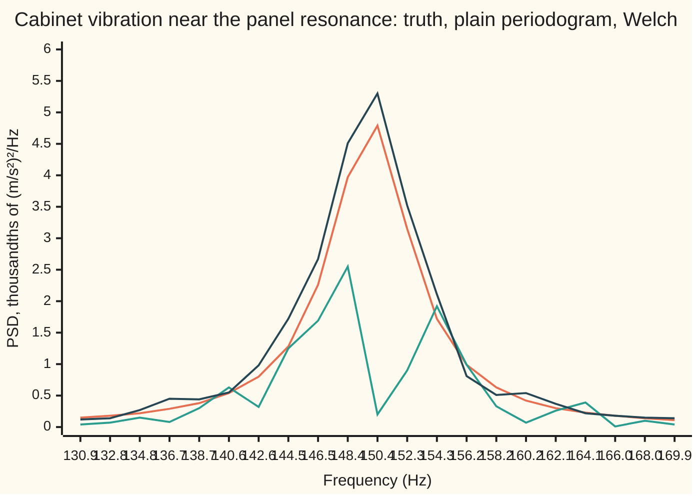
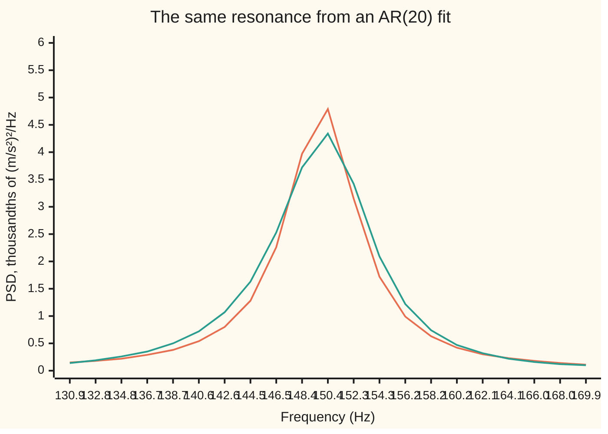

# Spectral estimation: the plain periodogram is noisy, so taper and average

[Syllabus](../../../SYLLABUS.md) → [Engineering mathematics](../README.md) → [Signals](../README.md#s05) → Spectral estimation

---

## General Overview

A washing machine spins its drum at 1200 rpm (revolutions per minute), which is 20 Hz (hertz, cycles per second). An accelerometer bolted to the side panel measures the cabinet's vibration, in m/s², 1000 times a second for 8.192 s: a record of 8192 numbers.

Two things shake the panel. The drum carries an unbalanced load, which pushes the cabinet back and forth at exactly 20 Hz with an amplitude of 0.30 m/s². The tumbling clothes add a random rumble at every frequency. The panel is a thin plate that rings: it has a lightly damped resonance near 150 Hz, so it turns the rumble into a broad hump of vibration centred there.

The test engineer wants two numbers from the record: **where the panel's resonance sits, and how strong the vibration is there**. Strength is measured as a **power spectral density** (PSD): how much of the vibration's mean square falls in each 1 Hz band, in (m/s²)²/Hz.

Here the record is simulated from a model whose true spectrum is known exactly: peak at 149.98 Hz, height 0.004872 (m/s²)²/Hz. So every estimate below can be graded against the truth.

The obvious estimate is the **plain periodogram**: take the Fourier transform of all 8192 samples and square its size ([The DFT and the FFT](02-discrete-fourier-transform-and-the-fft.md)). It has the finest detail possible, one value every 0.122 Hz, and it is badly wrong.

Its highest value near the resonance is 0.029305, six times the truth (6.02). Its value at the frequency closest to 150 Hz is 0.001390, less than a third. Every value scatters by about its own size, and a longer record does not help.

**Welch's method** fixes this. Cut the record into 31 half-overlapping segments of 512 samples each, taper each segment so it fades in and out, and average the 31 periodograms. The peak now reads 0.005305 at 150.39 Hz, 1.09 times the truth, with scatter of about 18 percent. The price is detail: values now come every 1.953 Hz.

An **autoregressive fit** strikes a third bargain. It assumes the record came out of a resonant filter, fits 20 coefficients, and reads 0.004348 at 150.20 Hz from a smooth curve.

**A spectrum estimated from one finite record trades detail against steadiness: each value of the plain periodogram is a single random draw that scatters by its own size however long the record; averaging K tapered segments cuts the scatter by about √K, while the grid coarsens by the ratio of record to segment, and overlapping the segments by half nearly doubles K for the same grid, here 31 segments for a grid 16 times coarser; an autoregressive fit buys a smooth curve by assuming the spectrum's shape.**

**What kind of fact this is:** a set of methods, with theorems about their errors. The exponential scatter of a periodogram value is proved in Why it works for white noise and holds approximately for any smooth spectrum. Welch's scatter formula is an approximation whose 1/√K law is checked here by simulation, though one record is too short to confirm its small overlap term. The autoregressive fit is a model, an assumption about where the data came from.

### The picture: three spectra around the panel's resonance



Orange: the true spectrum. Green: the plain periodogram, shown at every 16th of its values so it shares Welch's frequency grid. Dark blue: Welch's average of 31 segments. At 150.4 Hz the truth is 4.79 thousandths, the plain periodogram reads 0.20 and Welch reads 5.30. The plain periodogram is not blurred; it is ragged, each value a fresh random draw. Welch follows the truth to within its scatter.

---

## The formula

Notation first, in words. The record is $x[n]$, sample number $n$ from 0 to $N-1$, taken $f_s$ times a second ([Sampling](01-sampling-and-the-nyquist-theorem.md)); frequencies $f$ run from 0 to the Nyquist frequency $f_s/2$. As on the rest of this wing, $j$ is the square root of −1 (the rest of the library writes $i$). On its own, $e$ is Euler's number, 2.718…; with a sample number, $e[n]$ is the AR (autoregressive) model's noise.

The **autocovariance** $\gamma(h)$ is the covariance between the signal and itself $h$ samples later ([Stationarity and autocorrelation](../../09-Probability%20and%20statistics/12-Time%20Series/01-stationarity-and-autocorrelation.md)).

The **power spectral density** is the Fourier transform of the autocovariance (the Wiener–Khinchin theorem). Written one-sided, for $0 < f < f_s/2$, as engineers quote it:

$$S(f) = \frac{2}{f_s}\sum_{h=-\infty}^{\infty} \gamma(h)\,e^{-j2\pi f h/f_s}.$$

**Read it aloud:** the spectrum at frequency $f$ is how strongly the signal's memory of itself oscillates at that frequency. The area under $S$ from 0 to $f_s/2$ is the variance, the mean square: for the panel's rumble the check gets 0.04919 (m/s²)² both ways.

A **window** $w[n]$ tapers a segment of $L$ samples; here it is Hann, $w[n] = \tfrac12 - \tfrac12\cos(2\pi n/L)$, a single hump that starts at 0 ([Windows](03-windows-and-spectral-leakage.md)). The **periodogram** of the tapered segment, at the frequencies $f_k = k f_s/L$, is

$$\hat S(f_k) = \frac{2}{f_s\,U}\,\Bigl|\sum_{n=0}^{L-1} w[n]\,x[n]\,e^{-j2\pi kn/L}\Bigr|^2, \qquad U = \sum_{n=0}^{L-1} w[n]^2 .$$

**Read it aloud:** taper the segment, run the DFT (discrete Fourier transform), square the size of each output, and divide by the window's power and the sampling rate so the answer comes out in units per hertz. The plain periodogram is the case $L = N$ with no taper, $w[n] = 1$.

**Welch's estimate** $\bar S$ averages the periodograms of $K$ segments, each starting half a segment after the last. Its scatter, as a fraction of the true value, is about

$$\frac{\text{standard deviation of } \bar S}{S} \approx \sqrt{\frac{1 + 2\rho\,(1 - 1/K)}{K}}, \qquad \rho = \Bigl(\frac{1}{U}\sum_{n=0}^{L/2-1} w[n]\,w[n+L/2]\Bigr)^2 .$$

**Read it aloud:** averaging $K$ segments shrinks the scatter by the square root of $K$, slightly less because neighbouring segments share half their samples, which correlates them by $\rho$.

The **autoregressive (AR) estimate** fits the model $x[n] = a_1x[n-1] + \dots + a_px[n-p] + e[n]$, white noise $e$ of power $E_p$ driving a $p$-pole filter, one that feeds back its last $p$ outputs ([Autoregression](../../09-Probability%20and%20statistics/12-Time%20Series/02-ar-models.md)), and reads off that filter's output spectrum:

$$\hat S_{\text{AR}}(f) = \frac{2E_p/f_s}{\bigl|1 - \sum_{i=1}^{p} a_i\,e^{-j2\pi f i/f_s}\bigr|^2}.$$

**Read it aloud:** a flat noise floor, divided by how much the fitted filter lets each frequency through.

| Symbol | Plain meaning | In our example | Push it up and the answer… |
| --- | --- | --- | --- |
| $x[n]$, $n$, $N$ | the record, sample number, number of samples | cabinet acceleration, 8192 samples | longer $N$: finer grid, not less scatter |
| $f_s$, $f$, $j$ | samples per second; a frequency; the square root of −1 | 1000 Hz; 0 to 500 Hz | — |
| $S(f)$, $\sigma^2$ | true one-sided PSD; the variance of white noise, in Step 2 | peak 0.004872 (m/s²)²/Hz at 149.98 Hz | — |
| $\gamma(h)$, $h$, $c(h)$ | autocovariance at lag $h$ samples; its sample version from the record | true variance $\gamma(0)$ = 0.04919 (m/s²)² | — |
| $w[n]$, $U$, $v(h)$ | the taper; its total power; its overlap with itself shifted by $h$ | Hann; $U$ = 192.0000 at $L$ = 512 | — |
| $L$, $k$, $f_k$ | segment length; bin number; bin frequency $kf_s/L$ | 512 samples; bins 1.953 Hz apart | finer grid, more scatter, less blur |
| $\hat S(f_k)$, $\mathbb{E}$ | periodogram of one segment; average over many repeated records | 0.001390 at the bin nearest 150 Hz (plain) | — |
| $K$, $\bar S$ | number of segments; Welch's average | 31; 0.005305 at 150.39 Hz | scatter falls as $1/\sqrt K$ |
| $\rho$ | correlation between half-overlapped segments' periodograms | 0.0278 | scatter rises a little |
| $p$, $a_i$, $i$, $\kappa_m$, $m$ | AR order; coefficients, numbered by $i$; reflection coefficient at order $m$ | order 20 | more peaks possible, more scatter |
| $e[n]$, $E_p$, $E_m$ | the white noise driving the AR filter; its power at order $p$ or $m$ | 0.002882 (m/s²)² at $p$ = 20 | the whole AR curve scales up |
| $C$, $D$, $\theta_n$, $s$, $t$, $r$ | in Step 2's proof: real and imaginary parts of one DFT value, its angles, their spread, a threshold, a radius | — | — |

### When it holds

- **The record is stationary** (its statistics do not drift over the 8.192 s). The spin speed must be steady. If the drum ramps up during the record, the 20 Hz line smears across every frequency it passed through; a time-varying record needs [Spectrograms](09-short-time-fourier-and-spectrograms.md).
- **A segment is long compared with the features it must resolve.** Welch's grid must be finer than the resonance's half-power width, 6.43 Hz: the band where the true spectrum is at least half its peak. At $L$ = 512 (1.953 Hz bins) the expected reading near 150 Hz is 0.004362, close to the truth. At $L$ = 128 (7.812 Hz bins) the expected reading at the top is 0.002559, about half the true peak (0.53). At $L$ = 64 the highest value, 0.001464, sits at 156.25 Hz: the wrong place, at 0.30 of the true height.
- **The spectrum is roughly flat across one bin**, for the scatter formula. Measured scatter matches it: 0.187 against 0.184 at $L$ = 512. At $L$ = 64 the measured figure, 0.095, runs above the formula's 0.064, because each 15.625 Hz bin also catches leakage from the resonance, a bias that changes from bin to bin.
- **A line is not a density.** The drum's pure tone has power (0.045 (m/s²)², its amplitude squared over two) but no width, so its height on a PSD depends on the bin width. Read its power as the sum over its bins.
- **The AR model needs enough poles.** Each resonance or line needs a pair. An AR(2) fit of this record has one pair for two features and puts the "resonance" at 104.65 Hz, where there is none.

---

## Why it works

### Step 0: one record, half as many unknowns as numbers

A record of $N$ samples gives $N/2$ spectrum values, one per frequency bin. Each periodogram value is built from all $N$ samples, but it is a single number squared from a single complex Fourier coefficient: two random numbers, its real and imaginary parts. A longer record makes more bins; it never puts more data behind any one bin. So the plain periodogram never settles down. Every fix trades away some bins, either by averaging neighbouring information (Welch) or by assuming a shape with few parameters (AR).

### Step 1: the periodogram is the transform of the sample autocovariance

Expand the squared size of the DFT as a double sum over pairs of samples and group the pairs by their gap $h$. What comes out is exact:

$$\hat S_{\text{plain}}(f) = \frac{2}{f_s}\sum_{h=-(N-1)}^{N-1} c(h)\,e^{-j2\pi fh/f_s}, \qquad c(h) = \frac1N\sum_{n=0}^{N-1-h} x[n]\,x[n+h],$$

with $c(-h) = c(h)$ and the record's mean taken as zero.

This is the Wiener–Khinchin formula with the sample autocovariance in place of the true one. The check computes one 512-sample segment both ways, by the FFT (fast Fourier transform, a quick way to compute the DFT) and by this sum, and the largest relative gap over all bins is 5.92e-9 (rounding).

It shows where the noise comes from. Each long lag is an average of only a few products: $c(N-1)$ is a single pair, $x[0]\,x[N-1]$, divided by $N$. The $1/N$ shrinks such lags, but the periodogram adds hundreds of these noisy values into every bin with no further taper.

### Step 2: each periodogram value is an exponential random draw

Take white noise of variance $\sigma^2$ first. The real part of the DFT at bin $k$ is $\sum x[n]\cos(2\pi kn/N)$, a sum of many independent terms, so it is close to normal. So is the imaginary part. They have the same variance, $\sigma^2N/2$, and are uncorrelated. The squared size of two such parts is an **exponential** random variable: its standard deviation equals its mean, and its chance of exceeding $t$ times the mean is $e^{-t}$. The record length $N$ appears in the mean and in the variance and cancels from their ratio.

<details>
<summary>Detailed proof: the moments and the exponential law</summary>

Write $C = \sum_n x[n]\cos\theta_n$ and $D = \sum_n x[n]\sin\theta_n$ with $\theta_n = 2\pi kn/N$ and $0 < k < N/2$. The $x[n]$ are independent with mean 0 and variance $\sigma^2$, so $\operatorname{Var}C = \sigma^2\sum\cos^2\theta_n = \sigma^2N/2$, $\operatorname{Var}D = \sigma^2N/2$, and $\operatorname{Cov}(C, D) = \sigma^2\sum\cos\theta_n\sin\theta_n = \tfrac12\sigma^2\sum\sin 2\theta_n = 0$, since the sines of $2\theta_n$ go round the circle a whole number of times. By the central limit theorem, $C$ and $D$ are jointly normal for large $N$, and being uncorrelated they are independent. With $s^2 = \sigma^2N/2$, the pair $(C, D)$ has density $e^{-(c^2+d^2)/2s^2}/(2\pi s^2)$. In polar form, with $r$ the distance of $(C, D)$ from the origin, the chance that $C^2 + D^2 > t$ is $\int_{\sqrt t}^\infty e^{-r^2/2s^2}\,r\,dr/s^2 = e^{-t/2s^2}$. That is an exponential law with mean $2s^2 = \sigma^2N$; its standard deviation is also $\sigma^2N$. For coloured noise the same holds approximately, with $\sigma^2$ replaced by the spectrum's level near $f_k$, provided the spectrum changes little across a few bins.

</details>

The check tests this on the washing machine. Between 200 and 480 Hz, far from the drum line and the resonance, the plain periodogram divided by the truth has scatter 0.935 (theory 1.000). The share of values above three times the truth is 0.0427, against $e^{-3}$ = 0.0498. The first 2.048 s alone give scatter 0.960: a quarter of the record, the same scatter.

This also explains the sixfold peak. Dozens of bins sit inside the resonance's 6.43 Hz half-power width, each an independent exponential draw. The largest of dozens of such draws is routinely several times their mean. Reading "the highest point" off a plain periodogram reads that largest draw.

### Step 3: averaging segments shrinks the scatter by √K

Cut the record into $K$ segments and average their periodograms. If the segments were independent, the variance of the average would be $1/K$ of one segment's, and the scatter $1/\sqrt K$.

Neighbouring segments that share half their samples are not independent. For noise that is locally white, the correlation of their periodograms at the same bin is $\rho$. To get it, take the window's overlap with itself shifted by half a segment, divide it by the window's power, and square the result. For Hann at 512 samples that overlap is 32.0000 against $U$ = 192.0000, so $\rho = (32/192)^2$ = 0.0278. Each of the $K - 1$ neighbouring pairs adds $2\rho$ to the variance sum:

$$\operatorname{Var}\bar S = \frac{S^2}{K^2}\bigl(K + 2(K-1)\rho\bigr) = \frac{S^2}{K}\Bigl(1 + 2\rho\bigl(1 - \tfrac1K\bigr)\Bigr).$$

The taper fades out the ends of each segment, which would waste data; overlapping by half brings those samples back in the middle of the next segment, for a small cost in $\rho$. The measured scatter follows the formula down the table: 0.385 against 0.387 at $K$ = 7, 0.187 against 0.184 at $K$ = 31, 0.087 against 0.091 at $K$ = 127.

That confirms the $1/\sqrt K$ law, but not the small $\rho$ term. The table's 1/sqrtK column, the formula without $\rho$, reads 0.378, 0.180 and 0.089, and one record measures a scatter too roughly to tell the two apart. The overlap term is derived here, not confirmed by the check.

### Step 4: the taper stops strong features leaking into weak ones

A 512-sample segment is short, so each bin is a wide net. Without a taper, the segment starts and stops abruptly, and its spectral window (the spectrum of the window itself) has side lobes, smaller humps either side of the main one, that fall off slowly ([Windows](03-windows-and-spectral-leakage.md)). The strong drum line at 20 Hz then leaks into its neighbours. At 29.30 Hz, Welch with untapered segments reads 7.01 times the truth; with Hann it reads 0.95 times. The plain periodogram escapes this only because its bins are so narrow that 29.30 Hz lies many side lobes away from the line.

### Step 5: the price is blur, and it can be computed exactly

Take the expected value of a segment's periodogram and use Step 1's sum on the tapered segment. The expected product of samples $h$ apart is $\gamma(h)$, so

$$\mathbb{E}\,\hat S(f_k) = \frac{2}{f_s U}\sum_{h=-(L-1)}^{L-1} \gamma(h)\,v(h)\,e^{-j2\pi kh/L}, \qquad v(h) = \sum_{n=0}^{L-1-|h|} w[n]\,w[n+|h|].$$

Only lags shorter than the segment survive, and the window's self-overlap $v(h)$ tapers the long ones to zero. Those are exactly the badly estimated lags of Step 1. In frequency terms the expected reading is the true spectrum blurred by the window's own power spectrum, a hump about two bins wide. The check computes this expected reading from the model's exact $\gamma(h)$, with no simulation, and confirms each simulated reading lies within three scatters of it.

At $L$ = 512 the blur costs little: expected 0.004362 against a true 0.004792 at 150.39 Hz. At $L$ = 128 the bins are wider than the resonance and the expected reading near the top, 0.002559, is about half the peak. That is the trade: shorter segments, more of them, less scatter, more blur.

### Step 6: an AR fit spends its freedom on a shape instead

An AR model says the record is white noise passed through a filter with $p$ feedback taps. A filter multiplies the power at each frequency by its squared gain, and this filter's gain is $1/|1 - \sum a_i e^{-j2\pi fi/f_s}|$, which gives the formula for $\hat S_{\text{AR}}$. The coefficients come from the Yule–Walker equations: $p$ linear equations that make the model reproduce the record's $c(1)$ to $c(p)$. They use only $c(0)$ to $c(p)$, the short and well-estimated lags ([Autoregression](../../09-Probability%20and%20statistics/12-Time%20Series/02-ar-models.md)). The model then extends the autocovariance to every longer lag by its own recursion, instead of using the noisy sample values.

The equations are solved by the **Levinson–Durbin recursion**, which builds the order-$p$ fit from the order-$(p-1)$ fit in about $p$ steps, so the whole fit takes about $p^2$ operations instead of $p^3$. The check solves the order-20 equations a second way, by Gaussian elimination, and the largest gap between the two sets of coefficients prints as 0.00e-9, below rounding.

<details>
<summary>The Levinson–Durbin step, in full</summary>

Suppose the order-$(m-1)$ coefficients $a_1, \dots, a_{m-1}$ and their prediction-error power $E_{m-1}$ are known, starting from $E_0 = c(0)$. The new coefficient, the **reflection coefficient**, is the part of $c(m)$ the old fit cannot predict, scaled by the old error:

$$\kappa_m = \frac{c(m) - \sum_{i=1}^{m-1} a_i\,c(m-i)}{E_{m-1}}.$$

The old coefficients are corrected by the same fit run backwards in time, $a_i \leftarrow a_i - \kappa_m a_{m-i}$, then $a_m = \kappa_m$, and the error shrinks to $E_m = E_{m-1}(1 - \kappa_m^2)$. The backward correction works because the Yule–Walker matrix has the same entries along every diagonal, so the equations read the same forwards and backwards. Every $\kappa_m$ lies between −1 and 1 when the $c(h)$ come from a record, so $E_m$ never goes negative and the fitted filter is stable.

</details>

The order is the AR version of the segment length. The check fits five orders to the washing-machine record:

| Order $p$ | Noise power $E_p$ | Scatter, 200–480 Hz | Panel peak | Height | Drum line found at |
| --- | --- | --- | --- | --- | --- |
| 2 | 0.016124 | 0.988 | 104.65 Hz | 0.001492 | none |
| 4 | 0.004467 | 0.080 | 151.10 Hz | 0.003573 | none |
| 8 | 0.004018 | 0.199 | 150.60 Hz | 0.008458 | none: a broad hump, top at 10.15 Hz |
| 20 | 0.002882 | 0.109 | 150.20 Hz | 0.004348 | 20.15 Hz |
| 53 | 0.002638 | 0.134 | 149.90 Hz | 0.006277 | 20.00 Hz |

Too few poles and the fit cannot place both features: AR(2) invents a peak at 104.65 Hz, AR(4) smooths the drum line away.

AR(8) still has too few to make the line sharp. It smears the drum into a broad hump whose top, at 10.15 Hz, is only 1.02 times the curve's level at 5 Hz. The code's top/5 Hz column prints this ratio; AR(20)'s top at 20.15 Hz is 1489.36 times its level at 5 Hz. AR(8) also overshoots the panel peak, 0.008458 against the true 0.004872.

Too many poles and the curve starts to chase the noise: AR(53) overshoots to 0.006277. Order 53 is what the standard order rule, Akaike's information criterion (AIC: $N$ times the log of $E_p$, plus a penalty of 2 per coefficient), picks. A pure tone is an infinitely sharp resonance, and the criterion keeps adding poles to sharpen it.

AR(20) reads 0.89 of the true peak at 150.20 Hz and finds the drum at 20.15 Hz.

When the model is right, AR is hard to beat. Fitted to the panel's rumble alone, AR(2) returns $a_1$ = 1.1558 and $a_2$ = −0.9628 against the true 1.1521 and −0.9604, with standard error 0.0031.



Orange: the true spectrum. Green: the AR(20) estimate, from 20 fitted coefficients and one noise power. It is smooth everywhere, with no scatter to average away, and slightly too low and broad at the top.

---

## Worked numbers, by hand

The washing machine: $f_s$ = 1000 Hz, $N$ = 8192 samples, Hann segments of $L$ = 512 samples, each starting half a segment after the last.

| Step | Arithmetic | Value |
| --- | --- | --- |
| plain periodogram's bin width | 1000 / 8192 | 0.122 Hz |
| plain periodogram's scatter | one exponential draw per bin | 1.000 (measured 0.935) |
| Welch's bin width | 1000 / 512 | 1.953 Hz |
| number of segments $K$ | (8192 − 512) / (512 / 2) + 1 | 31 |
| overlap correlation $\rho$ | (32.0000 / 192.0000)² | 0.0278 |
| Welch's scatter | √((1 + 2 × 0.0278 × (1 − 1/31)) / 31) | 0.184 (measured 0.187) |
| expected reading near the peak | Step 5's sum at 150.39 Hz | 0.004362 |
| true value there | the model | 0.004792 |
| **Welch's reading** | highest of the 31-segment average, 100–200 Hz | **0.005305 (m/s²)²/Hz at 150.39 Hz** |

So the panel resonates at 150 Hz, give or take one 1.953 Hz bin, with a vibration density of about 0.0053 (m/s²)²/Hz, uncertain by about ±18 percent (one scatter). That is the figure a vibration specification is checked against. The plain periodogram would have reported 0.029305 at 151.12 Hz, six times the truth, and could fail a machine that meets its limit.

### What breaks if you drop a piece

| Mistake | Comes out at | What went wrong |
| --- | --- | --- |
| Read the highest value of the plain periodogram | 0.029305 at 151.12 Hz, 6.02 times the true peak | The largest of dozens of exponential draws, not the spectrum |
| Record a longer spin to steady the periodogram | scatter 0.960 from 2.048 s, 0.935 from 8.192 s | More bins, not more data per bin |
| Average segments without a taper | 7.01 times the truth at 29.30 Hz | The drum line leaks through the untapered segments' side lobes |
| Cut the segments too short, $L$ = 64 | highest value 0.001464 at 156.25 Hz, 0.30 of the true peak | The 15.625 Hz blur is wider than the 6.43 Hz resonance |
| Fit an AR(2) to a record with two features | a peak at 104.65 Hz; scatter 0.988 against the truth | One pole pair placed between the drum line and the resonance |

---

## Code, from first principles, and it actually runs

The script simulates the record (the panel as an AR(2) resonance driven by noise, plus the drum's sine), writes its own FFT, and estimates the spectrum three ways: plain periodogram, Welch at four segment lengths, and AR fits by Levinson–Durbin. It checks along **four independent roads**:

1. The FFT periodogram is matched against the transform of the sample autocovariance.
2. The measured scatter is matched against Welch's formula, and the share of plain-periodogram values above three times the truth against $e^{-3}$.
3. Every simulated reading near 150 Hz is matched against its expected value, computed from the model's exact autocovariance with no simulation.
4. The AR coefficients from Levinson–Durbin are matched against a direct linear solve, and an AR(2) fit to the rumble alone against the true coefficients.

The true spectrum itself is checked by its area, which must equal the variance formula.

### Python

```python
# Spectral estimation: the plain periodogram, Welch's average and an AR fit, on a
# washing machine's cabinet vibration.  Standard library only: the random numbers,
# the FFT, the Levinson-Durbin recursion and the linear solve are all written out.
import math
FS, N, F0, R, SIG, A, FD = 1000.0, 8192, 150.0, 0.98, 0.05, 0.30, 20.0  # Hz, samples, Hz, -, m/s^2, m/s^2, Hz
A1, A2 = 2 * R * math.cos(2 * math.pi * F0 / FS), -R * R                 # the panel: an AR(2) resonance
st = [2026]
def unif():                                     # SplitMix64, seed 2026
    st[0] = (st[0] + 0x9E3779B97F4A7C15) & (2**64 - 1); z = st[0]
    z = ((z ^ (z >> 30)) * 0xBF58476D1CE4E5B9) & (2**64 - 1); z = ((z ^ (z >> 27)) * 0x94D049BB133111EB) & (2**64 - 1)
    return ((z ^ (z >> 31)) >> 11) / 9007199254740992.0
def gauss():                                    # Box-Muller, one normal draw per pair of uniforms
    u1 = unif(); u2 = unif(); return math.sqrt(-2.0 * math.log(1.0 - u1)) * math.cos(2.0 * math.pi * u2)
def tot(v):                                     # plain left-to-right sum, the same order as the Rust
    s = 0.0
    for q in v: s += q
    return s
def fft(re, im):                                # radix-2, in place
    n = len(re); j = 0
    for i in range(1, n):
        b = n >> 1
        while j & b: j ^= b; b >>= 1
        j |= b
        if i < j: re[i], re[j], im[i], im[j] = re[j], re[i], im[j], im[i]
    L = 2
    while L <= n:
        for k in range(L // 2):
            c, s = math.cos(-2.0 * math.pi * k / L), math.sin(-2.0 * math.pi * k / L)
            for p in range(k, n, L):
                q = p + L // 2; tr = re[q] * c - im[q] * s; ti = re[q] * s + im[q] * c
                re[q] = re[p] - tr; im[q] = im[p] - ti; re[p] += tr; im[p] += ti
        L *= 2
def inv_gain2(a, f):                            # |1 - sum a_k e^{-j 2 pi f k / fs}|^2
    re, im = 1.0, 0.0
    for k in range(len(a)):
        w = 2.0 * math.pi * f * (k + 1) / FS; re -= a[k] * math.cos(w); im += a[k] * math.sin(w)
    return re * re + im * im
def s_true(f): return 2.0 * SIG * SIG / (FS * inv_gain2([A1, A2], f))     # one-sided, (m/s^2)^2/Hz
def ar_psd(a, e, f): return 2.0 * e / (FS * inv_gain2(a, f))
def hann(L, on=True): return [0.5 - 0.5 * math.cos(2.0 * math.pi * n / L) if on else 1.0 for n in range(L)]
def welch(x, L, on=True):                       # average of tapered periodograms, segments every L/2 samples
    w = hann(L, on); U = tot(v * v for v in w); acc = [0.0] * (L // 2 + 1); K = 0
    for s0 in range(0, len(x) - L + 1, max(L // 2, 1) if L < len(x) else L):
        re = [w[n] * x[s0 + n] for n in range(L)]; im = [0.0] * L; fft(re, im)
        for k in range(L // 2 + 1): acc[k] += 2.0 * (re[k] * re[k] + im[k] * im[k]) / (FS * U)
        K += 1
    return [v / K for v in acc], K
def acov(x, p):                                 # sample autocovariance, divided by n
    m = tot(x) / len(x); d = [v - m for v in x]
    return [tot(d[t] * d[t + h] for t in range(len(d) - h)) / len(d) for h in range(p + 1)]
def levinson(c, p):                             # Yule-Walker, grown one order at a time
    a, e = [], c[0]
    for k in range(1, p + 1):
        kk = (c[k] - tot(a[i] * c[k - 1 - i] for i in range(k - 1))) / e
        a = [a[i] - kk * a[k - 2 - i] for i in range(k - 1)] + [kk]; e *= 1.0 - kk * kk
    return a, e
def solve(M, b):                                # Gaussian elimination with partial pivoting
    n = len(b); M = [row[:] + [b[i]] for i, row in enumerate(M)]
    for i in range(n):
        piv = max(range(i, n), key=lambda r: abs(M[r][i])); M[i], M[piv] = M[piv], M[i]
        for r in range(i + 1, n):
            f = M[r][i] / M[i][i]; M[r] = [M[r][c] - f * M[i][c] for c in range(n + 1)]
    out = [0.0] * n
    for i in range(n - 1, -1, -1): out[i] = (M[i][n] - tot(M[i][c] * out[c] for c in range(i + 1, n))) / M[i][i]
    return out
# ---- the record: 8.192 s of cabinet vibration on a 1200 rpm spin ----
y1 = y2 = 0.0; noise = []
for t in range(N + 1000):                       # 1000 samples of run-in are thrown away
    v = A1 * y1 + A2 * y2 + SIG * gauss(); y2, y1 = y1, v
    if t >= 1000: noise.append(v)
x = [noise[t] + A * math.sin(2.0 * math.pi * FD * t / FS) for t in range(N)]
g = [SIG * SIG * (1 - A2) / ((1 + A2) * ((1 - A2) * (1 - A2) - A1 * A1))]       # true autocovariance of the panel
g.append(A1 * g[0] / (1 - A2))
for h in range(2, N): g.append(A1 * g[h - 1] + A2 * g[h - 2])
gx = [g[h] + 0.5 * A * A * math.cos(2.0 * math.pi * FD * h / FS) for h in range(N)]   # plus the drum line
parseval = tot(s_true(k * 0.01) * 0.01 for k in range(1, 50000)) + 0.5 * 0.01 * (s_true(0.0) + s_true(500.0))
fpk = max((140 + 0.001 * i for i in range(20001)), key=s_true); half = [f for f in (140 + 0.001 * i for i in range(20001)) if s_true(f) >= s_true(fpk) / 2]
print(f"setup: fs {FS:.0f} Hz, N {N}, record {N / FS:.3f} s, drum {FD:.0f} Hz ({60 * FD:.0f} rpm) amplitude {A:.2f} m/s^2")
print(f"panel variance: formula {g[0]:.5f}, area under S {parseval:.5f}, sample {tot(v * v for v in noise) / N:.5f} (m/s^2)^2")
print(f"true peak {fpk:.2f} Hz, S {s_true(fpk):.6f} (m/s^2)^2/Hz, half-power width {half[-1] - half[0]:.2f} Hz")
seg = x[:512]; P1, _ = welch(seg, 512, False); c1 = [tot(seg[t] * seg[t + h] for t in range(512 - h)) / 512 for h in range(512)]
wk = max(abs(2.0 / FS * (c1[0] + 2 * tot(c1[h] * math.cos(2 * math.pi * k * h / 512) for h in range(1, 512))) - P1[k]) / P1[k] for k in range(1, 256))
print(f"Wiener-Khinchin: FFT periodogram vs transform of c(h), largest relative gap {wk * 1e9:.2f}e-9")
w = hann(512); ov, U5 = tot(w[n] * w[n + 256] for n in range(256)), tot(v * v for v in w); rho = (ov / U5) * (ov / U5)
print(f"overlap correlation of half-overlapped Hann segments: rho = ({ov:.4f} / {U5:.4f})^2 = {rho:.4f}")
print("   L    K  bin Hz  scatter  formula 1/sqrtK  S near 150  E[read]   read  highest 100-200 Hz")
res, pk = {}, {}
for L, on in ((N, False), (2048, True), (512, True), (128, True), (64, True)):
    P, K = welch(x, L, on); df = FS / L; res[L] = P
    r = [P[k] / s_true(k * df) for k in range(len(P)) if 200 <= k * df <= 480]
    m = tot(r) / len(r); sd = math.sqrt(tot((q - m) * (q - m) for q in r) / len(r))
    sdf = 1.0 if K == 1 else math.sqrt((1 + 2 * rho * (1 - 1 / K)) / K)
    wn = hann(L, on); U = tot(v * v for v in wn); k0 = round(150 / df)
    vh = (lambda h: tot(wn[n] * wn[n + h] for n in range(L - h))) if on else (lambda h: float(L - h))   # window overlap
    ev = 2.0 / (FS * U) * (gx[0] * U + 2.0 * tot(gx[h] * math.cos(2.0 * math.pi * k0 * h / L) * vh(h) for h in range(1, L)))
    kh = max((k for k in range(len(P)) if 100 <= k * df <= 200), key=lambda k: P[k])
    print(f"{L:>4} {K:>4} {df:7.3f} {sd:8.3f} {sdf:8.3f} {1 / math.sqrt(K):7.3f} {s_true(k0 * df):11.6f} {ev:8.6f} {P[k0]:8.6f} {P[kh]:9.6f} at {kh * df:6.2f}")
    assert abs(sd - sdf) < 3 * sdf * math.sqrt(2 / len(r)), "scatter must match the Welch variance formula"
    assert abs(P[k0] - ev) < 3 * sdf * ev, "reading near 150 Hz within 3 sd of its expected value"
    pk[L] = (P[kh], ev)
    if L == N: share = len([q for q in r if q > 3]) / len(r); nb = len(r)
print(f"plain periodogram: share of bins over 3x the truth {share:.4f}, exponential law e^-3 = {math.exp(-3):.4f}")
assert abs(share - math.exp(-3)) < 3 * math.sqrt(math.exp(-3) * (1 - math.exp(-3)) / nb), "periodogram bins follow the exponential law"
P2, _ = welch(x[:2048], 2048, False); r2 = [P2[k] / s_true(k * FS / 2048) for k in range(1025) if 200 <= k * FS / 2048 <= 480]
m2 = tot(r2) / len(r2); print(f"plain periodogram of the first 2.048 s: scatter {math.sqrt(tot((q - m2) * (q - m2) for q in r2) / len(r2)):.3f}")
Pr, _ = welch(x, 512, False); k30 = 15
print(f"Welch L=512 at {k30 * FS / 512:.2f} Hz: rectangular {Pr[k30] / s_true(k30 * FS / 512):.2f}x truth, Hann {res[512][k30] / s_true(k30 * FS / 512):.2f}x truth")
for L in (512, 2048):
    df = FS / L; tp = tot(res[L][k] * df for k in range(len(res[L])) if 15 <= k * df <= 25)
    print(f"drum line, L={L}: peak height {res[L][round(FD / df)]:.5f} (m/s^2)^2/Hz, summed power {tp:.5f} (m/s^2)^2, true {A * A / 2:.5f}")
    assert abs(tp - A * A / 2) < 0.02 * A * A / 2, "the line's power is the sum over its bins"
c = acov(x, 60); aic = min(range(1, 61), key=lambda p: N * math.log(levinson(c, p)[1]) + 2 * p); grid = [100 + 0.05 * i for i in range(2001)]
print(f"AR order  E_p       scatter  panel peak Hz  S at peak   top 5-60 Hz  top/5 Hz   (AIC picks order {aic})")
for p in (2, 4, 8, 20, aic):
    a, e = levinson(c, p); fp = max(grid, key=lambda f: ar_psd(a, e, f))
    fl = max((5 + 0.05 * i for i in range(1101)), key=lambda f: ar_psd(a, e, f))
    ra = [ar_psd(a, e, f) / s_true(f) for f in range(200, 481)]; ma = tot(ra) / len(ra)
    lo = f"{fl:12.2f} {ar_psd(a, e, fl) / ar_psd(a, e, 5.0):9.2f}" if 5 < fl < 60 else "        none"
    print(f"{p:>8} {e:.6f} {math.sqrt(tot((q - ma) * (q - ma) for q in ra) / len(ra)):8.3f} {fp:14.2f} {ar_psd(a, e, fp):10.6f} {lo}")
    if p == 20: a20, e20, ar20 = a, e, ar_psd(a, e, fp)
yw = solve([[c[abs(i - k)] for k in range(20)] for i in range(20)], c[1:21])
print(f"AR(20): Levinson vs direct Yule-Walker solve, largest gap {max(abs(u - v) for u, v in zip(a20, yw)) * 1e9:.2f}e-9")
assert max(abs(u - v) for u, v in zip(a20, yw)) < 1e-9, "two roads to the AR coefficients"
an, en = levinson(acov(noise, 2), 2); se = math.sqrt((1 - A2 * A2) / N)
print(f"AR(2) on the panel alone: a1 {an[0]:.4f} (true {A1:.4f}), a2 {an[1]:.4f} (true {A2:.4f}), E {en:.6f} (true {SIG * SIG:.6f}), se {se:.4f}")
assert abs(an[0] - A1) < 3 * se and abs(an[1] - A2) < 3 * se, "AR(2) fit recovers the panel"
assert abs(parseval - g[0]) < 1e-4 * g[0], "area under the true spectrum is the variance"
assert wk < 1e-7, "periodogram equals the transform of the sample autocovariance"
T = s_true(fpk); print(f"over the true peak: plain highest {pk[N][0] / T:.2f}, Welch512 highest {pk[512][0] / T:.2f}, AR(20) {ar20 / T:.2f}, "
                      f"L=128 expected {pk[128][1] / T:.2f}, L=64 highest {pk[64][0] / T:.2f}")
ks = range(67, 88)
print("chart Hz " + " ".join(f"{k * FS / 512:6.1f}" for k in ks))
print("true     " + " ".join(f"{1000 * s_true(k * FS / 512):6.2f}" for k in ks))
print("plain    " + " ".join(f"{1000 * res[N][16 * k]:6.2f}" for k in ks))
print("Welch512 " + " ".join(f"{1000 * res[512][k]:6.2f}" for k in ks))
print("AR(20)   " + " ".join(f"{1000 * ar_psd(a20, e20, k * FS / 512):6.2f}" for k in ks))
print("ALL CHECKS PASS")
```

**Ran 2026-11-11 on macOS, Python 3.14.10, standard library only. All checks passed. Output, pasted from the run:**

```
setup: fs 1000 Hz, N 8192, record 8.192 s, drum 20 Hz (1200 rpm) amplitude 0.30 m/s^2
panel variance: formula 0.04919, area under S 0.04919, sample 0.05194 (m/s^2)^2
true peak 149.98 Hz, S 0.004872 (m/s^2)^2/Hz, half-power width 6.43 Hz
Wiener-Khinchin: FFT periodogram vs transform of c(h), largest relative gap 5.92e-9
overlap correlation of half-overlapped Hann segments: rho = (32.0000 / 192.0000)^2 = 0.0278
   L    K  bin Hz  scatter  formula 1/sqrtK  S near 150  E[read]   read  highest 100-200 Hz
8192    1   0.122    0.935    1.000   1.000    0.004870 0.004841 0.001390  0.029305 at 151.12
2048    7   0.488    0.385    0.387   0.378    0.004869 0.004832 0.004783  0.008422 at 149.41
 512   31   1.953    0.187    0.184   0.180    0.004792 0.004362 0.005305  0.005305 at 150.39
 128  127   7.812    0.087    0.091   0.089    0.003969 0.002559 0.002787  0.002787 at 148.44
  64  255  15.625    0.095    0.064   0.063    0.000991 0.001382 0.001464  0.001464 at 156.25
plain periodogram: share of bins over 3x the truth 0.0427, exponential law e^-3 = 0.0498
plain periodogram of the first 2.048 s: scatter 0.960
Welch L=512 at 29.30 Hz: rectangular 7.01x truth, Hann 0.95x truth
drum line, L=512: peak height 0.01441 (m/s^2)^2/Hz, summed power 0.04546 (m/s^2)^2, true 0.04500
drum line, L=2048: peak height 0.06187 (m/s^2)^2/Hz, summed power 0.04551 (m/s^2)^2, true 0.04500
AR order  E_p       scatter  panel peak Hz  S at peak   top 5-60 Hz  top/5 Hz   (AIC picks order 53)
       2 0.016124    0.988         104.65   0.001492         none
       4 0.004467    0.080         151.10   0.003573         none
       8 0.004018    0.199         150.60   0.008458        10.15      1.02
      20 0.002882    0.109         150.20   0.004348        20.15   1489.36
      53 0.002638    0.134         149.90   0.006277        20.00  49139.08
AR(20): Levinson vs direct Yule-Walker solve, largest gap 0.00e-9
AR(2) on the panel alone: a1 1.1558 (true 1.1521), a2 -0.9628 (true -0.9604), E 0.002476 (true 0.002500), se 0.0031
over the true peak: plain highest 6.02, Welch512 highest 1.09, AR(20) 0.89, L=128 expected 0.53, L=64 highest 0.30
chart Hz  130.9  132.8  134.8  136.7  138.7  140.6  142.6  144.5  146.5  148.4  150.4  152.3  154.3  156.2  158.2  160.2  162.1  164.1  166.0  168.0  169.9
true       0.15   0.18   0.22   0.29   0.38   0.54   0.80   1.28   2.26   3.97   4.79   3.15   1.72   0.99   0.63   0.42   0.30   0.23   0.18   0.14   0.11
plain      0.04   0.07   0.15   0.08   0.30   0.63   0.32   1.25   1.69   2.55   0.20   0.90   1.92   0.99   0.33   0.07   0.26   0.39   0.01   0.10   0.04
Welch512   0.12   0.14   0.27   0.45   0.44   0.55   0.98   1.72   2.67   4.51   5.30   3.52   2.11   0.81   0.51   0.54   0.37   0.22   0.18   0.15   0.14
AR(20)     0.14   0.19   0.26   0.35   0.50   0.72   1.07   1.63   2.53   3.72   4.34   3.42   2.09   1.22   0.74   0.47   0.32   0.22   0.16   0.12   0.10
ALL CHECKS PASS
```

### Rust

The same random numbers, FFT and recursions, in the same order, so the output matches line for line. Built with `rustc --edition 2021 -O`.

```rust
// Spectral estimation: the plain periodogram, Welch's average and an AR fit, on a
// washing machine's cabinet vibration.  Rust std only: the same random numbers, FFT,
// Levinson-Durbin recursion and linear solve as the Python, in the same order.
use std::f64::consts::PI;
const FS: f64 = 1000.0; const N: usize = 8192; const F0: f64 = 150.0; const R: f64 = 0.98;
const SIG: f64 = 0.05; const A: f64 = 0.30; const FD: f64 = 20.0;
struct Rng(u64);
impl Rng {
    fn unif(&mut self) -> f64 {                                  // SplitMix64, seed 2026
        self.0 = self.0.wrapping_add(0x9E3779B97F4A7C15); let mut z = self.0;
        z = (z ^ (z >> 30)).wrapping_mul(0xBF58476D1CE4E5B9); z = (z ^ (z >> 27)).wrapping_mul(0x94D049BB133111EB);
        ((z ^ (z >> 31)) >> 11) as f64 / 9007199254740992.0
    }
    fn gauss(&mut self) -> f64 { let u1 = self.unif(); let u2 = self.unif(); (-2.0 * (1.0 - u1).ln()).sqrt() * (2.0 * PI * u2).cos() }
}
fn tot<I: Iterator<Item = f64>>(v: I) -> f64 { let mut s = 0.0; for q in v { s += q; } s }
fn argmax(v: &[f64], f: impl Fn(f64) -> f64) -> f64 { let mut b = v[0]; for &q in v { if f(q) > f(b) { b = q; } } b }
fn fft(re: &mut [f64], im: &mut [f64]) {                         // radix-2, in place
    let n = re.len(); let mut j = 0;
    for i in 1..n {
        let mut b = n >> 1;
        while j & b != 0 { j ^= b; b >>= 1; }
        j |= b;
        if i < j { re.swap(i, j); im.swap(i, j); }
    }
    let mut l = 2;
    while l <= n {
        for k in 0..l / 2 {
            let (c, s) = ((-2.0 * PI * k as f64 / l as f64).cos(), (-2.0 * PI * k as f64 / l as f64).sin());
            let mut p = k;
            while p < n {
                let q = p + l / 2; let tr = re[q] * c - im[q] * s; let ti = re[q] * s + im[q] * c;
                re[q] = re[p] - tr; im[q] = im[p] - ti; re[p] += tr; im[p] += ti; p += l;
            }
        }
        l *= 2;
    }
}
fn inv_gain2(a: &[f64], f: f64) -> f64 {
    let (mut re, mut im) = (1.0, 0.0);
    for k in 0..a.len() { let w = 2.0 * PI * f * (k + 1) as f64 / FS; re -= a[k] * w.cos(); im += a[k] * w.sin(); }
    re * re + im * im
}
fn a12() -> [f64; 2] { [2.0 * R * (2.0 * PI * F0 / FS).cos(), -R * R] }
fn s_true(f: f64) -> f64 { 2.0 * SIG * SIG / (FS * inv_gain2(&a12(), f)) }
fn ar_psd(a: &[f64], e: f64, f: f64) -> f64 { 2.0 * e / (FS * inv_gain2(a, f)) }
fn hann(l: usize, on: bool) -> Vec<f64> { (0..l).map(|n| if on { 0.5 - 0.5 * (2.0 * PI * n as f64 / l as f64).cos() } else { 1.0 }).collect() }
fn welch(x: &[f64], l: usize, on: bool) -> (Vec<f64>, usize) {
    let w = hann(l, on); let u = tot(w.iter().map(|v| v * v)); let mut acc = vec![0.0; l / 2 + 1]; let mut kk = 0;
    let step = if l < x.len() { (l / 2).max(1) } else { l };
    let mut s0 = 0;
    while s0 + l <= x.len() {
        let mut re: Vec<f64> = (0..l).map(|n| w[n] * x[s0 + n]).collect(); let mut im = vec![0.0; l]; fft(&mut re, &mut im);
        for k in 0..l / 2 + 1 { acc[k] += 2.0 * (re[k] * re[k] + im[k] * im[k]) / (FS * u); }
        kk += 1; s0 += step;
    }
    (acc.iter().map(|v| v / kk as f64).collect(), kk)
}
fn acov(x: &[f64], p: usize) -> Vec<f64> {
    let m = tot(x.iter().cloned()) / x.len() as f64; let d: Vec<f64> = x.iter().map(|v| v - m).collect();
    (0..=p).map(|h| tot((0..d.len() - h).map(|t| d[t] * d[t + h])) / d.len() as f64).collect()
}
fn levinson(c: &[f64], p: usize) -> (Vec<f64>, f64) {
    let (mut a, mut e): (Vec<f64>, f64) = (vec![], c[0]);
    for k in 1..=p {
        let kk = (c[k] - tot((0..k - 1).map(|i| a[i] * c[k - 1 - i]))) / e;
        let mut b: Vec<f64> = (0..k - 1).map(|i| a[i] - kk * a[k - 2 - i]).collect(); b.push(kk); a = b; e *= 1.0 - kk * kk;
    }
    (a, e)
}
fn solve(m0: &[Vec<f64>], b: &[f64]) -> Vec<f64> {
    let n = b.len(); let mut m: Vec<Vec<f64>> = m0.iter().enumerate().map(|(i, r)| { let mut r = r.clone(); r.push(b[i]); r }).collect();
    for i in 0..n {
        let mut piv = i; for r in i..n { if m[r][i].abs() > m[piv][i].abs() { piv = r; } } m.swap(i, piv);
        for r in i + 1..n { let f = m[r][i] / m[i][i]; for c in 0..n + 1 { m[r][c] = m[r][c] - f * m[i][c]; } }
    }
    let mut out = vec![0.0; n];
    for i in (0..n).rev() { out[i] = (m[i][n] - tot((i + 1..n).map(|c| m[i][c] * out[c]))) / m[i][i]; }
    out
}
fn spread(r: &[f64]) -> f64 { let m = tot(r.iter().cloned()) / r.len() as f64; (tot(r.iter().map(|q| (q - m) * (q - m))) / r.len() as f64).sqrt() }
fn main() {
    let [a1, a2] = a12(); let mut rng = Rng(2026); let (mut y1, mut y2) = (0.0, 0.0); let mut noise = vec![];
    for t in 0..N + 1000 { let v = a1 * y1 + a2 * y2 + SIG * rng.gauss(); y2 = y1; y1 = v; if t >= 1000 { noise.push(v); } }
    let x: Vec<f64> = (0..N).map(|t| noise[t] + A * (2.0 * PI * FD * t as f64 / FS).sin()).collect();
    let mut g = vec![SIG * SIG * (1.0 - a2) / ((1.0 + a2) * ((1.0 - a2) * (1.0 - a2) - a1 * a1))];
    g.push(a1 * g[0] / (1.0 - a2));
    for h in 2..N { let v = a1 * g[h - 1] + a2 * g[h - 2]; g.push(v); }
    let gx: Vec<f64> = (0..N).map(|h| g[h] + 0.5 * A * A * (2.0 * PI * FD * h as f64 / FS).cos()).collect();
    let parseval = tot((1..50000).map(|k| s_true(k as f64 * 0.01) * 0.01)) + 0.5 * 0.01 * (s_true(0.0) + s_true(500.0));
    let fine: Vec<f64> = (0..20001).map(|i| 140.0 + 0.001 * i as f64).collect(); let fpk = argmax(&fine, s_true);
    let half: Vec<f64> = fine.iter().cloned().filter(|&f| s_true(f) >= s_true(fpk) / 2.0).collect();
    println!("setup: fs {:.0} Hz, N {}, record {:.3} s, drum {:.0} Hz ({:.0} rpm) amplitude {:.2} m/s^2", FS, N, N as f64 / FS, FD, 60.0 * FD, A);
    println!("panel variance: formula {:.5}, area under S {:.5}, sample {:.5} (m/s^2)^2", g[0], parseval, tot(noise.iter().map(|v| v * v)) / N as f64);
    println!("true peak {:.2} Hz, S {:.6} (m/s^2)^2/Hz, half-power width {:.2} Hz", fpk, s_true(fpk), half[half.len() - 1] - half[0]);
    let seg = &x[..512]; let (p1, _) = welch(seg, 512, false);
    let c1: Vec<f64> = (0..512).map(|h| tot((0..512 - h).map(|t| seg[t] * seg[t + h])) / 512.0).collect();
    let mut wk: f64 = 0.0;
    for k in 1..256 { let s = 2.0 / FS * (c1[0] + 2.0 * tot((1..512).map(|h| c1[h] * (2.0 * PI * k as f64 * h as f64 / 512.0).cos()))); wk = wk.max((s - p1[k]).abs() / p1[k]); }
    println!("Wiener-Khinchin: FFT periodogram vs transform of c(h), largest relative gap {:.2}e-9", wk * 1e9);
    let w = hann(512, true); let (ov, u5) = (tot((0..256).map(|n| w[n] * w[n + 256])), tot(w.iter().map(|v| v * v))); let rho = (ov / u5) * (ov / u5);
    println!("overlap correlation of half-overlapped Hann segments: rho = ({:.4} / {:.4})^2 = {:.4}", ov, u5, rho);
    println!("   L    K  bin Hz  scatter  formula 1/sqrtK  S near 150  E[read]   read  highest 100-200 Hz");
    let mut res: Vec<(usize, Vec<f64>)> = vec![]; let mut pk: Vec<(f64, f64)> = vec![]; let (mut share, mut nb) = (0.0, 0.0);
    for (l, on) in [(N, false), (2048, true), (512, true), (128, true), (64, true)] {
        let (p, kseg) = welch(&x, l, on); let df = FS / l as f64;
        let r: Vec<f64> = (0..p.len()).filter(|&k| 200.0 <= k as f64 * df && k as f64 * df <= 480.0).map(|k| p[k] / s_true(k as f64 * df)).collect();
        let sd = spread(&r); let kf = kseg as f64;
        let sdf = if kseg == 1 { 1.0 } else { ((1.0 + 2.0 * rho * (1.0 - 1.0 / kf)) / kf).sqrt() };
        let wn = hann(l, on); let u = tot(wn.iter().map(|v| v * v)); let k0 = (150.0 / df).round() as usize;
        let vh = |h: usize| if on { tot((0..l - h).map(|n| wn[n] * wn[n + h])) } else { (l - h) as f64 };
        let ev = 2.0 / (FS * u) * (gx[0] * u + 2.0 * tot((1..l).map(|h| gx[h] * (2.0 * PI * k0 as f64 * h as f64 / l as f64).cos() * vh(h))));
        let mut kh = 0; let mut best = f64::MIN;
        for k in 0..p.len() { let f = k as f64 * df; if 100.0 <= f && f <= 200.0 && p[k] > best { best = p[k]; kh = k; } }
        println!("{:>4} {:>4} {:7.3} {:8.3} {:8.3} {:7.3} {:11.6} {:8.6} {:8.6} {:9.6} at {:6.2}", l, kseg, df, sd, sdf, 1.0 / kf.sqrt(), s_true(k0 as f64 * df), ev, p[k0], p[kh], kh as f64 * df);
        assert!((sd - sdf).abs() < 3.0 * sdf * (2.0 / r.len() as f64).sqrt(), "scatter must match the Welch variance formula");
        assert!((p[k0] - ev).abs() < 3.0 * sdf * ev, "reading near 150 Hz within 3 sd of its expected value");
        if l == N { share = r.iter().filter(|&&q| q > 3.0).count() as f64 / r.len() as f64; nb = r.len() as f64; }
        pk.push((p[kh], ev)); res.push((l, p));
    }
    let e3 = (-3.0f64).exp();
    println!("plain periodogram: share of bins over 3x the truth {:.4}, exponential law e^-3 = {:.4}", share, e3);
    assert!((share - e3).abs() < 3.0 * (e3 * (1.0 - e3) / nb).sqrt(), "periodogram bins follow the exponential law");
    let (p2, _) = welch(&x[..2048], 2048, false);
    let r2: Vec<f64> = (0..1025).filter(|&k| 200.0 <= k as f64 * FS / 2048.0 && k as f64 * FS / 2048.0 <= 480.0).map(|k| p2[k] / s_true(k as f64 * FS / 2048.0)).collect();
    println!("plain periodogram of the first 2.048 s: scatter {:.3}", spread(&r2));
    let get = |l: usize| &res.iter().find(|e| e.0 == l).unwrap().1;
    let (pr, _) = welch(&x, 512, false); let k30 = 15; let f30 = k30 as f64 * FS / 512.0;
    println!("Welch L=512 at {:.2} Hz: rectangular {:.2}x truth, Hann {:.2}x truth", f30, pr[k30] / s_true(f30), get(512)[k30] / s_true(f30));
    for l in [512usize, 2048] {
        let df = FS / l as f64; let p = get(l); let tp = tot((0..p.len()).filter(|&k| 15.0 <= k as f64 * df && k as f64 * df <= 25.0).map(|k| p[k] * df));
        println!("drum line, L={}: peak height {:.5} (m/s^2)^2/Hz, summed power {:.5} (m/s^2)^2, true {:.5}", l, p[(FD / df).round() as usize], tp, A * A / 2.0);
        assert!((tp - A * A / 2.0).abs() < 0.02 * A * A / 2.0, "the line's power is the sum over its bins");
    }
    let c = acov(&x, 60); let mut aic = 1;
    let crit = |p: usize| N as f64 * levinson(&c, p).1.ln() + 2.0 * p as f64;
    for p in 1..61 { if crit(p) < crit(aic) { aic = p; } }
    let grid: Vec<f64> = (0..2001).map(|i| 100.0 + 0.05 * i as f64).collect(); let low: Vec<f64> = (0..1101).map(|i| 5.0 + 0.05 * i as f64).collect();
    println!("AR order  E_p       scatter  panel peak Hz  S at peak   top 5-60 Hz  top/5 Hz   (AIC picks order {})", aic);
    let (mut a20, mut e20, mut ar20) = (vec![], 0.0, 0.0);
    for p in [2, 4, 8, 20, aic] {
        let (a, e) = levinson(&c, p); let fp = argmax(&grid, |f| ar_psd(&a, e, f)); let fl = argmax(&low, |f| ar_psd(&a, e, f));
        let ra: Vec<f64> = (200..481).map(|f| ar_psd(&a, e, f as f64) / s_true(f as f64)).collect();
        let lo = if 5.0 < fl && fl < 60.0 { format!("{:12.2} {:9.2}", fl, ar_psd(&a, e, fl) / ar_psd(&a, e, 5.0)) } else { "        none".to_string() };
        println!("{:>8} {:.6} {:8.3} {:14.2} {:10.6} {}", p, e, spread(&ra), fp, ar_psd(&a, e, fp), lo);
        if p == 20 { ar20 = ar_psd(&a, e, fp); a20 = a; e20 = e; }
    }
    let m: Vec<Vec<f64>> = (0..20).map(|i| (0..20).map(|k| c[(i as i64 - k as i64).unsigned_abs() as usize]).collect()).collect();
    let yw = solve(&m, &c[1..21]); let gap = a20.iter().zip(&yw).map(|(u, v)| (u - v).abs()).fold(0.0, f64::max);
    println!("AR(20): Levinson vs direct Yule-Walker solve, largest gap {:.2}e-9", gap * 1e9);
    assert!(gap < 1e-9, "two roads to the AR coefficients");
    let (an, en) = levinson(&acov(&noise, 2), 2); let se = ((1.0 - a2 * a2) / N as f64).sqrt();
    println!("AR(2) on the panel alone: a1 {:.4} (true {:.4}), a2 {:.4} (true {:.4}), E {:.6} (true {:.6}), se {:.4}", an[0], a1, an[1], a2, en, SIG * SIG, se);
    assert!((an[0] - a1).abs() < 3.0 * se && (an[1] - a2).abs() < 3.0 * se, "AR(2) fit recovers the panel");
    assert!((parseval - g[0]).abs() < 1e-4 * g[0], "area under the true spectrum is the variance");
    assert!(wk < 1e-7, "periodogram equals the transform of the sample autocovariance");
    let tp = s_true(fpk);
    println!("over the true peak: plain highest {:.2}, Welch512 highest {:.2}, AR(20) {:.2}, L=128 expected {:.2}, L=64 highest {:.2}", pk[0].0 / tp, pk[2].0 / tp, ar20 / tp, pk[3].1 / tp, pk[4].0 / tp);
    let row = |name: &str, f: &dyn Fn(usize) -> f64| println!("{}{}", name, (67..88).map(|k| format!(" {:6.2}", f(k))).collect::<String>());
    println!("chart Hz {}", (67..88).map(|k| format!("{:6.1}", k as f64 * FS / 512.0)).collect::<Vec<_>>().join(" "));
    row("true    ", &|k| 1000.0 * s_true(k as f64 * FS / 512.0));
    row("plain   ", &|k| 1000.0 * get(N)[16 * k]);
    row("Welch512", &|k| 1000.0 * get(512)[k]);
    row("AR(20)  ", &|k| 1000.0 * ar_psd(&a20, e20, k as f64 * FS / 512.0));
    println!("ALL CHECKS PASS");
}
```

**Ran 2026-11-11 on macOS, rustc 1.98.1, no crates. All checks passed. Output, pasted from the run:**

```
setup: fs 1000 Hz, N 8192, record 8.192 s, drum 20 Hz (1200 rpm) amplitude 0.30 m/s^2
panel variance: formula 0.04919, area under S 0.04919, sample 0.05194 (m/s^2)^2
true peak 149.98 Hz, S 0.004872 (m/s^2)^2/Hz, half-power width 6.43 Hz
Wiener-Khinchin: FFT periodogram vs transform of c(h), largest relative gap 5.92e-9
overlap correlation of half-overlapped Hann segments: rho = (32.0000 / 192.0000)^2 = 0.0278
   L    K  bin Hz  scatter  formula 1/sqrtK  S near 150  E[read]   read  highest 100-200 Hz
8192    1   0.122    0.935    1.000   1.000    0.004870 0.004841 0.001390  0.029305 at 151.12
2048    7   0.488    0.385    0.387   0.378    0.004869 0.004832 0.004783  0.008422 at 149.41
 512   31   1.953    0.187    0.184   0.180    0.004792 0.004362 0.005305  0.005305 at 150.39
 128  127   7.812    0.087    0.091   0.089    0.003969 0.002559 0.002787  0.002787 at 148.44
  64  255  15.625    0.095    0.064   0.063    0.000991 0.001382 0.001464  0.001464 at 156.25
plain periodogram: share of bins over 3x the truth 0.0427, exponential law e^-3 = 0.0498
plain periodogram of the first 2.048 s: scatter 0.960
Welch L=512 at 29.30 Hz: rectangular 7.01x truth, Hann 0.95x truth
drum line, L=512: peak height 0.01441 (m/s^2)^2/Hz, summed power 0.04546 (m/s^2)^2, true 0.04500
drum line, L=2048: peak height 0.06187 (m/s^2)^2/Hz, summed power 0.04551 (m/s^2)^2, true 0.04500
AR order  E_p       scatter  panel peak Hz  S at peak   top 5-60 Hz  top/5 Hz   (AIC picks order 53)
       2 0.016124    0.988         104.65   0.001492         none
       4 0.004467    0.080         151.10   0.003573         none
       8 0.004018    0.199         150.60   0.008458        10.15      1.02
      20 0.002882    0.109         150.20   0.004348        20.15   1489.36
      53 0.002638    0.134         149.90   0.006277        20.00  49139.08
AR(20): Levinson vs direct Yule-Walker solve, largest gap 0.00e-9
AR(2) on the panel alone: a1 1.1558 (true 1.1521), a2 -0.9628 (true -0.9604), E 0.002476 (true 0.002500), se 0.0031
over the true peak: plain highest 6.02, Welch512 highest 1.09, AR(20) 0.89, L=128 expected 0.53, L=64 highest 0.30
chart Hz  130.9  132.8  134.8  136.7  138.7  140.6  142.6  144.5  146.5  148.4  150.4  152.3  154.3  156.2  158.2  160.2  162.1  164.1  166.0  168.0  169.9
true       0.15   0.18   0.22   0.29   0.38   0.54   0.80   1.28   2.26   3.97   4.79   3.15   1.72   0.99   0.63   0.42   0.30   0.23   0.18   0.14   0.11
plain      0.04   0.07   0.15   0.08   0.30   0.63   0.32   1.25   1.69   2.55   0.20   0.90   1.92   0.99   0.33   0.07   0.26   0.39   0.01   0.10   0.04
Welch512   0.12   0.14   0.27   0.45   0.44   0.55   0.98   1.72   2.67   4.51   5.30   3.52   2.11   0.81   0.51   0.54   0.37   0.22   0.18   0.15   0.14
AR(20)     0.14   0.19   0.26   0.35   0.50   0.72   1.07   1.63   2.53   3.72   4.34   3.42   2.09   1.22   0.74   0.47   0.32   0.22   0.16   0.12   0.10
ALL CHECKS PASS
```

### Lean

Lean proves Steps 1, 2 and 3 exactly, for any record, any number of segments and any normal pair, plus the worked numbers.

- Suppose each of $K$ segment periodograms has variance $S^2$, neighbours have correlation $\rho$, and segments two or more apart are uncorrelated. Then Welch's average has variance $(S^2/K)(1 + 2\rho(1 - 1/K))$.
- Take any record $x[0]$ to $x[N-1]$, any sampling rate $f_s$ and any frequency $f$. Then the plain periodogram equals Step 1's sum over lags of $c(h)$, exactly, with no rounding.
- Suppose $C$ and $D$ are independent normal variables with mean 0 and the same variance $s^2 > 0$. Then the chance that $C^2 + D^2 > t$ is $e^{-t/2s^2}$ for every $t \ge 0$.
- The drum's 1200 rpm is 20 revolutions a second, so its line sits at 20 Hz.
- Take $N$ = 8192 and $L$ = 512. Then $K$ = 31 half-overlapped segments, on a grid 16 times coarser, and $31 = 2 \times 16 - 1$.
- Take $\rho = (32/192)^2$, which is 1/36, and $K$ = 31. Then Welch's squared scatter $(1 + 2\rho(1 - 1/K))/K$ is exactly 98/2883.

The central limit step, the blur, the taper's leakage and the AR fit stay with the Python and Rust checks.

```lean
-- Spectral estimation: averaging K segment periodograms with neighbour correlation ρ gives variance (S²/K)(1 + 2ρ(1 − 1/K)), the periodogram is the transform of the sample autocovariance, and a white-noise periodogram value has an exponential tail.
import Mathlib.Probability.Moments.Variance
import Mathlib.Probability.Moments.Covariance
import Mathlib.Probability.Independence.Basic
import Mathlib.Probability.Distributions.Gaussian.Real
import Mathlib.Analysis.SpecialFunctions.Complex.Circle

open MeasureTheory ProbabilityTheory Finset
open scoped NNReal

/-- The sample autocovariance of a record `x[0], …, x[N-1]` at lag `h`:
`c(h) = (1/N) · Σ_{n=0}^{N-1-h} x[n] · x[n+h]`. -/
noncomputable def sampleAutocov (x : ℕ → ℝ) (N h : ℕ) : ℝ :=
  (1 / (N : ℝ)) * ∑ n ∈ range (N - h), x n * x (n + h)

lemma count_next (K : ℕ) :
    ∑ i ∈ range K, ∑ j ∈ range K, (if i + 1 = j then (1 : ℝ) else 0) = ((K - 1 : ℕ) : ℝ) := by
  simp_rw [Finset.sum_ite_eq]
  rw [Finset.sum_boole]
  congr 1
  have : Finset.filter (fun i => i + 1 ∈ range K) (range K) = range (K - 1) := by
    ext i; simp; omega
  rw [this, card_range]

lemma lag_fiber_sum {R : Type*} [CommRing R] (y : ℕ → R) (N : ℕ) (h : ℤ) :
    ∑ p ∈ (range N ×ˢ range N).filter (fun p : ℕ × ℕ => (p.1 : ℤ) - p.2 = h), y p.1 * y p.2 =
      ∑ k ∈ range (N - h.natAbs), y k * y (k + h.natAbs) := by
  refine Finset.sum_nbij' (fun p => min p.1 p.2)
    (fun k => if 0 ≤ h then (k + h.natAbs, k) else (k, k + h.natAbs)) ?_ ?_ ?_ ?_ ?_
  · intro p hp
    simp only [mem_filter, mem_product, mem_range, ] at hp ⊢
    omega
  · intro k hk
    simp only [mem_range] at hk
    split_ifs <;> simp only [mem_filter, mem_product, mem_range] <;> omega
  · intro p hp
    simp only [mem_filter, mem_product, mem_range, ] at hp
    split_ifs <;> ext <;> simp <;> omega
  · intro k hk
    split_ifs <;> simp
  · intro p hp
    simp only [mem_filter, mem_product, mem_range, ] at hp
    rcases le_total p.1 p.2 with h1 | h1
    · have e1 : min p.1 p.2 = p.1 := min_eq_left h1
      have e2 : p.1 + h.natAbs = p.2 := by omega
      rw [e1, e2]
    · have e1 : min p.1 p.2 = p.2 := min_eq_right h1
      have e2 : p.2 + h.natAbs = p.1 := by omega
      rw [e1, e2, mul_comm]

lemma lag_double_sum {R : Type*} [CommRing R] (y : ℕ → R) (e : ℤ → R) (N : ℕ) :
    ∑ n ∈ range N, ∑ m ∈ range N, y n * y m * e ((n : ℤ) - m) =
      ∑ h ∈ Ioo (-(N : ℤ)) N, (∑ k ∈ range (N - h.natAbs), y k * y (k + h.natAbs)) * e h := by
  rw [← Finset.sum_product' (f := fun n m => y n * y m * e ((n : ℤ) - m))]
  rw [← Finset.sum_fiberwise_of_maps_to (g := fun p : ℕ × ℕ => (p.1 : ℤ) - p.2)
    (t := Ioo (-(N : ℤ)) N)]
  · refine Finset.sum_congr rfl (fun h _ => ?_)
    rw [← lag_fiber_sum, Finset.sum_mul]
    refine Finset.sum_congr rfl (fun p hp => ?_)
    rw [(mem_filter.mp hp).2]
  · intro p hp
    simp only [mem_product, mem_range] at hp
    simp only [mem_Ioo]
    omega

lemma aemeasurable_of_map_eq_gaussianReal {Ω : Type*} [MeasurableSpace Ω] {μ : Measure Ω}
    [IsProbabilityMeasure μ] {C : Ω → ℝ} {s2 : ℝ≥0} (hs2 : s2 ≠ 0)
    (hC : μ.map C = gaussianReal 0 s2) : AEMeasurable C μ := by
  by_contra h
  have h0 := Measure.map_of_not_aemeasurable_of_ne_zero h (IsProbabilityMeasure.ne_zero μ)
  rw [hC] at h0
  have h1 := congrArg (fun m : Measure ℝ => m {Classical.ofNonempty}) h0
  have := nullSingletonClass_gaussianReal (μ := 0) hs2
  simp only [measure_singleton, Measure.dirac_apply_of_mem (Set.mem_singleton _)] at h1
  exact zero_ne_one h1

/-- The radial tail integral `∫_{√t}^∞ r e^{-r²/(2v)} dr = v e^{-t/(2v)}`. -/
lemma radial_tail_integral (v t : ℝ) (hv : 0 < v) (ht : 0 ≤ t) :
    ∫⁻ r in Set.Ioi (Real.sqrt t), ENNReal.ofReal (r * Real.exp (-r ^ 2 / (2 * v))) =
      ENNReal.ofReal (v * Real.exp (-t / (2 * v))) := by
  set G : ℝ → ℝ := fun r => -v * Real.exp (-r ^ 2 / (2 * v)) with hG
  have hderiv : ∀ x ∈ Set.Ici (Real.sqrt t),
      HasDerivAt G (x * Real.exp (-x ^ 2 / (2 * v))) x := by
    intro x _
    have h1 : HasDerivAt (fun r : ℝ => -r ^ 2 / (2 * v)) (-(2 * x) / (2 * v)) x := by
      have := ((hasDerivAt_pow 2 x).neg).div_const (2 * v)
      convert this using 1
      push_cast; ring
    have h2 := (h1.exp).const_mul (-v)
    convert h2 using 1
    field_simp
  have hpos : ∀ x ∈ Set.Ioi (Real.sqrt t), 0 ≤ x * Real.exp (-x ^ 2 / (2 * v)) := by
    intro x hx
    have : 0 ≤ x := le_trans (Real.sqrt_nonneg t) (le_of_lt hx)
    positivity
  have hlim : Filter.Tendsto G Filter.atTop (nhds 0) := by
    have h1 : Filter.Tendsto (fun r : ℝ => -r ^ 2 / (2 * v)) Filter.atTop Filter.atBot := by
      have := (Filter.tendsto_neg_atTop_atBot.comp (Filter.tendsto_pow_atTop (α := ℝ) two_ne_zero))
      exact this.atBot_div_const (by positivity)
    have h2 := (Real.tendsto_exp_atBot.comp h1).const_mul (-v)
    rw [hG]; simpa using h2
  have hint := integrableOn_Ioi_deriv_of_nonneg' hderiv hpos hlim
  have hval := integral_Ioi_of_hasDerivAt_of_nonneg' hderiv hpos hlim
  rw [← ofReal_integral_eq_lintegral_ofReal hint
    ((ae_restrict_iff' measurableSet_Ioi).mpr (Filter.Eventually.of_forall hpos)), hval]
  congr 1
  simp only [hG, Real.sq_sqrt ht]
  ring

#print axioms count_next
#print axioms lag_fiber_sum
#print axioms lag_double_sum
#print axioms aemeasurable_of_map_eq_gaussianReal
#print axioms radial_tail_integral

/-- Welch's variance formula (Step 3). Average the periodograms `P 0, …, P (K-1)` of `K`
segments at one frequency. If each has variance `S²`, neighbouring segments are correlated
by `ρ` (covariance `ρ S²`), and segments two or more apart are uncorrelated, then the
average has variance `(S²/K) · (1 + 2ρ(1 − 1/K))`: averaging cuts the variance by `K`,
slightly less because half-overlapped neighbours share samples. -/
theorem welch_variance_of_average {Ω : Type*} [MeasurableSpace Ω] (μ : Measure Ω)
    [IsProbabilityMeasure μ] (K : ℕ) (P : ℕ → Ω → ℝ) (S ρ : ℝ)
    (hP : ∀ i < K, MemLp (P i) 2 μ)
    (hvar : ∀ i < K, Var[P i; μ] = S ^ 2)
    (hnext : ∀ i, i + 1 < K → cov[P i, P (i + 1); μ] = ρ * S ^ 2)
    (hfar : ∀ i j, j < K → i + 2 ≤ j → cov[P i, P j; μ] = 0) :
    Var[fun ω ↦ (∑ i ∈ range K, P i ω) / K; μ] = S ^ 2 / K * (1 + 2 * ρ * (1 - 1 / K)) := by
  have h1 : (fun ω ↦ (∑ i ∈ range K, P i ω) / K) = fun ω ↦ (1 / (K : ℝ)) * ∑ i ∈ range K, P i ω := by
    funext ω; ring
  rw [h1, variance_const_mul, variance_fun_sum' (fun i hi => hP i (mem_range.mp hi))]
  have hc : ∀ i ∈ range K, ∀ j ∈ range K, cov[P i, P j; μ] =
      S ^ 2 * (if i = j then 1 else 0) + ρ * S ^ 2 * (if i + 1 = j then 1 else 0)
        + ρ * S ^ 2 * (if j + 1 = i then 1 else 0) := by
    intro i hi j hj
    rw [mem_range] at hi hj
    obtain h | h | h | h | h : i = j ∨ i + 1 = j ∨ j + 1 = i ∨ i + 2 ≤ j ∨ j + 2 ≤ i := by omega
    · subst h
      rw [covariance_self (hP i hi).aemeasurable, hvar i hi]; simp
    · subst h
      rw [hnext i hj]; simp; intro h; omega
    · subst h
      rw [covariance_comm, hnext j hi]; simp; intro h; omega
    · rw [hfar i j hj h]
      simp only [show ¬ i = j by omega, show ¬ i + 1 = j by omega, show ¬ j + 1 = i by omega,
        ite_false]; ring
    · rw [covariance_comm, hfar j i hi h]
      simp only [show ¬ i = j by omega, show ¬ i + 1 = j by omega, show ¬ j + 1 = i by omega,
        ite_false]; ring
  rw [Finset.sum_congr rfl (fun i hi => Finset.sum_congr rfl (fun j hj => hc i hi j hj))]
  simp only [Finset.sum_add_distrib, ← Finset.mul_sum]
  have e1 : ∑ i ∈ range K, ∑ j ∈ range K, (if i = j then (1 : ℝ) else 0) = K := by
    rw [Finset.sum_congr rfl (g := fun _ => (1 : ℝ)) (fun i hi => by simp only [Finset.sum_ite_eq, hi, ite_true])]; simp
  have e2 := count_next K
  have e3 : ∑ i ∈ range K, ∑ j ∈ range K, (if j + 1 = i then (1 : ℝ) else 0) = ((K - 1 : ℕ) : ℝ) := by
    rw [Finset.sum_comm]; exact count_next K
  rw [e1, e2, e3]
  rcases Nat.eq_zero_or_pos K with hK | hK
  · subst hK; simp
  · have hK' : (K : ℝ) ≠ 0 := by positivity
    rw [Nat.cast_sub (by omega)]
    field_simp
    ring

/-- The periodogram is the transform of the sample autocovariance (Step 1). For any record
`x[0], …, x[N-1]` sampled `f_s` times a second and any frequency `f`, the plain periodogram
`(2/(f_s N)) |Σ_n x[n] e^{-j2πfn/f_s}|²` equals `(2/f_s) Σ_{h=-(N-1)}^{N-1} c(h) e^{-j2πfh/f_s}`,
with `c(-h) = c(h)` the sample autocovariance. -/
theorem plain_periodogram_eq_transform_of_sample_autocov (x : ℕ → ℝ) (N : ℕ) (fs f : ℝ) :
    ((2 / (fs * N) *
        ‖∑ n ∈ range N, (x n : ℂ) * Complex.exp (-((2 * Real.pi * f * n / fs : ℝ) : ℂ) * Complex.I)‖ ^ 2
        : ℝ) : ℂ) =
      ((2 / fs : ℝ) : ℂ) * ∑ h ∈ Ioo (-(N : ℤ)) N,
        (sampleAutocov x N h.natAbs : ℂ) *
          Complex.exp (-((2 * Real.pi * f * h / fs : ℝ) : ℂ) * Complex.I) := by
  set z := ∑ n ∈ range N, (x n : ℂ) * Complex.exp (-((2 * Real.pi * f * n / fs : ℝ) : ℂ) * Complex.I)
    with hz
  have hconj : (starRingEnd ℂ) z =
      ∑ m ∈ range N, (x m : ℂ) * Complex.exp (((2 * Real.pi * f * m / fs : ℝ) : ℂ) * Complex.I) := by
    rw [hz, map_sum]
    refine Finset.sum_congr rfl (fun m _ => ?_)
    simp only [map_mul, map_neg, Complex.conj_ofReal, Complex.conj_I, ← Complex.exp_conj]
    ring_nf
  have hsq : ((‖z‖ ^ 2 : ℝ) : ℂ) =
      ∑ n ∈ range N, ∑ m ∈ range N, (x n : ℂ) * (x m : ℂ) *
        Complex.exp (-((2 * Real.pi * f * (((n : ℤ) - m : ℤ) : ℝ) / fs : ℝ) : ℂ) * Complex.I) := by
    rw [Complex.ofReal_pow, ← Complex.mul_conj', hconj, hz, Finset.sum_mul_sum]
    refine Finset.sum_congr rfl (fun n _ => Finset.sum_congr rfl (fun m _ => ?_))
    rw [show ∀ a b c d : ℂ, a * b * (c * d) = a * c * (b * d) by intros; ring,
      ← Complex.exp_add]
    congr 2
    push_cast
    ring
  rw [Complex.ofReal_mul, hsq,
    lag_double_sum (fun n => (x n : ℂ))
      (fun h : ℤ => Complex.exp (-((2 * Real.pi * f * (h : ℝ) / fs : ℝ) : ℂ) * Complex.I)) N]
  unfold sampleAutocov
  rw [Finset.mul_sum, Finset.mul_sum]
  refine Finset.sum_congr rfl (fun h _ => ?_)
  push_cast
  ring

/-- A white-noise periodogram value is an exponential random draw (Step 2). If the real and
imaginary parts `C`, `D` of a DFT value are independent normal variables with mean 0 and the
same variance `s² > 0`, then the chance that `C² + D²` exceeds `t ≥ 0` is `e^{-t/(2s²)}`:
an exponential law with mean `2s²`, so its standard deviation equals its mean. -/
theorem periodogram_value_exponential_tail {Ω : Type*} [MeasurableSpace Ω] (μ : Measure Ω)
    [IsProbabilityMeasure μ] (C D : Ω → ℝ) (s2 : ℝ≥0) (hs2 : s2 ≠ 0)
    (hC : μ.map C = gaussianReal 0 s2) (hD : μ.map D = gaussianReal 0 s2)
    (hCD : IndepFun C D μ) (t : ℝ) (ht : 0 ≤ t) :
    μ {ω | t < C ω ^ 2 + D ω ^ 2} = ENNReal.ofReal (Real.exp (-t / (2 * s2))) := by
  have hCm := aemeasurable_of_map_eq_gaussianReal hs2 hC
  have hDm := aemeasurable_of_map_eq_gaussianReal hs2 hD
  have hmap : μ.map (fun ω => (C ω, D ω)) = (gaussianReal 0 s2).prod (gaussianReal 0 s2) := by
    rw [(indepFun_iff_map_prod_eq_prod_map_map hCm hDm).mp hCD, hC, hD]
  set A : Set (ℝ × ℝ) := {p | t < p.1 ^ 2 + p.2 ^ 2} with hA
  have hAm : MeasurableSet A := measurableSet_lt measurable_const (by fun_prop)
  have h1 : μ {ω | t < C ω ^ 2 + D ω ^ 2} = μ.map (fun ω => (C ω, D ω)) A := by
    rw [Measure.map_apply_of_aemeasurable (hCm.prodMk hDm) hAm]; rfl
  have hv : (0 : ℝ) < s2 := by
    have := pos_iff_ne_zero.mpr hs2
    exact_mod_cast this
  set K : ℝ := (Real.sqrt (2 * Real.pi * s2))⁻¹ ^ 2 with hK
  rw [h1, hmap, gaussianReal_of_var_ne_zero _ hs2,
    prod_withDensity (measurable_gaussianPDF _ _) (measurable_gaussianPDF _ _),
    withDensity_apply _ hAm, ← lintegral_indicator hAm, ← Measure.volume_eq_prod,
    ← lintegral_comp_polarCoord_symm]
  have hpt : ∀ p ∈ polarCoord.target,
      ENNReal.ofReal p.1 • A.indicator
        (fun z : ℝ × ℝ => gaussianPDF 0 s2 z.1 * gaussianPDF 0 s2 z.2) (polarCoord.symm p) =
      (Set.Ioi (Real.sqrt t)).indicator
        (fun r => ENNReal.ofReal K * ENNReal.ofReal (r * Real.exp (-r ^ 2 / (2 * s2)))) p.1 := by
    rintro ⟨r, θ⟩ hp
    simp only [polarCoord_target, Set.mem_prod, Set.mem_Ioi, Set.mem_Ioo] at hp
    have hr := hp.1
    have hsq : (r * Real.cos θ) ^ 2 + (r * Real.sin θ) ^ 2 = r ^ 2 := by
      rw [mul_pow, mul_pow, ← mul_add, Real.cos_sq_add_sin_sq, mul_one]
    have hiff : t < r ^ 2 ↔ Real.sqrt t < r := (Real.sqrt_lt' hr).symm
    simp only [polarCoord_symm_apply, smul_eq_mul]
    by_cases hin : Real.sqrt t < r
    · rw [Set.indicator_of_mem (show (r * Real.cos θ, r * Real.sin θ) ∈ A by
          simp only [hA, Set.mem_ofPred_eq, hsq]; exact hiff.mpr hin),
        Set.indicator_of_mem (show r ∈ Set.Ioi (Real.sqrt t) from hin)]
      simp only [gaussianPDF, gaussianPDFReal]
      rw [← ENNReal.ofReal_mul (by positivity), ← ENNReal.ofReal_mul hr.le,
        ← ENNReal.ofReal_mul (by positivity)]
      congr 1
      rw [hK]
      have he : Real.exp (-(r * Real.cos θ - 0) ^ 2 / (2 * s2)) *
          Real.exp (-(r * Real.sin θ - 0) ^ 2 / (2 * s2)) = Real.exp (-r ^ 2 / (2 * s2)) := by
        rw [← Real.exp_add, ← hsq]; congr 1; ring
      linear_combination (r * (Real.sqrt (2 * Real.pi * s2))⁻¹ ^ 2) * he
    · rw [Set.indicator_of_notMem (show (r * Real.cos θ, r * Real.sin θ) ∉ A by
          simp only [hA, Set.mem_ofPred_eq, hsq]; exact fun h => hin (hiff.mp h)),
        Set.indicator_of_notMem (show r ∉ Set.Ioi (Real.sqrt t) from hin)]
      simp
  rw [setLIntegral_congr_fun polarCoord.open_target.measurableSet hpt]
  rw [polarCoord_target, Measure.volume_eq_prod, ← Measure.prod_restrict,
    lintegral_prod _ (by
      refine (Measurable.indicator ?_ measurableSet_Ioi).comp measurable_fst |>.aemeasurable
      fun_prop)]
  simp only [lintegral_const, Measure.restrict_apply MeasurableSet.univ, Set.univ_inter,
    Real.volume_Ioo]
  rw [lintegral_mul_const' _ _ ENNReal.ofReal_ne_top, lintegral_indicator measurableSet_Ioi,
    Measure.restrict_restrict measurableSet_Ioi,
    Set.inter_eq_left.mpr (Set.Ioi_subset_Ioi (Real.sqrt_nonneg t)),
    lintegral_const_mul' _ _ ENNReal.ofReal_ne_top, radial_tail_integral s2 t hv ht,
    ← ENNReal.ofReal_mul (by positivity), ← ENNReal.ofReal_mul (by positivity)]
  congr 1
  rw [hK, inv_pow, Real.sq_sqrt (by positivity)]
  field_simp
  ring

-- 1200 rpm is 20 revolutions a second: the drum line sits at 20 Hz.
example : (1200 : ℕ) / 60 = 20 := by decide

-- Half-overlapped segments of L = 512 in a record of N = 8192: K = (8192 − 512)/(512/2) + 1 = 31.
example : (8192 - 512) / (512 / 2) + 1 = 31 := by decide

-- The grid is 16 times coarser, and half overlap nearly doubles K: 31 = 2 · 16 − 1.
example : 8192 / 512 = 16 ∧ (8192 - 512) / (512 / 2) + 1 = 2 * (8192 / 512) - 1 := by decide

-- The Hann overlap correlation at L = 512: ρ = (32/192)² = 1/36.
example : ((32 : ℚ) / 192) ^ 2 = 1 / 36 := by norm_num

-- Welch's squared scatter at K = 31: (1 + 2 · (1/36) · (1 − 1/31)) / 31 = 98/2883.
example : (1 + 2 * (1 / 36 : ℚ) * (1 - 1 / 31)) / 31 = 98 / 2883 := by norm_num

#print axioms welch_variance_of_average
#print axioms plain_periodogram_eq_transform_of_sample_autocov
#print axioms periodogram_value_exponential_tail
```

**Checked 2026-11-14 on macOS, Lean 4.36.0-rc2, Mathlib v4.36.0-rc2. Every proof is complete and uses only Lean's standard axioms. Output, pasted from the run:**

```
'count_next' depends on axioms: [propext, Classical.choice, Quot.sound]
'lag_fiber_sum' depends on axioms: [propext, Classical.choice, Quot.sound]
'lag_double_sum' depends on axioms: [propext, Classical.choice, Quot.sound]
'aemeasurable_of_map_eq_gaussianReal' depends on axioms: [propext, Classical.choice, Quot.sound]
'radial_tail_integral' depends on axioms: [propext, Classical.choice, Quot.sound]
'welch_variance_of_average' depends on axioms: [propext, Classical.choice, Quot.sound]
'plain_periodogram_eq_transform_of_sample_autocov' depends on axioms: [propext, Classical.choice, Quot.sound]
'periodogram_value_exponential_tail' depends on axioms: [propext, Classical.choice, Quot.sound]
```

> [!TIP]
> **Try changing**
> Guess first, then run it. The asserts are pinned to this record, so some changes stop the script on purpose.
> - **Another spin.** Change the seed from 2026 to 7. Does the plain periodogram's highest value land near the truth this time? No: 0.020612 at 150.15 Hz, 4.23 times the peak. Welch reads 0.003095 (0.64): a low draw, within two scatters of its expected value.
> - **Record four times longer.** Set `N = 32768`. Guess the plain periodogram's scatter. Still about 1 (1.001). Welch at $L$ = 512 now averages 127 segments and its scatter halves, to 0.097.
> - **A sharper panel.** Set `R = 0.995`; the half-power width falls to 1.59 Hz. Welch at $L$ = 512 now under-reads the peak: 0.53 of it. The resonance is narrower than the blur, and the segment must grow.
> - **Stop the drum.** Set `A = 0.0`. The drum-line assert fails, as it should: there is no line to find. Delete that assert and AIC now picks order 3, and AR(2) finds the panel at 149.75 Hz. Without a tone, two poles are enough.

---

## The usual mistake

> [!warning]
> **Trusting a single periodogram because it looks detailed.** Its fine grid is not information. Every value is one exponential draw that scatters by its own size, whatever the record length, and the highest of many draws sits far above the truth: 0.029305 against 0.004872 here, six times too high. Average segments, or fit a model, before reading any height off a spectrum.
>
> - **Reading a tone's strength off the PSD height.** The drum line peaks at 0.01441 (m/s²)²/Hz with 512-sample segments and at 0.06187 with 2048-sample ones: the narrower the bins, the taller the same line. Its power is the sum over its bins times the bin width: 0.04546 and 0.04551, against a true 0.04500 (m/s²)².
> - **Shortening segments to buy steadiness.** At $L$ = 64 the scatter is small, but the peak reads 0.30 of the truth and sits at 156.25 Hz. Pick $L$ so the bin width is a fraction of the narrowest feature.
> - **Letting the order rule choose the AR order with a tone in the record.** AIC asks for 53 poles and the peak overshoots to 0.006277. A pure tone is best removed or measured separately before fitting the broadband part.
> - **Mixing one-sided and two-sided spectra.** A two-sided spectrum spreads the same power over negative frequencies too and reads half the value at every frequency. Say which one a number is.

---

## Where you meet it in real life

- **Appliance and car noise testing.** Vibration and noise engineers quote Welch spectra with a stated segment length and number of averages; the averaged spectrum is what a specification limit is drawn on.
- **Machine condition monitoring.** A bearing defect shows as a small new line in a pump's or turbine's vibration spectrum. Averaging makes the floor smooth enough for a small line to stand out.
- **Random vibration testing.** Shaker tables reproduce a target PSD, for example the vibration of a truck bed, and the controller estimates the achieved PSD with averaged, tapered periodograms.
- **Speech coding.** Mobile phones describe each short slice of speech by an AR filter, linear prediction, computed with the Levinson–Durbin recursion; the AR spectrum traces the vocal tract's resonances.
- **Climate and geophysics.** A cycle in a temperature or tide record is called real only if it stands above the AR spectrum fitted to the background "red noise", noise that is stronger at low frequencies ([Autoregression](../../09-Probability%20and%20statistics/12-Time%20Series/02-ar-models.md)).

> **Say it back**
> The power spectrum is the Fourier transform of the autocovariance, and the plain periodogram estimates it by plugging in every sample lag, including lags estimated from almost no data. Each of its values is one exponential draw, scattering by its own size however long the record. Welch cuts the record into tapered, half-overlapping segments and averages them, cutting the scatter by about the square root of the number of segments while blurring the spectrum by about two bins. An AR fit uses only short lags and a resonance model, giving a smooth curve whose order must match the number of peaks. For the washing machine, Welch puts the panel resonance at 150 Hz with about 0.0053 (m/s²)²/Hz.

---

## What this builds on

- [The DFT and the FFT](02-discrete-fourier-transform-and-the-fft.md): the transform every periodogram on this card is built from, and the fast algorithm the check writes out.
- [Windows](03-windows-and-spectral-leakage.md): why a segment must be tapered, and the side lobes that let a strong line leak. This card uses Hann and adds the overlap that wins back the tapered-out samples.
- [Stationarity and autocorrelation](../../09-Probability%20and%20statistics/12-Time%20Series/01-stationarity-and-autocorrelation.md): the autocovariance $\gamma(h)$ and its sample version $c(h)$. The power spectrum is their Fourier transform.
- [Autoregression](../../09-Probability%20and%20statistics/12-Time%20Series/02-ar-models.md): the AR model and the Yule–Walker equations. This card reads the fitted model as a filter and its gain as a spectrum.

## Where this goes next

- [Wiener and LMS](07-adaptive-and-optimal-filters.md): the best filter for separating a signal from noise is written in terms of spectra like these, and estimated from them.

Every estimate on this card uses one taper per segment; whether several different tapers on the same segment can buy steadiness without the blur is the question left open here.

---

## Sources

Verified 2026-11-11: every link below resolves to the publisher's page.

- Schuster, Arthur. "On the Investigation of Hidden Periodicities with Application to a Supposed 26 Day Period of Meteorological Phenomena." *Terrestrial Magnetism* 3, no. 1 (1898): 13–41. [doi:10.1029/TM003i001p00013](https://doi.org/10.1029/TM003i001p00013). The periodogram, introduced to search records for cycles.
- Welch, P. D. "The Use of Fast Fourier Transform for the Estimation of Power Spectra: A Method Based on Time Averaging over Short, Modified Periodograms." *IEEE Transactions on Audio and Electroacoustics* 15, no. 2 (1967): 70–73. [doi:10.1109/TAU.1967.1161901](https://doi.org/10.1109/TAU.1967.1161901). The tapered, overlapped average and its variance with overlap, used in Step 3.
- Levinson, Norman. "The Wiener (Root Mean Square) Error Criterion in Filter Design and Prediction." *Journal of Mathematics and Physics* 25 (1946): 261–278. [doi:10.1002/sapm1946251261](https://doi.org/10.1002/sapm1946251261). The order-by-order solution of the Yule–Walker equations.
- Akaike, Hirotugu. "A New Look at the Statistical Model Identification." *IEEE Transactions on Automatic Control* 19, no. 6 (1974): 716–723. [doi:10.1109/TAC.1974.1100705](https://doi.org/10.1109/TAC.1974.1100705). The information criterion used to choose the AR order.
- Kay, Steven M., and Stanley Lawrence Marple. "Spectrum Analysis—A Modern Perspective." *Proceedings of the IEEE* 69, no. 11 (1981): 1380–1419. [doi:10.1109/PROC.1981.12184](https://doi.org/10.1109/PROC.1981.12184). A survey comparing periodogram, Welch and AR estimates, including the order trade-off.
