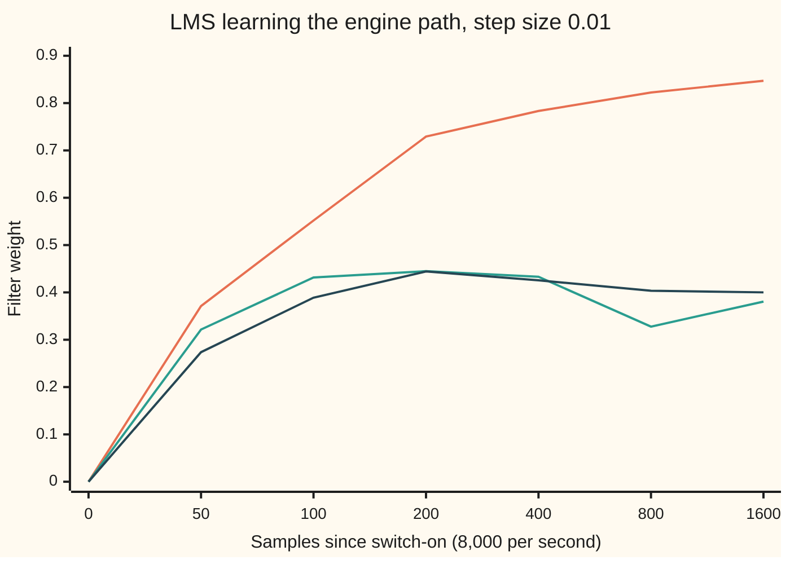

# Wiener and LMS: the best linear guess, then learning it sample by sample

[Syllabus](../../../SYLLABUS.md) → [Engineering mathematics](../README.md) → [Signals](../README.md#s05) → Wiener and LMS

---

## General Overview

A driver takes a call on the motorway. The hands-free microphone in the roof lining hears the driver's voice, and it hears the engine. The engine is louder: at the microphone its rumble carries 1.12 units of power against the voice's 0.25 (one unit is the power the engine microphone picks up): a signal-to-noise ratio of −6.51 dB (decibels, ten times the base-10 logarithm of the power ratio). The person on the other end hears mostly engine.

A second microphone sits in the engine bay. It hears the engine and almost nothing of the voice. Its signal is not the noise in the cabin: the sound has travelled through the bulkhead, been muffled and delayed. But it is related to that noise by a fixed recipe, here 0.8 of the engine sound now plus 0.4 of the engine sound one sample ago, at 8,000 samples a second. Guess that recipe, apply it to the engine microphone, subtract the result from the cabin microphone, and what is left is the voice.

This card does it twice. First with full knowledge of the averages: the **Wiener filter**, the best guess any fixed weighted sum of the engine samples can make. Then with no knowledge at all: **least mean squares (LMS)**, which starts from zero weights and nudges them after every sample. LMS has its average weights within 1 percent of the recipe after 100 milliseconds, and then leaves 0.0024 units of noise in the output: the call goes from −6.51 dB to +20.12 dB.

**The best weighted guess of one signal from another leaves an error that is uncorrelated with everything the guess used; that one condition is a small linear system, and LMS solves it on the fly by stepping against each sample's error.**

**What kind of fact this is:** the Wiener solution is a theorem, proved on this card in Why it works. LMS is an algorithm; that its average weights converge is proved here under a stated simplification, and its leftover-noise rule is an approximation for small steps.

### The picture: power at the microphone, before and after

```
voice alone                 ████████                                 0.2500
engine noise at the mic     ████████████████████████████████████    1.1200
engine noise after LMS      ▏                                        0.0024
```

The bottom bar is the engine noise still in the output once LMS has learned. It is a hundredth of the voice.

---

## The formula

Notation first. Time runs in samples, counted by $n$. The engine microphone gives $x(n)$; the filter looks at the two newest samples, written as one column $\mathbf{x}(n) = (x(n),\ x(n-1))$. The cabin microphone gives $d(n)$, the *desired* signal the filter tries to match. The filter's two weights are $\mathbf{w} = (w_0, w_1)$, and its guess is $\mathbf{w}^T\mathbf{x}(n) = w_0\,x(n) + w_1\,x(n-1)$, a two-tap FIR filter in the sense of [Digital filters](04-digital-filters-fir-and-iir.md). What is left, $e(n) = d(n) - \mathbf{w}^T\mathbf{x}(n)$, is the error, and in noise cancelling it is also the output: the voice plus whatever noise the guess missed.

$E[\cdot]$ is the long-run average, as in [Two variables at once](../../09-Probability%20and%20statistics/02-Random%20Variables/04-joint-distributions-and-covariance.md). Two tables of averages feed the filter: $R$, how the engine samples go together, and $\mathbf{p}$, how each engine sample goes with the cabin signal.

$$R\,\mathbf{w}_{\text{opt}} = \mathbf{p}, \qquad R = E[\mathbf{x}(n)\,\mathbf{x}(n)^T], \quad \mathbf{p} = E[d(n)\,\mathbf{x}(n)]$$

**Read it aloud:** the best weights are the ones that make the engine's own correlations, times the weights, reproduce the engine's correlation with the cabin microphone.

When the averages are unknown, LMS learns the weights one sample at a time:

$$\mathbf{w}(n+1) = \mathbf{w}(n) + \mu\, e(n)\, \mathbf{x}(n)$$

**Read it aloud:** after each sample, move every weight a little in the direction that would have shrunk this sample's error, by the step size times the error times that weight's input.

| Symbol | Plain meaning | In our example | Push it up and the answer… |
| --- | --- | --- | --- |
| $n$ | the sample count, 8,000 per second | 0 to 79,999 | — |
| $x(n)$, $\mathbf{x}(n)$, $^T$ | engine microphone sample; the newest two as a column; a superscript $T$ turns a column into a row | power 1 | louder reference, same weights scaled down |
| $d(n)$ | cabin microphone sample: voice plus engine noise | power 1.37 | — |
| $s(n)$ | the voice alone, never seen by the filter | power 0.25 | the floor $J_{\min}$ rises with it |
| $\mathbf{h}$ | the true path, engine to cabin | (0.8, 0.4) | more noise in the cabin |
| $\mathbf{w}$, $\mathbf{w}_{\text{opt}}$, $\mathbf{v}$ | the filter's two weights; the best ones; $\mathbf{v} = \mathbf{w} - \mathbf{w}_{\text{opt}}$, the distance from the best (Step 2's fold) | best: (0.8, 0.4) | — |
| $e(n)$, $e_{\text{opt}}$ | error, which is the output; the error left by the best weights (Step 2's fold) | power 0.2526 after LMS | — |
| $R$ | tap correlations; its diagonal summed, the trace $\operatorname{tr} R$, is 2 | `[[1, 0.5], [0.5, 1]]` | — |
| $\mathbf{p}$ | each tap's correlation with $d(n)$ | (1.0, 0.8) | weights follow it through $R^{-1}$ |
| $J(\mathbf{w})$, $J_{\min}$ | mean squared error $E[e(n)^2]$; its lowest value | lowest 0.25 | — |
| $\mu$ | the LMS step size | 0.01 | faster learning, noisier weights, and past 1.3333 even the average walk diverges |
| $\lambda$ | the eigenvalues of $R$, its stretch factors | 1.5 and 0.5 | the slow one sets how long learning takes |

### When it holds

- **The relation is linear and fixed.** A weighted sum can only copy a weighted-sum path. If the engine changes speed the best weights move, and the Wiener answer for last minute is wrong for this one; LMS keeps learning, which is why it is used.
- **The voice is uncorrelated with the engine.** If the engine microphone also hears the voice, $\mathbf{p}$ picks up the voice and the filter cancels part of the call.
- **The averages exist and stay put** (the signals are *stationary*). Otherwise $R$ and $\mathbf{p}$ have no single value to solve for.
- **The filter is long enough.** Two taps cover a two-tap path exactly. A real cabin path rings for thousands of samples; a short filter leaves the rest as error (one tap leaves 0.37 here, not 0.25).
- **$R$ can be inverted.** An engine signal with too little variety, such as a single low tone (or, for a filter longer than two taps, any single tone), makes $R$ nearly singular: many weight pairs fit equally well and LMS drifts along them.

---

## Why it works

### Step 0: perpendicular, again

[Least squares](../../03-Algebra/06-Dot%20Products%20and%20Best%20Fits/04-least-squares.md) found the best line by demanding the leftover be perpendicular to every column it could have used. Random signals have their own dot product: the average product $E[XY]$, which is the covariance when the averages are zero. "Perpendicular" becomes "uncorrelated". The best guess is the one whose error is uncorrelated with every tap: the **orthogonality principle**.

### Step 1: the error surface is a bowl

Expand the mean squared error for any weights:

$$J(\mathbf{w}) = E[d^2] - 2\,\mathbf{p}^T\mathbf{w} + \mathbf{w}^T R\,\mathbf{w}.$$

It is a quadratic in the two weights. $R$ is an average of squares, so $\mathbf{w}^T R\,\mathbf{w} = E[(\mathbf{w}^T\mathbf{x})^2] \ge 0$: the surface curves up in every direction. It is a bowl with one lowest point.

### Step 2: at the bottom, the error is uncorrelated with each tap

At the lowest point, nudging either weight cannot lower $J$. The slope of $J$ along $w_0$ is $-2E[e(n)\,x(n)]$, and along $w_1$ it is $-2E[e(n)\,x(n-1)]$, so the condition is

$$E[e(n)\,x(n)] = 0, \qquad E[e(n)\,x(n-1)] = 0.$$

Substitute $e = d - \mathbf{w}^T\mathbf{x}$ and the two zeros become $\mathbf{p} - R\,\mathbf{w} = \mathbf{0}$: the **Wiener–Hopf equations** $R\,\mathbf{w}_{\text{opt}} = \mathbf{p}$. The lowest error that is left is $J_{\min} = E[d^2] - \mathbf{p}^T\mathbf{w}_{\text{opt}}$. Put sums over a recording in place of the averages, and these are the normal equations of [Multiple regression](../../09-Probability%20and%20statistics/09-Regression/03-multiple-regression-and-gauss-markov.md) of $d(n)$ on the two predictors $x(n)$ and $x(n-1)$. The Wiener filter is that regression, and road 2 in the code computes it.

<details>
<summary>Detailed proof: why the bottom is the only bottom</summary>

Write any weights as $\mathbf{w} = \mathbf{w}_{\text{opt}} + \mathbf{v}$. Then $e = e_{\text{opt}} - \mathbf{v}^T\mathbf{x}$, and

$$J(\mathbf{w}) = E[e_{\text{opt}}^2] - 2\,\mathbf{v}^T E[e_{\text{opt}}\,\mathbf{x}] + \mathbf{v}^T R\,\mathbf{v} = J_{\min} + \mathbf{v}^T R\,\mathbf{v}.$$

The middle term is zero by orthogonality. The last term is zero only when $\mathbf{v}^T\mathbf{x}(n)$ is zero for all time, which for an invertible $R$ means $\mathbf{v} = \mathbf{0}$. So every other choice of weights costs exactly $\mathbf{v}^T R\,\mathbf{v}$ extra.

</details>

For the engine: $\mathbf{p} = R\,\mathbf{h}$ because the voice is uncorrelated with the engine, so the solution is $\mathbf{w}_{\text{opt}} = \mathbf{h}$, and $J_{\min}$ is the voice power. The best filter removes all the engine noise and none of the voice. The frequency-domain version of the same equation divides the cross spectrum by the engine's spectrum, both estimated as on [Spectral estimation](06-spectral-estimation-and-periodograms.md).

### Step 3: walk downhill instead of solving

The slope of the bowl is $-2(\mathbf{p} - R\,\mathbf{w})$. **Steepest descent** steps against it:

$$\mathbf{w} \leftarrow \mathbf{w} + \mu\,(\mathbf{p} - R\,\mathbf{w}),$$

repeated, each time from the newest weights.

Measure the gap $\mathbf{w}_{\text{opt}} - \mathbf{w}$ along the two eigenvectors of $R$, here the directions (1, 1) and (1, −1). Along each, one step multiplies the gap by $(1 - \mu\lambda)$: by 0.985 and 0.995 when $\mu = 0.01$. The walk converges exactly when every factor has size below 1, that is $0 < \mu < 2/\lambda_{\max} = 1.3333$. A gap shrinks by a factor of about 2.718 (Euler's number $e$) in about $1/(\mu\lambda)$ steps, its **time constant**: 66.67 steps along (1, 1), 200 along (1, −1).

### Step 4: LMS replaces each average by one sample

LMS does not know $\mathbf{p}$ or $R$. It takes the one sample it has, $e(n)\,\mathbf{x}(n)$, as its estimate of $\mathbf{p} - R\,\mathbf{w}$, whose long-run average it is. Each step is noisy, but the noise averages out. Under the usual simplification that the newest input is independent of the current weights, the *average* LMS weights follow the steepest-descent path exactly. The leftover jiggle costs a little extra error: about $J_{\min}\,\mu\,\operatorname{tr}R/2$, here 0.0025, the **misadjustment**. Small steps mean little jiggle but slow learning; that trade is the design choice.

---

## Worked numbers, by hand

Path (0.8, 0.4); engine power 1, neighbouring engine samples correlated 0.5; voice power 0.25.

| Step | Arithmetic | Value |
| --- | --- | --- |
| noise at the cabin mic, $\mathbf{h}^T R\,\mathbf{h}$ | 0.64 + 0.16 + 2 × 0.5 × 0.8 × 0.4 | 1.12 |
| cabin mic power $E[d^2]$ | 0.25 + 1.12 | 1.37 |
| $p_0 = E[d\,x(n)]$ | 0.8 × 1 + 0.4 × 0.5 | 1.0 |
| $p_1 = E[d\,x(n-1)]$ | 0.8 × 0.5 + 0.4 × 1 | 0.8 |
| determinant of $R$ | 1 × 1 − 0.5 × 0.5 | 0.75 |
| $w_0$ | (1.0 × 1 − 0.5 × 0.8) / 0.75 = 0.6 / 0.75 | **0.8** |
| $w_1$ | (1 × 0.8 − 0.5 × 1.0) / 0.75 = 0.3 / 0.75 | **0.4** |
| $\mathbf{p}^T\mathbf{w}_{\text{opt}}$ | 1.0 × 0.8 + 0.8 × 0.4 | 1.12 |
| $J_{\min}$ | 1.37 − 1.12 | **0.25** |
| signal-to-noise before | 10 log₁₀(0.25 / 1.12) | −6.51 dB |

The best two-tap filter is the path itself, and what it leaves is exactly the voice. LMS, starting from (0, 0) with $\mu = 0.01$, averages (0.8010, 0.4057) over the last second and leaves output power 0.2526, against the rule's 0.25 × (1 + 0.01) = 0.2525.

### What breaks if you drop a piece

| Mistake | Comes out at | What went wrong |
| --- | --- | --- |
| One tap only, $w_0 = p_0/r_0$ | weight 1.0, error 0.37 | The delayed half of the path is unreachable, and the one weight over-reaches to make up |
| Each tap solved on its own, $w_k = p_k / 1$ | weights (1.0, 0.8), error 0.53 | Ignores that the taps are correlated: each weight takes credit for its neighbour's work, worse than one tap |
| Steepest-descent step 1.4, above 2/1.5 | weights (−26.36, −26.76) after 40 steps | The fast direction's factor is 1 − 1.4 × 1.5 = −1.10: each step overshoots further |
| LMS with the sign flipped | weights (−923071, −927094) after 1,000 samples | Each step climbs the bowl instead of descending it |

---

## How the learning moves

The puzzle: LMS starts knowing nothing, sees one noisy sample at a time, and still homes in within a few hundred samples. Yet $w_1$ gets close to 0.4 well before $w_0$ reaches 0.8. Why does one weight lead?

The two weights are not learned separately. The bowl is tilted, because the engine samples are correlated, and its natural directions are "both weights together", (1, 1), with stretch 1.5, and "the difference", (1, −1), with stretch 0.5. The target splits into a sum of 1.2 and a difference of 0.4.

### One run, followed

| Samples | Time | LMS $w_0$ | LMS $w_1$ | Average path $w_0$ | Average path $w_1$ |
| --- | --- | --- | --- | --- | --- |
| 0 | 0 ms | 0 | 0 | 0 | 0 |
| 50 | 6.25 ms | 0.3712 | 0.3215 | 0.3625 | 0.2738 |
| 100 | 12.5 ms | 0.5519 | 0.4316 | 0.5465 | 0.3888 |
| 200 | 25 ms | 0.7292 | 0.4449 | 0.6974 | 0.4442 |
| 400 | 50 ms | 0.7834 | 0.4330 | 0.7716 | 0.4255 |
| 800 | 100 ms | 0.8223 | 0.3277 | 0.7964 | 0.4036 |
| 1600 | 200 ms | 0.8471 | 0.3806 | 0.7999 | 0.4001 |

The average path has overshot $w_1$ to 0.4442 by 25 ms and then settles back. The one real run tracks it, jiggling around it: 0.3277 against 0.4036 at 100 ms.

### Force one: the sum closes fast

Gap in $w_0 + w_1$, shrinking by 0.985 per sample:

```
     0 samples  ████████████████████████████████████████████████  1.2000
    50 samples  ██████████████████████▌                           0.5636
   100 samples  ██████████▌                                       0.2647
   200 samples  ██▎                                               0.0584
   400 samples  ▏                                                 0.0028
```

### Force two: the difference closes slowly

Gap in $w_0 - w_1$, shrinking by 0.995 per sample, on the same scale:

```
     0 samples  ████████████████                                  0.4000
    50 samples  ████████████▍                                     0.3113
   100 samples  █████████▋                                        0.2423
   200 samples  █████▉                                            0.1468
   400 samples  ██▏                                               0.0539
   800 samples  ▎                                                 0.0073
```

Early on the sum dominates: both weights rise together, and $w_1$, whose target is small, gets pushed past it. Once the sum has closed the slow difference is still open, and it pulls $w_1$ back down while $w_0$ keeps climbing. The slow direction, $1/(\mu\lambda_{\min}) = 200$ samples, sets the learning time.

### Both at once



Orange: the run's $w_0$, heading for 0.8. Green: the run's $w_1$, heading for 0.4. Dark: the average path of $w_1$, rising past 0.4 and settling back. The samples on the axis are not evenly spaced.

---

## Code, from first principles, and it actually runs

The scripts build a ten-second recording at 8,000 samples a second from their own random-number generator: a smooth engine rumble, a voice stand-in that has nothing to do with it, and the cabin signal made by the (0.8, 0.4) path. Four independent roads reach the weights: the Wiener–Hopf equations solved from the known averages, the same equations solved from the recording itself (least squares), steepest descent on the exact bowl, and LMS run sample by sample. They also check the orthogonality principle on the data, compare the LMS average path with the eigenvector formula, test the misadjustment rule, and reproduce every wrong answer above.

### Python

```python
# Wiener and LMS -- the check behind the card.  Standard library only.  Nothing imported knows
# the answer: the random numbers, the 2x2 solve and both filters are written out below.
# A hands-free microphone hears a voice plus engine noise; a second microphone at the engine
# hears the noise alone.  A two-tap filter turns the second signal into the first one's noise.
from math import sqrt, log10

FS, SECONDS = 8000, 10                      # samples per second, length of the recording
N = FS * SECONDS
H = (0.8, 0.4)                              # the path from engine to cabin microphone, unknown to the filter
A = 0.5                                     # the voice: a random signal of power A*A = 0.25
MU = 0.01                                   # the LMS step size

def rng(seed):                              # xorshift64, scaled to uniform on [-sqrt 3, sqrt 3]: power 1
    s = seed
    while True:
        s ^= (s << 13) & 0xFFFFFFFFFFFFFFFF; s ^= s >> 7; s ^= (s << 17) & 0xFFFFFFFFFFFFFFFF
        yield ((s >> 11) / 9007199254740992.0 * 2.0 - 1.0) * sqrt(3.0)

def recording():                            # x: engine mic, d: cabin mic, s: the voice alone
    g, talk = rng(2026), rng(7)             # engine and voice come from separate generators
    u_prev = next(g); x, d, s = [(u_prev + next(g)) / sqrt(2.0)], [0.0], [0.0]   # x[0] is x[-1]
    u_prev = next(g)
    for n in range(N):                      # list index n + 1 holds sample n
        u = next(g); xn = (u + u_prev) / sqrt(2.0); u_prev = u   # smooth rumble: neighbours alike
        sn = A * next(talk)
        x.append(xn); s.append(sn); d.append(sn + H[0] * xn + H[1] * x[-2])
    return x, d, s

def solve2(a, b, c, e, f):                  # [[a, b], [c, e]] w = f, by Cramer's rule
    det = a * e - b * c
    return ((f[0] * e - b * f[1]) / det, (a * f[1] - c * f[0]) / det)

def cost(w, r0, r1, p, sd2):                # the bowl J(w) = E[d^2] - 2 p.w + w.R w
    return sd2 - 2 * (p[0] * w[0] + p[1] * w[1]) + r0 * (w[0] * w[0] + w[1] * w[1]) + 2 * r1 * w[0] * w[1]

def steepest(mu, steps, r0, r1, p):         # road 3: walk downhill on the exact bowl
    w = [0.0, 0.0]
    for _ in range(steps):
        g0 = p[0] - r0 * w[0] - r1 * w[1]; g1 = p[1] - r1 * w[0] - r0 * w[1]
        w = [w[0] + mu * g0, w[1] + mu * g1]
    return w

def lms(x, d, s, mu, sign=1.0, stop=N, marks=()):   # road 4: learn sample by sample
    w0 = w1 = 0.0; out, err2, left2, avg0, avg1 = {}, 0.0, 0.0, 0.0, 0.0
    for n in range(stop):
        if n in marks: out[n] = (w0, w1)
        e = d[n + 1] - (w0 * x[n + 1] + w1 * x[n])  # the output: voice plus leftover noise
        if n >= stop - FS:                  # score the last second
            err2 += e * e; left2 += (e - s[n + 1]) * (e - s[n + 1]); avg0 += w0; avg1 += w1
        w0 += sign * mu * e * x[n + 1]; w1 += sign * mu * e * x[n]
    return (w0, w1), (avg0 / FS, avg1 / FS), err2 / FS, left2 / FS, out

r0, r1, voice = 1.0, 0.5, A * A             # engine noise: power 1, next-sample correlation 0.5
p = (H[0] * r0 + H[1] * r1, H[0] * r1 + H[1] * r0)       # E[d x(n)], E[d x(n-1)]
noise = r0 * (H[0] * H[0] + H[1] * H[1]) + 2 * r1 * H[0] * H[1]  # h.R h, engine noise reaching the cabin mic
sd2 = voice + noise
w_ex = solve2(r0, r1, r1, r0, p)
j_ex = cost(w_ex, r0, r1, p, sd2)
x, d, s = recording()
sxx = sum(v * v for v in x[1:]); sx1 = sum(x[n + 1] * x[n] for n in range(N)); s11 = sum(v * v for v in x[:-1])
pd0 = sum(d[n + 1] * x[n + 1] for n in range(N)); pd1 = sum(d[n + 1] * x[n] for n in range(N))
w_dat = solve2(sxx, sx1, sx1, s11, (pd0, pd1))           # road 2: least squares on the recording
mic_noise = sum((d[n + 1] - s[n + 1]) * (d[n + 1] - s[n + 1]) for n in range(N)) / N
e_true = [d[n + 1] - (H[0] * x[n + 1] + H[1] * x[n]) for n in range(N)]
orth0 = sum(e_true[n] * x[n + 1] for n in range(N)) / N; orth1 = sum(e_true[n] * x[n] for n in range(N)) / N
w_sd = steepest(0.5, 60, r0, r1, p)
marks = (0, 50, 100, 200, 400, 800, 1600)
w_end, w_avg, mse, left, path = lms(x, d, s, MU, marks=marks)
misadj = MU * (r0 + r0) / 2                 # mu * trace(R) / 2
fast, slow = r0 + r1, r0 - r1               # eigenvalues of R: along (1, 1) and along (1, -1)
print(f"setup: {FS} samples/s, {SECONDS} s = {N} samples, engine path h = ({H[0]:.1f}, {H[1]:.1f})")
print(f"R = [[{r0:.4f}, {r1:.4f}], [{r1:.4f}, {r0:.4f}]]   eigenvalues {fast:.4f}, {slow:.4f}   trace {r0 + r0:.4f}")
print(f"p = ({p[0]:.4f}, {p[1]:.4f})   determinant of R {r0 * r0 - r1 * r1:.4f}")
print(f"power: voice {voice:.4f}   engine noise at mic {noise:.4f}   mic total {sd2:.4f}")
print(f"measured engine noise at mic over 10 s {mic_noise:.4f}")
print(f"hand: h.R h = {r0 * H[0] * H[0]:.4f} + {r0 * H[1] * H[1]:.4f} + {2 * r1 * H[0] * H[1]:.4f}   Cramer tops {p[0] * r0 - r1 * p[1]:.4f}, {r0 * p[1] - r1 * p[0]:.4f}")
print(f"hand: p.w {p[0] * w_ex[0] + p[1] * w_ex[1]:.4f}   step bound 2/lmax {2 / fast:.4f}   decay per sample {1 - MU * fast:.4f}, {1 - MU * slow:.4f}   misadjustment {misadj:.4f}")
print(f"road 1 Wiener from the statistics    w = ({w_ex[0]:.4f}, {w_ex[1]:.4f})   Jmin {j_ex:.4f}")
print(f"road 2 Wiener from the 10 s of data  w = ({w_dat[0]:.4f}, {w_dat[1]:.4f})")
print(f"  orthogonality, true w: E[e x(n)] {orth0:+.4f}   E[e x(n-1)] {orth1:+.4f}")
print(f"road 3 steepest descent, mu 0.5, 60 steps  w = ({w_sd[0]:.6f}, {w_sd[1]:.6f})")
print(f"road 4 LMS, mu {MU}: last sample w = ({w_end[0]:.4f}, {w_end[1]:.4f})   last-second mean ({w_avg[0]:.4f}, {w_avg[1]:.4f})")
print(f"  output power, last second {mse:.4f}   predicted Jmin (1 + mu trR/2) {j_ex * (1 + misadj):.4f}")
print(f"  noise left in output {left:.4f}   predicted {j_ex * misadj:.4f}")
print(f"  SNR at mic {10 * log10(voice / noise):.2f} dB   after LMS {10 * log10(voice / left):.2f} dB")
print(f"  time constants: fast {1 / (MU * fast):.2f} samples = {1000 / (MU * fast) / FS:.2f} ms   slow {1 / (MU * slow):.2f} samples = {1000 / (MU * slow) / FS:.2f} ms")
print(f"wrong: one tap, w = {p[0] / r0:.4f}   J {cost((p[0] / r0, 0.0), r0, r1, p, sd2):.4f}")
print(f"wrong: taps solved separately, w = ({p[0] / r0:.4f}, {p[1] / r0:.4f})   J {cost((p[0] / r0, p[1] / r0), r0, r1, p, sd2):.4f}")
w_big = steepest(1.4, 40, r0, r1, p)
print(f"wrong: mu 1.4 > 2/1.5, factor {1 - 1.4 * fast:.2f}, 40 steps   w = ({w_big[0]:.2f}, {w_big[1]:.2f})")
w_flip = lms(x, d, s, MU, sign=-1.0, stop=1000)[0]
print(f"wrong: LMS sign flipped, 1000 samples   w = ({w_flip[0]:.0f}, {w_flip[1]:.0f})")
print("learning:  sample     ms   LMS w0  LMS w1   mean w0  mean w1   fast gap  slow gap")
for n in marks:
    m = steepest(MU, n, r0, r1, p)
    gf = (w_ex[0] + w_ex[1]) * (1 - MU * fast) ** n; gs = (w_ex[0] - w_ex[1]) * (1 - MU * slow) ** n
    print(f"  {n:>14} {1000 * n / FS:>6.2f} {path[n][0]:>8.4f} {path[n][1]:>7.4f} {m[0]:>9.4f} {m[1]:>8.4f} {gf:>10.4f} {gs:>9.4f}")
    assert abs(m[0] + m[1] + gf - 1.2) < 1e-9 and abs(m[0] - m[1] + gs - 0.4) < 1e-9, "modes"
for mu in (0.05, 0.001):
    t = lms(x, d, s, mu)
    print(f"try: mu {mu}: last-second mean w = ({t[1][0]:.4f}, {t[1][1]:.4f})   output power {t[2]:.4f} (predicted {j_ex * (1 + mu * r0):.4f})   slow time constant {1000 / (mu * slow) / FS:.2f} ms")

assert abs(w_ex[0] - 0.8) < 1e-12 and abs(w_ex[1] - 0.4) < 1e-12, "Wiener must recover the path"
assert abs(j_ex - voice) < 1e-12,                "with the path matched, only the voice is left"
assert abs(mic_noise - noise) < 0.03,            "simulated noise power vs h.R h"
assert max(abs(w_dat[0] - 0.8), abs(w_dat[1] - 0.4)) < 0.02, "data road lands on the statistics road"
assert max(abs(w_sd[0] - w_ex[0]), abs(w_sd[1] - w_ex[1])) < 1e-6, "steepest descent reaches the bottom"
assert max(abs(w_avg[0] - 0.8), abs(w_avg[1] - 0.4)) < 0.02, "LMS learns the path"
assert abs(left - j_ex * misadj) < 0.001,        "noise left in output vs the misadjustment rule"
assert abs(w_big[0]) > 10 and abs(w_flip[0]) > 1e3, "unstable steps must blow up"
print("ALL CHECKS PASS")
```

**Ran 2026-11-11 on macOS, Python 3.14.10, standard library only. All checks passed. Output, pasted from the run:**

```
setup: 8000 samples/s, 10 s = 80000 samples, engine path h = (0.8, 0.4)
R = [[1.0000, 0.5000], [0.5000, 1.0000]]   eigenvalues 1.5000, 0.5000   trace 2.0000
p = (1.0000, 0.8000)   determinant of R 0.7500
power: voice 0.2500   engine noise at mic 1.1200   mic total 1.3700
measured engine noise at mic over 10 s 1.1113
hand: h.R h = 0.6400 + 0.1600 + 0.3200   Cramer tops 0.6000, 0.3000
hand: p.w 1.1200   step bound 2/lmax 1.3333   decay per sample 0.9850, 0.9950   misadjustment 0.0100
road 1 Wiener from the statistics    w = (0.8000, 0.4000)   Jmin 0.2500
road 2 Wiener from the 10 s of data  w = (0.8035, 0.3997)
  orthogonality, true w: E[e x(n)] +0.0033   E[e x(n-1)] +0.0015
road 3 steepest descent, mu 0.5, 60 steps  w = (0.800000, 0.400000)
road 4 LMS, mu 0.01: last sample w = (0.8346, 0.4502)   last-second mean (0.8010, 0.4057)
  output power, last second 0.2526   predicted Jmin (1 + mu trR/2) 0.2525
  noise left in output 0.0024   predicted 0.0025
  SNR at mic -6.51 dB   after LMS 20.12 dB
  time constants: fast 66.67 samples = 8.33 ms   slow 200.00 samples = 25.00 ms
wrong: one tap, w = 1.0000   J 0.3700
wrong: taps solved separately, w = (1.0000, 0.8000)   J 0.5300
wrong: mu 1.4 > 2/1.5, factor -1.10, 40 steps   w = (-26.36, -26.76)
wrong: LMS sign flipped, 1000 samples   w = (-923071, -927094)
learning:  sample     ms   LMS w0  LMS w1   mean w0  mean w1   fast gap  slow gap
               0   0.00   0.0000  0.0000    0.0000   0.0000     1.2000    0.4000
              50   6.25   0.3712  0.3215    0.3625   0.2738     0.5636    0.3113
             100  12.50   0.5519  0.4316    0.5465   0.3888     0.2647    0.2423
             200  25.00   0.7292  0.4449    0.6974   0.4442     0.0584    0.1468
             400  50.00   0.7834  0.4330    0.7716   0.4255     0.0028    0.0539
             800 100.00   0.8223  0.3277    0.7964   0.4036     0.0000    0.0073
            1600 200.00   0.8471  0.3806    0.7999   0.4001     0.0000    0.0001
try: mu 0.05: last-second mean w = (0.7997, 0.4057)   output power 0.2633 (predicted 0.2625)   slow time constant 5.00 ms
try: mu 0.001: last-second mean w = (0.7988, 0.4084)   output power 0.2503 (predicted 0.2502)   slow time constant 250.00 ms
ALL CHECKS PASS
```

### Rust

```rust
// Wiener and LMS -- the same check as adaptive_and_optimal_filters_check.py, in Rust.
// Standard library only, no crates.  The random numbers, the 2x2 solve and both filters
// are written out.  A cabin microphone hears a voice plus engine noise; a microphone at the
// engine hears the noise alone.  A two-tap filter turns the second signal into the first one's noise.
const FS: usize = 8000;
const SECONDS: usize = 10;
const N: usize = FS * SECONDS;
const H: (f64, f64) = (0.8, 0.4); // the path from engine to cabin microphone, unknown to the filter
const A: f64 = 0.5; // the voice: a random signal of power A*A = 0.25
const MU: f64 = 0.01; // the LMS step size

struct Rng(u64); // xorshift64, scaled to uniform on [-sqrt 3, sqrt 3]: power 1
impl Rng {
    fn next(&mut self) -> f64 {
        let mut s = self.0;
        s ^= s << 13; s ^= s >> 7; s ^= s << 17;
        self.0 = s;
        ((s >> 11) as f64 / 9007199254740992.0 * 2.0 - 1.0) * 3.0_f64.sqrt()
    }
}

// x: engine mic, d: cabin mic, s: the voice alone; index n + 1 holds sample n, x[0] is x[-1]
fn recording() -> (Vec<f64>, Vec<f64>, Vec<f64>) {
    let (mut g, mut talk) = (Rng(2026), Rng(7)); // engine and voice from separate generators
    let mut u_prev = g.next();
    let first = (u_prev + g.next()) / 2.0_f64.sqrt();
    let (mut x, mut d, mut s) = (vec![first], vec![0.0], vec![0.0]);
    u_prev = g.next();
    for _ in 0..N {
        let u = g.next();
        let xn = (u + u_prev) / 2.0_f64.sqrt(); // smooth rumble: neighbours alike
        u_prev = u;
        let sn = A * talk.next();
        let before = x[x.len() - 1];
        x.push(xn); s.push(sn); d.push(sn + H.0 * xn + H.1 * before);
    }
    (x, d, s)
}

fn solve2(a: f64, b: f64, c: f64, e: f64, f: (f64, f64)) -> (f64, f64) { // Cramer's rule
    let det = a * e - b * c;
    ((f.0 * e - b * f.1) / det, (a * f.1 - c * f.0) / det)
}

fn cost(w: (f64, f64), r0: f64, r1: f64, p: (f64, f64), sd2: f64) -> f64 { // the bowl J(w)
    sd2 - 2.0 * (p.0 * w.0 + p.1 * w.1) + r0 * (w.0 * w.0 + w.1 * w.1) + 2.0 * r1 * w.0 * w.1
}

fn steepest(mu: f64, steps: usize, r0: f64, r1: f64, p: (f64, f64)) -> (f64, f64) { // road 3
    let mut w = (0.0, 0.0);
    for _ in 0..steps {
        let g0 = p.0 - r0 * w.0 - r1 * w.1;
        let g1 = p.1 - r1 * w.0 - r0 * w.1;
        w = (w.0 + mu * g0, w.1 + mu * g1);
    }
    w
}

struct Run { end: (f64, f64), avg: (f64, f64), mse: f64, left: f64, marks: Vec<(f64, f64)> }

fn lms(x: &[f64], d: &[f64], s: &[f64], mu: f64, sign: f64, stop: usize, marks: &[usize]) -> Run {
    let (mut w0, mut w1) = (0.0_f64, 0.0_f64); // road 4: learn sample by sample
    let (mut err2, mut left2, mut avg0, mut avg1) = (0.0, 0.0, 0.0, 0.0);
    let mut out = Vec::new();
    for n in 0..stop {
        if marks.contains(&n) { out.push((w0, w1)); }
        let e = d[n + 1] - (w0 * x[n + 1] + w1 * x[n]); // the output: voice plus leftover noise
        if n >= stop.saturating_sub(FS) { // score the last second
            err2 += e * e; left2 += (e - s[n + 1]) * (e - s[n + 1]); avg0 += w0; avg1 += w1;
        }
        w0 += sign * mu * e * x[n + 1]; w1 += sign * mu * e * x[n];
    }
    let f = FS as f64;
    Run { end: (w0, w1), avg: (avg0 / f, avg1 / f), mse: err2 / f, left: left2 / f, marks: out }
}

fn main() {
    let (r0, r1, voice) = (1.0_f64, 0.5_f64, A * A); // engine noise: power 1, neighbour correlation 0.5
    let p = (H.0 * r0 + H.1 * r1, H.0 * r1 + H.1 * r0); // E[d x(n)], E[d x(n-1)]
    let noise = r0 * (H.0 * H.0 + H.1 * H.1) + 2.0 * r1 * H.0 * H.1; // h.R h
    let sd2 = voice + noise;
    let w_ex = solve2(r0, r1, r1, r0, p);
    let j_ex = cost(w_ex, r0, r1, p, sd2);
    let (x, d, s) = recording();
    let sum = |f: &dyn Fn(usize) -> f64| (0..N).fold(0.0, |acc, n| acc + f(n));
    let sxx = sum(&|n| x[n + 1] * x[n + 1]);
    let sx1 = sum(&|n| x[n + 1] * x[n]);
    let s11 = sum(&|n| x[n] * x[n]);
    let pd0 = sum(&|n| d[n + 1] * x[n + 1]);
    let pd1 = sum(&|n| d[n + 1] * x[n]);
    let w_dat = solve2(sxx, sx1, sx1, s11, (pd0, pd1)); // road 2: least squares on the recording
    let mic_noise = sum(&|n| (d[n + 1] - s[n + 1]) * (d[n + 1] - s[n + 1])) / N as f64;
    let e_true: Vec<f64> = (0..N).map(|n| d[n + 1] - (H.0 * x[n + 1] + H.1 * x[n])).collect();
    let orth0 = sum(&|n| e_true[n] * x[n + 1]) / N as f64;
    let orth1 = sum(&|n| e_true[n] * x[n]) / N as f64;
    let w_sd = steepest(0.5, 60, r0, r1, p);
    let marks = [0usize, 50, 100, 200, 400, 800, 1600];
    let run = lms(&x, &d, &s, MU, 1.0, N, &marks);
    let misadj = MU * (r0 + r0) / 2.0; // mu * trace(R) / 2
    let (fast, slow) = (r0 + r1, r0 - r1); // eigenvalues of R: along (1, 1) and along (1, -1)
    println!("setup: {} samples/s, {} s = {} samples, engine path h = ({:.1}, {:.1})", FS, SECONDS, N, H.0, H.1);
    println!("R = [[{:.4}, {:.4}], [{:.4}, {:.4}]]   eigenvalues {:.4}, {:.4}   trace {:.4}", r0, r1, r1, r0, fast, slow, r0 + r0);
    println!("p = ({:.4}, {:.4})   determinant of R {:.4}", p.0, p.1, r0 * r0 - r1 * r1);
    println!("power: voice {:.4}   engine noise at mic {:.4}   mic total {:.4}", voice, noise, sd2);
    println!("measured engine noise at mic over 10 s {:.4}", mic_noise);
    println!("hand: h.R h = {:.4} + {:.4} + {:.4}   Cramer tops {:.4}, {:.4}", r0 * H.0 * H.0, r0 * H.1 * H.1,
             2.0 * r1 * H.0 * H.1, p.0 * r0 - r1 * p.1, r0 * p.1 - r1 * p.0);
    println!("hand: p.w {:.4}   step bound 2/lmax {:.4}   decay per sample {:.4}, {:.4}   misadjustment {:.4}",
             p.0 * w_ex.0 + p.1 * w_ex.1, 2.0 / fast, 1.0 - MU * fast, 1.0 - MU * slow, misadj);
    println!("road 1 Wiener from the statistics    w = ({:.4}, {:.4})   Jmin {:.4}", w_ex.0, w_ex.1, j_ex);
    println!("road 2 Wiener from the 10 s of data  w = ({:.4}, {:.4})", w_dat.0, w_dat.1);
    println!("  orthogonality, true w: E[e x(n)] {:+.4}   E[e x(n-1)] {:+.4}", orth0, orth1);
    println!("road 3 steepest descent, mu 0.5, 60 steps  w = ({:.6}, {:.6})", w_sd.0, w_sd.1);
    println!("road 4 LMS, mu {}: last sample w = ({:.4}, {:.4})   last-second mean ({:.4}, {:.4})",
             MU, run.end.0, run.end.1, run.avg.0, run.avg.1);
    println!("  output power, last second {:.4}   predicted Jmin (1 + mu trR/2) {:.4}", run.mse, j_ex * (1.0 + misadj));
    println!("  noise left in output {:.4}   predicted {:.4}", run.left, j_ex * misadj);
    println!("  SNR at mic {:.2} dB   after LMS {:.2} dB", 10.0 * (voice / noise).log10(), 10.0 * (voice / run.left).log10());
    println!("  time constants: fast {:.2} samples = {:.2} ms   slow {:.2} samples = {:.2} ms", 1.0 / (MU * fast),
             1000.0 / (MU * fast) / FS as f64, 1.0 / (MU * slow), 1000.0 / (MU * slow) / FS as f64);
    println!("wrong: one tap, w = {:.4}   J {:.4}", p.0 / r0, cost((p.0 / r0, 0.0), r0, r1, p, sd2));
    println!("wrong: taps solved separately, w = ({:.4}, {:.4})   J {:.4}", p.0 / r0, p.1 / r0, cost((p.0 / r0, p.1 / r0), r0, r1, p, sd2));
    let w_big = steepest(1.4, 40, r0, r1, p);
    println!("wrong: mu 1.4 > 2/1.5, factor {:.2}, 40 steps   w = ({:.2}, {:.2})", 1.0 - 1.4 * fast, w_big.0, w_big.1);
    let w_flip = lms(&x, &d, &s, MU, -1.0, 1000, &[]).end;
    println!("wrong: LMS sign flipped, 1000 samples   w = ({:.0}, {:.0})", w_flip.0, w_flip.1);
    println!("learning:  sample     ms   LMS w0  LMS w1   mean w0  mean w1   fast gap  slow gap");
    for (i, &n) in marks.iter().enumerate() {
        let m = steepest(MU, n, r0, r1, p);
        let gf = (w_ex.0 + w_ex.1) * (1.0 - MU * fast).powf(n as f64);
        let gs = (w_ex.0 - w_ex.1) * (1.0 - MU * slow).powf(n as f64);
        println!("  {:>14} {:>6.2} {:>8.4} {:>7.4} {:>9.4} {:>8.4} {:>10.4} {:>9.4}",
                 n, 1000.0 * n as f64 / FS as f64, run.marks[i].0, run.marks[i].1, m.0, m.1, gf, gs);
        assert!((m.0 + m.1 + gf - 1.2).abs() < 1e-9 && (m.0 - m.1 + gs - 0.4).abs() < 1e-9, "modes");
    }
    for mu in [0.05_f64, 0.001] {
        let t = lms(&x, &d, &s, mu, 1.0, N, &[]);
        println!("try: mu {}: last-second mean w = ({:.4}, {:.4})   output power {:.4} (predicted {:.4})   slow time constant {:.2} ms",
                 mu, t.avg.0, t.avg.1, t.mse, j_ex * (1.0 + mu * r0), 1000.0 / (mu * slow) / FS as f64);
    }

    assert!((w_ex.0 - 0.8).abs() < 1e-12 && (w_ex.1 - 0.4).abs() < 1e-12, "Wiener must recover the path");
    assert!((j_ex - voice).abs() < 1e-12, "with the path matched, only the voice is left");
    assert!((mic_noise - noise).abs() < 0.03, "simulated noise power vs h.R h");
    assert!((w_dat.0 - 0.8).abs().max((w_dat.1 - 0.4).abs()) < 0.02, "data road lands on the statistics road");
    assert!((w_sd.0 - w_ex.0).abs().max((w_sd.1 - w_ex.1).abs()) < 1e-6, "steepest descent reaches the bottom");
    assert!((run.avg.0 - 0.8).abs().max((run.avg.1 - 0.4).abs()) < 0.02, "LMS learns the path");
    assert!((run.left - j_ex * misadj).abs() < 0.001, "noise left in output vs the misadjustment rule");
    assert!(w_big.0.abs() > 10.0 && w_flip.0.abs() > 1e3, "unstable steps must blow up");
    println!("ALL CHECKS PASS");
}
```

**Ran 2026-11-11 on macOS, rustc 1.98.1, no crates. All checks passed. Output, pasted from the run:**

```
setup: 8000 samples/s, 10 s = 80000 samples, engine path h = (0.8, 0.4)
R = [[1.0000, 0.5000], [0.5000, 1.0000]]   eigenvalues 1.5000, 0.5000   trace 2.0000
p = (1.0000, 0.8000)   determinant of R 0.7500
power: voice 0.2500   engine noise at mic 1.1200   mic total 1.3700
measured engine noise at mic over 10 s 1.1113
hand: h.R h = 0.6400 + 0.1600 + 0.3200   Cramer tops 0.6000, 0.3000
hand: p.w 1.1200   step bound 2/lmax 1.3333   decay per sample 0.9850, 0.9950   misadjustment 0.0100
road 1 Wiener from the statistics    w = (0.8000, 0.4000)   Jmin 0.2500
road 2 Wiener from the 10 s of data  w = (0.8035, 0.3997)
  orthogonality, true w: E[e x(n)] +0.0033   E[e x(n-1)] +0.0015
road 3 steepest descent, mu 0.5, 60 steps  w = (0.800000, 0.400000)
road 4 LMS, mu 0.01: last sample w = (0.8346, 0.4502)   last-second mean (0.8010, 0.4057)
  output power, last second 0.2526   predicted Jmin (1 + mu trR/2) 0.2525
  noise left in output 0.0024   predicted 0.0025
  SNR at mic -6.51 dB   after LMS 20.12 dB
  time constants: fast 66.67 samples = 8.33 ms   slow 200.00 samples = 25.00 ms
wrong: one tap, w = 1.0000   J 0.3700
wrong: taps solved separately, w = (1.0000, 0.8000)   J 0.5300
wrong: mu 1.4 > 2/1.5, factor -1.10, 40 steps   w = (-26.36, -26.76)
wrong: LMS sign flipped, 1000 samples   w = (-923071, -927094)
learning:  sample     ms   LMS w0  LMS w1   mean w0  mean w1   fast gap  slow gap
               0   0.00   0.0000  0.0000    0.0000   0.0000     1.2000    0.4000
              50   6.25   0.3712  0.3215    0.3625   0.2738     0.5636    0.3113
             100  12.50   0.5519  0.4316    0.5465   0.3888     0.2647    0.2423
             200  25.00   0.7292  0.4449    0.6974   0.4442     0.0584    0.1468
             400  50.00   0.7834  0.4330    0.7716   0.4255     0.0028    0.0539
             800 100.00   0.8223  0.3277    0.7964   0.4036     0.0000    0.0073
            1600 200.00   0.8471  0.3806    0.7999   0.4001     0.0000    0.0001
try: mu 0.05: last-second mean w = (0.7997, 0.4057)   output power 0.2633 (predicted 0.2625)   slow time constant 5.00 ms
try: mu 0.001: last-second mean w = (0.7988, 0.4084)   output power 0.2503 (predicted 0.2502)   slow time constant 250.00 ms
ALL CHECKS PASS
```

The outputs agree line for line. Wiener from the averages gives (0.8, 0.4) exactly; from ten seconds of data, (0.8035, 0.3997); steepest descent lands on the sixth decimal; LMS averages (0.8010, 0.4057). On the recording, the true weights leave an error whose correlation with each tap is +0.0033 and +0.0015: zero, up to the wobble of a finite recording.

> [!TIP]
> **Try changing**
> - Guess first: five times the step, `mu = 0.05`. Learning is five times faster (slow time constant 5 ms), and the jiggle costs more: output power 0.2633 against the rule's 0.2625.
> - Guess first: a tenth of the step, `mu = 0.001`. The output power drops to 0.2503 (rule: 0.2502), but the slow time constant is 250 ms, long enough to lag an engine revving up.
> - Guess first: steepest descent with `mu = 1.4`. The bound is 1.3333; 40 steps later the weights are (−26.36, −26.76) and still growing.
> - Guess first: flip the sign of the LMS update. After 1,000 samples the weights are (−923071, −927094).

---

## The usual mistake

> [!warning]
> **Letting the voice into the reference.** The whole method rests on the reference hearing noise and nothing of what you want to keep. If the engine microphone also picks up the driver, the filter finds that subtracting voice lowers the error too, and it does: the cancellation eats the call. Place and shield the reference so it hears only the noise, or freeze adaptation while someone is talking.
>
> Smaller traps:
> - **Fitting each tap on its own.** Correlated taps share the work; solving them separately gives (1.0, 0.8) and an error of 0.53, worse than doing nothing clever with one tap (0.37).
> - **Reading the error as failure.** In noise cancelling the error *is* the output. A perfect filter leaves error power 0.25, the voice, not zero. Driving the error to zero would mean cancelling the voice.
> - **Choosing the step, then turning the reference up.** The bound $2/\lambda_{\max}$ shrinks as the reference gets louder: double its level and the eigenvalues quadruple, so the safe range of steps falls to a quarter. Normalised LMS divides the step by the input power to remove this.
> - **Quoting the last weights.** LMS weights jiggle around the answer: the last sample's weights here are (0.8346, 0.4502). Average them, or shrink the step, before reading them as the path.

---

## Where you meet it in real life

- **Hands-free car kits and headsets.** Exactly this card, with filters hundreds of taps long and a second microphone or the loudspeaker signal as the reference.
- **Echo cancellers on conference calls.** The reference is the far-end voice going into the loudspeaker; LMS-family filters learn the room's echo path and subtract it from the microphone.
- **Active noise-cancelling headphones.** An outside microphone is the reference; the filter drives the speaker with the predicted noise, inverted.
- **Medical monitoring.** The 1975 noise-cancelling paper removed the mother's heartbeat from a fetal heart recording, using a chest lead as the reference.
- **Modem and radio equalisers.** The filter learns to undo the channel's smearing, trained on a known preamble and then on its own decisions.
- **Linear prediction in speech coding.** The same Wiener–Hopf equations, with the signal's own past as the reference, compress speech into a few predictor weights.

> **Say it back**
> The best guess of one signal as a weighted sum of another leaves an error uncorrelated with every input it used. That condition is a small linear system, $R\,\mathbf{w} = \mathbf{p}$, built from averages, and its solution is the Wiener filter. Walking downhill on the squared-error bowl reaches the same answer, as long as the step stays below $2/\lambda_{\max}$. LMS takes that walk with one sample at a time standing in for the averages, so it learns, and keeps learning, with no averages known in advance. Here its average weights reach the (0.8, 0.4) engine path to within 1 percent in about 100 ms, and it lifts the call from −6.51 dB to +20.12 dB.

---

## What this builds on

- [Spectral estimation](06-spectral-estimation-and-periodograms.md): correlations and spectra of a random signal, and how to estimate them from a finite recording; the Wiener filter in the frequency domain divides one such estimate by another.
- [Digital filters](04-digital-filters-fir-and-iir.md): the two-tap weighted sum is an FIR filter; this card chooses its weights instead of designing them.
- [Least squares](../../03-Algebra/06-Dot%20Products%20and%20Best%20Fits/04-least-squares.md): perpendicular leftovers and the normal equations; road 2 in the code is least squares on the recording.
- [Two variables at once](../../09-Probability%20and%20statistics/02-Random%20Variables/04-joint-distributions-and-covariance.md): covariance as the average product, the dot product that makes "uncorrelated" mean "perpendicular".
- [Multiple regression](../../09-Probability%20and%20statistics/09-Regression/03-multiple-regression-and-gauss-markov.md): one variable regressed on several predictors. $R\,\mathbf{w} = \mathbf{p}$ are its normal equations with averages in place of sums, so the Wiener filter is that regression of the cabin signal on the engine taps.

## Where this goes next

- [Compressed sensing](10-compressed-sensing-in-outline.md): another way of recovering a signal from measurements, using the fact that it is mostly zeros rather than a known correlation.
- [The DFT and the FFT](02-discrete-fourier-transform-and-the-fft.md): the downhill walk of Step 3 on any smooth bowl, not just a quadratic one.

The open question: when the noise path changes faster than LMS can follow, how much faster can a smarter update, such as recursive least squares, learn, and at what cost per sample?

---

## Sources

Verified 2026-11-11: every link below resolves to the publisher's page.

- Wiener, Norbert. *Extrapolation, Interpolation, and Smoothing of Stationary Time Series*. The MIT Press, 1949. [doi:10.7551/mitpress/2946.001.0001](https://doi.org/10.7551/mitpress/2946.001.0001). The optimal linear filter from second-order statistics, the origin of the Wiener filter.
- Widrow, B., et al. "Adaptive noise cancelling: Principles and applications." *Proceedings of the IEEE* 63, no. 12 (1975): 1692–1716. [doi:10.1109/PROC.1975.10036](https://doi.org/10.1109/PROC.1975.10036). The reference-microphone scheme of this card, with LMS, and the fetal heartbeat example.
- Widrow, B., et al. "Stationary and nonstationary learning characteristics of the LMS adaptive filter." *Proceedings of the IEEE* 64, no. 8 (1976): 1151–1162. [doi:10.1109/PROC.1976.10286](https://doi.org/10.1109/PROC.1976.10286). Convergence in the mean, time constants and the misadjustment rule used in the checks.
- Kailath, T. "A view of three decades of linear filtering theory." *IEEE Transactions on Information Theory* 20, no. 2 (1974): 146–181. [doi:10.1109/TIT.1974.1055174](https://doi.org/10.1109/TIT.1974.1055174). The orthogonality principle and the Wiener–Hopf equations in their historical setting.
