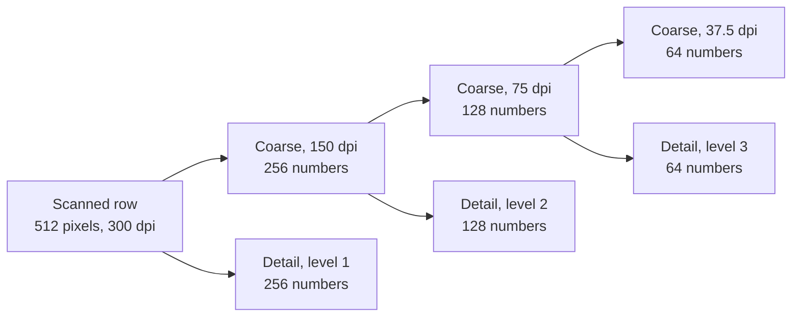
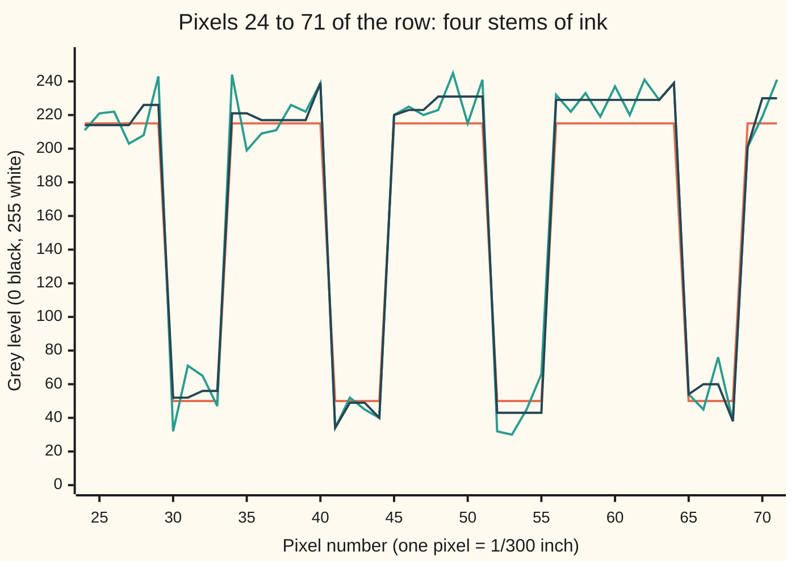

# Wavelets: a coarse picture plus the detail you left out at every scale

[Syllabus](../../../SYLLABUS.md) → [Engineering mathematics](../README.md) → [Signals](../README.md#s05) → Wavelets

---

## General Overview

An office scanner reads a printed page at 300 dpi (dots per inch: 300 pixels for every 25.4 mm). Each pixel is a grey level from 0 (black) to 255 (white). Clean paper should read 215 and printed ink 50. The scanner's sensor adds noise: each pixel is off by a random amount with a standard deviation of 16 grey levels. The paper comes out speckled, which bloats the compressed file and confuses the text reader.

Take one row of 512 pixels, 43.35 mm of the page, crossing the word "minimum". The engineer wants the speckle gone and the letter edges kept sharp. The obvious fix, averaging each pixel with its two neighbours, makes things worse. The error against the clean page (the root-mean-square difference: square each pixel's miss, average, take the square root) rises from 16.07 to 21.08 grey levels, because every edge gets smeared across three pixels.

A wavelet transform does something different. It replaces the 512 pixel values with 512 other numbers: a coarse picture of the row at 37.5 dpi, plus the detail lost at each halving of the resolution. Flat paper gives zero detail. Each letter edge gives a few large detail numbers. The noise spreads thinly over all of them, at the same size everywhere. So set every detail smaller than a threshold of 62.95 grey levels to zero, and rebuild. The error falls from 16.07 to 7.83 grey levels, and the speckle on bare paper drops from 15.45 to 4.66.

**A wavelet transform writes a signal as a coarse picture plus the detail left out at each scale, along perpendicular directions so that noise is the same size in every coefficient; a page is a few big details and noise is many small ones, so zeroing the small ones removes the noise and keeps the edges.**

**What kind of fact this is:** a theorem and a method. That the Haar transform rebuilds the row exactly, keeps its energy and leaves the noise the same size at every level is proved on this card in Why it works. The threshold rule is a method; the theorem that its soft form is close to the best possible is stated here and proved in the harmonic analysis wing.

### The picture: the ladder, rung by rung



Each rung halves the resolution. The detail box beside it holds exactly what the halving threw away, so the bottom coarse picture plus the three detail boxes, 64 + 64 + 128 + 256 numbers, rebuild the 512 pixels exactly.

---

## The formula

Notation first. The scanned row is $x[n]$, pixel number $n$, with $N$ pixels in all. Level $j$ is the rung of the ladder, from 1 (finest) to $J$ (coarsest); here $j$ is a level number, not the square root of −1 used elsewhere on this shelf. $k$ counts positions along a level. The row itself is level 0, so $s_0[n] = x[n]$.

$$s_j[k] = \frac{s_{j-1}[2k] + s_{j-1}[2k+1]}{\sqrt2},\qquad d_j[k] = \frac{s_{j-1}[2k] - s_{j-1}[2k+1]}{\sqrt2}$$

$$s_{j-1}[2k] = \frac{s_j[k] + d_j[k]}{\sqrt2},\qquad s_{j-1}[2k+1] = \frac{s_j[k] - d_j[k]}{\sqrt2}$$

$$\hat d_j[k] = \begin{cases} d_j[k] & \text{if } |d_j[k]| > T\\ 0 & \text{otherwise}\end{cases},\qquad T = \hat\sigma\sqrt{2\ln N},\qquad \hat\sigma = \frac{\operatorname{median}\,|d_1[k]|}{0.6745}$$

**Read it aloud:** take neighbours in pairs, keep their sum and their difference, each divided by root two, and repeat on the sums; to clean the row, zero every difference smaller than the noise level times the square root of two times the natural log of N, and run the pairing backwards.

| Symbol | Plain meaning | In our example | Push it up and the answer… |
| --- | --- | --- | --- |
| $x[n]$ | the scanned row: grey level of pixel $n$, 0 black to 255 white | 512 pixels; paper 215, ink 50 | — |
| $N$ | how many pixels in the row | 512 | $T$ rises slowly, as $\sqrt{2\ln N}$ |
| $j,\ J$ | the rung of the ladder, and the deepest rung | $J$ = 3: 150, 75 and 37.5 dpi | the coarse picture gets coarser; wide features move into the details |
| $k$ | position along a rung | 0 to 255 at level 1 | — |
| $s_j[k]$ | the **coarse picture** at level $j$: a pair sum, divided by $\sqrt2$ | 64 numbers at 37.5 dpi | — |
| $d_j[k]$ | the **detail** at level $j$: a pair difference, divided by $\sqrt2$ | 145.0 at the left edge of the ink in the hand block | — |
| $\hat d_j[k]$ | the detail after the threshold: kept if large, zero if small | 14, 26 and 21 kept at levels 1, 2, 3 | — |
| $a,\ b$ | two neighbouring pixels, as one pair (Why it works, Step 1) | 239 and 34, pixels 40 and 41 | their sum and difference grow with them |
| $t$ | a trial level for one bell-curve draw (the fold in Step 5) | 3.5322 | fewer noise draws exceed it |
| $\sigma$ | the noise's standard deviation, in grey levels | 16 | more speckle; $T$ must rise with it |
| $\hat\sigma$ | the estimate of $\sigma$ from the finest details | 17.82 | — |
| $T$ | the **threshold**: details smaller than this are zeroed | 62.95 | less noise survives, and more faint features are erased |

### When it holds

- **The noise is independent from pixel to pixel, with one size everywhere** (called white noise). If the scanner's optics smear the noise across neighbours, the finest details see less of it, $\hat\sigma$ comes out low, and speckle survives the threshold.
- **The page is mostly flat between edges.** Text is: paper, ink, paper. A photograph or a halftone pattern spreads into many middle-sized details, and zeroing them blurs the picture.
- **The features you care about stand well above $T$.** A faint pencil line, 40 grey levels darker than the paper and 3 pixels wide, has a largest detail of only 42.4, under $T$ = 62.95. The threshold treats it as noise: it comes back at 204.1 instead of 175.
- **The row length is a multiple of $2^J$.** 512 is 64 × 8. Otherwise the last pairs have no partner, and the row must be padded.
- **The √2 stays in.** Without it, the noise shrinks at every level and one threshold can no longer fit all levels; the error goes to 27.22.

---

## Why it works

### Step 0: change coordinates so the page is short and the noise is not

The pixel values are coordinates of the row along 512 directions, one per pixel. Noise touches every one of them equally, and so does the page. Nothing in the pixel list tells noise from ink.

The wavelet idea is to choose 512 other perpendicular directions in which the page needs only a few large coordinates. The noise has no reason to prefer any direction, so it stays spread over all 512, small in each. Then a single rule, keep the large and zero the small, separates them.

### Step 1: one pair is a rotation by 45 degrees

Take two neighbouring pixels $a$ and $b$. Replace them with $(a + b)/\sqrt2$ and $(a - b)/\sqrt2$. These are the coordinates of the point $(a, b)$ along two new axes, the directions $(1, 1)/\sqrt2$ and $(1, -1)/\sqrt2$. Both have length 1 and their dot product is zero, so the new axes are the old ones turned through 45 degrees.

A rotation keeps every length: $\bigl((a+b)/\sqrt2\bigr)^2 + \bigl((a-b)/\sqrt2\bigr)^2 = a^2 + b^2$. And it can be undone: add the two new numbers and divide by $\sqrt2$ to get $a$, subtract to get $b$. That is the second line of the formula.

Per pair, the sum says how bright the pair is overall and the difference says how much they disagree. Two paper pixels give a large sum and a difference near zero. A paper pixel next to an ink pixel gives a large difference: the 165 grey levels between them, divided by $\sqrt2$.

### Step 2: the ladder, and why each rung rebuilds exactly

Pair the whole row: 256 sums make the coarse picture at 150 dpi, and 256 differences make the level-1 detail. Pair the 256 sums the same way, and again. This is the **multiresolution ladder**: the row seen at 300, 150, 75 and 37.5 dpi, with the detail between neighbouring rungs kept separately. Each rung is a set of separate pair rotations, so undoing the rungs from the bottom up returns the row exactly. The check confirms this to 1e-9 grey levels, and finds the energy (the sum of squares) is 21208941.0 in pixels and 21208941.0 in coefficients.

Unfold the ladder and each final number is one dot product of the row with a fixed pattern. A level-$j$ detail uses an up-down step $2^j$ pixels wide: $+1/\sqrt{2^j}$ on the first half, $-1/\sqrt{2^j}$ on the second. A coarse number uses a flat box $2^J$ pixels wide. These are the **Haar wavelets** and the **scaling boxes**. They are perpendicular and of length 1: an orthonormal basis, so each coordinate is one dot product, as on the [Gram-Schmidt](../../03-Algebra/06-Dot%20Products%20and%20Best%20Fits/03-gram-schmidt-and-orthonormal-bases.md) card. The check builds all 512 patterns, confirms they are orthonormal to 1e-12, and that the dot products equal the ladder's numbers to 1e-9.

The patterns nest: a box is two half-width boxes side by side, and an up-down step is a half-width box minus its neighbour. This **two-scale relation** is why the ladder needs only pairs, about $2N$ additions instead of $N^2$ multiplications.

<details>
<summary>The same ladder as a pair of filters and a rate change</summary>

Each rung is a two-tap low-pass filter with weights $(1/\sqrt2, 1/\sqrt2)$ and a two-tap high-pass filter with weights $(1/\sqrt2, -1/\sqrt2)$ ([Digital filters](04-digital-filters-fir-and-iir.md)), each followed by keeping one output in two ([Changing rate](05-resampling-decimation-and-interpolation.md)). Neither short filter is a good low-pass or high-pass, so each half-rate channel is full of aliases: tones folded down by dropping every second sample. The aliases cancel exactly when the two channels are recombined, because the rebuild in Step 1 recovers each pair $a$ and $b$ without error. A pair of filters with this property is a **perfect-reconstruction filter bank**. Longer filters with the same property exist; the Daubechies family is the best known, and its four-tap member keeps straight-line ramps out of the details, which Haar does not. Their construction is proved in the harmonic analysis wing.

</details>

### Step 3: the noise is the same size in every coefficient

Each coefficient is a dot product of the row with a pattern of length 1. Noise that is independent from pixel to pixel, with standard deviation $\sigma$, gives each such dot product a standard deviation of $\sigma$ times the pattern's length: $\sigma$ again. Different patterns are perpendicular, so their noise is uncorrelated. In short, rotating white noise gives white noise of the same size.

The check runs 2000 rows of pure noise with $\sigma$ = 1 through the ladder. The detail coefficients come out with standard deviation 0.999, 1.001 and 1.000 at levels 1, 2 and 3. Drop the $\sqrt2$, using plain averages and half-differences instead, and they come out at 0.706, 0.500 and 0.354: the noise shrinks with every rung, and no single threshold suits them all.

### Step 4: the page is a few large details

Flat paper has no detail at any level: a pair of equal pixels has difference zero. An edge between paper and ink lands inside at most one pattern per level, so it makes at most one nonzero detail per level, of size up to about the contrast, 165 grey levels, times a factor set by where the edge falls and how wide the pattern is. The clean row's details are almost all exactly zero. The few that are not are large.

A row with this property is called **sparse** in the wavelet basis. [Compressed sensing](10-compressed-sensing-in-outline.md) builds on the same fact.

### Step 5: where to put the threshold

Noise coefficients are bell-curve draws of size $\sigma$. The largest of $N$ such draws grows only slowly with $N$: it seldom goes far past $\sigma\sqrt{2\ln N}$, though it does pass it now and then. For $N$ = 512 that multiplier is 3.5322. So a threshold of $\sigma$ times 3.5322 zeroes nearly every pure-noise coefficient. In 2000 rows of pure noise, each with 256 + 128 + 64 details, the check counts 336 details above the multiplier, about one for every six rows; the bell curve's tail predicts 369.2.

The noise level itself comes from the data. Most level-1 details are pure noise, since most pixel pairs do not straddle an edge. The median of their sizes is robust to the few edge details, and for a bell curve the median size is 0.6745 $\sigma$. Here $\hat\sigma$ = 17.82 against a true 16: the edges still push it up a little, so $T$ = 62.95 is slightly cautious.

A 1994 theorem (the fourth source below) shows that, for any signal, the soft form of this rule (see What breaks) comes within a factor of about $2\ln N$ of an oracle that knows which coefficients are signal. On a sparse signal the oracle's error is small, so the soft rule's is too. This card quotes that bound for the soft rule only. For the hard rule used here, the check measures the result directly, and on this page it does far better than the soft rule. The proof belongs to the harmonic analysis wing.

<details>
<summary>Why the largest of N bell-curve draws is about root of 2 ln N</summary>

The chance that one standard bell-curve draw exceeds $t$ is about $e^{-t^2/2}$, up to a slowly varying factor. With $N$ draws, the expected number above $t$ is about $N e^{-t^2/2}$. Set that to 1 and solve: $t^2 = 2\ln N$. The check integrates the exact tail by Simpson's rule to get the 369.2 above.

</details>

---

## Worked numbers, by hand

The hand block is pixels 40 to 47. On the clean page they are paper, four pixels of ink (the second stem of the first "m"), then paper: 215, 50, 50, 50, 50, 215, 215, 215. The scanner delivered 239, 34, 52, 45, 40, 220, 225, 220. All arithmetic divides by $\sqrt2$ = 1.4142.

| Step | Arithmetic | Value |
| --- | --- | --- |
| level 1, coarse | (239 + 34)/√2, (52 + 45)/√2, (40 + 220)/√2, (225 + 220)/√2 | 193.0, 68.6, 183.8, 314.7 |
| level 1, detail | (239 − 34)/√2, (52 − 45)/√2, (40 − 220)/√2, (225 − 220)/√2 | 145.0, 4.9, −127.3, 3.5 |
| level 2, coarse | (193.0 + 68.6)/√2, (183.8 + 314.7)/√2 | 185.0, 352.5 |
| level 2, detail | (193.0 − 68.6)/√2, (183.8 − 314.7)/√2 | 88.0, −92.5 |
| level 3, coarse | (185.0 + 352.5)/√2 | 380.1 |
| level 3, detail | (185.0 − 352.5)/√2 | −118.4 |
| noise estimate, whole row | median of the 256 level-1 detail sizes, divided by 0.6745 | 17.82 |
| threshold | 17.82 × √(2 ln 512) = 17.82 × 3.5322 | 62.95 |
| threshold the details | 145.0, −127.3, 88.0, −92.5, −118.4 are above 62.95; 4.9 and 3.5 are not | two zeros |
| rebuild level 1 pairs | (68.6 ± 0)/√2 and (314.7 ± 0)/√2 | 48.5, 48.5 and 222.5, 222.5 |
| **denoised block** | the other pairs come back unchanged | **239.0, 34.0, 48.5, 48.5, 40.0, 220.0, 222.5, 222.5** |

The two pairs inside flat regions lost their noise: 52 and 45 became 48.5 twice, 225 and 220 became 222.5 twice. The two pairs that straddle an edge kept their large details, and with them their noise: 239 stays 239.

Over the whole row, the same rule keeps 14 details at level 1, 26 at level 2 and 21 at level 3, out of 256, 128 and 64. The error against the clean page falls from 16.07 to 7.83 grey levels, and on bare paper away from any edge it falls from 15.45 to 4.66. In peak signal-to-noise ratio (20 log10 of 255 over the error, in decibels), the scan improves from 24.01 dB to 30.26 dB. That draw was a good one: over 20 other noise draws the error falls from 15.92 to 9.18 on average, ranging from 7.52 to 11.67.



The orange line is the clean page: paper at 215, four ink stems at 50. The green line is the scan. The dark line is the denoised row: edges as sharp as the scan's, flat runs where the paper was, and leftover noise on the pixels right at an edge. A flat run can still sit well off the paper's 215, as at 231, the average of the four noisy paper pixels there, because the coarse value and the kept level-3 edge detail both carry their noise.

### What breaks if you drop a piece

| Mistake | Comes out at | What went wrong |
| --- | --- | --- |
| Soft threshold: shrink every kept detail by $T$ as well | error 22.08; ink reads 95.0, not 50 | every edge detail lost 62.95, so the ink fades to grey |
| Plain average and half-difference, same $T$ | error 27.22 | without the √2 the coarse details shrink, fall under $T$, and real edges are erased |
| Threshold at $T = \hat\sigma$ instead of $\hat\sigma\sqrt{2\ln N}$ | error 14.57 | many pure-noise details now beat the threshold, so most of the speckle stays |
| Average each pixel with its neighbours instead | error 21.08 | the noise falls, but every edge is smeared across three pixels |
| A pencil line 40 grey levels darker than the paper | reads 204.1, not 175 | its largest detail, 42.4, is under $T$: a real feature fainter than the noise floor is erased with the noise |

```
error against the clean page, grey levels (20 marks = 27.22)
  scan as delivered            ████████████          16.07
  hard threshold, the method   ██████                 7.83
  threshold = sigma only       ███████████           14.57
  three-pixel average          ███████████████       21.08
  soft threshold               ████████████████      22.08
  no root 2                    ████████████████████  27.22
```

---

## Code, from first principles, and it actually runs

The script draws the clean row, adds scanner noise (a SplitMix64 generator, turned into bell-curve draws by the Box–Muller recipe), runs the Haar ladder, thresholds and rebuilds. Four independent roads check it: the fast ladder against 512 dot products with the explicit Haar patterns; the noise size per level, on 2000 rows of pure noise, against the 1 that Step 3 predicts; the count of noise details above the multiplier against the bell curve's tail, integrated by Simpson's rule; and the denoised error from pixels against the same error from coefficients.

### Python

```python
# Wavelets: Haar transform, the multiresolution ladder, and denoising one row of a scanned page.
# Standard library only.  Noise comes from SplitMix64 (seed 2026) and Box-Muller, written out.
from math import sqrt, log, cos, pi, exp, log10

M64 = (1 << 64) - 1
class Rng:
    def __init__(self, seed): self.x = seed
    def u64(self):
        self.x = (self.x + 0x9E3779B97F4A7C15) & M64
        z = self.x
        z = ((z ^ (z >> 30)) * 0xBF58476D1CE4E5B9) & M64
        z = ((z ^ (z >> 27)) * 0x94D049BB133111EB) & M64
        return z ^ (z >> 31)
    def unif(self): return ((self.u64() >> 11) + 0.5) / 2.0 ** 53
    def gauss(self): u1, u2 = self.unif(), self.unif(); return sqrt(-2.0 * log(u1)) * cos(2.0 * pi * u2)
R2 = sqrt(2.0)
def forward(x, levels, norm=R2):           # Haar pyramid: pair sums and pair differences, divided by norm
    s, ds = list(x), []
    for _ in range(levels):
        ds.append([(s[2 * k] - s[2 * k + 1]) / norm for k in range(len(s) // 2)])
        s = [(s[2 * k] + s[2 * k + 1]) / norm for k in range(len(s) // 2)]
    return s, ds                            # coarse picture, then details from finest to coarsest
def inverse(s, ds, norm=R2):
    s = list(s)
    for d in reversed(ds):
        s = [v for a, b in zip(s, d) for v in ((a + b) * norm / 2, (a - b) * norm / 2)]
    return s
def rmse(a, b): return sqrt(sum((x - y) ** 2 for x, y in zip(a, b)) / len(a))
def median(v): v = sorted(v); return (v[len(v) // 2 - 1] + v[len(v) // 2]) / 2   # even length only
def hard(v, t): return v if abs(v) > t else 0.0
def soft(v, t): return (1.0 if v > 0 else -1.0) * max(abs(v) - t, 0.0)
def shrink(s, ds, t, rule): return inverse(s, [[rule(v, t) for v in d] for d in ds])
def tail(t, n=2000):                        # chance a standard bell-curve draw lands above t (Simpson)
    h, f = t / n, lambda z: exp(-z * z / 2) / sqrt(2 * pi)
    area = f(0) + f(t) + sum((4 if i % 2 else 2) * f(i * h) for i in range(1, n))
    return 0.5 - area * h / 3
def fmt(v): return " ".join(f"{x:.1f}" for x in v)
def flat(x):                                # every coefficient: details finest first, then the coarse picture
    s, ds = forward(x, J); return [c for d in ds for c in d] + s
def scan(seed): g = Rng(seed); return [min(255, max(0, round(c + SIGMA * g.gauss()))) for c in clean]
def denoise(row):                           # estimate sigma from the finest details, threshold at T, rebuild
    s, ds = forward(row, J); sh = median([abs(c) for c in ds[0]]) / 0.6745
    return shrink(s, ds, sh * ln, hard), sh

# ---- the page: one row of 512 pixels at 300 dpi through the word "minimum", plus a faint pencil line ----
N, J, PAPER, INK, PENCIL, SIGMA = 512, 3, 215, 50, 175, 16
ln, n_det = sqrt(2 * log(N)), N - N // 2 ** J   # the universal multiplier; how many details
stems, p = [], 30
for count in (3, 1, 2, 1, 3, 2, 3):        # stems of m, i, n, i, m, u, m; each stem 4 pixels wide
    for _ in range(count): stems.append(p); p += 11
    p += 2
clean = [PAPER] * N
for a in stems:
    for i in range(a, a + 4): clean[i] = INK
clean[400] = clean[401] = clean[402] = PENCIL
noisy = scan(2026)
print(f"row: {N} pixels at 300 dpi = {N * 25.4 / 300:.2f} mm; paper {PAPER}, ink {INK}, noise sigma {SIGMA} grey levels")

# ---- by hand: the 8 pixels 40 to 47, three levels ----
print("hand block, pixels 40-47, clean:", fmt(clean[40:48]), " noisy:", fmt(noisy[40:48]))
s = noisy[40:48]
for lev in (1, 2, 3):
    s, d = forward(s, 1)
    print(f"  level {lev}: coarse {fmt(s)}  detail {fmt(d[0])}")
# ---- road 1: fast pyramid against dot products with the explicit Haar basis vectors ----
basis = []
for j in range(1, J + 2):                   # wavelets at levels 1 to J, then the level-J boxes
    L = 2 ** min(j, J)
    for k in range(N // L):
        v = [0.0] * N
        for i in range(L): v[k * L + i] = (1 if i < L // 2 or j > J else -1) / sqrt(L)
        basis.append(v)
cs, cds = forward(noisy, J)
fast = flat(noisy)
slow = [sum(a * b for a, b in zip(v, noisy)) for v in basis]
gap = max(abs(a - b) for a, b in zip(fast, slow))
nz = [[i for i in range(N) if v[i] != 0] for v in basis]
ortho = max(abs(sum(basis[a][i] * basis[b][i] for i in nz[a]) - (a == b)) for a in range(N) for b in range(N))
back = max(abs(a - b) for a, b in zip(inverse(cs, cds), noisy))
e_pix, e_coef = sum(x * x for x in noisy), sum(c * c for c in fast)
yes = lambda ok: "yes" if ok else "NO"
print(f"fast transform equals basis dot products to 1e-9: {yes(gap < 1e-9)}; basis orthonormal to 1e-12: {yes(ortho < 1e-12)}")
print(f"rebuilt row equals scanned row to 1e-9: {yes(back < 1e-9)}; energy {e_pix:.1f} in pixels, {e_coef:.1f} in coefficients")
assert gap < 1e-9 and ortho < 1e-12 and back < 1e-9 and abs(e_pix - e_coef) < 1e-6 * e_pix
# ---- denoise: estimate sigma from the finest details, threshold, rebuild ----
den, sig_hat = denoise(noisy)
T = sig_hat * ln
print(f"sigma estimate {sig_hat:.2f} (true {SIGMA}); multiplier sqrt(2 ln {N}) = {ln:.4f}; threshold T = {T:.2f}")
print("hand block, denoised:", fmt(den[40:48]))
# ---- the ladder, and road 2: pure noise keeps its size at every level (2000 noise-only rows) ----
rows_mc, sq, sq_raw, over, mc = 2000, [0.0] * J, [0.0] * J, 0, Rng(7)
for _ in range(rows_mc):
    z = [mc.gauss() for _ in range(N)]
    zd, zr = forward(z, J)[1], forward(z, J, 2.0)[1]
    for j in range(J):
        sq[j] += sum(c * c for c in zd[j]); sq_raw[j] += sum(c * c for c in zr[j])
        over += sum(1 for c in zd[j] if abs(c) > ln)
print("level  dpi  pixel(mm)  coefficients  details kept  noise std  noise std, no root 2")
for j in range(J):
    cnt = N // 2 ** (j + 1)
    kept = sum(1 for c in cds[j] if abs(c) > T)
    sd, sdr = sqrt(sq[j] / (rows_mc * cnt)), sqrt(sq_raw[j] / (rows_mc * cnt))
    print(f"{j + 1:5d} {300 / 2 ** (j + 1):5.1f} {25.4 * 2 ** (j + 1) / 300:9.3f} {cnt:12d} {kept:12d} {sd:10.3f} {sdr:10.3f}")
    assert abs(sd - 1) < 0.02 and abs(sdr - 0.5 ** ((j + 1) / 2)) < 0.02
expect = rows_mc * n_det * 2 * tail(ln)
print(f"pure-noise details above the multiplier, {rows_mc} rows: {over} counted, {expect:.1f} expected")
assert abs(over - expect) < 4 * sqrt(expect)
# ---- the result, measured two ways: in pixels and in coefficients ----
e_den = rmse(den, clean)
coef_err = rmse(flat(den), flat(clean))
print(f"rms error, grey levels: noisy {rmse(noisy, clean):.2f}, denoised {e_den:.2f} (from coefficients {coef_err:.2f})")
assert abs(coef_err - e_den) < 1e-9 and e_den < 0.7 * rmse(noisy, clean)
bg = [i for i in range(N) if all(clean[k] == PAPER for k in range(max(0, i - 4), min(N, i + 5)))]
print(f"bare paper ({len(bg)} pixels): noisy {rmse([noisy[i] for i in bg], [PAPER] * len(bg)):.2f}, denoised {rmse([den[i] for i in bg], [PAPER] * len(bg)):.2f}")
psnr = lambda e: 20 * log10(255 / e)
print(f"peak signal to noise: noisy {psnr(rmse(noisy, clean)):.2f} dB, denoised {psnr(e_den):.2f} dB")
runs = [(rmse(r, clean), rmse(denoise(r)[0], clean)) for r in map(scan, range(1, 21))]
mean_n, mean_d = sum(a for a, _ in runs) / 20, sum(b for _, b in runs) / 20
print(f"20 other noise draws: noisy {mean_n:.2f}, denoised {mean_d:.2f} on average, {min(b for _, b in runs):.2f} to {max(b for _, b in runs):.2f}")
assert all(b < a for a, b in runs)
# ---- what breaks ----
sft = shrink(cs, cds, T, soft)
ink_px = [i for i in range(N) if clean[i] == INK]
rs, rr = forward(noisy, J, 2.0)
raw = inverse(rs, [[hard(v, T) for v in d] for d in rr], 2.0)
low = shrink(cs, cds, sig_hat, hard)
box = [sum(noisy[max(0, i - 1):i + 2]) / len(noisy[max(0, i - 1):i + 2]) for i in range(N)]
print(f"soft instead of hard: rms {rmse(sft, clean):.2f}; mean ink level {sum(sft[i] for i in ink_px) / len(ink_px):.1f} (true {INK})")
print(f"average and half-difference, same T: rms {rmse(raw, clean):.2f}")
print(f"threshold T = sigma only: rms {rmse(low, clean):.2f}")
print(f"3-pixel blur instead: rms {rmse(box, clean):.2f}")
assert min(rmse(sft, clean), rmse(raw, clean), rmse(low, clean), rmse(box, clean)) > e_den
pen = [PENCIL if 400 <= i < 403 else PAPER for i in range(N)]   # the pencil line alone
pen_max = max(abs(c) for c in flat(pen)[:n_det])
print(f"pencil line (true {PENCIL}): largest detail {pen_max:.1f}; noisy {fmt(noisy[400:403])}, denoised {fmt(den[400:403])}")
assert pen_max < T and min(den[400:403]) > 195
# ---- chart points: pixels 24 to 71 ----
for name, row in (("clean", clean), ("noisy", noisy), ("denoised", den)):
    print(f"chart, {name}: " + ", ".join(f"{v:.0f}" for v in row[24:72]))
print("ALL CHECKS PASS")
```

**Ran 2026-11-11 on macOS, Python 3.14.10, standard library only. All checks passed. Output, pasted from the run:**

```
row: 512 pixels at 300 dpi = 43.35 mm; paper 215, ink 50, noise sigma 16 grey levels
hand block, pixels 40-47, clean: 215.0 50.0 50.0 50.0 50.0 215.0 215.0 215.0  noisy: 239.0 34.0 52.0 45.0 40.0 220.0 225.0 220.0
  level 1: coarse 193.0 68.6 183.8 314.7  detail 145.0 4.9 -127.3 3.5
  level 2: coarse 185.0 352.5  detail 88.0 -92.5
  level 3: coarse 380.1  detail -118.4
fast transform equals basis dot products to 1e-9: yes; basis orthonormal to 1e-12: yes
rebuilt row equals scanned row to 1e-9: yes; energy 21208941.0 in pixels, 21208941.0 in coefficients
sigma estimate 17.82 (true 16); multiplier sqrt(2 ln 512) = 3.5322; threshold T = 62.95
hand block, denoised: 239.0 34.0 48.5 48.5 40.0 220.0 222.5 222.5
level  dpi  pixel(mm)  coefficients  details kept  noise std  noise std, no root 2
    1 150.0     0.169          256           14      0.999      0.706
    2  75.0     0.339          128           26      1.001      0.500
    3  37.5     0.677           64           21      1.000      0.354
pure-noise details above the multiplier, 2000 rows: 336 counted, 369.2 expected
rms error, grey levels: noisy 16.07, denoised 7.83 (from coefficients 7.83)
bare paper (329 pixels): noisy 15.45, denoised 4.66
peak signal to noise: noisy 24.01 dB, denoised 30.26 dB
20 other noise draws: noisy 15.92, denoised 9.18 on average, 7.52 to 11.67
soft instead of hard: rms 22.08; mean ink level 95.0 (true 50)
average and half-difference, same T: rms 27.22
threshold T = sigma only: rms 14.57
3-pixel blur instead: rms 21.08
pencil line (true 175): largest detail 42.4; noisy 197.0 183.0 154.0, denoised 204.1 204.1 204.1
chart, clean: 215, 215, 215, 215, 215, 215, 50, 50, 50, 50, 215, 215, 215, 215, 215, 215, 215, 50, 50, 50, 50, 215, 215, 215, 215, 215, 215, 215, 50, 50, 50, 50, 215, 215, 215, 215, 215, 215, 215, 215, 215, 50, 50, 50, 50, 215, 215, 215
chart, noisy: 211, 221, 222, 203, 208, 243, 32, 71, 65, 47, 244, 199, 209, 211, 226, 222, 239, 34, 52, 45, 40, 220, 225, 220, 223, 245, 215, 241, 32, 30, 45, 66, 232, 222, 233, 219, 237, 220, 241, 229, 239, 54, 45, 76, 38, 201, 219, 241
chart, denoised: 214, 214, 214, 214, 226, 226, 52, 52, 56, 56, 221, 221, 217, 217, 217, 217, 239, 34, 49, 49, 40, 220, 223, 223, 231, 231, 231, 231, 43, 43, 43, 43, 229, 229, 229, 229, 229, 229, 229, 229, 239, 54, 60, 60, 38, 201, 230, 230
ALL CHECKS PASS
```

### Rust

Same numbers, same labels, built with `rustc --edition 2021 -O`.

```rust
// Wavelets: Haar transform, the multiresolution ladder, and denoising one row of a scanned page.
// std only.  Noise comes from SplitMix64 (seed 2026) and Box-Muller, written out.
use std::f64::consts::PI;
struct Rng { x: u64 }
impl Rng {
    fn u64(&mut self) -> u64 {
        self.x = self.x.wrapping_add(0x9E3779B97F4A7C15);
        let mut z = self.x;
        z = (z ^ (z >> 30)).wrapping_mul(0xBF58476D1CE4E5B9);
        z = (z ^ (z >> 27)).wrapping_mul(0x94D049BB133111EB);
        z ^ (z >> 31)
    }
    fn unif(&mut self) -> f64 { ((self.u64() >> 11) as f64 + 0.5) / 2f64.powi(53) }
    fn gauss(&mut self) -> f64 { let (u1, u2) = (self.unif(), self.unif()); (-2.0 * u1.ln()).sqrt() * (2.0 * PI * u2).cos() }
}
// Haar pyramid: pair sums and pair differences, divided by norm
fn forward(x: &[f64], levels: usize, norm: f64) -> (Vec<f64>, Vec<Vec<f64>>) {
    let (mut s, mut ds) = (x.to_vec(), Vec::new());
    for _ in 0..levels {
        let h = s.len() / 2;
        ds.push((0..h).map(|k| (s[2 * k] - s[2 * k + 1]) / norm).collect());
        s = (0..h).map(|k| (s[2 * k] + s[2 * k + 1]) / norm).collect();
    }
    (s, ds) // coarse picture, then details from finest to coarsest
}
fn inverse(s0: &[f64], ds: &[Vec<f64>], norm: f64) -> Vec<f64> {
    let mut s = s0.to_vec();
    for d in ds.iter().rev() {
        s = s.iter().zip(d).flat_map(|(a, b)| [(a + b) * norm / 2.0, (a - b) * norm / 2.0]).collect();
    }
    s
}
fn rmse(a: &[f64], b: &[f64]) -> f64 { (a.iter().zip(b).map(|(x, y)| (x - y) * (x - y)).sum::<f64>() / a.len() as f64).sqrt() }
fn median(v: &[f64]) -> f64 { // even length only
    let mut v = v.to_vec(); v.sort_by(|a, b| a.partial_cmp(b).unwrap()); (v[v.len() / 2 - 1] + v[v.len() / 2]) / 2.0
}
fn hard(v: f64, t: f64) -> f64 { if v.abs() > t { v } else { 0.0 } }
fn soft(v: f64, t: f64) -> f64 { (if v > 0.0 { 1.0 } else { -1.0 }) * (v.abs() - t).max(0.0) }
fn shrink(s: &[f64], ds: &[Vec<f64>], t: f64, rule: fn(f64, f64) -> f64) -> Vec<f64> {
    inverse(s, &ds.iter().map(|d| d.iter().map(|&v| rule(v, t)).collect()).collect::<Vec<Vec<f64>>>(), 2f64.sqrt())
}
fn tail(t: f64, n: usize) -> f64 { // chance a standard bell-curve draw lands above t (Simpson)
    let (h, f) = (t / n as f64, |z: f64| (-z * z / 2.0).exp() / (2.0 * PI).sqrt());
    let mut area = f(0.0) + f(t);
    for i in 1..n { area += (if i % 2 == 1 { 4.0 } else { 2.0 }) * f(i as f64 * h); }
    0.5 - area * h / 3.0
}
fn fmt(v: &[f64]) -> String { v.iter().map(|x| format!("{:.1}", x)).collect::<Vec<_>>().join(" ") }
fn flat(x: &[f64], j: usize) -> Vec<f64> { // every coefficient: details finest first, then the coarse picture
    let (s, ds) = forward(x, j, 2f64.sqrt());
    ds.iter().flatten().chain(s.iter()).cloned().collect()
}
fn yes(ok: bool) -> &'static str { if ok { "yes" } else { "NO" } }
fn scan(clean: &[f64], sigma: f64, seed: u64) -> Vec<f64> {
    let mut g = Rng { x: seed }; clean.iter().map(|c| (c + sigma * g.gauss()).round_ties_even().clamp(0.0, 255.0)).collect()
}
fn denoise(row: &[f64], j: usize, ln: f64) -> (Vec<f64>, f64) { // estimate sigma from the finest details, threshold at T, rebuild
    let (s, ds) = forward(row, j, 2f64.sqrt());
    let sh = median(&ds[0].iter().map(|c| c.abs()).collect::<Vec<_>>()) / 0.6745;
    (shrink(&s, &ds, sh * ln, hard), sh)
}
fn main() {
    let r2 = 2f64.sqrt();
    // ---- the page: one row of 512 pixels at 300 dpi through the word "minimum", plus a faint pencil line ----
    let (n, jl, paper, ink, pencil, sigma) = (512usize, 3usize, 215.0, 50.0, 175.0, 16.0);
    let (mut stems, mut p) = (Vec::new(), 30usize);
    for count in [3, 1, 2, 1, 3, 2, 3] { // stems of m, i, n, i, m, u, m; each stem 4 pixels wide
        for _ in 0..count { stems.push(p); p += 11; }
        p += 2;
    }
    let mut clean = vec![paper; n];
    for &a in &stems { for i in a..a + 4 { clean[i] = ink; } }
    for i in 400..403 { clean[i] = pencil; }
    let (ln, n_det) = ((2.0 * (n as f64).ln()).sqrt(), n - n / (1 << jl)); // the universal multiplier; how many details
    let noisy = scan(&clean, sigma, 2026);
    println!("row: {} pixels at 300 dpi = {:.2} mm; paper {}, ink {}, noise sigma {} grey levels", n, n as f64 * 25.4 / 300.0, paper, ink, sigma);
    // ---- by hand: the 8 pixels 40 to 47, three levels ----
    println!("hand block, pixels 40-47, clean: {}  noisy: {}", fmt(&clean[40..48]), fmt(&noisy[40..48]));
    let mut s = noisy[40..48].to_vec();
    for lev in 1..=3 {
        let (c, d) = forward(&s, 1, r2);
        println!("  level {}: coarse {}  detail {}", lev, fmt(&c), fmt(&d[0]));
        s = c;
    }
    // ---- road 1: fast pyramid against dot products with the explicit Haar basis vectors ----
    let mut basis: Vec<Vec<f64>> = Vec::new();
    for j in 1..=jl + 1 { // wavelets at levels 1 to J, then the level-J boxes
        let l = 1usize << j.min(jl);
        for k in 0..n / l {
            let mut v = vec![0.0; n];
            for i in 0..l { v[k * l + i] = (if i < l / 2 || j > jl { 1.0 } else { -1.0 }) / (l as f64).sqrt(); }
            basis.push(v);
        }
    }
    let (cs, cds) = forward(&noisy, jl, r2);
    let fast = flat(&noisy, jl);
    let slow: Vec<f64> = basis.iter().map(|v| v.iter().zip(&noisy).map(|(a, b)| a * b).sum()).collect();
    let gap = fast.iter().zip(&slow).map(|(a, b)| (a - b).abs()).fold(0.0, f64::max);
    let nz: Vec<Vec<usize>> = basis.iter().map(|v| (0..n).filter(|&i| v[i] != 0.0).collect()).collect();
    let ortho = (0..n * n).map(|ab| { let (a, b) = (ab / n, ab % n);
        (nz[a].iter().map(|&i| basis[a][i] * basis[b][i]).sum::<f64>() - if a == b { 1.0 } else { 0.0 }).abs() }).fold(0.0, f64::max);
    let back = inverse(&cs, &cds, r2).iter().zip(&noisy).map(|(a, b)| (a - b).abs()).fold(0.0, f64::max);
    let (e_pix, e_coef): (f64, f64) = (noisy.iter().map(|x| x * x).sum(), fast.iter().map(|c| c * c).sum());
    println!("fast transform equals basis dot products to 1e-9: {}; basis orthonormal to 1e-12: {}", yes(gap < 1e-9), yes(ortho < 1e-12));
    println!("rebuilt row equals scanned row to 1e-9: {}; energy {:.1} in pixels, {:.1} in coefficients", yes(back < 1e-9), e_pix, e_coef);
    assert!(gap < 1e-9 && ortho < 1e-12 && back < 1e-9 && (e_pix - e_coef).abs() < 1e-6 * e_pix);
    // ---- denoise: estimate sigma from the finest details, threshold, rebuild ----
    let (den, sig_hat) = denoise(&noisy, jl, ln);
    let t = sig_hat * ln;
    println!("sigma estimate {:.2} (true {}); multiplier sqrt(2 ln {}) = {:.4}; threshold T = {:.2}", sig_hat, sigma, n, ln, t);
    println!("hand block, denoised: {}", fmt(&den[40..48]));
    // ---- the ladder, and road 2: pure noise keeps its size at every level (2000 noise-only rows) ----
    let (rows_mc, mut sq, mut sq_raw, mut over, mut mc) = (2000usize, vec![0.0; jl], vec![0.0; jl], 0usize, Rng { x: 7 });
    for _ in 0..rows_mc {
        let z: Vec<f64> = (0..n).map(|_| mc.gauss()).collect();
        let (zd, zr) = (forward(&z, jl, r2).1, forward(&z, jl, 2.0).1);
        for j in 0..jl {
            sq[j] += zd[j].iter().map(|c| c * c).sum::<f64>(); sq_raw[j] += zr[j].iter().map(|c| c * c).sum::<f64>();
            over += zd[j].iter().filter(|c| c.abs() > ln).count();
        }
    }
    println!("level  dpi  pixel(mm)  coefficients  details kept  noise std  noise std, no root 2");
    for j in 0..jl {
        let cnt = n >> (j + 1);
        let kept = cds[j].iter().filter(|c| c.abs() > t).count();
        let (sd, sdr) = ((sq[j] / (rows_mc * cnt) as f64).sqrt(), (sq_raw[j] / (rows_mc * cnt) as f64).sqrt());
        println!("{:5} {:5.1} {:9.3} {:12} {:12} {:10.3} {:10.3}", j + 1, 300.0 / (1 << (j + 1)) as f64, 25.4 * (1 << (j + 1)) as f64 / 300.0, cnt, kept, sd, sdr);
        assert!((sd - 1.0).abs() < 0.02 && (sdr - 0.5f64.powf((j + 1) as f64 / 2.0)).abs() < 0.02);
    }
    let expect = (rows_mc * n_det) as f64 * 2.0 * tail(ln, 2000);
    println!("pure-noise details above the multiplier, {} rows: {} counted, {:.1} expected", rows_mc, over, expect);
    assert!((over as f64 - expect).abs() < 4.0 * expect.sqrt());
    // ---- the result, measured two ways: in pixels and in coefficients ----
    let (e_noisy, e_den) = (rmse(&noisy, &clean), rmse(&den, &clean));
    let coef_err = rmse(&flat(&den, jl), &flat(&clean, jl));
    println!("rms error, grey levels: noisy {:.2}, denoised {:.2} (from coefficients {:.2})", e_noisy, e_den, coef_err);
    assert!((coef_err - e_den).abs() < 1e-9 && e_den < 0.7 * e_noisy);
    let bg: Vec<usize> = (0..n).filter(|&i| (i.saturating_sub(4)..(i + 5).min(n)).all(|k| clean[k] == paper)).collect();
    let (pick, flat_paper) = (|row: &[f64]| bg.iter().map(|&i| row[i]).collect::<Vec<f64>>(), vec![paper; bg.len()]);
    println!("bare paper ({} pixels): noisy {:.2}, denoised {:.2}", bg.len(), rmse(&pick(&noisy), &flat_paper), rmse(&pick(&den), &flat_paper));
    let psnr = |e: f64| 20.0 * (255.0 / e).log10();
    println!("peak signal to noise: noisy {:.2} dB, denoised {:.2} dB", psnr(e_noisy), psnr(e_den));
    let runs: Vec<(f64, f64)> = (1..=20).map(|sd| scan(&clean, sigma, sd)).map(|r| (rmse(&r, &clean), rmse(&denoise(&r, jl, ln).0, &clean))).collect();
    let (mean_n, mean_d) = (runs.iter().map(|r| r.0).sum::<f64>() / 20.0, runs.iter().map(|r| r.1).sum::<f64>() / 20.0);
    let (lo, hi) = (runs.iter().map(|r| r.1).fold(f64::MAX, f64::min), runs.iter().map(|r| r.1).fold(0.0, f64::max));
    println!("20 other noise draws: noisy {:.2}, denoised {:.2} on average, {:.2} to {:.2}", mean_n, mean_d, lo, hi);
    assert!(runs.iter().all(|r| r.1 < r.0));
    // ---- what breaks ----
    let sft = shrink(&cs, &cds, t, soft);
    let ink_px: Vec<usize> = (0..n).filter(|&i| clean[i] == ink).collect();
    let (rs, rr) = forward(&noisy, jl, 2.0);
    let raw = inverse(&rs, &rr.iter().map(|d| d.iter().map(|&v| hard(v, t)).collect()).collect::<Vec<Vec<f64>>>(), 2.0);
    let low = shrink(&cs, &cds, sig_hat, hard);
    let bx: Vec<f64> = (0..n).map(|i| { let w = &noisy[i.saturating_sub(1)..(i + 2).min(n)]; w.iter().sum::<f64>() / w.len() as f64 }).collect();
    let ink_mean = ink_px.iter().map(|&i| sft[i]).sum::<f64>() / ink_px.len() as f64;
    println!("soft instead of hard: rms {:.2}; mean ink level {:.1} (true {})", rmse(&sft, &clean), ink_mean, ink);
    println!("average and half-difference, same T: rms {:.2}", rmse(&raw, &clean));
    println!("threshold T = sigma only: rms {:.2}", rmse(&low, &clean));
    println!("3-pixel blur instead: rms {:.2}", rmse(&bx, &clean));
    assert!(rmse(&sft, &clean).min(rmse(&raw, &clean)).min(rmse(&low, &clean)).min(rmse(&bx, &clean)) > e_den);
    let pen: Vec<f64> = (0..n).map(|i| if (400..403).contains(&i) { pencil } else { paper }).collect(); // the pencil line alone
    let pen_max = flat(&pen, jl)[..n_det].iter().fold(0.0f64, |m, c| m.max(c.abs()));
    println!("pencil line (true {}): largest detail {:.1}; noisy {}, denoised {}", pencil, pen_max, fmt(&noisy[400..403]), fmt(&den[400..403]));
    assert!(pen_max < t && den[400..403].iter().cloned().fold(f64::MAX, f64::min) > 195.0);
    // ---- chart points: pixels 24 to 71 ----
    for (name, row) in [("clean", &clean), ("noisy", &noisy), ("denoised", &den)] {
        println!("chart, {}: {}", name, row[24..72].iter().map(|v| format!("{:.0}", v)).collect::<Vec<_>>().join(", "));
    }
    println!("ALL CHECKS PASS");
}
```

**Ran 2026-11-11 on macOS, rustc 1.98.1, no crates. All checks passed. Output, pasted from the run:**

```
row: 512 pixels at 300 dpi = 43.35 mm; paper 215, ink 50, noise sigma 16 grey levels
hand block, pixels 40-47, clean: 215.0 50.0 50.0 50.0 50.0 215.0 215.0 215.0  noisy: 239.0 34.0 52.0 45.0 40.0 220.0 225.0 220.0
  level 1: coarse 193.0 68.6 183.8 314.7  detail 145.0 4.9 -127.3 3.5
  level 2: coarse 185.0 352.5  detail 88.0 -92.5
  level 3: coarse 380.1  detail -118.4
fast transform equals basis dot products to 1e-9: yes; basis orthonormal to 1e-12: yes
rebuilt row equals scanned row to 1e-9: yes; energy 21208941.0 in pixels, 21208941.0 in coefficients
sigma estimate 17.82 (true 16); multiplier sqrt(2 ln 512) = 3.5322; threshold T = 62.95
hand block, denoised: 239.0 34.0 48.5 48.5 40.0 220.0 222.5 222.5
level  dpi  pixel(mm)  coefficients  details kept  noise std  noise std, no root 2
    1 150.0     0.169          256           14      0.999      0.706
    2  75.0     0.339          128           26      1.001      0.500
    3  37.5     0.677           64           21      1.000      0.354
pure-noise details above the multiplier, 2000 rows: 336 counted, 369.2 expected
rms error, grey levels: noisy 16.07, denoised 7.83 (from coefficients 7.83)
bare paper (329 pixels): noisy 15.45, denoised 4.66
peak signal to noise: noisy 24.01 dB, denoised 30.26 dB
20 other noise draws: noisy 15.92, denoised 9.18 on average, 7.52 to 11.67
soft instead of hard: rms 22.08; mean ink level 95.0 (true 50)
average and half-difference, same T: rms 27.22
threshold T = sigma only: rms 14.57
3-pixel blur instead: rms 21.08
pencil line (true 175): largest detail 42.4; noisy 197.0 183.0 154.0, denoised 204.1 204.1 204.1
chart, clean: 215, 215, 215, 215, 215, 215, 50, 50, 50, 50, 215, 215, 215, 215, 215, 215, 215, 50, 50, 50, 50, 215, 215, 215, 215, 215, 215, 215, 50, 50, 50, 50, 215, 215, 215, 215, 215, 215, 215, 215, 215, 50, 50, 50, 50, 215, 215, 215
chart, noisy: 211, 221, 222, 203, 208, 243, 32, 71, 65, 47, 244, 199, 209, 211, 226, 222, 239, 34, 52, 45, 40, 220, 225, 220, 223, 245, 215, 241, 32, 30, 45, 66, 232, 222, 233, 219, 237, 220, 241, 229, 239, 54, 45, 76, 38, 201, 219, 241
chart, denoised: 214, 214, 214, 214, 226, 226, 52, 52, 56, 56, 221, 221, 217, 217, 217, 217, 239, 34, 49, 49, 40, 220, 223, 223, 231, 231, 231, 231, 43, 43, 43, 43, 229, 229, 229, 229, 229, 229, 229, 229, 239, 54, 60, 60, 38, 201, 230, 230
ALL CHECKS PASS
```

> [!TIP]
> **Try changing**
> Guess first, then run it. The asserts are pinned to this row, so a change that spoils the cleaning stops the program.
> - **Guess first: does Haar care exactly where the letters fall?** Set `stems, p = [], 31`, moving the word one pixel right. More edges now land inside pairs at awkward places, the error rises, and the assert that the error falls by 30% stops it. Haar is not shift-invariant: the same page, moved one pixel, cleans differently.
> - **Guess first: is a deeper ladder better?** Set `J` to 5, two more rungs down. The bare paper is no cleaner, the total error rises, and the pencil line vanishes completely: wider patterns straddle more edges.
> - **Guess first: what if the scanner is twice as noisy?** Set `SIGMA` to 32. The threshold doubles, close to the 165 grey-level contrast of the ink, so many real edge details fall under it; the error barely improves and the assert stops it.
> - **Guess first: is 7.83 the answer?** Change the seed in `scan(2026)` to 2027. The program passes with a different error. One scan is one draw; the 20-draw average is the honest number.

---

## The usual mistake

> [!warning]
> **Treating wavelet denoising as a smoothing filter.** A low-pass filter treats every place in the row alike, so it cannot quieten the paper without smearing the edges: the three-pixel average ends at 21.08 grey levels of error, worse than the raw scan's 16.07. The wavelet threshold decides coefficient by coefficient, so place by place and scale by scale. Where the row is flat it smooths hard; at an edge it keeps the detail whole, and reaches 7.83.
>
> - **Soft thresholding on text.** Shrinking every surviving detail by $T$ suits smooth images, but on text it fades the ink from 50 to 95.0 and the error to 22.08.
> - **Dropping the √2.** Plain averages and half-differences make the noise shrink at every rung, so one threshold kills real coarse detail: error 27.22.
> - **Setting the threshold at the noise level.** $T = \hat\sigma$ leaves many noise details alive: error 14.57, barely better than the raw 16.07.
> - **Expecting faint marks to survive.** Anything whose details stay under $T$ is treated as noise. The pencil line comes back at 204.1, nearly paper.

---

## Where you meet it in real life

- **Document scanning.** Speckle is cleaned before a page is turned into pure black and white for the text reader, so noise is not read as dots and commas.
- **JPEG 2000 and digital cinema.** The JPEG 2000 image standard uses a wavelet ladder in two dimensions (rows, then columns) and spends its bits on the large coefficients; digital cinema stores every frame this way.
- **Fingerprint records.** The United States fingerprint-records standard, WSQ (wavelet scalar quantisation), stores scans as rounded wavelet coefficients.
- **Medical and seismic signals.** ECG traces and seismograms have sharp events on a quiet background, the same few-large-details shape as a printed page.
- **Audio.** In a ten second guitar recording at 44.1 kHz, the pluck of each string is a sharp event and the ringing note is smooth; wavelets keep the pluck crisp where a fixed-window method smears it ([Spectrograms](09-short-time-fourier-and-spectrograms.md)).

> **Say it back**
> The Haar transform pairs neighbouring samples and keeps their sum and difference, each divided by root two, then repeats on the sums. This builds a ladder: a coarse picture at each halved resolution, plus the detail lost at each halving, and the ladder rebuilds the signal exactly. Because each step is a rotation, white noise stays the same size in every coefficient, while a page of text needs only a few large details at its edges. Zeroing every detail under the noise level times root of two log N removes most of the noise and keeps the edges: here 16.07 grey levels of error fall to 7.83. Features fainter than that threshold are erased along with the noise.

---

## What this builds on

- [Digital filters](04-digital-filters-fir-and-iir.md): the low-pass and high-pass FIR filters; each rung of the ladder is a two-tap pair of them.
- [Changing rate](05-resampling-decimation-and-interpolation.md): keeping one sample in two, and the aliasing it causes; the ladder decimates by 2 at every rung and cancels that aliasing on the way back.
- [Gram-Schmidt](../../03-Algebra/06-Dot%20Products%20and%20Best%20Fits/03-gram-schmidt-and-orthonormal-bases.md): orthonormal bases, where each coordinate is one dot product; the Haar patterns are one.
- [Fourier series](../../08-Differential%20equations%20and%20dynamics/09-Fourier%20Series/01-fourier-series-and-orthogonality.md): orthogonal waves and coefficients as integrals; wavelets swap the endless sines for short patterns at many scales.

## Where this goes next

- [Spectrograms](09-short-time-fourier-and-spectrograms.md): one fixed window for every frequency, the other answer to the same time-against-frequency trade-off; wavelets use short windows for fine detail and long ones for coarse.
- The Haar wavelet (planned): the Haar functions on a continuous line, the box and the up-down step, and why they form a complete basis.

Haar's patterns are flat steps, so a smooth shading or a photograph needs many middle-sized details; which longer wavelets keep such signals sparse, and how to build them, is the question this card leaves open.

---

## Sources

Verified 2026-11-11: every link below resolves to the publisher's page.

- Haar, A. "Zur Theorie der orthogonalen Funktionensysteme." *Mathematische Annalen* 69(3), 331–371, 1910. [DOI](https://doi.org/10.1007/BF01456326). The box and up-down step functions as an orthonormal system: the Haar wavelet.
- Mallat, S. G. "A theory for multiresolution signal decomposition: the wavelet representation." *IEEE Transactions on Pattern Analysis and Machine Intelligence* 11(7), 674–693, 1989. [DOI](https://doi.org/10.1109/34.192463). The multiresolution ladder and the fast pyramid algorithm with filters and decimation.
- Daubechies, I. "Orthonormal bases of compactly supported wavelets." *Communications on Pure and Applied Mathematics* 41(7), 909–996, 1988. [DOI](https://doi.org/10.1002/cpa.3160410705). Short perfect-reconstruction filters smoother than Haar, with more vanishing moments.
- Donoho, D. L., and I. M. Johnstone. "Ideal spatial adaptation by wavelet shrinkage." *Biometrika* 81(3), 425–455, 1994. [DOI](https://doi.org/10.1093/biomet/81.3.425). The threshold $\sigma\sqrt{2\ln N}$, the median estimate of $\sigma$, and the near-oracle theorem.
- Donoho, D. L. "De-noising by soft-thresholding." *IEEE Transactions on Information Theory* 41(3), 613–627, 1995. [DOI](https://doi.org/10.1109/18.382009). Soft thresholding, and the result that with high probability it adds no wiggles the clean signal lacks.
