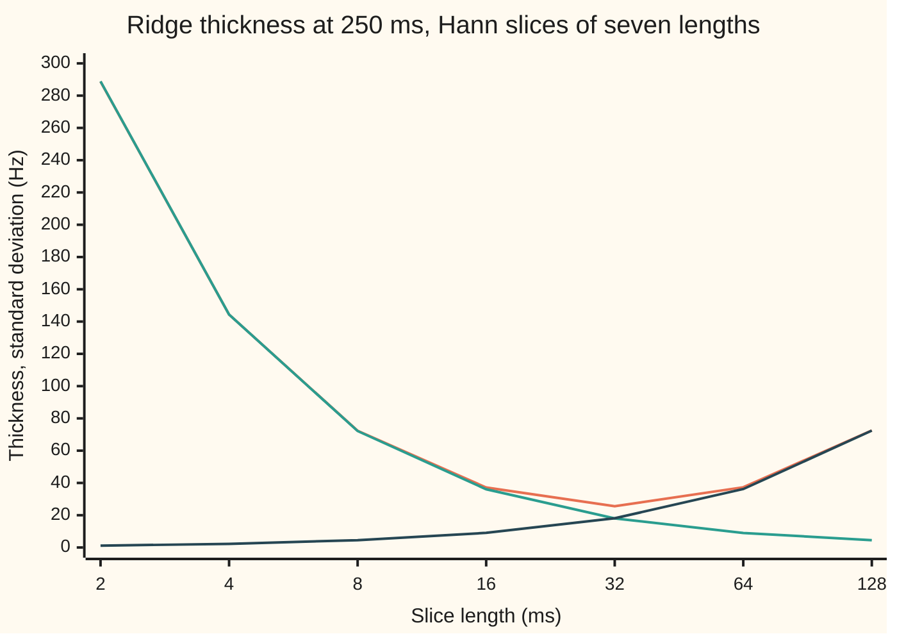
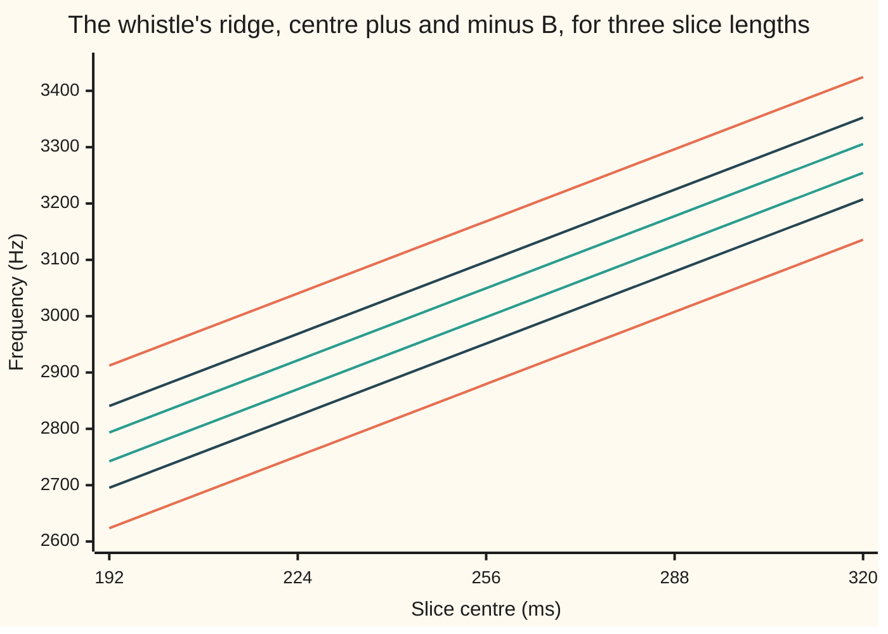

# Spectrograms: one spectrum per slice of time, and the blur you cannot avoid

[Syllabus](../../../SYLLABUS.md) → [Engineering mathematics](../README.md) → [Signals](../README.md#s05) → Spectrograms

---

## General Overview

A small bird gives one whistle: a pure note that slides from 2000 Hz (hertz, cycles per second) up to 4000 Hz in half a second. A recorder samples it 16000 times a second, so the call is a list of 8000 numbers. Here the whistle is drawn from a formula rather than recorded, so every answer can be checked against the truth: at time $t$ seconds its pitch is $2000 + 4000\,t$ Hz.

One Fourier transform of all 8000 samples ([The DFT and the FFT](02-discrete-fourier-transform-and-the-fft.md)) says the call holds every frequency from 2000 to 4000 Hz. True, and no help: it cannot say the low notes came first. A **spectrogram** can. Cut the recording into short slices, 32 ms long, a new one every 16 ms, so each overlaps the next by half. Taper each slice so it fades in and out. Take the spectrum of each. Stand the 30 spectra side by side, time across and frequency up, and the whistle appears as a rising ridge. The slice centred on 256 ms is centred on 3024.00 Hz, exactly where the formula puts the whistle at that moment.

The ridge is never a thin line. A slice lasts a while, so it hears a range of pitches. A slice also stops, so its spectrum is smeared. A shorter slice fixes the first fault and worsens the second. For this whistle the best slice is 32 ms long, and the ridge is then 25.56 Hz thick. No slice of any length, tapered by any real-valued window, can make it thinner than 25.23 Hz.

**A spectrogram is the spectrum of a sliding, tapered slice of the signal: its ridge follows the changing pitch, and its thickness combines the slice's own smear in frequency with the pitch drift inside the slice, so a short slice and a long slice both blur it.**

**What kind of fact this is:** a method (the short-time Fourier transform) and a theorem about its blur, proved on this card in Why it works; the floor under the blur is Gabor's uncertainty theorem, stated here and proved on the planned Uncertainty card.

### The picture: how thick the ridge is, against how long the slice is



The orange line is the whistle's ridge. The green line is a steady 2000 Hz tone through the same slices: the slice's own smear, which halves each time the slice doubles. The dark line is the pitch drift inside the slice, which doubles each time. The orange line bottoms out at 32 ms, where the other two are equal: 18.04 and 18.11 Hz.

---

## The formula

Notation first, in words. The recording is $x[n]$, sample number $n$, taken $f_s$ times a second. The **window** $w[n]$, $n = 0$ to $L-1$, is the taper: here the Hann window $w[n] = \tfrac12 - \tfrac12\cos(2\pi n/L)$, a single hump that is 0 at the start and 1 in the middle ([Windows](03-windows-and-spectral-leakage.md)). Slice $m$ starts at sample $mH$, where the **hop** $H$ is the step between slice starts. As on the rest of the wing, $j$ is the square root of −1.

$$X[m,k] = \sum_{n=0}^{L-1} x[mH+n]\;w[n]\;e^{-j2\pi kn/L}, \qquad S[m,k] = \lvert X[m,k]\rvert^2$$

**Read it aloud:** take the $L$ samples starting at sample $mH$, multiply each by the window, and run the DFT; the spectrogram is the power of what comes out.

$X$ is the **short-time Fourier transform**. Slice $m$ is labelled by its centre time $t_m = (mH + L/2)/f_s$, and bin $k$ by the frequency $k f_s / L$. The spectrogram $S$ is the picture: one column per slice, one row per bin, brightness for power.

How thick is the ridge? Measure a column's **spread**: the standard deviation of frequency, each frequency weighted by its power. Call it $B$. For a whistle whose pitch climbs at $c$ hertz per second,

$$B^2 = \Delta f_w^{\,2} + c^2\,\Delta t_w^{\,2}, \qquad \Delta t_w\,\Delta f_w \ \ge\ \frac{1}{4\pi}, \qquad\text{so}\qquad B \ \ge\ \sqrt{\frac{c}{2\pi}}.$$

**Read it aloud:** the ridge's squared thickness is the window's own squared spread in frequency plus the squared pitch drift across the window's spread in time; and those two spreads can never both be small.

The window's two spreads are its standard deviations in time and in frequency, weighted by its power $w^2$:

$$\Delta t_w^{\,2} = \frac{\sum_n \tau_n^2\, w[n]^2}{\sum_n w[n]^2}, \qquad \Delta f_w^{\,2} = \frac{\sum_n w'(\tau_n)^2}{4\pi^2\sum_n w[n]^2},$$

where $\tau_n = (n - L/2)/f_s$ is the time of sample $n$ from the window's centre and $w'$ is the window's slope, per second. The second formula is the frequency spread of $\lvert W\rvert^2$, the window's power spectrum, read off in the time domain (Step 2 shows why).

| Symbol | Plain meaning | In our example | Push it up and the answer… |
| --- | --- | --- | --- |
| $x[n]$, $f_s$ | the recording, sample number $n$; samples per second | 8000 samples at 16000 per second | — |
| $w[n]$, $L$, $T$ | the taper; its length in samples; in seconds, $T = L/f_s$ | Hann, 512 samples, 32.0 ms | $B$ falls, then rises: the U on the chart |
| $H$ | hop: samples between slice starts | 256 (16.0 ms) | fewer columns; past $L/2$ the slices stop covering every sample evenly |
| $m$, $k$, $t_m$ | slice number; bin number; a slice's centre time | 30 slices, bins 31.25 Hz apart; slice 15 at 256.0 ms | — |
| $X$, $S$, $j$ | the short-time Fourier transform; the spectrogram $\lvert X\rvert^2$; the square root of −1 | the slice at 250 ms is brightest at 3000.00 Hz | — |
| $f(\tau)$, $f_0$, $c$ | the pitch at time $\tau$; starting pitch; how fast the pitch climbs | 2000 Hz; 4000 Hz per second | larger $c$: thicker ridge, shorter best slice |
| $\tau_n$, $w'$ | a sample's time from the window's centre; the window's slope, per second | — | — |
| $\Delta t_w$ | the window's spread in time | 4.5263 ms | more drift inside the slice |
| $\Delta f_w$ | the window's spread in frequency | 18.042 Hz | more smear of a steady tone |
| $a$, $b$ | the window shape's two fixed numbers: $\Delta f_w = a/T$, $\Delta t_w = bT$ | 0.57735 and 0.14145 for Hann | a larger product $ab$ raises the best thickness |
| $B$, $T^\ast$ | the ridge's thickness, a column's spread; the slice length that makes it least | 25.56 Hz at 31.9 ms | — |
| $W$, $\varphi$, $y$, $Y$ | the window's spectrum; the whistle's phase, whose slope is $2\pi f$; one windowed slice and its spectrum (in the proof) | — | — |

### When it holds

- **The pitch climbs at a steady rate inside each slice.** If it bends, the drift term becomes the spread of pitch across the slice, which is larger near the bend; the floor $\sqrt{c/2\pi}$ then uses the local rate of climb at each slice.
- **One sound at a time.** Two whistles closer in pitch than about $B$ merge into one ridge, and their columns are not the sum of the two alone: the cross term between them beats.
- **A real window, symmetric about its centre.** Then the ridge's centre sits exactly on the pitch at the slice's centre. A lopsided window pulls it toward its heavy side.
- **A steady loudness.** A whistle that swells inside a slice pulls the ridge toward its louder end.
- **Pitch well away from 0 and $f_s/2$.** The proof treats the whistle as a single complex spinning tone. A real recording also has a mirror image at minus the pitch, which leaks in when the window is short: at 2 ms the formula says 288.68 Hz and the slice measures 288.74 Hz.

---

## Why it works

### Step 0: a slice short enough that the pitch hardly moves

A Fourier transform answers "which frequencies, over the whole recording?". Multiply the recording by a window that is zero outside a short stretch, and the same transform answers "which frequencies, in this stretch?". Slide the window along and the answers form a picture. The only question left is how sharp the picture can be.

### Step 1: a steady tone shows the window's own smear

A steady tone through a window gives the window's spectrum, moved to sit on the tone's frequency ([Windows](03-windows-and-spectral-leakage.md)). So a steady tone's ridge has thickness $\Delta f_w$ exactly. Stretch the window to twice the length and its spectrum squeezes to half the width: the green line on the chart, 36.08 Hz at 16 ms, 18.04 Hz at 32 ms, 9.02 Hz at 64 ms.

### Step 2: a slice's centre is the average pitch inside it, and its spread adds the window's

Write the whistle as a spinning tone of steady size, $e^{j\varphi(\tau)}$, whose pitch at time $\tau$ is $f(\tau) = \varphi'(\tau)/2\pi$. Two facts about any slice follow from Parseval's theorem (the energy is the same counted in time or in frequency).

- The column's mean frequency is the window-weighted average of the pitch, $\sum f(\tau_n)\,w[n]^2 / \sum w[n]^2$.
- The column's squared spread is the window-weighted spread of the pitch, plus $\Delta f_w^{\,2}$.

The window adds its own smear on top of whatever the pitch does inside it.

<details>
<summary>Proof: the moments of one slice</summary>

Let $y(\tau) = w(\tau)\,e^{j\varphi(\tau)}$ be one windowed slice, with $w$ real and zero at both ends, and $Y(f)$ its Fourier transform. Differentiating $y$ multiplies $Y$ by $j2\pi f$, so Parseval gives

$$\int f\,\lvert Y\rvert^2\,df = \frac{1}{2\pi j}\int y'\,\bar y\,d\tau, \qquad \int f^2\,\lvert Y\rvert^2\,df = \frac{1}{4\pi^2}\int \lvert y'\rvert^2\,d\tau .$$

Here $y' = (w' + j\varphi' w)\,e^{j\varphi}$, so $y'\bar y = w'w + j\varphi' w^2$ and $\lvert y'\rvert^2 = w'^2 + \varphi'^2 w^2$; the cross term is zero because $w$ is real. The piece $\int w'w\,d\tau = [w^2/2]$ vanishes because $w$ is zero at both ends. Divide by $\int \lvert Y\rvert^2\,df = \int w^2\,d\tau$:

$$\text{mean} = \frac{\int f(\tau)\,w^2\,d\tau}{\int w^2\,d\tau}, \qquad \text{mean square} = \frac{\int f(\tau)^2\,w^2\,d\tau}{\int w^2\,d\tau} + \frac{\int w'^2\,d\tau}{4\pi^2\int w^2\,d\tau}.$$

Subtract the mean squared from the mean square. The first part becomes the window-weighted variance of the pitch; the second part is $\Delta f_w^{\,2}$ as defined above. On samples the integrals become the sums in The formula.

</details>

### Step 3: for the whistle, the drift is $c$ times the window's time spread

Inside slice $m$ the pitch is $f(t_m) + c\,\tau$, with $\tau$ measured from the slice's centre. The Hann window is symmetric, so the $c\,\tau$ part averages to zero and the ridge's centre is $f(t_m)$: the column centred on 256 ms has its centre at 3024.00 Hz. The weighted spread of $c\,\tau$ is $c\,\Delta t_w$. So

$$B^2 = \Delta f_w^{\,2} + c^2\,\Delta t_w^{\,2}.$$

The table in the code output puts the measured spread beside this formula for seven slice lengths: 25.56 against 25.56 at 32 ms, 72.56 against 72.56 at 128 ms.

### Step 4: the trade-off has a best slice length

Stretching a window to length $T$ stretches its time spread in proportion and squeezes its frequency spread in proportion: $\Delta t_w = b\,T$ and $\Delta f_w = a/T$, with two numbers $a$ and $b$ fixed by the window's shape. For Hann, $a = 1/\sqrt3 = 0.57735$ and $b = \sqrt{1/12 - 5/(8\pi^2)} = 0.14145$. Then

$$B^2 = \frac{a^2}{T^2} + c^2 b^2 T^2 .$$

The first part falls as $T$ grows and the second rises. Their sum is smallest where they are equal, $a/T = c\,b\,T$, so at $T^\ast = \sqrt{a/(bc)}$, and there $B = \sqrt{2abc}$. For the whistle, $T^\ast$ is 31.9 ms (511 samples) and the thickness is 25.56 Hz. A faster sweep moves the best slice shorter, in proportion to $1/\sqrt c$.

<details>
<summary>Where Hann's a and b come from</summary>

Take the continuous Hann window $w(\tau) = \cos^2(\pi\tau/T)$ on $-T/2 \le \tau \le T/2$ and put $u = \pi\tau/T$. Then $\int w^2\,d\tau = (T/\pi)\int\cos^4u\,du = 3T/8$. The slope is $w' = -(\pi/T)\sin 2u$, so $\int w'^2\,d\tau = \pi^2/(2T)$, and $\Delta f_w^{\,2} = \frac{\pi^2/(2T)}{4\pi^2\cdot 3T/8} = \frac{1}{3T^2}$. For the time spread, expand $\cos^4u = \tfrac38 + \tfrac12\cos2u + \tfrac18\cos4u$ and integrate $u^2$ against each piece: $\int u^2\cos^4u\,du = \pi^3/32 - 15\pi/64$. Then $\Delta t_w^{\,2} = T^2\bigl(\tfrac1{12} - \tfrac{5}{8\pi^2}\bigr)$. The sampled window in the code gives the same 4.5263 ms and 18.042 Hz.

</details>

### Step 5: the floor under every window

Multiply the two spreads: $\Delta t_w\,\Delta f_w = ab$, which for Hann is 0.08167 at every length. Gabor proved in 1946 that for any window whatever,

$$\Delta t_w\,\Delta f_w \ \ge\ \frac{1}{4\pi} = 0.07958,$$

with equality only for the bell-shaped Gaussian window; the planned Uncertainty card proves it. Put $ab \ge 1/(4\pi)$ into $B = \sqrt{2abc}$: no real window of any shape or length can draw this whistle thinner than $\sqrt{c/(2\pi)} = 25.23$ Hz. (Step 2 assumed a real window. A complex window that chirps along with the whistle is not bound by this floor.) Hann's best, 25.56 Hz, sits just above the floor. That is the blur you cannot avoid: it comes from the whistle's sweep rate alone.

### Step 6: half-overlapping Hann slices lose nothing

Hann windows placed every $L/2$ samples add up to exactly 1 at every sample. So run each slice's DFT backwards, add the slices back in place, and the recording returns: away from the two ends, the code rebuilds every sample to nine decimal places. The spectrogram itself keeps only the power $\lvert X\rvert^2$ and throws away each value's angle, so going back from the picture alone needs an estimate of that angle (Griffin and Lim's method).

---

## Worked numbers, by hand

The column centred on 256 ms, with the 512-sample Hann window.

| Step | Arithmetic | Value |
| --- | --- | --- |
| sweep rate $c$ | $(4000 - 2000) / 0.5$ | 4000 Hz per second |
| slice 15's centre | $(15 \times 256 + 256)/16000$ | 256.0 ms |
| the whistle there | $2000 + 4000 \times 0.256$ | 3024.00 Hz |
| slice length $T$ | $512 / 16000$ | 32.0 ms |
| window's time spread $\Delta t_w$ | $\sqrt{1/12 - 5/(8\pi^2)} \times 32.0$ ms | 4.5263 ms |
| window's frequency spread $\Delta f_w$ | $0.57735 / 0.032$ | 18.042 Hz |
| pitch drift $c\,\Delta t_w$ | $4000 \times 0.0045263$ | 18.11 Hz |
| ridge thickness $B$ | $\sqrt{18.04^2 + 18.11^2}$ | **25.56 Hz** |
| the floor | $\sqrt{4000 / (2\pi)}$ | 25.23 Hz |

So the ridge at 256 ms is centred on 3024.00 Hz and is about 25.56 Hz thick: read off this spectrogram, the whistle's pitch at that moment is pinned to within a few tens of hertz, and no real window could pin it closer than 25.23.

### One column, as bars

The slice centred on 250 ms, on the spectrogram's own bins, 31.25 Hz apart. Each bar is that bin's power as a share of the brightest bin's power.

```
  bin (Hz)   power, % of the top bin
   2875.00                                              0.0
   2906.25                                              0.4
   2937.50   ██                                         4.9
   2968.75   ████████████████                          39.4
   3000.00   ████████████████████████████████████████ 100.0
   3031.25   ████████████████                          39.4
   3062.50   ██                                         4.9
   3093.75                                              0.4
   3125.00                                              0.0
```

The whistle was at exactly 3000 Hz at 250 ms. The column is symmetric about it, and nearly all its power sits within one bin either side.

### The ridge, slice by slice

| Slice | Centre (ms) | Whistle (Hz) | Column's centre (Hz) | Brightest point (Hz) | Zero crossings (Hz) |
| --- | ---: | ---: | ---: | ---: | ---: |
| 0 | 16.0 | 2064.00 | 2064.00 | 2063.91 | 2064.02 |
| 5 | 96.0 | 2384.00 | 2384.00 | 2383.60 | 2383.66 |
| 10 | 176.0 | 2704.00 | 2704.00 | 2704.12 | 2704.05 |
| 15 | 256.0 | 3024.00 | 3024.00 | 3024.37 | 3023.88 |
| 20 | 336.0 | 3344.00 | 3344.00 | 3343.98 | 3343.95 |
| 25 | 416.0 | 3664.00 | 3664.00 | 3663.62 | 3664.03 |
| 29 | 480.0 | 3920.00 | 3920.00 | 3919.78 | 3920.01 |

The brightest point is found by fitting a bell through the top three bins. Counting the times the samples cross zero inside the slice gives the same pitch with no Fourier transform at all. Over all 30 slices the brightest point is never more than 0.40 Hz off.

### The trade-off on the picture

The same stretch of the spectrogram, drawn three times, with slices 4 ms, 32 ms and 128 ms long. Each slice length is two lines of one colour: each column's centre plus its spread $B$, and its centre minus $B$. The ridge is the band between them.



Orange: 4 ms slices, the widest band; the table in the code output gives its $B$ as 144.36 Hz, nearly all of it the slice's own smear. Dark: 128 ms slices, $B$ = 72.56 Hz, nearly all of it the pitch drift inside the slice. Green: 32 ms slices, the thinnest band, $B$ = 25.56 Hz. All three bands climb with the whistle. Read across, the picture shows the trade-off directly: shortening the slice from 128 ms to 32 ms sharpens the ridge, and shortening it further to 4 ms blurs it again.

### What breaks if you drop a piece

| Mistake | Comes out at | What went wrong |
| --- | --- | --- |
| Label each slice by its start time | the slice read as 240.0 ms shows 3024.00 Hz; the whistle was at 2960.00 Hz then | the column describes the slice's centre, 256.0 ms, half a slice later |
| A long slice, 128 ms, "for finer frequency" | ridge 72.56 Hz thick | the drift inside the slice, 72.42 Hz, is nearly all of it |
| A short slice, 4 ms, "for finer time" | ridge 144.36 Hz thick | the window's own smear dominates |
| Hop of the full 512 samples, no overlap | window sum falls to 0.000; rebuild error 1.000 | each slice's edges get weight 0, so those samples are lost |

---

## Code, from first principles, and it actually runs

The script draws the whistle from its formula, writes its own FFT, and builds the spectrogram slice by slice. The pitch is reached **three independent ways**: the column's centre, its brightest point, and a count of zero crossings that uses no Fourier transform; all three are checked against the whistle's formula. The ridge's thickness is measured from the spectrum and checked against $\sqrt{\Delta f_w^{\,2} + c^2\Delta t_w^{\,2}}$, which is computed from the window alone in the time domain; Hann's spreads are checked against their closed forms. The overlap-add rebuild checks that the slices lose nothing.

### Python

```python
# Spectrograms -- the check behind the card.  Standard library only.
# A rising whistle is cut into overlapping Hann-windowed slices, and each slice
# goes through the FFT written out below.  Nothing imported knows the answer.
from math import sin, cos, pi, sqrt, log

FS, N, F0, C = 16000, 8000, 2000.0, 4000.0     # samples/s, samples (0.5 s), start Hz, sweep Hz/s
M = 8192                                        # zero-padded length for measuring a slice finely

def whistle(c):                                 # pitch F0 + c t, so the phase is 2 pi (F0 t + c t^2 / 2)
    return [sin(2 * pi * (F0 * n / FS + 0.5 * c * (n / FS) ** 2)) for n in range(N)]

def fft(a, sign=-1):                            # radix-2 FFT; sign=+1 runs it backwards
    a = list(a); n = len(a); j = 0
    for i in range(1, n):                       # bit-reversed order first
        b = n >> 1
        while j & b:
            j ^= b; b >>= 1
        j |= b
        if i < j:
            a[i], a[j] = a[j], a[i]
    size = 2
    while size <= n:
        h = size // 2
        tw = [complex(cos(2 * pi * k / size), sign * sin(2 * pi * k / size)) for k in range(h)]
        for s in range(0, n, size):
            for k in range(h):
                u, v = a[s + k], a[s + k + h] * tw[k]
                a[s + k], a[s + k + h] = u + v, u - v
        size *= 2
    return a

def hann(L):  return [0.5 - 0.5 * cos(2 * pi * n / L) for n in range(L)]

def slice_power(x, start, w, size):             # one column of the spectrogram, |X|^2, 0 .. FS/2
    seg = [x[start + i] * w[i] for i in range(len(w))] + [0.0] * (size - len(w))
    return [abs(z) ** 2 for z in fft(seg)[:size // 2]]

def centroid_spread(P):                         # power-weighted mean and standard deviation, Hz
    f = [k * FS / M for k in range(len(P))]; tot = sum(P)
    mean = sum(a * p for a, p in zip(f, P)) / tot
    return mean, sqrt(sum((a - mean) ** 2 * p for a, p in zip(f, P)) / tot)

def window_spreads(L):                          # time spread and frequency spread of the window itself
    w = hann(L); e = sum(v * v for v in w)
    dt = sqrt(sum(((n - L / 2) / FS) ** 2 * w[n] ** 2 for n in range(L)) / e)
    slope = [pi * FS / L * sin(2 * pi * n / L) for n in range(L)]           # dw/dt, exactly
    return dt, sqrt(sum(s * s for s in slope) / e) / (2 * pi)

def zero_cross_hz(x, start, L):                 # no Fourier at all: count the half-cycles
    t = [(n + x[n] / (x[n] - x[n + 1])) / FS for n in range(start, start + L - 1)
         if (x[n] < 0) != (x[n + 1] < 0)]
    return (len(t) - 1) / (2 * (t[-1] - t[0]))

x = whistle(C)
L, HOP = 512, 256
w = hann(L)
frames = (N - L) // HOP + 1
print(f"whistle: {FS} samples/s, {N} samples = {N / FS:.3f} s, pitch {F0:.0f} -> {F0 + C * N / FS:.0f} Hz, sweep {C:.0f} Hz/s")
print(f"spectrogram: Hann window {L} samples = {1000 * L / FS:.1f} ms, hop {HOP} = {1000 * HOP / FS:.1f} ms, "
      f"{frames} slices, bins {FS / L:.2f} Hz apart")
print("slice  centre_ms  whistle_Hz  centroid_Hz  peak_Hz  zero_cross_Hz")
worst_c = worst_p = 0.0
for m in range(frames):
    s = m * HOP; t = (s + L / 2) / FS
    cen, _ = centroid_spread(slice_power(x, s, w, M))
    P = slice_power(x, s, w, L); k = max(range(1, L // 2 - 1), key=P.__getitem__)
    a, b, c = log(P[k - 1]), log(P[k]), log(P[k + 1])
    peak = (k + 0.5 * (a - c) / (a - 2 * b + c)) * FS / L                   # fit a bell to 3 bins
    zc = zero_cross_hz(x, s, L)
    worst_c, worst_p = max(worst_c, abs(cen - F0 - C * t)), max(worst_p, abs(peak - F0 - C * t))
    assert abs(zc - F0 - C * t) < 2.0 and abs(peak - zc) < 3.0             # three roads agree
    if m % 5 == 0 or m == frames - 1:
        print(f"{m:5d}  {1000 * t:9.1f}  {F0 + C * t:10.2f}  {cen:11.2f}  {peak:7.2f}  {zc:13.2f}")
print(f"worst over {frames} slices: centroid off by {worst_c:.2f} Hz, peak off by {worst_p:.2f} Hz")
assert worst_c < 0.5 and worst_p < 3.0

P = slice_power(x, 4000 - L // 2, w, L)         # the slice centred on 250 ms, the spectrogram's own bins
top = max(P)
print("bars, Hz " + " ".join(f"{k * FS / L:7.2f}" for k in range(92, 101)))
print("bars, %  " + " ".join(f"{100 * P[k] / top:7.1f}" for k in range(92, 101)))

print("window  ms  spread_Hz  formula_Hz  steady_tone_Hz  sweep_part_Hz")
tone = whistle(0.0)
spreads = {}
for Lw in (32, 64, 128, 256, 512, 1024, 2048):
    dt, df = window_spreads(Lw)
    _, B = centroid_spread(slice_power(x, 4000 - Lw // 2, hann(Lw), M))
    _, B0 = centroid_spread(slice_power(tone, 4000 - Lw // 2, hann(Lw), M))
    spreads[Lw] = B
    print(f"{Lw:6d} {1000 * Lw / FS:5.1f} {B:9.2f} {sqrt(df ** 2 + (C * dt) ** 2):11.2f} {B0:15.2f} {C * dt:14.2f}")
    assert abs(B - sqrt(df ** 2 + (C * dt) ** 2)) < 0.1 and abs(B0 - df) < 0.3     # measured = formula
    assert abs(dt * df - (1 / 12 - 5 / (8 * pi * pi)) ** 0.5 / 3 ** 0.5) < 1e-4    # Hann, closed form
dt, df = window_spreads(L)
T = L / FS
print(f"Hann at {L}: time spread {1000 * dt:.4f} ms (closed form {1000 * T * sqrt(1 / 12 - 5 / (8 * pi * pi)):.4f}), "
      f"frequency spread {df:.3f} Hz (closed form {1 / (sqrt(3) * T):.3f})")
a, b = df * T, dt / T                           # spreads in units of 1/T and of T
print(f"a = {a:.5f}, b = {b:.5f}, product {dt * df:.5f} at every length; Gabor's floor 1/(4 pi) = {1 / (4 * pi):.5f}")
best = sqrt(a / (b * C))
print(f"best Hann window for this whistle: {best * FS:.0f} samples = {1000 * best:.1f} ms, spread {sqrt(2 * a * b * C):.2f} Hz;"
      f" no real window beats {sqrt(C / (2 * pi)):.2f} Hz")
assert min(spreads, key=spreads.get) == 512 and sqrt(C / (2 * pi)) < spreads[512] < sqrt(2 * a * b * C) + 0.05
for Lw in (64, 512, 2048):                      # the picture: each column's centre +- spread, slices centred 192 .. 320 ms
    cb = [centroid_spread(slice_power(x, 16 * t - Lw // 2, hann(Lw), M)) for t in (192, 224, 256, 288, 320)]
    print(f"picture, {Lw // 16} ms slice, centre + B: " + ", ".join(f"{c + d:.1f}" for c, d in cb))
    print(f"picture, {Lw // 16} ms slice, centre - B: " + ", ".join(f"{c - d:.1f}" for c, d in cb))

def overlap_add(x, L, hop):                     # forward FFT, backward FFT, add the slices back up
    y, wsum, w = [0.0] * N, [0.0] * N, hann(L)
    for s in range(0, N - L + 1, hop):
        back = fft(fft([x[s + i] * w[i] for i in range(L)]), +1)
        for i in range(L):
            y[s + i] += back[i].real / L; wsum[s + i] += w[i]
    mid = range(L, N - L)
    return min(wsum[n] for n in mid), max(wsum[n] for n in mid), max(abs(y[n] - x[n]) for n in mid)
lo, hi, err = overlap_add(x, L, HOP)
print(f"overlap-add, hop {HOP}: window sum {lo:.6f} to {hi:.6f}, rebuild error {err:.9f}")
lo2, hi2, err2 = overlap_add(x, L, L)
print(f"mistake, hop {L} (no overlap): window sum {lo2:.3f} to {hi2:.3f}, rebuild error {err2:.3f}")
assert err < 1e-9 and abs(lo - 1) < 1e-9 and err2 > 0.9
cs = 15 * HOP + L / 2
print(f"mistake, label by start: slice centred {1000 * cs / FS:.1f} ms read as {1000 * (cs - L / 2) / FS:.1f} ms: "
      f"whistle at centre {F0 + C * cs / FS:.2f} Hz, at start {F0 + C * (cs - L / 2) / FS:.2f} Hz")
Pr, Ph = slice_power(x, 4000 - L // 2, [1.0] * L, M), slice_power(x, 4000 - L // 2, w, M)
k5 = round(3500 * M / FS)
print(f"mistake, no taper: power 500 Hz from the ridge {10 * log(Pr[k5] / max(Pr), 10):.1f} dB (Hann {10 * log(Ph[k5] / max(Ph), 10):.1f} dB)")

x8 = whistle(8000.0)
b8 = {Lw: centroid_spread(slice_power(x8, 4000 - Lw // 2, hann(Lw), M))[1] for Lw in (256, 512)}
print(f"try, sweep 8000 Hz/s: best {sqrt(a / (b * 8000)) * FS:.0f} samples = {1000 * sqrt(a / (b * 8000)):.1f} ms, "
      f"spread {sqrt(2 * a * b * 8000):.2f} Hz; measured at 256: {b8[256]:.2f}, at 512: {b8[512]:.2f}")
_, b0 = centroid_spread(slice_power(tone, 4000 - 1024, hann(2048), M))
print(f"try, steady 2000 Hz tone, window 2048: spread {b0:.2f} Hz")
print(f"try, hop {L // 4}: window sum {sum(w[i] for i in range(0, L, L // 4)):.3f}")
print("ALL CHECKS PASS")
```

**Ran 2026-11-11 on macOS, Python 3.14.10, standard library only. All checks passed. Output, pasted from the run:**

```
whistle: 16000 samples/s, 8000 samples = 0.500 s, pitch 2000 -> 4000 Hz, sweep 4000 Hz/s
spectrogram: Hann window 512 samples = 32.0 ms, hop 256 = 16.0 ms, 30 slices, bins 31.25 Hz apart
slice  centre_ms  whistle_Hz  centroid_Hz  peak_Hz  zero_cross_Hz
    0       16.0     2064.00      2064.00  2063.91        2064.02
    5       96.0     2384.00      2384.00  2383.60        2383.66
   10      176.0     2704.00      2704.00  2704.12        2704.05
   15      256.0     3024.00      3024.00  3024.37        3023.88
   20      336.0     3344.00      3344.00  3343.98        3343.95
   25      416.0     3664.00      3664.00  3663.62        3664.03
   29      480.0     3920.00      3920.00  3919.78        3920.01
worst over 30 slices: centroid off by 0.00 Hz, peak off by 0.40 Hz
bars, Hz 2875.00 2906.25 2937.50 2968.75 3000.00 3031.25 3062.50 3093.75 3125.00
bars, %      0.0     0.4     4.9    39.4   100.0    39.4     4.9     0.4     0.0
window  ms  spread_Hz  formula_Hz  steady_tone_Hz  sweep_part_Hz
    32   2.0    288.74      288.68          288.87           1.13
    64   4.0    144.36      144.36          144.35           2.26
   128   8.0     72.31       72.31           72.17           4.53
   256  16.0     37.20       37.20           36.08           9.05
   512  32.0     25.56       25.56           18.04          18.11
  1024  64.0     37.32       37.32            9.02          36.21
  2048 128.0     72.56       72.56            4.51          72.42
Hann at 512: time spread 4.5263 ms (closed form 4.5263), frequency spread 18.042 Hz (closed form 18.042)
a = 0.57735, b = 0.14145, product 0.08167 at every length; Gabor's floor 1/(4 pi) = 0.07958
best Hann window for this whistle: 511 samples = 31.9 ms, spread 25.56 Hz; no real window beats 25.23 Hz
picture, 4 ms slice, centre + B: 2912.3, 3040.4, 3168.4, 3296.4, 3424.4
picture, 4 ms slice, centre - B: 2623.7, 2751.6, 2879.6, 3007.6, 3135.6
picture, 32 ms slice, centre + B: 2793.6, 2921.6, 3049.6, 3177.6, 3305.6
picture, 32 ms slice, centre - B: 2742.4, 2870.4, 2998.4, 3126.4, 3254.4
picture, 128 ms slice, centre + B: 2840.6, 2968.6, 3096.6, 3224.6, 3352.6
picture, 128 ms slice, centre - B: 2695.4, 2823.4, 2951.4, 3079.4, 3207.4
overlap-add, hop 256: window sum 1.000000 to 1.000000, rebuild error 0.000000000
mistake, hop 512 (no overlap): window sum 0.000 to 1.000, rebuild error 1.000
mistake, label by start: slice centred 256.0 ms read as 240.0 ms: whistle at centre 3024.00 Hz, at start 2960.00 Hz
mistake, no taper: power 500 Hz from the ridge -47.4 dB (Hann -89.0 dB)
try, sweep 8000 Hz/s: best 361 samples = 22.6 ms, spread 36.15 Hz; measured at 256: 40.37, at 512: 40.46
try, steady 2000 Hz tone, window 2048: spread 4.51 Hz
try, hop 128: window sum 2.000
ALL CHECKS PASS
```

### Rust

```rust
// Spectrograms -- the check behind the card.  Standard library only, no crates.
// A rising whistle is cut into overlapping Hann-windowed slices, and each slice
// goes through the FFT written out below.  Nothing used knows the answer.
use std::collections::BTreeMap;
use std::f64::consts::PI;

const FS: f64 = 16000.0; const N: usize = 8000; const F0: f64 = 2000.0; const C: f64 = 4000.0; // as in Python
const M: usize = 8192; // zero-padded length for measuring a slice finely

type Cx = (f64, f64);
fn mul(a: Cx, b: Cx) -> Cx { (a.0 * b.0 - a.1 * b.1, a.0 * b.1 + a.1 * b.0) }

fn whistle(c: f64) -> Vec<f64> { // pitch F0 + c t, so the phase is 2 pi (F0 t + c t^2 / 2)
    (0..N).map(|n| { let t = n as f64 / FS; (2.0 * PI * (F0 * t + 0.5 * c * t * t)).sin() }).collect()
}

fn fft(input: &[Cx], sign: f64) -> Vec<Cx> { // radix-2 FFT; sign=+1 runs it backwards
    let (mut a, n, mut j) = (input.to_vec(), input.len(), 0usize);
    for i in 1..n { // bit-reversed order first
        let mut b = n >> 1;
        while j & b != 0 { j ^= b; b >>= 1; }
        j |= b;
        if i < j { a.swap(i, j); }
    }
    let mut size = 2;
    while size <= n {
        let h = size / 2;
        let tw: Vec<Cx> = (0..h).map(|k| 2.0 * PI * k as f64 / size as f64).map(|g| (g.cos(), sign * g.sin())).collect();
        for s in (0..n).step_by(size) {
            for k in 0..h {
                let (u, v) = (a[s + k], mul(a[s + k + h], tw[k]));
                a[s + k] = (u.0 + v.0, u.1 + v.1);
                a[s + k + h] = (u.0 - v.0, u.1 - v.1);
            }
        }
        size *= 2;
    }
    a
}

fn hann(l: usize) -> Vec<f64> { (0..l).map(|n| 0.5 - 0.5 * (2.0 * PI * n as f64 / l as f64).cos()).collect() }

fn slice_power(x: &[f64], start: usize, w: &[f64], size: usize) -> Vec<f64> { // one column, |X|^2
    let mut seg = vec![(0.0, 0.0); size];
    for i in 0..w.len() { seg[i] = (x[start + i] * w[i], 0.0); }
    fft(&seg, -1.0)[..size / 2].iter().map(|z| z.0 * z.0 + z.1 * z.1).collect()
}

fn centroid_spread(p: &[f64]) -> (f64, f64) { // power-weighted mean and standard deviation, Hz
    let tot: f64 = p.iter().sum();
    let f = |k: usize| k as f64 * FS / M as f64;
    let mean = p.iter().enumerate().map(|(k, v)| f(k) * v).sum::<f64>() / tot;
    let var = p.iter().enumerate().map(|(k, v)| (f(k) - mean).powi(2) * v).sum::<f64>() / tot;
    (mean, var.sqrt())
}

fn window_spreads(l: usize) -> (f64, f64) { // time spread and frequency spread of the window itself
    let (w, lf) = (hann(l), l as f64);
    let e: f64 = w.iter().map(|v| v * v).sum();
    let dt = ((0..l).map(|n| ((n as f64 - lf / 2.0) / FS).powi(2) * w[n] * w[n]).sum::<f64>() / e).sqrt();
    let s2: f64 = (0..l).map(|n| (PI * FS / lf * (2.0 * PI * n as f64 / lf).sin()).powi(2)).sum(); // dw/dt
    (dt, (s2 / e).sqrt() / (2.0 * PI))
}

fn zero_cross_hz(x: &[f64], start: usize, l: usize) -> f64 { // no Fourier at all: count the half-cycles
    let t: Vec<f64> = (start..start + l - 1).filter(|&n| (x[n] < 0.0) != (x[n + 1] < 0.0))
        .map(|n| (n as f64 + x[n] / (x[n] - x[n + 1])) / FS).collect();
    (t.len() as f64 - 1.0) / (2.0 * (t[t.len() - 1] - t[0]))
}

fn overlap_add(x: &[f64], l: usize, hop: usize) -> (f64, f64, f64) { // forward, backward, add up
    let (mut y, mut wsum, w) = (vec![0.0; N], vec![0.0; N], hann(l));
    let mut s = 0;
    while s + l <= N {
        let seg: Vec<Cx> = (0..l).map(|i| (x[s + i] * w[i], 0.0)).collect();
        let back = fft(&fft(&seg, -1.0), 1.0);
        for i in 0..l { y[s + i] += back[i].0 / l as f64; wsum[s + i] += w[i]; }
        s += hop;
    }
    let (mut lo, mut hi, mut err) = (f64::INFINITY, f64::NEG_INFINITY, 0.0f64);
    for n in l..N - l { lo = lo.min(wsum[n]); hi = hi.max(wsum[n]); err = err.max((y[n] - x[n]).abs()); }
    (lo, hi, err)
}

fn main() {
    let (x, l, hop) = (whistle(C), 512usize, 256usize);
    let w = hann(l);
    let frames = (N - l) / hop + 1;
    println!("whistle: {} samples/s, {} samples = {:.3} s, pitch {:.0} -> {:.0} Hz, sweep {:.0} Hz/s", FS as usize, N, N as f64 / FS, F0, F0 + C * N as f64 / FS, C);
    println!("spectrogram: Hann window {} samples = {:.1} ms, hop {} = {:.1} ms, {} slices, bins {:.2} Hz apart",
        l, 1000.0 * l as f64 / FS, hop, 1000.0 * hop as f64 / FS, frames, FS / l as f64);
    println!("slice  centre_ms  whistle_Hz  centroid_Hz  peak_Hz  zero_cross_Hz");
    let (mut worst_c, mut worst_p) = (0.0f64, 0.0f64);
    for m in 0..frames {
        let (s, t) = (m * hop, (m * hop) as f64 / FS + l as f64 / 2.0 / FS);
        let (cen, _) = centroid_spread(&slice_power(&x, s, &w, M));
        let p = slice_power(&x, s, &w, l);
        let mut k = 1;
        for i in 1..l / 2 - 1 { if p[i] > p[k] { k = i; } }
        let (a, b, c) = (p[k - 1].ln(), p[k].ln(), p[k + 1].ln());
        let peak = (k as f64 + 0.5 * (a - c) / (a - 2.0 * b + c)) * FS / l as f64; // fit a bell to 3 bins
        let zc = zero_cross_hz(&x, s, l);
        worst_c = worst_c.max((cen - F0 - C * t).abs());
        worst_p = worst_p.max((peak - F0 - C * t).abs());
        assert!((zc - F0 - C * t).abs() < 2.0 && (peak - zc).abs() < 3.0); // three roads agree
        if m % 5 == 0 || m == frames - 1 {
            println!("{:5}  {:9.1}  {:10.2}  {:11.2}  {:7.2}  {:13.2}", m, 1000.0 * t, F0 + C * t, cen, peak, zc);
        }
    }
    println!("worst over {} slices: centroid off by {:.2} Hz, peak off by {:.2} Hz", frames, worst_c, worst_p);
    assert!(worst_c < 0.5 && worst_p < 3.0);

    let p = slice_power(&x, 4000 - l / 2, &w, l); // the slice centred on 250 ms, the spectrogram's own bins
    let top = p.iter().cloned().fold(0.0, f64::max);
    let hz: Vec<String> = (92..101).map(|k| format!("{:7.2}", k as f64 * FS / l as f64)).collect();
    let pc: Vec<String> = (92..101).map(|k| format!("{:7.1}", 100.0 * p[k] / top)).collect();
    println!("bars, Hz {}", hz.join(" "));
    println!("bars, %  {}", pc.join(" "));

    println!("window  ms  spread_Hz  formula_Hz  steady_tone_Hz  sweep_part_Hz");
    let tone = whistle(0.0);
    let mut spreads = BTreeMap::new();
    for &lw in &[32usize, 64, 128, 256, 512, 1024, 2048] {
        let (dt, df) = window_spreads(lw);
        let (_, bb) = centroid_spread(&slice_power(&x, 4000 - lw / 2, &hann(lw), M));
        let (_, b0) = centroid_spread(&slice_power(&tone, 4000 - lw / 2, &hann(lw), M));
        spreads.insert(lw, bb);
        let formula = (df * df + (C * dt).powi(2)).sqrt();
        println!("{:6} {:5.1} {:9.2} {:11.2} {:15.2} {:14.2}", lw, 1000.0 * lw as f64 / FS, bb, formula, b0, C * dt);
        assert!((bb - formula).abs() < 0.1 && (b0 - df).abs() < 0.3); // measured = formula
        assert!((dt * df - (1.0 / 12.0 - 5.0 / (8.0 * PI * PI)).sqrt() / 3f64.sqrt()).abs() < 1e-4); // Hann, closed form
    }
    let ((dt, df), t) = (window_spreads(l), l as f64 / FS);
    println!("Hann at {}: time spread {:.4} ms (closed form {:.4}), frequency spread {:.3} Hz (closed form {:.3})",
        l, 1000.0 * dt, 1000.0 * t * (1.0 / 12.0 - 5.0 / (8.0 * PI * PI)).sqrt(), df, 1.0 / (3f64.sqrt() * t));
    let (a, b) = (df * t, dt / t); // spreads in units of 1/T and of T
    println!("a = {:.5}, b = {:.5}, product {:.5} at every length; Gabor's floor 1/(4 pi) = {:.5}", a, b, dt * df, 1.0 / (4.0 * PI));
    let best = (a / (b * C)).sqrt();
    println!("best Hann window for this whistle: {:.0} samples = {:.1} ms, spread {:.2} Hz; no real window beats {:.2} Hz",
        best * FS, 1000.0 * best, (2.0 * a * b * C).sqrt(), (C / (2.0 * PI)).sqrt());
    let argmin = *spreads.iter().min_by(|p, q| p.1.partial_cmp(q.1).unwrap()).unwrap().0;
    assert!(argmin == 512 && (C / (2.0 * PI)).sqrt() < spreads[&512] && spreads[&512] < (2.0 * a * b * C).sqrt() + 0.05);
    for &lw in &[64usize, 512, 2048] { // the picture: each column's centre +- spread, slices centred 192 .. 320 ms
        let cb: Vec<(f64, f64)> = [192usize, 224, 256, 288, 320].iter().map(|&t| centroid_spread(&slice_power(&x, 16 * t - lw / 2, &hann(lw), M))).collect();
        let edge = |sg: f64| cb.iter().map(|(c, d)| format!("{:.1}", c + sg * d)).collect::<Vec<_>>().join(", ");
        println!("picture, {} ms slice, centre + B: {}\npicture, {} ms slice, centre - B: {}", lw / 16, edge(1.0), lw / 16, edge(-1.0)); }

    let (lo, hi, err) = overlap_add(&x, l, hop);
    println!("overlap-add, hop {}: window sum {:.6} to {:.6}, rebuild error {:.9}", hop, lo, hi, err);
    let (lo2, hi2, err2) = overlap_add(&x, l, l);
    println!("mistake, hop {} (no overlap): window sum {:.3} to {:.3}, rebuild error {:.3}", l, lo2, hi2, err2);
    assert!(err < 1e-9 && (lo - 1.0).abs() < 1e-9 && err2 > 0.9);
    let cs = (15 * hop) as f64 + l as f64 / 2.0;
    println!("mistake, label by start: slice centred {:.1} ms read as {:.1} ms: whistle at centre {:.2} Hz, at start {:.2} Hz",
        1000.0 * cs / FS, 1000.0 * (cs - l as f64 / 2.0) / FS, F0 + C * cs / FS, F0 + C * (cs - l as f64 / 2.0) / FS);
    let (pr, ph) = (slice_power(&x, 4000 - l / 2, &vec![1.0; l], M), slice_power(&x, 4000 - l / 2, &w, M));
    let k5 = (3500.0 * M as f64 / FS).round() as usize;
    let mx = |v: &Vec<f64>| v.iter().cloned().fold(0.0, f64::max);
    println!("mistake, no taper: power 500 Hz from the ridge {:.1} dB (Hann {:.1} dB)",
        10.0 * (pr[k5] / mx(&pr)).ln() / 10f64.ln(), 10.0 * (ph[k5] / mx(&ph)).ln() / 10f64.ln());

    let x8 = whistle(8000.0);
    let b8 = |lw: usize| centroid_spread(&slice_power(&x8, 4000 - lw / 2, &hann(lw), M)).1;
    println!("try, sweep 8000 Hz/s: best {:.0} samples = {:.1} ms, spread {:.2} Hz; measured at 256: {:.2}, at 512: {:.2}",
        (a / (b * 8000.0)).sqrt() * FS, 1000.0 * (a / (b * 8000.0)).sqrt(), (2.0 * a * b * 8000.0).sqrt(), b8(256), b8(512));
    let (_, b0) = centroid_spread(&slice_power(&tone, 4000 - 1024, &hann(2048), M));
    println!("try, steady 2000 Hz tone, window 2048: spread {:.2} Hz", b0);
    println!("try, hop {}: window sum {:.3}", l / 4, (0..l).step_by(l / 4).map(|i| w[i]).sum::<f64>());
    println!("ALL CHECKS PASS");
}
```

**Ran 2026-11-11 on macOS, rustc 1.98.1, no crates. All checks passed. Output, pasted from the run:**

```
whistle: 16000 samples/s, 8000 samples = 0.500 s, pitch 2000 -> 4000 Hz, sweep 4000 Hz/s
spectrogram: Hann window 512 samples = 32.0 ms, hop 256 = 16.0 ms, 30 slices, bins 31.25 Hz apart
slice  centre_ms  whistle_Hz  centroid_Hz  peak_Hz  zero_cross_Hz
    0       16.0     2064.00      2064.00  2063.91        2064.02
    5       96.0     2384.00      2384.00  2383.60        2383.66
   10      176.0     2704.00      2704.00  2704.12        2704.05
   15      256.0     3024.00      3024.00  3024.37        3023.88
   20      336.0     3344.00      3344.00  3343.98        3343.95
   25      416.0     3664.00      3664.00  3663.62        3664.03
   29      480.0     3920.00      3920.00  3919.78        3920.01
worst over 30 slices: centroid off by 0.00 Hz, peak off by 0.40 Hz
bars, Hz 2875.00 2906.25 2937.50 2968.75 3000.00 3031.25 3062.50 3093.75 3125.00
bars, %      0.0     0.4     4.9    39.4   100.0    39.4     4.9     0.4     0.0
window  ms  spread_Hz  formula_Hz  steady_tone_Hz  sweep_part_Hz
    32   2.0    288.74      288.68          288.87           1.13
    64   4.0    144.36      144.36          144.35           2.26
   128   8.0     72.31       72.31           72.17           4.53
   256  16.0     37.20       37.20           36.08           9.05
   512  32.0     25.56       25.56           18.04          18.11
  1024  64.0     37.32       37.32            9.02          36.21
  2048 128.0     72.56       72.56            4.51          72.42
Hann at 512: time spread 4.5263 ms (closed form 4.5263), frequency spread 18.042 Hz (closed form 18.042)
a = 0.57735, b = 0.14145, product 0.08167 at every length; Gabor's floor 1/(4 pi) = 0.07958
best Hann window for this whistle: 511 samples = 31.9 ms, spread 25.56 Hz; no real window beats 25.23 Hz
picture, 4 ms slice, centre + B: 2912.3, 3040.4, 3168.4, 3296.4, 3424.4
picture, 4 ms slice, centre - B: 2623.7, 2751.6, 2879.6, 3007.6, 3135.6
picture, 32 ms slice, centre + B: 2793.6, 2921.6, 3049.6, 3177.6, 3305.6
picture, 32 ms slice, centre - B: 2742.4, 2870.4, 2998.4, 3126.4, 3254.4
picture, 128 ms slice, centre + B: 2840.6, 2968.6, 3096.6, 3224.6, 3352.6
picture, 128 ms slice, centre - B: 2695.4, 2823.4, 2951.4, 3079.4, 3207.4
overlap-add, hop 256: window sum 1.000000 to 1.000000, rebuild error 0.000000000
mistake, hop 512 (no overlap): window sum 0.000 to 1.000, rebuild error 1.000
mistake, label by start: slice centred 256.0 ms read as 240.0 ms: whistle at centre 3024.00 Hz, at start 2960.00 Hz
mistake, no taper: power 500 Hz from the ridge -47.4 dB (Hann -89.0 dB)
try, sweep 8000 Hz/s: best 361 samples = 22.6 ms, spread 36.15 Hz; measured at 256: 40.37, at 512: 40.46
try, steady 2000 Hz tone, window 2048: spread 4.51 Hz
try, hop 128: window sum 2.000
ALL CHECKS PASS
```

The two outputs match line for line.

> [!TIP]
> **Try changing**
> Guess first, then run it. The asserts are pinned to this whistle, so a change may stop the script; the answers below are printed by the last lines of the output.
> - **Sweep twice as fast.** Change `C` to `8000.0`. Longer or shorter best slice? Shorter, by $\sqrt2$: 361 samples, 22.6 ms, with thickness 36.15 Hz. Of the seven lengths, 256 samples (40.37 Hz) now beats 512 (40.46 Hz), so the assert pinned to 512 stops it.
> - **Hold the pitch still.** How thick is a steady 2000 Hz tone's ridge through the longest slice, 2048 samples? The script already runs this: see the `try, steady` line and the `steady_tone_Hz` column. Only 4.51 Hz. With no drift, longer is always sharper.
> - **Overlap more.** Set `HOP = 128`. The windows now add to 2.000 everywhere, so the rebuild comes out twice too loud and the overlap-add assert stops it.
> - **Remove the taper.** How much power does a plain cut leave 500 Hz from the ridge? The script's `mistake, no taper` line measures it on the slice at 250 ms: −47.4 dB against the peak, where Hann gives −89.0 dB.

---

## The usual mistake

> [!warning]
> **Reading the ridge's thickness as the bird's.** At every instant the whistle is one exact pitch. The 25.56 Hz thickness is made by slicing, and the floor of 25.23 Hz is set by the sweep rate, not by any noise in the call. A wider ridge means a faster sweep or a worse window, not a rougher note.
>
> - **Labelling a slice by its start.** The slice that starts at 240.0 ms describes the whistle at its centre, 256.0 ms: 3024.00 Hz, not 2960.00 Hz.
> - **Always choosing the longest slice.** Long slices win only on steady sounds: 4.51 Hz for the steady tone at 128 ms, but 72.56 Hz for the whistle, almost three times its best of 25.56.
> - **Skipping the taper.** A plain cut leaves power at −47.4 dB 500 Hz from the ridge, against −89.0 dB with Hann. A faint second bird there vanishes under the leakage.
> - **Taking finer bins for finer detail.** Padding each slice with zeros gives more bins, but the ridge stays 25.56 Hz thick. Bin spacing is how often the column is sampled, not how sharp it is.

---

## Where you meet it in real life

- **Birdsong research.** Songs are studied as sonograms, the field's name for spectrograms; the sound spectrograph, published in 1946, first drew them on paper.
- **Speech.** Vowels show as bright horizontal bands, and speech recognisers start from spectrogram columns.
- **Music recognition.** Apps that name a song from a few seconds of sound match the pattern of bright points in its spectrogram.
- **Gravitational waves.** The first detected black-hole merger, in 2015, was a chirp: a rising ridge across a fraction of a second, like this whistle drawn faster.
- **Radar and sonar.** Many radars send a deliberate rising whistle, a chirp, and read the echo's ridge to tell range and speed.
- **Audio repair.** Editors remove a cough by painting it out of the spectrogram, then rebuild the sound by overlap-add.

> **Say it back**
> A spectrogram cuts a recording into short, tapered, overlapping slices and draws the spectrum of each, time across and frequency up. A changing pitch shows as a ridge whose centre is the pitch at each slice's centre. The ridge's squared thickness is the window's own smear plus the pitch drift inside the slice, so a short slice and a long slice both blur it. For the whistle the best Hann slice is 32 ms and the ridge is 25.56 Hz thick; the uncertainty floor says no real window can beat 25.23 Hz. Half-overlapping Hann slices lose nothing, so the recording can be rebuilt from them.

---

## What this builds on

- [Windows](03-windows-and-spectral-leakage.md): why a slice must be tapered, and why a steady tone through a window shows the window's spectrum. This card slides that window along in time.
- [Wavelets](08-wavelets-and-multiresolution.md): a different answer to the same trade-off, short windows for high frequencies and long ones for low. The spectrogram keeps one window for every frequency, which is why one best length exists for a given sweep.

## Where this goes next

- [Uncertainty](../09-Quantum%20Mechanics%20in%20Outline/05-uncertainty-principle.md): proves $\Delta t\,\Delta f \ge 1/(4\pi)$ for every window and shows why only the Gaussian bell reaches it.
- Short-time Fourier transform (planned): the sliding transform in its own right, with continuous time, its inverse formula, and which windows and hops let any signal be rebuilt.

This card fixes one window for the whole picture. Whether any time-frequency picture at all, of any construction, can beat the floor the uncertainty card sets is the question left open here.

---

## Sources

Verified 2026-11-11: every link below resolves to the publisher's page.

- Gabor, Dennis. "Theory of Communication. Part 1: The Analysis of Information." *Journal of the Institution of Electrical Engineers, Part III* 93, no. 26 (1946): 429–441. [doi:10.1049/ji-3-2.1946.0074](https://doi.org/10.1049/ji-3-2.1946.0074). The time and frequency spreads, their product's floor $1/(4\pi)$, and the Gaussian window that meets it.
- Koenig, W., H. K. Dunn, and L. Y. Lacy. "The Sound Spectrograph." *Journal of the Acoustical Society of America* 18, no. 1 (1946): 19–49. [doi:10.1121/1.1916342](https://doi.org/10.1121/1.1916342). The machine that first drew spectrograms, and the choice between narrow and wide analysing bands.
- Allen, J. B., and L. R. Rabiner. "A Unified Approach to Short-Time Fourier Analysis and Synthesis." *Proceedings of the IEEE* 65, no. 11 (1977): 1558–1564. [doi:10.1109/PROC.1977.10770](https://doi.org/10.1109/PROC.1977.10770). The short-time transform in sampled form, and the overlap-add rebuild of Step 6.
- Griffin, D. W., and J. S. Lim. "Signal Estimation from Modified Short-Time Fourier Transform." *IEEE Transactions on Acoustics, Speech, and Signal Processing* 32, no. 2 (1984): 236–243. [doi:10.1109/TASSP.1984.1164317](https://doi.org/10.1109/TASSP.1984.1164317). Rebuilding a sound from the spectrogram's power alone.
