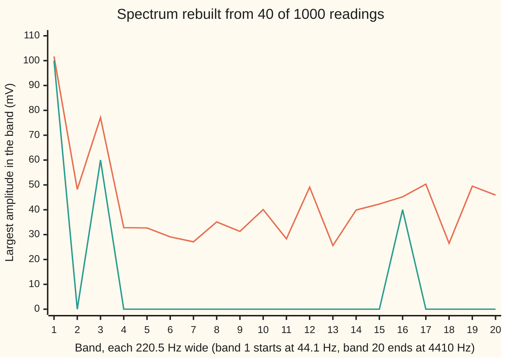

# Compressed sensing: few measurements suffice when the signal is mostly zeros

[Syllabus](../../../SYLLABUS.md) → [Engineering mathematics](../README.md) → [Signals](../README.md#s05) → Compressed sensing

---

## General Overview

A guitar pickup feeds a recorder at 44.1 kHz (44,100 readings a second). Take 1000 readings, 22.68 ms of sound. On the analysis grid of [The DFT and the FFT](02-discrete-fourier-transform-and-the-fft.md), those 1000 readings hold 501 frequencies, from 0 to 22,050 Hz in steps of 44.1 Hz.

This stretch of the chord uses three of them: an A at 220.5 Hz (100 mV, millivolts), an E at 661.5 Hz (60 mV) and a bright overtone at 3528 Hz (40 mV). The other 498 are zero. (The tones sit exactly on the grid; real tuning comes later on the card.)

Now keep only 40 of the 1000 readings, at random times, and throw the rest away. Even sampling would need more than 7056 readings a second to catch a 3528 Hz tone, more than 160 readings in this window. Forty is a quarter of that, and the rule on [Sampling](01-sampling-and-the-nyquist-theorem.md) says it cannot work.

It does. From the 40 readings, the method on this card rebuilds all 501 frequencies: 100.00, 60.00 and 40.00 mV at the right places, zero everywhere else, and the 1000-sample waveform with it. The Nyquist rule guarantees recovery for *every* signal below a frequency limit. This card asks for less: the signal must be **sparse**, meaning almost all of its spectrum is zero.

The method has one idea. Many spectra fit 40 readings exactly. Pick the one with the fewest frequencies switched on. Counting is hopeless to search, so instead pick the one whose frequency sizes have the smallest *sum*. For sparse signals, that sum picks the same answer.

**If a signal has only a few nonzero entries in a basis whose waves spread across every reading time, as sines do, a small number of randomly placed readings fixes it exactly, and the fit with the smallest summed size of entries finds it.**

**What kind of fact this is:** an outline. The recovery theorem (Candès, Romberg and Tao, 2006) is stated here, not proved. One piece is proved on this card: the certificate in Why it works, which shows that *this* recovery is exact. The checks then confirm it numerically.

### The picture: two fits to the same 40 readings



Orange: the obvious fit, missing readings set to zero and the spectrum scaled up 25 times. It smears energy across every band. Green: the fit with the smallest summed size. It is exactly the chord: 100 mV in band 1, 60 mV in band 3, 40 mV in band 16, and nothing else, all the way to 22,050 Hz.

---

## The formula

Notation first. The 1000 readings are written as a sum of 1000 basis waves, each scaled to length 1: one constant, one alternating wave at 22,050 Hz, and a cosine and a sine for each of bins 1 to 499. The list of their weights is the spectrum $z$.

Frequency bin $k$ owns a pair $z_k = (c_k, d_k)$, its cosine weight $c_k$ and sine weight $d_k$. Its **size** $\lVert z_k \rVert = \sqrt{c_k^2 + d_k^2}$ is the tone's amplitude times 22.36 (that is $\sqrt{N/2}$, from the scaling).

Keeping $m$ readings picks $m$ rows of the basis. Stacked, they form the **sensing matrix** $A$, $m$ rows by $N$ columns. The kept readings are $y = A z$.

Counting is the goal ($\#$ counts the members of a set):

$$\min_z \ \#\{k : z_k \neq 0\} \quad \text{subject to} \quad A z = y$$

Summing sizes is what can be solved, and it is **basis pursuit** ($\arg\min_z$ names the $z$ that makes the sum least):

$$\hat z = \arg\min_z \ \sum_{k=0}^{N/2} \lVert z_k \rVert \quad \text{subject to} \quad A z = y$$

**Read it aloud:** of all the spectra that reproduce the kept readings exactly, take the one whose frequency sizes add up to the least.

The recovery theorem says when this works. If the spectrum has $s$ nonzero numbers and the $m$ reading times are chosen at random, then with high probability $\hat z = z$ once

$$m \ \ge\ C\, s \,\ln N.$$

**Read it aloud:** the readings needed grow with the number of nonzero numbers, and only with the logarithm of the signal length.

This is the form proved for a sparse spectrum read at random times. When each reading is instead a random mix of all 1000 samples, the $\ln N$ improves to $\ln(N/s)$ (the overview by Candès and Wakin in the sources).

| Symbol | Plain meaning | In our example | Push it up and the answer… |
| --- | --- | --- | --- |
| $f_s$ | sampling rate, readings per second | 44,100 Hz | finer time, same 44.1 Hz grid only if $N$ grows too |
| $N$ | readings in the full window; also the number of basis waves | 1000 (22.68 ms) | more frequencies to search; $m$ grows only as $\ln N$ |
| $m$ | readings kept, at random times | 40 (4%) | recovery gets safer: exact in 5 of 5 draws from 35 up |
| $k$ | frequency bin; bin $k$ is $k \times 44.1$ Hz | 5, 15, 80 | — |
| $z$, $z_k = (c_k, d_k)$, $\hat z$ | the spectrum; bin $k$'s pair of cosine and sine weights; $\hat z$ is the fit basis pursuit picks | 3 of 501 bins nonzero | — |
| $\lVert z_k \rVert$ | size of bin $k$: amplitude times 22.36 | 100, 60, 40 mV times 22.36 | — |
| $s$, $S$ | nonzero numbers in $z$ (each tone gives a cosine and a sine weight); $S$ is the set of chord bins | 6 | more readings needed |
| $y$ | the kept readings, in mV | 40 numbers | — |
| $A$, $h$ | sensing matrix: the basis waves at the kept times; $h$ is a change to the spectrum with $Ah = 0$, invisible in the readings | 40 by 1000 | — |
| $C$ | a constant the theorem does not pin down | under 1 here: 30 to 35 needed, against $6 \ln 1000$ = 41.4 | — |
| $\tau$ | shrink per pass in the solver (Step 4) | 100 | slower or faster solving, same answer |
| $v$, $g_k$ | the certificate: one weight per kept reading (Step 3); $g_k$ is bin $k$'s pair in $g = A^\top v$ | largest match off the chord 0.8982 | — |

### When it holds

- **The signal is sparse in the basis you search.** Tones on the 44.1 Hz grid are. A tone at 242.55 Hz, halfway between two bins, spreads over every bin (the leakage of [Windows](03-windows-and-spectral-leakage.md)): with the same 40 readings the rebuilt waveform is off by 78.89 mV rms (root mean square).
- **Each basis wave spreads across every reading time** (incoherence). Sines do. A signal of three short clicks is sparse in the time basis instead, and each click shows in one reading only. Forty random readings out of 1000 catch all three with chance 5.9e-05; a click that falls between readings cannot be rebuilt by any method.
- **The reading times are random, not even.** Every 25th reading is regular sampling at 1764 Hz. Then each tone has aliases (false frequencies with identical readings), and no method can choose between them.
- **There are enough readings.** With 20 random readings the fit lands on 16 bins instead of 3 and misses by 33.22 mV rms.
- **The readings are clean, or the fit is relaxed.** The exact fit $Az = y$ trusts every reading. Add 1 mV of noise and it fits the noise too: false peaks of up to 0.60 mV, an rms error of 1.76 mV. A noisy version relaxes the fit; that is the lasso of [Regularisation](../../09-Probability%20and%20statistics/09-Regression/06-ridge-and-lasso.md).

---

## Why it works

### Step 0: there are many fits, so add one more requirement

Forty equations cannot pin 1000 unknowns. A huge family of spectra fits the 40 readings exactly. The extra requirement is the one fact known in advance: the true spectrum is mostly zeros. So pick the sparsest fit. Two things then need showing: the sparsest fit is the right one, and it can be found.

### Step 1: counting gives a unique answer, but cannot be searched

Suppose two different spectra, each with at most $s$ nonzero numbers, fit the same readings. Their difference $h$ has at most $2s$ nonzero numbers, and $Ah = 0$. If every set of $2s$ columns of $A$ is independent, no such $h$ exists. So with $2s = 12 \le m$ and columns in general position, the sparsest fit is the true one.

Finding it is another matter. The only sure way is to try every choice of bins. Three bins out of the 500 with a nonzero frequency is 20,708,500 choices, each a small least-squares fit. Ten bins out of 500 is 245,810,588,801,891,098,700. Counting does not scale.

### Step 2: swap counting for summing sizes

The sum of sizes is the closest cost to counting that is still bowl-shaped (convex): it has no false bottoms, so it can be minimised. It keeps the key feature of the lasso charge on [Regularisation](../../09-Probability%20and%20statistics/09-Regression/06-ridge-and-lasso.md). Its slope does not flatten at zero, so it can land *exactly* on zero.

In pictures: the fits form a flat sheet in a 1000-dimensional space. Grow a ball of fixed summed size until it first touches the sheet. That ball is a diamond, all points and edges, with its corners on the axes. A diamond growing toward a flat sheet usually touches with a corner first, and a corner is a sparse spectrum.

A round ball, the fit of least energy (smallest sum of squares), touches anywhere, and the touching point has every entry nonzero. That is the orange line in the picture, there scaled up 25 times so its peaks are readable. Before scaling it is a true fit, with summed size 504.42 mV against the chord's 200.00 mV.

### Step 3: a certificate proves the answer is the smallest

How do we know the sum-of-sizes fit is the chord and not some other spectrum with a smaller sum? A **certificate** settles it. Find weights $v$, one per kept reading, such that the correlation $A^\top v$, read bin by bin, is

- on each chord bin, exactly the unit direction of that bin's pair: $z_k / \lVert z_k \rVert$;
- on every other bin, smaller than 1 in size.

If such a $v$ exists, every other fit has a strictly larger summed size. The checks build one and find the largest match off the chord at **0.8982**: below 1, so the chord is proved to be the unique smallest fit. They also confirm the two facts the proof below leans on: the chord bins match their unit directions exactly, and the chord's 6 columns are independent.

<details>
<summary>Detailed proof: why the certificate rules out every other fit</summary>

Let $z$ be the chord, with nonzero bins $S$, and let $z + h$ be any other fit, so $Ah = 0$. Write $g = A^\top v$ and $g_k$ for its pair at bin $k$, and $\langle a, b \rangle$ for the dot product of $a$ and $b$.

On a chord bin, $\lVert z_k + h_k \rVert \ge \langle z_k + h_k, \, g_k \rangle = \lVert z_k \rVert + \langle h_k, g_k \rangle$, because $g_k$ is a unit vector pointing along $z_k$. Off the chord, $\lVert h_k \rVert \ge \langle h_k, g_k \rangle + (1 - \lVert g_k \rVert)\lVert h_k \rVert$, by the Cauchy–Schwarz inequality.

Add over all bins:

$$\sum_k \lVert z_k + h_k \rVert \ \ge\ \sum_{k} \lVert z_k \rVert + \langle h, A^\top v \rangle + \sum_{k \notin S} (1 - \lVert g_k \rVert)\lVert h_k \rVert.$$

The middle term is $\langle Ah, v \rangle = 0$. The last term is positive unless $h$ is zero off the chord. If it is, $h$ lives on the chord's 6 columns with $Ah = 0$, and those columns are independent, so $h = 0$. Every other fit costs strictly more.

</details>

The recovery theorem is, at heart, a promise that random reading times make such a certificate exist with high probability. The 2006 proof builds the certificate directly from the random times. Later proofs show that one set of readings works for every sparse spectrum at once. They go through the **restricted isometry property**: every small set of columns of $A$ behaves almost like perpendicular unit vectors (the Candès–Wakin overview). Both proofs are long, and this card leaves them to the sources.

### Step 4: solve it by alternating two moves

The checks find the sum-of-sizes fit with two simple moves, repeated until the answer fits every reading and has stopped moving (858 passes for the chord):

1. **Shrink.** Pull every bin's pair toward zero by $\tau$, and stop at zero. This is the soft-threshold of the lasso, applied to each pair's length.
2. **Snap.** Move to the nearest spectrum that fits the 40 readings exactly. The rows of $A$ are rows of a basis whose rows are perpendicular unit vectors, so $AA^\top$ is the identity and the snap is one line: subtract $A^\top(Az - y)$.

A running correction, carried between passes, keeps the pair from settling on a compromise; the full recipe is the **alternating direction method of multipliers** (ADMM, from Boyd and colleagues in the sources). The correction, divided by $\tau$, is also the raw material for the certificate of Step 3.

Each run stops only when no entry moves by more than $10^{-6}$ in a pass and the answer fits the readings; the checks assert that every reported fit does. Other solvers, such as proximal gradient, take the same shrink as their basic step.

### Step 5: why random times

Each basis wave is spread over the whole window, so every reading sees a little of every frequency. What can go wrong is a pattern in the reading times that makes two frequencies look the same. Evenly spaced readings are exactly that pattern: aliasing. Random times have no pattern, so no pair of frequencies can line up on all of them at once. That is the **incoherence** behind the theorem.

How many readings are enough? The rule $s \ln N$ gives $6 \ln 1000 = 41.4$. The checks redraw the reading times five times for each $m$:

```
10 readings  ▏                                         0 of 5 proved exact
20 readings  ████████████████                          2 of 5 proved exact
25 readings  ████████████████████████                  3 of 5 proved exact
30 readings  ████████████████████████████████          4 of 5 proved exact
35 readings  ████████████████████████████████████████  5 of 5 proved exact
40 readings  ████████████████████████████████████████  5 of 5 proved exact
```

Each draw is settled by a proof, not by eye. "Proved exact" means the certificate of Step 3, built from the solver's running correction, comes out below 1. The other draws are proved to fail: the solver finds a fit to the readings whose summed size is smaller than the chord's.

The change from failure to success happens between 20 and 35 readings, a little below the rule's 41.4, so $C$ is a little under 1 for this example. Theorems with proofs need a larger $C$ to be safe for every signal.

---

## Worked numbers, by hand

| Step | Arithmetic | Value |
| --- | --- | --- |
| window length | 1000 / 44,100 s | 22.68 ms |
| bin spacing | 44,100 / 1000 | 44.1 Hz |
| the three tones | 5 × 44.1, 15 × 44.1, 80 × 44.1 | 220.5, 661.5, 3528.0 Hz |
| even sampling for the top tone | 2 × 3528; 2 × 80 readings in the window | more than 7056 per second; more than 160 readings |
| readings kept | 40 / 1000 | 4% |
| size scale per mV | $\sqrt{1000/2}$ | 22.36 |
| summed size of the chord, in mV | 100 + 60 + 40 | 200.00 |
| root-sum-square size of the chord, in mV | $\sqrt{100^2 + 60^2 + 40^2}$ | 123.29 |
| fewest readings for a unique sparsest fit | 2 × 6 | 12 |
| rule of thumb | 6 × ln 1000 | 41.4 |
| the swap in miniature: one reading says first + 2 × second = 2 | least energy: (first, second) = 2 × (1, 2) / 5 | 0.4, 0.8; summed size 1.2 |
| the same reading, least summed size | put all the weight on the larger column: second = 2 / 2, first = 0 | 0, 1.0; summed size 1.0 |
| sum-of-sizes fit from 40 readings | read off the rebuilt spectrum | **100.00, 60.00, 40.00 mV** |

The miniature is the whole swap in two lines: least energy spreads over both unknowns, while least summed size lands on a corner, with one unknown exactly zero. From 40 readings, a quarter of what even sampling needs, the three tones come back at their exact amplitudes and phases (0.3000, 1.1000 and 2.0000 radians), with no false frequency anywhere up to 22,050 Hz.

### What breaks if you drop a piece

| Mistake | Comes out at | What went wrong |
| --- | --- | --- |
| Least energy instead of least summed size (fill missing readings with zero, scale up 25 times) | 501 bins switched on; a false peak of 74.55 mV at 18,081 Hz | A round ball touches the sheet of fits anywhere; before the 25-times scaling its root-sum-square size is lower (25.41 against 123.29 mV) but its summed size is higher (504.42 against 200.00 mV) |
| Even reading times, every 25th | 4.00, 2.40, 1.39 mV, spread over 62 bins | Regular sampling at 1764 Hz: each tone's aliases fit the readings at the same or a smaller summed size, 176.65 against the chord's 200.00 mV, because at these times the 3528 Hz tone's sine half reads zero |
| Too few readings: 20 random | 71.06, 34.77, 24.62 mV; 33.22 mV rms error | Below the threshold, a spread-out spectrum has a smaller sum than the chord: 198.71 against 200.00 mV |
| Not sparse: the A moved to 242.55 Hz, between bins | 23.96 mV in bin 5; a false peak of 33.43 mV at 9216.9 Hz; 78.89 mV rms error | A tone between bins leaks into all of them, so there is no sparse spectrum to find |

---

## Code, from first principles, and it actually runs

The scripts build the chord, draw 40 reading times with a SplitMix64 random generator written out in both languages (seed 2026), and rebuild the spectrum by four roads:

1. Road 1 is the full 1000-reading DFT (discrete Fourier transform), which sees everything and gives the truth.
2. Road 2 is the sum-of-sizes fit from the 40 readings, by the shrink-and-snap passes of Step 4, run until it fits every reading and stops moving.
3. Road 3 is **greedy matching** (orthogonal matching pursuit), a different method: pick the bin that best matches what is still unexplained, refit by least squares, repeat.
4. Road 4 is the certificate of Step 3, which proves the chord is the smallest fit.

The scripts then reproduce every wrong answer above, the noisy and real-tuning runs, and the sweep over $m$. In the sweep, each draw is settled by a proof: a certificate below 1, or a fit to the readings smaller than the chord. The Python runs in under a minute.

### Python

```python
# Compressed sensing -- the check behind the card.  Standard library only: the random draws, the
# spectrum, both recovery methods, the proof certificate and the small solves are written out below.
# 1000 samples of a guitar chord at 44.1 kHz hold three tones: 3 of 501 frequencies are switched on.
# Keep 40 samples at random times, throw the rest away, and rebuild the whole spectrum from the 40.
from math import sqrt, cos, sin, pi, log, atan2, comb; from operator import mul
N, M, FS, SEED = 1000, 40, 44100.0, 2026  # samples, samples kept, sampling rate in Hz, random seed
TONES = ((5, 100.0, 0.3), (15, 60.0, 1.1), (80, 40.0, 2.0))  # (frequency bin, amplitude mV, phase rad)
TAU, TOL, CAP, MASK = 100.0, 1e-6, 20000, (1 << 64) - 1      # shrink per pass, stop, most passes, mask
GROUPS = [(0,)] + [(2 * k - 1, 2 * k) for k in range(1, N // 2)] + [(N - 1,)]  # bin k's slots
SCALE = sqrt(N / 2)                       # a coefficient is the tone's amplitude times this, 22.36

def splitmix(seed):                       # SplitMix64: the same random integers in both languages
    s = seed
    while True:
        s = (s + 0x9E3779B97F4A7C15) & MASK; z = s
        z = ((z ^ (z >> 30)) * 0xBF58476D1CE4E5B9) & MASK
        z = ((z ^ (z >> 27)) * 0x94D049BB133111EB) & MASK
        yield z ^ (z >> 31)

def pick(seed, m):                        # m distinct sample times, by a partial shuffle
    g, idx = splitmix(seed), list(range(N))
    for i in range(m):
        r = i + next(g) % (N - i); idx[i], idx[r] = idx[r], idx[i]
    return sorted(idx[:m])
def wave(j, n):                           # basis wave j at time n, scaled to length 1 over all N samples
    if j == 0: return 1 / sqrt(N)
    if j == N - 1: return 1 / sqrt(N) if n % 2 == 0 else -1 / sqrt(N)
    ph = 2 * pi * ((j + 1) // 2) * n / N
    return sqrt(2 / N) * (cos(ph) if j % 2 == 1 else sin(ph))
def chord(n, tones): return sum(a * cos(2 * pi * f * n / N + p) for f, a, p in tones)  # mV at sample n
def dot(a, b): return sum(map(mul, a, b))
def amp(z, k): return sqrt(sum(z[j] * z[j] for j in GROUPS[k])) / (SCALE if 0 < k < N // 2 else sqrt(N))
def cost(z): return sum(sqrt(sum(z[j] * z[j] for j in g)) for g in GROUPS)   # what road 2 minimises

def solve(G, b):                          # Gaussian elimination with partial pivoting; also the smallest pivot
    n = len(b); A = [row[:] + [b[i]] for i, row in enumerate(G)]
    for c in range(n):
        p = max(range(c, n), key=lambda r: abs(A[r][c])); A[c], A[p] = A[p], A[c]
        for r in range(c + 1, n):
            f = A[r][c] / A[c][c]; A[r] = [x - f * y for x, y in zip(A[r], A[c])]
    x = [0.0] * n
    for r in range(n - 1, -1, -1): x[r] = (A[r][n] - dot(A[r][r + 1:n], x[r + 1:])) / A[r][r]
    return x, min(abs(A[c][c]) for c in range(n))
def shrink(w):                            # pull each bin's size toward zero by TAU, stop at zero
    z = [0.0] * N
    for g in GROUPS:
        size = sqrt(sum(w[j] * w[j] for j in g))
        if size > TAU:
            for j in g: z[j] = w[j] * (1 - TAU / size)
    return z

def sum_of_sizes(cols, y, judge=None):    # road 2: the exact fit with the smallest summed size
    rows, z, u, gap, step, passes = [list(r) for r in zip(*cols)], [0.0] * N, [0.0] * N, 1.0, 1.0, 0
    while (judge or gap > TOL or step > TOL) and passes < CAP:   # until z fits and stops moving
        v = [a - b for a, b in zip(z, u)]
        miss = [dot(row, v) - yi for row, yi in zip(rows, y)]
        x = [vj - dot(c, miss) for vj, c in zip(v, cols)]       # snap onto 'fits the samples'
        zn = shrink([a + b for a, b in zip(x, u)])              # shrink every bin
        gap, step = max(abs(a - b) for a, b in zip(x, zn)), max(abs(a - b) for a, b in zip(z, zn))
        z, u, passes = zn, [a + b - c for a, b, c in zip(u, x, zn)], passes + 1
        if judge and passes % 25 == 0:    # the sweep: stop once a proof settles it, either way
            if cost(x) < cost(judge) - 1e-6: return False         # an exact fit smaller than the chord
            if certificate(cols, judge, [dot(row, u) / TAU for row in rows]) < 1: return True
    assert passes < CAP and max(abs(dot(row, z) - yi) for row, yi in zip(rows, y)) < 1e-5, "z fits every sample"
    return z, [dot(row, u) / TAU for row in rows], passes      # the answer, its dual vector, passes

def greedy(cols, y, tones):               # road 3: take the best-matching bin, refit, repeat
    chosen, r, z = [], y[:], [0.0] * N
    for _ in range(tones):
        score = [dot(cols[2 * k - 1], r) ** 2 + dot(cols[2 * k], r) ** 2 for k in range(1, N // 2)]
        chosen.append(1 + max(range(len(score)), key=lambda i: score[i]))
        js = [j for k in chosen for j in GROUPS[k]]                          # least squares on them
        c, _ = solve([[dot(cols[a], cols[b]) for b in js] for a in js], [dot(cols[a], y) for a in js])
        r = [yi - sum(cj * cols[j][i] for cj, j in zip(c, js)) for i, yi in enumerate(y)]
    for cj, j in zip(c, js): z[j] = cj
    return z

def certificate(cols, z, v):              # road 4: a value below 1 proves z is the unique smallest summed size
    on = [k for k in range(1, N // 2) if amp(z, k) > 1e-3]
    js, unit = [j for k in on for j in GROUPS[k]], [z[j] / (amp(z, k) * SCALE) for k in on for j in GROUPS[k]]
    c, pivot = solve([[dot(cols[a], cols[b]) for b in js] for a in js], [e - dot(cols[j], v) for e, j in zip(unit, js)])
    v = [vi + sum(cj * cols[j][i] for cj, j in zip(c, js)) for i, vi in enumerate(v)]   # make the chord's slots exact
    g = [dot(col, v) for col in cols]
    assert max(abs(g[j] - e) for e, j in zip(unit, js)) < 1e-9 and pivot > 1e-6, "exact on independent chord columns"
    return max(sqrt(sum(g[j] ** 2 for j in GROUPS[k])) for k in range(len(GROUPS)) if k not in on)
def setup(times, tones, noise=0.0):       # the kept columns and samples, with optional uniform noise
    cols, g = [[wave(j, n) for n in times] for j in range(N)], splitmix(99)
    return cols, [chord(n, tones) + noise * sqrt(3) * ((next(g) >> 11) / 2 ** 52 - 1) for n in times]
def report(label, z, tones):              # the three bins, the largest false peak, the waveform error
    a = [amp(z, k) for k in range(len(GROUPS))]
    false = max((a[k], k) for k in range(len(GROUPS)) if k not in (5, 15, 80))
    err = sqrt(sum((sum(z[j] * wave(j, n) for j in range(N) if z[j]) - chord(n, tones)) ** 2 for n in range(N)) / N)
    print(f"{label}: {a[5]:7.2f} {a[15]:6.2f} {a[80]:6.2f} mV  false peak {false[0]:6.2f} mV at {false[1] * FS / N:7.1f} Hz"
          f"  bins on {sum(1 for v in a if v > 0.01):3d}  rms error {err:7.2f} mV  summed size {sum(a):6.2f} mV")
    print(f"  peak in each 220.5 Hz band up to 4410 Hz (mV): {' '.join(f'{max(a[5 * b + 1:5 * b + 6]):.1f}' for b in range(20))}")
    return a, false[0], err

truth = [0.0] * N
for f, a, p in TONES: truth[2 * f - 1], truth[2 * f] = a * cos(p) * SCALE, -a * sin(p) * SCALE
full = [chord(n, TONES) for n in range(N)]
dft = [2 / N * sqrt(sum(x * cos(2 * pi * k * n / N) for n, x in enumerate(full)) ** 2
                    + sum(x * sin(2 * pi * k * n / N) for n, x in enumerate(full)) ** 2) for k in range(N // 2)]
times = pick(SEED, M)
print(f"setup: {N} samples at {FS / 1000:.1f} kHz = {1000 * N / FS:.2f} ms, bin spacing {FS / N:.1f} Hz, keep {M} at random times")
print(f"tones: {', '.join(f'{f * FS / N:.1f} Hz {a:.0f} mV' for f, a, p in TONES)}   coefficient scale {SCALE:.2f}")
print(f"even sampling for {TONES[-1][0] * FS / N:.1f} Hz: more than {2 * TONES[-1][0] * FS / N:.0f} per second, more than {2 * TONES[-1][0]} samples in the window")
print(f"kept times (first 8 of {M}): {times[:8]}   that is {100 * M // N}%   chance they see 3 given clicks {M * (M - 1) * (M - 2) / (N * (N - 1) * (N - 2)):.1e}")
print(f"road 1 full 1000-sample DFT: {dft[5]:.4f} {dft[15]:.4f} {dft[80]:.4f} mV  largest elsewhere {max(dft[k] for k in range(N // 2) if k not in (5, 15, 80)):.1e} mV")
print(f"counting search: 3 of 500 bins {comb(500, 3)}   10 of 500 {comb(500, 10)}   2s = 12   s ln N = 6 ln 1000 = {6 * log(N):.1f}")
print(f"by hand, one sample a + 2b = 2: least energy a, b = {2 * 1 / 5:.1f}, {2 * 2 / 5:.1f} (summed size {2 * 3 / 5:.1f}); least summed size 0, {2 / 2:.1f} (summed size {2 / 2:.1f})")
cols, y = setup(times, TONES)
z1, v1, n1 = sum_of_sizes(cols, y)
a1, _, e1 = report("road 2 sum of sizes      ", z1, TONES)
print(f"  phases {', '.join(f'{atan2(-z1[2 * f], z1[2 * f - 1]):.4f}' for f, _, _ in TONES)} rad   largest amplitude error {max(abs(a1[f] - a) for f, a, _ in TONES):.1e} mV after {n1} passes")
a2, _, e2 = report("road 3 greedy matching   ", greedy(cols, y, 3), TONES)
cert = certificate(cols, truth, v1)
print(f"road 4 certificate: largest match off the chord {cert:.4f}  (below 1 proves no other fit is smaller)")
size, rss = lambda z: sum(amp(z, k) for k in range(len(GROUPS))), lambda z: sqrt(sum(v * v for v in z)) / SCALE
z0 = [dot(c, y) for c in cols]            # the fit of least energy: fill the missing samples with zeros
print(f"summed size (mV):     truth {size(truth):.2f}  road 2 {size(z1):.2f}  least-energy fit {size(z0):.2f}")
print(f"root-sum-square (mV): truth {rss(truth):.2f}  road 2 {rss(z1):.2f}  least-energy fit {rss(z0):.2f}")
a0, f0, _ = report("wrong: zero-fill x 25    ", [v * N / M for v in z0], TONES)
report("wrong: every 25th, 1764 Hz", sum_of_sizes(*setup(list(range(0, N, N // M)), TONES))[0], TONES)
_, _, e4 = report("wrong: 20 random samples ", sum_of_sizes(*setup(pick(SEED, 20), TONES))[0], TONES)
tuned = ((220.0 * N / FS, 100.0, 0.3), (659.26 * N / FS, 60.0, 1.1), (3520.0 * N / FS, 40.0, 2.0))
_, _, e5 = report("tuned 220, 659.26, 3520 Hz", sum_of_sizes(*setup(times, tuned))[0], tuned)
half = ((5.5, 100.0, 0.3), (15, 60.0, 1.1), (80, 40.0, 2.0))
_, _, e6 = report("wrong: 242.6 Hz, half-bin", sum_of_sizes(*setup(times, half))[0], half)
a7, f7, e7 = report("noise 1 mV rms on samples", sum_of_sizes(*setup(times, TONES, 1.0))[0], TONES)
sweep = {m: [sum_of_sizes(*setup(pick(s, m), TONES), judge=truth) for s in range(1, 6)] for m in (10, 20, 25, 30, 35, 40)}
print(f"proved exact, of 5 random draws: {', '.join(f'{m} samples {sum(r is True for r in rs)}' for m, rs in sweep.items())}")
assert max(abs(dft[f] - a) for f, a, _ in TONES) < 1e-9, "the full DFT finds the chord"
assert max(abs(a1[f] - a) for f, a, _ in TONES) < 1e-4 and e1 < 1e-4, "40 samples rebuild the chord by summed size"
assert max(abs(a2[f] - a) for f, a, _ in TONES) < 1e-9 and e2 < 1e-9, "the greedy road agrees"
assert cert < 1, "the certificate proves the chord is the smallest summed size"
assert rss(z0) < rss(truth) and size(z0) > size(truth), "zero-fill wins on energy, loses on summed size"
assert f0 > 10 and e4 > 1 and e6 > 1, "zero-fill, too few samples and an off-grid tone must fail"
assert all(type(r) is bool for rs in sweep.values() for r in rs) and sum(sweep[10]) == 0 and sum(sweep[40]) == 5, \
    "a proof settles every draw; 10 samples never suffice, 40 always do here"
print("ALL CHECKS PASS")
```

**Ran 2026-11-11 on macOS, Python 3.14.10, standard library only. All checks passed. Output, pasted from the run:**

```
setup: 1000 samples at 44.1 kHz = 22.68 ms, bin spacing 44.1 Hz, keep 40 at random times
tones: 220.5 Hz 100 mV, 661.5 Hz 60 mV, 3528.0 Hz 40 mV   coefficient scale 22.36
even sampling for 3528.0 Hz: more than 7056 per second, more than 160 samples in the window
kept times (first 8 of 40): [14, 51, 76, 95, 192, 225, 228, 317]   that is 4%   chance they see 3 given clicks 5.9e-05
road 1 full 1000-sample DFT: 100.0000 60.0000 40.0000 mV  largest elsewhere 1.9e-12 mV
counting search: 3 of 500 bins 20708500   10 of 500 245810588801891098700   2s = 12   s ln N = 6 ln 1000 = 41.4
by hand, one sample a + 2b = 2: least energy a, b = 0.4, 0.8 (summed size 1.2); least summed size 0, 1.0 (summed size 1.0)
road 2 sum of sizes      :  100.00  60.00  40.00 mV  false peak   0.00 mV at 22050.0 Hz  bins on   3  rms error    0.00 mV  summed size 200.00 mV
  peak in each 220.5 Hz band up to 4410 Hz (mV): 100.0 0.0 60.0 0.0 0.0 0.0 0.0 0.0 0.0 0.0 0.0 0.0 0.0 0.0 0.0 40.0 0.0 0.0 0.0 0.0
  phases 0.3000, 1.1000, 2.0000 rad   largest amplitude error 1.0e-06 mV after 858 passes
road 3 greedy matching   :  100.00  60.00  40.00 mV  false peak   0.00 mV at 22050.0 Hz  bins on   3  rms error    0.00 mV  summed size 200.00 mV
  peak in each 220.5 Hz band up to 4410 Hz (mV): 100.0 0.0 60.0 0.0 0.0 0.0 0.0 0.0 0.0 0.0 0.0 0.0 0.0 0.0 0.0 40.0 0.0 0.0 0.0 0.0
road 4 certificate: largest match off the chord 0.8982  (below 1 proves no other fit is smaller)
summed size (mV):     truth 200.00  road 2 200.00  least-energy fit 504.42
root-sum-square (mV): truth 123.29  road 2 123.29  least-energy fit 25.41
wrong: zero-fill x 25    :  101.70  77.13  36.49 mV  false peak  74.55 mV at 18081.0 Hz  bins on 501  rms error  439.54 mV  summed size 12610.41 mV
  peak in each 220.5 Hz band up to 4410 Hz (mV): 101.7 48.2 77.1 32.8 32.7 29.1 27.1 35.1 31.3 40.1 28.3 49.1 25.6 39.9 42.3 45.2 50.3 26.5 49.5 45.9
wrong: every 25th, 1764 Hz:    4.00   2.40   1.39 mV  false peak   4.00 mV at 17860.5 Hz  bins on  62  rms error   85.54 mV  summed size 176.65 mV
  peak in each 220.5 Hz band up to 4410 Hz (mV): 4.0 0.0 2.4 0.0 2.4 0.0 4.0 1.4 4.0 0.0 2.4 0.0 2.4 0.0 4.0 1.4 4.0 0.0 2.4 0.0
wrong: 20 random samples :   71.06  34.77  24.62 mV  false peak   8.79 mV at 20197.8 Hz  bins on  16  rms error   33.22 mV  summed size 198.71 mV
  peak in each 220.5 Hz band up to 4410 Hz (mV): 71.1 5.5 34.8 0.0 0.0 0.0 0.0 0.0 0.0 0.0 0.0 6.0 0.0 7.4 0.0 24.6 0.0 0.0 0.0 0.0
tuned 220, 659.26, 3520 Hz:   90.54  54.91  31.48 mV  false peak   5.43 mV at  3616.2 Hz  bins on  34  rms error   14.28 mV  summed size 225.97 mV
  peak in each 220.5 Hz band up to 4410 Hz (mV): 90.5 0.8 54.9 0.0 0.0 0.0 2.2 0.0 0.0 0.0 0.0 0.0 0.0 0.0 0.0 31.5 5.4 0.0 0.0 0.0
wrong: 242.6 Hz, half-bin:   23.96  20.14   0.00 mV  false peak  33.43 mV at  9216.9 Hz  bins on  33  rms error   78.89 mV  summed size 269.92 mV
  peak in each 220.5 Hz band up to 4410 Hz (mV): 24.0 7.3 20.1 0.0 1.1 0.0 3.3 11.0 0.0 1.8 0.0 0.0 0.0 0.0 0.0 0.0 0.0 0.0 0.0 0.0
noise 1 mV rms on samples:   98.80  58.96  38.92 mV  false peak   0.60 mV at 18036.9 Hz  bins on  33  rms error    1.76 mV  summed size 202.13 mV
  peak in each 220.5 Hz band up to 4410 Hz (mV): 98.8 0.0 59.0 0.0 0.0 0.0 0.0 0.0 0.0 0.3 0.0 0.0 0.0 0.1 0.0 38.9 0.0 0.0 0.0 0.0
proved exact, of 5 random draws: 10 samples 0, 20 samples 2, 25 samples 3, 30 samples 4, 35 samples 5, 40 samples 5
ALL CHECKS PASS
```

### Rust

```rust
// Compressed sensing -- the same check as compressed_sensing_in_outline_check.py, in Rust, std only.
// 1000 samples of a guitar chord at 44.1 kHz hold three tones: 3 of 501 frequencies are switched on.
// Keep 40 samples at random times, throw the rest away, and rebuild the whole spectrum from the 40.
use std::f64::consts::PI;
const N: usize = 1000; const M: usize = 40; const FS: f64 = 44100.0; const SEED: u64 = 2026; // as in Python
const TONES: [(f64, f64, f64); 3] = [(5.0, 100.0, 0.3), (15.0, 60.0, 1.1), (80.0, 40.0, 2.0)];
const HALF: [(f64, f64, f64); 3] = [(5.5, 100.0, 0.3), (15.0, 60.0, 1.1), (80.0, 40.0, 2.0)]; // A3 moved half a bin
const TAU: f64 = 100.0; const TOL: f64 = 1e-6; const CAP: usize = 20000; // shrink per pass, stop, most passes
const G: usize = N / 2 + 1; // bins 0..=500; bin k uses slots 2k-1 (cosine) and 2k (sine)
struct SplitMix(u64); // SplitMix64: the same random integers in both languages
impl SplitMix { fn next(&mut self) -> u64 {
    self.0 = self.0.wrapping_add(0x9E3779B97F4A7C15); let mut z = self.0;
    z = (z ^ (z >> 30)).wrapping_mul(0xBF58476D1CE4E5B9); z = (z ^ (z >> 27)).wrapping_mul(0x94D049BB133111EB);
    z ^ (z >> 31)
} }
fn psum<I: IntoIterator<Item = f64>>(it: I) -> f64 { // compensated sum, as Python's sum() does it
    let (mut s, mut c) = (0.0_f64, 0.0_f64);
    for x in it { let t = s + x; if s.abs() >= x.abs() { c += (s - t) + x } else { c += (x - t) + s } s = t; }
    if c != 0.0 && c.is_finite() { s + c } else { s }
}
fn group(k: usize) -> Vec<usize> { if k == 0 { vec![0] } else if k == N / 2 { vec![N - 1] } else { vec![2 * k - 1, 2 * k] } }
fn scale() -> f64 { (N as f64 / 2.0).sqrt() } // a coefficient is the tone's amplitude times this
fn pick(seed: u64, m: usize) -> Vec<usize> { // m distinct sample times, by a partial shuffle
    let (mut g, mut idx) = (SplitMix(seed), (0..N).collect::<Vec<usize>>());
    for i in 0..m { let r = i + (g.next() % (N - i) as u64) as usize; idx.swap(i, r); }
    let mut t = idx[..m].to_vec(); t.sort(); t
}
fn wave(j: usize, n: usize) -> f64 { // basis wave j at time n, scaled to length 1 over all N samples
    let r = 1.0 / (N as f64).sqrt();
    if j == 0 { return r; }
    if j == N - 1 { return if n % 2 == 0 { r } else { -r }; }
    let ph = 2.0 * PI * ((j + 1) / 2) as f64 * n as f64 / N as f64;
    (2.0 / N as f64).sqrt() * if j % 2 == 1 { ph.cos() } else { ph.sin() }
}
fn chord(n: usize, tones: &[(f64, f64, f64)]) -> f64 { psum(tones.iter().map(|&(f, a, p)| a * (2.0 * PI * f * n as f64 / N as f64 + p).cos())) }
fn dot(a: &[f64], b: &[f64]) -> f64 { psum(a.iter().zip(b).map(|(x, y)| x * y)) }
fn amp(z: &[f64], k: usize) -> f64 { psum(group(k).iter().map(|&j| z[j] * z[j])).sqrt() / if k > 0 && k < N / 2 { scale() } else { (N as f64).sqrt() } }
fn cost(z: &[f64]) -> f64 { psum((0..G).map(|k| psum(group(k).iter().map(|&j| z[j] * z[j])).sqrt())) } // what road 2 minimises
fn solve(gm: Vec<Vec<f64>>, b: Vec<f64>) -> (Vec<f64>, f64) { // Gaussian elimination with partial pivoting; also the smallest pivot
    let n = b.len(); let mut a: Vec<Vec<f64>> = gm.iter().zip(&b).map(|(row, &bi)| { let mut r = row.clone(); r.push(bi); r }).collect();
    for c in 0..n {
        let mut p = c; for r in c + 1..n { if a[r][c].abs() > a[p][c].abs() { p = r; } } a.swap(c, p);
        for r in c + 1..n { let f = a[r][c] / a[c][c]; a[r] = a[r].iter().zip(&a[c]).map(|(x, y)| x - f * y).collect(); }
    }
    let mut x = vec![0.0; n]; for r in (0..n).rev() { x[r] = (a[r][n] - dot(&a[r][r + 1..n], &x[r + 1..])) / a[r][r]; }
    (x, (0..n).map(|c| a[c][c].abs()).fold(f64::INFINITY, f64::min))
}
fn shrink(w: &[f64]) -> Vec<f64> { // pull each bin's size toward zero by TAU, stop at zero
    let mut z = vec![0.0; N]; for k in 0..G {
        let g = group(k); let size = psum(g.iter().map(|&j| w[j] * w[j])).sqrt();
        if size > TAU { for &j in &g { z[j] = w[j] * (1.0 - TAU / size); } }
    }
    z
}
// road 2: the exact fit with the smallest summed size; with a judge, stop once a proof settles it, either way
fn sum_of_sizes(cols: &[Vec<f64>], y: &[f64], judge: Option<&[f64]>) -> (Vec<f64>, Vec<f64>, usize, Option<bool>) {
    let rows: Vec<Vec<f64>> = (0..y.len()).map(|i| cols.iter().map(|c| c[i]).collect()).collect();
    let (mut z, mut u, mut gap, mut step, mut passes) = (vec![0.0; N], vec![0.0; N], 1.0f64, 1.0f64, 0usize);
    while (judge.is_some() || gap > TOL || step > TOL) && passes < CAP { // until z fits and stops moving
        let v: Vec<f64> = z.iter().zip(&u).map(|(a, b)| a - b).collect();
        let miss: Vec<f64> = rows.iter().zip(y).map(|(row, yi)| dot(row, &v) - yi).collect();
        let x: Vec<f64> = v.iter().zip(cols).map(|(vj, c)| vj - dot(c, &miss)).collect(); // snap onto the fit
        let zn = shrink(&x.iter().zip(&u).map(|(a, b)| a + b).collect::<Vec<f64>>()); // shrink every bin
        (gap, step) = (x.iter().zip(&zn).map(|(a, b)| (a - b).abs()).fold(0.0, f64::max), z.iter().zip(&zn).map(|(a, b)| (a - b).abs()).fold(0.0, f64::max));
        u = u.iter().zip(&x).zip(&zn).map(|((a, b), c)| a + b - c).collect(); z = zn; passes += 1;
        if let (Some(t), 0) = (judge, passes % 25) {
            if cost(&x) < cost(t) - 1e-6 { return (z, u, passes, Some(false)); } // an exact fit smaller than the chord
            if certificate(cols, t, &rows.iter().map(|row| dot(row, &u) / TAU).collect::<Vec<f64>>()) < 1.0 { return (z, u, passes, Some(true)); }
        }
    }
    assert!(passes < CAP && rows.iter().zip(y).all(|(row, yi)| (dot(row, &z) - yi).abs() < 1e-5), "z fits every sample");
    (z, rows.iter().map(|row| dot(row, &u) / TAU).collect(), passes, None) // the answer, its dual vector, passes
}
fn gram(cols: &[Vec<f64>], js: &[usize]) -> Vec<Vec<f64>> { js.iter().map(|&a| js.iter().map(|&b| dot(&cols[a], &cols[b])).collect()).collect() }
fn greedy(cols: &[Vec<f64>], y: &[f64], tones: usize) -> Vec<f64> { // road 3: best-matching bin, refit, repeat
    let (mut chosen, mut r, mut z, mut c, mut js) = (Vec::new(), y.to_vec(), vec![0.0; N], Vec::new(), Vec::new());
    for _ in 0..tones {
        let (mut best, mut top) = (1, -1.0);
        for k in 1..N / 2 { let s = dot(&cols[2 * k - 1], &r).powi(2) + dot(&cols[2 * k], &r).powi(2); if s > top { top = s; best = k; } }
        chosen.push(best);
        js = chosen.iter().flat_map(|&k| group(k)).collect();
        c = solve(gram(cols, &js), js.iter().map(|&a| dot(&cols[a], y)).collect()).0;
        r = (0..y.len()).map(|i| y[i] - psum(c.iter().zip(&js).map(|(cj, &j)| cj * cols[j][i]))).collect();
    }
    for (cj, &j) in c.iter().zip(&js) { z[j] = *cj; }
    z
}
fn certificate(cols: &[Vec<f64>], z: &[f64], v: &[f64]) -> f64 { // road 4: below 1 proves z is the unique smallest
    let on: Vec<usize> = (1..N / 2).filter(|&k| amp(z, k) > 1e-3).collect();
    let js: Vec<usize> = on.iter().flat_map(|&k| group(k)).collect();
    let unit: Vec<f64> = on.iter().flat_map(|&k| group(k).into_iter().map(move |j| (k, j))).map(|(k, j)| z[j] / (amp(z, k) * scale())).collect();
    let (c, pivot) = solve(gram(cols, &js), unit.iter().zip(&js).map(|(e, &j)| e - dot(&cols[j], v)).collect());
    let v: Vec<f64> = (0..v.len()).map(|i| v[i] + psum(c.iter().zip(&js).map(|(cj, &j)| cj * cols[j][i]))).collect(); // chord slots exact
    let g: Vec<f64> = cols.iter().map(|col| dot(col, &v)).collect();
    assert!(unit.iter().zip(&js).all(|(e, &j)| (g[j] - e).abs() < 1e-9) && pivot > 1e-6, "exact on independent chord columns");
    (0..G).filter(|k| !on.contains(k)).map(|k| psum(group(k).iter().map(|&j| g[j].powi(2))).sqrt()).fold(f64::MIN, f64::max)
}
fn setup(times: &[usize], tones: &[(f64, f64, f64)], noise: f64) -> (Vec<Vec<f64>>, Vec<f64>) {
    let cols = (0..N).map(|j| times.iter().map(|&n| wave(j, n)).collect()).collect();
    let mut g = SplitMix(99); let y = times.iter().map(|&n| chord(n, tones) + noise * 3.0_f64.sqrt() * ((g.next() >> 11) as f64 / 2f64.powi(52) - 1.0)).collect();
    (cols, y)
}
fn report(label: &str, z: &[f64], tones: &[(f64, f64, f64)]) -> (Vec<f64>, f64, f64) {
    let a: Vec<f64> = (0..G).map(|k| amp(z, k)).collect();
    let (mut fv, mut fk) = (f64::MIN, 0); for k in (0..G).filter(|k| ![5, 15, 80].contains(k)) { if a[k] >= fv { fv = a[k]; fk = k; } }
    let err = (psum((0..N).map(|n| (psum((0..N).filter(|&j| z[j] != 0.0).map(|j| z[j] * wave(j, n))) - chord(n, tones)).powi(2))) / N as f64).sqrt();
    println!("{}: {:7.2} {:6.2} {:6.2} mV  false peak {:6.2} mV at {:7.1} Hz  bins on {:3}  rms error {:7.2} mV  summed size {:6.2} mV",
             label, a[5], a[15], a[80], fv, fk as f64 * FS / N as f64, a.iter().filter(|&&v| v > 0.01).count(), err, psum(a.iter().cloned()));
    println!("  peak in each 220.5 Hz band up to 4410 Hz (mV): {}", (0..20).map(|b| format!("{:.1}", a[5 * b + 1..5 * b + 6].iter().cloned().fold(f64::MIN, f64::max))).collect::<Vec<_>>().join(" "));
    (a, fv, err)
}
fn sci(x: f64) -> String { // Python's .1e: at least two exponent digits
    let s = format!("{:.1e}", x); let (m, e) = s.split_once('e').unwrap();
    let (sign, d) = if let Some(d) = e.strip_prefix('-') { ('-', d) } else { ('+', e) };
    format!("{}e{}{:0>2}", m, sign, d)
}
fn main() {
    let (sc, mut truth) = (scale(), vec![0.0; N]); for &(f, a, p) in &TONES { let f = f as usize; truth[2 * f - 1] = a * p.cos() * sc; truth[2 * f] = -a * p.sin() * sc; }
    let full: Vec<f64> = (0..N).map(|n| chord(n, &TONES)).collect();
    let dft: Vec<f64> = (0..N / 2).map(|k| 2.0 / N as f64 * (psum(full.iter().enumerate().map(|(n, x)| x * (2.0 * PI * k as f64 * n as f64 / N as f64).cos())).powi(2)
        + psum(full.iter().enumerate().map(|(n, x)| x * (2.0 * PI * k as f64 * n as f64 / N as f64).sin())).powi(2)).sqrt()).collect();
    let times = pick(SEED, M);
    let comb = |n: u128, r: u128| (0..r).fold(1u128, |c, i| c * (n - i) / (i + 1));
    println!("setup: {} samples at {:.1} kHz = {:.2} ms, bin spacing {:.1} Hz, keep {} at random times", N, FS / 1000.0, 1000.0 * N as f64 / FS, FS / N as f64, M);
    println!("tones: {}   coefficient scale {:.2}", TONES.iter().map(|&(f, a, _)| format!("{:.1} Hz {:.0} mV", f * FS / N as f64, a)).collect::<Vec<_>>().join(", "), sc);
    println!("even sampling for {:.1} Hz: more than {:.0} per second, more than {} samples in the window", TONES[2].0 * FS / N as f64, 2.0 * TONES[2].0 * FS / N as f64, 2 * TONES[2].0 as usize);
    println!("kept times (first 8 of {}): {:?}   that is {}%   chance they see 3 given clicks {}", M, &times[..8], 100 * M / N, sci((M * (M - 1) * (M - 2)) as f64 / (N * (N - 1) * (N - 2)) as f64));
    let rest = (0..N / 2).filter(|k| ![5, 15, 80].contains(k)).map(|k| dft[k]).fold(f64::MIN, f64::max);
    println!("road 1 full 1000-sample DFT: {:.4} {:.4} {:.4} mV  largest elsewhere {} mV", dft[5], dft[15], dft[80], sci(rest));
    println!("counting search: 3 of 500 bins {}   10 of 500 {}   2s = 12   s ln N = 6 ln 1000 = {:.1}", comb(500, 3), comb(500, 10), 6.0 * (N as f64).ln());
    println!("by hand, one sample a + 2b = 2: least energy a, b = {:.1}, {:.1} (summed size {:.1}); least summed size 0, {:.1} (summed size {:.1})",
        2.0 * 1.0 / 5.0, 2.0 * 2.0 / 5.0, 2.0 * 3.0 / 5.0, 2.0 / 2.0, 2.0 / 2.0);
    let (cols, y) = setup(&times, &TONES, 0.0);
    let (z1, v1, n1, _) = sum_of_sizes(&cols, &y, None);
    let (a1, _, e1) = report("road 2 sum of sizes      ", &z1, &TONES);
    let ph: Vec<String> = TONES.iter().map(|&(f, _, _)| { let f = f as usize; format!("{:.4}", (-z1[2 * f]).atan2(z1[2 * f - 1])) }).collect();
    let aerr = TONES.iter().map(|&(f, a, _)| (a1[f as usize] - a).abs()).fold(f64::MIN, f64::max);
    println!("  phases {} rad   largest amplitude error {} mV after {} passes", ph.join(", "), sci(aerr), n1);
    let (a2, _, e2) = report("road 3 greedy matching   ", &greedy(&cols, &y, 3), &TONES);
    let cert = certificate(&cols, &truth, &v1);
    println!("road 4 certificate: largest match off the chord {:.4}  (below 1 proves no other fit is smaller)", cert);
    let (size, rss) = (|z: &[f64]| psum((0..G).map(|k| amp(z, k))), |z: &[f64]| psum(z.iter().map(|v| v * v)).sqrt() / sc);
    let z0: Vec<f64> = cols.iter().map(|c| dot(c, &y)).collect(); // least energy: missing samples set to zero
    println!("summed size (mV):     truth {:.2}  road 2 {:.2}  least-energy fit {:.2}", size(&truth), size(&z1), size(&z0));
    println!("root-sum-square (mV): truth {:.2}  road 2 {:.2}  least-energy fit {:.2}", rss(&truth), rss(&z1), rss(&z0));
    let zr: Vec<f64> = z0.iter().map(|v| v * N as f64 / M as f64).collect();
    let (_, f0, _) = report("wrong: zero-fill x 25    ", &zr, &TONES);
    let run = |t: &[usize], tones: &[(f64, f64, f64)], noise: f64| { let (c, y) = setup(t, tones, noise); sum_of_sizes(&c, &y, None).0 };
    report("wrong: every 25th, 1764 Hz", &run(&(0..N).step_by(N / M).collect::<Vec<usize>>(), &TONES, 0.0), &TONES);
    let (_, _, e4) = report("wrong: 20 random samples ", &run(&pick(SEED, 20), &TONES, 0.0), &TONES);
    let tuned = [(220.0 * N as f64 / FS, 100.0, 0.3), (659.26 * N as f64 / FS, 60.0, 1.1), (3520.0 * N as f64 / FS, 40.0, 2.0)];
    report("tuned 220, 659.26, 3520 Hz", &run(&times, &tuned, 0.0), &tuned);
    let (_, _, e6) = report("wrong: 242.6 Hz, half-bin", &run(&times, &HALF, 0.0), &HALF);
    report("noise 1 mV rms on samples", &run(&times, &TONES, 1.0), &TONES);
    let ms = [10usize, 20, 25, 30, 35, 40];
    let sweep: Vec<Vec<Option<bool>>> = ms.iter().map(|&m| (1..6).map(|s| { let (c, y) = setup(&pick(s, m), &TONES, 0.0); sum_of_sizes(&c, &y, Some(&truth)).3 }).collect()).collect();
    let proved = |rs: &Vec<Option<bool>>| rs.iter().filter(|&&r| r == Some(true)).count();
    println!("proved exact, of 5 random draws: {}", ms.iter().zip(&sweep).map(|(m, rs)| format!("{} samples {}", m, proved(rs))).collect::<Vec<_>>().join(", "));
    assert!(TONES.iter().all(|&(f, a, _)| (dft[f as usize] - a).abs() < 1e-9), "the full DFT finds the chord");
    assert!(aerr < 1e-4 && e1 < 1e-4, "40 samples rebuild the chord by summed size");
    assert!(TONES.iter().all(|&(f, a, _)| (a2[f as usize] - a).abs() < 1e-9) && e2 < 1e-9, "the greedy road agrees");
    assert!(cert < 1.0, "the certificate proves the chord is the smallest summed size");
    assert!(rss(&z0) < rss(&truth) && size(&z0) > size(&truth), "zero-fill wins on energy, loses on summed size");
    assert!(f0 > 10.0 && e4 > 1.0 && e6 > 1.0, "zero-fill, too few samples and an off-grid tone must fail");
    assert!(sweep.iter().flatten().all(|r| r.is_some()) && proved(&sweep[0]) == 0 && proved(&sweep[5]) == 5,
        "a proof settles every draw; 10 samples never suffice, 40 always do here");
    println!("ALL CHECKS PASS");
}
```

**Ran 2026-11-11 on macOS, rustc 1.98.1, no crates. All checks passed. Output, pasted from the run:**

```
setup: 1000 samples at 44.1 kHz = 22.68 ms, bin spacing 44.1 Hz, keep 40 at random times
tones: 220.5 Hz 100 mV, 661.5 Hz 60 mV, 3528.0 Hz 40 mV   coefficient scale 22.36
even sampling for 3528.0 Hz: more than 7056 per second, more than 160 samples in the window
kept times (first 8 of 40): [14, 51, 76, 95, 192, 225, 228, 317]   that is 4%   chance they see 3 given clicks 5.9e-05
road 1 full 1000-sample DFT: 100.0000 60.0000 40.0000 mV  largest elsewhere 1.9e-12 mV
counting search: 3 of 500 bins 20708500   10 of 500 245810588801891098700   2s = 12   s ln N = 6 ln 1000 = 41.4
by hand, one sample a + 2b = 2: least energy a, b = 0.4, 0.8 (summed size 1.2); least summed size 0, 1.0 (summed size 1.0)
road 2 sum of sizes      :  100.00  60.00  40.00 mV  false peak   0.00 mV at 22050.0 Hz  bins on   3  rms error    0.00 mV  summed size 200.00 mV
  peak in each 220.5 Hz band up to 4410 Hz (mV): 100.0 0.0 60.0 0.0 0.0 0.0 0.0 0.0 0.0 0.0 0.0 0.0 0.0 0.0 0.0 40.0 0.0 0.0 0.0 0.0
  phases 0.3000, 1.1000, 2.0000 rad   largest amplitude error 1.0e-06 mV after 858 passes
road 3 greedy matching   :  100.00  60.00  40.00 mV  false peak   0.00 mV at 22050.0 Hz  bins on   3  rms error    0.00 mV  summed size 200.00 mV
  peak in each 220.5 Hz band up to 4410 Hz (mV): 100.0 0.0 60.0 0.0 0.0 0.0 0.0 0.0 0.0 0.0 0.0 0.0 0.0 0.0 0.0 40.0 0.0 0.0 0.0 0.0
road 4 certificate: largest match off the chord 0.8982  (below 1 proves no other fit is smaller)
summed size (mV):     truth 200.00  road 2 200.00  least-energy fit 504.42
root-sum-square (mV): truth 123.29  road 2 123.29  least-energy fit 25.41
wrong: zero-fill x 25    :  101.70  77.13  36.49 mV  false peak  74.55 mV at 18081.0 Hz  bins on 501  rms error  439.54 mV  summed size 12610.41 mV
  peak in each 220.5 Hz band up to 4410 Hz (mV): 101.7 48.2 77.1 32.8 32.7 29.1 27.1 35.1 31.3 40.1 28.3 49.1 25.6 39.9 42.3 45.2 50.3 26.5 49.5 45.9
wrong: every 25th, 1764 Hz:    4.00   2.40   1.39 mV  false peak   4.00 mV at 17860.5 Hz  bins on  62  rms error   85.54 mV  summed size 176.65 mV
  peak in each 220.5 Hz band up to 4410 Hz (mV): 4.0 0.0 2.4 0.0 2.4 0.0 4.0 1.4 4.0 0.0 2.4 0.0 2.4 0.0 4.0 1.4 4.0 0.0 2.4 0.0
wrong: 20 random samples :   71.06  34.77  24.62 mV  false peak   8.79 mV at 20197.8 Hz  bins on  16  rms error   33.22 mV  summed size 198.71 mV
  peak in each 220.5 Hz band up to 4410 Hz (mV): 71.1 5.5 34.8 0.0 0.0 0.0 0.0 0.0 0.0 0.0 0.0 6.0 0.0 7.4 0.0 24.6 0.0 0.0 0.0 0.0
tuned 220, 659.26, 3520 Hz:   90.54  54.91  31.48 mV  false peak   5.43 mV at  3616.2 Hz  bins on  34  rms error   14.28 mV  summed size 225.97 mV
  peak in each 220.5 Hz band up to 4410 Hz (mV): 90.5 0.8 54.9 0.0 0.0 0.0 2.2 0.0 0.0 0.0 0.0 0.0 0.0 0.0 0.0 31.5 5.4 0.0 0.0 0.0
wrong: 242.6 Hz, half-bin:   23.96  20.14   0.00 mV  false peak  33.43 mV at  9216.9 Hz  bins on  33  rms error   78.89 mV  summed size 269.92 mV
  peak in each 220.5 Hz band up to 4410 Hz (mV): 24.0 7.3 20.1 0.0 1.1 0.0 3.3 11.0 0.0 1.8 0.0 0.0 0.0 0.0 0.0 0.0 0.0 0.0 0.0 0.0
noise 1 mV rms on samples:   98.80  58.96  38.92 mV  false peak   0.60 mV at 18036.9 Hz  bins on  33  rms error    1.76 mV  summed size 202.13 mV
  peak in each 220.5 Hz band up to 4410 Hz (mV): 98.8 0.0 59.0 0.0 0.0 0.0 0.0 0.0 0.0 0.3 0.0 0.0 0.0 0.1 0.0 38.9 0.0 0.0 0.0 0.0
proved exact, of 5 random draws: 10 samples 0, 20 samples 2, 25 samples 3, 30 samples 4, 35 samples 5, 40 samples 5
ALL CHECKS PASS
```

The outputs agree line for line. The full DFT, the sum-of-sizes fit and greedy matching all give 100.00, 60.00 and 40.00 mV. The sum-of-sizes fit's largest amplitude error, when it stops after 858 passes, is 1.0e-06 mV, and the full DFT's largest leftover off the chord is 1.9e-12 mV, rounding noise.

### Lean

Lean proves Step 3's certificate and Step 1's counting fact for any sensing matrix, proves the one-reading miniature, and checks the worked numbers.

- Suppose $A^\top v$ is the unit direction on each nonzero bin of $z$, under 1 in size elsewhere, and those bins' columns are independent. Then every other spectrum that fits the same readings has a strictly larger summed size.
- Suppose any $2s$ or fewer columns of $A$ are independent, and two spectra with at most $s$ nonzero numbers fit the same readings. Then the two spectra are equal.
- Take one reading, first + 2 × second = 2. Then the least energy is 0.8, reached only at first = 0.4, second = 0.8.
- Take the same reading. Then the least summed size is 1, reached only at the corner first = 0, second = 1.
- The worked numbers also check: 501 frequencies, the 44.1 Hz spacing, 160 readings, 1764 Hz, 200 mV, and 20,708,500 choices of three bins.

The recovery theorem, the solver and every numerical result, such as the 0.8982 match off the chord, are left to the Python and Rust checks.

```lean
-- Compressed sensing: a certificate whose correlation is the unit direction on every nonzero bin and below 1 in size on every other bin proves that the spectrum is the unique fit with the smallest summed size of bins, two fits with few nonzero entries agree when every small set of columns is independent, and in the one-reading miniature the least summed size lands on a corner.
import Mathlib.Data.Matrix.Mul
import Mathlib.LinearAlgebra.LinearIndependent.Defs
import Mathlib.Analysis.SpecialFunctions.Pow.Real
import Mathlib.Data.Nat.Choose.Basic
import Mathlib.Tactic.NormNum

open Matrix Finset

/-- The size of bin `k` of a spectrum `z`: the square root of the sum of squares of the
entries `z j` whose slot `j` belongs to bin `k` (for the card, a bin's cosine and sine weight). -/
noncomputable def binSize {ι K : Type*} [Fintype ι] [DecidableEq K] (bin : ι → K)
    (z : ι → ℝ) (k : K) : ℝ :=
  Real.sqrt (∑ j ∈ univ.filter (fun j => bin j = k), z j ^ 2)

lemma binSize_nonneg' {ι K : Type*} [Fintype ι] [DecidableEq K] (bin : ι → K)
    (z : ι → ℝ) (k : K) : 0 ≤ binSize bin z k := Real.sqrt_nonneg _

lemma binSize_sq {ι K : Type*} [Fintype ι] [DecidableEq K] (bin : ι → K)
    (z : ι → ℝ) (k : K) :
    binSize bin z k ^ 2 = ∑ j ∈ univ.filter (fun j => bin j = k), z j ^ 2 :=
  Real.sq_sqrt (Finset.sum_nonneg fun _ _ => sq_nonneg _)

lemma binSize_eq_zero_imp {ι K : Type*} [Fintype ι] [DecidableEq K] (bin : ι → K)
    (z : ι → ℝ) (k : K) (h : binSize bin z k = 0) (j : ι) (hj : bin j = k) : z j = 0 := by
  have h2 := binSize_sq bin z k
  rw [h] at h2
  have hall := (Finset.sum_eq_zero_iff_of_nonneg (fun i _ => sq_nonneg (z i))).1
    (by rw [← h2]; ring)
  have := hall j (by simp [hj])
  exact (pow_eq_zero_iff two_ne_zero).1 this

lemma binSize_cs {ι K : Type*} [Fintype ι] [DecidableEq K] (bin : ι → K)
    (f g : ι → ℝ) (k : K) :
    ∑ j ∈ univ.filter (fun j => bin j = k), f j * g j ≤ binSize bin f k * binSize bin g k :=
  Real.sum_mul_le_sqrt_mul_sqrt _ f g

#print axioms binSize_nonneg'
#print axioms binSize_sq
#print axioms binSize_eq_zero_imp
#print axioms binSize_cs

/-- **The certificate proves the fit with the smallest summed size is exact (Step 3).**
A spectrum `z` has its entries (slots `ι`) grouped into frequency bins `K` by `bin`, and the
sensing matrix `A` takes the kept readings `A z`. Suppose weights `v`, one per kept reading,
give a correlation `g = Aᵀ v` that, read bin by bin, is exactly the unit direction
`z_k / ‖z_k‖` on every bin where `z` is nonzero, and has size smaller than 1 on every other bin;
and suppose the columns of `A` belonging to the nonzero bins of `z` are independent. Then every
other spectrum that fits the same readings has a strictly larger summed size of bins: `z` is the
unique fit with the smallest summed size. -/
theorem certificate_proves_unique_smallest_fit {σ ι K : Type*} [Fintype σ] [Fintype ι]
    [Fintype K] [DecidableEq K] (bin : ι → K) (A : Matrix σ ι ℝ) (z : ι → ℝ) (v : σ → ℝ)
    (hon : ∀ j, binSize bin z (bin j) ≠ 0 → (Aᵀ *ᵥ v) j = z j / binSize bin z (bin j))
    (hoff : ∀ k, binSize bin z k = 0 → binSize bin (Aᵀ *ᵥ v) k < 1)
    (hind : LinearIndependent ℝ (fun j : {j : ι // binSize bin z (bin j) ≠ 0} => Aᵀ j.1)) :
    ∀ x : ι → ℝ, A *ᵥ x = A *ᵥ z → x ≠ z →
      ∑ k, binSize bin z k < ∑ k, binSize bin x k := by
  intro x hx hne
  classical
  set g := Aᵀ *ᵥ v with hg
  set h : ι → ℝ := x - z with hh
  obtain ⟨c, hc⟩ : ∃ c : K → ℝ,
      c = fun k => ∑ j ∈ univ.filter (fun j => bin j = k), g j * h j := ⟨_, rfl⟩
  have hAh : A *ᵥ h = 0 := by simp [hh, Matrix.mulVec_sub, hx]
  have hsum0 : ∑ k, c k = 0 := by
    have e1 : ∑ k, c k = ∑ j, g j * h j := by
      simp only [hc]
      exact Finset.sum_fiberwise univ bin (fun j => g j * h j)
    rw [e1]
    have e2 : ∑ j, g j * h j = g ⬝ᵥ h := rfl
    rw [e2, hg, Matrix.mulVec_transpose, ← Matrix.dotProduct_mulVec, hAh, dotProduct_zero]
  have hbin : ∀ k, binSize bin z k + c k ≤ binSize bin x k ∧
      (binSize bin z k = 0 → c k ≤ binSize bin g k * binSize bin x k) := by
    intro k
    by_cases hk : binSize bin z k = 0
    · have hck : c k ≤ binSize bin g k * binSize bin x k := by
        have e : c k = ∑ j ∈ univ.filter (fun j => bin j = k), g j * x j := by
          simp only [hc]
          apply Finset.sum_congr rfl
          intro j hj
          have hj' : bin j = k := (Finset.mem_filter.1 hj).2
          simp [hh, binSize_eq_zero_imp bin z k hk j hj']
        rw [e]; exact binSize_cs bin g x k
      refine ⟨?_, fun _ => hck⟩
      have h1 := hoff k hk
      have h2 := binSize_nonneg' bin g k
      have h3 := binSize_nonneg' bin x k
      rw [hk]; nlinarith
    · refine ⟨?_, fun h0 => absurd h0 hk⟩
      have hnpos : 0 < binSize bin z k := lt_of_le_of_ne (binSize_nonneg' bin z k) (Ne.symm hk)
      have hn2 := binSize_sq bin z k
      have hcn : c k * binSize bin z k =
          ∑ j ∈ univ.filter (fun j => bin j = k), z j * x j - binSize bin z k ^ 2 := by
        rw [hn2, hc, Finset.sum_mul, ← Finset.sum_sub_distrib]
        apply Finset.sum_congr rfl
        intro j hj
        have hj' : bin j = k := (Finset.mem_filter.1 hj).2
        have e := hon j (by rw [hj']; exact hk)
        rw [hj'] at e
        rw [e]
        simp only [hh, Pi.sub_apply]
        field_simp
      have hcs := binSize_cs bin z x k
      have h3 := binSize_nonneg' bin x k
      by_contra hlt
      replace hlt := not_le.1 hlt
      have : binSize bin x k * binSize bin z k < (binSize bin z k + c k) * binSize bin z k :=
        mul_lt_mul_of_pos_right hlt hnpos
      nlinarith
  by_contra hlt
  replace hlt := not_lt.1 hlt
  have hterm : ∀ k ∈ (univ : Finset K), 0 ≤ binSize bin x k - binSize bin z k - c k :=
    fun k _ => by linarith [(hbin k).1]
  have htot : ∑ k, (binSize bin x k - binSize bin z k - c k) = 0 := by
    apply le_antisymm
    · rw [Finset.sum_sub_distrib, Finset.sum_sub_distrib, hsum0]; linarith
    · exact Finset.sum_nonneg hterm
  have heach := (Finset.sum_eq_zero_iff_of_nonneg hterm).1 htot
  have hoffx : ∀ j, binSize bin z (bin j) = 0 → h j = 0 := by
    intro j hj
    have e := heach (bin j) (mem_univ _)
    have hck := (hbin (bin j)).2 hj
    have h1 := hoff (bin j) hj
    have h2 := binSize_nonneg' bin x (bin j)
    have h3 := binSize_nonneg' bin g (bin j)
    rw [hj] at e
    have hx0 : binSize bin x (bin j) = 0 := le_antisymm (by nlinarith) h2
    have ex := binSize_eq_zero_imp bin x (bin j) hx0 j rfl
    have ez := binSize_eq_zero_imp bin z (bin j) hj j rfl
    simp [hh, ex, ez]
  have hS : ∀ j, binSize bin z (bin j) ≠ 0 → h j = 0 := by
    intro j hj
    refine (Fintype.linearIndependent_iff.1 hind) (fun i => h i.1) ?_ ⟨j, hj⟩
    ext r
    have hr : (A *ᵥ h) r = 0 := by rw [hAh]; rfl
    simp only [Finset.sum_apply, Pi.smul_apply, smul_eq_mul, Pi.zero_apply,
      Matrix.transpose_apply]
    refine Eq.trans ?_ hr
    simp only [Matrix.mulVec, dotProduct]
    rw [← Fintype.sum_subtype_add_sum_subtype (fun j => binSize bin z (bin j) ≠ 0)
      (fun j => A r j * h j)]
    have e0 : ∑ i : {j // ¬ binSize bin z (bin j) ≠ 0}, A r i.1 * h i.1 = 0 :=
      Finset.sum_eq_zero (fun i _ => by rw [hoffx i.1 (not_not.1 i.2)]; ring)
    rw [e0, add_zero]
    apply Finset.sum_congr rfl
    intro i _
    ring
  apply hne
  funext j
  have : h j = 0 := by
    by_cases hj : binSize bin z (bin j) = 0
    · exact hoffx j hj
    · exact hS j hj
  have e : h j = x j - z j := rfl
  linarith

/-- **Counting gives a unique answer (Step 1).** If every set of at most `2s` columns of the
sensing matrix `A` is independent, then two spectra that each have at most `s` nonzero entries
and fit the same readings are equal: the sparsest fit is the true one. -/
theorem sparsest_fit_unique {σ ι : Type*} [Fintype σ] [Fintype ι] (A : Matrix σ ι ℝ) (s : ℕ)
    (hA : ∀ T : Finset ι, T.card ≤ 2 * s → LinearIndependent ℝ (fun j : T => Aᵀ j.1))
    (z z' : ι → ℝ) (hz : (univ.filter (fun j => z j ≠ 0)).card ≤ s)
    (hz' : (univ.filter (fun j => z' j ≠ 0)).card ≤ s) (hfit : A *ᵥ z = A *ᵥ z') :
    z = z' := by
  classical
  set T := univ.filter (fun j => z j ≠ 0) ∪ univ.filter (fun j => z' j ≠ 0) with hT
  have hcard : T.card ≤ 2 * s := (card_union_le _ _).trans (by omega)
  have hli := Fintype.linearIndependent_iff.1 (hA T hcard)
  have hoff : ∀ j, j ∉ T → z j - z' j = 0 := by
    intro j hj
    simp only [hT, mem_union, mem_filter, mem_univ, true_and, not_or, not_not] at hj
    rw [hj.1, hj.2, sub_self]
  have hAh : ∀ r, ∑ j, A r j * (z j - z' j) = 0 := by
    intro r
    have := congrFun hfit r
    simp only [Matrix.mulVec, dotProduct] at this
    rw [Finset.sum_congr rfl (fun j _ => mul_sub (A r j) (z j) (z' j)),
      Finset.sum_sub_distrib, this, sub_self]
  have hzero : ∀ j ∈ T, z j - z' j = 0 := by
    intro j hj
    refine hli (fun i => z i.1 - z' i.1) ?_ ⟨j, hj⟩
    ext r
    simp only [Finset.sum_apply, Pi.smul_apply, smul_eq_mul, Pi.zero_apply,
      Matrix.transpose_apply]
    rw [← hAh r, Finset.sum_coe_sort T (fun i => (z i - z' i) * A r i)]
    rw [Finset.sum_subset (subset_univ T) (fun j _ hj => by rw [hoff j hj]; ring)]
    apply Finset.sum_congr rfl
    intro i _
    ring
  funext j
  by_cases hj : j ∈ T
  · linarith [hzero j hj]
  · linarith [hoff j hj]

/-- **The swap in miniature.** One reading says `first + 2 × second = 2`. Among all fits, the
least energy (sum of squares) is `4/5`, reached only at `(2/5, 4/5)`, both entries nonzero; the
least summed size `|first| + |second|` is `1`, reached only at the corner `(0, 1)`. -/
theorem miniature_least_energy_vs_least_summed_size :
    (∀ a b : ℝ, a + 2 * b = 2 → 4 / 5 ≤ a ^ 2 + b ^ 2 ∧
      (a ^ 2 + b ^ 2 = 4 / 5 → a = 2 / 5 ∧ b = 4 / 5)) ∧
    (∀ a b : ℝ, a + 2 * b = 2 → 1 ≤ |a| + |b| ∧ (|a| + |b| = 1 → a = 0 ∧ b = 1)) := by
  refine ⟨fun a b hab => ?_, fun a b hab => ?_⟩
  · have ha : a = 2 - 2 * b := by linarith
    subst ha
    refine ⟨by nlinarith [sq_nonneg (b - 4 / 5)], fun he => ?_⟩
    have hb : (b - 4 / 5) ^ 2 = 0 := by nlinarith
    have hb' : b = 4 / 5 := by
      have := (pow_eq_zero_iff two_ne_zero).1 hb
      linarith
    exact ⟨by linarith, hb'⟩
  · have ha : a = 2 - 2 * b := by linarith
    subst ha
    constructor
    · rcases abs_cases (2 - 2 * b) with ⟨h1, h2⟩ | ⟨h1, h2⟩ <;>
        rcases abs_cases b with ⟨h3, h4⟩ | ⟨h3, h4⟩ <;> linarith
    · intro he
      have hb : b = 1 := by
        rcases abs_cases (2 - 2 * b) with ⟨h1, h2⟩ | ⟨h1, h2⟩ <;>
          rcases abs_cases b with ⟨h3, h4⟩ | ⟨h3, h4⟩ <;> linarith
      subst hb
      norm_num

-- The card's whole-number worked examples.
-- 1000 readings hold bins 0 to 500: 501 frequencies, 500 of them nonzero.
example : 1000 / 2 + 1 = 501 := by norm_num
-- Bin spacing 44,100 / 1000 = 44.1 Hz, and the three tones sit on bins 5, 15 and 80.
example : (44100 : ℚ) / 1000 = 441 / 10 := by norm_num
example : (5 : ℚ) * (441 / 10) = 441 / 2 ∧ (15 : ℚ) * (441 / 10) = 1323 / 2 ∧
    (80 : ℚ) * (441 / 10) = 3528 := by norm_num
-- Even sampling for the top tone: more than 2 × 3528 per second, more than 2 × 80 readings.
example : 2 * 3528 = 7056 ∧ 2 * 80 = 160 ∧ 40 * 4 = 160 := by norm_num
-- Keeping 40 of 1000 readings is 4%; every 25th reading is 40 readings at 44,100 / 25 = 1764 Hz.
example : (40 : ℚ) / 1000 = 4 / 100 ∧ 1000 / 25 = 40 ∧ 44100 / 25 = 1764 := by norm_num
-- Summed size of the chord: 100 + 60 + 40 = 200 mV; two tones per bin give s = 6, so 2s = 12.
example : 100 + 60 + 40 = 200 ∧ 2 * 3 = 6 ∧ 2 * 6 = 12 := by norm_num
-- Counting search: 3 of 500 bins, and 10 of 500 bins.
example : Nat.choose 500 3 = 20708500 := by
  norm_num [Nat.choose_eq_descFactorial_div_factorial, Nat.descFactorial, Nat.factorial]
example : Nat.choose 500 10 = 245810588801891098700 := by
  norm_num [Nat.choose_eq_descFactorial_div_factorial, Nat.descFactorial, Nat.factorial]
-- The miniature: least energy (2/5, 4/5) fits the reading and has summed size 6/5;
-- the corner (0, 1) fits it with summed size 1.
example : (2 / 5 : ℚ) + 2 * (4 / 5) = 2 ∧ (2 / 5 : ℚ) + 4 / 5 = 6 / 5 ∧
    (0 : ℚ) + 2 * 1 = 2 := by norm_num

#print axioms certificate_proves_unique_smallest_fit
#print axioms sparsest_fit_unique
#print axioms miniature_least_energy_vs_least_summed_size
```

**Checked 2026-11-14 on macOS, Lean 4.36.0-rc2, Mathlib v4.36.0-rc2. Every proof is complete and uses only Lean's standard axioms. Output, pasted from the run:**

```
'binSize_nonneg'' depends on axioms: [propext, Classical.choice, Quot.sound]
'binSize_sq' depends on axioms: [propext, Classical.choice, Quot.sound]
'binSize_eq_zero_imp' depends on axioms: [propext, Classical.choice, Quot.sound]
'binSize_cs' depends on axioms: [propext, Classical.choice, Quot.sound]
'certificate_proves_unique_smallest_fit' depends on axioms: [propext, Classical.choice, Quot.sound]
'sparsest_fit_unique' depends on axioms: [propext, Classical.choice, Quot.sound]
'miniature_least_energy_vs_least_summed_size' depends on axioms: [propext, Classical.choice, Quot.sound]
```

> [!TIP]
> **Try changing**
> - Guess first: keep 20 readings, `pick(SEED, 20)`. The answer: 71.06, 34.77 and 24.62 mV, with 16 bins switched on. Over five random draws, 20 readings rebuild the chord 2 times, 25 readings 3 times, 30 readings 4 times, 35 readings every time.
> - Guess first: add 1 mV rms of noise to the 40 readings, `setup(times, TONES, 1.0)`. The answer: 98.80, 58.96 and 38.92 mV, with 33 bins on, the largest false one 0.60 mV, and 1.76 mV rms error.
> - Guess first: tune the guitar properly, 220, 659.26 and 3520 Hz, off the 44.1 Hz grid. The answer: 90.54, 54.91 and 31.48 mV over 34 bins, 14.28 mV rms error. Leakage costs sparsity.
> - Guess first: move the A to 242.55 Hz, halfway between bins. The answer: only 23.96 mV in bin 5, and 78.89 mV rms error. The signal is no longer sparse in this basis.

---

## The usual mistake

> [!warning]
> **Believing that compressed sensing beats the sampling theorem for every signal.** It beats it only for signals that are sparse in a basis known in advance. Sparsity, not cleverness, supplies the missing information. Move one tone half a bin off the grid and the same 40 readings give 78.89 mV rms error. Real tuning, only slightly off the grid, already costs 14.28 mV. Before trusting the method, check how sparse your signal really is in the basis you search.
>
> Smaller traps:
> - **Taking readings at even times.** Regular sampling at 1764 Hz aliases: the rebuilt amplitudes come out at 4.00, 2.40 and 1.39 mV, spread over 62 bins. The randomness is not optional.
> - **Filling the gaps with zeros and reading the spectrum.** That is the least-energy fit. It switches on all 501 bins, with a false 74.55 mV peak at 18,081 Hz.
> - **Fitting noisy readings exactly.** With 1 mV of noise the exact fit chases it: 33 bins on and 1.76 mV rms error. Relax the fit, as the lasso does, when the readings are noisy.
> - **Hoping to search by counting.** Three of the 500 nonzero-frequency bins is 20,708,500 trials. Ten out of 500 is 245,810,588,801,891,098,700. Summing sizes is what makes the problem solvable.

---

## Where you meet it in real life

- **MRI scanners.** A scanner measures an image's spatial frequencies one line at a time, and each line costs scan time. Medical images are close to sparse after a wavelet transform, so scanners measure a random subset of lines and rebuild by a summed-size fit, cutting the time a patient lies still. A wavelet transform rewrites an image as a coarse picture plus the detail at every scale ([Wavelets](08-wavelets-and-multiresolution.md)).
- **Single-pixel cameras.** One light sensor reads the scene through a series of random masks. Each reading is one row of $A$; a few thousand readings rebuild an image of many more pixels.
- **Radio astronomy.** An array of dishes measures only some of the sky's spatial frequencies. A sky of a few bright sources is sparse, and the same idea fills in the gaps.
- **Wideband radio receivers.** A receiver watching a band of many megahertz in which only a few channels are busy can sample far below the band's Nyquist rate at random times.
- **Seismic surveys.** Geophones cannot be placed everywhere. Randomly placed ones, plus a sparse model of the layers underground, rebuild the full survey.

> **Say it back**
> A signal with only a few nonzero entries in a known basis can be rebuilt from far fewer readings than the sampling theorem asks for. Of all the spectra that fit the readings, the right one is the sparsest. Counting cannot be searched, so take the fit with the smallest summed size instead. Its corners make it land on sparse answers, and a certificate can prove when it is exact. Random reading times stop aliases from lining up, and about $s \ln N$ of them are enough: here 40 random readings out of 1000 rebuild a 220.5, 661.5 and 3528 Hz chord exactly.

---

## What this builds on

- [The DFT and the FFT](02-discrete-fourier-transform-and-the-fft.md): the 44.1 Hz grid, the cosine-and-sine basis, and road 1 of the checks.
- [Wiener and LMS](07-adaptive-and-optimal-filters.md): least-squares fitting of signals, used by greedy matching to refit its chosen bins.
- [Regularisation](../../09-Probability%20and%20statistics/09-Regression/06-ridge-and-lasso.md): the sum-of-sizes charge and the soft-threshold, which this card applies to each frequency's pair and uses as the shrink move.
- [The singular value decomposition](../../03-Algebra/07-Eigenvalues%20and%20Symmetric%20Matrices/06-singular-value-decomposition.md): stretch factors of a matrix; the restricted isometry property says every small set of columns of $A$ has stretch factors close to 1.

## Where this goes next

- [Proximal gradient](../../15-Optimization/06-Conic%2C%20Quadratic%20and%20Stochastic%20Programs/06-proximal-methods-ista-fista-and-the-lasso.md): the shrink step as a general method for costs with corners, how fast it converges, and the noisy version of this card's fit.

This card leaves open what to do when the signal is sparse in no fixed basis, as a properly tuned guitar is not quite sparse on a 44.1 Hz grid: should the basis bend to fit the signal?

---

## Sources

Verified 2026-11-11: every link below resolves to the publisher's page.

- Candès, Emmanuel J., Justin Romberg, and Terence Tao. "Robust uncertainty principles: exact signal reconstruction from highly incomplete frequency information." *IEEE Transactions on Information Theory* 52, no. 2 (2006): 489–509. [doi:10.1109/TIT.2005.862083](https://doi.org/10.1109/TIT.2005.862083). The recovery theorem, $m \ge C\,s\ln N$, with its certificate built directly; it is stated for a signal with few nonzero samples seen at random frequencies, this card's setting with time and frequency swapped.
- Donoho, David L. "Compressed sensing." *IEEE Transactions on Information Theory* 52, no. 4 (2006): 1289–1306. [doi:10.1109/TIT.2006.871582](https://doi.org/10.1109/TIT.2006.871582). The general theory, and the case for summing sizes in place of counting.
- Candès, Emmanuel J., and Michael B. Wakin. "An introduction to compressive sampling." *IEEE Signal Processing Magazine* 25, no. 2 (2008): 21–30. [doi:10.1109/MSP.2007.914731](https://doi.org/10.1109/MSP.2007.914731). A readable overview: incoherence, the restricted isometry property, the $s\ln(N/s)$ rate for fully random measurements, and applications.
- Tropp, Joel A., and Anna C. Gilbert. "Signal recovery from random measurements via orthogonal matching pursuit." *IEEE Transactions on Information Theory* 53, no. 12 (2007): 4655–4666. [doi:10.1109/TIT.2007.909108](https://doi.org/10.1109/TIT.2007.909108). The greedy method of road 3.
- Boyd, Stephen, et al. "Distributed optimization and statistical learning via the alternating direction method of multipliers." *Foundations and Trends in Machine Learning* 3, no. 1 (2011): 1–122. [doi:10.1561/2200000016](https://doi.org/10.1561/2200000016). The shrink-and-snap solver of road 2, with basis pursuit as a worked case.
