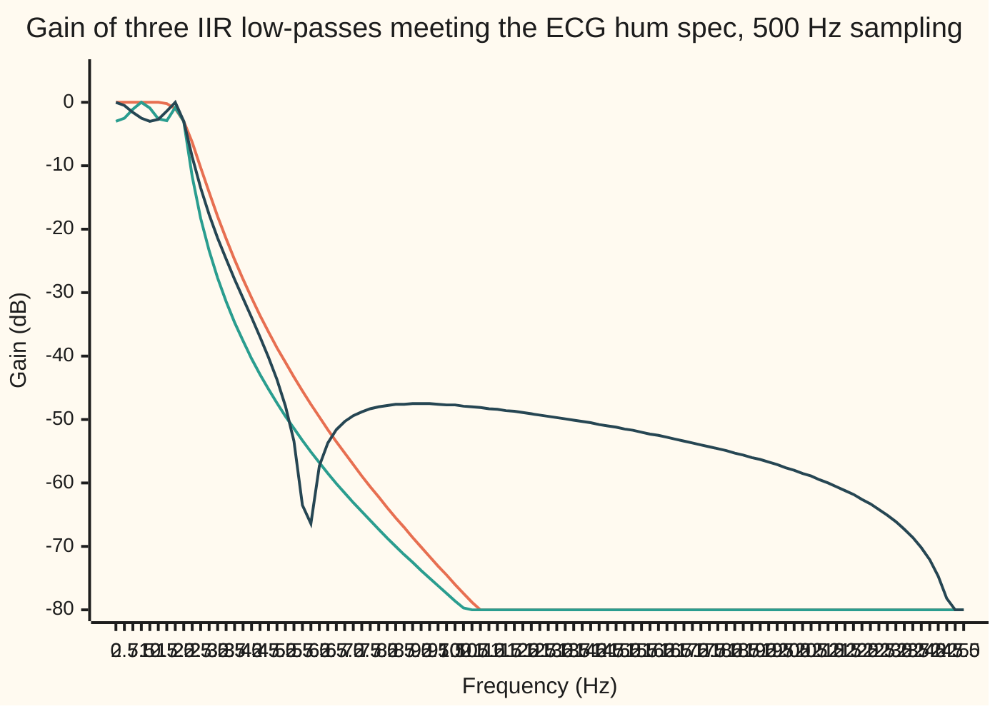
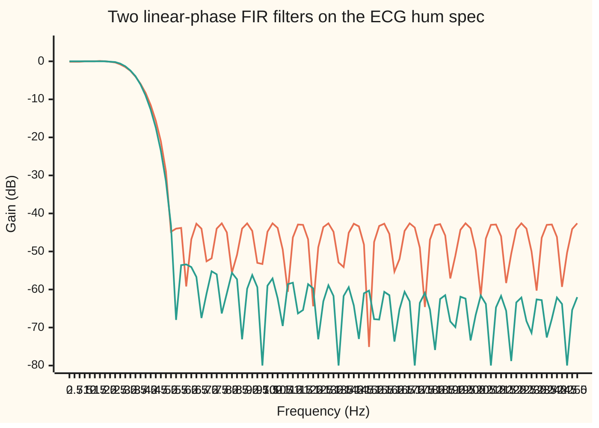

# Optimal filters: spread the error evenly, and buy sharpness with ripple

[Syllabus](../../../SYLLABUS.md) → [Engineering mathematics](../README.md) → [Signals](../README.md#s05) → Optimal filters

---

## General Overview

A heart monitor takes 500 readings a second of an electrocardiogram (ECG), the heart's electrical signal. The building's wiring adds 0.5 mV of 50 Hz hum to a beat that is about 1 mV tall. [Digital filters](04-digital-filters-fir-and-iir.md) sized two designs for removing it: keep at least half the power up to 20 Hz, and cut every frequency from 49.8 Hz to 250 Hz by at least 40 dB (to a hundredth of its height). A fifth-order Butterworth filter needs 11 multiplies per reading. A Hamming-window FIR filter, which delays every frequency equally, needs 53.

Both designs waste effort. The Butterworth is as flat as possible near 0 Hz and cuts more and more above 49.8 Hz, far past the 40 dB the spec asks for. The Hamming filter's error is largest next to the band edges and much smaller further out. The spec only checks the worst error. Any frequency where the error stays below the worst case is effort the filter did not need to spend.

An **optimal filter**, in the sense used here, has the lowest possible worst-case error for its size. Its error swings up to the same peak again and again across each band, in equal ripples. This is called an **equiripple** filter. For the ECG spec the results are:

- a Chebyshev type I filter of order 4: 9 multiplies;
- an elliptic filter of order 3: 7 multiplies;
- a Parks–McClellan equiripple FIR filter of 37 taps, against the Hamming design's 53, still with one equal delay of 36 ms at every frequency. Both lengths are odd, so the delay is a whole number of readings; allow an even length and 36 taps meet the spec, with a delay of 35 ms.

The FIR gains only by spreading its error evenly. The two feedback designs also accept ripple, a wobble in the gain, across the passband, up to the 3 dB that "half the power" allows. The cost is a gain that is not flat between 0 and 20 Hz, and a delay that changes more with frequency.

**An optimal filter makes its error ripple with equal peaks across each band, because error held below the worst case anywhere is wasted; letting the passband ripple as well as the stopband buys the sharpest cut for the fewest multiplies.**

**What kind of fact this is:** a design method resting on theorems. The alternation theorem (in the direction used here) and the Chebyshev order rule are proved on this card in Why it works. The elliptic order rule is stated, not proved; the code confirms it by building filters of each order. The ECG and its hum are a model with stated assumptions.

### The picture: three feedback filters on one spec



Orange: Butterworth, order 5. Teal: Chebyshev type I, order 4. Dark: elliptic, order 3. Gains below −80 dB are drawn at −80. The Butterworth is flat to about 12.5 Hz and then falls steadily. The Chebyshev ripples between 0 and −3 dB up to 20 Hz, then falls faster. The elliptic ripples in both bands: its gain drops to zero at 56.38 Hz, then climbs back to a ripple ceiling of −47.51 dB.

---

## The formula

Notation first. As in [Digital filters](04-digital-filters-fir-and-iir.md), $`f_s`$ = 500 Hz is the sampling rate, and a frequency f in hertz becomes an angle per reading, $`\omega = 2\pi f / f_s`$. The passband (the band kept) ends at $`f_p`$ = 20 Hz. The stopband (the band cut) starts at $`f_{st}`$ = 49.8 Hz. The bilinear transform bends the frequency axis ([Discretising a design](../02-Linear%20Systems%20and%20Transforms/09-zero-order-hold-and-tustin-discretisation.md)), so every order rule uses the **warped edge ratio** $`r = \tan(\omega_{st}/2)/\tan(\omega_p/2)`$ = 2.5610.

Two numbers set the tolerance. The passband gain may sag by $`R_p`$ = 3 dB, so it stays between 1 and $`1/\sqrt{1+\varepsilon^2}`$, where ε (epsilon) = 0.9976 is the **ripple size**. The stopband gain must sit $`A`$ = 40 dB down. Their ratio is the **discrimination** D: roughly, how many times lower the stopband must be than the passband floor.

```math
\varepsilon = \sqrt{10^{R_p/10} - 1} = 0.9976, \qquad D = \frac{\sqrt{10^{A/10} - 1}}{\varepsilon} = 100.23
```

**The three feedback (IIR) designs** need the smallest whole order N with:

```math
N_{\mathrm{Butterworth}} \ge \frac{\log_{10}\left(10^{A/10}-1\right)}{2\log_{10} r}, \qquad N_{\mathrm{Chebyshev}} \ge \frac{\mathrm{arccosh}\, D}{\mathrm{arccosh}\, r}, \qquad N_{\mathrm{elliptic}} \ge \frac{K(1/r)\,K'(1/D)}{K'(1/r)\,K(1/D)}
```

**Read it aloud:** the order each design needs grows with how hard the spec is, D, and shrinks with how much room the edges leave, r; the Chebyshev turns both into hyperbolic angles, and the elliptic into ratios of elliptic integrals.

Here arccosh is the inverse of cosh, and K is the complete elliptic integral, with its complement K′:

```math
K(k) = \int_0^{\pi/2} \frac{d\theta}{\sqrt{1 - k^2 \sin^2\theta}}, \qquad K'(k) = K\left(\sqrt{1-k^2}\right)
```

The Chebyshev type I gain is built on the Chebyshev polynomial $`T_N`$, where Ω is the prototype frequency, $`\Omega = \tan(\omega/2)`$, and $`\Omega_p`$ is its value at 20 Hz:

```math
|H|^2 = \frac{1}{1 + \varepsilon^2\, T_N^2(\Omega/\Omega_p)}, \qquad T_N(x) = \cos(N \arccos x) \text{ for } |x| \le 1, \qquad T_N(x) = \cosh(N\, \mathrm{arccosh}\, x) \text{ for } x \ge 1
```

**The equiripple FIR.** A symmetric FIR filter with an odd number L of taps (weights) $`h[0], \dots, h[L-1]`$ has $`M = (L-1)/2`$ and a real gain curve, called its amplitude:

```math
P(\omega) = h[M] + 2\sum_{k=1}^{M} h[M-k]\cos(k\omega)
```

Parks–McClellan chooses the taps to make the largest weighted error as small as possible: target 1 in the passband and 0 in the stopband, with weight W.

```math
\min_{h}\ \max_{\omega \text{ in either band}}\ W(\omega)\,\bigl|\,\text{target}(\omega) - P(\omega)\bigr|
```

**Read it aloud:** pick the taps so that the worst weighted miss, over both bands, is as small as it can be.

| Symbol | Plain meaning | In our example | Push it up and the answer… |
| --- | --- | --- | --- |
| $`f_s`$, $`f`$, $`\omega`$ | sampling rate; a frequency; the same as an angle per reading, $`2\pi f/f_s`$ | 500 Hz; 50 Hz is 0.2π rad | — |
| $`f_p`$, $`f_{st}`$, $`\omega_p`$, $`\omega_{st}`$ | passband edge and stopband edge, in Hz and as angles | 20 Hz and 49.8 Hz | edges further apart: every order falls |
| $`r`$ | warped edge ratio, $`\tan(\omega_{st}/2)/\tan(\omega_p/2)`$ | 2.5610 | lower orders and fewer taps |
| $`A`$, $`R_p`$ | cut demanded in the stopband; sag allowed in the passband | 40 dB; 3 dB | A up: higher orders; $`R_p`$ up: lower Chebyshev and elliptic orders |
| $`\varepsilon`$, $`D`$ | ripple size: passband gain stays between 1 and $`1/\sqrt{1+\varepsilon^2}`$; discrimination: how far the stopband sits below that floor | 0.9976; 100.23 | ε up: lower orders; D up: higher orders |
| $`N`$, $`H`$, $`\tau_g`$ | an IIR filter's order (its number of poles); the transfer function, what the filter does to each frequency; group delay, how long a narrow band of frequencies is held up | N = 5, 4 and 3; $`\tau_g`$ up to 100.07 ms (Chebyshev) | N up: sharper cut, more multiplies, more delay |
| $`\Omega`$, $`\Omega_p`$, $`T_N`$, $`x`$, $`\theta`$ | prototype frequency $`\tan(\omega/2)`$; its value at 20 Hz; the Chebyshev polynomial of degree N; its input, written $`x = \cos\theta`$ (for the FIR, $`x = \cos\omega`$) | $`T_4`$ for the order-4 design | — |
| $`K(k)`$, $`K'(k)`$, $`k`$, $`k_1`$ | complete elliptic integral; its complement; the number inside it (its modulus); the stopband depth an elliptic filter reaches | K(1/r) = 1.6364, K′(1/D) = 5.9939 | — |
| $`L`$, $`M`$, $`h[n]`$ | FIR taps; half the length, (L − 1)/2; the tap weights | 37 taps, M = 18 | more taps: sharper cut, longer delay of M readings |
| $`P(\omega)`$, $`W`$, $`\delta_p`$, $`\delta_s`$ | FIR amplitude; error weight; passband and stopband ripple | $`\delta_p = \delta_s`$ = 0.00743; delay 36 ms | W up: smaller passband ripple, larger stopband ripple |
| $`E`$, $`\delta`$, $`Q`$, $`p`$, $`q`$, $`x_i`$, $`x_0`$ | inside the proofs: the weighted error and its largest size; rival polynomials; the points where they are compared | 20 alternation points for 37 taps | — |

### When it holds

- **Passband ripple is acceptable.** The order-4 Chebyshev passes 0 Hz at −3.0 dB and 7.5 Hz at 0 dB. A heart-rate monitor only needs beat timing, so that is fine; a diagnostic trace is not. Hold the elliptic order 3 to 0.1 dB of ripple and it cuts only 31.20 dB.
- **The worst case is the right measure.** Minimax design (the smallest possible maximum error) fits a spec written as limits. If only the total leaked noise power matters, a least-squares design leaks less overall.
- **Phase does not matter, for the IIR designs.** The Chebyshev delays frequencies near 20 Hz by up to 100.07 ms, against 41.45 ms for the Butterworth. The equiripple FIR delays every frequency by 36 ms.
- **The coefficients are exact.** Poles at radius 0.9790 (Chebyshev) and 0.9655 (elliptic) sit close to the unit circle. Rounded weights move poles, and a pole pushed onto or past the circle leaves a filter that never settles. How far they move depends on the bits kept and on how the filter is wired: see [Finite word length](12-finite-word-length-filters-and-quantisation.md).
- **The filter is linear and the same every reading**, as in [Digital filters](04-digital-filters-fir-and-iir.md). Clip the input and no gain curve applies.

---

## Why it works

### Step 0: the spec only sees the worst error, so spread the error out

A spec like "40 dB from 49.8 Hz up" is a ceiling on the stopband gain. A filter that cuts far deeper than 40 dB at 200 Hz passes no better than one that just meets it there. The extra depth cost filter size and bought nothing.

So the best filter of a given size pushes its error up to the limit wherever it can, in ripples of equal height. The steps below show this shape is best, then build it.

### Step 1: a symmetric FIR's gain is a polynomial in cos ω

[Digital filters](04-digital-filters-fir-and-iir.md), Step 2, showed that a symmetric FIR filter has $`H(e^{j\omega}) = e^{-j\omega M} P(\omega)`$, a pure delay of M readings times a real amplitude P. Each $`\cos(k\omega)`$ is a polynomial of degree k in $`x = \cos\omega`$: for example $`\cos 2\omega = 2x^2 - 1`$. So P is a polynomial of degree M in x.

So FIR design is a polynomial fit: find the degree-M polynomial in x that stays closest to 1 on the passband and to 0 on the stopband.

### Step 2: equal alternating peaks mean best

The **alternation theorem** (due to Chebyshev) says when a fit is the best possible. Suppose the weighted error reaches its largest size δ at M + 2 frequencies, with signs that alternate: +δ, −δ, +δ, and so on. Then no polynomial of degree M has a smaller worst error.

The reason is a root count. A better polynomial would sit closer to the target at all M + 2 points. Then the difference between the two would change sign M + 1 times, giving M + 1 roots. A polynomial of degree M with M + 1 roots is zero, so the two are the same.

<details>
<summary>Detailed proof: alternation means no polynomial does better</summary>

Let E(x) = W(x)(target(x) − P(x)) be the weighted error of P. Suppose $`E(x_i) = (-1)^i \delta`$ at points $`x_0 > x_1 > \dots > x_{M+1}`$ in the bands, with δ > 0 the largest |E| anywhere.

Suppose Q, also of degree at most M, has weighted error below δ everywhere. At each $`x_i`$:

$`\displaystyle W(x_i)\,\bigl(Q(x_i) - P(x_i)\bigr) = E(x_i) - E_Q(x_i)`$

Here $`E_Q`$ is Q's weighted error, smaller than δ in size. So the right side has the sign of $`E(x_i)`$, which alternates. W is positive, so Q − P alternates in sign across the M + 2 points. Between each neighbouring pair it crosses zero, which gives M + 1 roots. Q − P has degree at most M, so it is the zero polynomial, and Q = P. That contradicts Q's error being below δ.

The converse (the best polynomial must alternate this way) also holds, and makes the best fit unique. It is sketched, with a named source, in the numerical-analysis wing, in Weierstrass and the minimax fit, listed under Where this goes next.

</details>

The code checks this certificate directly. The 37-tap filter has M = 18, so it needs 20 alternations. The code counts 20, measured on a 0.05 Hz grid from the taps themselves.

### Step 3: the exchange finds the alternating points

Parks and McClellan found the taps by an exchange (the Remez exchange, run on a dense grid of frequencies):

1. Guess M + 2 frequencies across both bands.
2. Find the polynomial whose weighted error is exactly +δ, −δ, +δ, … at those frequencies. That is M + 2 linear equations for M + 1 coefficients plus δ.
3. Compute the error on the whole grid and find where it actually peaks.
4. Move the guesses to those peaks and repeat. Stop when the peaks all equal δ.

Each round δ grows toward the optimum, and the guesses settle within a few rounds. The taps then come from sampling P at L equally spaced angles and inverting, as in [The DFT and the FFT](02-discrete-fourier-transform-and-the-fft.md).

With equal weights the ripple is the same in both bands. Over odd lengths, 35 taps reach ripple 0.01075, just over the 0.01 allowed; 37 taps reach 0.00743, which is −42.57 dB. The Hamming design of [Digital filters](04-digital-filters-fir-and-iir.md) needs 53 taps, also odd, because its error falls away from the edge instead of staying at the limit.

An even length is symmetric too, so it also delays every frequency equally: by 17.5 readings for 36 taps, half a reading off the sample grid. Its amplitude is $`\cos(\omega/2)`$ times a polynomial in $`x = \cos\omega`$ of degree $`L/2 - 1`$, so its gain at 250 Hz is forced to zero. The code runs the same exchange on that polynomial, with the target divided by $`\cos(\omega/2)`$ and the weight multiplied by it. 36 taps reach ripple 0.00900 (34 taps: 0.01264), with all 19 alternations they need, and a delay of 35 ms. This card keeps the odd 37, whose delay of 18 whole readings lets the filtered trace line up sample for sample with the raw one.



Orange: the 37-tap equiripple FIR. Teal: the 53-tap Hamming FIR. Gains below −80 dB are drawn at −80. The equiripple filter's stopband peaks all sit near −42.57 dB. The Hamming filter's first peak is the only one near its limit; the rest fall away, unused.

The weight W on the passband sets the ratio of the two ripples: $`\delta_p/\delta_s = 1/W`$. Let the passband ripple fill a 3 dB band, as the IIR filters do, and the FIR drops to 25 taps.

### Step 4: the Chebyshev polynomial ripples, then climbs as fast as possible

For the feedback filters the trick moves to the power gain. Write $`x = \cos\theta`$. Then $`T_N(x) = \cos N\theta`$ reaches +1 and −1, alternately, at exactly N + 1 points as x runs from −1 to 1. So in the passband, $`\varepsilon^2 T_N^2`$ ripples between 0 and $`\varepsilon^2`$, and the gain ripples between 1 and $`1/\sqrt{1+\varepsilon^2}`$: −3 dB here.

Beyond x = 1, $`T_N(x) = \cosh(N\, \mathrm{arccosh}\, x)`$, which grows very fast. No polynomial of degree N that stays between −1 and 1 on [−1, 1] grows faster beyond it.

<details>
<summary>Detailed proof: nothing bounded by 1 grows faster than the Chebyshev polynomial</summary>

Suppose p has degree at most N, |p| ≤ 1 on [−1, 1], and $`p(x_0) > T_N(x_0)`$ at some $`x_0 > 1`$. Scale it: $`q = (T_N(x_0)/p(x_0))\, p`$. The scale factor is below 1, so |q| < 1 on [−1, 1], and $`q(x_0) = T_N(x_0)`$.

$`T_N`$ equals +1 or −1, alternately, at the N + 1 points $`\cos(i\pi/N)`$. At each of them $`T_N - q`$ takes the sign of $`T_N`$, since |q| < 1. So $`T_N - q`$ changes sign N times in [−1, 1], giving N roots, and it has one more root at $`x_0`$. That is N + 1 roots for a polynomial of degree at most N, so $`T_N = q`$. But |q| < 1 on [−1, 1] while $`T_N(1) = 1`$. The contradiction shows no such p exists.

</details>

**The order rule.** At the stopband edge, $`\Omega/\Omega_p = r`$. The stopband needs $`1 + \varepsilon^2 T_N^2(r) \ge 10^{A/10}`$, which is $`T_N(r) \ge D`$. Since $`T_N(r) = \cosh(N\, \mathrm{arccosh}\, r)`$, the rule is $`N \ge \mathrm{arccosh}\, D / \mathrm{arccosh}\, r`$ = 5.3006 / 1.5930 = 3.327. So N = 4.

The poles of this gain lie on an ellipse, not a circle as for the Butterworth. The code places them, maps them through the bilinear transform, and checks the built filter against the closed-form gain on both bands. They agree to $`10^{-12}`$.

### Step 5: the elliptic filter ripples in both bands

The Chebyshev filter still over-delivers in the stopband: −49.31 dB at worst, where 40 is enough. The elliptic filter replaces $`T_N`$ by a ratio of polynomials whose square ripples between 0 and 1 in the passband and stays above $`D^2`$ beyond r. That ratio has poles in the stopband, so the filter's gain has zeros there: for order 3, one pair at 56.38 Hz, plus one at 250 Hz from the bilinear map. Between zeros the gain climbs back to the same ceiling.

Jacobi elliptic functions build this ratio, the way cosine builds $`T_N`$. The order rule that follows is stated here, not proved. In it 1/r measures how sharp the edge is, and 1/D how deep the cut is:

```math
N \ge \frac{K(1/r)\,K'(1/D)}{K'(1/r)\,K(1/D)} = \frac{1.6364 \times 5.9939}{2.3815 \times 1.5708} = 2.622
```

So N = 3. The built filter's stopband peaks sit at −47.51 dB, exactly the level theory predicts for order 3; rounding 2.622 up left room to spare.

<details>
<summary>How the code builds the elliptic filter</summary>

The code follows the standard construction for the prototype, with the passband edge at Ω = 1.

1. Compute K by the arithmetic–geometric mean. Start from 1 and $`\sqrt{1-k^2}`$, and replace the pair by its average and its geometric mean, over and over. K(k) is π divided by twice the common limit. Simpson's rule on the integral gives the same four values to $`10^{-9}`$.
2. Take k = 1/r. For order N, the stopband depth the filter actually reaches, $`k_1`$, follows from k and N through the Jacobi function sn (the elliptic cousin of sine).
3. The zeros sit on the imaginary axis at 1/k divided by values of the Jacobi function cd (the elliptic cousin of cosine). The poles are j times cd at complex arguments, shifted by an amount set by ε, plus one real pole when N is odd. Here j is the square root of −1.
4. The code computes cd by descending Landen steps: shrink the modulus about ten times until it is effectively zero, where cd is a plain cosine, then climb back with one rational step per stage. It gets sn from cd by shifting the argument by K.
5. The bilinear transform, prewarped to 20 Hz, carries poles and zeros to the z-plane, as in [Digital filters](04-digital-filters-fir-and-iir.md), Step 4.

</details>

### Step 6: the price is ripple and uneven delay

Each step down in order bought sharpness by spending a tolerance the Butterworth left unused.

| Design | Order or taps | Multiplies per reading | Worst stopband | Peak delay, 0 to 20 Hz |
| --- | --- | --- | --- | --- |
| Butterworth | 5 | 11 | −40.84 dB | 41.45 ms |
| Chebyshev type I | 4 | 9 | −49.31 dB | 100.07 ms |
| elliptic | 3 | 7 | −47.51 dB | 60.08 ms |
| equiripple FIR, odd length | 37 taps | 37 | −42.57 dB | 36 ms at every frequency |
| equiripple FIR, even length | 36 taps | 36 | −40.91 dB | 35 ms at every frequency |
| Hamming FIR | 53 taps | 53 | −42.04 dB | equal at every frequency |

The Chebyshev's poles crowd nearest the unit circle, at radius 0.9790, so it rings longest and delays most near the edge. The elliptic's poles sit at 0.9655. The FIR keeps linear phase at any length.

---

## Worked numbers, by hand

The spec at $`f_s`$ = 500 Hz: at least half power to 20 Hz, at least 40 dB cut from 49.8 to 250 Hz.

| Step | Arithmetic | Value |
| --- | --- | --- |
| warped edge ratio | tan(π·49.8/500) ÷ tan(π·20/500) | r = 2.5610 |
| ripple size, 3 dB | √(10^0.3 − 1) | ε = 0.9976 |
| discrimination | √(10^4 − 1) ÷ 0.9976 | D = 100.23 |
| Butterworth order | 3.99996 ÷ 0.8168 | 4.897, so 5 |
| Chebyshev order | arccosh 100.23 ÷ arccosh 2.5610 = 5.3006 ÷ 1.5930 | 3.327, so 4 |
| elliptic order | (1.6364 × 5.9939) ÷ (2.3815 × 1.5708) | 2.622, so 3 |
| multiplies per reading | 2N + 1 | 11, 9 and **7** |
| equiripple FIR, equal ripples | smallest odd L with ripple ≤ 0.01 | **37 taps**, ripple 0.00743 |
| equiripple FIR, even length | smallest even L, same exchange | 36 taps, ripple 0.00900, delay 35 ms |
| equiripple FIR, 3 dB passband ripple | same search, weighted | 25 taps |
| hum left from 0.5 mV at 50.2 Hz, the top of the mains drift that [Digital filters](04-digital-filters-fir-and-iir.md) allows | 500 µV × gain, by simulation | Butterworth 4.35, Chebyshev 1.65, elliptic 1.93, FIR 2.10 µV |

The elliptic filter meets the hum spec with 7 multiplies per reading against the Butterworth's 11, and the odd-length equiripple FIR with 37 taps against the Hamming design's 53. Each leaves less than a hundredth of the 0.5 mV of hum, as the spec requires.

### What breaks if you drop a piece

| Mistake | Comes out at | What went wrong |
| --- | --- | --- |
| Round the Chebyshev's 3.327 down to order 3 | −35.47 dB worst stopband | the order rule is a floor; 3 poles cannot reach D = 100.23 |
| Use an elliptic filter of order 2 | −27.66 dB worst stopband | 2.622 also rounds up, never down |
| Hold the elliptic order 3 to 0.1 dB ripple | −31.20 dB worst stopband | the passband ripple is what bought the sharpness |
| Cut the equiripple FIR to 35 taps | ripple 0.01075 | over the 0.01 (40 dB) the spec allows |

---

## Code, from first principles, and it actually runs

The script builds every filter from its definition: Butterworth poles on a circle, Chebyshev poles on an ellipse, elliptic poles and zeros from Jacobi functions, all through the bilinear transform, and the equiripple FIR by the exchange written out in full. Nothing imported knows anything about filters. Five independent roads check the results:

- Each IIR order comes from its formula and, separately, from a search that builds filters of order 1, 2, 3, … and tests the spec on a 0.05 Hz grid.
- The Chebyshev gain from its poles matches the closed form with $`T_4`$, and the elliptic ripple levels match theory: 0 and −3 dB in the passband, −47.51 dB in the stopband.
- Each filter runs as a difference equation on a 50.2 Hz sine for 6 s, and the settled output matches the gain.
- The FIR's alternation count is measured from its taps: 20 of the 20 that prove it optimal.
- K is computed by the arithmetic–geometric mean and by Simpson's rule.

### Python

```python
# Optimal filters -- the check behind the card.  Standard library only.  ECG hum spec, fs = 500 Hz:
# half power or more to 20 Hz, 40 dB off from 49.8 to 250 Hz.  Roads: order formula against a search of
# built designs; gain against closed-form ripple levels; a simulated sine; the FIR's alternation count.
import math, cmath
FS, FP, FST, ATT, RP = 500.0, 20.0, 49.8, 40.0, 3.0
wp, ws = 2 * math.pi * FP / FS, 2 * math.pi * FST / FS
Wp = math.tan(wp / 2)                                   # prewarped passband edge
r = math.tan(ws / 2) / Wp                               # warped edge ratio
EPS = math.sqrt(10 ** (RP / 10) - 1)                    # ripple size: passband floor 1/sqrt(1 + eps^2)
D = math.sqrt(10 ** (ATT / 10) - 1) / EPS               # how far the stopband must sit below that
def db(g): return 20 * math.log10(g) if g > 1e-15 else -300.0
def resp(zs, ps, g, f):                                 # H(z) on the unit circle from zeros and poles
    z = cmath.exp(2j * math.pi * f / FS)
    return g * math.prod(z - q for q in zs) / math.prod(z - p for p in ps)
def poly(rts):                                          # multiply out the product of (1 - root z^-1)
    c = [1 + 0j]
    for q in rts: c = [u - q * v for u, v in zip(c + [0], [0] + c)]
    return [v.real for v in c]
def digital(za, pa, h0, N):                             # bilinear map z = (1 + s)/(1 - s), s scaled by Wp
    zs, ps = [(1 + Wp * q) / (1 - Wp * q) for q in za] + [-1.0] * (N - len(za)), [(1 + Wp * p) / (1 - Wp * p) for p in pa]
    return zs, ps, h0 / abs(resp(zs, ps, 1.0, 0.0))     # gain at 0 Hz set to h0
def agm_K(k):                                           # complete elliptic integral K(k) by the AGM
    a, b = 1.0, math.sqrt(1 - k * k)
    for _ in range(40): a, b = (a + b) / 2, math.sqrt(a * b)
    return math.pi / (2 * a)
def F(phi, k, n=200000):                                # integral of 1/sqrt(1 - k^2 sin^2 t), Simpson's rule
    return phi / n / 3 * sum((1 if i in (0, n) else 4 if i % 2 else 2) / math.sqrt(1 - (k * math.sin(i * phi / n)) ** 2) for i in range(n + 1))
def cde(u, k):                                          # Jacobi cd(uK, k) by descending Landen steps
    ks = []
    for _ in range(10): k = (k / (1 + math.sqrt(1 - k * k))) ** 2; ks.append(k)
    w = cmath.cos(u * math.pi / 2)
    for kn in reversed(ks): w = (1 + kn) * w / (1 + kn * w * w)
    return w
def butter(N): return digital([], [cmath.exp(1j * math.pi * (2 * i + N + 1) / (2 * N)) for i in range(N)], 1.0, N)
def cheby(N, e=EPS):
    a, th = math.asinh(1 / e) / N, [(2 * i + 1) * math.pi / (2 * N) for i in range(N)]
    return digital([], [complex(-math.sinh(a) * math.sin(t), math.cosh(a) * math.cos(t)) for t in th], 1.0 if N % 2 else 1 / math.sqrt(1 + e * e), N)
def ellip(N, e=EPS):
    k, u = 1 / r, [(2 * i - 1) / N for i in range(1, N // 2 + 1)]
    k1 = k ** N * math.prod(cde(1 - ui, k).real ** 4 for ui in u)          # sn(uK) = cd((1 - u)K)
    v0 = F(math.atan(1 / e), math.sqrt(1 - k1 * k1), 4000) / (N * agm_K(k1))
    za = [1j / (k * cde(ui, k).real) for ui in u]                          # zeros in the stopband
    pa = [1j * cde(ui - 1j * v0, k) for ui in u] + ([1j * cde(1 - 1j * v0, k)] if N % 2 else [])
    za, pa = za + [q.conjugate() for q in za], pa + [p.conjugate() for p in pa[:N // 2]]
    return digital(za, pa, 1.0 if N % 2 else 1 / math.sqrt(1 + e * e), N) + (k1,)
stop = [FST + 0.05 * i for i in range(4005)]            # 49.8 to 250 Hz in 0.05 Hz steps
pas = [0.05 * i for i in range(401)]                    # 0 to 20 Hz
def worst(d): return max(abs(resp(*d[:3], f)) for f in stop)
def meets(d): return abs(resp(*d[:3], FP)) ** 2 >= 0.5 - 1e-9 and worst(d) <= 10 ** (-ATT / 20)
def gdelay(d, f, h=1e-4): return -cmath.phase(resp(*d[:3], f + h) / resp(*d[:3], f - h)) / (4 * math.pi * h) * 1000
def settled(b, a, f):                                   # run the difference equation on a sine; amplitude, last 5 s
    y = []
    for n in range(3000):
        y.append(sum(b[k] * math.sin(2 * math.pi * f * (n - k) / FS) for k in range(len(b)) if n >= k) - sum(a[k] * y[n - k] for k in range(1, len(a)) if n >= k))
    return 2 * abs(sum(v * cmath.exp(-2j * math.pi * f * n / FS) for n, v in enumerate(y) if n >= 500)) / 2500
nb, nc = math.log10(10 ** (ATT / 10) - 1) / (2 * math.log10(r)), math.acosh(D) / math.acosh(r)
ks = (1 / r, math.sqrt(1 - 1 / r ** 2), 1 / D, math.sqrt(1 - 1 / D ** 2))   # K(k), K'(k) = K(sqrt(1 - k^2))
Kv, Ks = [agm_K(k) for k in ks], [F(math.pi / 2, k) for k in ks]; ne = Kv[0] * Kv[3] / (Kv[1] * Kv[2])
print(f"spec: fs {FS:.0f} Hz; half power or more to {FP:.0f} Hz; {ATT:.0f} dB off from {FST:.1f} Hz to {FS / 2:.0f} Hz")
print(f"by hand: warped edge ratio r {r:.4f}; ripple eps {EPS:.4f}, floor {db(1 / math.sqrt(1 + EPS ** 2)):.3f} dB; D {D:.2f}")
print(f"Butterworth: log10(10^(A/10) - 1) / (2 log10 r) = {math.log10(10 ** (ATT / 10) - 1):.5f} / {2 * math.log10(r):.4f} = {nb:.3f}")
print(f"Chebyshev:   acosh(D) / acosh(r) = {math.acosh(D):.4f} / {math.acosh(r):.4f} = {nc:.3f}")
print(f"elliptic:    K(1/r) {Kv[0]:.4f}, K' {Kv[1]:.4f}; K(1/D) {Kv[2]:.4f}, K' {Kv[3]:.4f}; ratio {ne:.3f}")
print(f"K by Simpson's rule agrees with the AGM to 1e-9: {'yes' if max(abs(a - b) for a, b in zip(Kv, Ks)) < 1e-9 else 'no'}")
print("design       order: search formula  mult  pole radius  worst stop dB  hum left uV  sim=H  peak delay ms")
des, rows = {}, []
for name, mk, need in [("Butterworth", butter, nb), ("Chebyshev I", cheby, nc), ("elliptic", ellip, ne)]:
    n = next(n for n in range(1, 12) if meets(mk(n)))
    des[name] = d = mk(n)
    amp, h = settled([d[2] * c for c in poly(d[0])], poly(d[1]), 50.2), abs(resp(*d[:3], 50.2))
    rows.append((n, math.ceil(need), max(abs(p) for p in d[1]), amp, h))
    print(f"{name:12s}         {n:3d}    {math.ceil(need):3d}     {2 * n + 1:3d}     {rows[-1][2]:.4f}       {db(worst(d)):7.2f}"
          f"       {500 * amp:6.2f}    {'yes' if abs(amp - h) < 1e-6 else 'no '}     {max(gdelay(d, f) for f in pas[1:]):6.2f}")
c4, e3, T4 = des["Chebyshev I"], des["elliptic"], lambda x: math.cos(4 * math.acos(x)) if x <= 1 else math.cosh(4 * math.acosh(x))
cf = max(abs(abs(resp(*c4[:3], f)) - 1 / math.sqrt(1 + (EPS * T4(math.tan(math.pi * f / FS) / Wp)) ** 2)) for f in pas + stop)
print(f"Chebyshev 4 against 1/sqrt(1 + eps^2 T4^2), both bands, agree to 1e-12: {'yes' if cf < 1e-12 else 'no'}")
ep, est = [db(abs(resp(*e3[:3], f))) for f in pas], -10 * math.log10(1 + (EPS / e3[3]) ** 2)
print(f"elliptic 3: passband {min(ep):.3f} to {round(max(ep), 3) + 0.0:.3f} dB; stopband peaks {db(worst(e3)):.2f} dB, theory {est:.2f} dB; "
      f"zero at {FS / (2 * math.pi) * cmath.phase(e3[0][0]):.2f} Hz")
def remez(L, K):                                        # Parks-McClellan exchange; weight K in the passband
    M = (L - 1) // 2; np_, ns = max(4, round(32 * (M + 2) * wp / (wp + math.pi - ws))), 32 * (M + 2)
    g = [wp * i / (np_ - 1) for i in range(np_)] + [ws + (math.pi - ws) * i / (ns - L % 2) for i in range(ns)]
    cs = [math.cos(w / 2) if L % 2 == 0 else 1.0 for w in g]   # even L: amplitude is cos(w/2) times a polynomial, 0 at 250 Hz
    Dg, Wg = [1 / c for c in cs[:np_]] + [0.0] * ns, [K * c for c in cs[:np_]] + cs[np_:]
    ext = [round(i * (len(g) - 1) / (M + 1)) for i in range(M + 2)]
    for _ in range(60):
        x = [math.cos(g[e]) for e in ext]               # bw, gm: barycentric weights
        bw = [1 / math.prod(x[i] - x[j] for j in range(M + 2) if j != i) for i in range(M + 2)]
        dl = sum(bw[i] * Dg[e] for i, e in enumerate(ext)) / sum(bw[i] * (-1) ** i / Wg[e] for i, e in enumerate(ext))
        C = [Dg[e] - (-1) ** i * dl / Wg[e] for i, e in enumerate(ext)]   # A must hit these at the old set
        gm = [1 / math.prod(x[i] - x[j] for j in range(M + 1) if j != i) for i in range(M + 1)]
        def A(w):                                       # the cosine polynomial, barycentric form
            t = math.cos(w)
            if t in x[:M + 1]: return C[x.index(t)]
            q = [gm[i] / (t - x[i]) for i in range(M + 1)]
            return sum(qi * ci for qi, ci in zip(q, C)) / sum(q)
        E = [Wg[i] * (Dg[i] - A(w)) for i, w in enumerate(g)]
        side = lambda i: [j for j in (i - 1, i + 1) if 0 <= j < len(g) and (j < np_) == (i < np_)]
        new = []                                        # new set: alternating peaks of the error
        for i in range(len(g)):
            if abs(E[i]) < abs(dl) * (1 - 1e-6) or any((E[i] - E[j]) * E[i] < 0 for j in side(i)): continue
            if not new or (E[i] > 0) != (E[new[-1]] > 0): new.append(i)
            elif abs(E[i]) > abs(E[new[-1]]): new[-1] = i
        while len(new) > M + 2: new.pop(0 if abs(E[new[0]]) < abs(E[new[-1]]) else -1)
        if len(new) < M + 2 or new == ext: break
        ext = new
    Am = [A(2 * math.pi * m / L) * (math.cos(math.pi * m / L) if L % 2 == 0 else 1) for m in range(M + 1)]   # taps from L samples
    return [(Am[0] + 2 * sum(Am[m] * math.cos(2 * math.pi * m * (n - (L - 1) / 2) / L) for m in range(1, M + 1))) / L for n in range(L)], abs(dl)
def amp(h, f): return sum(v * math.cos(2 * math.pi * f / FS * (k - (len(h) - 1) / 2)) for k, v in enumerate(h))
def alternations(h, K):                                 # sign changes between the peaks of the weighted error
    e = [K * (1 - amp(h, f)) for f in pas] + [-amp(h, f) for f in stop]; top = 0.995 * max(map(abs, e))
    pk = [i for i in range(len(e)) if abs(e[i]) >= top and (i in (0, 400, 401, len(e) - 1) or abs(e[i]) >= max(abs(e[i - 1]), abs(e[i + 1])))]
    return 1 + sum(1 for i, j in zip(pk, pk[1:]) if (e[i] > 0) != (e[j] > 0))
dp3, fir = (1 - 10 ** (-RP / 20)) / (1 + 10 ** (-RP / 20)), {}   # a 3 dB band written as 1 +- dp
for name, dp, ds, L0 in [("PM, flat", 0.01, 0.01, 11), ("PM, even L", 0.01, 0.01, 10), ("PM, 3 dB ripple", dp3, 0.01 * (1 + dp3), 11)]:
    L = next(L for L in range(L0, 81, 2) if remez(L, ds / dp)[1] <= ds)
    (h, dl), dl2 = remez(L, ds / dp), remez(L - 2, ds / dp)[1]
    sc = 1 / max(amp(h, f) for f in pas) if dp > 0.05 else 1.0   # the rippled design is scaled to peak gain 1
    kai = (-20 * math.log10(math.sqrt(dp * ds)) - 13) / (14.6 * (FST - FP) / FS) + 1
    ws_, al = max(abs(amp(h, f)) for f in stop), alternations(h, ds / dp)
    fir[name] = h
    print(f"{name}: {L} taps, M = {(L - 1) / 2:g}, delay {(L - 1) / 2 / FS * 1000:.0f} ms (Kaiser's estimate {kai:.1f} taps); ripple {dl:.5f}, {L - 2} taps {dl2:.5f}")
    print(f"  measured: worst stop {db(sc * ws_):.2f} dB, at 20 Hz {db(sc * abs(amp(h, FP))):.2f} dB; alternations {al} of "
          f"{(L - 1) // 2 + 2} needed; hum left {500 * sc * settled(h, [1.0], 50.2):.2f} uV")
    assert dl <= ds < dl2 and al >= (L - 1) // 2 + 2 and abs(ws_ - dl) < 1e-2 * dl and sc * abs(amp(h, FP)) >= math.sqrt(0.5)
def hamming(L, fc=(FP + FST) / 2):                      # the window design of Digital filters
    h = [(0.54 - 0.46 * math.cos(2 * math.pi * k / (L - 1))) * (math.sin(2 * math.pi * fc / FS * (k - (L - 1) / 2)) / (math.pi * (k - (L - 1) / 2)) if 2 * k != L - 1 else 2 * fc / FS) for k in range(L)]
    return [v / sum(h) for v in h]
hw = {L: db(max(abs(amp(hamming(L), f)) for f in stop)) for L in (51, 53)}
print(f"Hamming FIR from Digital filters: 53 taps worst stop {hw[53]:.2f} dB, 51 taps {hw[51]:.2f} dB")
print("chart, f Hz     " + " ".join(f"{2.5 * i:5.1f}" for i in range(101)))
for nm, d in [*des.items(), ("PM, flat", fir["PM, flat"]), ("Hamming 53", hamming(53))]:
    gain = [abs(resp(*d[:3], 2.5 * i)) if len(d) < 5 else abs(amp(d, 2.5 * i)) for i in range(101)]
    print(f"chart, {nm:11s} " + " ".join(f"{round(max(db(v), -80), 1) + 0.0:5.1f}" for v in gain))
brk = [db(worst(cheby(3))), db(worst(ellip(2))), db(worst(ellip(3, math.sqrt(10 ** 0.01 - 1))))]
print(f"breaks: Chebyshev order 3 {brk[0]:.2f} dB; elliptic order 2 {brk[1]:.2f} dB; elliptic 3 held to 0.1 dB ripple {brk[2]:.2f} dB")
assert [x[0] for x in rows] == [x[1] for x in rows] == [5, 4, 3] and all(x[2] < 1 and abs(x[3] - x[4]) < 1e-6 for x in rows)
assert max(abs(a - b) for a, b in zip(Kv, Ks)) < 1e-9 and cf < 1e-12 and hw[53] < -40 < hw[51] and min(brk) > -40
assert abs(max(ep)) < 1e-9 and abs(min(ep) + RP) < 1e-6 and abs(db(worst(e3)) - est) < 1e-6
print("ALL CHECKS PASS")
```

**Ran 2026-11-23 on macOS, Python 3.14.10, standard library only. All checks passed. Output, pasted from the run:**

```
spec: fs 500 Hz; half power or more to 20 Hz; 40 dB off from 49.8 Hz to 250 Hz
by hand: warped edge ratio r 2.5610; ripple eps 0.9976, floor -3.000 dB; D 100.23
Butterworth: log10(10^(A/10) - 1) / (2 log10 r) = 3.99996 / 0.8168 = 4.897
Chebyshev:   acosh(D) / acosh(r) = 5.3006 / 1.5930 = 3.327
elliptic:    K(1/r) 1.6364, K' 2.3815; K(1/D) 1.5708, K' 5.9939; ratio 2.622
K by Simpson's rule agrees with the AGM to 1e-9: yes
design       order: search formula  mult  pole radius  worst stop dB  hum left uV  sim=H  peak delay ms
Butterworth            5      5      11     0.9259        -40.84         4.35    yes      41.45
Chebyshev I            4      4       9     0.9790        -49.31         1.65    yes     100.07
elliptic               3      3       7     0.9655        -47.51         1.93    yes      60.08
Chebyshev 4 against 1/sqrt(1 + eps^2 T4^2), both bands, agree to 1e-12: yes
elliptic 3: passband -3.000 to 0.000 dB; stopband peaks -47.51 dB, theory -47.51 dB; zero at 56.38 Hz
PM, flat: 37 taps, M = 18, delay 36 ms (Kaiser's estimate 32.0 taps); ripple 0.00743, 35 taps 0.01075
  measured: worst stop -42.57 dB, at 20 Hz -0.06 dB; alternations 20 of 20 needed; hum left 2.10 uV
PM, even L: 36 taps, M = 17.5, delay 35 ms (Kaiser's estimate 32.0 taps); ripple 0.00900, 34 taps 0.01264
  measured: worst stop -40.91 dB, at 20 Hz -0.08 dB; alternations 19 of 19 needed; hum left 2.68 uV
PM, 3 dB ripple: 25 taps, M = 12, delay 24 ms (Kaiser's estimate 17.1 taps); ripple 0.01067, 23 taps 0.01278
  measured: worst stop -40.69 dB, at 20 Hz -2.73 dB; alternations 14 of 14 needed; hum left 3.35 uV
Hamming FIR from Digital filters: 53 taps worst stop -42.04 dB, 51 taps -39.31 dB
chart, f Hz       0.0   2.5   5.0   7.5  10.0  12.5  15.0  17.5  20.0  22.5  25.0  27.5  30.0  32.5  35.0  37.5  40.0  42.5  45.0  47.5  50.0  52.5  55.0  57.5  60.0  62.5  65.0  67.5  70.0  72.5  75.0  77.5  80.0  82.5  85.0  87.5  90.0  92.5  95.0  97.5 100.0 102.5 105.0 107.5 110.0 112.5 115.0 117.5 120.0 122.5 125.0 127.5 130.0 132.5 135.0 137.5 140.0 142.5 145.0 147.5 150.0 152.5 155.0 157.5 160.0 162.5 165.0 167.5 170.0 172.5 175.0 177.5 180.0 182.5 185.0 187.5 190.0 192.5 195.0 197.5 200.0 202.5 205.0 207.5 210.0 212.5 215.0 217.5 220.0 222.5 225.0 227.5 230.0 232.5 235.0 237.5 240.0 242.5 245.0 247.5 250.0
chart, Butterworth   0.0   0.0   0.0   0.0   0.0   0.0  -0.2  -1.0  -3.0  -6.3 -10.3 -14.2 -18.0 -21.5 -24.8 -27.9 -30.8 -33.6 -36.2 -38.7 -41.0 -43.3 -45.5 -47.6 -49.6 -51.6 -53.5 -55.3 -57.1 -58.9 -60.6 -62.2 -63.9 -65.5 -67.0 -68.6 -70.1 -71.6 -73.1 -74.5 -76.0 -77.4 -78.8 -80.0 -80.0 -80.0 -80.0 -80.0 -80.0 -80.0 -80.0 -80.0 -80.0 -80.0 -80.0 -80.0 -80.0 -80.0 -80.0 -80.0 -80.0 -80.0 -80.0 -80.0 -80.0 -80.0 -80.0 -80.0 -80.0 -80.0 -80.0 -80.0 -80.0 -80.0 -80.0 -80.0 -80.0 -80.0 -80.0 -80.0 -80.0 -80.0 -80.0 -80.0 -80.0 -80.0 -80.0 -80.0 -80.0 -80.0 -80.0 -80.0 -80.0 -80.0 -80.0 -80.0 -80.0 -80.0 -80.0 -80.0 -80.0
chart, Chebyshev I  -3.0  -2.5  -1.1   0.0  -0.9  -2.6  -2.9  -0.8  -3.0 -11.7 -18.3 -23.4 -27.7 -31.4 -34.7 -37.6 -40.4 -42.9 -45.2 -47.4 -49.5 -51.4 -53.3 -55.1 -56.8 -58.5 -60.1 -61.6 -63.1 -64.5 -65.9 -67.3 -68.7 -70.0 -71.3 -72.5 -73.8 -75.0 -76.2 -77.4 -78.6 -79.7 -80.0 -80.0 -80.0 -80.0 -80.0 -80.0 -80.0 -80.0 -80.0 -80.0 -80.0 -80.0 -80.0 -80.0 -80.0 -80.0 -80.0 -80.0 -80.0 -80.0 -80.0 -80.0 -80.0 -80.0 -80.0 -80.0 -80.0 -80.0 -80.0 -80.0 -80.0 -80.0 -80.0 -80.0 -80.0 -80.0 -80.0 -80.0 -80.0 -80.0 -80.0 -80.0 -80.0 -80.0 -80.0 -80.0 -80.0 -80.0 -80.0 -80.0 -80.0 -80.0 -80.0 -80.0 -80.0 -80.0 -80.0 -80.0 -80.0
chart, elliptic      0.0  -0.5  -1.6  -2.5  -3.0  -2.7  -1.4   0.0  -3.0  -8.6 -13.5 -17.7 -21.4 -24.7 -27.9 -30.9 -33.9 -37.0 -40.2 -43.7 -47.9 -53.4 -63.5 -66.4 -57.3 -53.7 -51.6 -50.3 -49.4 -48.8 -48.3 -48.0 -47.8 -47.6 -47.6 -47.5 -47.5 -47.5 -47.6 -47.7 -47.7 -47.9 -48.0 -48.1 -48.3 -48.4 -48.6 -48.7 -48.9 -49.1 -49.3 -49.5 -49.7 -49.9 -50.1 -50.3 -50.5 -50.8 -51.0 -51.2 -51.5 -51.7 -52.0 -52.3 -52.5 -52.8 -53.1 -53.4 -53.7 -54.0 -54.3 -54.6 -54.9 -55.3 -55.6 -56.0 -56.3 -56.7 -57.1 -57.6 -58.0 -58.5 -58.9 -59.5 -60.0 -60.6 -61.2 -61.8 -62.6 -63.3 -64.2 -65.1 -66.1 -67.3 -68.6 -70.2 -72.1 -74.7 -78.2 -80.0 -80.0
chart, PM, flat     -0.1  -0.1  -0.1   0.0   0.0   0.0   0.1   0.0  -0.1  -0.3  -0.8  -1.5  -2.5  -4.0  -5.9  -8.3 -11.5 -15.6 -21.0 -28.9 -44.8 -44.0 -43.8 -59.2 -46.8 -42.7 -44.0 -52.6 -51.8 -44.0 -42.6 -45.0 -55.6 -50.9 -44.0 -42.6 -44.6 -53.0 -53.3 -44.8 -42.6 -43.8 -49.5 -60.6 -46.3 -42.9 -43.0 -46.8 -64.4 -48.9 -43.6 -42.6 -44.8 -52.9 -54.1 -45.1 -42.7 -43.4 -48.2 -75.1 -47.5 -43.3 -42.7 -45.4 -55.3 -52.0 -44.6 -42.6 -43.7 -49.0 -64.6 -46.9 -43.1 -42.8 -45.8 -57.1 -51.1 -44.3 -42.6 -43.9 -49.6 -61.7 -46.6 -43.0 -42.9 -46.0 -58.3 -50.6 -44.2 -42.6 -44.0 -50.0 -60.3 -46.4 -43.0 -42.9 -46.2 -59.3 -50.3 -44.1 -42.6
chart, Hamming 53    0.0   0.0   0.0   0.0   0.0   0.0   0.0   0.0  -0.1  -0.2  -0.6  -1.3  -2.4  -3.9  -6.1  -9.0 -12.7 -17.4 -23.5 -31.5 -43.2 -68.0 -53.6 -53.4 -54.1 -56.7 -67.5 -61.1 -55.2 -56.0 -66.3 -61.0 -55.6 -57.3 -73.1 -59.8 -56.2 -59.4 -80.0 -59.0 -57.1 -62.3 -69.6 -58.6 -58.2 -66.3 -65.4 -58.6 -59.7 -73.1 -63.1 -58.9 -61.7 -80.0 -61.7 -59.4 -64.2 -73.0 -61.0 -60.3 -67.8 -67.9 -60.6 -61.5 -73.7 -65.2 -60.6 -63.1 -80.0 -63.5 -60.9 -65.3 -75.9 -62.5 -61.5 -68.4 -69.9 -61.9 -62.4 -73.4 -66.7 -61.6 -63.8 -80.0 -64.7 -61.7 -65.6 -78.8 -63.4 -62.1 -68.3 -71.4 -62.6 -62.8 -72.6 -67.7 -62.1 -63.8 -80.0 -65.4 -62.0
breaks: Chebyshev order 3 -35.47 dB; elliptic order 2 -27.66 dB; elliptic 3 held to 0.1 dB ripple -31.20 dB
ALL CHECKS PASS
```

### Rust

Same roads, same numbers. Rust has no complex type in its standard library, so a small one is written out.

```rust
// Optimal filters -- the same check as the Python, in Rust.  No crates.  ECG hum spec, fs = 500 Hz: half power
// or more to 20 Hz, 40 dB off from 49.8 to 250 Hz.  Same roads; complex numbers are a small struct written out.
use std::f64::consts::PI;
use std::ops::{Add, Div, Mul, Sub};
const FS: f64 = 500.0; const FP: f64 = 20.0; const FST: f64 = 49.8; const ATT: f64 = 40.0; const RP: f64 = 3.0;
#[derive(Clone, Copy)]
struct C { re: f64, im: f64 }
fn c(re: f64, im: f64) -> C { C { re, im } }
impl Add for C { type Output = C; fn add(self, o: C) -> C { c(self.re + o.re, self.im + o.im) } }
impl Sub for C { type Output = C; fn sub(self, o: C) -> C { c(self.re - o.re, self.im - o.im) } }
impl Mul for C { type Output = C; fn mul(self, o: C) -> C { c(self.re * o.re - self.im * o.im, self.re * o.im + self.im * o.re) } }
impl Div for C { type Output = C; fn div(self, o: C) -> C { let d = o.re * o.re + o.im * o.im; c((self.re * o.re + self.im * o.im) / d, (self.im * o.re - self.re * o.im) / d) } }
impl C { fn abs(self) -> f64 { self.re.hypot(self.im) } fn arg(self) -> f64 { self.im.atan2(self.re) } fn conj(self) -> C { c(self.re, -self.im) }
    fn s(self, k: f64) -> C { c(self.re * k, self.im * k) } fn cos(self) -> C { c(self.re.cos() * self.im.cosh(), -self.re.sin() * self.im.sinh()) } }
fn cis(t: f64) -> C { c(t.cos(), t.sin()) }
struct Des { zs: Vec<C>, ps: Vec<C>, g: f64, k1: f64 }
struct G { wp: f64, ws: f64, wpw: f64, r: f64 }
fn db(g: f64) -> f64 { if g > 1e-15 { 20.0 * g.log10() } else { -300.0 } }
fn maxf(v: impl Iterator<Item = f64>) -> f64 { v.fold(f64::MIN, f64::max) }
fn resp(d: &Des, f: f64) -> C {                         // H(z) on the unit circle from zeros and poles
    let z = cis(2.0 * PI * f / FS);
    d.ps.iter().fold(d.zs.iter().fold(c(d.g, 0.0), |h, q| h * (z - *q)), |h, p| h / (z - *p))
}
fn poly(rts: &[C]) -> Vec<f64> {                        // multiply out the product of (1 - root z^-1)
    let mut cf = vec![c(1.0, 0.0)];
    for q in rts { let mut n = cf.clone(); n.push(c(0.0, 0.0)); for i in 1..n.len() { n[i] = n[i] - *q * cf[i - 1]; } cf = n; } cf.iter().map(|v| v.re).collect()
}
fn digital(g: &G, za: &[C], pa: &[C], h0: f64, n: usize, k1: f64) -> Des { // bilinear map z = (1 + s)/(1 - s), s scaled by Wp
    let m = |q: &C| (c(1.0, 0.0) + q.s(g.wpw)) / (c(1.0, 0.0) - q.s(g.wpw));
    let mut d = Des { zs: za.iter().map(m).chain(std::iter::repeat(c(-1.0, 0.0))).take(n).collect(), ps: pa.iter().map(m).collect(), g: 1.0, k1 };
    d.g = h0 / resp(&d, 0.0).abs(); d                   // gain at 0 Hz set to h0
}
fn agm_k(k: f64) -> f64 {                               // complete elliptic integral K(k) by the AGM
    let (mut a, mut b) = (1.0f64, (1.0 - k * k).sqrt());
    for _ in 0..40 { let t = (a + b) / 2.0; b = (a * b).sqrt(); a = t; } PI / (2.0 * a)
}
fn fint(phi: f64, k: f64, n: usize) -> f64 {            // integral of 1/sqrt(1 - k^2 sin^2 t), Simpson's rule
    (0..=n).map(|i| (if i == 0 || i == n { 1.0 } else if i % 2 == 1 { 4.0 } else { 2.0 }) / (1.0 - (k * (i as f64 * phi / n as f64).sin()).powi(2)).sqrt()).sum::<f64>() * phi / n as f64 / 3.0
}
fn cde(u: C, k: f64) -> C {                             // Jacobi cd(uK, k) by descending Landen steps
    let (mut ks, mut k) = (vec![], k); for _ in 0..10 { k = (k / (1.0 + (1.0 - k * k).sqrt())).powi(2); ks.push(k); }
    ks.iter().rev().fold(u.s(PI / 2.0).cos(), |w, kn| w.s(1.0 + kn) / (c(1.0, 0.0) + (w * w).s(*kn)))
}
fn h0(n: usize, e: f64) -> f64 { if n % 2 == 1 { 1.0 } else { 1.0 / (1.0 + e * e).sqrt() } }
fn butter(g: &G, n: usize) -> Des { digital(g, &[], &(0..n).map(|i| cis(PI * (2 * i + n + 1) as f64 / (2 * n) as f64)).collect::<Vec<_>>(), 1.0, n, 0.0) }
fn cheby(g: &G, n: usize, e: f64) -> Des {
    let a = (1.0 / e).asinh() / n as f64; let pa: Vec<C> = (0..n).map(|i| { let t = (2 * i + 1) as f64 * PI / (2 * n) as f64; c(-a.sinh() * t.sin(), a.cosh() * t.cos()) }).collect();
    digital(g, &[], &pa, h0(n, e), n, 0.0)
}
fn ellip(g: &G, n: usize, e: f64) -> Des {
    let (k, u): (f64, Vec<f64>) = (1.0 / g.r, (1..=n / 2).map(|i| (2 * i - 1) as f64 / n as f64).collect());
    let k1 = k.powi(n as i32) * u.iter().map(|ui| cde(c(1.0 - ui, 0.0), k).re.powi(4)).product::<f64>();   // sn(uK) = cd((1 - u)K)
    let v0 = fint((1.0 / e).atan(), (1.0 - k1 * k1).sqrt(), 4000) / (n as f64 * agm_k(k1));
    let mut za: Vec<C> = u.iter().map(|ui| c(0.0, 1.0 / (k * cde(c(*ui, 0.0), k).re))).collect();     // zeros in the stopband
    let mut pa: Vec<C> = u.iter().map(|ui| c(0.0, 1.0) * cde(c(*ui, -v0), k)).collect();
    if n % 2 == 1 { pa.push(c(0.0, 1.0) * cde(c(1.0, -v0), k)); } for i in 0..n / 2 { za.push(za[i].conj()); pa.push(pa[i].conj()); }
    digital(g, &za, &pa, h0(n, e), n, k1)
}
fn worst(d: &Des, stop: &[f64]) -> f64 { maxf(stop.iter().map(|f| resp(d, *f).abs())) }
fn gdelay(d: &Des, f: f64) -> f64 { let h = 1e-4; -(resp(d, f + h) / resp(d, f - h)).arg() / (4.0 * PI * h) * 1000.0 }
fn settled(b: &[f64], a: &[f64], f: f64) -> f64 {        // run the difference equation on a sine; amplitude, last 5 s
    let mut y: Vec<f64> = vec![];
    for n in 0..3000usize {
        let v: f64 = (0..b.len().min(n + 1)).map(|k| b[k] * (2.0 * PI * f * (n - k) as f64 / FS).sin()).sum::<f64>(); y.push(v - (1..a.len().min(n + 1)).map(|k| a[k] * y[n - k]).sum::<f64>());
    }
    2.0 * (500..3000).fold(c(0.0, 0.0), |s, n| s + cis(-2.0 * PI * f * n as f64 / FS).s(y[n])).abs() / 2500.0
}
fn bary(w: f64, x: &[f64], cc: &[f64], gm: &[f64]) -> f64 {  // the cosine polynomial, barycentric form
    let t = w.cos(); if let Some(i) = x[..gm.len()].iter().position(|xi| *xi == t) { return cc[i]; }
    let q: Vec<f64> = (0..gm.len()).map(|i| gm[i] / (t - x[i])).collect();
    (0..gm.len()).map(|i| q[i] * cc[i]).sum::<f64>() / q.iter().sum::<f64>()
}
fn weights(x: &[f64], n: usize) -> Vec<f64> { (0..n).map(|i| 1.0 / (0..n).filter(|j| *j != i).map(|j| x[i] - x[j]).product::<f64>()).collect() }
fn remez(g: &G, l: usize, kw: f64) -> (Vec<f64>, f64) { // Parks-McClellan exchange; weight kw in the passband
    let m = (l - 1) / 2; let (np, ns) = (((32 * (m + 2)) as f64 * g.wp / (g.wp + PI - g.ws)).round().max(4.0) as usize, 32 * (m + 2));
    let gr: Vec<f64> = (0..np).map(|i| g.wp * i as f64 / (np - 1) as f64).chain((0..ns).map(|i| g.ws + (PI - g.ws) * i as f64 / (ns - l % 2) as f64)).collect();
    let cs = |i: usize| if l % 2 == 0 { (gr[i] / 2.0).cos() } else { 1.0 };   // even L: amplitude is cos(w/2) times a polynomial, 0 at 250 Hz
    let (dg, wg, sg) = (|i: usize| if i < np { 1.0 / cs(i) } else { 0.0 }, |i: usize| if i < np { kw * cs(i) } else { cs(i) }, |i: usize| if i % 2 == 0 { 1.0 } else { -1.0 });
    let mut ext: Vec<usize> = (0..m + 2).map(|i| (i as f64 * (gr.len() - 1) as f64 / (m + 1) as f64).round() as usize).collect();
    let (mut x, mut cc, mut gm, mut dl) = (vec![], vec![], vec![], 0.0);
    for _ in 0..60 {
        x = ext.iter().map(|e| gr[*e].cos()).collect(); let bw = weights(&x, m + 2);   // bw, gm: barycentric weights
        dl = (0..m + 2).map(|i| bw[i] * dg(ext[i])).sum::<f64>() / (0..m + 2).map(|i| bw[i] * sg(i) / wg(ext[i])).sum::<f64>();
        cc = (0..m + 2).map(|i| dg(ext[i]) - sg(i) * dl / wg(ext[i])).collect(); gm = weights(&x, m + 1);   // A must hit cc at the old set
        let e: Vec<f64> = (0..gr.len()).map(|i| wg(i) * (dg(i) - bary(gr[i], &x, &cc, &gm))).collect();
        let mut new: Vec<usize> = vec![];                   // new set: alternating peaks of the error
        for i in 0..gr.len() {
            if e[i].abs() < dl.abs() * (1.0 - 1e-6) || [i.wrapping_sub(1), i + 1].iter().any(|j| *j < gr.len() && (*j < np) == (i < np) && (e[i] - e[*j]) * e[i] < 0.0) { continue; }
            match new.last().copied() { Some(j) if (e[i] > 0.0) == (e[j] > 0.0) => { if e[i].abs() > e[j].abs() { *new.last_mut().unwrap() = i; } } _ => new.push(i) }
        }
        while new.len() > m + 2 { if e[new[0]].abs() < e[new[new.len() - 1]].abs() { new.remove(0); } else { new.pop(); } }
        if new.len() < m + 2 || new == ext { break; } ext = new;
    }
    let am: Vec<f64> = (0..=m).map(|j| bary(2.0 * PI * j as f64 / l as f64, &x, &cc, &gm) * if l % 2 == 0 { (PI * j as f64 / l as f64).cos() } else { 1.0 }).collect();   // taps from L samples
    ((0..l).map(|n| (am[0] + 2.0 * (1..=m).map(|j| am[j] * (2.0 * PI * (j as f64) * (n as f64 - (l - 1) as f64 / 2.0) / l as f64).cos()).sum::<f64>()) / l as f64).collect(), dl.abs())
}
fn amp(h: &[f64], f: f64) -> f64 { h.iter().enumerate().map(|(k, v)| v * (2.0 * PI * f / FS * (k as f64 - (h.len() - 1) as f64 / 2.0)).cos()).sum() }
fn alternations(h: &[f64], kw: f64, pas: &[f64], stop: &[f64]) -> usize { // sign changes between the peaks of the weighted error
    let e: Vec<f64> = pas.iter().map(|f| kw * (1.0 - amp(h, *f))).chain(stop.iter().map(|f| -amp(h, *f))).collect();
    let top = 0.995 * maxf(e.iter().map(|v| v.abs()));
    let pk: Vec<usize> = (0..e.len()).filter(|&i| e[i].abs() >= top && ([0, 400, 401, e.len() - 1].contains(&i) || e[i].abs() >= e[i - 1].abs().max(e[i + 1].abs()))).collect();
    1 + pk.windows(2).filter(|w| (e[w[0]] > 0.0) != (e[w[1]] > 0.0)).count()
}
fn hamming(l: usize) -> Vec<f64> {                       // the window design of Digital filters
    let (fc, mid) = ((FP + FST) / 2.0, (l - 1) as f64 / 2.0);
    let h: Vec<f64> = (0..l).map(|k| { let t = k as f64 - mid; (0.54 - 0.46 * (2.0 * PI * k as f64 / (l - 1) as f64).cos())
        * if 2 * k != l - 1 { (2.0 * PI * fc / FS * t).sin() / (PI * t) } else { 2.0 * fc / FS } }).collect();
    let s: f64 = h.iter().sum(); h.iter().map(|v| v / s).collect()
}
fn f1(x: f64) -> String { let s = format!("{:5.1}", x); if s == " -0.0" { "  0.0".into() } else { s } }
fn yes(b: bool) -> &'static str { if b { "yes" } else { "no" } }
fn main() {
    let (wp, ws) = (2.0 * PI * FP / FS, 2.0 * PI * FST / FS); let wpw = (wp / 2.0).tan();
    let (r, eps) = ((ws / 2.0).tan() / wpw, (10f64.powf(RP / 10.0) - 1.0).sqrt());
    let (dd, g) = ((10f64.powf(ATT / 10.0) - 1.0).sqrt() / eps, G { wp, ws, wpw, r });
    let (stop, pas): (Vec<f64>, Vec<f64>) = ((0..4005).map(|i| FST + 0.05 * i as f64).collect(), (0..401).map(|i| 0.05 * i as f64).collect());
    let meets = |d: &Des| resp(d, FP).abs().powi(2) >= 0.5 - 1e-9 && worst(d, &stop) <= 10f64.powf(-ATT / 20.0);
    let (nb, nc) = ((10f64.powf(ATT / 10.0) - 1.0).log10() / (2.0 * r.log10()), dd.acosh() / r.acosh());
    let ks = [1.0 / r, (1.0 - 1.0 / (r * r)).sqrt(), 1.0 / dd, (1.0 - 1.0 / (dd * dd)).sqrt()];   // K(k), K'(k) = K(sqrt(1 - k^2))
    let kv: Vec<f64> = ks.iter().map(|k| agm_k(*k)).collect(); let (ne, kgap) = (kv[0] * kv[3] / (kv[1] * kv[2]), maxf((0..4).map(|i| (kv[i] - fint(PI / 2.0, ks[i], 200000)).abs())));
    println!("spec: fs {:.0} Hz; half power or more to {:.0} Hz; {:.0} dB off from {:.1} Hz to {:.0} Hz\nby hand: warped edge ratio r {:.4}; ripple eps {:.4}, floor {:.3} dB; D {:.2}",
             FS, FP, ATT, FST, FS / 2.0, r, eps, db(1.0 / (1.0 + eps * eps).sqrt()), dd);
    println!("Butterworth: log10(10^(A/10) - 1) / (2 log10 r) = {:.5} / {:.4} = {:.3}\nChebyshev:   acosh(D) / acosh(r) = {:.4} / {:.4} = {:.3}", (10f64.powf(ATT / 10.0) - 1.0).log10(), 2.0 * r.log10(), nb, dd.acosh(), r.acosh(), nc);
    println!("elliptic:    K(1/r) {:.4}, K' {:.4}; K(1/D) {:.4}, K' {:.4}; ratio {:.3}", kv[0], kv[1], kv[2], kv[3], ne);
    println!("K by Simpson's rule agrees with the AGM to 1e-9: {}\ndesign       order: search formula  mult  pole radius  worst stop dB  hum left uV  sim=H  peak delay ms", yes(kgap < 1e-9));
    let mut des: Vec<Des> = vec![];
    for (name, need, fam) in [("Butterworth", nb, 0), ("Chebyshev I", nc, 1), ("elliptic", ne, 2)] {
        let mk = |n: usize| match fam { 0 => butter(&g, n), 1 => cheby(&g, n, eps), _ => ellip(&g, n, eps) };
        let n = (1..12).find(|n| meets(&mk(*n))).unwrap(); let d = mk(n); let b: Vec<f64> = poly(&d.zs).iter().map(|v| v * d.g).collect();
        let (am, h, pr) = (settled(&b, &poly(&d.ps), 50.2), resp(&d, 50.2).abs(), maxf(d.ps.iter().map(|p| p.abs())));
        println!("{:12}         {:3}    {:3}     {:3}     {:.4}       {:7.2}       {:6.2}    {}     {:6.2}", name, n, need.ceil(), 2 * n + 1, pr,
                 db(worst(&d, &stop)), 500.0 * am, if (am - h).abs() < 1e-6 { "yes" } else { "no " }, maxf(pas[1..].iter().map(|f| gdelay(&d, *f))));
        assert!(n == need.ceil() as usize && n == [5, 4, 3][fam] && pr < 1.0 && (am - h).abs() < 1e-6);
        des.push(d);
    }
    let t4 = |x: f64| if x <= 1.0 { (4.0 * x.acos()).cos() } else { (4.0 * x.acosh()).cosh() };
    let cf = maxf(pas.iter().chain(stop.iter()).map(|f| (resp(&des[1], *f).abs() - 1.0 / (1.0 + (eps * t4((PI * f / FS).tan() / wpw)).powi(2)).sqrt()).abs()));
    println!("Chebyshev 4 against 1/sqrt(1 + eps^2 T4^2), both bands, agree to 1e-12: {}", yes(cf < 1e-12));
    let e3 = &des[2]; let ep: Vec<f64> = pas.iter().map(|f| db(resp(e3, *f).abs())).collect();
    let (epmin, epmax, est) = (-maxf(ep.iter().map(|v| -v)), maxf(ep.iter().cloned()), -10.0 * (1.0 + (eps / e3.k1).powi(2)).log10());
    println!("elliptic 3: passband {:.3} to {} dB; stopband peaks {:.2} dB, theory {:.2} dB; zero at {:.2} Hz", epmin,
             format!("{:.3}", epmax).replace("-0.000", "0.000"), db(worst(e3, &stop)), est, FS / (2.0 * PI) * e3.zs[0].arg());
    let dp3 = (1.0 - 10f64.powf(-RP / 20.0)) / (1.0 + 10f64.powf(-RP / 20.0));   // a 3 dB band written as 1 +- dp
    let mut flat = vec![];
    for (name, dp, ds, l0) in [("PM, flat", 0.01, 0.01, 11), ("PM, even L", 0.01, 0.01, 10), ("PM, 3 dB ripple", dp3, 0.01 * (1.0 + dp3), 11)] {
        let l = (l0..81).step_by(2).find(|l| remez(&g, *l, ds / dp).1 <= ds).unwrap();
        let ((h, dl), dl2) = (remez(&g, l, ds / dp), remez(&g, l - 2, ds / dp).1);
        let (sc, kai) = (if dp > 0.05 { 1.0 / maxf(pas.iter().map(|f| amp(&h, *f))) } else { 1.0 }, /* the rippled design is scaled to peak gain 1 */ (-20.0 * (dp * ds).sqrt().log10() - 13.0) / (14.6 * (FST - FP) / FS) + 1.0);
        let (wsm, al) = (maxf(stop.iter().map(|f| amp(&h, *f).abs())), alternations(&h, ds / dp, &pas, &stop));
        println!("{}: {} taps, M = {}, delay {:.0} ms (Kaiser's estimate {:.1} taps); ripple {:.5}, {} taps {:.5}", name, l, (l - 1) as f64 / 2.0, (l - 1) as f64 / 2.0 / FS * 1000.0, kai, dl, l - 2, dl2);
        println!("  measured: worst stop {:.2} dB, at 20 Hz {:.2} dB; alternations {} of {} needed; hum left {:.2} uV", db(sc * wsm),
                 db(sc * amp(&h, FP).abs()), al, (l - 1) / 2 + 2, 500.0 * sc * settled(&h, &[1.0], 50.2));
        assert!(dl <= ds && ds < dl2 && al >= (l - 1) / 2 + 2 && (wsm - dl).abs() < 1e-2 * dl && sc * amp(&h, FP).abs() >= 0.5f64.sqrt());
        if flat.is_empty() { flat = h; }
    }
    let hw: Vec<f64> = [51, 53].iter().map(|l| db(maxf(stop.iter().map(|f| amp(&hamming(*l), *f).abs())))).collect();
    println!("Hamming FIR from Digital filters: 53 taps worst stop {:.2} dB, 51 taps {:.2} dB", hw[1], hw[0]);
    println!("chart, f Hz     {}", (0..101).map(|i| format!("{:5.1}", 2.5 * i as f64)).collect::<Vec<_>>().join(" "));
    let h53 = hamming(53); for (nm, k) in [("Butterworth", 0), ("Chebyshev I", 1), ("elliptic", 2), ("PM, flat", 3), ("Hamming 53", 4)] {
        let row: Vec<String> = (0..101).map(|i| { let f = 2.5 * i as f64;
            f1(db(match k { 0..=2 => resp(&des[k], f).abs(), 3 => amp(&flat, f).abs(), _ => amp(&h53, f).abs() }).max(-80.0)) }).collect();
        println!("chart, {:11} {}", nm, row.join(" "));
    }
    let brk = [db(worst(&cheby(&g, 3, eps), &stop)), db(worst(&ellip(&g, 2, eps), &stop)), db(worst(&ellip(&g, 3, (10f64.powf(0.01) - 1.0).sqrt()), &stop))];
    println!("breaks: Chebyshev order 3 {:.2} dB; elliptic order 2 {:.2} dB; elliptic 3 held to 0.1 dB ripple {:.2} dB", brk[0], brk[1], brk[2]);
    assert!(kgap < 1e-9 && cf < 1e-12 && hw[1] < -40.0 && -40.0 < hw[0] && brk.iter().all(|b| *b > -40.0));
    assert!(epmax.abs() < 1e-9 && (epmin + RP).abs() < 1e-6 && (db(worst(e3, &stop)) - est).abs() < 1e-6);
    println!("ALL CHECKS PASS");
}
```

**Ran 2026-11-23 on macOS, rustc 1.98.1, no crates. All checks passed. Output, pasted from the run:**

```
spec: fs 500 Hz; half power or more to 20 Hz; 40 dB off from 49.8 Hz to 250 Hz
by hand: warped edge ratio r 2.5610; ripple eps 0.9976, floor -3.000 dB; D 100.23
Butterworth: log10(10^(A/10) - 1) / (2 log10 r) = 3.99996 / 0.8168 = 4.897
Chebyshev:   acosh(D) / acosh(r) = 5.3006 / 1.5930 = 3.327
elliptic:    K(1/r) 1.6364, K' 2.3815; K(1/D) 1.5708, K' 5.9939; ratio 2.622
K by Simpson's rule agrees with the AGM to 1e-9: yes
design       order: search formula  mult  pole radius  worst stop dB  hum left uV  sim=H  peak delay ms
Butterworth            5      5      11     0.9259        -40.84         4.35    yes      41.45
Chebyshev I            4      4       9     0.9790        -49.31         1.65    yes     100.07
elliptic               3      3       7     0.9655        -47.51         1.93    yes      60.08
Chebyshev 4 against 1/sqrt(1 + eps^2 T4^2), both bands, agree to 1e-12: yes
elliptic 3: passband -3.000 to 0.000 dB; stopband peaks -47.51 dB, theory -47.51 dB; zero at 56.38 Hz
PM, flat: 37 taps, M = 18, delay 36 ms (Kaiser's estimate 32.0 taps); ripple 0.00743, 35 taps 0.01075
  measured: worst stop -42.57 dB, at 20 Hz -0.06 dB; alternations 20 of 20 needed; hum left 2.10 uV
PM, even L: 36 taps, M = 17.5, delay 35 ms (Kaiser's estimate 32.0 taps); ripple 0.00900, 34 taps 0.01264
  measured: worst stop -40.91 dB, at 20 Hz -0.08 dB; alternations 19 of 19 needed; hum left 2.68 uV
PM, 3 dB ripple: 25 taps, M = 12, delay 24 ms (Kaiser's estimate 17.1 taps); ripple 0.01067, 23 taps 0.01278
  measured: worst stop -40.69 dB, at 20 Hz -2.73 dB; alternations 14 of 14 needed; hum left 3.35 uV
Hamming FIR from Digital filters: 53 taps worst stop -42.04 dB, 51 taps -39.31 dB
chart, f Hz       0.0   2.5   5.0   7.5  10.0  12.5  15.0  17.5  20.0  22.5  25.0  27.5  30.0  32.5  35.0  37.5  40.0  42.5  45.0  47.5  50.0  52.5  55.0  57.5  60.0  62.5  65.0  67.5  70.0  72.5  75.0  77.5  80.0  82.5  85.0  87.5  90.0  92.5  95.0  97.5 100.0 102.5 105.0 107.5 110.0 112.5 115.0 117.5 120.0 122.5 125.0 127.5 130.0 132.5 135.0 137.5 140.0 142.5 145.0 147.5 150.0 152.5 155.0 157.5 160.0 162.5 165.0 167.5 170.0 172.5 175.0 177.5 180.0 182.5 185.0 187.5 190.0 192.5 195.0 197.5 200.0 202.5 205.0 207.5 210.0 212.5 215.0 217.5 220.0 222.5 225.0 227.5 230.0 232.5 235.0 237.5 240.0 242.5 245.0 247.5 250.0
chart, Butterworth   0.0   0.0   0.0   0.0   0.0   0.0  -0.2  -1.0  -3.0  -6.3 -10.3 -14.2 -18.0 -21.5 -24.8 -27.9 -30.8 -33.6 -36.2 -38.7 -41.0 -43.3 -45.5 -47.6 -49.6 -51.6 -53.5 -55.3 -57.1 -58.9 -60.6 -62.2 -63.9 -65.5 -67.0 -68.6 -70.1 -71.6 -73.1 -74.5 -76.0 -77.4 -78.8 -80.0 -80.0 -80.0 -80.0 -80.0 -80.0 -80.0 -80.0 -80.0 -80.0 -80.0 -80.0 -80.0 -80.0 -80.0 -80.0 -80.0 -80.0 -80.0 -80.0 -80.0 -80.0 -80.0 -80.0 -80.0 -80.0 -80.0 -80.0 -80.0 -80.0 -80.0 -80.0 -80.0 -80.0 -80.0 -80.0 -80.0 -80.0 -80.0 -80.0 -80.0 -80.0 -80.0 -80.0 -80.0 -80.0 -80.0 -80.0 -80.0 -80.0 -80.0 -80.0 -80.0 -80.0 -80.0 -80.0 -80.0 -80.0
chart, Chebyshev I  -3.0  -2.5  -1.1   0.0  -0.9  -2.6  -2.9  -0.8  -3.0 -11.7 -18.3 -23.4 -27.7 -31.4 -34.7 -37.6 -40.4 -42.9 -45.2 -47.4 -49.5 -51.4 -53.3 -55.1 -56.8 -58.5 -60.1 -61.6 -63.1 -64.5 -65.9 -67.3 -68.7 -70.0 -71.3 -72.5 -73.8 -75.0 -76.2 -77.4 -78.6 -79.7 -80.0 -80.0 -80.0 -80.0 -80.0 -80.0 -80.0 -80.0 -80.0 -80.0 -80.0 -80.0 -80.0 -80.0 -80.0 -80.0 -80.0 -80.0 -80.0 -80.0 -80.0 -80.0 -80.0 -80.0 -80.0 -80.0 -80.0 -80.0 -80.0 -80.0 -80.0 -80.0 -80.0 -80.0 -80.0 -80.0 -80.0 -80.0 -80.0 -80.0 -80.0 -80.0 -80.0 -80.0 -80.0 -80.0 -80.0 -80.0 -80.0 -80.0 -80.0 -80.0 -80.0 -80.0 -80.0 -80.0 -80.0 -80.0 -80.0
chart, elliptic      0.0  -0.5  -1.6  -2.5  -3.0  -2.7  -1.4   0.0  -3.0  -8.6 -13.5 -17.7 -21.4 -24.7 -27.9 -30.9 -33.9 -37.0 -40.2 -43.7 -47.9 -53.4 -63.5 -66.4 -57.3 -53.7 -51.6 -50.3 -49.4 -48.8 -48.3 -48.0 -47.8 -47.6 -47.6 -47.5 -47.5 -47.5 -47.6 -47.7 -47.7 -47.9 -48.0 -48.1 -48.3 -48.4 -48.6 -48.7 -48.9 -49.1 -49.3 -49.5 -49.7 -49.9 -50.1 -50.3 -50.5 -50.8 -51.0 -51.2 -51.5 -51.7 -52.0 -52.3 -52.5 -52.8 -53.1 -53.4 -53.7 -54.0 -54.3 -54.6 -54.9 -55.3 -55.6 -56.0 -56.3 -56.7 -57.1 -57.6 -58.0 -58.5 -58.9 -59.5 -60.0 -60.6 -61.2 -61.8 -62.6 -63.3 -64.2 -65.1 -66.1 -67.3 -68.6 -70.2 -72.1 -74.7 -78.2 -80.0 -80.0
chart, PM, flat     -0.1  -0.1  -0.1   0.0   0.0   0.0   0.1   0.0  -0.1  -0.3  -0.8  -1.5  -2.5  -4.0  -5.9  -8.3 -11.5 -15.6 -21.0 -28.9 -44.8 -44.0 -43.8 -59.2 -46.8 -42.7 -44.0 -52.6 -51.8 -44.0 -42.6 -45.0 -55.6 -50.9 -44.0 -42.6 -44.6 -53.0 -53.3 -44.8 -42.6 -43.8 -49.5 -60.6 -46.3 -42.9 -43.0 -46.8 -64.4 -48.9 -43.6 -42.6 -44.8 -52.9 -54.1 -45.1 -42.7 -43.4 -48.2 -75.1 -47.5 -43.3 -42.7 -45.4 -55.3 -52.0 -44.6 -42.6 -43.7 -49.0 -64.6 -46.9 -43.1 -42.8 -45.8 -57.1 -51.1 -44.3 -42.6 -43.9 -49.6 -61.7 -46.6 -43.0 -42.9 -46.0 -58.3 -50.6 -44.2 -42.6 -44.0 -50.0 -60.3 -46.4 -43.0 -42.9 -46.2 -59.3 -50.3 -44.1 -42.6
chart, Hamming 53    0.0   0.0   0.0   0.0   0.0   0.0   0.0   0.0  -0.1  -0.2  -0.6  -1.3  -2.4  -3.9  -6.1  -9.0 -12.7 -17.4 -23.5 -31.5 -43.2 -68.0 -53.6 -53.4 -54.1 -56.7 -67.5 -61.1 -55.2 -56.0 -66.3 -61.0 -55.6 -57.3 -73.1 -59.8 -56.2 -59.4 -80.0 -59.0 -57.1 -62.3 -69.6 -58.6 -58.2 -66.3 -65.4 -58.6 -59.7 -73.1 -63.1 -58.9 -61.7 -80.0 -61.7 -59.4 -64.2 -73.0 -61.0 -60.3 -67.8 -67.9 -60.6 -61.5 -73.7 -65.2 -60.6 -63.1 -80.0 -63.5 -60.9 -65.3 -75.9 -62.5 -61.5 -68.4 -69.9 -61.9 -62.4 -73.4 -66.7 -61.6 -63.8 -80.0 -64.7 -61.7 -65.6 -78.8 -63.4 -62.1 -68.3 -71.4 -62.6 -62.8 -72.6 -67.7 -62.1 -63.8 -80.0 -65.4 -62.0
breaks: Chebyshev order 3 -35.47 dB; elliptic order 2 -27.66 dB; elliptic 3 held to 0.1 dB ripple -31.20 dB
ALL CHECKS PASS
```

The two outputs match line for line.

### Lean

Lean proves the three results of Why it works for any positive weight W, any degree and any spec, and checks the counts.

- Suppose P, of degree at most M, has largest weighted error δ, reached with alternating signs at M + 2 points. Then no polynomial of degree at most M has a smaller worst weighted error.
- Suppose p has degree at most N and $`|p| \le 1`$ on [−1, 1]. Then $`p(x_0) \le T_N(x_0)`$ at every $`x_0 > 1`$.
- Take ε > 0, r > 1, and D from its formula, with D ≥ 1. Then the stopband demand at r is met exactly when $`N \ge \mathrm{arccosh}\, D / \mathrm{arccosh}\, r`$.
- $`T_2 = 2x^2 - 1`$, the polynomial behind $`\cos 2\omega`$.
- Orders 5, 4 and 3 give 2N + 1 = 11, 9 and 7 multiplies.
- 37 taps give M = 18 and need 20 alternations; 36 taps need 19.

The filter designs, the exchange, the elliptic order rule and every decimal value are left to the Python and Rust checks.

```lean
-- Optimal filters: a fit whose weighted error alternates with equal peaks is best, the Chebyshev polynomial grows fastest beyond 1, and this gives the Chebyshev order rule.
import Mathlib.Analysis.SpecialFunctions.Trigonometric.Chebyshev.Extremal
import Mathlib.Analysis.SpecialFunctions.Arcosh
import Mathlib.Analysis.SpecialFunctions.Pow.Real
import Mathlib.Topology.Algebra.Polynomial

open Polynomial Polynomial.Chebyshev Real

/-- A real polynomial that changes sign strictly between `a < b` has a root strictly inside. -/
theorem poly_root_of_sign_change (f : ℝ[X]) {a b : ℝ} (hab : a < b)
    (hf : f.eval a * f.eval b < 0) : ∃ c ∈ Set.Ioo a b, f.eval c = 0 := by
  have hcont : ContinuousOn (fun t => f.eval t) (Set.Icc a b) :=
    f.continuous.continuousOn
  rcases lt_or_gt_of_ne (show f.eval a ≠ 0 by rintro h; simp [h] at hf) with ha | ha
  · have hb : 0 < f.eval b := by nlinarith
    obtain ⟨c, hc, hc0⟩ := intermediate_value_Ioo hab.le hcont ⟨ha, hb⟩
    exact ⟨c, hc, hc0⟩
  · have hb : f.eval b < 0 := by nlinarith
    obtain ⟨c, hc, hc0⟩ := intermediate_value_Ioo' hab.le hcont ⟨hb, ha⟩
    exact ⟨c, hc, hc0⟩

#print axioms poly_root_of_sign_change

/-- The alternation theorem, in the direction the card proves. Let `P` be a polynomial of
degree at most `M` in `x = cos ω`, fitted to `target` on the bands `S` with a positive weight
`W`. If the weighted error `W (target - P)` is at most `δ > 0` in size everywhere on `S`, and
equals `+δ, -δ, +δ, …` at `M + 2` points `x₀ > x₁ > … > x_{M+1}` of `S`, then no polynomial
`Q` of degree at most `M` does better: its weighted error reaches size `δ` somewhere on `S`. -/
theorem equiripple_alternation_is_minimax {M : ℕ} (S : Set ℝ) (W target : ℝ → ℝ)
    (hW : ∀ y ∈ S, 0 < W y) (P : ℝ[X]) (hP : P.natDegree ≤ M)
    (x : Fin (M + 2) → ℝ) (hx : StrictAnti x) (hxS : ∀ i, x i ∈ S)
    (δ : ℝ) (hδ : 0 < δ)
    (hmax : ∀ y ∈ S, |W y * (target y - P.eval y)| ≤ δ)
    (halt : ∀ i : Fin (M + 2), W (x i) * (target (x i) - P.eval (x i)) = (-1) ^ (i : ℕ) * δ) :
    ∀ Q : ℝ[X], Q.natDegree ≤ M → ∃ y ∈ S, δ ≤ |W y * (target y - Q.eval y)| := by
  intro Q hQ
  by_contra hcon
  push Not at hcon
  set D : ℝ[X] := P - Q with hDdef
  have hs : ∀ i : Fin (M + 2), (-1 : ℝ) ^ (i : ℕ) * D.eval (x i) < 0 := by
    intro i
    have hq := hcon (x i) (hxS i)
    have hw := hW (x i) (hxS i)
    have e := halt i
    have key : W (x i) * ((-1 : ℝ) ^ (i : ℕ) * D.eval (x i)) =
        (-1 : ℝ) ^ (i : ℕ) * (W (x i) * (target (x i) - Q.eval (x i))) -
        (-1 : ℝ) ^ (i : ℕ) * (W (x i) * (target (x i) - P.eval (x i))) := by
      simp only [hDdef, eval_sub]; ring
    rw [e] at key
    rw [abs_lt] at hq
    by_contra hc
    push Not at hc
    have hnn := mul_nonneg hw.le hc
    rcases neg_one_pow_eq_or ℝ (i : ℕ) with h1 | h1 <;> rw [h1] at key <;> nlinarith
  have hroot : ∀ j : Fin (M + 1), ∃ c ∈ Set.Ioo (x j.succ) (x (Fin.castSucc j)), D.eval c = 0 := by
    intro j
    apply poly_root_of_sign_change D (hx Fin.castSucc_lt_succ)
    have h1 := hs (Fin.castSucc j)
    have h2 := hs j.succ
    simp only [Fin.val_castSucc, Fin.val_succ] at h1 h2
    rcases neg_one_pow_eq_or ℝ (j : ℕ) with h | h <;>
      simp only [pow_succ, h] at h1 h2 <;> nlinarith
  choose c hc hc0 using hroot
  have hcanti : StrictAnti c := by
    intro j k hjk
    have hle : j.succ ≤ Fin.castSucc k := by
      rw [Fin.le_def]; simp only [Fin.val_succ, Fin.val_castSucc]; exact hjk
    have := hx.antitone hle
    exact lt_trans (lt_of_lt_of_le (hc k).2 this) (hc j).1
  have hD0 : D = 0 := by
    apply eq_zero_of_natDegree_lt_card_of_eval_eq_zero D hcanti.injective hc0
    rw [Fintype.card_fin]
    show (P - Q).natDegree < M + 1
    have := natDegree_sub_le P Q
    omega
  have h0 := hs 0
  rw [hD0] at h0
  simp at h0

/-- Nothing bounded by one on [-1, 1] grows faster than the Chebyshev polynomial: if `p` has
degree at most `N` and `|p| ≤ 1` on `[-1, 1]`, then `p(x₀) ≤ T_N(x₀)` at every `x₀ > 1`. -/
theorem chebyshev_grows_fastest_beyond_one {N : ℕ} (p : ℝ[X]) (hp : p.natDegree ≤ N)
    (hbound : ∀ x ∈ Set.Icc (-1 : ℝ) 1, |p.eval x| ≤ 1) {x₀ : ℝ} (hx₀ : 1 < x₀) :
    p.eval x₀ ≤ (T ℝ N).eval x₀ := by
  have := eval_iterate_derivative_le_of_forall_abs_le_one (k := 0) hx₀.le
    (degree_le_of_natDegree_le hp) hbound
  simpa using this

/-- The Chebyshev type I order rule. With ripple size `ε > 0`, stopband cut `A` dB,
discrimination `D = √(10^(A/10) - 1) / ε ≥ 1` and warped edge ratio `r > 1`, an order-`N`
Chebyshev filter meets the stopband at its edge, `1 + ε² T_N(r)² ≥ 10^(A/10)`, exactly when
`N ≥ arcosh D / arcosh r`. -/
theorem chebyshev_order_rule (N : ℕ) {ε A D r : ℝ} (hε : 0 < ε)
    (hD : D = Real.sqrt ((10 : ℝ) ^ (A / 10) - 1) / ε) (hD1 : 1 ≤ D) (hr : 1 < r) :
    (10 : ℝ) ^ (A / 10) ≤ 1 + ε ^ 2 * ((T ℝ N).eval r) ^ 2 ↔ arcosh D / arcosh r ≤ N := by
  set K : ℝ := (10 : ℝ) ^ (A / 10) with hKdef
  have hsq : ε ≤ Real.sqrt (K - 1) := by
    rw [hD, le_div_iff₀ hε] at hD1; linarith
  have hK : 0 < K - 1 := Real.sqrt_pos.mp (lt_of_lt_of_le hε hsq)
  have hD2 : D ^ 2 * ε ^ 2 = K - 1 := by
    rw [hD, div_pow, Real.sq_sqrt hK.le]; field_simp
  set θ := arcosh r with hθdef
  have hθ : 0 < θ := arcosh_pos hr
  have hTr : (T ℝ N).eval r = cosh (N * θ) := by
    conv_lhs => rw [← cosh_arcosh hr.le]
    rw [T_real_cosh]; push_cast; rfl
  rw [hTr]
  have hNθ : 0 ≤ (N : ℝ) * θ := by positivity
  have hc1 : 1 ≤ cosh ((N : ℝ) * θ) := one_le_cosh _
  have hε2 : 0 < ε ^ 2 := by positivity
  have hD0 : 0 < D := by linarith
  calc K ≤ 1 + ε ^ 2 * cosh ((N : ℝ) * θ) ^ 2
        ↔ D ^ 2 ≤ cosh ((N : ℝ) * θ) ^ 2 := by
          constructor
          · intro h; nlinarith
          · intro h; nlinarith
    _ ↔ D ≤ cosh ((N : ℝ) * θ) := pow_le_pow_iff_left₀ hD0.le (by linarith) two_ne_zero
    _ ↔ arcosh D ≤ arcosh (cosh ((N : ℝ) * θ)) :=
          (arcosh_le_arcosh hD0 (by linarith)).symm
    _ ↔ arcosh D ≤ (N : ℝ) * θ := by rw [arcosh_cosh hNθ]
    _ ↔ arcosh D / θ ≤ N := by rw [div_le_iff₀ hθ]

-- A symmetric FIR's gain is a polynomial in x = cos ω: cos 2ω = 2x² - 1 is T₂.
example : (T ℝ 2 : ℝ[X]) = 2 * X ^ 2 - 1 := by norm_num [T_two]

-- Multiplies per reading, 2N + 1: Butterworth order 5, Chebyshev order 4, elliptic order 3.
example : 2 * 5 + 1 = 11 ∧ 2 * 4 + 1 = 9 ∧ 2 * 3 + 1 = 7 := by decide

-- 37 taps: M = (37 - 1)/2 = 18, so the certificate needs M + 2 = 20 alternations.
example : (37 - 1) / 2 = 18 ∧ (37 - 1) / 2 + 2 = 20 := by decide

-- 36 taps: a polynomial of degree 36/2 - 1 = 17, so 17 + 2 = 19 alternations.
example : 36 / 2 - 1 = 17 ∧ 36 / 2 - 1 + 2 = 19 := by decide

#print axioms equiripple_alternation_is_minimax
#print axioms chebyshev_grows_fastest_beyond_one
#print axioms chebyshev_order_rule
```

**Checked 2026-11-23 on macOS, Lean 4.36.0-rc2, Mathlib v4.36.0-rc2. Every proof is complete and uses only Lean's standard axioms. Output, pasted from the run:**

```
'poly_root_of_sign_change' depends on axioms: [propext, Classical.choice, Quot.sound]
'equiripple_alternation_is_minimax' depends on axioms: [propext, Classical.choice, Quot.sound]
'chebyshev_grows_fastest_beyond_one' depends on axioms: [propext, Classical.choice, Quot.sound]
'chebyshev_order_rule' depends on axioms: [propext, Classical.choice, Quot.sound]
```

> [!TIP]
> **Try changing**
> Guess first, then run it. Some asserts are pinned to this spec, so expect some changes to stop the run after it prints.
> - **Allow only 0.1 dB of ripple.** Set `RP = 0.1`. Guess which design loses most. The Chebyshev rises to order 5, the Butterworth's count of 11 multiplies, and the elliptic to order 4. The Butterworth does not change. The order assert stops the run.
> - **Demand 60 dB instead of 40.** Set `ATT = 60.0`. Guess whether the elliptic's lead grows. It does: the orders become 8, 5 and 4, that is 17, 11 and 9 multiplies. The FIR targets are fixed at 40 dB in the code, so they do not move.
> - **Make the FIR's passband ten times flatter.** In the `"PM, flat"` entry change `0.01, 0.01` to `0.001, 0.01`. Guess how many taps that costs. It needs 45 taps, and the run passes.
> - **Make the FIR cut 60 dB.** In the same entry, change `0.01, 0.01` to `0.01, 0.001`. It needs 47 taps, and the hum left drops to 0.08 µV.

---

## The usual mistake

> [!warning]
> **Calling the lowest order the best filter.** The elliptic filter meets the gain spec with 7 multiplies, but it gets there by spending every tolerance. Its passband gain wobbles by 3 dB, and frequencies near 20 Hz arrive up to 60.08 ms late, against 41.45 ms for the Butterworth. Check the passband shape and the delay before choosing it, as for any filter in [Digital filters](04-digital-filters-fir-and-iir.md).
>
> - **Rounding the order down.** The Chebyshev rule gives 3.327. Order 3 cuts only 35.47 dB.
> - **Trusting a rule of thumb for FIR length.** A widely used estimate of equiripple length, due to Kaiser, gives 32.0 taps here. The exchange needs 37 at odd length and 36 at even length, because the estimate ignores where the bands sit.
> - **Reading "3 dB ripple" as "3 dB at the edge only".** An even-order Chebyshev is at −3.0 dB at 0 Hz too. The whole passband wobbles.
> - **Forgetting to prewarp.** All three order rules use the warped ratio 2.5610. The bilinear transform squeezes frequencies, so a design made at the raw edges misses them.

---

## Where you meet it in real life

- **Heart monitors and wearables.** A rate monitor cares about when each beat happens, not its fine shape. A low-order elliptic or Chebyshev filter saves power on a small battery-run chip.
- **Audio converters.** A converter that samples fast and then reduces the rate needs a very sharp low-pass with linear phase, so it does not smear transients. Long equiripple FIR filters do this, as in [Changing rate](05-resampling-decimation-and-interpolation.md).
- **Radio receivers.** A channel filter must pass one station and reject the next one a few kilohertz away. Elliptic filters, often built as analogue circuits before the sampler, give the sharpest edge for the fewest parts.
- **Filter design software.** Signal-processing libraries offer the exchange as `remez` or `firpm`, and elliptic design as `ellip`. They run the same steps as the code on this card.

> **Say it back**
> A filter spec is a set of limits, so error held below the limit anywhere is wasted. The best FIR of a given length has an error that peaks at the limit with alternating signs at M + 2 frequencies; a root count proves nothing beats it, and the exchange finds it. Chebyshev filters make the passband ripple and elliptic filters make both bands ripple, so the ECG spec needs order 4 or 3 instead of the Butterworth's 5. The equiripple FIR needs 37 taps instead of 53, both odd lengths, or 36 at an even length. The price is passband ripple and, for the feedback filters, more uneven delay.

---

## What this builds on

- [Digital filters](04-digital-filters-fir-and-iir.md): the ECG spec, the Butterworth and its order rule, the 53-tap Hamming FIR, and the proof that symmetric weights mean equal delay.
- [Windows](03-windows-and-spectral-leakage.md): the Hamming window, whose falling sidelobes are the uneven error this card removes.
- [Discretising a design](../02-Linear%20Systems%20and%20Transforms/09-zero-order-hold-and-tustin-discretisation.md): the bilinear transform and prewarping, which carry every analogue prototype here to a digital filter.

## Where this goes next

- [Finite word length](12-finite-word-length-filters-and-quantisation.md): what happens when the weights of these sharp filters are rounded to a few bits, which matters most with poles as close to the unit circle as 0.9790.
- [Weierstrass and the minimax fit](../../16-Numerical%20analysis/04-Interpolation%20and%20Approximation/08-weierstrass-and-best-approximation.md): the alternation theorem in both directions, and the Remez algorithm studied as numerical analysis.
- [Filter banks](../../20-Harmonic%20analysis/05-Wavelets%20and%20Time-Frequency/05-filter-banks-and-perfect-reconstruction.md): many filters side by side, where equiripple designs set how cleanly the bands separate.

The question this card leaves open: how to get an equiripple-sharp cut with exactly linear phase from a feedback filter, which a causal IIR filter cannot have.

---

## Sources

Verified 2026-11-23: every link below resolves to the publisher's page.

- Parks, T. W., and J. H. McClellan. "Chebyshev Approximation for Nonrecursive Digital Filters with Linear Phase." *IEEE Transactions on Circuit Theory* 19, no. 2 (1972): 189–194. [doi:10.1109/TCT.1972.1083419](https://doi.org/10.1109/TCT.1972.1083419). The equiripple FIR and the exchange used in Step 3.
- McClellan, J. H., T. W. Parks, and L. R. Rabiner. "A Computer Program for Designing Optimum FIR Linear Phase Digital Filters." *IEEE Transactions on Audio and Electroacoustics* 21, no. 6 (1973): 506–526. [doi:10.1109/TAU.1973.1162525](https://doi.org/10.1109/TAU.1973.1162525). The dense-grid version with band weights, the form the code follows.
- Rabiner, L. R., J. H. McClellan, and T. W. Parks. "FIR Digital Filter Design Techniques Using Weighted Chebyshev Approximation." *Proceedings of the IEEE* 63, no. 4 (1975): 595–610. [doi:10.1109/PROC.1975.9794](https://doi.org/10.1109/PROC.1975.9794). A survey of weighted equiripple design and how length trades against ripple and transition width.
- Darlington, S. "Simple Algorithms for Elliptic Filters and Generalizations Thereof." *IEEE Transactions on Circuits and Systems* 25, no. 12 (1978): 975–980. [doi:10.1109/TCS.1978.1084421](https://doi.org/10.1109/TCS.1978.1084421). Computing elliptic filters by short recursions instead of tables, the approach behind the Landen steps in the code.
