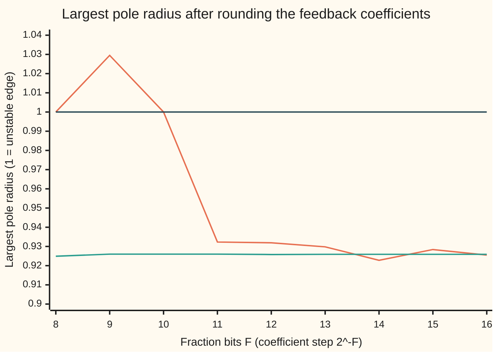

# Finite word length: rounded coefficients move poles, rounded sums add noise

[Syllabus](../../../SYLLABUS.md) → [Engineering mathematics](../README.md) → [Signals](../README.md#s05) → Finite word length

---

## General Overview

[Digital filters](04-digital-filters-fir-and-iir.md) built a fifth-order Butterworth low-pass to strip 50 Hz mains hum from a heart trace (an ECG) sampled 500 times a second. On a laptop, in 64-bit floating point, it works: 0.5 mV of hum at 50.2 Hz, the top of the mains drift, comes out as 4.35 µV. Now put the same filter on the cheap chip inside a heart monitor. That chip stores every number as a 16-bit integer. Every coefficient and every stored sum must land on a fixed grid of values.

The engineer has two questions. Is the filter still stable once its coefficients are rounded? And how much noise does all that rounding add, compared with the 4.35 µV of hum the filter leaves behind?

The answer depends on how the filter is wired, not just on its maths.

- **One big recursion (the direct form).** A 16-bit word that holds a coefficient as large as 7.07 spends a sign bit and three whole-number bits, leaving 12 fraction bits. There the filter stays stable, but its gain at 0 Hz is 0.9348 instead of 1. Save coefficient memory with 10 fraction bits, steps of 0.000977 (that is, 2⁻¹⁰), and one pole lands exactly on z = 1. The filter no longer settles. Rounding its stored sums to 16 bits adds 18.6 µV of noise, more than four times the 4.35 µV of hum the filter leaves behind.
- **Three small recursions in a row (a cascade).** Split the same filter into two second-order sections and one first-order section. At 10 bits the same rounding moves no pole by more than 0.001437, and the noise is 0.45 µV.

Same filter on paper, 41.4 times less noise in the chip.

**Rounding a filter's numbers moves its poles and adds noise, and both effects grow when the poles crowd together inside one polynomial; splitting the filter into second-order sections gives each pole pair its own small polynomial, so the poles barely move and the noise is barely amplified.**

**What kind of fact this is:** an engineering model. The pole-movement formula is a first-order approximation, and treating rounding as random noise is a model; both are checked here against exact roots and a bit-for-bit simulation. The bound "a rounding error is at most half a step" is exact.

### The picture: how far out the worst pole sits as the coefficients get coarser



Orange: the direct form. Teal: the cascade of sections. Dark: radius 1, the edge of stability; a pole on or beyond it means the filter never settles. The true largest radius is 0.9259. The direct form sits on or past the edge at 8, 9 and 10 bits and wanders even at 16. The cascade stays between 0.9249 and 0.9260 all the way down to 8 bits.

---

## The formula

Notation first. A **fixed-point** number is an integer times a fixed **step**. With F fraction bits the step is $`2^{-F}`$; rounding to it is called quantisation. The data here are 16-bit words: one sign bit and 15 fraction bits, so values run from −1 to 1 in steps of $`q = 2^{-15}`$. Full scale 1.0 stands for 5 mV of heart signal, so one step is 0.1526 µV.

As on [The z-transform](../02-Linear%20Systems%20and%20Transforms/08-z-transform-and-discrete-time-systems.md), a filter's poles are the roots of its denominator. Written in powers of z, the denominator is

```math
A(z) = z^N + a_1 z^{N-1} + \dots + a_N = (z - p_1)(z - p_2)\cdots(z - p_N).
```

Here N = 5 is the order, the $`a_k`$ are the feedback coefficients and the $`p_i`$ are the poles. A **biquad** (second-order section) is the same thing with N = 2: one pair of poles.

**Pole sensitivity.** Round each $`a_k`$ by a small error $`\delta a_k`$. Pole $`p_i`$ then moves by about

```math
\delta p_i \approx -\frac{\sum_{k=1}^{N} \delta a_k \, p_i^{\,N-k}}{\prod_{m \ne i} (p_i - p_m)}.
```

**Read it aloud:** the move is the coefficient errors, weighted by powers of the pole, divided by the product of the pole's distances to all the other poles.

**Roundoff noise.** Each rounding to step q adds an error e, at most q/2 in size. Modelled as uniform on that interval, it has variance $`q^2/12`$. The filter passes it on to the output:

```math
\sigma_y^2 = \frac{q^2}{12} \sum_{n=0}^{\infty} h_e[n]^2 .
```

**Read it aloud:** the output noise power is one rounding's power times the noise gain, the sum of squares of the impulse response from where the rounding happens to the output.

With the card's numbers: $`q^2/12 = 7.761 \times 10^{-11}`$. For the direct form the noise gain is 178,750, which gives an output noise of 122.0 q, or 18.6 µV.

| Symbol | Plain meaning | In our example | Push it up and the answer… |
| --- | --- | --- | --- |
| $`F`$ | fraction bits kept in each coefficient; step $`2^{-F}`$ | 10, step 0.000977 (a 16-bit word holding 7.07 has room for 12) | poles move less |
| $`q`$ | step of the 16-bit data words | $`2^{-15}`$ = 3.0518e-05 = 0.1526 µV | noise grows in proportion |
| $`N`$ | the filter's order: how many poles | 5 | more crowding, more sensitivity |
| $`a_k`$, $`\delta a_k`$ | a feedback coefficient; its rounding error | $`a_2`$ = 7.069723, rounded to 7.069336 | pole moves grow in proportion |
| $`p_i`$, $`\bar p`$, $`\delta p_i`$, $`\rho`$, $`\theta`$ | a pole; its mirror image; its move; its radius (ρ, rho) and angle | 0.9259 at 13.72° | radius near 1: sharper, more sensitive |
| $`A(z)`$, $`A(1)`$ | the denominator; its value at z = 1 | A(1) = 0.000685 | larger A(1): safer from a pole at z = 1 |
| $`A'(p_i) = \prod_{m \ne i}(p_i - p_m)`$ | slope of A(z) at a pole: the product of its distances to the others | its inverse: 188.8 direct, 2.276 biquad | small product: large moves |
| $`z`$, $`e^{j\omega}`$ | the z-transform variable; the point on the unit circle at angle ω, the frequency in radians per sample (j is the engineers' square root of −1) | z = 1 is 0 Hz, where the poles crowd | — |
| $`e`$ | one rounding error | between −q/2 and q/2 | — |
| $`h_e[n]`$ | impulse response from a rounding point to the output | that of 1/A(z) in the direct form | — |
| $`\sum h_e^2`$ | noise gain | 178,750 direct; 1.625, 41.624 and 60.995 on the noise paths from sections 1, 2 and 3 to the output | noise grows as its square root |
| $`\sigma_y`$ | output noise, root mean square (rms) | 18.6 µV direct, 0.45 µV cascade | — |

### When it holds

- **The roundings are small.** The sensitivity formula is first order. At F = 16 it predicts a move of 0.001994 for the 0.9259 pole; the exact roots give 0.001954. At F = 10 it predicts 0.0989, but the pole really moves 0.0516: outside its range the formula is only a warning light.
- **The signal is busy.** The uniform-noise model needs the signal to cross many steps, so that rounding errors look random. On 120,000 real roundings the mean was −0.0005 q and the variance 1.0008 times $`q^2/12`$. With zero input the model fails: the filter can stick at a nonzero value (see Step 6).
- **Each rounding is a fresh error.** Here every product is summed at full precision in a wide accumulator, a double-length register, and rounded once when stored. Many textbooks instead round every product, as a chip without a wide accumulator must: each multiply then adds its own error at the same adder, so the noise power grows with the number of multiplies. Repeated weights (a biquad's 1, 2, 1) also make the same error enter twice. The errors are then no longer independent, and the formula undercounts.
- **Nothing overflows.** Every stored number must stay inside ±1. The direct form used here stores only inputs and outputs. The other common layout, direct form II, stores the input after it passes through 1/A(z), whose gain at 0 Hz is 1460.5. That needs 11 extra bits of headroom.

---

## Why it works

### Step 0: crowded roots are fragile

A polynomial is pinned at its roots by its slope there. If the slope is gentle, a small push to the coefficients slides the root a long way. The size of the slope at a root equals the product of the root's distances to all the other roots. Poles packed close together make that product tiny. A sharp low-pass filter packs all its poles close together, near z = 1.

### Step 1: the sensitivity formula

At a pole, $`A(p_i) = 0`$. Round the coefficients and the pole moves to $`p_i + \delta p_i`$, where the new polynomial is zero. To first order, the slope times the move cancels the change in the polynomial:

```math
A'(p_i)\,\delta p_i + \sum_{k=1}^{N} \delta a_k\, p_i^{\,N-k} = 0, \qquad A'(p_i) = \prod_{m \ne i} (p_i - p_m).
```

The second part is the product rule applied to the factored form: every term but one contains the factor $`(z - p_i)`$, which is zero at $`p_i`$.

For the 0.9259 pole of the direct form, $`1/\lvert A'(p_i)\rvert`$ = 188.8. Every coefficient error is multiplied by that before it moves the pole.

In a biquad the only other pole is the mirror image $`\bar p`$, at distance $`2 \rho \sin\theta`$. So $`1/\lvert A'\rvert = 1/(2\rho\sin\theta)`$ = 2.276 instead of 188.8, because the three other poles are no longer in the polynomial.

<details>
<summary>Detailed proof: the slope at a root is the product of distances</summary>

Write $`A(z) = (z - p_i)\, R(z)`$, where $`R(z)`$ is the product of the other factors. The product rule gives

$`\displaystyle A'(z) = R(z) + (z - p_i)\, R'(z).`$

At $`z = p_i`$ the second term vanishes, so $`A'(p_i) = R(p_i) = \prod_{m \ne i}(p_i - p_m)`$.

For the move, expand the rounded polynomial $`A(z) + \sum_k \delta a_k z^{N-k}`$ at $`p_i + \delta p_i`$:

$`\displaystyle A(p_i) + A'(p_i)\,\delta p_i + \sum_k \delta a_k\, p_i^{\,N-k} + (\text{products of two small terms}) = 0.`$

The first term is zero. Drop the products of small terms and solve for $`\delta p_i`$.

</details>

### Step 2: why z = 1 is the weak spot

Put z = 1 into both forms of A(z):

```math
A(1) = 1 + a_1 + a_2 + a_3 + a_4 + a_5 = (1 - p_1)(1 - p_2)\cdots(1 - p_5).
```

All five poles sit near 1, so the product is tiny: 0.000685. The sum of coefficients must hit that tiny number exactly. Coefficients as big as 7.069723 add and cancel to reach it.

Rounding each of the five coefficients by up to half a step can shift the sum by up to 5 × 2⁻¹¹ = 0.002441. That is more than A(1) itself. At F = 10 the rounded sum comes out at exactly 0.000000. Then A(1) = 0, so z = 1 is a root: a pole on the unit circle. The gain at 0 Hz, which is the numerator's sum divided by A(1), becomes infinite.

Even when the filter stays stable, A(1) sets the gain at 0 Hz. At F = 12 the direct form's gain at 0 Hz is 0.9348 instead of 1. The cascade's is 1.0010.

Each section of the cascade has its own A(1): 0.2243, 0.0523 and 0.0583. Each is far bigger than the 0.000977 by which rounding a biquad's two coefficients to 10 fraction bits can shift it (two half-steps), so at 10 bits no section can be pushed onto z = 1.

### Step 3: one rounding error is uniform noise

Rounding to the nearest step leaves an error e between −q/2 and q/2. If the signal is busy, every value in that interval is equally likely ([Uniform](../../09-Probability%20and%20statistics/04-Continuous%20Distributions/02-uniform-distribution.md)). Its mean is 0, and its variance is the average of $`e^2`$ over the interval:

```math
\frac{1}{q}\int_{-q/2}^{q/2} e^2 \, de = \frac{q^2}{12}.
```

For 16-bit data, $`q = 2^{-15}`$ and $`q^2/12 = 7.761 \times 10^{-11}`$. The rms error is 0.2887 q.

### Step 4: the filter shapes the noise

In the direct form the output is computed as a sum and then rounded: y[n] = (exact sum) + e[n]. That stored y[n] is fed back. So e[n] enters exactly like an extra input pushed into the feedback loop, and reaches the output through 1/A(z). (Strictly through $`z^N/A(z)`$, but the factor $`z^N`$ only shifts the response in time, so the gains and the noise gain are those of 1/A(z).)

The output error is then the errors convolved with $`h_e`$, the impulse response of 1/A(z). Independent errors add their variances. Each one arrives weighted by $`h_e[n]`$, so the output variance is $`q^2/12`$ times $`\sum h_e[n]^2`$.

The same noise gain is the average of $`\lvert 1/A(e^{j\omega})\rvert^2`$ around the unit circle (Parseval's theorem: energy in time equals energy in frequency). The code computes it both ways and gets 178,750.0 both times. It is huge because 1/A has gain 1/A(1) = 1460.5 at 0 Hz: the same tiny number as in Step 2.

So the direct form's output noise is $`0.2887\,q \times \sqrt{178{,}750}`$ = 122.0 q = 18.6 µV.

### Step 5: the cascade rounds three times, but each rounding is shaped gently

The cascade rounds once at each section's output: three roundings. Each error passes through its own section's 1/A(z) and then through the later sections. The three noise gains are 1.625, 41.624 and 60.995. Their total gives 2.95 q, or 0.45 µV: 41.4 times less noise than the direct form, 32.3 dB.

The order of the sections matters. Reversed, with the sharpest pole pair first, the noise drops to 1.99 q. But that section has a peak gain of 1.701, so a full-scale input near its peak would overflow the first stored sum. Engineers trade noise against headroom when they choose the order.

### Step 6: with no input, rounding can stop the decay

Feed the sharpest biquad (poles at 0.9259) nothing but its starting value of 1000 q. In exact arithmetic it decays to zero. In 16-bit arithmetic it sticks at 7 q.

The reason: when the output is a steady value c, the next sum differs from c by $`A_3(1)\,c`$, where $`A_3(1)`$ = 0.0583 is the section's own A(1). Rounding erases any change smaller than half a step. So any steady value with $`\lvert c\rvert\, A_3(1) \le 1/2`$, that is $`\lvert c \rvert \le`$ 8.57 q, never moves again. This is a **limit cycle**: a stuck value or small oscillation that rounding sustains with no input.

Here it is 1.07 µV of steady offset, harmless next to the 4.35 µV of hum. In audio, an oscillating limit cycle can be a faint, audible tone in a silent passage. A larger danger is overflow: two's-complement arithmetic wraps a too-large number round to a negative one, which can set off a full-scale oscillation. Clipping at ±1 instead (saturation arithmetic) prevents that.

---

## Worked numbers, by hand

| Step | Arithmetic | Value |
| --- | --- | --- |
| A(1) of the direct form | 1 − 4.187300 + 7.069723 − 6.009958 + 2.570429 − 0.442209 | 0.000685 |
| Worst shift from rounding at F = 10 | 5 coefficients × half of 0.000977 | 0.002441 |
| A(1) after rounding at F = 10 | 1 − 4.187500 + 7.069336 − 6.009766 + 2.570312 − 0.442383 | 0.000000: a pole at z = 1 |
| Sensitivity of the 0.9259 pole in its biquad | 1 ÷ (2 × 0.9259 × sin 13.72°) | 2.276 (188.8 in the direct form) |
| One rounding | $`q^2/12`$ with $`q = 2^{-15}`$ | 7.761e-11, rms 0.2887 q |
| Direct form noise | 0.2887 q × √178,750 | 122.0 q = 18.6 µV |
| Cascade noise | 0.2887 q × √(1.625 + 41.624 + 60.995) | 2.95 q = **0.45 µV** |

The cascade adds 0.45 µV of noise against the direct form's 18.6 µV. That is far below the 4.35 µV of hum left behind, so on this chip the cascade's rounding is invisible on the trace, while the direct form's would be the biggest error in it.

### What breaks if you drop a piece

| Mistake | Comes out at | What went wrong |
| --- | --- | --- |
| Run the direct form with 9 fraction bits | largest pole radius 1.0295 | a pole outside the unit circle: the output grows without limit |
| Trust the first-order formula at F = 10 | predicts 0.0989; the pole really moves 0.0516 | the move is not small, so the linear formula no longer holds |
| Assume rounding noise passes straight through: 0.2887 q | the direct form gives 122.0 q | the error is fed back through 1/A(z), with noise gain 178,750 |
| Expect zero input to give zero output | the sharpest biquad sticks at 7 q | a limit cycle: rounding erases the last small steps of the decay |

---

## Code, from first principles, and it actually runs

The script designs the filter exactly as [Digital filters](04-digital-filters-fir-and-iir.md) does: Butterworth poles on a circle, mapped by the bilinear transform. Then it rounds and measures. Nothing imported knows anything about filters or roots. It takes three independent roads:

1. **Poles:** exact roots of the rounded polynomial, found by the Durand–Kerner iteration (it refines guesses for all roots at once), against the first-order sensitivity formula. A(1) is computed as a sum of coefficients and as a product over the poles.
2. **Noise gain:** the sum of squares of the impulse response, against the average of the squared gain around the unit circle.
3. **A bit-for-bit run:** 40,000 random input samples on the 16-bit grid, from a SplitMix64 generator with seed 2026, filtered with and without rounding. The measured error is compared with the predicted noise.

### Python

```python
# Finite word length -- the check behind the card.  Standard library only.
# The 5th-order Butterworth hum filter (fs 500 Hz, cutoff 20 Hz) built two ways:
# one direct form (one 5th-degree denominator) and a cascade of sections (two biquads + one 1st-order).
# Part 1: round the feedback coefficients to a step 2^-F and see where the poles go.
# Part 2: round each stored sum to 16 bits (q = 2^-15) and size the noise that adds.
# Roads: exact roots against the first-order sensitivity formula; A(1) as a sum and as a product;
# noise gain as a sum of squared impulse response and as a frequency-domain average; a bit-true run.
import math, cmath
FS, FC, N, Q, MV = 500.0, 20.0, 5, 2.0 ** -15, 5.0      # MV: full scale 1.0 = 5 mV
def rnd(v, q): return math.floor(v / q + 0.5) * q        # round to the nearest step, halves up
def polymul(p, r): return [sum(p[i] * r[k - i] for i in range(len(p)) if 0 <= k - i < len(r)) for k in range(len(p) + len(r) - 1)]
Wc = math.tan(math.pi * FC / FS)
sp = [Wc * cmath.exp(1j * math.pi * (2 * k + N + 1) / (2 * N)) for k in range(N)]
poles = [(1 + p) / (1 - p) for p in sp]                  # bilinear map of the analogue poles
a = [1 + 0j]
for p in poles: a = [u - p * v for u, v in zip(a + [0], [0] + a)]
a = [c.real for c in a]
b = [math.comb(N, k) * sum(a) / 2 ** N for k in range(N + 1)]
pr = [p for p in poles if abs(p.imag) < 1e-9][0]
pp = sorted([p for p in poles if p.imag > 1e-9], key=abs)
dens = [[1.0, -pr.real]] + [[1.0, -2 * p.real, abs(p) ** 2] for p in pp]
secs = [([c * sum(A) / 2 ** (len(A) - 1) for c in ([1, 1] if len(A) == 2 else [1, 2, 1])], A) for A in dens]
def roots(c, it=600):                                    # Durand-Kerner: all roots at once
    n = len(c) - 1; z = [(0.4 + 0.9j) ** k for k in range(n)]
    for _ in range(it):
        nz = []
        for i in range(n):
            num = 0j
            for ck in c: num = num * z[i] + ck
            den = 1 + 0j
            for j in range(n):
                if j != i: den *= z[i] - z[j]
            nz.append(z[i] - num / den)
        z = nz
    return z
def sec_poles(A):                                        # quadratic formula, section by section
    if len(A) == 2: return [complex(-A[1])]
    d = A[1] ** 2 - 4 * A[2]; r = cmath.sqrt(d)
    return [(-A[1] + r) / 2, (-A[1] - r) / 2]
def move(new): return max(min(abs(p - q) for q in new) for p in poles)
def casc_poles(F): return [p for A in dens for p in sec_poles([rnd(c, 2.0 ** -F) for c in A])]
def dir_poles(F): return roots([rnd(c, 2.0 ** -F) for c in a])
print("a =", " ".join(f"{c:.6f}" for c in a))
print("sections: " + "; ".join(" ".join(f"{c:.6f}" for c in A[1:]) for A in dens))
print("pole radii " + " ".join(f"{abs(p):.4f}" for p in poles) + "; angles deg " + " ".join(f"{math.degrees(cmath.phase(p)):.2f}" for p in poles))
A1, A1p = sum(a), math.prod(abs(1 - p) for p in poles)  # A(1) two ways
print(f"A(1): sum of a {A1:.6f}, product of (1 - p) {A1p:.6f}; sections {' '.join(f'{sum(A):.4f}' for A in dens)}")
assert abs(A1 - A1p) < 1e-12
def dA(p, ps): return math.prod(abs(p - r) for r in ps if abs(r - p) > 1e-12)
p0 = pp[1]                                               # the pole nearest the unit circle
print(f"sensitivity of the 0.9259 pole, 1/|A'(p)|: direct {1 / dA(p0, poles):.1f}, biquad {1 / dA(p0, [p0, p0.conjugate()]):.3f}, "
      f"1/(2 rho sin theta) {1 / (2 * abs(p0) * math.sin(cmath.phase(p0))):.3f}")
def pred_move(F):                                        # road 2: first-order prediction of the move
    da = [rnd(c, 2.0 ** -F) - c for c in a]
    pred = -sum(da[k] * p0 ** (N - k) for k in range(1, N + 1)) / math.prod(p0 - r for r in poles if abs(r - p0) > 1e-12)
    return pred, min((r for r in dir_poles(F)), key=lambda r: abs(r - p0)) - p0
for F in (16, 10): print(f"F = {F}, move of the 0.9259 pole: predicted {abs(pred_move(F)[0]):.6f}, exact root {abs(pred_move(F)[1]):.6f}")
assert abs(pred_move(16)[0] - pred_move(16)[1]) < 0.05 * abs(pred_move(16)[1])
print("bits F | direct: largest radius, largest move | cascade: largest radius, largest move")
chart = []
for F in range(8, 17):
    d, c = dir_poles(F), casc_poles(F)
    chart.append((max(abs(r) for r in d), max(abs(r) for r in c)))
    print(f"  {F:2d}   |      {chart[-1][0]:.4f}  {move(d):.4f}          |       {chart[-1][1]:.4f}  {move(c):.6f}")
dmin = next(F for F in range(2, 30) if all(max(abs(r) for r in dir_poles(G)) < 1 - 1e-9 for G in range(F, 30)))
cmin = next(F for F in range(2, 30) if all(max(abs(r) for r in casc_poles(G)) < 1 - 1e-9 for G in range(F, 30)))
print(f"fewest fraction bits for stability at every F above: direct {dmin}, cascade {cmin}")
ar10 = [rnd(c, 2.0 ** -10) for c in a]
print(f"F = 10: step {2.0 ** -10:.6f}, worst shift of A(1) 5 x step/2 = {5 * 2.0 ** -11:.6f}; rounded a =", " ".join(f"{c:.6f}" for c in ar10), f"; A(1) = {sum(ar10):.6f}")
assert abs(sum(ar10)) < 1e-12 and cmin < dmin
for F in (12, 16):
    arF = [rnd(c, 2.0 ** -F) for c in a]
    print(f"F = {F}: gain at 0 Hz, direct {sum(b) / sum(arF):.4f}, cascade {math.prod(sum(B) / sum(rnd(c, 2.0 ** -F) for c in A) for B, A in secs):.4f}")
# ---- Part 2: roundoff noise ----
s2 = Q * Q / 12
def impulse(B, A, n=3000):
    y = []
    for i in range(n):
        y.append((B[i] if i < len(B) else 0) - sum(A[k] * y[i - k] for k in range(1, len(A)) if i >= k))
    return y
def gain_sum(B, A): return sum(v * v for v in impulse(B, A))
def freq(B, A, w): return abs(sum(v * cmath.exp(-1j * w * k) for k, v in enumerate(B)) / sum(v * cmath.exp(-1j * w * k) for k, v in enumerate(A)))
def gain_freq(B, A, M=4096): return sum(freq(B, A, 2 * math.pi * m / M) ** 2 for m in range(M)) / M  # road 3
def shaping(order):                                      # noise path from each section's rounding
    out = []
    for k, (B, A) in enumerate(order):
        num, den = [1.0], A
        for B2, A2 in order[k + 1:]: num, den = polymul(num, B2), polymul(den, A2)
        out.append((num, den))
    return out
Gd, Gdf = gain_sum([1.0], a), gain_freq([1.0], a)
vd = s2 * Gd
vc = sum(s2 * gain_sum(nu, de) for nu, de in shaping(secs))
vr = sum(s2 * gain_sum(nu, de) for nu, de in shaping(secs[::-1]))
print(f"q = 2^-15 = {Q:.4e} = {Q * MV * 1000:.4f} uV; one rounding: variance q^2/12 = {s2:.3e}, rms {math.sqrt(s2) / Q:.4f} q")
print(f"noise gain of 1/A(z): squared impulse response {Gd:.1f}, frequency average {Gdf:.1f}")
assert abs(Gd - Gdf) < 1e-6 * Gd
for k, (nu, de) in enumerate(shaping(secs)):
    print(f"  noise path from section {k + 1}: {gain_sum(nu, de):.3f} by impulse, {gain_freq(nu, de):.3f} by frequency")
def splitmix(seed):
    while True:
        seed = (seed + 0x9E3779B97F4A7C15) & 0xFFFFFFFFFFFFFFFF
        z = seed; z = ((z ^ (z >> 30)) * 0xBF58476D1CE4E5B9) & 0xFFFFFFFFFFFFFFFF
        z = ((z ^ (z >> 27)) * 0x94D049BB133111EB) & 0xFFFFFFFFFFFFFFFF
        yield (z ^ (z >> 31)) >> 11
g = splitmix(2026); L = 40000
x = [((next(g) % 16384) - 8192) * Q for _ in range(L)]  # white input on the 16-bit grid, +-0.25
def run(B, A, xs, q, errs=None):                         # direct form I, wide accumulator; q = 0: exact
    y = []
    for n in range(len(xs)):
        acc = sum(B[k] * xs[n - k] for k in range(len(B)) if n >= k) - sum(A[k] * y[n - k] for k in range(1, len(A)) if n >= k)
        y.append(rnd(acc, q) if q else acc)              # one rounding, when the output is stored
        if errs is not None: errs.append(y[-1] - acc)
    return y
def var(e): m = sum(e) / len(e); return sum((v - m) ** 2 for v in e) / len(e)
ed = [u - v for u, v in zip(run(b, a, x, Q), run(b, a, x, 0))]
errs, yq, yf = [], x, x
for B, A in secs: yq, yf = run(B, A, yq, Q, errs), run(B, A, yf, 0)
ec = [u - v for u, v in zip(yq, yf)]
print(f"rounding errors seen: {len(errs)}, mean {sum(errs) / len(errs) / Q:+.4f} q, variance / (q^2/12) {var(errs) / s2:.4f}")
print(f"direct form, 1 rounding:   predicted rms {math.sqrt(vd) / Q:.1f} q, simulated {math.sqrt(var(ed)) / Q:.1f} q")
print(f"cascade, 3 roundings:      predicted rms {math.sqrt(vc) / Q:.2f} q, simulated {math.sqrt(var(ec)) / Q:.2f} q")
assert abs(var(ed) / vd - 1) < 0.1 and abs(var(ec) / vc - 1) < 0.1 and abs(var(errs) / s2 - 1) < 0.02 and abs(sum(errs) / len(errs)) < 0.01 * Q
print(f"in the ECG (1.0 = {MV:.0f} mV): direct {math.sqrt(vd) * MV * 1000:.1f} uV rms, cascade {math.sqrt(vc) * MV * 1000:.2f} uV rms; "
      f"ratio {math.sqrt(vd / vc):.1f}, {10 * math.log10(vd / vc):.1f} dB")
hum = 500 / math.sqrt(1 + (math.tan(math.pi * 50.2 / FS) / Wc) ** 10)  # uV of 0.5 mV hum left at 50.2 Hz
print(f"hum left by the exact filter {hum:.2f} uV; direct-form noise / hum {math.sqrt(vd) * MV * 1000 / hum:.1f}")
def peak(B, A): return max(freq(B, A, math.pi * i / 2000) for i in range(2001))
print("peak gain of each section: " + " ".join(f"{peak(B, A):.3f}" for B, A in secs) + f"; sections in reverse order {math.sqrt(vr) / Q:.2f} q")
print(f"breaks: direct form at F = 9: largest radius {max(abs(r) for r in dir_poles(9)):.4f}")
print(f"try: 24-bit words: direct {math.sqrt(vd) * MV * 1000 / 256:.3f} uV, cascade {math.sqrt(vc) * MV * 1000 / 256:.4f} uV; "
      f"direct form II inner gain at 0 Hz 1/A(1) = {1 / A1:.1f}, {math.ceil(math.log2(1 / A1))} bits of headroom")
A3 = dens[2]; y1, y2 = 1000, 0                           # zero input into the 0.9259 biquad, integers in q
for n in range(3000): y1, y2 = -math.floor(A3[1] * y1 + A3[2] * y2 + 0.5), y1
print(f"zero-input biquad from 1000 q: stuck at {y1} q after 3000 steps ({y1 * Q * MV * 1000:.2f} uV); bound 0.5/A3(1) = {0.5 / sum(A3):.2f} q")
assert y1 != 0 and y1 == y2 and abs(y1) <= 0.5 / sum(A3)
for k, name in enumerate(("direct ", "cascade")): print(f"chart, {name} " + " ".join(f"{r[k]:.4f}" for r in chart))
print("ALL CHECKS PASS")
```

**Ran 2026-11-23 on macOS, Python 3.14.10, standard library only. All checks passed. Output, pasted from the run:**

```
a = 1.000000 -4.187300 7.069723 -6.009958 2.570429 -0.442209
sections: -0.775680; -1.612700 0.665010; -1.798920 0.857270
pole radii 0.9259 0.8155 0.7757 0.8155 0.9259; angles deg 13.72 8.58 0.00 -8.58 -13.72
A(1): sum of a 0.000685, product of (1 - p) 0.000685; sections 0.2243 0.0523 0.0583
sensitivity of the 0.9259 pole, 1/|A'(p)|: direct 188.8, biquad 2.276, 1/(2 rho sin theta) 2.276
F = 16, move of the 0.9259 pole: predicted 0.001994, exact root 0.001954
F = 10, move of the 0.9259 pole: predicted 0.098945, exact root 0.051619
bits F | direct: largest radius, largest move | cascade: largest radius, largest move
   8   |      1.0000  0.1003          |       0.9249  0.008114
   9   |      1.0295  0.1524          |       0.9260  0.005970
  10   |      1.0000  0.1443          |       0.9260  0.001437
  11   |      0.9323  0.1296          |       0.9260  0.000536
  12   |      0.9319  0.0105          |       0.9258  0.000192
  13   |      0.9298  0.0842          |       0.9259  0.000219
  14   |      0.9228  0.0052          |       0.9259  0.000219
  15   |      0.9284  0.0224          |       0.9259  0.000014
  16   |      0.9255  0.0090          |       0.9259  0.000008
fewest fraction bits for stability at every F above: direct 11, cascade 4
F = 10: step 0.000977, worst shift of A(1) 5 x step/2 = 0.002441; rounded a = 1.000000 -4.187500 7.069336 -6.009766 2.570312 -0.442383 ; A(1) = 0.000000
F = 12: gain at 0 Hz, direct 0.9348, cascade 1.0010
F = 16: gain at 0 Hz, direct 1.0198, cascade 1.0000
q = 2^-15 = 3.0518e-05 = 0.1526 uV; one rounding: variance q^2/12 = 7.761e-11, rms 0.2887 q
noise gain of 1/A(z): squared impulse response 178750.0, frequency average 178750.0
  noise path from section 1: 1.625 by impulse, 1.625 by frequency
  noise path from section 2: 41.624 by impulse, 41.624 by frequency
  noise path from section 3: 60.995 by impulse, 60.995 by frequency
rounding errors seen: 120000, mean -0.0005 q, variance / (q^2/12) 1.0008
direct form, 1 rounding:   predicted rms 122.0 q, simulated 122.1 q
cascade, 3 roundings:      predicted rms 2.95 q, simulated 2.95 q
in the ECG (1.0 = 5 mV): direct 18.6 uV rms, cascade 0.45 uV rms; ratio 41.4, 32.3 dB
hum left by the exact filter 4.35 uV; direct-form noise / hum 4.3
peak gain of each section: 1.000 1.000 1.701; sections in reverse order 1.99 q
breaks: direct form at F = 9: largest radius 1.0295
try: 24-bit words: direct 0.073 uV, cascade 0.0018 uV; direct form II inner gain at 0 Hz 1/A(1) = 1460.5, 11 bits of headroom
zero-input biquad from 1000 q: stuck at 7 q after 3000 steps (1.07 uV); bound 0.5/A3(1) = 8.57 q
chart, direct  1.0000 1.0295 1.0000 0.9323 0.9319 0.9298 0.9228 0.9284 0.9255
chart, cascade 0.9249 0.9260 0.9260 0.9260 0.9258 0.9259 0.9259 0.9259 0.9259
ALL CHECKS PASS
```

### Rust

The same roads and the same numbers. Rust has no complex type in its standard library, so a small one is written out, and Python's exponent style is copied for two numbers.

```rust
// Finite word length -- the check behind the card.  Rust std only, no crates.
// The 5th-order Butterworth hum filter (fs 500 Hz, cutoff 20 Hz) built two ways:
// one direct form (one 5th-degree denominator) and a cascade of sections (two biquads + one 1st-order).
// Part 1: round the feedback coefficients to a step 2^-F and see where the poles go.
// Part 2: round each stored sum to 16 bits (q = 2^-15) and size the noise that adds.
// Same roads as the Python: roots against the sensitivity formula; A(1) two ways; noise gain two ways; a bit-true run.
use std::f64::consts::PI;
const FS: f64 = 500.0; const FC: f64 = 20.0; const N: usize = 5; const MV: f64 = 5.0;
#[derive(Clone, Copy)]
struct C { re: f64, im: f64 }
fn c(re: f64, im: f64) -> C { C { re, im } }
impl C {
    fn add(self, o: C) -> C { c(self.re + o.re, self.im + o.im) }
    fn sub(self, o: C) -> C { c(self.re - o.re, self.im - o.im) }
    fn mul(self, o: C) -> C { c(self.re * o.re - self.im * o.im, self.re * o.im + self.im * o.re) }
    fn div(self, o: C) -> C { let d = o.re * o.re + o.im * o.im;
        c((self.re * o.re + self.im * o.im) / d, (self.im * o.re - self.re * o.im) / d) }
    fn abs(self) -> f64 { self.re.hypot(self.im) }  fn conj(self) -> C { c(self.re, -self.im) }
}
fn rnd(v: f64, q: f64) -> f64 { (v / q + 0.5).floor() * q }
fn rndv(v: &[f64], f: i32) -> Vec<f64> { v.iter().map(|&x| rnd(x, 2f64.powi(-f))).collect() }
fn sum(v: &[f64]) -> f64 { v.iter().fold(0.0, |s, x| s + x) }
fn polymul(p: &[f64], r: &[f64]) -> Vec<f64> {
    (0..p.len() + r.len() - 1).map(|k| (0..p.len()).filter(|&i| k >= i && k - i < r.len()).fold(0.0, |s, i| s + p[i] * r[k - i])).collect()
}
fn roots(cf: &[f64]) -> Vec<C> { // Durand-Kerner: all roots at once
    let n = cf.len() - 1; let s = c(0.4, 0.9);
    let mut z: Vec<C> = (0..n).map(|k| (0..k).fold(c(1.0, 0.0), |p, _| p.mul(s))).collect();
    for _ in 0..600 {
        let mut nz = Vec::new();
        for i in 0..n {
            let num = cf.iter().fold(c(0.0, 0.0), |p, &v| p.mul(z[i]).add(c(v, 0.0)));
            let den = (0..n).filter(|&j| j != i).fold(c(1.0, 0.0), |p, j| p.mul(z[i].sub(z[j])));
            nz.push(z[i].sub(num.div(den)));
        }
        z = nz;
    }
    z
}
fn sec_poles(a: &[f64]) -> Vec<C> { // quadratic formula, section by section
    if a.len() == 2 { return vec![c(-a[1], 0.0)]; }
    let d = a[1] * a[1] - 4.0 * a[2];
    if d >= 0.0 { vec![c((-a[1] + d.sqrt()) / 2.0, 0.0), c((-a[1] - d.sqrt()) / 2.0, 0.0)] }
    else { vec![c(-a[1] / 2.0, (-d).sqrt() / 2.0), c(-a[1] / 2.0, -(-d).sqrt() / 2.0)] }
}
fn maxr(v: &[C]) -> f64 { v.iter().map(|p| p.abs()).fold(0.0, f64::max) }
fn impulse(b: &[f64], a: &[f64]) -> Vec<f64> {
    let mut y: Vec<f64> = Vec::new();
    for i in 0..3000 { let fb = (1..a.len()).filter(|&k| i >= k).fold(0.0, |s, k| s + a[k] * y[i - k]);
        y.push((if i < b.len() { b[i] } else { 0.0 }) - fb); }
    y
}
fn freq(b: &[f64], a: &[f64], w: f64) -> f64 {
    let ev = |cf: &[f64]| cf.iter().enumerate().fold(c(0.0, 0.0), |s, (k, &v)| s.add(c(v * (w * k as f64).cos(), -v * (w * k as f64).sin())));
    ev(b).div(ev(a)).abs()
}
fn gain_freq(b: &[f64], a: &[f64]) -> f64 { (0..4096).fold(0.0, |s, m| s + freq(b, a, 2.0 * PI * m as f64 / 4096.0).powi(2)) / 4096.0 } // road 3
fn shaping(order: &[(Vec<f64>, Vec<f64>)]) -> Vec<(Vec<f64>, Vec<f64>)> { // noise path from each section's rounding
    (0..order.len()).map(|k| { let (mut num, mut den) = (vec![1.0], order[k].1.clone());
        for (b2, a2) in &order[k + 1..] { num = polymul(&num, b2); den = polymul(&den, a2); } (num, den) }).collect()
}
fn run(b: &[f64], a: &[f64], xs: &[f64], q: f64, errs: &mut Vec<f64>) -> Vec<f64> { // direct form I, wide accumulator
    let mut y: Vec<f64> = Vec::new();
    for n in 0..xs.len() {
        let s1 = (0..b.len()).filter(|&k| n >= k).fold(0.0, |s, k| s + b[k] * xs[n - k]);
        let s2 = (1..a.len()).filter(|&k| n >= k).fold(0.0, |s, k| s + a[k] * y[n - k]);
        let acc = s1 - s2; y.push(if q > 0.0 { rnd(acc, q) } else { acc }); // one rounding, when stored
        if q > 0.0 { errs.push(y[n] - acc); }
    }
    y
}
fn var(e: &[f64]) -> f64 { let m = sum(e) / e.len() as f64; e.iter().fold(0.0, |s, v| s + (v - m) * (v - m)) / e.len() as f64 }
fn sci(x: f64, p: usize) -> String { let s = format!("{:.*e}", p, x); let (m, e) = s.split_once('e').unwrap(); // Python-style exponent
    let e: i32 = e.parse().unwrap(); format!("{}e{}{:02}", m, if e < 0 { '-' } else { '+' }, e.abs()) }
fn j(v: &[f64], p: usize) -> String { v.iter().map(|x| format!("{:.*}", p, x)).collect::<Vec<_>>().join(" ") }
fn main() {
    let (q, one) = (2f64.powi(-15), c(1.0, 0.0));
    let wc = (PI * FC / FS).tan();
    let poles: Vec<C> = (0..N).map(|k| { let t = PI * (2 * k + N + 1) as f64 / (2 * N) as f64;
        let s = c(wc * t.cos(), wc * t.sin()); one.add(s).div(one.sub(s)) }).collect(); // bilinear map
    let mut ac = vec![one];
    for p in &poles { let mut na = vec![c(0.0, 0.0); ac.len() + 1];
        for i in 0..na.len() { let u = if i < ac.len() { ac[i] } else { c(0.0, 0.0) };
            na[i] = if i > 0 { u.sub(p.mul(ac[i - 1])) } else { u }; } ac = na; }
    let a: Vec<f64> = ac.iter().map(|z| z.re).collect();
    let mut binom = vec![1.0f64]; for k in 1..=N { binom.push(binom[k - 1] * (N + 1 - k) as f64 / k as f64); }
    let b: Vec<f64> = binom.iter().map(|v| v * sum(&a) / 32.0).collect();
    let pr = *poles.iter().find(|p| p.im.abs() < 1e-9).unwrap();
    let mut pp: Vec<C> = poles.iter().cloned().filter(|p| p.im > 1e-9).collect();
    pp.sort_by(|x, y| x.abs().partial_cmp(&y.abs()).unwrap());
    let mut dens = vec![vec![1.0, -pr.re]];
    for p in &pp { dens.push(vec![1.0, -2.0 * p.re, p.abs().powi(2)]); }
    let secs: Vec<(Vec<f64>, Vec<f64>)> = dens.iter().map(|d| { let w: Vec<f64> = if d.len() == 2 { vec![1.0, 1.0] } else { vec![1.0, 2.0, 1.0] };
        (w.iter().map(|v| v * sum(d) / 2f64.powi(d.len() as i32 - 1)).collect(), d.clone()) }).collect();
    let mv = |new: &[C]| poles.iter().map(|p| new.iter().map(|r| r.sub(*p).abs()).fold(f64::INFINITY, f64::min)).fold(0.0, f64::max);
    let casc = |f: i32| -> Vec<C> { dens.iter().flat_map(|d| sec_poles(&rndv(d, f))).collect() };
    let dirp = |f: i32| -> Vec<C> { roots(&rndv(&a, f)) };
    println!("a = {}", j(&a, 6));
    println!("sections: {}", dens.iter().map(|d| j(&d[1..], 6)).collect::<Vec<_>>().join("; "));
    println!("pole radii {}; angles deg {}", j(&poles.iter().map(|p| p.abs()).collect::<Vec<_>>(), 4),
        j(&poles.iter().map(|p| p.im.atan2(p.re).to_degrees()).collect::<Vec<_>>(), 2));
    let (a1, a1p) = (sum(&a), poles.iter().fold(1.0, |s, p| s * one.sub(*p).abs())); // A(1) two ways
    println!("A(1): sum of a {:.6}, product of (1 - p) {:.6}; sections {}", a1, a1p, j(&dens.iter().map(|d| sum(d)).collect::<Vec<_>>(), 4));
    assert!((a1 - a1p).abs() < 1e-12);
    let p0 = pp[1]; let da = |p: C, ps: &[C]| ps.iter().filter(|r| r.sub(p).abs() > 1e-12).fold(1.0, |s, r| s * p.sub(*r).abs());
    println!("sensitivity of the 0.9259 pole, 1/|A'(p)|: direct {:.1}, biquad {:.3}, 1/(2 rho sin theta) {:.3}",
        1.0 / da(p0, &poles), 1.0 / da(p0, &[p0, p0.conj()]), 1.0 / (2.0 * p0.abs() * p0.im.atan2(p0.re).sin()));
    let pred_move = |f: i32| -> (C, C) { // road 2: first-order prediction of the move
        let d: Vec<f64> = rndv(&a, f).iter().zip(&a).map(|(r, v)| r - v).collect();
        let num = (1..=N).fold(c(0.0, 0.0), |s, k| s.add(c(d[k], 0.0).mul((0..N - k).fold(one, |t, _| t.mul(p0)))));
        let den = poles.iter().filter(|r| r.sub(p0).abs() > 1e-12).fold(one, |t, r| t.mul(p0.sub(*r)));
        let ex = dirp(f).into_iter().fold((f64::INFINITY, one), |m, r| if r.sub(p0).abs() < m.0 { (r.sub(p0).abs(), r.sub(p0)) } else { m });
        (c(0.0, 0.0).sub(num.div(den)), ex.1) }; // (predicted move, exact move), as complex numbers
    for f in [16, 10] { println!("F = {}, move of the 0.9259 pole: predicted {:.6}, exact root {:.6}", f, pred_move(f).0.abs(), pred_move(f).1.abs()); }
    assert!(pred_move(16).0.sub(pred_move(16).1).abs() < 0.05 * pred_move(16).1.abs());
    println!("bits F | direct: largest radius, largest move | cascade: largest radius, largest move");
    let mut chart = Vec::new();
    for f in 8..17 { let (d, cc) = (dirp(f), casc(f)); chart.push((maxr(&d), maxr(&cc)));
        println!("  {:2}   |      {:.4}  {:.4}          |       {:.4}  {:.6}", f, maxr(&d), mv(&d), maxr(&cc), mv(&cc)); }
    let dmin = (2..30).find(|&f| (f..30).all(|g| maxr(&dirp(g)) < 1.0 - 1e-9)).unwrap();
    let cmin = (2..30).find(|&f| (f..30).all(|g| maxr(&casc(g)) < 1.0 - 1e-9)).unwrap();
    println!("fewest fraction bits for stability at every F above: direct {}, cascade {}", dmin, cmin);
    let ar10 = rndv(&a, 10);
    println!("F = 10: step {:.6}, worst shift of A(1) 5 x step/2 = {:.6}; rounded a = {} ; A(1) = {:.6}", 2f64.powi(-10), 5.0 * 2f64.powi(-11), j(&ar10, 6), sum(&ar10));
    assert!(sum(&ar10).abs() < 1e-12 && cmin < dmin);
    for f in [12, 16] { println!("F = {}: gain at 0 Hz, direct {:.4}, cascade {:.4}", f, sum(&b) / sum(&rndv(&a, f)),
        secs.iter().fold(1.0, |s, (bb, aa)| s * (sum(bb) / sum(&rndv(aa, f))))); }
    // ---- Part 2: roundoff noise ----
    let s2 = q * q / 12.0; let gain_sum = |b: &[f64], a: &[f64]| impulse(b, a).iter().fold(0.0, |s, v| s + v * v);
    let (gd, gdf) = (gain_sum(&[1.0], &a), gain_freq(&[1.0], &a));
    let vd = s2 * gd;
    let vc = shaping(&secs).iter().fold(0.0, |s, (nu, de)| s + s2 * gain_sum(nu, de));
    let rev: Vec<(Vec<f64>, Vec<f64>)> = secs.iter().rev().cloned().collect();
    let vr = shaping(&rev).iter().fold(0.0, |s, (nu, de)| s + s2 * gain_sum(nu, de));
    println!("q = 2^-15 = {} = {:.4} uV; one rounding: variance q^2/12 = {}, rms {:.4} q", sci(q, 4), q * MV * 1000.0, sci(s2, 3), s2.sqrt() / q);
    println!("noise gain of 1/A(z): squared impulse response {:.1}, frequency average {:.1}", gd, gdf);
    assert!((gd - gdf).abs() < 1e-6 * gd);
    for (k, (nu, de)) in shaping(&secs).iter().enumerate() {
        println!("  noise path from section {}: {:.3} by impulse, {:.3} by frequency", k + 1, gain_sum(nu, de), gain_freq(nu, de)); }
    let mut seed: u64 = 2026;
    let mut next = || { seed = seed.wrapping_add(0x9E3779B97F4A7C15); let mut z = seed;
        z = (z ^ (z >> 30)).wrapping_mul(0xBF58476D1CE4E5B9); z = (z ^ (z >> 27)).wrapping_mul(0x94D049BB133111EB); (z ^ (z >> 31)) >> 11 };
    let x: Vec<f64> = (0..40000).map(|_| ((next() % 16384) as f64 - 8192.0) * q).collect(); // white input, +-0.25
    let (mut errs, mut none) = (Vec::new(), Vec::new());
    let ed: Vec<f64> = run(&b, &a, &x, q, &mut none).iter().zip(run(&b, &a, &x, 0.0, &mut none)).map(|(u, v)| u - v).collect();
    let (mut yq, mut yf) = (x.clone(), x.clone());
    for (bb, aa) in &secs { yq = run(bb, aa, &yq, q, &mut errs); yf = run(bb, aa, &yf, 0.0, &mut none); }
    let ec: Vec<f64> = yq.iter().zip(&yf).map(|(u, v)| u - v).collect();
    println!("rounding errors seen: {}, mean {:+.4} q, variance / (q^2/12) {:.4}", errs.len(), sum(&errs) / errs.len() as f64 / q, var(&errs) / s2);
    println!("direct form, 1 rounding:   predicted rms {:.1} q, simulated {:.1} q", vd.sqrt() / q, var(&ed).sqrt() / q);
    println!("cascade, 3 roundings:      predicted rms {:.2} q, simulated {:.2} q", vc.sqrt() / q, var(&ec).sqrt() / q);
    assert!((var(&ed) / vd - 1.0).abs() < 0.1 && (var(&ec) / vc - 1.0).abs() < 0.1 && (var(&errs) / s2 - 1.0).abs() < 0.02 && (sum(&errs) / errs.len() as f64).abs() < 0.01 * q);
    println!("in the ECG (1.0 = {:.0} mV): direct {:.1} uV rms, cascade {:.2} uV rms; ratio {:.1}, {:.1} dB",
        MV, vd.sqrt() * MV * 1000.0, vc.sqrt() * MV * 1000.0, (vd / vc).sqrt(), 10.0 * (vd / vc).log10());
    let hum = 500.0 / (1.0 + ((PI * 50.2 / FS).tan() / wc).powi(10)).sqrt(); // uV of 0.5 mV hum left at 50.2 Hz
    println!("hum left by the exact filter {:.2} uV; direct-form noise / hum {:.1}", hum, vd.sqrt() * MV * 1000.0 / hum);
    let peak = |bb: &[f64], aa: &[f64]| (0..2001).map(|i| freq(bb, aa, PI * i as f64 / 2000.0)).fold(0.0, f64::max);
    println!("peak gain of each section: {}; sections in reverse order {:.2} q",
        j(&secs.iter().map(|(bb, aa)| peak(bb, aa)).collect::<Vec<_>>(), 3), vr.sqrt() / q);
    println!("breaks: direct form at F = 9: largest radius {:.4}", maxr(&dirp(9)));
    println!("try: 24-bit words: direct {:.3} uV, cascade {:.4} uV; direct form II inner gain at 0 Hz 1/A(1) = {:.1}, {} bits of headroom",
        vd.sqrt() * MV * 1000.0 / 256.0, vc.sqrt() * MV * 1000.0 / 256.0, 1.0 / a1, (1.0 / a1).log2().ceil());
    let a3 = &dens[2]; let (mut y1, mut y2) = (1000.0f64, 0.0f64); // zero input into the 0.9259 biquad, integers in q
    for _ in 0..3000 { let y = -(a3[1] * y1 + a3[2] * y2 + 0.5).floor(); y2 = y1; y1 = y; }
    println!("zero-input biquad from 1000 q: stuck at {} q after 3000 steps ({:.2} uV); bound 0.5/A3(1) = {:.2} q",
        y1, y1 * q * MV * 1000.0, 0.5 / sum(a3));
    assert!(y1 != 0.0 && y1 == y2 && y1.abs() <= 0.5 / sum(a3));
    println!("chart, direct  {}\nchart, cascade {}", j(&chart.iter().map(|r| r.0).collect::<Vec<_>>(), 4), j(&chart.iter().map(|r| r.1).collect::<Vec<_>>(), 4));
    println!("ALL CHECKS PASS");
}
```

**Ran 2026-11-23 on macOS, rustc 1.98.1, no crates. All checks passed. Output, pasted from the run:**

```
a = 1.000000 -4.187300 7.069723 -6.009958 2.570429 -0.442209
sections: -0.775680; -1.612700 0.665010; -1.798920 0.857270
pole radii 0.9259 0.8155 0.7757 0.8155 0.9259; angles deg 13.72 8.58 0.00 -8.58 -13.72
A(1): sum of a 0.000685, product of (1 - p) 0.000685; sections 0.2243 0.0523 0.0583
sensitivity of the 0.9259 pole, 1/|A'(p)|: direct 188.8, biquad 2.276, 1/(2 rho sin theta) 2.276
F = 16, move of the 0.9259 pole: predicted 0.001994, exact root 0.001954
F = 10, move of the 0.9259 pole: predicted 0.098945, exact root 0.051619
bits F | direct: largest radius, largest move | cascade: largest radius, largest move
   8   |      1.0000  0.1003          |       0.9249  0.008114
   9   |      1.0295  0.1524          |       0.9260  0.005970
  10   |      1.0000  0.1443          |       0.9260  0.001437
  11   |      0.9323  0.1296          |       0.9260  0.000536
  12   |      0.9319  0.0105          |       0.9258  0.000192
  13   |      0.9298  0.0842          |       0.9259  0.000219
  14   |      0.9228  0.0052          |       0.9259  0.000219
  15   |      0.9284  0.0224          |       0.9259  0.000014
  16   |      0.9255  0.0090          |       0.9259  0.000008
fewest fraction bits for stability at every F above: direct 11, cascade 4
F = 10: step 0.000977, worst shift of A(1) 5 x step/2 = 0.002441; rounded a = 1.000000 -4.187500 7.069336 -6.009766 2.570312 -0.442383 ; A(1) = 0.000000
F = 12: gain at 0 Hz, direct 0.9348, cascade 1.0010
F = 16: gain at 0 Hz, direct 1.0198, cascade 1.0000
q = 2^-15 = 3.0518e-05 = 0.1526 uV; one rounding: variance q^2/12 = 7.761e-11, rms 0.2887 q
noise gain of 1/A(z): squared impulse response 178750.0, frequency average 178750.0
  noise path from section 1: 1.625 by impulse, 1.625 by frequency
  noise path from section 2: 41.624 by impulse, 41.624 by frequency
  noise path from section 3: 60.995 by impulse, 60.995 by frequency
rounding errors seen: 120000, mean -0.0005 q, variance / (q^2/12) 1.0008
direct form, 1 rounding:   predicted rms 122.0 q, simulated 122.1 q
cascade, 3 roundings:      predicted rms 2.95 q, simulated 2.95 q
in the ECG (1.0 = 5 mV): direct 18.6 uV rms, cascade 0.45 uV rms; ratio 41.4, 32.3 dB
hum left by the exact filter 4.35 uV; direct-form noise / hum 4.3
peak gain of each section: 1.000 1.000 1.701; sections in reverse order 1.99 q
breaks: direct form at F = 9: largest radius 1.0295
try: 24-bit words: direct 0.073 uV, cascade 0.0018 uV; direct form II inner gain at 0 Hz 1/A(1) = 1460.5, 11 bits of headroom
zero-input biquad from 1000 q: stuck at 7 q after 3000 steps (1.07 uV); bound 0.5/A3(1) = 8.57 q
chart, direct  1.0000 1.0295 1.0000 0.9323 0.9319 0.9298 0.9228 0.9284 0.9255
chart, cascade 0.9249 0.9260 0.9260 0.9260 0.9258 0.9259 0.9259 0.9259 0.9259
ALL CHECKS PASS
```

### Lean

Lean proves the rounding bound, the $`q^2/12`$ noise formula and the slope at a pole, for every step and every filter order.

- Take any real number x and any step q > 0. Then rounding x to the nearest multiple of q changes it by at most q/2.
- Suppose one rounding error e is uniform between −q/2 and q/2, with q > 0. Then its mean is 0 and its variance is $`q^2/12`$.
- Take any complex poles $`p_1, \dots, p_N`$, and let $`A(z)`$ be the product of the factors $`(z - p_i)`$. Then the slope of A(z) at each pole is the product of that pole's distances to all the other poles.
- Take the direct form's coefficients, rounded to 10 fraction bits. Then they sum to exactly 0, so A(1) = 0 and z = 1 is a pole.

The pole moves, the noise gains, the bit-for-bit run and the limit cycle are left to the Python and Rust checks.

```lean
-- Finite word length: rounding to a step q misses by at most q/2, a uniform rounding error has mean 0 and variance q^2/12, and a polynomial's slope at a root is the product of that root's distances to the other roots.
import Mathlib.Algebra.Order.Round
import Mathlib.Analysis.SpecialFunctions.Integrals.Basic
import Mathlib.Algebra.Polynomial.Derivative
import Mathlib.Data.Rat.Floor
import Mathlib.Tactic.NormNum

/-! A fixed-point number is an integer times a step `q > 0`. Rounding `x` to the nearest
step gives `q * round (x / q)`; Mathlib's `round` rounds halves up, `round y = ⌊y + 1/2⌋`,
exactly as the card's code `floor(v / q + 0.5) * q` does.
A filter's denominator is `A(z) = (z - p 1) ⋯ (z - p N)` with poles `p i`. -/

open Polynomial Finset

/-- A rounding error is at most half a step: rounding any real number `x` to the nearest
multiple of the step `q > 0` changes it by at most `q / 2`. -/
theorem rounding_error_le_half_step (q : ℝ) (hq : 0 < q) (x : ℝ) :
    |x - q * round (x / q)| ≤ q / 2 := by
  have h := abs_sub_round (x / q)
  have e : x - q * round (x / q) = q * (x / q - round (x / q)) := by
    field_simp
  rw [e, abs_mul, abs_of_pos hq]
  calc q * |x / q - round (x / q)| ≤ q * (1 / 2) := by gcongr
    _ = q / 2 := by ring

/-- One rounding error, modelled as uniform on `[-q/2, q/2]`, has mean `0` and
variance `q^2 / 12`: the average of `e` over the interval is `0` and the average
of `e^2` is `q^2 / 12`. -/
theorem uniform_rounding_error_mean_zero_variance (q : ℝ) (hq : 0 < q) :
    (1 / q) * ∫ e in (-q / 2)..(q / 2), e = 0 ∧
    (1 / q) * ∫ e in (-q / 2)..(q / 2), e ^ 2 = q ^ 2 / 12 := by
  rw [integral_id, integral_pow]
  constructor
  · ring
  · field_simp
    ring

/-- The slope of the denominator at a pole is the product of that pole's distances to all
the other poles: if `A(z) = ∏ m, (z - p m)` then `A'(p i) = ∏ (m ≠ i), (p i - p m)`.
This is the divisor in the card's pole-sensitivity formula. -/
theorem slope_at_pole_eq_prod_distances {N : ℕ} (p : Fin N → ℂ) (i : Fin N) :
    (derivative (∏ m, (X - C (p m)))).eval (p i) = ∏ m ∈ univ.erase i, (p i - p m) := by
  classical
  rw [derivative_prod_finset, eval_finsetSum]
  rw [Finset.sum_eq_single i]
  · simp [eval_prod]
  · intro b _ hb
    rw [eval_mul, eval_prod]
    apply mul_eq_zero_of_left
    apply Finset.prod_eq_zero (i := i)
    · exact Finset.mem_erase.mpr ⟨fun h => hb h.symm, Finset.mem_univ _⟩
    · simp
  · intro h; exact absurd (Finset.mem_univ i) h

/-! Worked numbers from the card, exact. -/

-- Rounding the direct form's coefficients to 10 fraction bits (step 2^-10): in units of
-- 2^-10 they become 1024, -4288, 7239, -6154, 2632, -453 (1.000000, -4.187500, 7.069336,
-- -6.009766, 2.570312, -0.442383), from the card's 1, -4.187300, 7.069723, -6.009958,
-- 2.570429, -0.442209.
example : round ((-4187300 : ℚ) / 1000000 * 1024) = -4288 := by norm_num [round_eq]
example : round ((7069723 : ℚ) / 1000000 * 1024) = 7239 := by norm_num [round_eq]
example : round ((-6009958 : ℚ) / 1000000 * 1024) = -6154 := by norm_num [round_eq]
example : round ((2570429 : ℚ) / 1000000 * 1024) = 2632 := by norm_num [round_eq]
example : round ((-442209 : ℚ) / 1000000 * 1024) = -453 := by norm_num [round_eq]

-- Their sum A(1) is exactly 0, so z = 1 is a pole: the filter no longer settles.
example : (1024 : ℤ) - 4288 + 7239 - 6154 + 2632 - 453 = 0 := by norm_num

-- The worst shift of A(1) from rounding five coefficients at F = 10 is 5 × 2^-11 = 5/2048,
-- more than the true A(1) = 0.000685.
example : (5 : ℚ) * ((1 / 2) * (1 / 2 ^ 10)) = 5 / 2048 ∧ (685 : ℚ) / 1000000 < 5 / 2048 := by
  norm_num

-- A 16-bit word holding a coefficient as large as 7.07 (between 2^2 and 2^3) spends a sign
-- bit and three whole-number bits, leaving 12 fraction bits.
example : (2 : ℕ) ^ 2 ≤ 7 ∧ 7 < 2 ^ 3 ∧ 1 + 3 + 12 = 16 := by norm_num

-- Direct form II's inner gain at 0 Hz, 1460.5, needs 11 extra bits: 2^10 < 1460.5 ≤ 2^11.
example : (2 : ℚ) ^ 10 < 2921 / 2 ∧ (2921 : ℚ) / 2 ≤ 2 ^ 11 := by norm_num

#print axioms rounding_error_le_half_step
#print axioms uniform_rounding_error_mean_zero_variance
#print axioms slope_at_pole_eq_prod_distances
```

**Checked 2026-11-23 on macOS, Lean 4.36.0-rc2, Mathlib v4.36.0-rc2. Every proof is complete and uses only Lean's standard axioms. Output, pasted from the run:**

```
'rounding_error_le_half_step' depends on axioms: [propext, Classical.choice, Quot.sound]
'uniform_rounding_error_mean_zero_variance' depends on axioms: [propext, Classical.choice, Quot.sound]
'slope_at_pole_eq_prod_distances' depends on axioms: [propext, Classical.choice, Quot.sound]
```

> [!TIP]
> **Try changing**
> - Guess first: how many fraction bits does each form need to stay stable at every word length above it? The script's search says the direct form needs 11 and the cascade only 4.
> - Guess first: what do 24-bit data words buy? Set `Q = 2.0 ** -23`. The noise falls 256-fold, below the decimals of the ECG line; the default run's `try:` line prints it: 0.073 µV for the direct form, 0.0018 µV for the cascade.
> - Guess first: which section should go first? Run the cascade as `secs[::-1]`. The noise falls to 1.99 q, but the section with peak gain 1.701 now comes first, and a full-scale input near its peak overflows.
> - Guess first: how wrong is the gain at 0 Hz with 12-bit coefficients? The direct form gives 0.9348, the cascade 1.0010.

---

## The usual mistake

> [!warning]
> **Designing in floating point, then rounding the direct-form coefficients.** The design on the laptop is perfect, and the chip runs a different filter. The direct form hides five poles inside one polynomial whose coefficients must cancel to 0.000685 at z = 1. Rounded to 10 fraction bits, they cancel to exactly 0: a pole on the unit circle. Build high-order IIR filters as cascades of biquads, and check the rounded poles, not the rounded coefficients.
>
> - **Ignoring noise gain.** One rounding is only 0.2887 q rms. The direct form feeds it back and multiplies its power by 178,750, giving 122.0 q.
> - **Choosing direct form II without headroom.** Its inner signal has gain 1460.5 at 0 Hz, so a full-scale input needs 11 extra bits.
> - **Trusting the first-order formula for large roundings.** At F = 10 it predicts 0.0989, while the pole really moves 0.0516.
> - **Assuming silence in means silence out.** The sharpest biquad, left with no input, sticks at 7 q.

---

## Where you meet it in real life

- **Heart monitors and wearables.** Battery-powered front ends often run 16-bit fixed-point processors with no floating-point unit. Their IIR filters ship as biquad cascades for exactly the reasons on this card.
- **Audio equalisers.** A guitar recording at 44.1 kHz is shaped by chains of biquads. A bass control at 40 Hz puts its poles even closer to z = 1 than the ECG filter does, so audio chips keep 24 or more bits inside their accumulators. Quiet passages are where limit cycles become audible.
- **Digital control.** A motor or heating controller run at a high sample rate has poles crowded near z = 1. Coefficient rounding can turn a stable loop into an unstable one, the same failure as the direct form here.
- **Chips designed for one job.** On a custom chip or a programmable logic chip, every extra bit costs area and power. Designers choose each word length from noise-gain sums like the ones here.

> **Say it back**
> A fixed-point chip rounds every coefficient and every stored sum to a grid. Rounded coefficients move the poles, and a pole moves more when the other poles crowd round it in the same polynomial. The fifth-order direct form packs all five poles near z = 1, so coefficients with 10 fraction bits put a pole right on the unit circle, while the cascade of biquads barely notices. Each rounding adds noise of variance q²/12, which the filter amplifies by its noise gain: 18.6 µV for the direct form, 0.45 µV for the cascade. With no input, rounding can also leave a small stuck value, a limit cycle.

---

## What this builds on

- [Digital filters](04-digital-filters-fir-and-iir.md): the fifth-order Butterworth hum filter, its coefficients and its poles at radii 0.9259, 0.8155 and 0.7757.
- [The z-transform](../02-Linear%20Systems%20and%20Transforms/08-z-transform-and-discrete-time-systems.md): poles as roots of the denominator, and why they must sit inside the unit circle.
- [Optimal filters](11-equiripple-fir-and-optimal-iir-design.md): the sharpest filters for a given order. Sharpness alone does not decide how badly rounding hurts: by Step 1 a pole moves further the more poles crowd round it in one polynomial, and a move does more harm the closer the pole sits to the unit circle.
- [Uniform](../../09-Probability%20and%20statistics/04-Continuous%20Distributions/02-uniform-distribution.md): the uniform distribution and its variance, the source of q²/12.

## Where this goes next

- [Floating point](../../14-Applied%20and%20computational/08-Scientific%20Computing%20Practice/01-floating-point-in-practice.md): numbers that carry their own exponent, so the step grows with the size of the number, and rounding becomes a relative error instead of a fixed one.
- [Every root at once](../../16-Numerical%20analysis/02-Root%20Finding%20and%20Fixed%20Points/08-polynomial-roots-and-companion-matrices.md): the same crowded-roots effect for any polynomial, measured by a root's condition number, with Wilkinson's polynomial as the extreme case.

Left open: how to choose a filter structure whose sensitivity is low by design, rather than by splitting into sections afterwards.

---

## Sources

Verified 2026-11-23: every link below resolves to the publisher's page.

- Widrow, Bernard. "A Study of Rough Amplitude Quantization by Means of Nyquist Sampling Theory." *IRE Transactions on Circuit Theory* 3, no. 4 (1956): 266–276. [doi:10.1109/TCT.1956.1086334](https://doi.org/10.1109/TCT.1956.1086334). When rounding error behaves like uniform noise of variance q²/12.
- Rader, Charles M., and Bernard Gold. "Effects of Parameter Quantization on the Poles of a Digital Filter." *Proceedings of the IEEE* 55, no. 5 (1967): 688–689. [doi:10.1109/PROC.1967.5634](https://doi.org/10.1109/PROC.1967.5634). How quantised coefficients move a digital filter's poles in the standard layouts, and a layout less sensitive to quantisation than they are.
- Jackson, Leland B. "Roundoff-Noise Analysis for Fixed-Point Digital Filters Realized in Cascade or Parallel Form." *IEEE Transactions on Audio and Electroacoustics* 18, no. 2 (1970): 107–122. [doi:10.1109/TAU.1970.1162084](https://doi.org/10.1109/TAU.1970.1162084). Noise gains of cascades, and the trade between section order and overflow.
- Ebert, P. M., J. E. Mazo, and M. G. Taylor. "Overflow Oscillations in Digital Filters." *Bell System Technical Journal* 48, no. 9 (1969): 2999–3020. [doi:10.1002/j.1538-7305.1969.tb01202.x](https://doi.org/10.1002/j.1538-7305.1969.tb01202.x). Full-scale oscillations from wraparound arithmetic, and how saturation stops them.
- Parker, Sydney R., and Stanley F. Hess. "Limit-Cycle Oscillations in Digital Filters." *IEEE Transactions on Circuit Theory* 18, no. 6 (1971): 687–697. [doi:10.1109/TCT.1971.1083367](https://doi.org/10.1109/TCT.1971.1083367). Zero-input limit cycles from rounding, as in Step 6.
