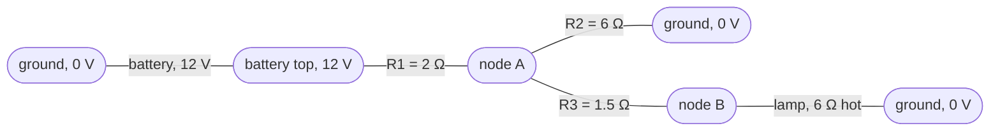
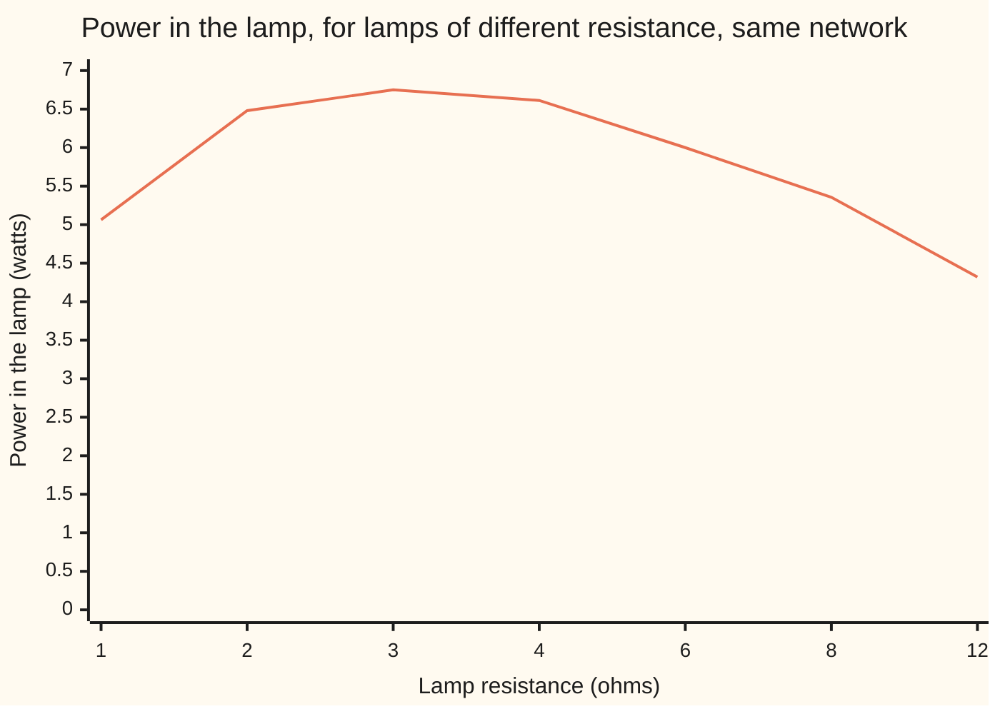

# Kirchhoff's laws: charge balances at a node, voltage sums to zero round a loop

[Syllabus](../../../SYLLABUS.md) → [Engineering mathematics](../README.md) → [Circuits and Electromagnetism](../README.md#s06) → Kirchhoff's laws

---

## General Overview

A 12-volt battery feeds a small lamp rated 6 volts, 1 amp. Between them sit three resistors: one in the supply wire, one leaking current to the return wire, one more in the lamp's own wire. Does the lamp get its 6 volts, or does it glow dim, or burn out?

Two bookkeeping rules answer it. At any junction, the current flowing in equals the current flowing out: charge is not made or stored there. Round any closed path, the voltage rises equal the voltage drops: voltage is a height, and a walk that ends where it began has climbed nothing. With one more rule per part (a resistor's current is its voltage divided by its resistance), the circuit becomes a small system of linear equations. Solving it gives the lamp exactly 6 volts, 1 amp, 6 watts.

The second half of the job: from the lamp's two wires, the whole battery-and-resistor network behaves exactly like one 9-volt battery with one 3-ohm resistor. Swap in any other lamp, and that two-part stand-in gives its current in one line, with no re-solving.

**Kirchhoff's two laws turn any circuit drawing into linear equations, one per junction, and the linearity of those equations means any part of the circuit, seen from two of its wires, is one source and one resistor.**

**What kind of fact this is:** a model, then a theorem inside it. The two laws are the lumped-circuit approximation: true when the circuit is small beside the wavelength of its signals and no changing magnetic field threads its loops. Given them, and parts that obey straight-line laws, the equivalent circuit is a theorem, proved on this card in Why it works.

### The picture: the circuit as wires and junctions



A schematic, not to scale. Each rounded box is a **node**: a stretch of wire at one voltage. The three ground boxes are one node, drawn three times to keep the lines straight. The left loop is battery, R1 and R2; the right loop is R2, R3 and the lamp. Node A and node B are the two voltages nobody knows yet.

---

## The formula

$$\sum_{\text{wires at a node}} I = 0, \qquad \sum_{\text{parts round a loop}} V = 0$$

**Read it aloud:** the currents into any junction add to zero, counting a current out as negative, and the voltage changes round any closed loop add to zero, counting a rise as positive and a drop as negative.

Each resistor adds Ohm's law, $I = V/R$: current is the voltage across the part divided by its resistance. Put together, the unknown node voltages obey one matrix equation, and the network seen by the lamp shrinks to two numbers:

$$\mathbf{G}\,\mathbf{v} = \mathbf{s}, \qquad I_\text{lamp} = \frac{V_{th}}{R_{th} + R_L}, \qquad I_N = \frac{V_{th}}{R_{th}}$$

**Read it aloud:** conductances times node voltages equal the currents the sources would push into nodes held at 0 V; the lamp's current is the stand-in battery's voltage over the stand-in resistor plus the lamp; and the stand-in current source is that voltage over that resistor.

| Symbol | Plain meaning | In our example | Push it up and the answer… |
| --- | --- | --- | --- |
| $V_s$ | the battery's voltage, in volts (V) | 12 V | every current and voltage scales with it |
| $R_1, R_2, R_3$ | the three resistors, in ohms (Ω): supply wire, leak to ground, lamp's wire | 2, 6, 1.5 Ω | $R_1$ or $R_3$ up: the lamp dims; $R_2$ up: less leaks away, the lamp brightens |
| $R_L$ | the lamp's resistance while lit (the "load") | 6 Ω | less current, more voltage across the lamp |
| $V_A, V_B$ | voltage at node A and node B, measured from ground | 7.5 V, 6 V | the unknowns |
| $V, I$ | the voltage across one part, in volts, and the current through it, in amps (A); $I_\text{lamp}$ is the lamp's current | lamp 6 V and 1 A; currents 2.25, 1.25, 1, 1 A | the unknowns, from Ohm's law |
| $g$ | a conductance, $1/R$, in siemens (S): how easily a part passes current; $g_1, g_2, g_3, g_L$ for the four parts | 6 times them: 3, 1, 4, 1 | more current for the same voltage |
| $\mathbf{G}, \mathbf{v}, \mathbf{s}$ | the node matrix of conductances ($\mathbf{G}'$: the same with the lamp out); the list $(V_A, V_B)$; the source currents, what each source would push into a node held at 0 V | 6 times $\mathbf{G}$ is `[[8, -4], [-4, 5]]`, 6 times $\mathbf{s}$ is $(36, 0)$ | — |
| $J_1, J_2$ | loop currents: one current imagined circling each loop | 2.25 A, 1 A | the second road's unknowns |
| $V_{th}$ | the Thevenin voltage: what a meter reads across the lamp's wires with the lamp out | 9 V | the lamp brightens |
| $R_{th}$ | the Thevenin resistance: how far that voltage sags per amp drawn; $R_1 \parallel R_2$ means two in parallel, $R_1 R_2/(R_1 + R_2)$ | 3 Ω | the lamp dims |
| $I_N$ | the Norton current: what flows through a plain wire put in the lamp's place | 3 A | the lamp brightens |
| $P$ | power, in watts (W): voltage times current, or $I^2 R$ in a resistor | lamp 6 W, battery 27 W | — |

### When it holds

- **The circuit is small beside the wavelength of its signals.** A battery circuit qualifies easily. At radio frequencies a long wire carries a wave, and charge bunches up along it; the current law then fails and the field equations take over ([Maxwell's equations](07-maxwells-equations.md)).
- **No changing magnetic flux threads a loop.** A changing field drives a voltage round the loop that belongs to no single part, and the voltage law fails ([Magnetic fields](05-magnetism-and-faradays-law.md)).
- **The battery holds 12 V whatever it supplies.** A real battery sags under load. Model that as a small resistor inside it, added to $R_1$, and every law still holds.
- **The network's parts obey straight-line laws.** The equivalent needs this. The lamp itself need not: a cold filament has far lower resistance than a hot one, so 6 Ω is true only once it glows. Cold, it is nearer 0.6 Ω, and at switch-on it draws 9 ÷ (3 + 0.6) = 2.5 A, two and a half times its rating. The stand-in still describes the network; the lamp then settles where its own curve crosses the line $V = 9 - 3I$.
- **The equivalent is true from outside only.** It reproduces every voltage and current at the lamp's two wires, and nothing inside the box.

---

## Why it works

### Step 0: two conservation facts become linear equations

Charge is neither made nor stored at a junction of wires, so what flows in flows out: the current law. Voltage is energy per unit charge, a height measured from ground, so a loop that returns to its start has gone up exactly as far as down: the voltage law. Ohm's law ties each part's current to the voltages at its two ends. Every relation is a sum of unknowns times fixed numbers, so the whole circuit is a linear system, the kind solved in [Solving A x = b](../../03-Algebra/05-Solving%20Systems/01-matrix-equation-ax-b.md).

### Step 1: name the node voltages, and the voltage law comes free

Call ground 0 V. The battery fixes its top at 12 V. Two voltages are unknown: $V_A$ and $V_B$.

Every current can now be written from its two end voltages. The current through $R_3$ is $(V_A - V_B)/R_3$; through $R_1$ it is $(12 - V_A)/R_1$. Because each part's voltage is a difference of two heights, every loop sums to zero automatically. Only the current law is left to write: one equation per unknown node.

### Step 2: the current law at A and at B gives the node matrix

Write each current leaving a node as (this node's voltage minus the other end's) times the part's conductance $g = 1/R$. At node A, three parts leave: towards the battery top, towards ground, towards B. At node B, two: towards A, towards ground through the lamp.

$$g_1 (V_A - 12) + g_2 V_A + g_3 (V_A - V_B) = 0$$
$$g_3 (V_B - V_A) + g_L V_B = 0$$

The four conductances are 3, 1, 4 and 1 sixths of a siemens. Fractions are a nuisance, so multiply through by 6, and the system is

$$\begin{pmatrix} 8 & -4 \\ -4 & 5 \end{pmatrix}\begin{pmatrix} V_A \\ V_B \end{pmatrix} = \begin{pmatrix} 36 \\ 0 \end{pmatrix}$$

The pattern is general. Each diagonal entry is the total conductance touching that node: 3 + 1 + 4 = 8. Each off-diagonal entry is minus the conductance joining the two nodes: −4. The right side is the current $R_1$ would carry into A if A sat at ground, 12 V times $g_1$; scaled the same way, 12 times 3 is 36. The matrix is symmetric because a resistor treats its two ends alike.

[Gaussian elimination](../../03-Algebra/05-Solving%20Systems/02-gaussian-elimination.md) finishes it. Row B minus −0.5 times row A is `[0, 3 | 18]`, so $V_B = 6$ V; back up, $8 V_A = 36 + 4 \times 6$ gives $V_A = 7.5$ V.

### Step 3: the other road, loop currents

Turn the bookkeeping round. Imagine one current $J_1$ circling the left loop and $J_2$ circling the right. Each wire then carries in exactly what it carries out, so now the current law comes free, and the voltage law gives one equation per loop. $R_2$ sits in both loops and carries $J_1 - J_2$:

$$\begin{pmatrix} 8 & -6 \\ -6 & 13.5 \end{pmatrix}\begin{pmatrix} J_1 \\ J_2 \end{pmatrix} = \begin{pmatrix} 12 \\ 0 \end{pmatrix}$$

It gives $J_1 = 2.25$ A and $J_2 = 1$ A: the battery's current and the lamp's, the same answers by a different matrix. Which road is shorter depends on the drawing: the node road needs one equation per node whose voltage is not already fixed by ground or a battery, the loop road one per independent loop. Here both need two.

### Step 4: why one source and one resistor can stand in for the rest

Unclip the lamp and draw a current $I$ out of node B by any means. The equations stay linear, with $I$ now one of the inputs. Each input of a linear system moves the answer along a straight line, so

$$V_B = V_{th} - R_{th}\, I$$

for two fixed numbers. A single battery $V_{th}$ behind a single resistor $R_{th}$ obeys exactly the same line. Anything clipped to the two wires sees only that line, so it cannot tell the network from the stand-in. That is Thevenin's theorem.

<details>
<summary>Detailed proof: the line comes out of the node matrix</summary>

With the lamp out, call the node matrix $\mathbf{G}'$. Every node still has a path to ground, and that makes the answer unique. Set every source to zero and suppose some node sat above 0 V. Take the highest: no current can flow into it, so by the current law none flows out, and each of its neighbours sits just as high. Stepping from neighbour to neighbour reaches ground at 0 V, a contradiction, and the same argument rules out a node below 0 V. So only $\mathbf{v} = 0$ solves $\mathbf{G}'\mathbf{v} = 0$. The columns of $\mathbf{G}'$ are therefore independent, and $\mathbf{G}'\mathbf{v} = \mathbf{s}$ has exactly one answer for any right side ([Solving A x = b](../../03-Algebra/05-Solving%20Systems/01-matrix-equation-ax-b.md)). Drawing $I$ out of B takes $I$ off B's entry of $\mathbf{s}$.

Split that right side into two pieces: $\mathbf{s}$ itself, and a right side that is zero except for $-I$ in B's place. Each piece has its own answer, and because the left side is a matrix times $\mathbf{v}$, the two answers add to the answer for the whole. The first answer puts B at the open-circuit voltage, $V_{th}$. The second is $-I$ times the answer for 1 A pushed into B with every source at zero, and B's entry of that is $R_{th}$. So $V_B = V_{th} - R_{th} I$ for every $I$, whatever is attached. The argument never used the number of nodes, so it holds for any linear network.

</details>

### Step 5: finding the two numbers, three ways

- **Open and short.** With the lamp out, no current flows in $R_3$, so B reads the same as A: $V_{th} = 9$ V. With a plain wire in the lamp's place, the wire carries $I_N = 3$ A. The line's two ends give the slope: $R_{th} = 9/3 = 3$ Ω.
- **Kill the source and push 1 A.** An ideal battery keeps zero volts between its own ends when set to 0 V, so it becomes a plain wire. Push 1 A into B; B rises to 3 V, so $R_{th} = 3$ Ω.
- **By the rules for series and parallel.** With the battery a wire, $R_1$ and $R_2$ sit side by side: $R_1 \parallel R_2 = 2 \times 6/(2 + 6) = 1.5$ Ω, then $R_3$ adds in series to make 3 Ω. With the lamp out, $R_1$ and $R_2$ split the 12 V in proportion: $12 \times 6/(2 + 6) = 9$ V.


The stand-in the lamp sees, as a schematic, not to scale.

Solve the same line for the current instead: $I = I_N - V_B/R_{th}$. That is a current source of $I_N = 3$ A with $R_{th}$ connected across it: Norton's form. The two stand-ins are one line written two ways, linked by $I_N = V_{th}/R_{th}$.

### Step 6: the payoff, any lamp in one division

Once $V_{th}$ and $R_{th}$ are known, each new lamp costs one division: $I = 9/(3 + R_L)$. The checks also re-solve the full network for seven lamps and agree with the stand-in to within a trillionth of an amp.



The single line is the lamp's power, $I^2 R_L$. It peaks at 6.75 W for a 3 Ω lamp, the one that matches $R_{th}$. A low-resistance lamp draws more current (2.25 A at 1 Ω) but loses most of the voltage across $R_{th}$; a high-resistance one keeps the voltage but draws little.

---

## Worked numbers, by hand

| Step | Arithmetic | Value |
| --- | --- | --- |
| node equations, times 6 | conductances 3, 1, 4, 1 | `[8, -4 \| 36]`, `[-4, 5 \| 0]` |
| clear $V_A$ from row B | row B − (−0.5) × row A | `[0, 3 \| 18]` |
| $V_B$, the lamp's voltage | 18 ÷ 3 | 6 V |
| $V_A$ | (36 + 4 × 6) ÷ 8 | 7.5 V |
| battery current, through $R_1$ | (12 − 7.5) ÷ 2 | 2.25 A |
| leak through $R_2$ | 7.5 ÷ 6 | 1.25 A |
| current law at A | 1.25 + 1 | 2.25 A, matching what comes in |
| lamp current | 6 ÷ 6 | 1 A |
| power: battery out, parts in | 12 × 2.25; four $I^2 R$ terms | 27 W, 27 W |
| stand-in: $V_{th}$ and $R_{th}$ | 12 × 6/8; 2 × 6/8 + 1.5 | 9 V, 3 Ω |
| lamp, from the stand-in | 9 ÷ (3 + 6) | **1 A, so 6 V and 6 W** |

The lamp gets exactly its rating: 6 volts, 1 amp, 6 watts. The battery supplies 27 W; the resistors burn the other 21 W.

### What breaks if you drop a piece

| Mistake | Lamp current comes out at | What went wrong |
| --- | --- | --- |
| $R_3$'s term in A's equation written $g_3 (V_B - V_A)$, B's equation left right | 1.5 A | The current is counted as leaving both ends of $R_3$ at once, so charge appears from nowhere |
| $R_{th}$ as all three in series, 2 + 6 + 1.5 | 0.580645 A | With the battery a wire, $R_1$ and $R_2$ are side by side, not end to end |
| Battery set to zero as a gap, not a wire: $R_{th}$ = 6 + 1.5 | 0.666667 A | A 0 V source keeps its ends at one voltage, which is what a wire does |
| $V_{th}$ taken as the battery's 12 V | 1.333333 A | With the lamp out, $R_1$ and $R_2$ still divide the 12 V; B sits at 9 V |
| The lamp's hot 6 Ω used at switch-on, while the filament is cold, about 0.6 Ω | 1 A predicted; 2.5 A flows | A filament's resistance climbs as it heats, so the lamp breaks the straight-line law. The stand-in still holds: 9 ÷ (3 + 0.6) |

---

## Code, from first principles, and it actually runs

The script writes its own elimination with partial pivoting (before clearing each column, it swaps up the row with the largest entry there) and a general node-voltage builder: give it parts, fixed voltages and injected currents, and it writes the current law at every free node.

It reaches the lamp's 1 A by four independent roads:

- node voltages by elimination
- loop currents by elimination
- relaxation (sweep after sweep, set each node to the conductance-weighted average of its neighbours, which is what the current law says)
- the Thevenin and Norton stand-ins

The stand-in's two numbers are found three ways: open and short tests on the solver, a 1 A test current with the battery killed, and the series and parallel rules. It also checks the current law on the node road, the voltage law on the loop road (each road has the other law built in) and the power balance, re-solves the full network for seven lamps, and computes every wrong answer above.

### Python

```python
# Kirchhoff's laws and equivalent circuits -- the check behind the card.  Standard library only.
# A 12 V battery, three resistors and a 6-ohm lamp.  Every number quoted on the card is printed here.
# Roads to the lamp: node voltages by elimination, loop currents by elimination, relaxation,
# and the Thevenin/Norton pair, found by open/short tests, by a test current and by hand rules.

VS, R1, R2, R3, RL = 12.0, 2.0, 6.0, 1.5, 6.0     # volts, then ohms
GND, TOP, A, B = 0, 1, 2, 3                        # ground, battery top, node A, node B (lamp top)

def solve(M, s):                                   # Gaussian elimination, partial pivoting
    n = len(s)
    M = [row[:] + [s[i]] for i, row in enumerate(M)]
    for k in range(n):
        p = max(range(k, n), key=lambda i: abs(M[i][k]))
        M[k], M[p] = M[p], M[k]
        for i in range(k + 1, n):
            m = M[i][k] / M[k][k]
            M[i] = [a - m * b for a, b in zip(M[i], M[k])]
    x = [0.0] * n
    for i in reversed(range(n)):
        x[i] = (M[i][n] - sum(M[i][j] * x[j] for j in range(i + 1, n))) / M[i][i]
    return x

def nodal(parts, fixed, inject=None):
    # parts: (node, node, ohms).  fixed: {node: volts}.  inject: {node: amps pushed in from outside}.
    inject = inject or {}
    free = sorted({n for a, b, _ in parts for n in (a, b)} - set(fixed))
    ix = {n: i for i, n in enumerate(free)}
    G = [[0.0] * len(free) for _ in free]
    s = [inject.get(n, 0.0) for n in free]
    for a, b, r in parts:                          # KCL at each free node, Ohm's law for each part
        g = 1.0 / r
        for here, there in ((a, b), (b, a)):
            if here in ix:
                G[ix[here]][ix[here]] += g
                if there in ix:
                    G[ix[here]][ix[there]] -= g
                else:
                    s[ix[here]] += g * fixed[there]
    v = dict(fixed)
    v.update(zip(free, solve(G, s)))
    return v, G, s

def circuit(vs=VS, r1=R1, r2=R2, r3=R3, rl=RL):
    parts = [(TOP, A, r1), (A, B, r3)]
    parts += [(A, GND, r2)] if r2 else []
    parts += [(B, GND, rl)] if rl else []
    return parts, {GND: 0.0, TOP: vs}

def show(name, v):
    print(f"{name:<44} {v:>11.6f}")

# ---- road 1: node voltages, G v = s, solved by elimination ----
v, G, s = nodal(*circuit())
print("conductances x 6: R1, R2, R3, lamp      " + "".join(f"{6 / r:6.1f}" for r in (R1, R2, R3, RL)))
for name, row, rhs in (("row A", G[0], s[0]), ("row B", G[1], s[1])):
    print(f"nodal matrix x 6, {name}            {6*row[0]:8.3f} {6*row[1]:8.3f} | {6*rhs:7.3f}")
m = 6 * G[1][0] / (6 * G[0][0])
print(f"after row B - ({m:.1f}) x row A               {0.0:8.3f} {6*G[1][1] - m*6*G[0][1]:8.3f} | {6*s[1] - m*6*s[0]:7.3f}")
VA, VB = v[A], v[B]
show("1 node voltages: V_A", VA); show("1 node voltages: V_B", VB)
I1, I2, I3, IL = (VS - VA) / R1, VA / R2, (VA - VB) / R3, VB / RL
show("current through R1 (the battery)", I1); show("current through R2", I2)
show("current through R3", I3); show("current through the lamp", IL)
show("KCL at A: out through R2 and R3", I2 + I3)

# ---- road 2: loop currents J1 (left loop), J2 (right loop), KVL in each ----
LOOP = [[R1 + R2, -R2], [-R2, R2 + R3 + RL]]
for name, row, rhs in (("row 1", LOOP[0], VS), ("row 2", LOOP[1], 0.0)):
    print(f"loop matrix, {name}                 {row[0]:8.3f} {row[1]:8.3f} | {rhs:7.3f}")
J1, J2 = solve(LOOP, [VS, 0.0])
show("2 loop currents: J1", J1); show("2 loop currents: J2 (the lamp)", J2)
show("KVL, left loop: drops on R1 and R2", J1 * R1 + (J1 - J2) * R2)
show("KVL, right loop: drop on R2", (J1 - J2) * R2); show("KVL, right loop: drops on R3 and lamp", J2 * (R3 + RL))

# ---- road 3: relaxation -- each node becomes the conductance-weighted average of its neighbours ----
g1, g2, g3, gl = 1 / R1, 1 / R2, 1 / R3, 1 / RL
ra, rb = 0.0, 0.0
for sweep in range(200):
    ra = (g1 * VS + g3 * rb) / (g1 + g2 + g3)
    rb = (g3 * ra) / (g3 + gl)
show("3 relaxation, 200 sweeps: V_B", rb)

# ---- power: what the battery gives equals what the parts burn ----
P_batt = VS * I1
P_parts = I1**2 * R1 + I2**2 * R2 + I3**2 * R3 + IL**2 * RL
show("battery power, watts", P_batt); show("sum of I^2 R over the four parts", P_parts)
show("lamp power, watts", IL**2 * RL)
show("power burned in the network, lamp aside", P_batt - IL**2 * RL)

# ---- the equivalent seen by the lamp, three ways ----
v_open, _, _ = nodal(*circuit(rl=0))                         # lamp unclipped
Voc = v_open[B]
parts, fixed = circuit(rl=0); fixed[B] = 0.0                 # lamp replaced by a wire
v_sc, _, _ = nodal(parts, fixed)
Isc = (v_sc[A] - 0.0) / R3
parts, fixed = circuit(vs=0.0, rl=0)                         # battery killed, 1 A pushed into B
v_test, _, _ = nodal(parts, fixed, {B: 1.0})
Vth_rule = VS * R2 / (R1 + R2)
Rth_rule = R1 * R2 / (R1 + R2) + R3
show("open-circuit voltage V_th", Voc); show("short-circuit current I_N", Isc)
show("R_th = V_th / I_N", Voc / Isc); show("R_th by 1 A test current, battery killed", v_test[B])
show("R1 || R2 = 2 x 6/(2+6)", R1 * R2 / (R1 + R2))
show("V_th by the divider 12 x 6/(2+6)", Vth_rule); show("R_th by rules (2 || 6) + 1.5", Rth_rule)
show("lamp current, Thevenin 9/(3+6)", Voc / (Rth_rule + RL))
show("lamp current, Norton 3 x 3/(3+6)", Isc * Rth_rule / (Rth_rule + RL))
show("power in the Thevenin 3 ohms at 1 A", (Voc / (Rth_rule + RL))**2 * Rth_rule)

# ---- swap the lamp: Thevenin formula against a fresh nodal solve ----
print("lamp ohms   amps, Thevenin   amps, full solve   lamp watts")
sweep_pts = []
for rl in (1.0, 2.0, 3.0, 4.0, 6.0, 8.0, 12.0):
    i_th = Voc / (Rth_rule + rl)
    i_full = nodal(*circuit(rl=rl))[0][B] / rl
    sweep_pts.append((i_th, i_full))
    print(f"{rl:9.1f} {i_th:16.6f} {i_full:18.6f} {i_th**2 * rl:12.6f}")

# ---- what breaks ----
bad_G = [[g1 + g2 - g3, g3], [-g3, g3 + gl]]                 # R3's current signed backwards at A
bad = solve(bad_G, [g1 * VS, 0.0])
show("wrong: R3 signed backwards at A, lamp amps", bad[1] / RL)
show("wrong: R1 + R2 taken in series, ohms", R1 + R2); show("wrong: R_th = 2 + 6 + 1.5, lamp amps", Voc / (R1 + R2 + R3 + RL))
show("wrong: R_th, battery a gap: 6 + 1.5", R2 + R3); show("wrong: battery killed as a gap, lamp amps", Voc / (R2 + R3 + RL))
show("wrong: V_th = 12 V, lamp amps", VS / (Rth_rule + RL)); show("cold lamp at switch-on, 0.6 ohm: amps", nodal(*circuit(rl=0.6))[0][B] / 0.6)

# ---- try changing ----
show("try: battery 24 V, lamp amps", nodal(*circuit(vs=24.0))[0][B] / RL)
show("try: R2 = 3 ohms, lamp amps", nodal(*circuit(r2=3.0))[0][B] / RL)
show("try: R2 removed, lamp amps", nodal(*circuit(r2=0))[0][B] / RL)
show("try: R2 removed, V_th", nodal(*circuit(r2=0, rl=0))[0][B]); show("try: R2 removed, R_th by 1 A test", nodal(*circuit(0.0, r2=0, rl=0), {B: 1.0})[0][B])

assert abs(VB - 6.0) < 1e-12 and abs(VA - 7.5) < 1e-12,  "nodal road vs the hand answer 7.5 V, 6 V"
assert abs(J2 - IL) < 1e-12 and abs(J1 - I1) < 1e-12,    "loop-current road vs node-voltage road"
assert abs(rb - VB) < 1e-9,                              "relaxation vs elimination"
assert abs(I1 - I2 - I3) < 1e-12,                        "KCL at A, on the node road"
assert abs(VS - J1 * R1 - (J1 - J2) * R2) < 1e-12,       "KVL round the left loop, on the loop road"
assert abs(P_batt - P_parts) < 1e-9,                     "power in equals power burned"
assert abs(Voc - Vth_rule) < 1e-12 and abs(Voc / Isc - Rth_rule) < 1e-12, "open/short tests vs hand rules"
assert abs(v_test[B] - Rth_rule) < 1e-12,                "test-current R_th vs hand rules"
assert all(abs(a - b) < 1e-12 for a, b in sweep_pts),    "Thevenin vs full solve for every lamp"
print("ALL CHECKS PASS")
```

**Ran 2026-11-11 on macOS, Python 3.14.10, standard library only. All checks passed. Output, pasted from the run:**

```
conductances x 6: R1, R2, R3, lamp         3.0   1.0   4.0   1.0
nodal matrix x 6, row A               8.000   -4.000 |  36.000
nodal matrix x 6, row B              -4.000    5.000 |   0.000
after row B - (-0.5) x row A                  0.000    3.000 |  18.000
1 node voltages: V_A                            7.500000
1 node voltages: V_B                            6.000000
current through R1 (the battery)                2.250000
current through R2                              1.250000
current through R3                              1.000000
current through the lamp                        1.000000
KCL at A: out through R2 and R3                 2.250000
loop matrix, row 1                    8.000   -6.000 |  12.000
loop matrix, row 2                   -6.000   13.500 |   0.000
2 loop currents: J1                             2.250000
2 loop currents: J2 (the lamp)                  1.000000
KVL, left loop: drops on R1 and R2             12.000000
KVL, right loop: drop on R2                     7.500000
KVL, right loop: drops on R3 and lamp           7.500000
3 relaxation, 200 sweeps: V_B                   6.000000
battery power, watts                           27.000000
sum of I^2 R over the four parts               27.000000
lamp power, watts                               6.000000
power burned in the network, lamp aside        21.000000
open-circuit voltage V_th                       9.000000
short-circuit current I_N                       3.000000
R_th = V_th / I_N                               3.000000
R_th by 1 A test current, battery killed        3.000000
R1 || R2 = 2 x 6/(2+6)                          1.500000
V_th by the divider 12 x 6/(2+6)                9.000000
R_th by rules (2 || 6) + 1.5                    3.000000
lamp current, Thevenin 9/(3+6)                  1.000000
lamp current, Norton 3 x 3/(3+6)                1.000000
power in the Thevenin 3 ohms at 1 A             3.000000
lamp ohms   amps, Thevenin   amps, full solve   lamp watts
      1.0         2.250000           2.250000     5.062500
      2.0         1.800000           1.800000     6.480000
      3.0         1.500000           1.500000     6.750000
      4.0         1.285714           1.285714     6.612245
      6.0         1.000000           1.000000     6.000000
      8.0         0.818182           0.818182     5.355372
     12.0         0.600000           0.600000     4.320000
wrong: R3 signed backwards at A, lamp amps      1.500000
wrong: R1 + R2 taken in series, ohms            8.000000
wrong: R_th = 2 + 6 + 1.5, lamp amps            0.580645
wrong: R_th, battery a gap: 6 + 1.5             7.500000
wrong: battery killed as a gap, lamp amps       0.666667
wrong: V_th = 12 V, lamp amps                   1.333333
cold lamp at switch-on, 0.6 ohm: amps           2.500000
try: battery 24 V, lamp amps                    2.000000
try: R2 = 3 ohms, lamp amps                     0.827586
try: R2 removed, lamp amps                      1.263158
try: R2 removed, V_th                          12.000000
try: R2 removed, R_th by 1 A test               3.500000
ALL CHECKS PASS
```

### Rust

The same roads, line for line, with `std` only. Node sets are kept in sorted maps so the unknowns come out in the same order as the Python's.

```rust
// Kirchhoff's laws and equivalent circuits -- the same check as the Python, in Rust.  No crates.
// A 12 V battery, three resistors and a 6-ohm lamp.  Every number quoted on the card is printed here.
// Roads to the lamp: node voltages by elimination, loop currents by elimination, relaxation,
// and the Thevenin/Norton pair, found by open/short tests, by a test current and by hand rules.
use std::collections::{BTreeMap, BTreeSet};

const VS: f64 = 12.0; const R1: f64 = 2.0; const R2: f64 = 6.0; const R3: f64 = 1.5; const RL: f64 = 6.0;
const GND: usize = 0; const TOP: usize = 1; const A: usize = 2; const B: usize = 3;

fn solve(m: &[Vec<f64>], s: &[f64]) -> Vec<f64> {          // Gaussian elimination, partial pivoting
    let n = s.len();
    let mut m: Vec<Vec<f64>> = m.iter().zip(s).map(|(row, &si)| { let mut r = row.clone(); r.push(si); r }).collect();
    for k in 0..n {
        let p = (k..n).fold(k, |best, i| if m[i][k].abs() > m[best][k].abs() { i } else { best });
        m.swap(k, p);
        for i in k + 1..n {
            let f = m[i][k] / m[k][k];
            let rk = m[k].clone();
            for (a, b) in m[i].iter_mut().zip(rk.iter()) { *a -= f * b; }
        }
    }
    let mut x = vec![0.0; n];
    for i in (0..n).rev() {
        let tail: f64 = (i + 1..n).map(|j| m[i][j] * x[j]).sum();
        x[i] = (m[i][n] - tail) / m[i][i];
    }
    x
}

type Parts = Vec<(usize, usize, f64)>;

// parts: (node, node, ohms).  fixed: node -> volts.  inject: node -> amps pushed in from outside.
fn nodal(parts: &Parts, fixed: &BTreeMap<usize, f64>, inject: &BTreeMap<usize, f64>)
    -> (BTreeMap<usize, f64>, Vec<Vec<f64>>, Vec<f64>) {
    let all: BTreeSet<usize> = parts.iter().flat_map(|&(a, b, _)| [a, b]).collect();
    let free: Vec<usize> = all.into_iter().filter(|n| !fixed.contains_key(n)).collect();
    let ix: BTreeMap<usize, usize> = free.iter().enumerate().map(|(i, &n)| (n, i)).collect();
    let mut g = vec![vec![0.0; free.len()]; free.len()];
    let mut s: Vec<f64> = free.iter().map(|n| *inject.get(n).unwrap_or(&0.0)).collect();
    for &(a, b, r) in parts {                               // KCL at each free node, Ohm's law for each part
        let c = 1.0 / r;
        for (here, there) in [(a, b), (b, a)] {
            if let Some(&h) = ix.get(&here) {
                g[h][h] += c;
                match ix.get(&there) { Some(&t) => g[h][t] -= c, None => s[h] += c * fixed[&there] }
            }
        }
    }
    let x = solve(&g, &s);
    let mut v = fixed.clone();
    for (n, val) in free.iter().zip(x) { v.insert(*n, val); }
    (v, g, s)
}

fn circuit(vs: f64, r1: f64, r2: f64, r3: f64, rl: f64) -> (Parts, BTreeMap<usize, f64>) {
    let mut parts = vec![(TOP, A, r1), (A, B, r3)];
    if r2 != 0.0 { parts.push((A, GND, r2)); }
    if rl != 0.0 { parts.push((B, GND, rl)); }
    (parts, BTreeMap::from([(GND, 0.0), (TOP, vs)]))
}

fn lamp_amps(vs: f64, r2: f64) -> f64 {
    let (p, f) = circuit(vs, R1, r2, R3, RL);
    nodal(&p, &f, &BTreeMap::new()).0[&B] / RL
}

fn show(name: &str, v: f64) { println!("{:<44} {:>11.6}", name, v); }

fn main() {
    let none = BTreeMap::new();
    // ---- road 1: node voltages, G v = s, solved by elimination ----
    let (p, f) = circuit(VS, R1, R2, R3, RL);
    let (v, g, s) = nodal(&p, &f, &none);
    let cs: String = [R1, R2, R3, RL].iter().map(|r| format!("{:6.1}", 6.0 / r)).collect();
    println!("conductances x 6: R1, R2, R3, lamp      {}", cs);
    for (name, row, rhs) in [("row A", &g[0], s[0]), ("row B", &g[1], s[1])] {
        println!("nodal matrix x 6, {}            {:8.3} {:8.3} | {:7.3}", name, 6.0 * row[0], 6.0 * row[1], 6.0 * rhs);
    }
    let m = 6.0 * g[1][0] / (6.0 * g[0][0]);
    println!("after row B - ({:.1}) x row A               {:8.3} {:8.3} | {:7.3}",
             m, 0.0, 6.0 * g[1][1] - m * 6.0 * g[0][1], 6.0 * s[1] - m * 6.0 * s[0]);
    let (va, vb) = (v[&A], v[&B]);
    show("1 node voltages: V_A", va); show("1 node voltages: V_B", vb);
    let (i1, i2, i3, il) = ((VS - va) / R1, va / R2, (va - vb) / R3, vb / RL);
    show("current through R1 (the battery)", i1); show("current through R2", i2);
    show("current through R3", i3); show("current through the lamp", il);
    show("KCL at A: out through R2 and R3", i2 + i3);

    // ---- road 2: loop currents J1 (left loop), J2 (right loop), KVL in each ----
    let lp = [vec![R1 + R2, -R2], vec![-R2, R2 + R3 + RL]];
    for (name, row, rhs) in [("row 1", &lp[0], VS), ("row 2", &lp[1], 0.0)] {
        println!("loop matrix, {}                 {:8.3} {:8.3} | {:7.3}", name, row[0], row[1], rhs);
    }
    let j = solve(&lp, &[VS, 0.0]);
    show("2 loop currents: J1", j[0]); show("2 loop currents: J2 (the lamp)", j[1]);
    show("KVL, left loop: drops on R1 and R2", j[0] * R1 + (j[0] - j[1]) * R2);
    show("KVL, right loop: drop on R2", (j[0] - j[1]) * R2); show("KVL, right loop: drops on R3 and lamp", j[1] * (R3 + RL));

    // ---- road 3: relaxation -- each node becomes the conductance-weighted average of its neighbours ----
    let (g1, g2, g3, gl) = (1.0 / R1, 1.0 / R2, 1.0 / R3, 1.0 / RL);
    let mut rb = 0.0_f64;
    for _ in 0..200 {
        let ra = (g1 * VS + g3 * rb) / (g1 + g2 + g3);
        rb = (g3 * ra) / (g3 + gl);
    }
    show("3 relaxation, 200 sweeps: V_B", rb);

    // ---- power: what the battery gives equals what the parts burn ----
    let p_batt = VS * i1;
    let p_parts = i1 * i1 * R1 + i2 * i2 * R2 + i3 * i3 * R3 + il * il * RL;
    show("battery power, watts", p_batt); show("sum of I^2 R over the four parts", p_parts);
    show("lamp power, watts", il * il * RL);
    show("power burned in the network, lamp aside", p_batt - il * il * RL);

    // ---- the equivalent seen by the lamp, three ways ----
    let (p, f) = circuit(VS, R1, R2, R3, 0.0);
    let voc = nodal(&p, &f, &none).0[&B];                     // lamp unclipped
    let (p, mut f) = circuit(VS, R1, R2, R3, 0.0); f.insert(B, 0.0);
    let isc = (nodal(&p, &f, &none).0[&A] - 0.0) / R3;         // lamp replaced by a wire
    let (p, f) = circuit(0.0, R1, R2, R3, 0.0);                // battery killed, 1 A pushed into B
    let v_test = nodal(&p, &f, &BTreeMap::from([(B, 1.0)])).0[&B];
    let vth_rule = VS * R2 / (R1 + R2);
    let rth_rule = R1 * R2 / (R1 + R2) + R3;
    show("open-circuit voltage V_th", voc); show("short-circuit current I_N", isc);
    show("R_th = V_th / I_N", voc / isc); show("R_th by 1 A test current, battery killed", v_test);
    show("R1 || R2 = 2 x 6/(2+6)", R1 * R2 / (R1 + R2));
    show("V_th by the divider 12 x 6/(2+6)", vth_rule); show("R_th by rules (2 || 6) + 1.5", rth_rule);
    show("lamp current, Thevenin 9/(3+6)", voc / (rth_rule + RL));
    show("lamp current, Norton 3 x 3/(3+6)", isc * rth_rule / (rth_rule + RL));
    let i_eq = voc / (rth_rule + RL);
    show("power in the Thevenin 3 ohms at 1 A", i_eq * i_eq * rth_rule);

    // ---- swap the lamp: Thevenin formula against a fresh nodal solve ----
    println!("lamp ohms   amps, Thevenin   amps, full solve   lamp watts");
    let mut sweep_pts = Vec::new();
    for rl in [1.0_f64, 2.0, 3.0, 4.0, 6.0, 8.0, 12.0] {
        let i_th = voc / (rth_rule + rl);
        let (p, f) = circuit(VS, R1, R2, R3, rl);
        let i_full = nodal(&p, &f, &none).0[&B] / rl;
        sweep_pts.push((i_th, i_full));
        println!("{:9.1} {:16.6} {:18.6} {:12.6}", rl, i_th, i_full, i_th * i_th * rl);
    }

    // ---- what breaks ----
    let bad = solve(&[vec![g1 + g2 - g3, g3], vec![-g3, g3 + gl]], &[g1 * VS, 0.0]);   // R3 signed backwards at A
    show("wrong: R3 signed backwards at A, lamp amps", bad[1] / RL);
    show("wrong: R1 + R2 taken in series, ohms", R1 + R2);
    show("wrong: R_th = 2 + 6 + 1.5, lamp amps", voc / (R1 + R2 + R3 + RL));
    show("wrong: R_th, battery a gap: 6 + 1.5", R2 + R3);
    show("wrong: battery killed as a gap, lamp amps", voc / (R2 + R3 + RL));
    show("wrong: V_th = 12 V, lamp amps", VS / (rth_rule + RL)); let (p, f) = circuit(VS, R1, R2, R3, 0.6); show("cold lamp at switch-on, 0.6 ohm: amps", nodal(&p, &f, &none).0[&B] / 0.6);

    // ---- try changing ----
    show("try: battery 24 V, lamp amps", lamp_amps(24.0, R2));
    show("try: R2 = 3 ohms, lamp amps", lamp_amps(VS, 3.0));
    show("try: R2 removed, lamp amps", lamp_amps(VS, 0.0));
    let (p, f) = circuit(VS, R1, 0.0, R3, 0.0); show("try: R2 removed, V_th", nodal(&p, &f, &none).0[&B]);
    let (p, f) = circuit(0.0, R1, 0.0, R3, 0.0); show("try: R2 removed, R_th by 1 A test", nodal(&p, &f, &BTreeMap::from([(B, 1.0)])).0[&B]);

    assert!((vb - 6.0).abs() < 1e-12 && (va - 7.5).abs() < 1e-12, "nodal road vs the hand answer 7.5 V, 6 V");
    assert!((j[1] - il).abs() < 1e-12 && (j[0] - i1).abs() < 1e-12, "loop-current road vs node-voltage road");
    assert!((rb - vb).abs() < 1e-9, "relaxation vs elimination");
    assert!((i1 - i2 - i3).abs() < 1e-12, "KCL at A, on the node road");
    assert!((VS - j[0] * R1 - (j[0] - j[1]) * R2).abs() < 1e-12, "KVL round the left loop, on the loop road");
    assert!((p_batt - p_parts).abs() < 1e-9, "power in equals power burned");
    assert!((voc - vth_rule).abs() < 1e-12 && (voc / isc - rth_rule).abs() < 1e-12, "open/short tests vs hand rules");
    assert!((v_test - rth_rule).abs() < 1e-12, "test-current R_th vs hand rules");
    assert!(sweep_pts.iter().all(|(a, b)| (a - b).abs() < 1e-12), "Thevenin vs full solve for every lamp");
    println!("ALL CHECKS PASS");
}
```

**Ran 2026-11-11 on macOS, rustc 1.98.1, no crates. All checks passed. Output, pasted from the run:**

```
conductances x 6: R1, R2, R3, lamp         3.0   1.0   4.0   1.0
nodal matrix x 6, row A               8.000   -4.000 |  36.000
nodal matrix x 6, row B              -4.000    5.000 |   0.000
after row B - (-0.5) x row A                  0.000    3.000 |  18.000
1 node voltages: V_A                            7.500000
1 node voltages: V_B                            6.000000
current through R1 (the battery)                2.250000
current through R2                              1.250000
current through R3                              1.000000
current through the lamp                        1.000000
KCL at A: out through R2 and R3                 2.250000
loop matrix, row 1                    8.000   -6.000 |  12.000
loop matrix, row 2                   -6.000   13.500 |   0.000
2 loop currents: J1                             2.250000
2 loop currents: J2 (the lamp)                  1.000000
KVL, left loop: drops on R1 and R2             12.000000
KVL, right loop: drop on R2                     7.500000
KVL, right loop: drops on R3 and lamp           7.500000
3 relaxation, 200 sweeps: V_B                   6.000000
battery power, watts                           27.000000
sum of I^2 R over the four parts               27.000000
lamp power, watts                               6.000000
power burned in the network, lamp aside        21.000000
open-circuit voltage V_th                       9.000000
short-circuit current I_N                       3.000000
R_th = V_th / I_N                               3.000000
R_th by 1 A test current, battery killed        3.000000
R1 || R2 = 2 x 6/(2+6)                          1.500000
V_th by the divider 12 x 6/(2+6)                9.000000
R_th by rules (2 || 6) + 1.5                    3.000000
lamp current, Thevenin 9/(3+6)                  1.000000
lamp current, Norton 3 x 3/(3+6)                1.000000
power in the Thevenin 3 ohms at 1 A             3.000000
lamp ohms   amps, Thevenin   amps, full solve   lamp watts
      1.0         2.250000           2.250000     5.062500
      2.0         1.800000           1.800000     6.480000
      3.0         1.500000           1.500000     6.750000
      4.0         1.285714           1.285714     6.612245
      6.0         1.000000           1.000000     6.000000
      8.0         0.818182           0.818182     5.355372
     12.0         0.600000           0.600000     4.320000
wrong: R3 signed backwards at A, lamp amps      1.500000
wrong: R1 + R2 taken in series, ohms            8.000000
wrong: R_th = 2 + 6 + 1.5, lamp amps            0.580645
wrong: R_th, battery a gap: 6 + 1.5             7.500000
wrong: battery killed as a gap, lamp amps       0.666667
wrong: V_th = 12 V, lamp amps                   1.333333
cold lamp at switch-on, 0.6 ohm: amps           2.500000
try: battery 24 V, lamp amps                    2.000000
try: R2 = 3 ohms, lamp amps                     0.827586
try: R2 removed, lamp amps                      1.263158
try: R2 removed, V_th                          12.000000
try: R2 removed, R_th by 1 A test               3.500000
ALL CHECKS PASS
```

The two outputs are identical, line for line.

### Lean

Lean proves the stand-ins for any resistor network with a path to ground, the voltage law round any loop, and the worked numbers.

- Take any resistor network where every node has a path of resistors to ground or to a battery. Then for every current $I$ drawn out of B, the node equations have exactly one answer.
- Take the same network, and draw any current $I$ out of B. Then $V_B = V_{th} - R_{th} I$ for two fixed numbers, with $R_{th} > 0$.
- Take the same network with a lamp of any resistance $R_L > 0$ from B to ground. Then the lamp carries $V_{th}/(R_{th} + R_L)$, with the same two numbers.
- Take the same network with a plain wire in the lamp's place. Then the wire carries the Norton current $I_N = V_{th}/R_{th}$.
- Suppose each part's voltage is the difference of the voltages at its two ends. Then round any closed loop, the part voltages add to zero.
- The node equations hold at 7.5 V and 6 V, the loop equations at 2.25 A and 1 A, and the power balances at 27 W.
- The stand-in is 9 V behind 3 Ω, and pushing 1 A into B with the battery a wire raises B to 3 V.
- The lamp sweep, every wrong answer in the mistakes table and the Try changing answers come out as exact fractions.

Lean starts from the node equations, so the decimal solves and relaxation sweeps are left to the Python and Rust checks.

```lean
-- Kirchhoff's laws: in any linear resistor network that reaches ground, the voltage at one node is a fixed source voltage minus a fixed positive resistance times the current drawn there, so any lamp's current is one division, and node voltages make every loop's voltage sum zero.
import Mathlib.Data.Real.Basic
import Mathlib.Algebra.BigOperators.Fin
import Mathlib.Logic.Relation
import Mathlib.Combinatorics.SimpleGraph.Walk.Basic
import Mathlib.Data.Matrix.Mul
import Mathlib.LinearAlgebra.Matrix.Notation
import Mathlib.LinearAlgebra.FiniteDimensional.Basic

open BigOperators Matrix

/-! ### The model

A resistor network with `n` nodes whose voltages are unknown (node `i` has voltage `v i`,
measured from ground). Every other node (ground, a battery's top) has a fixed voltage.

* `c i j` is the conductance `1/R` of the resistor joining unknown nodes `i` and `j`
  (`0` when none is fitted); a resistor treats its two ends alike, so `c i j = c j i`.
* `g i` is the total conductance from node `i` to fixed-voltage nodes.
* `s i` is the current the fixed-voltage nodes would push into node `i` if it sat at 0 V
  (conductance times fixed voltage, summed).
* A current `I` is drawn out of node `b`, the lamp's top wire, by anything clipped there.

The current law at node `i`, with Ohm's law for each part, reads
`∑ j, c i j * (v i - v j) + g i * v i = s i - (I if i = b)`.
Every node has a path of resistors to a fixed-voltage node (`hground`). -/

/-- The node operator `v ↦ (∑ j, c i j * (v i - v j) + g i * v i)_i` as a linear map. -/
def kirchhoffNodeMap {n : ℕ} (c : Fin n → Fin n → ℝ) (g : Fin n → ℝ) :
    (Fin n → ℝ) →ₗ[ℝ] (Fin n → ℝ) where
  toFun v i := ∑ j, c i j * (v i - v j) + g i * v i
  map_add' x y := by
    ext i
    simp only [Pi.add_apply, add_sub_add_comm, mul_add, Finset.sum_add_distrib]
    ring
  map_smul' r x := by
    ext i
    simp only [Pi.smul_apply, smul_eq_mul, RingHom.id_apply, mul_add, Finset.mul_sum]
    congr 1
    · exact Finset.sum_congr rfl fun j _ => by ring
    · ring

lemma kirchhoffNodeMap_apply {n : ℕ} (c : Fin n → Fin n → ℝ) (g v : Fin n → ℝ) (i : Fin n) :
    kirchhoffNodeMap c g v i = ∑ j, c i j * (v i - v j) + g i * v i := rfl

/-- Energy identity: twice the power fed into the network is the dissipation. -/
lemma kirchhoff_energy {n : ℕ} (c : Fin n → Fin n → ℝ) (hc_symm : ∀ i j, c i j = c j i)
    (g v : Fin n → ℝ) :
    2 * ∑ i, v i * (∑ j, c i j * (v i - v j) + g i * v i) =
      ∑ i, ∑ j, c i j * (v i - v j) ^ 2 + 2 * ∑ i, g i * v i ^ 2 := by
  have h1 : ∑ i, ∑ j, c i j * v i * (v i - v j) = ∑ i, ∑ j, c i j * (-v j) * (v i - v j) := by
    rw [Finset.sum_comm]
    refine Finset.sum_congr rfl fun i _ => Finset.sum_congr rfl fun j _ => ?_
    rw [hc_symm j i]; ring
  have h2 : ∑ i, v i * (∑ j, c i j * (v i - v j) + g i * v i) =
      ∑ i, ∑ j, c i j * v i * (v i - v j) + ∑ i, g i * v i ^ 2 := by
    rw [← Finset.sum_add_distrib]
    refine Finset.sum_congr rfl fun i _ => ?_
    rw [mul_add, Finset.mul_sum]
    congr 1
    · exact Finset.sum_congr rfl fun j _ => by ring
    · ring
  have h3 : ∑ i, ∑ j, c i j * (v i - v j) ^ 2 =
      ∑ i, ∑ j, c i j * v i * (v i - v j) + ∑ i, ∑ j, c i j * (-v j) * (v i - v j) := by
    rw [← Finset.sum_add_distrib]
    refine Finset.sum_congr rfl fun i _ => ?_
    rw [← Finset.sum_add_distrib]
    exact Finset.sum_congr rfl fun j _ => by ring
  rw [h2, h3, ← h1]; ring

/-- If the power fed in is not positive, every node voltage is zero (the network reaches ground). -/
lemma kirchhoff_eq_zero_of_energy_nonpos {n : ℕ}
    (c : Fin n → Fin n → ℝ) (hc_symm : ∀ i j, c i j = c j i) (hc_nonneg : ∀ i j, 0 ≤ c i j)
    (g : Fin n → ℝ) (hg_nonneg : ∀ i, 0 ≤ g i)
    (hground : ∀ i, ∃ k, Relation.ReflTransGen (fun x y => 0 < c x y) i k ∧ 0 < g k)
    (v : Fin n → ℝ) (h : ∑ i, v i * (∑ j, c i j * (v i - v j) + g i * v i) ≤ 0) : v = 0 := by
  have hE := kirchhoff_energy c hc_symm g v
  have hT1 : 0 ≤ ∑ i, ∑ j, c i j * (v i - v j) ^ 2 :=
    Finset.sum_nonneg fun i _ => Finset.sum_nonneg fun j _ =>
      mul_nonneg (hc_nonneg i j) (sq_nonneg _)
  have hT2 : 0 ≤ ∑ i, g i * v i ^ 2 :=
    Finset.sum_nonneg fun i _ => mul_nonneg (hg_nonneg i) (sq_nonneg _)
  have hT1z : ∑ i, ∑ j, c i j * (v i - v j) ^ 2 = 0 := by linarith
  have hT2z : ∑ i, g i * v i ^ 2 = 0 := by linarith
  have hc0 : ∀ i j, c i j * (v i - v j) ^ 2 = 0 := by
    intro i j
    have hi := (Finset.sum_eq_zero_iff_of_nonneg (fun i _ => Finset.sum_nonneg fun j _ =>
      mul_nonneg (hc_nonneg i j) (sq_nonneg (v i - v j)))).mp hT1z i (Finset.mem_univ _)
    exact (Finset.sum_eq_zero_iff_of_nonneg (fun j _ =>
      mul_nonneg (hc_nonneg i j) (sq_nonneg (v i - v j)))).mp hi j (Finset.mem_univ _)
  have hg0 : ∀ i, g i * v i ^ 2 = 0 := fun i =>
    (Finset.sum_eq_zero_iff_of_nonneg (fun i _ => mul_nonneg (hg_nonneg i) (sq_nonneg (v i)))).mp
      hT2z i (Finset.mem_univ _)
  have hpathEq : ∀ x y, Relation.ReflTransGen (fun x y => 0 < c x y) x y → v x = v y := by
    intro x y hp
    induction hp with
    | refl => rfl
    | @tail a d _ had ih =>
      rw [ih]
      rcases mul_eq_zero.mp (hc0 a d) with h0 | h0
      · exact absurd h0 had.ne'
      · have := pow_eq_zero_iff (n := 2) (by norm_num) |>.mp h0
        linarith
  funext i
  obtain ⟨k, hpath, hgk⟩ := hground i
  have hik : v i = v k := hpathEq i k hpath
  have hk : v k = 0 := by
    rcases mul_eq_zero.mp (hg0 k) with h0 | h0
    · exact absurd h0 hgk.ne'
    · exact pow_eq_zero_iff (n := 2) (by norm_num) |>.mp h0
  rw [hik, hk]; rfl

lemma kirchhoffNodeMap_injective {n : ℕ}
    (c : Fin n → Fin n → ℝ) (hc_symm : ∀ i j, c i j = c j i) (hc_nonneg : ∀ i j, 0 ≤ c i j)
    (g : Fin n → ℝ) (hg_nonneg : ∀ i, 0 ≤ g i)
    (hground : ∀ i, ∃ k, Relation.ReflTransGen (fun x y => 0 < c x y) i k ∧ 0 < g k) :
    Function.Injective (kirchhoffNodeMap c g) := by
  intro x y hxy
  have h0 : kirchhoffNodeMap c g (x - y) = 0 := by rw [map_sub, hxy, sub_self]
  have := kirchhoff_eq_zero_of_energy_nonpos c hc_symm hc_nonneg g hg_nonneg hground (x - y) (by
    have : ∀ i, (∑ j, c i j * ((x - y) i - (x - y) j) + g i * (x - y) i) = 0 := fun i => by
      rw [← kirchhoffNodeMap_apply, h0]; rfl
    exact le_of_eq (Finset.sum_eq_zero fun i _ => by rw [this i, mul_zero]))
  exact sub_eq_zero.mp this

/-- Thevenin's theorem. Seen from one node `b` and ground, a linear resistor network that
reaches ground acts exactly like one battery `Vth` behind one resistor `Rth > 0`: for every
current `I` drawn out of `b`, the node equations have exactly one solution, and in it the
voltage at `b` is `Vth - Rth * I`. -/
theorem thevenin_equivalent {n : ℕ}
    (c : Fin n → Fin n → ℝ) (hc_symm : ∀ i j, c i j = c j i) (hc_nonneg : ∀ i j, 0 ≤ c i j)
    (g : Fin n → ℝ) (hg_nonneg : ∀ i, 0 ≤ g i)
    (hground : ∀ i, ∃ k, Relation.ReflTransGen (fun x y => 0 < c x y) i k ∧ 0 < g k)
    (s : Fin n → ℝ) (b : Fin n) :
    ∃ Vth Rth : ℝ, 0 < Rth ∧ ∀ I : ℝ,
      (∃! v : Fin n → ℝ,
        ∀ i, ∑ j, c i j * (v i - v j) + g i * v i = s i - if i = b then I else 0) ∧
      ∀ v : Fin n → ℝ,
        (∀ i, ∑ j, c i j * (v i - v j) + g i * v i = s i - if i = b then I else 0) →
          v b = Vth - Rth * I := by
  have hinj := kirchhoffNodeMap_injective c hc_symm hc_nonneg g hg_nonneg hground
  have hsurj := LinearMap.injective_iff_surjective.mp hinj
  obtain ⟨w, hw⟩ := hsurj s
  obtain ⟨z, hz⟩ := hsurj (fun i => if i = b then (1 : ℝ) else 0)
  have hzi : ∀ i, ∑ j, c i j * (z i - z j) + g i * z i = if i = b then 1 else 0 := fun i => by
    rw [← kirchhoffNodeMap_apply, hz]
  have hwi : ∀ i, ∑ j, c i j * (w i - w j) + g i * w i = s i := fun i => by
    rw [← kirchhoffNodeMap_apply, hw]
  -- the solution for current `I`
  have hsol : ∀ I : ℝ, ∀ i, ∑ j, c i j * ((w - I • z) i - (w - I • z) j) + g i * (w - I • z) i =
      s i - if i = b then I else 0 := fun I i => by
    rw [← kirchhoffNodeMap_apply, map_sub, map_smul, Pi.sub_apply, Pi.smul_apply, hw, hz]
    by_cases hib : i = b <;> simp [hib]
  have huniq : ∀ I : ℝ, ∀ v : Fin n → ℝ,
      (∀ i, ∑ j, c i j * (v i - v j) + g i * v i = s i - if i = b then I else 0) →
        v = w - I • z := fun I v hv => by
    apply hinj
    funext i
    rw [kirchhoffNodeMap_apply, kirchhoffNodeMap_apply, hv i, hsol I i]
  refine ⟨w b, z b, ?_, fun I => ⟨⟨w - I • z, hsol I, fun v hv => huniq I v hv⟩, fun v hv => ?_⟩⟩
  · by_contra hneg
    have hE : ∑ i, z i * (∑ j, c i j * (z i - z j) + g i * z i) ≤ 0 := by
      simp only [hzi, mul_ite, mul_one, mul_zero, Finset.sum_ite_eq', Finset.mem_univ, ite_true]
      linarith
    have hz0 := kirchhoff_eq_zero_of_energy_nonpos c hc_symm hc_nonneg g hg_nonneg hground z hE
    have := hzi b
    simp [hz0] at this
  · rw [huniq I v hv]
    simp [mul_comm]

/-- Any lamp in one division, and the Norton form. For the same network there are two fixed
numbers `Vth` and `Rth > 0` such that a lamp of any resistance `RL > 0` clipped from `b` to
ground carries the current `Vth / (Rth + RL)`, and a plain wire in the lamp's place carries
`I_N = Vth / Rth`. -/
theorem lamp_current_from_stand_in {n : ℕ}
    (c : Fin n → Fin n → ℝ) (hc_symm : ∀ i j, c i j = c j i) (hc_nonneg : ∀ i j, 0 ≤ c i j)
    (g : Fin n → ℝ) (hg_nonneg : ∀ i, 0 ≤ g i)
    (hground : ∀ i, ∃ k, Relation.ReflTransGen (fun x y => 0 < c x y) i k ∧ 0 < g k)
    (s : Fin n → ℝ) (b : Fin n) :
    ∃ Vth Rth : ℝ, 0 < Rth ∧
      (∀ RL : ℝ, 0 < RL → ∀ v : Fin n → ℝ,
        (∀ i, ∑ j, c i j * (v i - v j) + g i * v i = s i - if i = b then v b / RL else 0) →
          v b / RL = Vth / (Rth + RL)) ∧
      (∀ (I : ℝ) (v : Fin n → ℝ), v b = 0 →
        (∀ i, ∑ j, c i j * (v i - v j) + g i * v i = s i - if i = b then I else 0) →
          I = Vth / Rth) := by
  obtain ⟨Vth, Rth, hR, h⟩ := thevenin_equivalent c hc_symm hc_nonneg g hg_nonneg hground s b
  refine ⟨Vth, Rth, hR, fun RL hRL v hv => ?_, fun I v hvb hv => ?_⟩
  · have h1 := (h (v b / RL)).2 v hv
    have hpos : 0 < Rth + RL := by linarith
    rw [eq_div_iff hpos.ne']
    have : v b / RL * RL = v b := div_mul_cancel₀ _ hRL.ne'
    nlinarith
  · have h1 := (h I).2 v hv
    rw [eq_div_iff hR.ne']
    linarith

/-- The voltage law comes free from node voltages. If every part's voltage is the difference of
the voltages at its two ends, then round any closed loop of the circuit's wiring the part
voltages add to zero. -/
theorem voltage_law_from_node_voltages {V : Type*} (G : SimpleGraph V) (φ : V → ℝ)
    {u : V} (loop : G.Walk u u) :
    (loop.darts.map fun d => φ d.snd - φ d.fst).sum = 0 := by
  have key : ∀ {x y : V} (p : G.Walk x y),
      (p.darts.map fun d => φ d.snd - φ d.fst).sum = φ y - φ x := by
    intro x y p
    induction p with
    | nil => simp
    | cons h p ih => simp [ih]
  rw [key]; ring

/-! ### The card's worked numbers, exactly (7.5 = 15/2, 1.5 = 3/2, 2.25 = 9/4) -/

-- Current law at A and at B with conductances 1/2, 1/6, 2/3, 1/6, at V_A = 15/2, V_B = 6.
example : (1 / 2 : ℝ) * (15 / 2 - 12) + 1 / 6 * (15 / 2) + 2 / 3 * (15 / 2 - 6) = 0 ∧
    (2 / 3 : ℝ) * (6 - 15 / 2) + 1 / 6 * 6 = 0 := by norm_num

-- Node matrix times 6: [[8, -4], [-4, 5]] (V_A, V_B) = (36, 0).
example : !![(8 : ℝ), -4; -4, 5] *ᵥ ![15 / 2, 6] = ![36, 0] := by
  ext i; fin_cases i <;> simp [Matrix.mulVec, dotProduct, Fin.sum_univ_two] <;> norm_num

-- Elimination: row B + (1/2) row A = [0, 3 | 18], so V_B = 6, then V_A = (36 + 4 * 6)/8 = 15/2.
example : (-4 : ℝ) + 1 / 2 * 8 = 0 ∧ (5 : ℝ) + 1 / 2 * (-4) = 3 ∧ (0 : ℝ) + 1 / 2 * 36 = 18 ∧
    (18 : ℝ) / 3 = 6 ∧ ((36 : ℝ) + 4 * 6) / 8 = 15 / 2 := by norm_num

-- Currents: 9/4 A through R1, 5/4 A through R2, 1 A through R3 and the lamp; current law at A.
example : ((12 : ℝ) - 15 / 2) / 2 = 9 / 4 ∧ (15 / 2 : ℝ) / 6 = 5 / 4 ∧
    ((15 / 2 : ℝ) - 6) / (3 / 2) = 1 ∧ (6 : ℝ) / 6 = 1 ∧ (5 / 4 : ℝ) + 1 = 9 / 4 := by norm_num

-- Loop currents: [[8, -6], [-6, 27/2]] (J1, J2) = (12, 0) at J1 = 9/4, J2 = 1.
example : !![(8 : ℝ), -6; -6, 27 / 2] *ᵥ ![9 / 4, 1] = ![12, 0] := by
  ext i; fin_cases i <;> simp [Matrix.mulVec, dotProduct, Fin.sum_univ_two] <;> norm_num

-- Power: the battery gives 27 W, the four parts burn 27 W, the lamp 6 W, the network 21 W.
example : (12 : ℝ) * (9 / 4) = 27 ∧
    (9 / 4 : ℝ) ^ 2 * 2 + (5 / 4) ^ 2 * 6 + 1 ^ 2 * (3 / 2) + 1 ^ 2 * 6 = 27 ∧
    (1 : ℝ) ^ 2 * 6 = 6 ∧ (27 : ℝ) - 6 = 21 := by norm_num

-- The stand-in: V_th = 12 * 6/8 = 9, R_th = 2 * 6/8 + 3/2 = 3, I_N = 9/3 = 3;
-- the lamp gets 9/(3 + 6) = 1 A by Thevenin and 3 * 3/(3 + 6) = 1 A by Norton;
-- the stand-in resistor burns 3 W.
example : (12 : ℝ) * 6 / (2 + 6) = 9 ∧ (2 : ℝ) * 6 / (2 + 6) + 3 / 2 = 3 ∧ (9 : ℝ) / 3 = 3 ∧
    (9 : ℝ) / (3 + 6) = 1 ∧ (3 : ℝ) * 3 / (3 + 6) = 1 ∧ (1 : ℝ) ^ 2 * 3 = 3 := by norm_num

-- Pushing 1 A into B with the battery a wire: B rises to 3 V.
example : !![(1 / 2 + 1 / 6 + 2 / 3 : ℝ), -(2 / 3); -(2 / 3), 2 / 3] *ᵥ ![3 / 2, 3] = ![0, 1] := by
  ext i; fin_cases i <;> simp [Matrix.mulVec, dotProduct, Fin.sum_univ_two] <;> norm_num

-- The lamp sweep: current 9/(3 + R_L) and power I^2 R_L for R_L = 1, 2, 3, 4, 6, 8, 12.
example : (9 : ℝ) / (3 + 1) = 9 / 4 ∧ (9 : ℝ) / (3 + 2) = 9 / 5 ∧ (9 : ℝ) / (3 + 3) = 3 / 2 ∧
    (9 : ℝ) / (3 + 4) = 9 / 7 ∧ (9 : ℝ) / (3 + 6) = 1 ∧ (9 : ℝ) / (3 + 8) = 9 / 11 ∧
    (9 : ℝ) / (3 + 12) = 3 / 5 := by norm_num
example : (9 / 4 : ℝ) ^ 2 * 1 = 81 / 16 ∧ (9 / 5 : ℝ) ^ 2 * 2 = 162 / 25 ∧
    (3 / 2 : ℝ) ^ 2 * 3 = 27 / 4 ∧ (9 / 7 : ℝ) ^ 2 * 4 = 324 / 49 ∧ (1 : ℝ) ^ 2 * 6 = 6 ∧
    (9 / 11 : ℝ) ^ 2 * 8 = 648 / 121 ∧ (3 / 5 : ℝ) ^ 2 * 12 = 108 / 25 := by norm_num

-- The mistakes: all three in series gives 18/31 A, the battery as a gap 2/3 A,
-- V_th taken as 12 V gives 4/3 A; the cold 3/5-ohm filament draws 5/2 A.
example : (9 : ℝ) / (2 + 6 + 3 / 2 + 6) = 18 / 31 ∧ (9 : ℝ) / (6 + 3 / 2 + 6) = 2 / 3 ∧
    (12 : ℝ) / (3 + 6) = 4 / 3 ∧ (9 : ℝ) / (3 + 3 / 5) = 5 / 2 := by norm_num

-- R3 signed backwards at A: [[0, 2/3], [-2/3, 5/6]] (45/4, 9) = (6, 0), so the lamp gets 9/6 = 3/2 A.
example : !![(1 / 2 + 1 / 6 - 2 / 3 : ℝ), 2 / 3; -(2 / 3), 2 / 3 + 1 / 6] *ᵥ ![45 / 4, 9] = ![6, 0] ∧
    (9 : ℝ) / 6 = 3 / 2 := by
  refine ⟨?_, by norm_num⟩
  ext i; fin_cases i <;> simp [Matrix.mulVec, dotProduct, Fin.sum_univ_two] <;> norm_num

-- Try changing: 24 V doubles the lamp to 2 A; R2 = 3 ohms gives 24/29 A;
-- R2 removed gives V_th = 12, R_th = 7/2 and 24/19 A.
example : (24 : ℝ) * 6 / (2 + 6) / (3 + 6) = 2 ∧
    ((12 : ℝ) * 3 / (2 + 3)) / ((2 * 3 / (2 + 3) + 3 / 2) + 6) = 24 / 29 ∧
    (2 : ℝ) + 3 / 2 = 7 / 2 ∧ (12 : ℝ) / (7 / 2 + 6) = 24 / 19 := by norm_num

#print axioms kirchhoffNodeMap_apply
#print axioms kirchhoff_energy
#print axioms kirchhoff_eq_zero_of_energy_nonpos
#print axioms kirchhoffNodeMap_injective
#print axioms thevenin_equivalent
#print axioms lamp_current_from_stand_in
#print axioms voltage_law_from_node_voltages
```

**Checked 2026-11-14 on macOS, Lean 4.36.0-rc2, Mathlib v4.36.0-rc2. Every proof is complete and uses only Lean's standard axioms. Output, pasted from the run:**

```
'kirchhoffNodeMap_apply' depends on axioms: [propext, Classical.choice, Quot.sound]
'kirchhoff_energy' depends on axioms: [propext, Classical.choice, Quot.sound]
'kirchhoff_eq_zero_of_energy_nonpos' depends on axioms: [propext, Classical.choice, Quot.sound]
'kirchhoffNodeMap_injective' depends on axioms: [propext, Classical.choice, Quot.sound]
'thevenin_equivalent' depends on axioms: [propext, Classical.choice, Quot.sound]
'lamp_current_from_stand_in' depends on axioms: [propext, Classical.choice, Quot.sound]
'voltage_law_from_node_voltages' depends on axioms: [propext, Classical.choice, Quot.sound]
```

> [!TIP]
> **Try changing**
> Guess first, then run it. The asserts are pinned to the 12 V network, so the first one stops each edited run; the printed `try:` lines and the lamp sweep give the answers without editing anything.
> - **Double the battery.** Guess first: with every equation linear, what happens to the lamp? Set `VS = 24.0`. The lamp draws 2 A: everything doubles, and the lamp is over-driven.
> - **Halve the leak resistor.** Guess first: brighter or dimmer? Set `R2 = 3.0`. More current leaks away and the lamp drops to 0.827586 A.
> - **Remove the leak.** Guess first: how much brighter? Call `circuit(r2=0)`, where 0 means "not fitted", as the last `try:` line does. Nothing leaks, $V_{th}$ rises to the full 12 V, $R_{th}$ to 3.5 Ω, and the lamp draws 1.263158 A.
> - **Match the lamp to the network.** Guess first: which lamp takes the most power? Set `RL = 3.0`. It draws 1.5 A and takes 6.75 W, the top of the sweep.

---

## The usual mistake

> [!warning]
> **Treating the stand-in as the real thing inside.** The 3 Ω stand-in resistor burns 3 W when the lamp draws 1 A. The real network burns 21 W at the same moment. The equivalent copies every voltage and current at the lamp's two wires and promises nothing about the inside: not the heat in the resistors, not the battery's current, not which part fails first.
>
> - **Killing the battery as a gap.** To find $R_{th}$, a battery set to zero becomes a wire. Treated as a gap, $R_{th}$ comes out at 7.5 Ω and the lamp at 0.666667 A instead of 1 A.
> - **Adding resistors that are not in series.** With the battery a wire, $R_1$ and $R_2$ both join node A to ground, so they are in parallel: 1.5 Ω, not 8 Ω. All three in series predicts 0.580645 A.
> - **Mixing up signs.** Pick "current leaving the node is positive" and use it for every part at every node. Flip one term and the lamp comes out at 1.5 A.
> - **Reading $V_{th}$ as the battery's voltage.** The open-circuit voltage is measured at the lamp's wires: 9 V, not 12 V. Using 12 V gives 1.333333 A.

---

## Where you meet it in real life

- **Circuit simulators.** Programs that design chips and boards build the node matrix of this card from the drawing, with extra rows for sources, and solve it by elimination, again at every step of a simulation.
- **A car's electrics.** A battery with its internal resistance is a Thevenin stand-in. The starter motor draws so much current that the voltage sags across that resistance, and the headlamps dim while the engine turns over.
- **Sensors and measuring bridges.** A strain gauge or thermometer inside a resistor network is read through its Thevenin voltage; the stand-in resistance says how much the meter's own current disturbs the reading.
- **Audio and radio.** A radio's antenna acts as a Thevenin stand-in, and the receiver's input is matched to its resistance, so it takes the most power from a faint signal, as the 3 Ω lamp does here. An audio amplifier is deliberately not matched: its output resistance, its $R_{th}$, is kept far below the speaker's, so the speaker's voltage barely sags.
- **Power grids.** Engineers judge a fault at a substation from the grid's Thevenin equivalent at that point, which sets how much current a short circuit would draw.

> **Say it back**
> Current into a junction equals current out, and voltage round a loop sums to zero. With Ohm's law for each part, a circuit becomes linear equations: one per unknown node voltage, with the voltage law built in. For this battery, three resistors and lamp, elimination gives 7.5 V and 6 V at the two nodes, so the lamp gets its rated 1 amp. Because the equations are linear, the network seen from the lamp's two wires is a 9 V battery behind a 3 Ω resistor, or a 3 A source beside it. That stand-in gives any lamp's current in one division, and says nothing about what happens inside.

---

## What this builds on

- [Solving A x = b](../../03-Algebra/05-Solving%20Systems/01-matrix-equation-ax-b.md): a circuit's equations are one matrix equation, with exactly one answer when the matrix's columns are independent.
- [Gaussian elimination](../../03-Algebra/05-Solving%20Systems/02-gaussian-elimination.md): the row moves that solve the node and loop equations, by hand and in both checks.

## Where this goes next

- [Phasors](02-phasors-and-impedance.md): with an alternating battery, coils and capacitors join the resistors. Each part's straight-line law becomes complex arithmetic, and the same two laws, node matrix and stand-ins carry over with impedance in place of resistance.
- [Random walks as circuits](../../14-Applied%20and%20computational/07-Network%20Science%20and%20Spectral%20Graphs/08-random-walks-and-electrical-networks.md): a walker steps from node to node, choosing each wire with a chance in proportion to its conductance. Hold one node at 1 V and another at 0 V, and each node's voltage is the chance that the walker reaches the 1 V node first.

This card's circuit sits still: nothing in it stores energy. What happens when a part holds charge or magnetic field, and the answer depends on time, is the question left open.

---

## Sources

Verified 2026-11-11: every link below resolves to the publisher's page, and each DOI was checked against Crossref for title and first author.

- Kirchhoff, G. "Ueber den Durchgang eines elektrischen Stromes durch eine Ebene, insbesondere durch eine kreisförmige." *Annalen der Physik* 140(4), 1845, pp. 497–514. [doi:10.1002/andp.18451400402](https://doi.org/10.1002/andp.18451400402). The paper that states the two laws for networks of wires.
- Kirchhoff, G. "Ueber die Auflösung der Gleichungen, auf welche man bei der Untersuchung der linearen Vertheilung galvanischer Ströme geführt wird." *Annalen der Physik* 148(12), 1847, pp. 497–508. [doi:10.1002/andp.18471481202](https://doi.org/10.1002/andp.18471481202). Solving a network's linear equations in general, and counting how many independent loops it has.
- Johnson, D. H. "Origins of the equivalent circuit concept: the voltage-source equivalent." *Proceedings of the IEEE* 91(4), 2003, pp. 636–640. [doi:10.1109/JPROC.2003.811716](https://doi.org/10.1109/JPROC.2003.811716). Where the voltage-source stand-in came from, and who stated it first.
- Johnson, D. H. "Origins of the equivalent circuit concept: the current-source equivalent." *Proceedings of the IEEE* 91(5), 2003, pp. 817–821. [doi:10.1109/JPROC.2003.811795](https://doi.org/10.1109/JPROC.2003.811795). Where the current-source stand-in came from.
- Agarwal, Anant, and Jeffrey Lang. *6.002 Circuits and Electronics*, MIT OpenCourseWare, Spring 2007. [Course page](https://ocw.mit.edu/courses/6-002-circuits-and-electronics-spring-2007/). The node method, superposition and the Thevenin method for resistor networks, taught as one course.
