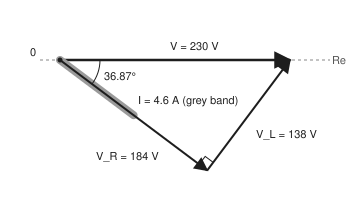
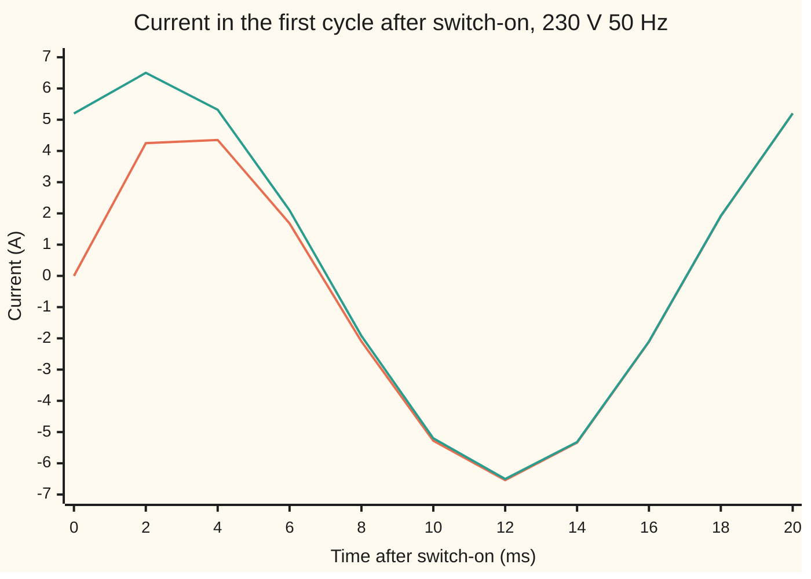

# Phasors: steady AC becomes complex arithmetic, and impedance replaces resistance

[Syllabus](../../../SYLLABUS.md) → [Engineering mathematics](../README.md) → [Circuits and Electromagnetism](../README.md#s06) → Phasors

---

## General Overview

A bench is wired to the 230 V, 50 Hz mains. The supply runs through a 5 A fuse, then a 40 Ω resistor, then a coil of 95.49 mH, and back. Is the current within the fuse's rating, the 5 A it is built to carry indefinitely? With the resistor alone, Ohm's law says 230 ÷ 40 = 5.75 A, over the rating. But the coil also holds the current back, so the true answer is lower. How much lower is the question.

Put a voltmeter across each part and the readings are stranger still: 184 V on the resistor and 138 V on the coil. They add to 322 V, from a 230 V supply. Nothing is broken. Both voltages swing at 50 Hz, but they peak at different moments, so their peaks never stack.

The fix is to describe each wave by two numbers: its size, and how far it runs ahead or behind. Two numbers make a complex number, called a **phasor**. In phasor form, a coil becomes a "resistance" with an imaginary part, called its **impedance**. The whole circuit then solves like a battery and resistors: one complex division. Here it gives 4.6 A, within the fuse's rating, and the current peaks 36.87° (2.048 ms) after the voltage does.

**For a circuit driven by one steady sine wave, every voltage and current is a sine at that same frequency, so each one is fixed by a size and a timing, a complex number; differentiating in time becomes multiplying by a fixed complex number, so coils and capacitors become complex impedances, and Kirchhoff's laws and Ohm's law work unchanged in complex numbers.**

**What kind of fact this is:** a theorem about linear circuits in steady state, proved on this card in Why it works. "A coil is a pure inductance plus a resistance" is a model, good for an air-cored coil at mains frequency.

### The picture: the three voltages as arrows

<p align="center"></p>

Drawn to scale: 1 unit per volt. The grey band is the current, at 20 units per amp; the resistor's voltage points the same way. The coil's voltage is a quarter turn ahead of it. Placed head to tail they make a right triangle whose long side is the supply: 184² + 138² = 230². The meters read the sides; the supply is the diagonal.

---

## The formula

Notation first, in words. Engineers write **j** for the square root of −1, because i is taken by current; the rest of this library writes i ([Complex numbers](../../07-Complex%20analysis/01-Complex%20Numbers%20and%20the%20Plane/01-complex-numbers.md)). A **phasor** is a complex number standing for a sine wave: its length is the wave's size, its angle is the wave's timing. Here the length is the **rms** (root-mean-square) value, the size a meter shows, which for a sine is the peak divided by √2. Mains "230 V" is rms; its peak is 325.27 V.

$$v(t) = \sqrt{2}\,|V|\cos(\omega t + \theta) \quad\longleftrightarrow\quad V = |V|\,e^{j\theta}$$

**Read it aloud:** a sine wave of rms size |V| that starts θ ahead is stored as the complex number of length |V| at angle θ.

$$Z_R = R, \qquad Z_L = j\omega L, \qquad Z_C = \frac{1}{j\omega C}, \qquad I = \frac{V}{Z}$$

**Read it aloud:** a resistor's impedance is its resistance, a coil's is jω times its inductance, a capacitor's is one over jω times its capacitance, and the current is the voltage divided by the impedance.

For the bench, the parts are in series, so their impedances add: $Z = 40 + j30$ Ω. The current is

$$I = \frac{230}{40 + j30} = 3.68 - j2.76 \text{ A}, \qquad |I| = 4.6 \text{ A}, \qquad \varphi = 36.87^\circ.$$

| Symbol | Plain meaning | In our example | Push it up and the answer… |
| --- | --- | --- | --- |
| $t$, $f$, $\omega$ | time in seconds; frequency in hertz (cycles a second); angular frequency $\omega = 2\pi f$, in rad/s | 50 Hz, 314.16 rad/s | coil's share grows: less current, more lag |
| $v(t)$, $i(t)$, $v_R$, $v_L$ | the voltage and current at instant $t$, the waves themselves; the resistor's and coil's voltages | peaks 325.27 V and 6.505 A | — |
| $a$, $b$ | the current's cosine part and sine part, peak amps | 5.2043 A, 3.9032 A | — |
| $V$, $I$, $V_R$, $V_L$, $V_k$ | phasors: rms size and timing as one complex number; the supply, the current, the parts, any one in a sum | $230$ V; $3.68 - j2.76$ A; 184 V, 138 V | — |
| $\lvert\cdot\rvert$, $\theta$, $\alpha$ | the length of a complex number; its angle, the wave's lead; any angle | $\lvert I\rvert$ = 4.6 A | — |
| $R$ | resistance, ohms (Ω) | 40 Ω | less current, less lag |
| $L$, $C$ | inductance of the coil, henries (H); capacitance, farads (F) | 95.49 mH; no capacitor | $L$ up: less current, more lag |
| $X$ | reactance, $\omega L$: the coil's opposition, in ohms, a quarter turn out of step | 30 Ω | less current, more lag |
| $Z$, $Z_R$, $Z_L$, $Z_C$ | impedance: voltage phasor over current phasor; for a resistor, coil, capacitor | $40 + j30$ Ω, length 50 Ω | less current |
| $j$, $e$, $\operatorname{Re}$ | the square root of −1, a quarter turn anticlockwise; the base of natural growth; "the real part of", the shadow on the real axis | — | — |
| $\varphi$ | the lag: how far the current's peak trails the voltage's, the angle of $Z$ | 36.87°, 0.6435 rad, 2.048 ms | — |
| $\tau$, $A$ | the switch-on time constant $L/R$; the size of the start-up surge, $A\,e^{-t/\tau}$ | 2.387 ms; −5.20 A | $\tau$ up: the phasor answer comes true later |

### When it holds

- **One frequency, steady.** Every source must be a sine at the same $f$. A second frequency needs its own phasor calculation, and the two answers add afterwards.
- **Long after switch-on.** At the instant of switching, the phasor answer says 5.20 A while the real current is 0. The gap dies as $e^{-t/\tau}$, with $\tau$ = 2.387 ms; at 10 ms it is down to 0.0789 A. Step 5 shows it.
- **Linear parts.** An iron-cored coil saturates: past some current its inductance falls, the current stops being a sine and no single phasor describes it. The 95.49 mH here is an air-cored figure.
- **Lumped parts.** The circuit is small beside the wavelength, thousands of kilometres at 50 Hz, the same condition as [Kirchhoff's laws](01-kirchhoffs-laws-and-equivalent-circuits.md). At radio frequencies a long lead is a transmission line, not a wire.
- **Ideal coil.** A real coil has its own winding resistance. Lump it into $R$; the method is unchanged.

---

## Why it works

### Step 0: one frequency in, the same frequency everywhere

The coil obeys $v_L = L\,di/dt$: its voltage is its inductance times how fast the current changes. The resistor obeys $v_R = R\,i$. Kirchhoff's voltage law adds them: $L\,di/dt + R\,i = v(t)$. Differentiating a sine gives a sine of the same frequency, shifted a quarter cycle. So if the current is a 50 Hz sine, every term is a 50 Hz sine. In steady state the current *is* one: the only thing left to find is its size and its timing. Two numbers per wave is the whole problem.

### Step 1: a sine is the shadow of a spinning arrow

By [Euler's formula](../../07-Complex%20analysis/01-Complex%20Numbers%20and%20the%20Plane/04-eulers-formula.md), $e^{j\alpha} = \cos\alpha + j\sin\alpha$. So

$$\sqrt{2}\,|V|\cos(\omega t + \theta) = \operatorname{Re}\big(\sqrt{2}\,V\,e^{j\omega t}\big), \qquad V = |V|e^{j\theta}.$$

The arrow $V e^{j\omega t}$ spins at $\omega$; its shadow on the real axis is the wave. Every wave in the circuit spins at the same $\omega$, so the factor $e^{j\omega t}$ is shared. Freeze the picture at $t = 0$ and each wave is a fixed arrow: its phasor. The size is the arrow's length, the timing its angle, read as in [Polar form](../../07-Complex%20analysis/01-Complex%20Numbers%20and%20the%20Plane/03-polar-form-and-argument.md).

### Step 2: differentiating becomes multiplying by jω

Differentiate the spinning arrow: $\frac{d}{dt}e^{j\omega t} = j\omega\,e^{j\omega t}$. Taking the real part and differentiating can be done in either order, so the phasor of $di/dt$ is $j\omega I$. Multiplying by $j$ turns an arrow a quarter turn anticlockwise, so a derivative runs a quarter cycle ahead. That is why the coil's voltage, $j\omega L\,I$, sits at right angles to the resistor's.

So each part is "voltage = something times current", in phasors:

- resistor: $V_R = R\,I$;
- coil: $V_L = j\omega L\,I$;
- capacitor: $i = C\,dv/dt$ gives $I = j\omega C\,V$, so $V = I/(j\omega C)$.

That "something" is the impedance $Z$. It plays exactly the part a resistance plays in Ohm's law.

### Step 3: Kirchhoff's laws carry over

Kirchhoff's laws are sums: currents into a node, voltages round a loop. A sum of shadows is the shadow of the sum. If $\operatorname{Re}\big(\sum V_k e^{j\omega t}\big) = 0$ at every instant, then $\sum V_k = 0$: at $t = 0$ the real part vanishes, a quarter cycle later the imaginary part does. So the laws hold for phasors, and every DC method carries over with $Z$ in place of $R$: series impedances add, parallel ones combine, node matrices fill with complex entries.

For the bench: $Z = R + j\omega L = 40 + j30$ Ω, and $I = V/Z$.

### Step 4: one complex division, read off as size and timing

Divide by multiplying top and bottom by the conjugate (flip the sign of $j$):

$$I = \frac{230\,(40 - j30)}{(40 + j30)(40 - j30)} = \frac{230\,(40 - j30)}{40^2 + 30^2} = 3.68 - j2.76 \text{ A}.$$

Read it in polar form. Length: $230/50 = 4.6$ A rms. Angle: $-\arctan(30/40) = -36.87°$, so the current lags. Dividing by $Z$ divides the lengths and subtracts the angles: the current is the voltage shrunk by 50 Ω and turned back by $Z$'s angle.

<details>
<summary>The same answer with no complex numbers at all</summary>

Guess $i(t) = a\cos\omega t + b\sin\omega t$, with supply $v = 325.27\cos\omega t$. Then $di/dt = -a\omega\sin\omega t + b\omega\cos\omega t$. Put both into $L\,di/dt + R\,i = v$ and collect terms. The cosine terms give $R a + X b = 325.27$; the sine terms give $-X a + R b = 0$, with $X = \omega L$ = 30 Ω. The second says $b = (X/R)\,a$. Then $a = 325.27 \times 40/50^2 = 5.2043$ A and $b = 325.27 \times 30/50^2 = 3.9032$ A. The peak is $\sqrt{a^2 + b^2}$ = 6.5054 A, which is 4.6 A rms, and the lag is $\arctan(b/a)$ = 36.87°.

Those two real equations are the real and imaginary parts of $(R + jX)(a - jb) = 325.27$. The complex division does this pair of equations in one line. For a circuit with ten unknown currents, the real route needs twenty equations; phasors need ten.

</details>

### Step 5: what steady state leaves out

The full solution of $L\,di/dt + R\,i = v$ is the phasor answer plus a free part, $A\,e^{-t/\tau}$ with $\tau = L/R$ = 2.387 ms. The free part is fixed by the current at switch-on, which must be 0: a coil cannot change its current in an instant. Switching at a voltage peak, the phasor answer is 5.20 A at that moment, so $A = -5.20$ A. Seen from 10 ms on, the gap is $-5.20\,e^{-10/2.387}$ = −0.0789 A, and the simulation agrees to six decimal places.



Orange: the simulated current, starting from 0. Teal: the phasor answer, $6.505\cos(\omega t - 36.87°)$ A. At switch-on the phasor says 5.20 A against a true 0; at 2 ms it says 6.50 A against 4.25 A. By 10 ms they are within a tenth of an amp, and by the end of the first cycle they match to the plotted two decimals. The largest current in that first cycle is 6.539 A, a hair above the steady 6.505 A peak, so the fuse sees no real surge here.

---

## Worked numbers, by hand

| Step | Arithmetic | Value |
| --- | --- | --- |
| angular frequency $\omega$ | 2 × π × 50 | 314.16 rad/s |
| coil's reactance $X = \omega L$ | 314.16 × 0.09549 | 30 Ω |
| impedance $Z$ | 40 + j30 | length 50 Ω, angle 36.87° |
| current $I = V/Z$ | 230 × (40 − j30) ÷ 50² | 3.68 − j2.76 A |
| size $\lvert I\rvert$ | 230 ÷ 50 | **4.6 A rms** |
| lag $\varphi$ | arctan(30/40); ÷ ω for time | **36.87°**, 0.6435 rad, 2.048 ms |
| peak current | 4.6 × √2 | 6.505 A |
| resistor's voltage $\lvert V_R\rvert$ | 4.6 × 40 | 184 V |
| coil's voltage $\lvert V_L\rvert$ | 4.6 × 30 | 138 V |
| check: arrows add to the supply | 184 in step with $I$, plus 138 a quarter turn ahead | 230 + j0 V |
| heat in the resistor | 4.6² × 40 | 846.4 W |

The fuse carries 4.6 A, under its 5 A rating, so it holds. The current peaks 2.048 ms after each voltage peak. Only the resistor turns power into heat; why the coil takes none is the subject of [AC power](09-power-and-three-phase.md).

### What breaks if you drop a piece

| Mistake | Comes out at | What went wrong |
| --- | --- | --- |
| Add the coil's 30 Ω to the 40 Ω as plain ohms | 3.2857 A | The two oppositions are a quarter cycle apart. They add at right angles: 50 Ω, not 70 Ω |
| Ignore the coil: resistance only | 5.75 A | Over the fuse's 5 A rating, so the fuse looks too small. Correct only at 0 Hz, direct current |
| Reactance as $fL$, forgetting the 2π | 5.7095 A | The coil shrinks to a sixth of its size. The derivative brings $\omega$, in rad/s |
| Add the two meter readings to check Kirchhoff | 322 V | Meters show lengths, not arrows. The law holds for the phasors: 184 and 138 at right angles make 230 |

---

## Code, from first principles, and it actually runs

The script reaches the 4.6 A and the 36.87° lag by three independent roads. Road 1 is the phasor division. Road 2 solves the two real equations for the cosine and sine parts, with no complex numbers. Road 3 integrates $L\,di/dt + R\,i = v(t)$ from switch-on with RK4 (a standard step-by-step method for differential equations, from wing 08), runs ten cycles, and measures the last one as a meter would: rms current, rms voltage on each part, and the cosine and sine parts by averaging. It then reproduces every wrong answer above, the "Try changing" numbers, the switch-on gap against its closed form, the chart and the figure. Rust writes its own complex type; Python uses the built-in one.

### Python

```python
# Phasors and impedance -- the check behind the card.  Standard library only.
# 230 V rms, 50 Hz mains through a 40-ohm resistor and a 95.49 mH coil in series.
# Roads to the current: one complex division; the same sum done with real cosine and
# sine coefficients; and an RK4 simulation of L di/dt + R i = v(t), measured like a meter.
from math import pi, sqrt, cos, sin, atan2, exp, degrees

F, VRMS, R = 50.0, 230.0, 40.0              # hertz, volts rms, ohms
L = 0.3 / pi                                # henries: 95.49 mH, so 30 ohms at 50 Hz
W = 2 * pi * F                              # angular frequency, rad/s
VPK = VRMS * sqrt(2)                        # peak of the mains wave

def current(f, r, l, c=None, vrms=VRMS):    # road 1: phasor I = V / Z, rms
    w = 2 * pi * f
    z = complex(r, w * l - (1 / (w * c) if c else 0.0))
    return vrms / z, z

def real_pair(f, r, l):                     # road 2: i = a cos wt + b sin wt, peak amps
    x = 2 * pi * f * l                      # match cos and sin terms: r a + x b = VPK, -x a + r b = 0
    a = VPK * r / (r * r + x * x)
    return a, VPK * x / (r * r + x * x)

def simulate(cycles=10, n=2000):            # road 3: RK4 from switch-on at a voltage peak
    T = 1 / F; h = T / n
    rhs = lambda t, i: (VPK * cos(W * t) - R * i) / L
    t, i, trace = 0.0, 0.0, [0.0]
    for _ in range(cycles * n):
        k1 = rhs(t, i); k2 = rhs(t + h / 2, i + h * k1 / 2)
        k3 = rhs(t + h / 2, i + h * k2 / 2); k4 = rhs(t + h, i + h * k3)
        i += h * (k1 + 2 * k2 + 2 * k3 + k4) / 6; t += h
        trace.append(i)
    last = range(len(trace) - 1 - n, len(trace) - 1)       # the final whole cycle
    ca = 2 / n * sum(trace[k] * cos(W * k * h) for k in last)
    cb = 2 / n * sum(trace[k] * sin(W * k * h) for k in last)
    irms = sqrt(sum(trace[k] ** 2 for k in last) / n)
    vr = sqrt(sum((R * trace[k]) ** 2 for k in last) / n)
    vl = sqrt(sum((VPK * cos(W * k * h) - R * trace[k]) ** 2 for k in last) / n)
    return trace, h, ca, cb, irms, vr, vl

I, Z = current(F, R, L)
X = W * L
mag, lag = abs(I), -atan2(I.imag, I.real)
VR, VL = I * R, I * complex(0, X)
a, b = real_pair(F, R, L)
trace, h, ca, cb, irms_sim, vr_sim, vl_sim = simulate()
tau = L / R
ipk = mag * sqrt(2)
steady = lambda t: ipk * cos(W * t - lag)
first = max(abs(v) for v in trace[:2001])
t10 = int(round(0.010 / h))
gap10 = trace[t10] - steady(t10 * h)
gap10_exact = -ipk * cos(lag) * exp(-0.010 / tau)

wrong_add = VRMS / (R + X)                  # R and X added as plain ohms
wrong_noL = VRMS / R                        # coil ignored
wrong_fL = abs(current(F, R, L / (2 * pi))[0])   # X = f L, the 2 pi forgotten
wrong_meters = abs(VR) + abs(VL)            # the two meter readings added

I60 = current(60.0, R, L)[0]
I2L = current(F, R, 2 * L)[0]
C = 1 / (W * X)                             # the capacitor whose -30 ohms cancels the coil
Icap = current(F, R, L, C)[0]

rows = [
    ("mains peak, V", VPK), ("omega, rad/s", W), ("coil L, mH", L * 1000), ("reactance X, ohm", X),
    ("Z real, ohm", Z.real), ("Z imag, ohm", Z.imag), ("|Z|, ohm", abs(Z)),
    ("angle of Z, deg", degrees(atan2(Z.imag, Z.real))),
    ("1 phasor: I real, A rms", I.real), ("1 phasor: I imag, A rms", I.imag),
    ("1 phasor: |I|, A rms", mag), ("1 phasor: lag, deg", degrees(lag)),
    ("  lag, rad", lag), ("  lag, ms", lag / W * 1000), ("  peak current, A", ipk),
    ("2 real pair: cos part a, A", a), ("2 real pair: sin part b, A", b),
    ("2 real pair: peak, A", sqrt(a * a + b * b)), ("2 real pair: lag, deg", degrees(atan2(b, a))),
    ("3 simulated: cos part, A", ca), ("3 simulated: sin part, A", cb),
    ("3 simulated: rms current, A", irms_sim), ("3 simulated: lag, deg", degrees(atan2(cb, ca))),
    ("resistor voltage |VR|, V rms", abs(VR)), ("coil voltage |VL|, V rms", abs(VL)),
    ("3 simulated meter on R, V rms", vr_sim), ("3 simulated meter on L, V rms", vl_sim),
    ("VR + VL as arrows: real, V", (VR + VL).real), ("VR + VL as arrows: imag, V", (VR + VL).imag),
    ("heat in the resistor, W", mag * mag * R),
    ("wrong: R + X as ohms, A", wrong_add), ("wrong: coil ignored, A", wrong_noL),
    ("wrong: X = f L, A", wrong_fL), ("wrong: meters added, V", wrong_meters),
    ("wrong: 230 V taken as the peak, A rms", VRMS / sqrt(2) / abs(Z)),
    ("try: 60 Hz, A", abs(I60)), ("try: 60 Hz lag, deg", -degrees(atan2(I60.imag, I60.real))),
    ("try: coil doubled, A", abs(I2L)), ("try: coil doubled lag, deg", -degrees(atan2(I2L.imag, I2L.real))),
    ("try: series C, uF", C * 1e6), ("try: series C, A", abs(Icap)),
    ("try: series C lag, deg", round(-degrees(atan2(Icap.imag, Icap.real)), 9) + 0.0),
    ("switch-on: tau = L/R, ms", tau * 1000), ("switch-on: largest |i|, 1st cycle, A", first),
    ("switch-on: sim minus phasor at 10 ms, A", gap10), ("  closed form, A", gap10_exact),
]
for name, v in rows:
    print(f"{name:<40} {v:>11.4f}")
ms = range(0, 21, 2)
print("chart, ms         " + " ".join(f"{m:>6d}" for m in ms))
print("chart, simulated  " + " ".join(f"{trace[m * 100]:>6.2f}" for m in ms))
print("chart, phasor     " + " ".join(f"{steady(m / 1000):>6.2f}" for m in ms))
S = 1.0                                     # figure: 1 unit per volt, origin (60, 60), y down
print(f"figure, VR tip ({60 + S * VR.real:.1f}, {60 - S * VR.imag:.1f}), "
      f"V tip ({60 + S * VRMS:.1f}, 60.0), I tip ({60 + 20 * I.real:.1f}, {60 - 20 * I.imag:.1f})")

assert abs(mag - 230 / 50) < 1e-9,                       "hand value: 230 V over a 3-4-5 triangle of 50 ohms"
assert abs(sqrt(a * a + b * b) - ipk) < 1e-9,            "real-pair road matches the complex division"
assert abs(atan2(b, a) - lag) < 1e-9,                    "real-pair lag matches the phasor's angle"
assert abs(irms_sim - mag) < 1e-4,                       "simulated rms current matches the phasor"
assert abs(atan2(cb, ca) - lag) < 1e-4,                  "simulated lag matches the phasor"
assert abs(sqrt(vr_sim ** 2 + vl_sim ** 2) - VRMS) < 1e-3, "meter readings add as a right triangle"
assert abs(gap10 - gap10_exact) < 1e-6,                  "switch-on gap is the decaying free response"
assert abs(abs(Icap) - wrong_noL) < 1e-9,                "a cancelling capacitor leaves only R"
print("ALL CHECKS PASS")
```

**Ran 2026-11-11 on macOS, Python 3.14.10, standard library only. All checks passed. Output, pasted from the run:**

```
mains peak, V                               325.2691
omega, rad/s                                314.1593
coil L, mH                                   95.4930
reactance X, ohm                             30.0000
Z real, ohm                                  40.0000
Z imag, ohm                                  30.0000
|Z|, ohm                                     50.0000
angle of Z, deg                              36.8699
1 phasor: I real, A rms                       3.6800
1 phasor: I imag, A rms                      -2.7600
1 phasor: |I|, A rms                          4.6000
1 phasor: lag, deg                           36.8699
  lag, rad                                    0.6435
  lag, ms                                     2.0483
  peak current, A                             6.5054
2 real pair: cos part a, A                    5.2043
2 real pair: sin part b, A                    3.9032
2 real pair: peak, A                          6.5054
2 real pair: lag, deg                        36.8699
3 simulated: cos part, A                      5.2043
3 simulated: sin part, A                      3.9032
3 simulated: rms current, A                   4.6000
3 simulated: lag, deg                        36.8699
resistor voltage |VR|, V rms                184.0000
coil voltage |VL|, V rms                    138.0000
3 simulated meter on R, V rms               184.0000
3 simulated meter on L, V rms               138.0000
VR + VL as arrows: real, V                  230.0000
VR + VL as arrows: imag, V                    0.0000
heat in the resistor, W                     846.4000
wrong: R + X as ohms, A                       3.2857
wrong: coil ignored, A                        5.7500
wrong: X = f L, A                             5.7095
wrong: meters added, V                      322.0000
wrong: 230 V taken as the peak, A rms         3.2527
try: 60 Hz, A                                 4.2739
try: 60 Hz lag, deg                          41.9872
try: coil doubled, A                          3.1895
try: coil doubled lag, deg                   56.3099
try: series C, uF                           106.1033
try: series C, A                              5.7500
try: series C lag, deg                        0.0000
switch-on: tau = L/R, ms                      2.3873
switch-on: largest |i|, 1st cycle, A          6.5390
switch-on: sim minus phasor at 10 ms, A      -0.0789
  closed form, A                             -0.0789
chart, ms              0      2      4      6      8     10     12     14     16     18     20
chart, simulated    0.00   4.25   4.35   1.68  -2.10  -5.28  -6.54  -5.34  -2.11   1.91   5.20
chart, phasor       5.20   6.50   5.32   2.10  -1.92  -5.20  -6.50  -5.32  -2.10   1.92   5.20
figure, VR tip (207.2, 170.4), V tip (290.0, 60.0), I tip (133.6, 115.2)
ALL CHECKS PASS
```

### Rust

```rust
// Phasors and impedance -- the check behind the card.  std only, no crates.
// 230 V rms, 50 Hz mains through a 40-ohm resistor and a 95.49 mH coil in series.
// Roads to the current: one complex division; the same sum done with real cosine and
// sine coefficients; and an RK4 simulation of L di/dt + R i = v(t), measured like a meter.
use std::f64::consts::PI;

#[derive(Clone, Copy)]
struct C { re: f64, im: f64 }                       // a complex number, written out
impl C {
    fn add(self, o: C) -> C { C { re: self.re + o.re, im: self.im + o.im } }
    fn mul(self, o: C) -> C { C { re: self.re * o.re - self.im * o.im, im: self.re * o.im + self.im * o.re } }
    fn div(self, o: C) -> C {                       // times the conjugate, over |o| squared
        let d = o.re * o.re + o.im * o.im;
        C { re: (self.re * o.re + self.im * o.im) / d, im: (self.im * o.re - self.re * o.im) / d }
    }
    fn abs(self) -> f64 { self.re.hypot(self.im) }
    fn arg(self) -> f64 { self.im.atan2(self.re) }
}

const F: f64 = 50.0; const VRMS: f64 = 230.0; const R: f64 = 40.0;   // hertz, volts rms, ohms

fn current(f: f64, r: f64, l: f64, c: Option<f64>) -> (C, C) {   // road 1: I = V / Z, rms
    let w = 2.0 * PI * f;
    let xc = match c { Some(c) => 1.0 / (w * c), None => 0.0 };
    let z = C { re: r, im: w * l - xc };
    (C { re: VRMS, im: 0.0 }.div(z), z)
}

fn main() {
    let l = 0.3 / PI;                               // henries: 95.49 mH, so 30 ohms at 50 Hz
    let w = 2.0 * PI * F;
    let vpk = VRMS * 2f64.sqrt();
    let (i, z) = current(F, R, l, None);
    let x = w * l;
    let (mag, lag) = (i.abs(), -i.arg());
    let vr = i.mul(C { re: R, im: 0.0 });
    let vl = i.mul(C { re: 0.0, im: x });
    // road 2: i = a cos wt + b sin wt; match cos and sin terms: R a + X b = VPK, -X a + R b = 0
    let a = vpk * R / (R * R + x * x);
    let b = vpk * x / (R * R + x * x);
    // road 3: RK4 from switch-on at a voltage peak, ten cycles, then measure the last one
    let n = 2000usize; let cycles = 10usize;
    let h = 1.0 / F / n as f64;
    let rhs = |t: f64, i: f64| (vpk * (w * t).cos() - R * i) / l;
    let (mut t, mut cur) = (0.0f64, 0.0f64);
    let mut trace = vec![0.0f64];
    for _ in 0..cycles * n {
        let k1 = rhs(t, cur); let k2 = rhs(t + h / 2.0, cur + h * k1 / 2.0);
        let k3 = rhs(t + h / 2.0, cur + h * k2 / 2.0); let k4 = rhs(t + h, cur + h * k3);
        cur += h * (k1 + 2.0 * k2 + 2.0 * k3 + k4) / 6.0; t += h;
        trace.push(cur);
    }
    let (mut ca, mut cb, mut s2, mut sr, mut sl) = (0.0, 0.0, 0.0, 0.0, 0.0);
    for k in (trace.len() - 1 - n)..(trace.len() - 1) {
        let tk = w * k as f64 * h;
        ca += trace[k] * tk.cos(); cb += trace[k] * tk.sin();
        s2 += trace[k] * trace[k]; sr += (R * trace[k]).powi(2);
        sl += (vpk * tk.cos() - R * trace[k]).powi(2);
    }
    let nf = n as f64;
    let (ca, cb) = (2.0 / nf * ca, 2.0 / nf * cb);
    let (irms_sim, vr_sim, vl_sim) = ((s2 / nf).sqrt(), (sr / nf).sqrt(), (sl / nf).sqrt());
    let tau = l / R;
    let ipk = mag * 2f64.sqrt();
    let steady = |t: f64| ipk * (w * t - lag).cos();
    let first = trace[..2001].iter().fold(0.0f64, |m, v| m.max(v.abs()));
    let t10 = (0.010 / h).round() as usize;
    let gap10 = trace[t10] - steady(t10 as f64 * h);
    let gap10_exact = -ipk * lag.cos() * (-0.010 / tau).exp();

    let wrong_add = VRMS / (R + x);
    let wrong_nol = VRMS / R;
    let wrong_fl = current(F, R, l / (2.0 * PI), None).0.abs();
    let wrong_meters = vr.abs() + vl.abs();
    let i60 = current(60.0, R, l, None).0;
    let i2l = current(F, R, 2.0 * l, None).0;
    let cap = 1.0 / (w * x);
    let icap = current(F, R, l, Some(cap)).0;
    let sum = vr.add(vl);

    let rows: Vec<(&str, f64)> = vec![
        ("mains peak, V", vpk), ("omega, rad/s", w), ("coil L, mH", l * 1000.0), ("reactance X, ohm", x),
        ("Z real, ohm", z.re), ("Z imag, ohm", z.im), ("|Z|, ohm", z.abs()),
        ("angle of Z, deg", z.arg().to_degrees()),
        ("1 phasor: I real, A rms", i.re), ("1 phasor: I imag, A rms", i.im),
        ("1 phasor: |I|, A rms", mag), ("1 phasor: lag, deg", lag.to_degrees()),
        ("  lag, rad", lag), ("  lag, ms", lag / w * 1000.0), ("  peak current, A", ipk),
        ("2 real pair: cos part a, A", a), ("2 real pair: sin part b, A", b),
        ("2 real pair: peak, A", (a * a + b * b).sqrt()), ("2 real pair: lag, deg", b.atan2(a).to_degrees()),
        ("3 simulated: cos part, A", ca), ("3 simulated: sin part, A", cb),
        ("3 simulated: rms current, A", irms_sim), ("3 simulated: lag, deg", cb.atan2(ca).to_degrees()),
        ("resistor voltage |VR|, V rms", vr.abs()), ("coil voltage |VL|, V rms", vl.abs()),
        ("3 simulated meter on R, V rms", vr_sim), ("3 simulated meter on L, V rms", vl_sim),
        ("VR + VL as arrows: real, V", sum.re), ("VR + VL as arrows: imag, V", sum.im),
        ("heat in the resistor, W", mag * mag * R),
        ("wrong: R + X as ohms, A", wrong_add), ("wrong: coil ignored, A", wrong_nol),
        ("wrong: X = f L, A", wrong_fl), ("wrong: meters added, V", wrong_meters),
        ("wrong: 230 V taken as the peak, A rms", VRMS / 2f64.sqrt() / z.abs()),
        ("try: 60 Hz, A", i60.abs()), ("try: 60 Hz lag, deg", -i60.arg().to_degrees()),
        ("try: coil doubled, A", i2l.abs()), ("try: coil doubled lag, deg", -i2l.arg().to_degrees()),
        ("try: series C, uF", cap * 1e6), ("try: series C, A", icap.abs()),
        ("try: series C lag, deg", (-icap.arg().to_degrees() * 1e9).round() / 1e9 + 0.0),
        ("switch-on: tau = L/R, ms", tau * 1000.0), ("switch-on: largest |i|, 1st cycle, A", first),
        ("switch-on: sim minus phasor at 10 ms, A", gap10), ("  closed form, A", gap10_exact),
    ];
    for (name, v) in &rows { println!("{:<40} {:>11.4}", name, v); }
    let ms: Vec<usize> = (0..=20).step_by(2).collect();
    let line = |f: &dyn Fn(usize) -> String| ms.iter().map(|&m| f(m)).collect::<Vec<_>>().join(" ");
    println!("chart, ms         {}", line(&|m| format!("{:>6}", m)));
    println!("chart, simulated  {}", line(&|m| format!("{:>6.2}", trace[m * 100])));
    println!("chart, phasor     {}", line(&|m| format!("{:>6.2}", steady(m as f64 / 1000.0))));
    println!("figure, VR tip ({:.1}, {:.1}), V tip ({:.1}, 60.0), I tip ({:.1}, {:.1})",
        60.0 + vr.re, 60.0 - vr.im, 60.0 + VRMS, 60.0 + 20.0 * i.re, 60.0 - 20.0 * i.im);

    assert!((mag - 230.0 / 50.0).abs() < 1e-9, "hand value: 230 V over a 3-4-5 triangle of 50 ohms");
    assert!(((a * a + b * b).sqrt() - ipk).abs() < 1e-9, "real-pair road matches the complex division");
    assert!((b.atan2(a) - lag).abs() < 1e-9, "real-pair lag matches the phasor's angle");
    assert!((irms_sim - mag).abs() < 1e-4, "simulated rms current matches the phasor");
    assert!((cb.atan2(ca) - lag).abs() < 1e-4, "simulated lag matches the phasor");
    assert!(((vr_sim * vr_sim + vl_sim * vl_sim).sqrt() - VRMS).abs() < 1e-3, "meter readings add as a right triangle");
    assert!((gap10 - gap10_exact).abs() < 1e-6, "switch-on gap is the decaying free response");
    assert!((icap.abs() - wrong_nol).abs() < 1e-9, "a cancelling capacitor leaves only R");
    println!("ALL CHECKS PASS");
}
```

**Ran 2026-11-11 on macOS, rustc 1.98.1, no crates. All checks passed. Output, pasted from the run:**

```
mains peak, V                               325.2691
omega, rad/s                                314.1593
coil L, mH                                   95.4930
reactance X, ohm                             30.0000
Z real, ohm                                  40.0000
Z imag, ohm                                  30.0000
|Z|, ohm                                     50.0000
angle of Z, deg                              36.8699
1 phasor: I real, A rms                       3.6800
1 phasor: I imag, A rms                      -2.7600
1 phasor: |I|, A rms                          4.6000
1 phasor: lag, deg                           36.8699
  lag, rad                                    0.6435
  lag, ms                                     2.0483
  peak current, A                             6.5054
2 real pair: cos part a, A                    5.2043
2 real pair: sin part b, A                    3.9032
2 real pair: peak, A                          6.5054
2 real pair: lag, deg                        36.8699
3 simulated: cos part, A                      5.2043
3 simulated: sin part, A                      3.9032
3 simulated: rms current, A                   4.6000
3 simulated: lag, deg                        36.8699
resistor voltage |VR|, V rms                184.0000
coil voltage |VL|, V rms                    138.0000
3 simulated meter on R, V rms               184.0000
3 simulated meter on L, V rms               138.0000
VR + VL as arrows: real, V                  230.0000
VR + VL as arrows: imag, V                    0.0000
heat in the resistor, W                     846.4000
wrong: R + X as ohms, A                       3.2857
wrong: coil ignored, A                        5.7500
wrong: X = f L, A                             5.7095
wrong: meters added, V                      322.0000
wrong: 230 V taken as the peak, A rms         3.2527
try: 60 Hz, A                                 4.2739
try: 60 Hz lag, deg                          41.9872
try: coil doubled, A                          3.1895
try: coil doubled lag, deg                   56.3099
try: series C, uF                           106.1033
try: series C, A                              5.7500
try: series C lag, deg                        0.0000
switch-on: tau = L/R, ms                      2.3873
switch-on: largest |i|, 1st cycle, A          6.5390
switch-on: sim minus phasor at 10 ms, A      -0.0789
  closed form, A                             -0.0789
chart, ms              0      2      4      6      8     10     12     14     16     18     20
chart, simulated    0.00   4.25   4.35   1.68  -2.10  -5.28  -6.54  -5.34  -2.11   1.91   5.20
chart, phasor       5.20   6.50   5.32   2.10  -1.92  -5.20  -6.50  -5.32  -2.10   1.92   5.20
figure, VR tip (207.2, 170.4), V tip (290.0, 60.0), I tip (133.6, 115.2)
ALL CHECKS PASS
```

Three roads, one answer. The complex division and the real pair agree to the last digit: they are the same equations. The simulation knows only the differential equation and still reads 4.6000 A rms, a lag of 36.8699°, and meters at 184 V and 138 V.

> [!TIP]
> **Try changing**
> The asserts are pinned to the 50 Hz bench, so the first one stops any edited run; the printed `try:` lines give the answers without editing anything.
> - Guess first: the same bench on 60 Hz mains, as in North America. Set `F = 60.0`. The coil's reactance rises with frequency, so the current falls to 4.2739 A and the lag grows to 41.99°.
> - Guess first: double the coil. Set `L = 0.6 / pi`. The current falls to 3.1895 A, lagging by 56.31°. Doubling $X$ did not halve the current, because $R$ is still there.
> - Guess first: add a capacitor in series that cancels the coil. Its impedance must be −j30 Ω, so $C = 1/(\omega X)$ = 106.10 µF. The current rises to 5.75 A with no lag at all, exactly as if the coil were gone: the 50 Hz case of [RLC resonance](03-rlc-circuits-and-resonance.md). That is over the fuse's 5 A rating.
> - Guess first: switch on at a voltage peak, what is the largest current in the first cycle? 6.539 A, just above the steady 6.505 A. The switch-on surge is small because $\tau$ is short beside the 20 ms cycle.

---

## The usual mistake

> [!warning]
> **Adding sizes instead of arrows.** Every quantity in an AC circuit has a size and a timing, and only the phasors add. So 40 Ω and 30 Ω make 50 Ω, not 70 Ω (which gives 3.2857 A), and 184 V and 138 V make 230 V, not 322 V. Adding sizes works only when everything peaks together, which is a circuit of resistors alone.
>
> Smaller traps:
> - **Forgetting the 2π.** The reactance is $\omega L = 2\pi f L$. Using $fL$ shrinks the coil to a sixth of its size and gives 5.7095 A.
> - **Mixing peak and rms.** Mains 230 V is rms. Treat it as the peak and the current comes out 3.2527 A, wrong by √2. Pick one convention for every phasor and keep it.
> - **Getting the lag backwards.** The current lags the supply by 36.87° here; put a −j30 Ω capacitor in the coil's place and the current leads by the same 36.87°. The sign of $X$ says which.
> - **Using phasors at switch-on.** The phasor answer is 5.20 A at the instant of switching, when the true current is 0. It describes the circuit only once the free part, $e^{-t/\tau}$, has died.

---

## Where you meet it in real life

- **Fuse and cable sizing.** Every motor, fan and ballast on the mains is rated by the current $V/\lvert Z\rvert$, not by its resistance alone.
- **Power-factor correction.** Factories hang capacitors across their motor loads to cancel the coil's $+jX$ with a $-jX$, cutting the current the cable must carry; [AC power](09-power-and-three-phase.md) puts numbers on it.
- **Audio crossovers.** A coil passes the low notes to the woofer and a capacitor passes the high notes to the tweeter, because $\omega L$ grows with frequency and $1/(\omega C)$ shrinks.
- **Radio tuning.** The tuner in a radio set is a coil and a capacitor whose reactances cancel at one frequency: [RLC resonance](03-rlc-circuits-and-resonance.md).
- **Impedance meters.** An LCR meter applies a small sine wave, measures the current's size and lag, and divides: the phasor $V/I$ is what it reports.
- **Transformers and grids.** Grid engineers write every line, cable and transformer as an impedance and solve whole networks with complex node matrices; [Transformers](06-transformers-and-mutual-inductance.md) shows how a coupled pair fits in.

> **Say it back**
> In a circuit driven by one steady sine wave, every voltage and current is a sine of the same frequency, so each is just a size and a timing: a complex number called a phasor. Differentiating becomes multiplying by jω, so a coil acts as an impedance jωL and a capacitor as 1/(jωC). Kirchhoff's laws and Ohm's law then hold in complex numbers, and the circuit solves like a DC one. For 230 V through 40 Ω and a 95.49 mH coil, one division gives 4.6 A lagging by 36.87°. Sizes never add directly; arrows do.

---

## What this builds on

- [Kirchhoff's laws](01-kirchhoffs-laws-and-equivalent-circuits.md): the two conservation laws and the DC solving methods. This card keeps them all and swaps resistances for impedances.
- [Euler's formula](../../07-Complex%20analysis/01-Complex%20Numbers%20and%20the%20Plane/04-eulers-formula.md): $e^{j\alpha} = \cos\alpha + j\sin\alpha$, which makes a sine wave the shadow of a spinning arrow.
- [Polar form](../../07-Complex%20analysis/01-Complex%20Numbers%20and%20the%20Plane/03-polar-form-and-argument.md): length and angle, and why dividing complex numbers divides lengths and subtracts angles.
- [Trig graphs](../../05-Geometry%20and%20trig/03-Trigonometry/04-trig-graphs-amplitude-period-and-phase.md): amplitude, period and phase, the three things a phasor packs into two numbers and a shared frequency.

## Where this goes next

- [RLC resonance](03-rlc-circuits-and-resonance.md): the next card. Add a capacitor, let the frequency vary, and find the one frequency where the reactances cancel.
- [Transformers](06-transformers-and-mutual-inductance.md): two coils sharing a magnetic field, solved with the same impedances plus a coupling term.
- [AC power](09-power-and-three-phase.md): multiply a voltage phasor by a current phasor and ask what the 36.87° lag does to the power delivered.

This card handles one frequency at a time; how a circuit treats a wave made of many frequencies at once, such as a square wave or speech, is the question it leaves open.

---

## Sources

Verified 2026-11-11: every link below resolves to the publisher's page.

- Kennelly, Arthur E. "Impedance." *Transactions of the American Institute of Electrical Engineers* 10 (1893): 172–232. [doi:10.1109/T-AIEE.1893.4768008](https://doi.org/10.1109/T-AIEE.1893.4768008). Represented impedance as a complex number (the word itself is Heaviside's, 1886).
- Steinmetz, Charles Proteus. "Symbolic Representation of General Alternating Waves and of Double Frequency Vector Products." *Transactions of the American Institute of Electrical Engineers* 16 (1899): 269–296. [doi:10.1109/T-AIEE.1899.4764075](https://doi.org/10.1109/T-AIEE.1899.4764075). The symbolic, complex-number method for alternating currents, from the engineer who spread it.
- Agarwal, Anant, and Jeffrey H. Lang. *Foundations of Analog and Digital Electronic Circuits*. Morgan Kaufmann (Elsevier), 2005. [Publisher page](https://shop.elsevier.com/books/foundations-of-analog-and-digital-electronic-circuits/agarwal/978-0-08-050681-4). The chapter "Sinusoidal Steady State" derives impedance from the differential equation, as Steps 0 to 2 do.
- Alexander, Charles K., and Matthew N. O. Sadiku. *Fundamentals of Electric Circuits*, 7th ed. McGraw Hill. [Publisher page](https://www.mheducation.com/highered/product/fundamentals-of-electric-circuits-alexander.html). The standard course treatment of phasors, impedance and AC circuit solving.
- IEC 60038:2009, *IEC standard voltages*. International Electrotechnical Commission. [Publisher page](https://webstore.iec.ch/en/publication/153). Fixes 230 V at 50 Hz as the standard low-voltage mains, the supply used on this card.
