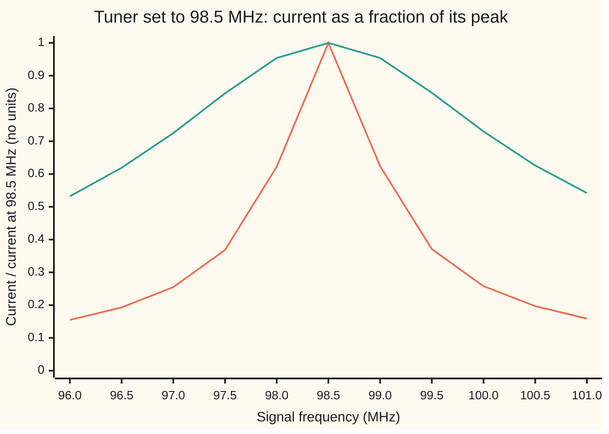
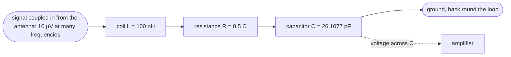

# RLC resonance: one frequency the circuit answers loudest, and how sharp the peak is

[Syllabus](../../../SYLLABUS.md) → [Engineering mathematics](../README.md) → [Circuits and Electromagnetism](../README.md#s06) → RLC resonance

---

## General Overview

A radio's antenna picks up every FM station in range at once. In the US the FM band runs from 88 to 108 MHz (megahertz, millions of cycles per second), with stations on channels 200 kHz (kilohertz) apart. Each station arrives as a voltage of a few microvolts. Say the listener wants 98.5 MHz.

The first thing the signal meets is a tuner: a coil, a capacitor and a little unavoidable resistance, wired in one loop. The antenna is coupled into that loop lightly, through a tap on the coil or a small second coil ([Transformers](06-transformers-and-mutual-inductance.md)), so the loop feels almost none of the antenna's own resistance. Here the coil is 100 nH (nanohenries) and its own losses come to 0.5 ohms.

Turn the tuning knob until the capacitor reads 26.1077 pF (picofarads). Now a 10 µV (microvolt) signal at 98.5 MHz drives 20 µA (microamps) round the loop and builds 1.2378 mV (millivolts) across the capacitor: 124 times the voltage that came in. A station at 100.5 MHz, 2 MHz away, gets only 0.1970 of that current.

The engineer wants two numbers. **Where is the peak?** That is the resonant frequency, set by the coil and capacitor alone. **How sharp is it?** That is the quality factor Q, here 123.78: it sets how narrow a band gets through, how much the voltage is magnified, and how long the loop rings after a kick.

That is why the antenna is coupled in lightly. A 75 Ω antenna wired straight into the loop would drag Q down to 0.82, and the loop would pass a band wider than the whole FM dial. Both numbers come from one fact: at one frequency the coil's and the capacitor's opposition to current cancel, leaving only the resistor.

**A series coil, capacitor and resistor passes current most easily at one frequency, set by the coil and capacitor alone, where their push-backs cancel; the quality factor Q, the coil's push-back there divided by the resistance, says how sharp that peak is, and the width of the band it passes is that frequency divided by Q.**

**What kind of fact this is:** a theorem about the series RLC model, proved on this card in Why it works; the model itself (ideal, linear parts in a circuit much smaller than the wavelength) is an assumption that fits this tuner well.

### The picture: how much current each frequency gets



Orange: the tuner as built, 0.5 ohms, Q = 123.8. Teal: the same coil and capacitor with 2.0 ohms of resistance, Q = 30.9. Both peak at exactly 98.5 MHz: resistance does not move the peak. It only decides how sharp the peak is. At 98.0 MHz the sharp tuner passes 0.622 of the peak current; the lossy one still passes 0.954.

---

## The formula

The circuit, drawn as a loop (schematic, not to scale):



Reminder from [Phasors](02-phasors-and-impedance.md): a sine wave of angular frequency ω is handled as a complex number. Each part has an **impedance** Z, its opposition to current: R for the resistor, jωL for the coil, 1/(jωC) for the capacitor. Here j is the square root of −1, as engineers write it (the rest of the library writes i). An angular frequency ω, in radians per second, is 2π times the frequency f in hertz.

In series the impedances add:

$$Z(\omega) = R + j\left(\omega L - \frac{1}{\omega C}\right), \qquad I = \frac{V}{|Z|}$$

**Read it aloud:** the loop's opposition is the resistance plus a sideways part, the coil's push-back minus the capacitor's; the current is the antenna voltage divided by the size of that opposition.

The sideways part is zero at one frequency, and that gives the three numbers an engineer reads off:

$$f_0 = \frac{1}{2\pi\sqrt{LC}}, \qquad Q = \frac{\omega_0 L}{R} = \frac{1}{R}\sqrt{\frac{L}{C}}, \qquad \Delta f = \frac{f_0}{Q} = \frac{R}{2\pi L}$$

**Read it aloud:** the resonant frequency is one over two pi root L C; the quality factor is the coil's reactance at resonance divided by the resistance; the bandwidth is the resonant frequency divided by Q.

Away from the peak, the current as a fraction of its peak value is

$$G(f) = \frac{|I(f)|}{|I(f_0)|} = \frac{1}{\sqrt{1 + Q^2\left(\dfrac{f}{f_0} - \dfrac{f_0}{f}\right)^2}}$$

**Read it aloud:** one over the root of one plus Q squared times how far the frequency is from resonance, measured as f over f0 minus f0 over f.

| Symbol | Plain meaning | In our example | Push it up and the answer… |
| --- | --- | --- | --- |
| $L$ | the coil's inductance, henries: volts per amp-per-second of change | 100 nH | f0 falls; Q rises; bandwidth narrows |
| $C$ | the capacitor's capacitance, farads: coulombs stored per volt; the tuning knob | 26.1077 pF | f0 falls; Q falls a little |
| $R$ | all the resistance in the loop: the coil's own losses, with the antenna coupled in lightly, ohms | 0.5 Ω | Q falls; bandwidth widens; f0 does not move |
| $f$, $\omega$ | the signal's frequency in hertz; ω = 2πf in rad/s | 98.7 MHz, a neighbour | — |
| $f_0$, $\omega_0$ | the resonant frequency, where the current peaks | 98.5 MHz; 618.89 million rad/s | — |
| $Z$, $X$, $j$ | impedance in ohms, a complex number; X its sideways part, the reactance; j = √−1 | Z = 0.5 Ω and X = 0 at f0 | less current |
| $V$, $I$, $q$, $t$ | antenna voltage and loop current, as peak values ([Phasors](02-phasors-and-impedance.md) used rms, root-mean-square, values; ratios such as G and Q are the same either way); charge on the capacitor; time | 10 µV; 20 µA at f0 | every current and voltage scales with V |
| $V_C$ | the voltage across the capacitor, what the amplifier reads | 1.2378 mV at f0, which is Q × V | — |
| $Q$ | quality factor: sharpness of the peak, no units | 123.78 | narrower band, bigger voltage gain, longer ringing |
| $\Delta f$, $f_1$, $f_2$ | bandwidth: width of the band passing at least half the peak power; its lower and upper edges | 795.77 kHz; 98.1029 and 98.8987 MHz | — |
| $G$, $x$ | gain: current as a fraction of the peak current; x = f/f0 − f0/f, the detuning | 0.8937 at 98.7 MHz | — |
| $\zeta$, $\omega_n$, $m$, $c$, $k$ | the loop seen as a spring: damping ratio 1/(2Q), natural frequency; mass, damper, stiffness | 0.004039; ω_n = ω0 | Q falls |

### When it holds

- **A circuit small beside the wavelength.** The loop law assumes one current all round the loop at each instant. At 98.5 MHz the wavelength is 3.0436 m against parts a few centimetres long, so it holds. At 2.45 GHz (gigahertz; Wi-Fi) the wavelength is 12.24 cm, the size of the leads, and the lumped model (each part treated as one point, joined by wires of no length) fails ([Electromagnetic waves](08-electromagnetic-waves.md)).
- **Linear parts.** A tuning diode (a varactor: a capacitor set by a control voltage) shifts with a large signal, detuning f0 while the station plays. Microvolt signals leave it alone.
- **A fixed resistance.** A real coil's resistance rises with frequency, as current crowds to the wire's surface, so Q across the band drifts from ω0L/R.
- **High Q for the energy reading.** The bandwidth f0/Q is exact at any Q, but "2π/Q of the energy lost per cycle" is a high-Q estimate: 5.076% against the simulated 4.949%.
- **One loop selects a band, not a station.** The channel 200 kHz away still passes at 0.8937. Separating stations needs Q = 2452.6, which no small coil reaches.

---

## Why it works

### Step 0: two stores of energy that cancel each other's push-back

[The RLC circuit](../../08-Differential%20equations%20and%20dynamics/03-Oscillators%20-%20Second-Order%20Linear%20Equations/08-the-rlc-circuit-and-the-spring.md) solves this loop as L q'' + R q' + q/C = V(t), charge q in the place of position. This card works with steady sine waves instead.

The coil resists changes in current: the faster the signal, the harder it pushes back. The capacitor pushes back less the faster the signal, because less charge piles up each half-cycle. And they push in opposite directions: the coil's voltage leads the current by a quarter cycle, the capacitor's lags it by a quarter cycle. So at one frequency they are equal and opposite and cancel. There the antenna sees only the resistor, and the current is as large as it can be.

### Step 1: the peak is where the reactances cancel

The coil's impedance is jωL and the capacitor's is 1/(jωC) = −j/(ωC). Their sum is the **reactance**, X = ωL − 1/(ωC), the sideways part of Z. The size of Z is √(R² + X²). R does not depend on frequency, so |Z| is smallest, and the current largest, where X = 0:

$$\omega_0 L = \frac{1}{\omega_0 C} \quad\Longrightarrow\quad \omega_0 = \frac{1}{\sqrt{LC}}, \qquad f_0 = \frac{\omega_0}{2\pi}.$$

R does not appear. That is why the two curves in the picture peak at the same place. For the tuner: ω0 = 618.89 million rad/s, and f0 = 98.5000 MHz. At f0 the coil's reactance is ω0L = 61.8894 Ω, and the capacitor's is the same, with the opposite sign.

### Step 2: the curve in terms of Q

Write the reactance using ω0. Since 1/C = ω0²L,

$$X = \omega L - \frac{\omega_0^2 L}{\omega} = \omega_0 L\left(\frac{\omega}{\omega_0} - \frac{\omega_0}{\omega}\right).$$

Divide Z by R. The real part becomes 1, and the sideways part becomes (ω0L/R) times the bracket. Name ω0L/R the **quality factor** Q. Then |Z|/R = √(1 + Q²x²), where x = ω/ω0 − ω0/ω = f/f0 − f0/f. The current is V/|Z|, and at the peak it is V/R, so their ratio is the formula for G.

The whole curve depends on two numbers: f0 places it, Q shapes it. For the neighbouring channel, 98.7 MHz, x is tiny, Qx is about one half, and G = 0.8937: a loss of only 0.98 dB (decibels, 20 log10 of a gain). For 100.5 MHz, G = 0.1970, which is −14.11 dB.

### Step 3: the half-power band is exactly f0/Q wide

The power the resistor takes is proportional to the current squared. It falls to half its peak where G = 1/√2, which means Qx = ±1. Solving that gives two frequencies, f1 below f0 and f2 above, and

$$f_2 - f_1 = \frac{f_0}{Q}, \qquad f_1 f_2 = f_0^2.$$

The width is exactly f0/Q, at any Q. The two edges sit symmetrically around f0 on a ratio scale, not on a straight scale: f0 is their geometric mean, √(f1 f2).

<details>
<summary>Detailed proof: the two half-power edges</summary>

The edges satisfy ω/ω0 − ω0/ω = ±1/Q. Multiply by ωω0:

$$\omega^2 \mp \frac{\omega_0}{Q}\,\omega - \omega_0^2 = 0.$$

Take the + sign version, ω² − (ω0/Q)ω − ω0² = 0. Its roots multiply to −ω0², so one is positive and one negative. The positive one is the upper edge ω2. The other sign's equation has the same roots with their signs flipped, so its positive root is the lower edge ω1, and the negative root of the first equation is −ω1.

The roots of the first equation therefore are ω2 and −ω1. Their sum is ω0/Q, so ω2 − ω1 = ω0/Q. Their product is −ω0², so ω1ω2 = ω0². Divide by 2π for hertz. Since ω0/Q = R/L, the bandwidth in hertz is R/(2πL): it contains no C at all.

</details>

For the tuner: f1 = 98.1029 MHz, f2 = 98.8987 MHz, a width of 795.7747 kHz, and 98.5 MHz divided by that width gives Q = 123.7788 again.

### Step 4: Q has three readings, and they agree

**Voltage gain.** At f0 the current is V/R, and the capacitor's voltage is that current times its reactance, 1/(ω0C) = ω0L. So V_C = Q × V: the antenna's 10 µV becomes 1.2378 mV. No amplifier does this; energy stored over many cycles does.

**Energy lost per cycle.** Left alone, the stored energy dies, cycle by cycle, as e^(−Rt/L). A cycle lasts 2π/ω0, so each cycle keeps e^(−2π/Q) of it: a loss of about 2π/Q, 5.076% here. Hence the textbook definition, Q = 2π × energy stored / energy lost per cycle. The simulation's 4.949% differs only by that approximation.

**Ringing.** The amplitude dies half as fast, as e^(−Rt/(2L)), so after Q cycles it has fallen to e^(−π) = 4.321%. The simulated tuner, after 124 cycles, is at 4.297%.

### Step 5: the spring and mass reading

[The RLC circuit](../../08-Differential%20equations%20and%20dynamics/03-Oscillators%20-%20Second-Order%20Linear%20Equations/08-the-rlc-circuit-and-the-spring.md) matches the loop to a damped spring term by term: inductance L plays mass m, resistance R plays the damper c, and 1/C plays stiffness k. [Damping ratio and natural frequency](../02-Linear%20Systems%20and%20Transforms/06-second-order-systems-damping-and-natural-frequency.md) reduces any such system to a natural frequency ω_n = √(k/m) and a damping ratio ζ = c/(2√(km)). Translated:

$$\omega_n = \sqrt{\frac{1/C}{L}} = \frac{1}{\sqrt{LC}} = \omega_0, \qquad \zeta = \frac{R}{2}\sqrt{\frac{C}{L}}, \qquad Q = \frac{1}{2\zeta}.$$

The last one follows because (1/R)√(L/C) is one over twice (R/2)√(C/L). It is the same number that card found as the gain at the natural frequency, 1/(2ζ); in the loop that gain is V_C/V, the capacitor's voltage over the antenna's.

For the tuner, ζ = 0.004039, so Q = 123.7788, the same as before. The car corner on that card has ζ = 0.7, so Q = 0.7143. The two numbers show the two design aims. A suspension is built not to ring: a bump should die in about one bounce. A tuner is built to ring: it should keep only a narrow band and magnify it.

---

## Worked numbers, by hand

Tuner: L = 100 nH, R = 0.5 Ω, station 98.5 MHz, antenna 10 µV.

| Step | Arithmetic | Value |
| --- | --- | --- |
| angular frequency of the station | 2π × 98.5 × 10⁶ | 618.89 million rad/s |
| capacitance that tunes it | 1 / (ω0² L) = 1 / ((618.89 × 10⁶)² × 100 × 10⁻⁹) | 26.1077 pF |
| check: f0 back from L and C | 1 / (2π √(100 nH × 26.1077 pF)) | 98.5000 MHz |
| coil reactance at f0 | ω0 L = 618.89 × 10⁶ × 100 × 10⁻⁹ | 61.8894 Ω |
| **quality factor** | ω0 L / R = 61.8894 / 0.5 | **Q = 123.78** |
| **bandwidth** | f0 / Q = 98.5 MHz / 123.78, or R / (2πL) | **795.77 kHz** |
| half-power edges | from the fold, √(f1 f2) = f0 | 98.1029 and 98.8987 MHz |
| current at f0 | V / R = 10 µV / 0.5 Ω | 20 µA |
| voltage on the capacitor | Q × V = 123.78 × 10 µV | 1.2378 mV |
| neighbour 2 MHz up | x = 100.5/98.5 − 98.5/100.5; 1/√(1 + (Qx)²) | 0.1970, −14.11 dB |

So the tuner passes a band 795.77 kHz wide around 98.5 MHz and magnifies the centre about 124 times; it cuts a station 2 MHz away to a fifth, but barely touches the channel next door.

### What breaks if you drop a piece

Same tuner, correct answers f0 = 98.5 MHz, Q = 123.78, bandwidth 795.77 kHz:

| Mistake | Comes out at | What went wrong |
| --- | --- | --- |
| Read 1/√(LC) as hertz | 618.89 MHz | 1/√(LC) is ω0 in rad/s; divide by 2π for hertz |
| Bandwidth taken where the current halves | 1378.32 kHz | Half power is current at 1/√2, not 1/2; the half-current width is √3 times wider |
| Q = 1/ζ | Q = 247.56, bandwidth 397.89 kHz | The spring link is Q = 1/(2ζ); this doubles Q and halves the band |
| Bandwidth R/L read as hertz | 5.00 MHz | R/L is the width in rad/s; divide by 2π |
| One tuned loop to separate neighbouring stations | 0.8937 of the peak at 98.7 MHz | The model is right; the hope is wrong. Rejecting the neighbour to 0.1 needs Q = 2452.6, a loop resistance of 25.2 mΩ (milliohms) |

---

## Code, from first principles, and it actually runs

The code takes three independent roads to f0 and Q. Road 1 is the formulas. Road 2 is the frequency domain: it finds the smallest |Z| by golden-section search (shrinking a bracket by a fixed ratio each step) and the half-power edges by bisection, never using f0/Q. Road 3 is the time domain: it steps the loop's equation with RK4 (the fourth-order Runge–Kutta method from wing 08), drives it from rest at three frequencies until the start-up dies, and measures the current; then it lets a charged loop ring for 124 cycles and reads Q from the energy's decay. The Rust version writes its own small complex-number type.

### Python

```python
# RLC resonance: a series tuner picking 98.5 MHz. Three roads to f0 and Q:
# the formulas, a frequency sweep of the complex impedance, and a time-domain simulation.
import math

L, R, F_STATION, V_ANT = 100e-9, 0.5, 98.5e6, 10e-6   # henry, ohm, hertz, volt (antenna EMF)
C_LIGHT = 299792458.0                                   # m/s, exact by the SI definition

def show(label, value, unit, dp=4):
    print(f"{label:<44}{value:>14.{dp}f} {unit}".rstrip())

# ---- road 1: the formulas ----
C = 1.0 / ((2 * math.pi * F_STATION) ** 2 * L)          # capacitance that tunes the station
w0 = 1.0 / math.sqrt(L * C); f0 = w0 / (2 * math.pi)
Q = w0 * L / R
BW = R / (2 * math.pi * L)
zeta = (R / 2) * math.sqrt(C / L)                       # spring road: c / (2 sqrt(k m)), m=L, c=R, k=1/C
print(f"inputs: L {L*1e9:.0f} nH, R {R:.1f} ohm, station {F_STATION/1e6:.1f} MHz, antenna {V_ANT*1e6:.0f} uV")
print("FM band 88 to 108 MHz, channels 200 kHz apart; speed of light 299792458 m/s")
show(f"C that tunes {F_STATION/1e6:.1f} MHz", C * 1e12, "pF")
show("w0 = 1/sqrt(LC)", w0 / 1e6, "million rad/s")
show("f0 = 1/(2 pi sqrt(LC))", f0 / 1e6, "MHz")
show("reactance of the coil at f0, w0 L", w0 * L, "ohm")
show("Q = w0 L / R", Q, "")
show("bandwidth R/(2 pi L)", BW / 1e3, "kHz")
show("spring road: zeta = (R/2) sqrt(C/L)", zeta, "", 6)
show("spring road: Q = 1/(2 zeta)", 1 / (2 * zeta), "")
show("car corner, zeta 0.7: Q = 1/(2 zeta)", 1 / 1.4, "")
show("current at f0, V/R", V_ANT / R * 1e6, "uA")
show("capacitor voltage at f0, Q V", Q * V_ANT * 1e3, "mV")

# ---- road 2: frequency domain, complex impedance written out ----
def Z(f):
    w = 2 * math.pi * f
    return complex(R, w * L - 1 / (w * C))

def gain(f, r=R):                                       # |I(f)| / |I(f0)| for resistance r
    w = 2 * math.pi * f
    return r / abs(complex(r, w * L - 1 / (w * C)))

lo, hi, g = 0.9 * F_STATION, 1.1 * F_STATION, (math.sqrt(5) - 1) / 2   # golden-section search for the smallest |Z|
for _ in range(200):
    a, b = hi - g * (hi - lo), lo + g * (hi - lo)
    if abs(Z(a)) < abs(Z(b)): hi = b
    else: lo = a
f_peak = (lo + hi) / 2

def edge(level, lo, hi):                                # bisection for gain(f) = level
    for _ in range(200):
        mid = (lo + hi) / 2
        if (gain(lo) - level) * (gain(mid) - level) <= 0: hi = mid
        else: lo = mid
    return (lo + hi) / 2

f1, f2 = edge(1 / math.sqrt(2), 0.9 * F_STATION, f_peak), edge(1 / math.sqrt(2), f_peak, 1.1 * F_STATION)
h1, h2 = edge(0.5, 0.9 * F_STATION, f_peak), edge(0.5, f_peak, 1.1 * F_STATION)
show("sweep: frequency of smallest |Z|", f_peak / 1e6, "MHz")
show("sweep: lower half-power edge", f1 / 1e6, "MHz")
show("sweep: upper half-power edge", f2 / 1e6, "MHz")
show("sweep: bandwidth f2 - f1", (f2 - f1) / 1e3, "kHz")
show("sweep: Q = f0 / bandwidth", f_peak / (f2 - f1), "")
show("sweep: sqrt(f1 f2)", math.sqrt(f1 * f2) / 1e6, "MHz")
for fs in (98.7e6, 100.5e6):
    show(f"gain at {fs/1e6:.1f} MHz", gain(fs), "")
    show(f"  in decibels", 20 * math.log10(gain(fs)), "dB", 2)

# ---- road 3: time domain, RK4 on L i' = v(t) - R i - q/C ----
def step(q, i, t, h, drive):
    def d(q, i, t):
        return i, (drive(t) - R * i - q / C) / L
    k1 = d(q, i, t); k2 = d(q + h / 2 * k1[0], i + h / 2 * k1[1], t + h / 2)
    k3 = d(q + h / 2 * k2[0], i + h / 2 * k2[1], t + h / 2)
    k4 = d(q + h * k3[0], i + h * k3[1], t + h)
    return (q + h / 6 * (k1[0] + 2 * k2[0] + 2 * k3[0] + k4[0]),
            i + h / 6 * (k1[1] + 2 * k2[1] + 2 * k3[1] + k4[1]))

def driven_amplitude(fd, periods=600, n=100):           # steady current amplitude, from rest
    w, h = 2 * math.pi * fd, 1 / (fd * n)
    q = i = 0.0
    drive = lambda t: V_ANT * math.sin(w * t)
    for k in range(periods * n):
        q, i = step(q, i, k * h, h, drive)
    s = c = 0.0
    for k in range(n):                                  # project the last period on sin and cos
        t = (periods * n + k) * h
        s += i * math.sin(w * t); c += i * math.cos(w * t)
        q, i = step(q, i, t, h, drive)
    return 2 * math.hypot(s, c) / n

amps = {}
for fs in (98.5e6, 98.7e6, 100.5e6):
    amps[fs] = driven_amplitude(fs)
    show(f"simulated current at {fs/1e6:.1f} MHz", amps[fs] * 1e6, "uA")
    show(f"  phasor V/|Z|", V_ANT / abs(Z(fs)) * 1e6, "uA")

alpha = R / (2 * L); wd = math.sqrt(w0 ** 2 - alpha ** 2)    # ring-down: charge C to Q V, let go
Td, n, cycles = 2 * math.pi / wd, 200, 124
q, i = C * Q * V_ANT, 0.0
energy = lambda q, i: L * i * i / 2 + q * q / (2 * C)
E0, h, E1 = energy(q, i), Td / n, None
for k in range(cycles * n):
    q, i = step(q, i, k * h, h, lambda t: 0.0)
    if k == n - 1: E1 = energy(q, i)
E_end = energy(q, i)
Q_ring = w0 * cycles * Td / -math.log(E_end / E0)
show("ring-down: energy lost in one cycle", 100 * (1 - E1 / E0), "%", 3)
show("  2 pi / Q, the high-Q estimate of it", 100 * 2 * math.pi / Q, "%", 3)
show(f"ring-down: amplitude left after {cycles} cycles", 100 * math.sqrt(E_end / E0), "%", 3)
show("  e^-pi, the target after Q cycles", 100 * math.exp(-math.pi), "%", 3)
show("ring-down: Q from the decay rate", Q_ring, "")

# ---- the band, the neighbour, the range ----
for fb in (88e6, 108e6):
    show(f"C to tune {fb/1e6:.0f} MHz", 1e12 / ((2 * math.pi * fb) ** 2 * L), "pF")
    show(f"  Q there", 2 * math.pi * fb * L / R, "")
x = 98.7 / 98.5 - 98.5 / 98.7; Q_need = math.sqrt(1 / 0.1 ** 2 - 1) / x
show("Q to cut 98.7 MHz to 0.1 of the peak", Q_need, "", 1)
show("  series R that needs", w0 * L / Q_need * 1e3, "mohm", 1); show("Q with a 75 ohm antenna wired into the loop", w0 * L / (R + 75), "")
show("wavelength at 98.5 MHz", C_LIGHT / 98.5e6, "m")
show("wavelength at 2.45 GHz", C_LIGHT / 2.45e9 * 100, "cm", 2)

# ---- what breaks ----
show("wrong: 1/sqrt(LC) read as hertz", 1 / math.sqrt(L * C) / 1e6, "MHz", 2)
show("wrong: half-amplitude width", (h2 - h1) / 1e3, "kHz", 2)
show("wrong: Q = 1/zeta", 1 / zeta, "")
show("  its bandwidth f0/Q", f0 * zeta / 1e3, "kHz", 2)
show("wrong: bandwidth R/L read as hertz", R / L / 1e6, "MHz", 2)

print("chart, MHz                " + " ".join(f"{f:6.1f}" for f in [96 + 0.5 * k for k in range(11)]))
for r in (R, 2.0):
    print(f"chart, R {r:.1f} ohm, Q {w0 * L / r:5.1f} " + " ".join(f"{gain((96 + 0.5 * k) * 1e6, r):6.3f}" for k in range(11)))

assert abs(f_peak - f0) / f0 < 1e-9, "sweep peak must sit at 1/(2 pi sqrt(LC))"
assert abs((f2 - f1) - BW) / BW < 1e-9, "half-power width must equal R/(2 pi L)"
assert abs((h2 - h1) - math.sqrt(3) * BW) / BW < 1e-9, "half-amplitude width is sqrt(3) bandwidths"
assert abs(math.sqrt(f1 * f2) - f0) / f0 < 1e-12, "f0 is the geometric mean of the edges"
assert abs(1 / (2 * zeta) - Q) / Q < 1e-12, "spring road and circuit road give one Q"
for fs, a in amps.items():
    assert abs(a - V_ANT / abs(Z(fs))) / a < 1e-4, "simulation must match the phasor"
assert abs(Q_ring - Q) / Q < 1e-3, "ring-down Q must match w0 L / R"
print("ALL CHECKS PASS")
```

**Ran 2026-11-11 on macOS, Python 3.14.10, standard library only. All checks passed. Output, pasted from the run:**

```
inputs: L 100 nH, R 0.5 ohm, station 98.5 MHz, antenna 10 uV
FM band 88 to 108 MHz, channels 200 kHz apart; speed of light 299792458 m/s
C that tunes 98.5 MHz                              26.1077 pF
w0 = 1/sqrt(LC)                                   618.8938 million rad/s
f0 = 1/(2 pi sqrt(LC))                             98.5000 MHz
reactance of the coil at f0, w0 L                  61.8894 ohm
Q = w0 L / R                                      123.7788
bandwidth R/(2 pi L)                              795.7747 kHz
spring road: zeta = (R/2) sqrt(C/L)               0.004039
spring road: Q = 1/(2 zeta)                       123.7788
car corner, zeta 0.7: Q = 1/(2 zeta)                0.7143
current at f0, V/R                                 20.0000 uA
capacitor voltage at f0, Q V                        1.2378 mV
sweep: frequency of smallest |Z|                   98.5000 MHz
sweep: lower half-power edge                       98.1029 MHz
sweep: upper half-power edge                       98.8987 MHz
sweep: bandwidth f2 - f1                          795.7747 kHz
sweep: Q = f0 / bandwidth                         123.7788
sweep: sqrt(f1 f2)                                 98.5000 MHz
gain at 98.7 MHz                                    0.8937
  in decibels                                        -0.98 dB
gain at 100.5 MHz                                   0.1970
  in decibels                                       -14.11 dB
simulated current at 98.5 MHz                      20.0000 uA
  phasor V/|Z|                                     20.0000 uA
simulated current at 98.7 MHz                      17.8729 uA
  phasor V/|Z|                                     17.8732 uA
simulated current at 100.5 MHz                      3.9401 uA
  phasor V/|Z|                                      3.9401 uA
ring-down: energy lost in one cycle                  4.949 %
  2 pi / Q, the high-Q estimate of it                5.076 %
ring-down: amplitude left after 124 cycles           4.297 %
  e^-pi, the target after Q cycles                   4.321 %
ring-down: Q from the decay rate                  123.7787
C to tune 88 MHz                                   32.7096 pF
  Q there                                         110.5841
C to tune 108 MHz                                  21.7166 pF
  Q there                                         135.7168
Q to cut 98.7 MHz to 0.1 of the peak                2452.6
  series R that needs                                 25.2 mohm
Q with a 75 ohm antenna wired into the loop         0.8197
wavelength at 98.5 MHz                              3.0436 m
wavelength at 2.45 GHz                               12.24 cm
wrong: 1/sqrt(LC) read as hertz                     618.89 MHz
wrong: half-amplitude width                        1378.32 kHz
wrong: Q = 1/zeta                                 247.5575
  its bandwidth f0/Q                                397.89 kHz
wrong: bandwidth R/L read as hertz                    5.00 MHz
chart, MHz                  96.0   96.5   97.0   97.5   98.0   98.5   99.0   99.5  100.0  100.5  101.0
chart, R 0.5 ohm, Q 123.8  0.155  0.193  0.255  0.368  0.622  1.000  0.624  0.371  0.258  0.197  0.159
chart, R 2.0 ohm, Q  30.9  0.532  0.619  0.725  0.846  0.954  1.000  0.954  0.848  0.730  0.626  0.542
ALL CHECKS PASS
```

### Rust

```rust
// RLC resonance: a series tuner picking 98.5 MHz. Three roads to f0 and Q:
// the formulas, a frequency sweep of the complex impedance, and a time-domain simulation.
use std::f64::consts::PI;

const L: f64 = 100e-9; // henry
const R: f64 = 0.5; // ohm
const F_STATION: f64 = 98.5e6; // hertz
const V_ANT: f64 = 10e-6; // volt, antenna EMF
const C_LIGHT: f64 = 299792458.0; // m/s, exact by the SI definition

#[derive(Clone, Copy)]
struct Cx { re: f64, im: f64 } // a complex number, written out
impl Cx { fn abs(self) -> f64 { self.re.hypot(self.im) } }

fn show(label: &str, value: f64, unit: &str, dp: usize) {
    let line = format!("{:<44}{:>14.*} {}", label, dp, value, unit);
    println!("{}", line.trim_end());
}

fn z(f: f64, r: f64, c: f64) -> Cx {
    let w = 2.0 * PI * f;
    Cx { re: r, im: w * L - 1.0 / (w * c) }
}
fn gain(f: f64, r: f64, c: f64) -> f64 { r / z(f, r, c).abs() } // |I(f)| / |I(f0)|

fn edge(level: f64, mut lo: f64, mut hi: f64, c: f64) -> f64 { // bisection for gain = level
    for _ in 0..200 {
        let mid = (lo + hi) / 2.0;
        if (gain(lo, R, c) - level) * (gain(mid, R, c) - level) <= 0.0 { hi = mid } else { lo = mid }
    }
    (lo + hi) / 2.0
}

// RK4 on q' = i, L i' = v(t) - R i - q/C
fn step(q: f64, i: f64, t: f64, h: f64, c: f64, drive: &dyn Fn(f64) -> f64) -> (f64, f64) {
    let d = |q: f64, i: f64, t: f64| (i, (drive(t) - R * i - q / c) / L);
    let k1 = d(q, i, t);
    let k2 = d(q + h / 2.0 * k1.0, i + h / 2.0 * k1.1, t + h / 2.0);
    let k3 = d(q + h / 2.0 * k2.0, i + h / 2.0 * k2.1, t + h / 2.0);
    let k4 = d(q + h * k3.0, i + h * k3.1, t + h);
    (q + h / 6.0 * (k1.0 + 2.0 * k2.0 + 2.0 * k3.0 + k4.0),
     i + h / 6.0 * (k1.1 + 2.0 * k2.1 + 2.0 * k3.1 + k4.1))
}

fn driven_amplitude(fd: f64, c: f64) -> f64 { // steady current amplitude, from rest
    let (periods, n) = (600usize, 100usize);
    let (w, h) = (2.0 * PI * fd, 1.0 / (fd * n as f64));
    let drive = move |t: f64| V_ANT * (w * t).sin();
    let (mut q, mut i) = (0.0, 0.0);
    for k in 0..periods * n { let r = step(q, i, k as f64 * h, h, c, &drive); q = r.0; i = r.1; }
    let (mut s, mut cc) = (0.0, 0.0);
    for k in 0..n { // project the last period on sin and cos
        let t = (periods * n + k) as f64 * h;
        s += i * (w * t).sin(); cc += i * (w * t).cos();
        let r = step(q, i, t, h, c, &drive); q = r.0; i = r.1;
    }
    2.0 * s.hypot(cc) / n as f64
}

fn main() {
    // ---- road 1: the formulas ----
    let c = 1.0 / ((2.0 * PI * F_STATION).powi(2) * L);
    let w0 = 1.0 / (L * c).sqrt();
    let f0 = w0 / (2.0 * PI);
    let q_f = w0 * L / R;
    let bw = R / (2.0 * PI * L);
    let zeta = (R / 2.0) * (c / L).sqrt(); // spring road: m = L, c = R, k = 1/C
    println!("inputs: L {:.0} nH, R {:.1} ohm, station {:.1} MHz, antenna {:.0} uV", L * 1e9, R, F_STATION / 1e6, V_ANT * 1e6);
    println!("FM band 88 to 108 MHz, channels 200 kHz apart; speed of light 299792458 m/s");
    show(&format!("C that tunes {:.1} MHz", F_STATION / 1e6), c * 1e12, "pF", 4);
    show("w0 = 1/sqrt(LC)", w0 / 1e6, "million rad/s", 4);
    show("f0 = 1/(2 pi sqrt(LC))", f0 / 1e6, "MHz", 4);
    show("reactance of the coil at f0, w0 L", w0 * L, "ohm", 4);
    show("Q = w0 L / R", q_f, "", 4);
    show("bandwidth R/(2 pi L)", bw / 1e3, "kHz", 4);
    show("spring road: zeta = (R/2) sqrt(C/L)", zeta, "", 6);
    show("spring road: Q = 1/(2 zeta)", 1.0 / (2.0 * zeta), "", 4);
    show("car corner, zeta 0.7: Q = 1/(2 zeta)", 1.0 / 1.4, "", 4);
    show("current at f0, V/R", V_ANT / R * 1e6, "uA", 4);
    show("capacitor voltage at f0, Q V", q_f * V_ANT * 1e3, "mV", 4);

    // ---- road 2: frequency domain ----
    let (mut lo, mut hi) = (0.9 * F_STATION, 1.1 * F_STATION);
    let g = (5f64.sqrt() - 1.0) / 2.0;
    for _ in 0..200 { // golden-section search for the smallest |Z|
        let (a, b) = (hi - g * (hi - lo), lo + g * (hi - lo));
        if z(a, R, c).abs() < z(b, R, c).abs() { hi = b } else { lo = a }
    }
    let f_peak = (lo + hi) / 2.0;
    let s2 = 1.0 / 2f64.sqrt();
    let (f1, f2) = (edge(s2, 0.9 * F_STATION, f_peak, c), edge(s2, f_peak, 1.1 * F_STATION, c));
    let (h1, h2) = (edge(0.5, 0.9 * F_STATION, f_peak, c), edge(0.5, f_peak, 1.1 * F_STATION, c));
    show("sweep: frequency of smallest |Z|", f_peak / 1e6, "MHz", 4);
    show("sweep: lower half-power edge", f1 / 1e6, "MHz", 4);
    show("sweep: upper half-power edge", f2 / 1e6, "MHz", 4);
    show("sweep: bandwidth f2 - f1", (f2 - f1) / 1e3, "kHz", 4);
    show("sweep: Q = f0 / bandwidth", f_peak / (f2 - f1), "", 4);
    show("sweep: sqrt(f1 f2)", (f1 * f2).sqrt() / 1e6, "MHz", 4);
    for fs in [98.7e6, 100.5e6] {
        show(&format!("gain at {:.1} MHz", fs / 1e6), gain(fs, R, c), "", 4);
        show("  in decibels", 20.0 * gain(fs, R, c).log10(), "dB", 2);
    }

    // ---- road 3: time domain ----
    let mut amps = Vec::new();
    for fs in [98.5e6, 98.7e6, 100.5e6] {
        let a = driven_amplitude(fs, c);
        amps.push((fs, a));
        show(&format!("simulated current at {:.1} MHz", fs / 1e6), a * 1e6, "uA", 4);
        show("  phasor V/|Z|", V_ANT / z(fs, R, c).abs() * 1e6, "uA", 4);
    }
    let alpha = R / (2.0 * L); // ring-down: charge C to Q V, let go
    let wd = (w0 * w0 - alpha * alpha).sqrt();
    let (td, n, cycles) = (2.0 * PI / wd, 200usize, 124usize);
    let (mut q, mut i) = (c * q_f * V_ANT, 0.0);
    let energy = |q: f64, i: f64| L * i * i / 2.0 + q * q / (2.0 * c);
    let (e0, h) = (energy(q, i), td / n as f64);
    let mut e1 = 0.0;
    let free = |_t: f64| 0.0;
    for k in 0..cycles * n {
        let r = step(q, i, k as f64 * h, h, c, &free); q = r.0; i = r.1;
        if k == n - 1 { e1 = energy(q, i); }
    }
    let e_end = energy(q, i);
    let q_ring = w0 * cycles as f64 * td / -(e_end / e0).ln();
    show("ring-down: energy lost in one cycle", 100.0 * (1.0 - e1 / e0), "%", 3);
    show("  2 pi / Q, the high-Q estimate of it", 100.0 * 2.0 * PI / q_f, "%", 3);
    show(&format!("ring-down: amplitude left after {} cycles", cycles), 100.0 * (e_end / e0).sqrt(), "%", 3);
    show("  e^-pi, the target after Q cycles", 100.0 * (-PI).exp(), "%", 3);
    show("ring-down: Q from the decay rate", q_ring, "", 4);

    // ---- the band, the neighbour, the range ----
    for fb in [88e6, 108e6] {
        show(&format!("C to tune {:.0} MHz", fb / 1e6), 1e12 / ((2.0 * PI * fb).powi(2) * L), "pF", 4);
        show("  Q there", 2.0 * PI * fb * L / R, "", 4);
    }
    let x = 98.7 / 98.5 - 98.5 / 98.7;
    let q_need = (1.0 / (0.1f64 * 0.1) - 1.0).sqrt() / x;
    show("Q to cut 98.7 MHz to 0.1 of the peak", q_need, "", 1);
    show("  series R that needs", w0 * L / q_need * 1e3, "mohm", 1);
    show("Q with a 75 ohm antenna wired into the loop", w0 * L / (R + 75.0), "", 4);
    show("wavelength at 98.5 MHz", C_LIGHT / 98.5e6, "m", 4);
    show("wavelength at 2.45 GHz", C_LIGHT / 2.45e9 * 100.0, "cm", 2);

    // ---- what breaks ----
    show("wrong: 1/sqrt(LC) read as hertz", 1.0 / (L * c).sqrt() / 1e6, "MHz", 2);
    show("wrong: half-amplitude width", (h2 - h1) / 1e3, "kHz", 2);
    show("wrong: Q = 1/zeta", 1.0 / zeta, "", 4);
    show("  its bandwidth f0/Q", f0 * zeta / 1e3, "kHz", 2);
    show("wrong: bandwidth R/L read as hertz", R / L / 1e6, "MHz", 2);

    let fr: Vec<f64> = (0..11).map(|k| 96.0 + 0.5 * k as f64).collect();
    println!("chart, MHz                {}", fr.iter().map(|f| format!("{:6.1}", f)).collect::<Vec<_>>().join(" "));
    for r in [R, 2.0] {
        let row: Vec<String> = fr.iter().map(|f| format!("{:6.3}", gain(f * 1e6, r, c))).collect();
        println!("chart, R {:.1} ohm, Q {:5.1} {}", r, w0 * L / r, row.join(" "));
    }

    assert!((f_peak - f0).abs() / f0 < 1e-9, "sweep peak must sit at 1/(2 pi sqrt(LC))");
    assert!(((f2 - f1) - bw).abs() / bw < 1e-9, "half-power width must equal R/(2 pi L)");
    assert!(((h2 - h1) - 3f64.sqrt() * bw).abs() / bw < 1e-9, "half-amplitude width is sqrt(3) bandwidths");
    assert!(((f1 * f2).sqrt() - f0).abs() / f0 < 1e-12, "f0 is the geometric mean of the edges");
    assert!((1.0 / (2.0 * zeta) - q_f).abs() / q_f < 1e-12, "spring road and circuit road give one Q");
    for (fs, a) in &amps {
        assert!((a - V_ANT / z(*fs, R, c).abs()).abs() / a < 1e-4, "simulation must match the phasor");
    }
    assert!((q_ring - q_f).abs() / q_f < 1e-3, "ring-down Q must match w0 L / R");
    println!("ALL CHECKS PASS");
}
```

**Ran 2026-11-11 on macOS, rustc 1.98.1, no crates. All checks passed. Output, pasted from the run:**

```
inputs: L 100 nH, R 0.5 ohm, station 98.5 MHz, antenna 10 uV
FM band 88 to 108 MHz, channels 200 kHz apart; speed of light 299792458 m/s
C that tunes 98.5 MHz                              26.1077 pF
w0 = 1/sqrt(LC)                                   618.8938 million rad/s
f0 = 1/(2 pi sqrt(LC))                             98.5000 MHz
reactance of the coil at f0, w0 L                  61.8894 ohm
Q = w0 L / R                                      123.7788
bandwidth R/(2 pi L)                              795.7747 kHz
spring road: zeta = (R/2) sqrt(C/L)               0.004039
spring road: Q = 1/(2 zeta)                       123.7788
car corner, zeta 0.7: Q = 1/(2 zeta)                0.7143
current at f0, V/R                                 20.0000 uA
capacitor voltage at f0, Q V                        1.2378 mV
sweep: frequency of smallest |Z|                   98.5000 MHz
sweep: lower half-power edge                       98.1029 MHz
sweep: upper half-power edge                       98.8987 MHz
sweep: bandwidth f2 - f1                          795.7747 kHz
sweep: Q = f0 / bandwidth                         123.7788
sweep: sqrt(f1 f2)                                 98.5000 MHz
gain at 98.7 MHz                                    0.8937
  in decibels                                        -0.98 dB
gain at 100.5 MHz                                   0.1970
  in decibels                                       -14.11 dB
simulated current at 98.5 MHz                      20.0000 uA
  phasor V/|Z|                                     20.0000 uA
simulated current at 98.7 MHz                      17.8729 uA
  phasor V/|Z|                                     17.8732 uA
simulated current at 100.5 MHz                      3.9401 uA
  phasor V/|Z|                                      3.9401 uA
ring-down: energy lost in one cycle                  4.949 %
  2 pi / Q, the high-Q estimate of it                5.076 %
ring-down: amplitude left after 124 cycles           4.297 %
  e^-pi, the target after Q cycles                   4.321 %
ring-down: Q from the decay rate                  123.7787
C to tune 88 MHz                                   32.7096 pF
  Q there                                         110.5841
C to tune 108 MHz                                  21.7166 pF
  Q there                                         135.7168
Q to cut 98.7 MHz to 0.1 of the peak                2452.6
  series R that needs                                 25.2 mohm
Q with a 75 ohm antenna wired into the loop         0.8197
wavelength at 98.5 MHz                              3.0436 m
wavelength at 2.45 GHz                               12.24 cm
wrong: 1/sqrt(LC) read as hertz                     618.89 MHz
wrong: half-amplitude width                        1378.32 kHz
wrong: Q = 1/zeta                                 247.5575
  its bandwidth f0/Q                                397.89 kHz
wrong: bandwidth R/L read as hertz                    5.00 MHz
chart, MHz                  96.0   96.5   97.0   97.5   98.0   98.5   99.0   99.5  100.0  100.5  101.0
chart, R 0.5 ohm, Q 123.8  0.155  0.193  0.255  0.368  0.622  1.000  0.624  0.371  0.258  0.197  0.159
chart, R 2.0 ohm, Q  30.9  0.532  0.619  0.725  0.846  0.954  1.000  0.954  0.848  0.730  0.626  0.542
ALL CHECKS PASS
```

The sweep lands on the formulas' 98.5000 MHz and 795.7747 kHz. The simulated currents match the phasor answer, at worst 17.8729 µA against 17.8732 µA, and the ring-down gives Q = 123.7787 against 123.7788.

### Lean

Lean proves the peak, the resonance curve and the half-power band, for any R, L and C above zero.

- Take f0 = 1/(2π√(LC)). Then |Z| = R at f0, and |Z| is strictly larger at every other frequency above zero. So the current peaks at f0 alone, and R does not move that peak.
- Take Q = ω0L/R. Then Q also equals (1/R)√(L/C).
- Take any frequency f above zero. Then the gain is G(f) = 1/√(1 + Q²(f/f0 − f0/f)²).
- The frequencies above zero that get at least half the peak power form one band, from f1 to f2. Its width f2 − f1 is exactly f0/Q, at any Q, and f1 f2 = f0².

The tuner's numbers, the time-domain simulation, the voltage gain Q × V and the ringing are left to the Python and Rust checks.

```lean
-- RLC resonance: a series coil, capacitor and resistor draws the most current at exactly f0 = 1/(2π√(LC)), its current curve is 1/√(1 + Q²(f/f0 − f0/f)²), and its half-power band is exactly f0/Q wide.
import Mathlib.Analysis.Complex.Norm
import Mathlib.Analysis.SpecialFunctions.Trigonometric.Basic
import Mathlib.Analysis.SpecialFunctions.Sqrt

open Real

/-- The impedance of a series loop of resistance `R`, inductance `L` and capacitance `C`
at angular frequency `ω` (radians per second): `Z(ω) = R + j(ωL − 1/(ωC))`.
The current for a drive of size `V` is `V / ‖Z(ω)‖`; a frequency `f` in hertz has `ω = 2πf`. -/
noncomputable def seriesImpedance (R L C ω : ℝ) : ℂ :=
  (R : ℂ) + ((ω * L - 1 / (ω * C) : ℝ) : ℂ) * Complex.I

lemma rlc_norm_seriesImpedance (R L C ω : ℝ) :
    ‖seriesImpedance R L C ω‖ = √(R ^ 2 + (ω * L - 1 / (ω * C)) ^ 2) :=
  Complex.norm_add_mul_I _ _

#print axioms rlc_norm_seriesImpedance

lemma rlc_omega0 (L C : ℝ) (hL : 0 < L) (hC : 0 < C) :
    2 * π * (1 / (2 * π * √(L * C))) = 1 / √(L * C) := by
  have hs : 0 < √(L * C) := Real.sqrt_pos.mpr (mul_pos hL hC)
  field_simp

#print axioms rlc_omega0

lemma rlc_reactance_zero (L C : ℝ) (hL : 0 < L) (hC : 0 < C) :
    1 / √(L * C) * L - 1 / (1 / √(L * C) * C) = 0 := by
  have hs : 0 < √(L * C) := Real.sqrt_pos.mpr (mul_pos hL hC)
  have hs2 : √(L * C) ^ 2 = L * C := Real.sq_sqrt (mul_pos hL hC).le
  field_simp
  nlinarith

#print axioms rlc_reactance_zero

lemma rlc_norm_at_res (R L C : ℝ) (hR : 0 < R) (hL : 0 < L) (hC : 0 < C) :
    ‖seriesImpedance R L C (2 * π * (1 / (2 * π * √(L * C))))‖ = R := by
  rw [rlc_omega0 L C hL hC, rlc_norm_seriesImpedance, rlc_reactance_zero L C hL hC]
  simp [Real.sqrt_sq hR.le]

#print axioms rlc_norm_at_res

/-- reactance vanishes only at resonance -/
lemma rlc_reactance_ne (L C f : ℝ) (hL : 0 < L) (hC : 0 < C) (hf : 0 < f)
    (hne : f ≠ 1 / (2 * π * √(L * C))) :
    2 * π * f * L - 1 / (2 * π * f * C) ≠ 0 := by
  intro h
  have hs : 0 < √(L * C) := Real.sqrt_pos.mpr (mul_pos hL hC)
  have hs2 : √(L * C) ^ 2 = L * C := Real.sq_sqrt (mul_pos hL hC).le
  have hw : 0 < 2 * π * f := by positivity
  apply hne
  have h1 : (2 * π * f) ^ 2 * (L * C) = 1 := by
    field_simp at h
    nlinarith
  have h2 : (2 * π * f * √(L * C)) ^ 2 = 1 := by rw [mul_pow, hs2]; exact h1
  have h3 : 2 * π * f * √(L * C) = 1 := by
    have hp : 0 < 2 * π * f * √(L * C) := by positivity
    nlinarith
  field_simp
  linarith

#print axioms rlc_reactance_ne

/-- The quadratic factorisation behind the half-power edges. -/
lemma rlc_factor (R L C S ω : ℝ) (hL : 0 < L) (hC : 0 < C)
    (hS2 : S ^ 2 = R ^ 2 + 4 * L / C) :
    L * ω ^ 2 - R * ω - 1 / C = L * (ω - (R + S) / (2 * L)) * (ω + (S - R) / (2 * L)) ∧
    L * ω ^ 2 + R * ω - 1 / C = L * (ω - (S - R) / (2 * L)) * (ω + (R + S) / (2 * L)) := by
  have hL' : L ≠ 0 := hL.ne'
  have hC' : C ≠ 0 := hC.ne'
  have hS2' : C * S ^ 2 = C * R ^ 2 + 4 * L := by rw [hS2]; field_simp
  constructor
  · field_simp
    linear_combination hS2'
  · field_simp
    linear_combination hS2'

#print axioms rlc_factor

/-- Half-power condition in angular frequency. -/
lemma rlc_band (R L C ω : ℝ) (hR : 0 < R) (hL : 0 < L) (hC : 0 < C) (hω : 0 < ω) :
    (ω * L - 1 / (ω * C)) ^ 2 ≤ R ^ 2 ↔
      (√(R ^ 2 + 4 * L / C) - R) / (2 * L) ≤ ω ∧ ω ≤ (R + √(R ^ 2 + 4 * L / C)) / (2 * L) := by
  have hS2 : √(R ^ 2 + 4 * L / C) ^ 2 = R ^ 2 + 4 * L / C := Real.sq_sqrt (by positivity)
  have hSR : R < √(R ^ 2 + 4 * L / C) := by
    rw [show R = √(R ^ 2) from (Real.sqrt_sq hR.le).symm]
    rw [Real.sqrt_sq hR.le]
    have : 0 < 4 * L / C := by positivity
    exact Real.lt_sqrt_of_sq_lt (by linarith)
  generalize √(R ^ 2 + 4 * L / C) = S at hS2 hSR
  obtain ⟨h1, h2⟩ := rlc_factor R L C S ω hL hC hS2
  have hXω : (ω * L - 1 / (ω * C)) * ω = L * ω ^ 2 - 1 / C := by
    field_simp
  have hw1 : 0 < ω + (S - R) / (2 * L) := by
    have : 0 < (S - R) / (2 * L) := div_pos (by linarith) (by linarith)
    linarith
  have hw2 : 0 < ω + (R + S) / (2 * L) := by
    have : 0 < (R + S) / (2 * L) := div_pos (by linarith) (by linarith)
    linarith
  rw [sq_le_sq, abs_of_pos hR, abs_le]
  constructor
  · rintro ⟨hlo, hhi⟩
    constructor
    · -- b ≥ 0
      have hb : 0 ≤ L * (ω - (S - R) / (2 * L)) * (ω + (R + S) / (2 * L)) := by
        rw [← h2]; nlinarith
      by_contra hcon
      push Not at hcon
      have : L * (ω - (S - R) / (2 * L)) * (ω + (R + S) / (2 * L)) < 0 := by
        have : L * (ω - (S - R) / (2 * L)) < 0 := mul_neg_of_pos_of_neg hL (by linarith)
        exact mul_neg_of_neg_of_pos this hw2
      linarith
    · have ha : L * (ω - (R + S) / (2 * L)) * (ω + (S - R) / (2 * L)) ≤ 0 := by
        rw [← h1]; nlinarith
      by_contra hcon
      push Not at hcon
      have : 0 < L * (ω - (R + S) / (2 * L)) * (ω + (S - R) / (2 * L)) := by
        have : 0 < L * (ω - (R + S) / (2 * L)) := mul_pos hL (by linarith)
        exact mul_pos this hw1
      linarith
  · rintro ⟨hlo, hhi⟩
    have hb : 0 ≤ L * (ω - (S - R) / (2 * L)) * (ω + (R + S) / (2 * L)) :=
      mul_nonneg (mul_nonneg hL.le (by linarith)) hw2.le
    have ha : L * (ω - (R + S) / (2 * L)) * (ω + (S - R) / (2 * L)) ≤ 0 :=
      mul_nonpos_of_nonpos_of_nonneg (mul_nonpos_of_nonneg_of_nonpos hL.le (by linarith)) hw1.le
    rw [← h2] at hb
    rw [← h1] at ha
    constructor
    · by_contra hcon
      push Not at hcon
      have : (ω * L - 1 / (ω * C)) * ω < -R * ω := mul_lt_mul_of_pos_right hcon hω
      nlinarith
    · by_contra hcon
      push Not at hcon
      have : R * ω < (ω * L - 1 / (ω * C)) * ω := mul_lt_mul_of_pos_right hcon hω
      nlinarith

#print axioms rlc_band

/-- The card's main claim, the peak: for any positive resistance, inductance and capacitance,
the size of the loop's impedance, and so the opposition to current, is smallest at exactly one
positive frequency, `f0 = 1/(2π√(LC))`, which does not involve `R`. There the coil's and the
capacitor's push-backs cancel and only the resistor is left: `‖Z‖ = R`. At every other positive
frequency `‖Z‖` is strictly larger, so the current `V/‖Z‖` is strictly smaller. -/
theorem current_peaks_at_resonant_frequency (R L C : ℝ) (hR : 0 < R) (hL : 0 < L) (hC : 0 < C) :
    let f₀ := 1 / (2 * π * √(L * C))
    ‖seriesImpedance R L C (2 * π * f₀)‖ = R ∧
      ∀ f : ℝ, 0 < f → f ≠ f₀ →
        ‖seriesImpedance R L C (2 * π * f₀)‖ < ‖seriesImpedance R L C (2 * π * f)‖ := by
  intro f₀
  refine ⟨rlc_norm_at_res R L C hR hL hC, fun f hf hne => ?_⟩
  rw [rlc_norm_at_res R L C hR hL hC, rlc_norm_seriesImpedance]
  have hX := rlc_reactance_ne L C f hL hC hf hne
  have hpos : 0 < (2 * π * f * L - 1 / (2 * π * f * C)) ^ 2 := by positivity
  rw [show R = √(R ^ 2) from (Real.sqrt_sq hR.le).symm]
  rw [Real.sqrt_sq hR.le]
  apply Real.lt_sqrt_of_sq_lt
  linarith

/-- The card's main claim, the sharpness: with `Q = 2π f0 L / R` (the coil's reactance at
resonance over the resistance), the frequencies that get at least half the peak power, that is
current at least `1/√2` of the peak current, form one closed band `[f1, f2]`. Its width is
exactly `f0 / Q`, at any `Q`, and `f0` is the geometric mean of its edges: `f1 · f2 = f0²`. -/
theorem half_power_bandwidth_eq_f0_div_Q (R L C : ℝ) (hR : 0 < R) (hL : 0 < L) (hC : 0 < C) :
    let f₀ := 1 / (2 * π * √(L * C))
    let Q := 2 * π * f₀ * L / R
    ∃ f₁ f₂ : ℝ, 0 < f₁ ∧ f₁ < f₂ ∧
      {f : ℝ | 0 < f ∧
          1 / 2 ≤ (‖seriesImpedance R L C (2 * π * f₀)‖ / ‖seriesImpedance R L C (2 * π * f)‖) ^ 2} =
        Set.Icc f₁ f₂ ∧
      f₂ - f₁ = f₀ / Q ∧ f₁ * f₂ = f₀ ^ 2 := by
  intro f₀ Q
  have hS2 : √(R ^ 2 + 4 * L / C) ^ 2 = R ^ 2 + 4 * L / C := Real.sq_sqrt (by positivity)
  have hSR : R < √(R ^ 2 + 4 * L / C) := by
    rw [show R = √(R ^ 2) from (Real.sqrt_sq hR.le).symm]
    rw [Real.sqrt_sq hR.le]
    have : 0 < 4 * L / C := by positivity
    exact Real.lt_sqrt_of_sq_lt (by linarith)
  have hπ : 0 < 2 * π := by positivity
  refine ⟨(√(R ^ 2 + 4 * L / C) - R) / (2 * L) / (2 * π),
    (R + √(R ^ 2 + 4 * L / C)) / (2 * L) / (2 * π), ?_, ?_, ?_, ?_, ?_⟩
  · exact div_pos (div_pos (by linarith) (by linarith)) hπ
  · apply div_lt_div_of_pos_right _ hπ
    apply div_lt_div_of_pos_right _ (by linarith)
    linarith
  · ext f
    simp only [Set.mem_ofPred_eq, Set.mem_Icc]
    rw [rlc_norm_at_res R L C hR hL hC, rlc_norm_seriesImpedance, div_pow,
      Real.sq_sqrt (by positivity)]
    rw [div_le_iff₀ hπ, le_div_iff₀ hπ]
    constructor
    · rintro ⟨hf, hhalf⟩
      have hw : 0 < 2 * π * f := by positivity
      have hpos : 0 < R ^ 2 + (2 * π * f * L - 1 / (2 * π * f * C)) ^ 2 := by positivity
      rw [le_div_iff₀ hpos] at hhalf
      have hX : (2 * π * f * L - 1 / (2 * π * f * C)) ^ 2 ≤ R ^ 2 := by linarith
      obtain ⟨h1, h2⟩ := (rlc_band R L C (2 * π * f) hR hL hC hw).mp hX
      constructor <;> linarith
    · rintro ⟨h1, h2⟩
      have hlo : 0 < (√(R ^ 2 + 4 * L / C) - R) / (2 * L) := div_pos (by linarith) (by linarith)
      have hw : 0 < 2 * π * f := by linarith
      have hf : 0 < f := by
        by_contra h; push Not at h; nlinarith [Real.pi_pos]
      refine ⟨hf, ?_⟩
      have hX := (rlc_band R L C (2 * π * f) hR hL hC hw).mpr ⟨by linarith, by linarith⟩
      have hpos : 0 < R ^ 2 + (2 * π * f * L - 1 / (2 * π * f * C)) ^ 2 := by positivity
      rw [le_div_iff₀ hpos]
      linarith
  · show _ = (1 / (2 * π * √(L * C))) / (2 * π * (1 / (2 * π * √(L * C))) * L / R)
    have hs : 0 < √(L * C) := Real.sqrt_pos.mpr (mul_pos hL hC)
    generalize √(L * C) = s at hs
    generalize √(R ^ 2 + 4 * L / C) = S
    field_simp
    ring
  · show _ = (1 / (2 * π * √(L * C))) ^ 2
    have hs : 0 < √(L * C) := Real.sqrt_pos.mpr (mul_pos hL hC)
    have hs2 : √(L * C) ^ 2 = L * C := Real.sq_sqrt (mul_pos hL hC).le
    generalize √(L * C) = s at hs hs2
    generalize √(R ^ 2 + 4 * L / C) = S at hS2
    have hS2' : C * S ^ 2 = C * R ^ 2 + 4 * L := by rw [hS2]; field_simp
    field_simp
    rw [hs2]
    linear_combination L * hS2'

/-- The resonance curve: at any positive frequency `f`, the current as a fraction of its peak,
`G(f) = |I(f)| / |I(f0)| = ‖Z(f0)‖ / ‖Z(f)‖`, equals `1 / √(1 + Q²(f/f0 − f0/f)²)`,
with `Q = 2π f0 L / R`, which also equals `(1/R)√(L/C)`. -/
theorem resonance_curve_gain (R L C : ℝ) (hR : 0 < R) (hL : 0 < L) (hC : 0 < C) :
    let f₀ := 1 / (2 * π * √(L * C))
    let Q := 2 * π * f₀ * L / R
    Q = 1 / R * √(L / C) ∧
      ∀ f : ℝ, 0 < f →
        ‖seriesImpedance R L C (2 * π * f₀)‖ / ‖seriesImpedance R L C (2 * π * f)‖ =
          1 / √(1 + Q ^ 2 * (f / f₀ - f₀ / f) ^ 2) := by
  intro f₀ Q
  have hs : 0 < √(L * C) := Real.sqrt_pos.mpr (mul_pos hL hC)
  have hs2 : √(L * C) ^ 2 = L * C := Real.sq_sqrt (mul_pos hL hC).le
  have hsLC : √(L * C) = √L * √C := Real.sqrt_mul hL.le C
  have hLC : √(L / C) = √L / √C := Real.sqrt_div' L hC.le
  have hsL : 0 < √L := Real.sqrt_pos.mpr hL
  have hsC : 0 < √C := Real.sqrt_pos.mpr hC
  have hL2 : √L ^ 2 = L := Real.sq_sqrt hL.le
  have hC2 : √C ^ 2 = C := Real.sq_sqrt hC.le
  constructor
  · show 2 * π * (1 / (2 * π * √(L * C))) * L / R = 1 / R * √(L / C)
    rw [hsLC, hLC]
    field_simp
    linear_combination (-1 : ℝ) * hL2
  · intro f hf
    rw [rlc_norm_at_res R L C hR hL hC, rlc_norm_seriesImpedance]
    have hf0 : 0 < f₀ := by positivity
    have key : R ^ 2 + (2 * π * f * L - 1 / (2 * π * f * C)) ^ 2 =
        R ^ 2 * (1 + Q ^ 2 * (f / f₀ - f₀ / f) ^ 2) := by
      show _ = R ^ 2 * (1 + (2 * π * (1 / (2 * π * √(L * C))) * L / R) ^ 2 *
        (f / (1 / (2 * π * √(L * C))) - (1 / (2 * π * √(L * C))) / f) ^ 2)
      generalize √(L * C) = s at hs hs2 ⊢
      field_simp
      rw [show s ^ 4 = (s ^ 2) ^ 2 by ring, hs2]
      ring
    rw [key, Real.sqrt_mul (sq_nonneg R), Real.sqrt_sq hR.le]
    have : 0 < √(1 + Q ^ 2 * (f / f₀ - f₀ / f) ^ 2) := Real.sqrt_pos.mpr (by positivity)
    field_simp

#print axioms current_peaks_at_resonant_frequency
#print axioms half_power_bandwidth_eq_f0_div_Q
#print axioms resonance_curve_gain
```

**Checked 2026-11-14 on macOS, Lean 4.36.0-rc2, Mathlib v4.36.0-rc2. Every proof is complete and uses only Lean's standard axioms. Output, pasted from the run:**

```
'rlc_norm_seriesImpedance' depends on axioms: [propext, Classical.choice, Quot.sound]
'rlc_omega0' depends on axioms: [propext, Classical.choice, Quot.sound]
'rlc_reactance_zero' depends on axioms: [propext, Classical.choice, Quot.sound]
'rlc_norm_at_res' depends on axioms: [propext, Classical.choice, Quot.sound]
'rlc_reactance_ne' depends on axioms: [propext, Classical.choice, Quot.sound]
'rlc_factor' depends on axioms: [propext, Classical.choice, Quot.sound]
'rlc_band' depends on axioms: [propext, Classical.choice, Quot.sound]
'current_peaks_at_resonant_frequency' depends on axioms: [propext, Classical.choice, Quot.sound]
'half_power_bandwidth_eq_f0_div_Q' depends on axioms: [propext, Classical.choice, Quot.sound]
'resonance_curve_gain' depends on axioms: [propext, Classical.choice, Quot.sound]
```

> [!TIP]
> **Try changing**
> - Guess first: raise R from 0.5 to 2.0 ohms. Does the peak move? Set `R = 2.0`. It stays at 98.5 MHz; Q falls to 30.9, and 98.0 MHz now passes 0.954 of the peak instead of 0.622 (the teal line in the picture).
> - Guess first: tune to the bottom of the band. Set `F_STATION = 88e6`. C rises to 32.7096 pF and Q falls to 110.58.
> - Guess first: tune to the top, `F_STATION = 108e6`. C falls to 21.7166 pF and Q rises to 135.72, but the bandwidth stays 795.77 kHz: R/(2πL) has no C in it, so a fixed coil passes the same width everywhere on the dial.
> - Guess first: what Q would cut the next channel, 98.7 MHz, to a tenth of the peak? It is 2452.6, which means a loop resistance of 25.2 mΩ (milliohms) with this coil.

---

## The usual mistake

> [!warning]
> **Mixing hertz and radians per second.** 1/√(LC) is ω0, in radians per second. The frequency on the dial is that divided by 2π. Forget it and this tuner "resonates" at 618.89 MHz, more than six times too high. The same slip turns the bandwidth R/(2πL) = 795.77 kHz into R/L read as 5.00 MHz. Write the unit after every number and the error shows.
>
> - **Half power is not half current.** The bandwidth edges are where the current falls to 1/√2 of its peak. Measuring where it halves gives 1378.32 kHz instead of 795.77 kHz.
> - **Q is 1/(2ζ), not 1/ζ.** Using 1/ζ gives Q = 247.56 and a band of 397.89 kHz, half the true width.
> - **Resistance does not detune.** A lossy coil widens the peak but leaves it at 98.5 MHz; the picture's two curves peak together.

---

## Where you meet it in real life

- **FM radio front ends.** A varactor-tuned loop like this one sits right behind the antenna, coupled to it lightly so the antenna's resistance does not flatten the peak. It rejects strong signals far away, such as broadcast TV and mobile phones, and passes about one megahertz around the wanted station. Separating stations 200 kHz apart is left to a later, fixed filter: the superheterodyne receiver shifts every station to one intermediate frequency where a high-Q filter waits.
- **Crystal oscillators in clocks and computers.** A quartz crystal behaves electrically like a series RLC with a very high Q. That sharpness is what holds a watch or a processor clock to one frequency.
- **Wireless charging and contactless cards.** Both coils are tuned to one resonant frequency so energy passes between them efficiently. Higher Q gives more range but detunes more easily.
- **Power systems.** A capacitor bank added to a factory resonates with the supply's inductance. If f0 lands on a harmonic of the mains (a whole-number multiple of the supply frequency), currents there swell and capacitors fail, so engineers compute f0 before installing.

> **Say it back**
> A series coil and capacitor push back against current in opposite directions, and at one frequency, f0 = 1/(2π√(LC)), the push-backs cancel. There only the resistance limits the current, so the tuner answers loudest. The quality factor Q = ω0L/R says how sharp that peak is: the band it passes is f0/Q wide, the voltage on the capacitor is Q times the input, and after a kick it rings for about Q cycles. Seen as a spring and mass, Q is 1/(2ζ). For the tuner at 98.5 MHz, Q = 123.78 and the band is 795.77 kHz: enough to pick a region of the dial, not a single station.

---

## What this builds on

- [Phasors](02-phasors-and-impedance.md): the impedances R, jωL and 1/(jωC), and adding them in series; this card asks where their sum is smallest.
- [Damping ratio and natural frequency](../02-Linear%20Systems%20and%20Transforms/06-second-order-systems-damping-and-natural-frequency.md): the natural frequency ω_n and damping ratio ζ, and the resonant gain 1/(2ζ) that becomes Q here.
- [The RLC circuit](../../08-Differential%20equations%20and%20dynamics/03-Oscillators%20-%20Second-Order%20Linear%20Equations/08-the-rlc-circuit-and-the-spring.md): the loop as L q'' + R q' + q/C = V(t), and the term-by-term match to a spring; the time-domain road in the code steps this equation.
- [Resonance](../../08-Differential%20equations%20and%20dynamics/03-Oscillators%20-%20Second-Order%20Linear%20Equations/06-resonance-and-beats.md): why a push at the natural frequency builds a large swing, and the damped steady amplitude that this card reads as a current.

## Where this goes next

- [Transformers](06-transformers-and-mutual-inductance.md): coupling the antenna into the tuner through a second coil, which changes the resistance the loop sees and so its Q.
- [Electromagnetic waves](08-electromagnetic-waves.md): what replaces the lumped loop when the circuit is as large as the wavelength, as at 2.45 GHz.
- [AC power](09-power-and-three-phase.md): real and reactive power, and why at resonance the antenna supplies no reactive power: the coil and capacitor trade energy only with each other.

This card leaves open how a receiver gets the sharpness one loop cannot give: a Q in the thousands, at a frequency fixed in advance.

---

## Sources

Verified 2026-11-11: every link below resolves to the publisher's page.

- OpenStax. *University Physics Volume 2*, section 15.5, "Resonance in an AC Circuit." [Textbook page](https://openstax.org/books/university-physics-volume-2/pages/15-5-resonance-in-an-ac-circuit). The resonant frequency 1/√(LC), the quality factor ω0L/R and the half-power bandwidth.
- US Code of Federal Regulations, 47 CFR § 73.201, "Numerical designation of FM broadcast channels." [Regulation text](https://www.ecfr.gov/current/title-47/section-73.201). The FM band from 88 to 108 MHz in 100 channels of 200 kHz.
- Armstrong, E. H. "The Super-Heterodyne: Its Origin, Development, and Some Recent Improvements." *Proceedings of the IRE* 12 (1924): 539–552. [doi:10.1109/JRPROC.1924.219990](https://doi.org/10.1109/JRPROC.1924.219990). Why a receiver moves every station to one fixed frequency before the sharp filtering.
- Armstrong, E. H. "A Method of Reducing Disturbances in Radio Signaling by a System of Frequency Modulation." *Proceedings of the IRE* 24 (1936): 689–740. [doi:10.1109/JRPROC.1936.227383](https://doi.org/10.1109/JRPROC.1936.227383). The paper that introduced wideband FM broadcasting.
- NIST. "Speed of light in vacuum," CODATA value. [Constant page](https://physics.nist.gov/cgi-bin/cuu/Value?c). The speed of light, 299 792 458 m/s, exact, used for the wavelengths.
