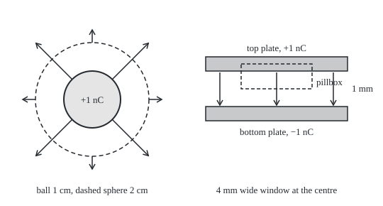

# Electric fields: Coulomb's law, flux through a closed surface, voltage as potential

[Syllabus](../../../SYLLABUS.md) → [Engineering mathematics](../README.md) → [Circuits and Electromagnetism](../README.md#s06) → Electric fields

---

## General Overview

A radio picks one station by tuning a coil against a capacitor ([RLC resonance](03-rlc-circuits-and-resonance.md)). The capacitor here is two metal plates, each 10 cm square, held 1 mm apart with air between them. Move 1 nC (one nanocoulomb, a billionth of a coulomb) of charge from the bottom plate to the top one. The top plate now holds +1 nC and the bottom −1 nC.

The engineer wants two numbers. How strong is the electric push in the gap? And what voltage would a meter read across the plates? From those comes the capacitance, the charge stored per volt, which sets the station the radio hears.

Coulomb's law gives the push between two small charges. Adding that up over a whole plate is hard work. Gauss's law skips the work: it says the field poking out through any closed surface counts the charge inside it.

Draw a small box around a patch of plate, and the field falls out in one line: 11294.1 volts per metre. The field is the same everywhere in the gap, so the voltage is that field times the gap: 11.294 V. That is 88.54 pF (picofarads, trillionths of a farad) of capacitance, which with a 250 µH coil tunes to 1069.7 kHz, in the AM band.

**Charge makes a field whose outward flux through any closed surface equals the charge inside divided by a constant, ε0; symmetry then gives the field of a sphere or a pair of plates in one line, and adding the field along a path gives the voltage.**

**What kind of fact this is:** Coulomb's law is an experimental law for charges at rest. Gauss's law is a theorem that follows from it, proved on this card in Why it works. The plate formula is a model: exact for plates of endless size, and close when the plates are wide beside their gap.

### The picture: a charged ball, and the capacitor gap

<p align="center"></p>

Left, to scale at 40 px per cm: a metal ball of radius 1 cm holding the same 1 nC, and a dashed imaginary sphere of radius 2 cm. Arrow length is 0.8 px per kV/m: 72 px at the ball's surface, where the field is 89875.5 V/m, and 18 px on the dashed sphere, where it is 22468.9 V/m.

Right, to scale at 50 px per mm: the middle of the capacitor, gap 50 px. The dashed box is a pillbox, half in the metal, half in the gap. The arrows in the gap show direction only.

---

## The formula

Notation first, in words. A charge $q$ is measured in coulombs (C). The **electric field** $\mathbf E$ at a point is the force a small test charge would feel there, per coulomb of test charge, in newtons per coulomb, which is the same as volts per metre (V/m).

$\varepsilon_0$, read "epsilon nought", is the permittivity of empty space (a constant of nature that sets how much field a charge makes): 8.8541878188 × 10^−12 F/m (farads per metre), from NIST CODATA 2022. Air is so close to empty space that this card uses $\varepsilon_0$ for it.

**Coulomb's law.** Two charges $q_1$ and $q_2$ a distance $r$ apart push apart (same sign) or pull together (opposite signs) along the line joining them:

$$F = k\,\frac{q_1 q_2}{r^2}, \qquad k = \frac{1}{4\pi\varepsilon_0}, \qquad E = k\,\frac{Q}{r^2}$$

**Read it aloud:** the force grows with each charge and falls with the square of the distance, so a single charge $Q$ makes a field $kQ/r^2$ pointing straight away from it.

The constant $k$ is 8.987552 × 10^9 N m^2/C^2. At 1 cm from 1 nC the field is 89875.5 V/m.

**Gauss's law.** Wrap the charge in any closed surface $S$. The flux $\Phi$ is the field crossing the surface outward, added over its whole area ([Surface integrals](../../06-Calculus%20and%20analysis/09-Vector%20Calculus/05-surface-integrals-and-flux.md)):

$$\Phi = \oint_S \mathbf E \cdot \mathbf n\,dA = \frac{Q_{\text{in}}}{\varepsilon_0}$$

**Read it aloud:** the field leaving through a closed skin, added up, is the charge inside divided by epsilon nought, whatever the skin's shape and wherever the charge sits inside it.

For 1 nC inside, the flux is 112.9409 V m (volt-metres, field times area).

**Voltage as potential.** The potential difference from point $a$ to point $b$ is minus the field added along any path between them ([Conservative fields](../../06-Calculus%20and%20analysis/09-Vector%20Calculus/04-conservative-fields-and-potentials.md)):

$$V(b) - V(a) = -\int_a^b \mathbf E \cdot d\mathbf l$$

**Read it aloud:** walking with the field, the voltage drops by the field times the distance walked.

What symmetry makes of these:

$$\text{sphere, outside: } E = \frac{kQ}{r^2},\ V = \frac{kQ}{r} \qquad \text{plates: } E = \frac{\sigma}{\varepsilon_0},\ V = E\,d,\ C = \frac{Q}{V} = \frac{\varepsilon_0 A}{d}$$

| Symbol | Plain meaning | In our example | Push it up and the answer… |
| --- | --- | --- | --- |
| $q_1$, $q_2$, $Q$, $Q_{\text{in}}$ | charges, in coulombs; $Q_{\text{in}}$ is the charge inside a surface | 1 nC on each plate | field and voltage grow in step |
| $F$ | force between two charges, newtons | — | — |
| $\mathbf E$, $E$ | electric field and its size, V/m | 11294.1 V/m in the gap | — |
| $\varepsilon_0$, $k$ | permittivity of empty space; Coulomb's constant $1/(4\pi\varepsilon_0)$ | 8.8541878188 × 10^−12 F/m; 8.987552 × 10^9 N m^2/C^2 | larger $\varepsilon_0$, weaker field |
| $r$, $R$ | distance from a charge or a sphere's centre; the ball's radius | $R$ = 1 cm | field falls as $1/r^2$ |
| $S$, $\mathbf n$, $dA$ | a closed surface; its outward arrow of length one; a small patch of it | sphere of 2 cm; pillbox | the flux does not change |
| $\Phi$ | flux: outward field added over the surface, V m | 112.9409 V m for 1 nC | — |
| $\sigma$, $\rho$ | charge per square metre of plate; charge per cubic metre, for the point form with divergence $\nabla\cdot$ | 100.0 nC/m^2 on the plates | stronger field |
| $A$, $A_{\text{box}}$, $d$ | plate area; a pillbox face's area; gap | 10 cm × 10 cm; 1 mm | more $A$: more C; more $d$: more V, less C |
| $V$, $a$, $b$, $d\mathbf l$ | potential, volts; a path's start and end; a small step along it | 11.294 V across the plates | — |
| $C$ | capacitance: charge stored per volt, farads | 88.54 pF | lower tuned frequency |
| $\theta$, $d\Omega$ | tilt of a patch from square-on; the solid angle it covers, seen from the charge | — | — |

### When it holds

- **Charges at rest.** Coulomb's law and the potential are for statics. When currents change or magnets move, the changing magnetic field drives an electric field whose loop integral is not zero, and voltage stops being a single-valued potential ([Magnetic fields](05-magnetism-and-faradays-law.md)). Gauss's law itself survives as one of [Maxwell's equations](07-maxwells-equations.md).
- **Symmetry, for the one-line answers.** Gauss's law always holds, but it gives the field only when symmetry makes the field the same size and square to the surface over each piece of it. A cube around a point charge still has flux 112.9409 V m, but the field on its faces varies, so the law alone cannot give it.
- **Plates wide beside their gap.** The plate formula assumes plates of endless size. With the charge held evenly spread, the finite 10 cm plates at 1 mm fall 0.90% short of it at the centre. At a 50 mm gap the field at the centre is only 59.0% of the formula, and the voltage 348.5 V instead of 564.7 V. Real metal plates crowd their charge toward the edges and read a lower voltage still.
- **Air or empty space between.** An insulating material in the gap weakens the field by its relative permittivity (a factor above 1 set by the material), and the capacitance rises by the same factor.

---

## Why it works

### Step 0: the field thins out exactly as fast as the area grows

A point charge's field falls as $1/r^2$. A sphere's area grows as $r^2$. Multiply and $r$ cancels: every sphere round the charge carries the same flux. A field line (a line drawn along the field's direction), once started, cannot get lost. That is why only the charge inside counts.

### Step 1: one sphere round one charge

Put a sphere of radius $r$ round charge $Q$ at its centre. The field points straight out everywhere, the same size $kQ/r^2$. So the flux is that size times the area:

$$\Phi = \frac{kQ}{r^2}\cdot 4\pi r^2 = 4\pi k Q = \frac{Q}{\varepsilon_0}$$

That last step is why $k$ is written $1/(4\pi\varepsilon_0)$: the $4\pi$ is a sphere's area, absorbed into the constant once.

### Step 2: any closed surface, and charge outside counts zero

Look from the charge at a tiny patch of any surface. The flux through the patch depends only on the cone of directions it covers, called its solid angle (the patch's area seen square-on, divided by $r^2$). A tilted patch farther away covers the same cone as a small square-on patch close in, and passes the same flux. Every direction from the charge leaves the closed surface once more than it enters, so the total is the same as for the sphere.

A charge outside is different. Each cone from it enters the surface and leaves it, an equal number of times, and the in and out cancel. With many charges the fields add, so each charge's flux is counted separately, and the flux counts the total charge inside.

<details>
<summary>Detailed proof: flux through a small patch is charge times solid angle</summary>

A patch of area $dA$ at distance $r$, whose outward arrow $\mathbf n$ makes angle $\theta$ with the line from the charge, passes flux $\frac{kQ}{r^2}\cos\theta\,dA$. Its square-on area is $\cos\theta\,dA$, and $\cos\theta\,dA/r^2$ is the solid angle $d\Omega$ it covers. So the flux is $kQ\,d\Omega$. A closed surface round the charge covers all $4\pi$ of the solid angle once, net: flux $4\pi kQ = Q/\varepsilon_0$. For a charge outside, every cone crosses the surface an even number of times, with the outward and inward crossings alternating, so the net solid angle is 0. Adding over charges proves the law for any static arrangement.

</details>

The code checks this without symmetry. It adds Coulomb's field over the six faces of a 2 cm cube, with the 1 nC placed off-centre inside: 112.9486 V m, against 112.9409 from the law. Moved outside the cube, the same charge gives 0.0005 V m, zero up to the grid's error.

### Step 3: the same law at a single point

Shrink the surface to a tiny box round a point. The flux per unit volume is the divergence of the field ([Divergence and curl](../../06-Calculus%20and%20analysis/09-Vector%20Calculus/03-divergence-and-curl.md)), and the charge per unit volume is the charge density $\rho$. The [Divergence theorem](../../06-Calculus%20and%20analysis/09-Vector%20Calculus/07-divergence-theorem.md) turns the surface law into the point law and back:

$$\nabla\cdot\mathbf E = \frac{\rho}{\varepsilon_0}$$

Field lines start only where there is charge. This is the form Maxwell's equations use.

### Step 4: the charged sphere

Spread 1 nC evenly over a metal ball of radius 1 cm. Nothing picks out a direction, so the field points straight out and has one size at each distance. Take a sphere of radius $r$ as the surface.

- **Outside**, $r$ > 1 cm, all the charge is inside: $E \cdot 4\pi r^2 = Q/\varepsilon_0$, so $E = kQ/r^2$, exactly as if the charge sat at the centre. At 2 cm: 22468.9 V/m.
- **Inside**, $r$ < 1 cm, no charge is inside: $E = 0$.

The code gets both answers the long way, by adding the Coulomb fields of thin rings round the ball: 22468.9 V/m at 2 cm and 0.0 at 0.5 cm.

### Step 5: the plates, with a pillbox

Take the top plate. Its charge sits on its inner face, spread evenly at $\sigma = Q/A$. Away from the edges the field must point straight across the gap: a sideways part would have no reason to pick left over right.

Draw a pillbox, a short flat box, with one face inside the metal and one face in the gap, as in the picture. In the metal the field is zero: if it were not, the free charges in the metal would move until it was. The side walls run along the field and pass no flux. Only the face in the gap counts:

$$E \cdot A_{\text{box}} = \frac{\sigma A_{\text{box}}}{\varepsilon_0} \quad\Rightarrow\quad E = \frac{\sigma}{\varepsilon_0}$$

With 100.0 nC/m^2, the field is 11294.1 V/m, pointing from the + plate to the − plate. It does not depend on where in the gap the box ends, so the field is the same all the way across.

Another way to see it: each plate alone, as a sheet, gives $\sigma/(2\varepsilon_0)$ on both sides. Between the plates the two halves add. Outside they cancel.

### Step 6: from field to voltage

Static fields of charges have zero curl (no circulation round any point), since each is minus the gradient of $kq/r$, the arrow pointing along its fastest rise. So the voltage between two points does not depend on the path ([Conservative fields](../../06-Calculus%20and%20analysis/09-Vector%20Calculus/04-conservative-fields-and-potentials.md)).

- **Plates.** Walk straight across the gap against the field. The field is constant, so the integral is field times distance: $V = Ed$ = 11.294 V, top plate above bottom.
- **Sphere.** Walk in from very far away, where the potential is taken as zero, to the surface. Adding $kQ/r^2$ from infinity to $R$ gives $V = kQ/R$ = 898.76 V.

Then capacitance is charge per volt: $C = Q/V = \varepsilon_0 A/d$ = 88.54 pF. The same 1 nC that raises the ball to 898.76 V raises the plates to only 11.294 V. The −1 nC on the near plate cancels most of the potential the +1 nC would make alone, and that is why two close plates store so much charge per volt.

---

## Worked numbers, by hand

The tuning capacitor, then the ball.

| Step | Arithmetic | Value |
| --- | --- | --- |
| charge per area | 1 nC / (0.1 m × 0.1 m) | 100.0 nC/m^2 |
| field in the gap | 100.0 × 10^−9 / 8.8541878188 × 10^−12 | 11294.1 V/m |
| voltage | 11294.1 V/m × 0.001 m | **11.294 V** |
| capacitance | 1 nC / 11.294 V | 88.54 pF |
| tuning with 250 µH | 1 / (2π √(250 µH × 88.54 pF)) | 1069.7 kHz |
| ball, field at its surface | 8.987552 × 10^9 × 10^−9 / 0.01^2 | 89875.5 V/m |
| ball, potential | 8.987552 × 10^9 × 10^−9 / 0.01 | **898.76 V** |

The 1 nC on the tuning plates reads 11.294 V on a meter; the capacitor's 88.54 pF is enough, with a 250 µH coil, to put the radio at 1069.7 kHz.

### What breaks if you drop a piece

| Mistake | Comes out at | What went wrong |
| --- | --- | --- |
| One sheet's field, $\sigma/(2\varepsilon_0)$, used for the gap | 5.647 V | Both plates push the same way in the gap; their fields add |
| Coulomb's point-charge field $kQ/d^2$ across the gap | 8987.6 V | The plate's charge is spread over 10 cm, not piled at one point 1 mm away |
| $kQ/r^2$ inside the ball, at 0.5 cm | 359502.1 V/m | No charge is inside a smaller sphere; the true field is 0.0 |
| The plate formula at a 50 mm gap | 564.7 V | The plates are no longer wide beside the gap; adding Coulomb over them, with the charge held evenly spread, gives 348.5 V, and real metal plates read lower still |

The code prints all four.

---

## Code, from first principles, and it actually runs

Both programs take two roads. Road 1 is Gauss's law in closed form, as above. Road 2 ignores Gauss's law and adds Coulomb's law over the charge, piece by piece: over a cube's six faces for the flux, over thin rings for the ball, over the square plates in angle slices for the capacitor.

Then it adds the field along a path to get the voltage: across the gap for the plates, in from infinity for the ball. A known closed form for a square sheet's field checks the plate sums a third way. The plate charge is held evenly spread, a model: real metal plates crowd extra charge toward their edges.

### Python

```python
# Electric fields, Gauss's law and voltage -- the check behind the card.  Standard library only.
# A radio's tuning capacitor: two square plates 10 cm across, 1 mm of air apart, +1 nC and -1 nC.
# Road 1: Gauss's law in closed form.  Road 2: Coulomb's law summed piece by piece over the charge,
# then the field integrated along a path to get the voltage.  A closed-form square-sheet field is a third.
import math

EPS0 = 8.8541878188e-12          # F/m, NIST CODATA 2022
K = 1 / (4 * math.pi * EPS0)     # Coulomb's constant, N m^2/C^2
Q = 1e-9                         # C, charge on each plate (+Q on top, -Q below)
SIDE, GAP = 0.10, 0.001          # m, plate side and gap
R_BALL = 0.01                    # m, radius of the charged sphere
L_COIL = 250e-6                  # H, tuning coil

def simpson(f, lo, hi, n):       # Simpson's rule, n even
    h = (hi - lo) / n
    return h / 3 * (f(lo) + f(hi) + sum((4 if i % 2 else 2) * f(lo + i * h) for i in range(1, n)))

def coulomb_E(q, src, at):       # field vector of a point charge q at src, felt at point at
    d = [at[i] - src[i] for i in range(3)]
    r = math.sqrt(sum(c * c for c in d))
    return [K * q * c / r ** 3 for c in d]

def cube_flux(src, half=0.01, n=60):   # flux out of a 2 cm cube centred at 0, midpoint rule, 6 faces
    total, h = 0.0, 2 * half / n
    for axis in range(3):
        for sign in (1, -1):
            for i in range(n):
                for j in range(n):
                    p = [0.0, 0.0, 0.0]
                    p[axis] = sign * half
                    p[(axis + 1) % 3] = -half + (i + 0.5) * h
                    p[(axis + 2) % 3] = -half + (j + 0.5) * h
                    total += sign * coulomb_E(Q, src, p)[axis] * h * h
    return total

def shell_E(r, R=R_BALL):        # charge Q spread evenly on a sphere: add rings, field along the axis
    def ring(th):                # ring at polar angle th holds Q sin(th)/2 dth
        dz, rho = r - R * math.cos(th), R * math.sin(th)
        return K * (Q * math.sin(th) / 2) * dz / (dz * dz + rho * rho) ** 1.5
    return simpson(ring, 0, math.pi, 2000)

def sheet_E(z, sigma):           # uniform square sheet: Coulomb summed in polar angles about the foot point
    rho = lambda p: (SIDE / 2) / math.cos(p)          # distance to the edge, 0 <= p <= 45 degrees
    # a patch at angle t from the vertical adds K sigma sin(t) dt dp along the axis; 8 equal slices
    return 8 * K * sigma * simpson(lambda p: simpson(math.sin, 0, math.atan2(rho(p), z), 32), 0, math.pi / 4, 32)

def sheet_closed(z, sigma):      # the known closed form for a uniform square sheet, on its axis
    return sigma / (math.pi * EPS0) * math.atan(SIDE ** 2 / (4 * z * math.sqrt(z * z + SIDE ** 2 / 2)))

def plates(gap, q=Q):            # road 2 for the plates: field midway and voltage along the axis
    s = q / SIDE ** 2
    E_mid = 2 * sheet_E(gap / 2, s)
    V = simpson(lambda z: sheet_E(z, s) + sheet_E(gap - z, s), 0, gap, 40)
    return E_mid, V

def line(label, value): print(f"{label:<52}{value}")

# ---- Coulomb and Gauss: the flux through a closed surface counts the charge inside ----
line("k = 1/(4 pi eps0), N m^2/C^2", f"{K / 1e9:.6f} x 10^9")
E1 = K * Q / R_BALL ** 2
line("Coulomb field of 1 nC at 1 cm, V/m", f"{E1:.1f}")
gauss_flux = Q / EPS0
f_in, f_out = cube_flux((0.002, 0.001, -0.003)), cube_flux((0.03, 0.0, 0.0))
line("Gauss: flux = Q/eps0, V m", f"{gauss_flux:.4f}")
line("Coulomb summed over a cube, charge inside, V m", f"{f_in:.4f}")
line("Coulomb summed over a cube, charge outside, V m", f"{abs(f_out):.4f}")
assert abs(f_in / gauss_flux - 1) < 1e-4 and abs(f_out) < 1e-4 * gauss_flux

# ---- the charged sphere: Gauss's law with a sphere as the closed surface ----
for r in (0.02, 0.005):
    gauss = K * Q / r ** 2 if r > R_BALL else 0.0
    line(f"sphere, field at {r * 100:.1f} cm: Gauss | rings, V/m", f"{gauss:.1f} | {abs(shell_E(r)):.1f}")
    assert abs(shell_E(r) - gauss) < 1e-6 * E1
V_ball = K * Q / R_BALL
# voltage = field added along the way out to infinity; u = 1/r makes that run 0 < u < 1/R, dr = du/u^2
n, top = 40, 1 / R_BALL
V_ball_num = sum(shell_E(1 / u) / u ** 2 * top / n for u in ((i + 0.5) * top / n for i in range(n)))
line("sphere potential: kQ/R | ring field integrated, V", f"{V_ball:.2f} | {V_ball_num:.2f}")
assert abs(V_ball_num - V_ball) < 1e-5 * V_ball

# ---- the plates: pillbox gives sigma/eps0, then V = E d ----
sigma = Q / SIDE ** 2
E_gauss = sigma / EPS0
V_gauss = E_gauss * GAP
line("plates: sigma, nC/m^2", f"{sigma * 1e9:.1f}")
line("plates: E = sigma/eps0, V/m", f"{E_gauss:.1f}")
line("plates: V = E d, V", f"{V_gauss:.3f}")
E_num, V_num = plates(GAP)
line("Coulomb over finite plates: E at centre, V/m", f"{E_num:.1f}")
line("Coulomb over finite plates: V along the axis, V", f"{V_num:.3f}")
line("finite plates against Gauss, field shortfall, %", f"{100 * (1 - E_num / E_gauss):.2f}")
assert abs(E_num / E_gauss - 1) < 0.015 and abs(V_num / V_gauss - 1) < 0.015
assert abs(sheet_E(GAP / 2, sigma) - sheet_closed(GAP / 2, sigma)) < 1e-6 * E_gauss
C = Q / V_gauss
line("capacitance C = Q/V = eps0 A/d, pF", f"{C * 1e12:.2f} | {EPS0 * SIDE ** 2 / GAP * 1e12:.2f}")
f_tune = 1 / (2 * math.pi * math.sqrt(L_COIL * C))
line("tunes with 250 uH to, kHz", f"{f_tune / 1e3:.1f}")
line("same 1 nC: plate voltage | sphere voltage, V", f"{V_gauss:.3f} | {V_ball:.2f}")

# ---- what breaks ----
line("mistake 1, one sheet's field sigma/(2 eps0): V", f"{V_gauss / 2:.3f}")
line("mistake 2, point-charge kQ/d^2 across the gap: V", f"{K * Q / GAP ** 2 * GAP:.1f}")
line("mistake 3, kQ/r^2 inside the sphere at 0.5 cm: V/m", f"{K * Q / 0.005 ** 2:.1f}")
line("sign slip, minus dropped: top minus bottom, V", f"{-V_gauss:.3f}")
E50, V50 = plates(0.05)
line("mistake 4, 50 mm gap: Gauss V | finite plates V", f"{E_gauss * 0.05:.1f} | {V50:.1f}")
line("50 mm gap: field at centre, % of Gauss", f"{100 * E50 / E_gauss:.1f}")
assert E50 < 0.7 * E_gauss and abs(sheet_E(0.025, sigma) - sheet_closed(0.025, sigma)) < 1e-6 * E_gauss

# ---- try changing ----
line("try: gap 2 mm, C pF | tuning kHz", f"{EPS0 * SIDE ** 2 / 0.002 * 1e12:.2f} | "
     f"{1 / (2 * math.pi * math.sqrt(L_COIL * EPS0 * SIDE ** 2 / 0.002)) / 1e3:.1f}")
line("try: 3 nC on the plates, V", f"{3 * V_gauss:.3f}")
line("try: sphere radius 2 cm, V", f"{K * Q / 0.02:.2f}")

# ---- figure: sphere at 40 px per cm, arrows 0.8 px per kV/m; plates at 50 px per mm ----
line("figure, px: sphere r | Gauss r | arrows 1 cm, 2 cm",
     f"{R_BALL * 4000:.0f} | {0.02 * 4000:.0f} | {E1 / 1e3 * 0.8:.0f}, {K * Q / 0.02 ** 2 / 1e3 * 0.8:.0f}")
line("figure, plate gap px", f"{GAP * 50000:.0f}")
print("ALL CHECKS PASS")
```

**Ran 2026-11-11 on macOS, Python 3.14.10, standard library only. All checks passed. Output, pasted from the run:**

```
k = 1/(4 pi eps0), N m^2/C^2                        8.987552 x 10^9
Coulomb field of 1 nC at 1 cm, V/m                  89875.5
Gauss: flux = Q/eps0, V m                           112.9409
Coulomb summed over a cube, charge inside, V m      112.9486
Coulomb summed over a cube, charge outside, V m     0.0005
sphere, field at 2.0 cm: Gauss | rings, V/m         22468.9 | 22468.9
sphere, field at 0.5 cm: Gauss | rings, V/m         0.0 | 0.0
sphere potential: kQ/R | ring field integrated, V   898.76 | 898.76
plates: sigma, nC/m^2                               100.0
plates: E = sigma/eps0, V/m                         11294.1
plates: V = E d, V                                  11.294
Coulomb over finite plates: E at centre, V/m        11192.4
Coulomb over finite plates: V along the axis, V     11.192
finite plates against Gauss, field shortfall, %     0.90
capacitance C = Q/V = eps0 A/d, pF                  88.54 | 88.54
tunes with 250 uH to, kHz                           1069.7
same 1 nC: plate voltage | sphere voltage, V        11.294 | 898.76
mistake 1, one sheet's field sigma/(2 eps0): V      5.647
mistake 2, point-charge kQ/d^2 across the gap: V    8987.6
mistake 3, kQ/r^2 inside the sphere at 0.5 cm: V/m  359502.1
sign slip, minus dropped: top minus bottom, V       -11.294
mistake 4, 50 mm gap: Gauss V | finite plates V     564.7 | 348.5
50 mm gap: field at centre, % of Gauss              59.0
try: gap 2 mm, C pF | tuning kHz                    44.27 | 1512.8
try: 3 nC on the plates, V                          33.882
try: sphere radius 2 cm, V                          449.38
figure, px: sphere r | Gauss r | arrows 1 cm, 2 cm  40 | 80 | 72, 18
figure, plate gap px                                50
ALL CHECKS PASS
```

### Rust

```rust
// Electric fields, Gauss's law and voltage -- the check behind the card.  std only, no crates.
// A radio's tuning capacitor: two square plates 10 cm across, 1 mm of air apart, +1 nC and -1 nC.
// Road 1: Gauss's law in closed form.  Road 2: Coulomb's law summed piece by piece over the charge,
// then the field integrated along a path to get the voltage.  A closed-form square-sheet field is a third.
use std::f64::consts::PI;

const EPS0: f64 = 8.8541878188e-12; // F/m, NIST CODATA 2022
const Q: f64 = 1e-9; // C, charge on each plate (+Q on top, -Q below)
const SIDE: f64 = 0.10; // m, plate side
const GAP: f64 = 0.001; // m, gap
const R_BALL: f64 = 0.01; // m, radius of the charged sphere
const L_COIL: f64 = 250e-6; // H, tuning coil

fn k() -> f64 { 1.0 / (4.0 * PI * EPS0) } // Coulomb's constant, N m^2/C^2

fn simpson(f: &dyn Fn(f64) -> f64, lo: f64, hi: f64, n: usize) -> f64 {
    let h = (hi - lo) / n as f64;
    let mut s = 0.0;
    for i in 1..n { s += (if i % 2 == 1 { 4.0 } else { 2.0 }) * f(lo + i as f64 * h); }
    h / 3.0 * (f(lo) + f(hi) + s)
}

fn coulomb_e(q: f64, src: [f64; 3], at: [f64; 3]) -> [f64; 3] {
    let d = [at[0] - src[0], at[1] - src[1], at[2] - src[2]];
    let r = (d[0] * d[0] + d[1] * d[1] + d[2] * d[2]).sqrt();
    [k() * q * d[0] / r.powi(3), k() * q * d[1] / r.powi(3), k() * q * d[2] / r.powi(3)]
}

fn cube_flux(src: [f64; 3]) -> f64 { // flux out of a 2 cm cube centred at 0, midpoint rule, 6 faces
    let (half, n) = (0.01, 60usize);
    let h = 2.0 * half / n as f64;
    let mut total = 0.0;
    for axis in 0..3 {
        for sign in [1.0, -1.0] {
            for i in 0..n {
                for j in 0..n {
                    let mut p = [0.0; 3];
                    p[axis] = sign * half;
                    p[(axis + 1) % 3] = -half + (i as f64 + 0.5) * h;
                    p[(axis + 2) % 3] = -half + (j as f64 + 0.5) * h;
                    total += sign * coulomb_e(Q, src, p)[axis] * h * h;
                }
            }
        }
    }
    total
}

fn shell_e(r: f64) -> f64 { // charge Q spread evenly on a sphere: add rings, field along the axis
    let ring = |th: f64| {
        let (dz, rho) = (r - R_BALL * th.cos(), R_BALL * th.sin());
        k() * (Q * th.sin() / 2.0) * dz / (dz * dz + rho * rho).powf(1.5)
    };
    simpson(&ring, 0.0, PI, 2000)
}

fn sheet_e(z: f64, sigma: f64) -> f64 { // uniform square sheet: Coulomb summed in polar angles
    let rho = |p: f64| (SIDE / 2.0) / p.cos();
    let inner = |p: f64| simpson(&|t: f64| t.sin(), 0.0, rho(p).atan2(z), 32);
    8.0 * k() * sigma * simpson(&inner, 0.0, PI / 4.0, 32)
}

fn sheet_closed(z: f64, sigma: f64) -> f64 {
    sigma / (PI * EPS0) * (SIDE.powi(2) / (4.0 * z * (z * z + SIDE.powi(2) / 2.0).sqrt())).atan()
}

fn plates(gap: f64) -> (f64, f64) { // road 2 for the plates: field midway, voltage along the axis
    let s = Q / SIDE.powi(2);
    let e_mid = 2.0 * sheet_e(gap / 2.0, s);
    let v = simpson(&|z: f64| sheet_e(z, s) + sheet_e(gap - z, s), 0.0, gap, 40);
    (e_mid, v)
}

fn line(label: &str, value: String) { println!("{:<52}{}", label, value); }

fn main() {
    let kk = k();
    // ---- Coulomb and Gauss: the flux through a closed surface counts the charge inside ----
    line("k = 1/(4 pi eps0), N m^2/C^2", format!("{:.6} x 10^9", kk / 1e9));
    let e1 = kk * Q / R_BALL.powi(2);
    line("Coulomb field of 1 nC at 1 cm, V/m", format!("{:.1}", e1));
    let gauss_flux = Q / EPS0;
    let (f_in, f_out) = (cube_flux([0.002, 0.001, -0.003]), cube_flux([0.03, 0.0, 0.0]));
    line("Gauss: flux = Q/eps0, V m", format!("{:.4}", gauss_flux));
    line("Coulomb summed over a cube, charge inside, V m", format!("{:.4}", f_in));
    line("Coulomb summed over a cube, charge outside, V m", format!("{:.4}", f_out.abs()));
    assert!((f_in / gauss_flux - 1.0).abs() < 1e-4 && f_out.abs() < 1e-4 * gauss_flux);

    // ---- the charged sphere ----
    for r in [0.02, 0.005] {
        let gauss = if r > R_BALL { kk * Q / (r * r) } else { 0.0 };
        line(&format!("sphere, field at {:.1} cm: Gauss | rings, V/m", r * 100.0),
             format!("{:.1} | {:.1}", gauss, shell_e(r).abs()));
        assert!((shell_e(r) - gauss).abs() < 1e-6 * e1);
    }
    let v_ball = kk * Q / R_BALL;
    let (n, top) = (40usize, 1.0 / R_BALL);
    let mut v_ball_num = 0.0;
    for i in 0..n {
        let u = (i as f64 + 0.5) * top / n as f64;
        v_ball_num += shell_e(1.0 / u) / (u * u) * top / n as f64;
    }
    line("sphere potential: kQ/R | ring field integrated, V", format!("{:.2} | {:.2}", v_ball, v_ball_num));
    assert!((v_ball_num - v_ball).abs() < 1e-5 * v_ball);

    // ---- the plates ----
    let sigma = Q / SIDE.powi(2);
    let e_gauss = sigma / EPS0;
    let v_gauss = e_gauss * GAP;
    line("plates: sigma, nC/m^2", format!("{:.1}", sigma * 1e9));
    line("plates: E = sigma/eps0, V/m", format!("{:.1}", e_gauss));
    line("plates: V = E d, V", format!("{:.3}", v_gauss));
    let (e_num, v_num) = plates(GAP);
    line("Coulomb over finite plates: E at centre, V/m", format!("{:.1}", e_num));
    line("Coulomb over finite plates: V along the axis, V", format!("{:.3}", v_num));
    line("finite plates against Gauss, field shortfall, %", format!("{:.2}", 100.0 * (1.0 - e_num / e_gauss)));
    assert!((e_num / e_gauss - 1.0).abs() < 0.015 && (v_num / v_gauss - 1.0).abs() < 0.015);
    assert!((sheet_e(GAP / 2.0, sigma) - sheet_closed(GAP / 2.0, sigma)).abs() < 1e-6 * e_gauss);
    let c = Q / v_gauss;
    line("capacitance C = Q/V = eps0 A/d, pF", format!("{:.2} | {:.2}", c * 1e12, EPS0 * SIDE.powi(2) / GAP * 1e12));
    let f_tune = 1.0 / (2.0 * PI * (L_COIL * c).sqrt());
    line("tunes with 250 uH to, kHz", format!("{:.1}", f_tune / 1e3));
    line("same 1 nC: plate voltage | sphere voltage, V", format!("{:.3} | {:.2}", v_gauss, v_ball));

    // ---- what breaks ----
    line("mistake 1, one sheet's field sigma/(2 eps0): V", format!("{:.3}", v_gauss / 2.0));
    line("mistake 2, point-charge kQ/d^2 across the gap: V", format!("{:.1}", kk * Q / GAP.powi(2) * GAP));
    line("mistake 3, kQ/r^2 inside the sphere at 0.5 cm: V/m", format!("{:.1}", kk * Q / 0.005f64.powi(2)));
    line("sign slip, minus dropped: top minus bottom, V", format!("{:.3}", -v_gauss));
    let (e50, v50) = plates(0.05);
    line("mistake 4, 50 mm gap: Gauss V | finite plates V", format!("{:.1} | {:.1}", e_gauss * 0.05, v50));
    line("50 mm gap: field at centre, % of Gauss", format!("{:.1}", 100.0 * e50 / e_gauss));
    assert!(e50 < 0.7 * e_gauss && (sheet_e(0.025, sigma) - sheet_closed(0.025, sigma)).abs() < 1e-6 * e_gauss);

    // ---- try changing ----
    let c2 = EPS0 * SIDE.powi(2) / 0.002;
    line("try: gap 2 mm, C pF | tuning kHz", format!("{:.2} | {:.1}", c2 * 1e12, 1.0 / (2.0 * PI * (L_COIL * c2).sqrt()) / 1e3));
    line("try: 3 nC on the plates, V", format!("{:.3}", 3.0 * v_gauss));
    line("try: sphere radius 2 cm, V", format!("{:.2}", kk * Q / 0.02));

    // ---- figure: sphere at 40 px per cm, arrows 0.8 px per kV/m; plates at 50 px per mm ----
    line("figure, px: sphere r | Gauss r | arrows 1 cm, 2 cm",
         format!("{:.0} | {:.0} | {:.0}, {:.0}", R_BALL * 4000.0, 0.02 * 4000.0, e1 / 1e3 * 0.8, kk * Q / 0.02f64.powi(2) / 1e3 * 0.8));
    line("figure, plate gap px", format!("{:.0}", GAP * 50000.0));
    println!("ALL CHECKS PASS");
}
```

**Ran 2026-11-11 on macOS, rustc 1.98.1, no crates. All checks passed. Output, pasted from the run:**

```
k = 1/(4 pi eps0), N m^2/C^2                        8.987552 x 10^9
Coulomb field of 1 nC at 1 cm, V/m                  89875.5
Gauss: flux = Q/eps0, V m                           112.9409
Coulomb summed over a cube, charge inside, V m      112.9486
Coulomb summed over a cube, charge outside, V m     0.0005
sphere, field at 2.0 cm: Gauss | rings, V/m         22468.9 | 22468.9
sphere, field at 0.5 cm: Gauss | rings, V/m         0.0 | 0.0
sphere potential: kQ/R | ring field integrated, V   898.76 | 898.76
plates: sigma, nC/m^2                               100.0
plates: E = sigma/eps0, V/m                         11294.1
plates: V = E d, V                                  11.294
Coulomb over finite plates: E at centre, V/m        11192.4
Coulomb over finite plates: V along the axis, V     11.192
finite plates against Gauss, field shortfall, %     0.90
capacitance C = Q/V = eps0 A/d, pF                  88.54 | 88.54
tunes with 250 uH to, kHz                           1069.7
same 1 nC: plate voltage | sphere voltage, V        11.294 | 898.76
mistake 1, one sheet's field sigma/(2 eps0): V      5.647
mistake 2, point-charge kQ/d^2 across the gap: V    8987.6
mistake 3, kQ/r^2 inside the sphere at 0.5 cm: V/m  359502.1
sign slip, minus dropped: top minus bottom, V       -11.294
mistake 4, 50 mm gap: Gauss V | finite plates V     564.7 | 348.5
50 mm gap: field at centre, % of Gauss              59.0
try: gap 2 mm, C pF | tuning kHz                    44.27 | 1512.8
try: 3 nC on the plates, V                          33.882
try: sphere radius 2 cm, V                          449.38
figure, px: sphere r | Gauss r | arrows 1 cm, 2 cm  40 | 80 | 72, 18
figure, plate gap px                                50
ALL CHECKS PASS
```

The two outputs match line for line.

### Lean

Lean proves Gauss's law for a sphere centred on one point charge, the field as minus a gradient, and the plate capacitance.

- Take a charge $q$ and a sphere of any radius $r > 0$ centred on it. Then the outward flux of its Coulomb field through the sphere is $q/\varepsilon_0$.
- Take a point charge $q$. Then away from the charge, its field is minus the gradient of the potential $kq/r$.
- Take plates of area $A$, gap $d$ and charge $Q \neq 0$, with field $\sigma/\varepsilon_0$ and $V = Ed$. Then $C = Q/V = \varepsilon_0 A/d$.

Other closed surfaces, charge outside, the charged ball, finite plates and the decimals are left to the Python and Rust checks.

```lean
-- Electric fields: a point charge's Coulomb field sends flux q/ε₀ out through every sphere centred on it, is minus the gradient of the potential q/(4πε₀r), and parallel plates give capacitance ε₀A/d.
import Mathlib.MeasureTheory.Constructions.HaarToSphere
import Mathlib.MeasureTheory.Measure.Lebesgue.VolumeOfBalls
import Mathlib.MeasureTheory.Integral.Bochner.Basic
import Mathlib.Analysis.Calculus.Gradient.Basic
import Mathlib.Analysis.InnerProductSpace.PiL2
import Mathlib.Analysis.SpecialFunctions.Sqrt
import Mathlib.Analysis.InnerProductSpace.Calculus

open MeasureTheory Metric Real InnerProductSpace

/-- Coulomb's law: the field at `x` of a charge `q` sitting at `p`, in space with permittivity `ε₀`,
is `k q (x - p) / ‖x - p‖³` with `k = 1/(4π ε₀)`: size `k q / r²`, pointing straight away from `p`. -/
noncomputable def coulombField (ε₀ q : ℝ) (p x : EuclideanSpace ℝ (Fin 3)) :
    EuclideanSpace ℝ (Fin 3) :=
  (q / (4 * π * ε₀) / ‖x - p‖ ^ 3) • (x - p)

/-- Helper: the unit sphere in 3-space has total surface measure `4π`. -/
lemma toSphere_real_univ_fin_three :
    (volume : Measure (EuclideanSpace ℝ (Fin 3))).toSphere.real Set.univ = 4 * π := by
  rw [Measure.real, Measure.toSphere_apply_univ, EuclideanSpace.volume_ball_fin_three]
  simp
  rw [ENNReal.toReal_ofReal (by positivity)]
  ring

/-- Gauss's law for a sphere round the charge: the outward flux of a point charge's field through a
sphere of any radius `r` centred on it equals the charge divided by `ε₀`. The point on the sphere is
`p + r u` for `u` on the unit sphere, the outward unit normal there is `u`, and the area element is
`r² dσ(u)`, where `σ` is the surface measure of the unit sphere (total area 4π). -/
theorem gauss_flux_through_sphere_eq_charge_div_eps0 (ε₀ q : ℝ) (p : EuclideanSpace ℝ (Fin 3))
    {r : ℝ} (hr : 0 < r) :
    ∫ u : sphere (0 : EuclideanSpace ℝ (Fin 3)) 1,
        ⟪coulombField ε₀ q p (p + r • (u : EuclideanSpace ℝ (Fin 3))),
          (u : EuclideanSpace ℝ (Fin 3))⟫_ℝ * r ^ 2 ∂(volume.toSphere) = q / ε₀ := by
  have key : ∀ u : sphere (0 : EuclideanSpace ℝ (Fin 3)) 1,
      ⟪coulombField ε₀ q p (p + r • (u : EuclideanSpace ℝ (Fin 3))),
          (u : EuclideanSpace ℝ (Fin 3))⟫_ℝ * r ^ 2 = q / (4 * π * ε₀) := by
    intro u
    have hu : ‖(u : EuclideanSpace ℝ (Fin 3))‖ = 1 := by simp
    simp only [coulombField, add_sub_cancel_left, norm_smul, hu, Real.norm_eq_abs, abs_of_pos hr,
      inner_smul_left, real_inner_self_eq_norm_sq]
    simp
    field_simp
  simp_rw [key]
  rw [integral_const, smul_eq_mul, toSphere_real_univ_fin_three]
  rcases eq_or_ne ε₀ 0 with rfl | he
  · simp
  field_simp

/-- Voltage as potential: away from the charge, the Coulomb field is minus the gradient of the
potential `V(x) = k q / ‖x - p‖`, so adding the field along any path gives the same voltage. -/
theorem coulomb_field_eq_neg_gradient_of_potential (ε₀ q : ℝ) {p x : EuclideanSpace ℝ (Fin 3)}
    (hx : x ≠ p) :
    HasGradientAt (fun y => q / (4 * π * ε₀) / ‖y - p‖) (-coulombField ε₀ q p x) x := by
  set c := q / (4 * π * ε₀)
  have hv : x - p ≠ 0 := sub_ne_zero.mpr hx
  have hr : ‖x - p‖ ≠ 0 := norm_ne_zero_iff.mpr hv
  have h1 := ((hasFDerivAt_id x).sub_const p).norm_sq
  have h2 := h1.sqrt (by simpa using hr)
  have h3 := ((hasDerivAt_inv (by simpa using hr : √(‖x - p‖ ^ 2) ≠ 0)).const_mul c).comp_hasFDerivAt
    x h2
  rw [hasGradientAt_iff_hasFDerivAt]
  convert h3 using 1
  · funext y
    simp [Real.sqrt_sq (norm_nonneg _), div_eq_mul_inv]
  · ext w
    simp [coulombField, Real.sqrt_sq (norm_nonneg _)]
    simp only [c]
    field_simp

/-- Parallel plates: with charge `Q` on plates of area `A` a gap `d` apart, the field is
`E = σ/ε₀` with `σ = Q/A`, the voltage is `V = E d`, and the capacitance `C = Q/V` equals `ε₀ A / d`. -/
theorem parallel_plate_capacitance (Q A d ε₀ : ℝ) (hQ : Q ≠ 0) :
    Q / ((Q / A / ε₀) * d) = ε₀ * A / d := by
  rcases eq_or_ne A 0 with rfl | hA
  · simp
  rcases eq_or_ne ε₀ 0 with rfl | he
  · simp
  rcases eq_or_ne d 0 with rfl | hd
  · simp
  field_simp

#print axioms toSphere_real_univ_fin_three
#print axioms gauss_flux_through_sphere_eq_charge_div_eps0
#print axioms coulomb_field_eq_neg_gradient_of_potential
#print axioms parallel_plate_capacitance
```

**Checked 2026-11-14 on macOS, Lean 4.36.0-rc2, Mathlib v4.36.0-rc2. Every proof is complete and uses only Lean's standard axioms. Output, pasted from the run:**

```
'toSphere_real_univ_fin_three' depends on axioms: [propext, Classical.choice, Quot.sound]
'gauss_flux_through_sphere_eq_charge_div_eps0' depends on axioms: [propext, Classical.choice, Quot.sound]
'coulomb_field_eq_neg_gradient_of_potential' depends on axioms: [propext, Classical.choice, Quot.sound]
'parallel_plate_capacitance' depends on axioms: [propext, Classical.choice, Quot.sound]
```

> [!TIP]
> **Try changing**
> - Guess first: double the gap to 2 mm. What happens to the capacitance and the station? Set `GAP = 0.002`. The capacitance halves to 44.27 pF and the tuning rises to 1512.8 kHz, as the `try:` line already prints. The run then stops at the finite-plate assert: at twice the gap, the 10 cm plates are less wide beside it and fall more than 1.5% short of Gauss.
> - Guess first: put 3 nC on the plates instead of 1 nC. Set `Q = 3e-9`. Field and voltage triple, to 33.882 V; the capacitance stays 88.54 pF. Every assert passes, though some labels still say 1 nC.
> - Guess first: a ball twice as big, radius 2 cm. Set `R_BALL = 0.02`, and move the outside test point from `0.02` to `0.03` so it no longer sits on the surface, where the ring sum divides zero by zero. The potential halves to 449.38 V and every assert passes.

---

## The usual mistake

> [!warning]
> **Pulling the field out of the flux integral without symmetry.** Gauss's law always gives the flux, but it gives the field only where symmetry makes the field the same size and square to every piece of the surface. Round a cube, the flux is still 112.9409 V m, but the field varies over each face, and dividing by the cube's area gives only an average, not the field at any point. For finite plates the symmetry is only approximate: at a 50 mm gap, with the charge held evenly spread, the field in the middle is 59.0% of $\sigma/\varepsilon_0$.
>
> - **Counting one plate.** One charged sheet makes $\sigma/(2\varepsilon_0)$. Use that for the gap and the voltage comes out at 5.647 V, half the true 11.294 V.
> - **Treating the plate as a point.** Coulomb's $kQ/d^2$ across a 1 mm gap predicts 8987.6 V.
> - **Field inside a hollow or metal ball.** Using $kQ/r^2$ at 0.5 cm gives 359502.1 V/m. No charge is inside that radius, so the field is 0.0.
> - **Mixing signs.** The field points from + to −; the voltage drops along it. Drop the minus sign in $-\int \mathbf E\cdot d\mathbf l$ and the top plate reads −11.294 V, below the bottom one instead of 11.294 V above it.

---

## Where you meet it in real life

- **Radio tuners.** The classic air-gap tuning capacitor is a stack of plates that turn into and out of mesh. Turning the knob changes the overlapping area $A$, so $C = \varepsilon_0 A/d$ and the tuned frequency change with it.
- **Touch screens.** A finger near a phone screen changes the capacitance between thin electrodes under the glass; the phone reads the change as a touch.
- **Capacitor design.** Parts makers shrink $d$ and fill the gap with an insulator to raise $C$; the field $V/d$ in that thin gap sets the voltage rating.
- **Shielding.** A closed metal box has no field inside from charges outside: the free charges in its wall move until the field inside is zero, as in the metal of Step 5. Sensitive radio stages sit in metal cans for this reason.
- **Lightning rods and sharp points.** On a ball, the surface field $kQ/R^2$ grows fast as $R$ shrinks at a given voltage $kQ/R$: field = voltage / $R$. A sharp tip has a tiny $R$, so the air breaks down there first.

> **Say it back**
> Coulomb's law gives the field of a point charge, falling as one over distance squared. Because area grows as distance squared, the flux out of any closed surface counts only the charge inside: that is Gauss's law. With a sphere or a flat plate, symmetry turns the law into the field in one line: $kQ/r^2$ outside a ball, $\sigma/\varepsilon_0$ between plates. Adding the field along a path gives the voltage: 11.294 V across the radio's 1 mm gap for 1 nC, so 88.54 pF. The plate formula is a model that holds while the plates are wide beside their gap.

---

## What this builds on

- [Surface integrals](../../06-Calculus%20and%20analysis/09-Vector%20Calculus/05-surface-integrals-and-flux.md): flux, the field crossing a surface added over its area.
- [Divergence and curl](../../06-Calculus%20and%20analysis/09-Vector%20Calculus/03-divergence-and-curl.md): divergence as outflow per unit volume, which becomes charge density.
- [Conservative fields](../../06-Calculus%20and%20analysis/09-Vector%20Calculus/04-conservative-fields-and-potentials.md): why a curl-free field has a potential, so voltage does not depend on the path.
- [Divergence theorem](../../06-Calculus%20and%20analysis/09-Vector%20Calculus/07-divergence-theorem.md): the bridge between Gauss's law on a surface and at a point.

## Where this goes next

- [Magnetic fields](05-magnetism-and-faradays-law.md): the field made by moving charge, and why a changing magnetic field breaks the "voltage depends only on the endpoints" rule.
- [Maxwell's equations](07-maxwells-equations.md): Gauss's law joins three more equations, and the set holds when charges move.

This card's charge was told where to sit. On real metal plates the charge arranges itself, crowding toward the edges, and finding that arrangement means solving for the potential everywhere: the question this card leaves open.

---

## Sources

Verified 2026-11-11: every link below resolves to the publisher's page, and the DOI was checked against Crossref for title and first author.

- NIST. "Vacuum electric permittivity", CODATA 2022 recommended value. [NIST reference page](https://physics.nist.gov/cgi-bin/cuu/Value?ep0). The value of $\varepsilon_0$ used throughout.
- Griffiths, David J. *Introduction to Electrodynamics*, 5th ed. Cambridge University Press, 2023. [doi:10.1017/9781009397735](https://doi.org/10.1017/9781009397735). Coulomb's law, Gauss's law in both forms, the potential, and the parallel-plate capacitor.
- OpenStax. *University Physics Volume 2*, section 6.3, "Applying Gauss's Law". [Publisher page](https://openstax.org/books/university-physics-volume-2/pages/6-3-applying-gausss-law). Free; the charged sphere and the charged plane by Gauss's law.
- OpenStax. *University Physics Volume 2*, section 8.1, "Capacitors and Capacitance". [Publisher page](https://openstax.org/books/university-physics-volume-2/pages/8-1-capacitors-and-capacitance). Free; integrating the plate field to a voltage and reading off $C = \varepsilon_0 A/d$.
