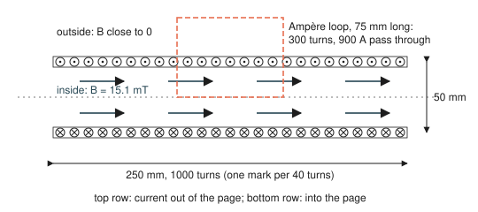
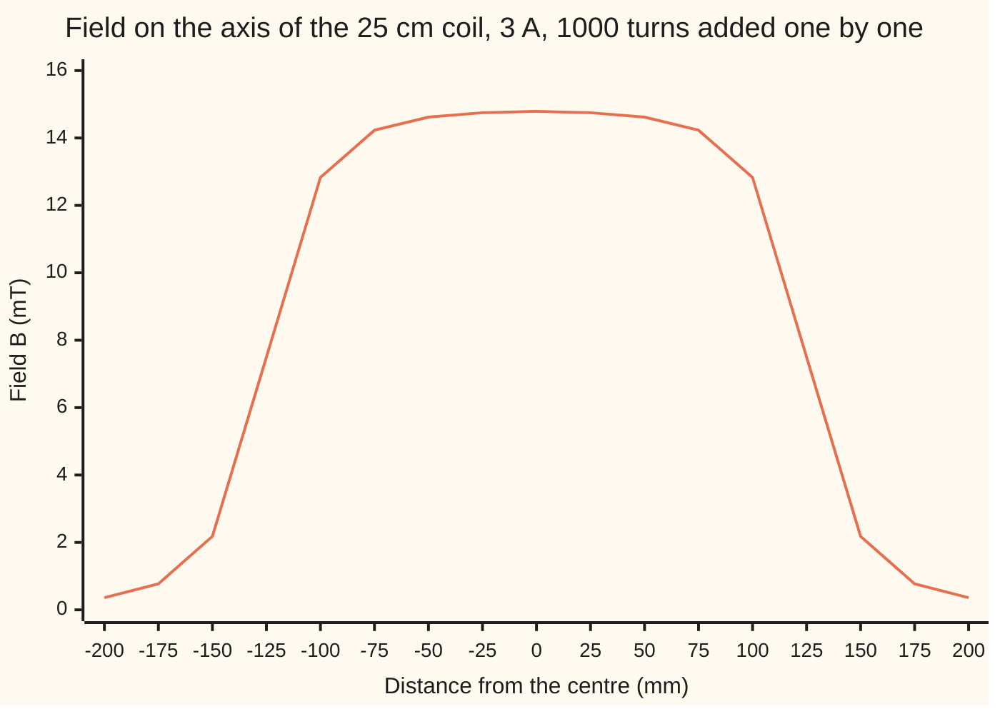
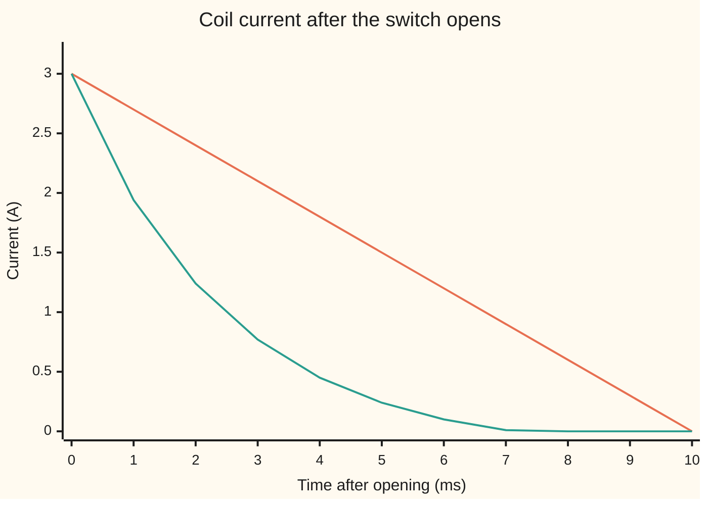

# Magnetic fields: currents make them, moving charges feel them, change induces voltage

[Syllabus](../../../SYLLABUS.md) → [Engineering mathematics](../README.md) → [Circuits and Electromagnetism](../README.md#s06) → Magnetic fields

---

## General Overview

A coil sits on a bench: 1000 turns of copper wire wound on a tube 25 cm long and 5 cm across. A 12-volt supply drives 3 amps through it; the wire's own resistance is 4 ohms. A switch will cut the current, ramping it from 3 A to zero in 10 milliseconds.

An engineer wants three numbers. How strong is the magnetic field inside? How hard does the coil resist a change in its current, a property called **inductance**? And what voltage appears across the coil while the current dies, the number that decides which switch survives?

The answers: 15.08 millitesla inside by the long-coil formula (14.79 mT at the true centre), nearly even over the middle 150 mm of the tube. An inductance of 9.87 millihenries. And 2.96 volts while the current falls over 10 ms.

That last number is gentle only because 10 ms is slow. A mechanical contact that snaps open in 10 microseconds asks the coil for 2961 volts, enough to jump the gap as a spark. A cheap diode (a part that lets current pass one way only) across the coil caps the voltage at the switch at 12.7 V.

All three answers come from three facts. A current makes a magnetic field that circles it. A changing field drives a voltage round any loop it threads. A moving charge feels a sideways push from the field.

<p align="center"></p>

To scale, 1.6 px per mm. The top row of wire carries current out of the page, the bottom row into it; one mark stands for 40 turns. Inside, the field runs along the axis. The dashed rectangle is the Ampère loop of Why it works, Step 1: 75 mm long, with 300 turns passing through it.

**A current makes a magnetic field, the field threading a coil's own turns makes it resist any change in its current, and that resistance shows up as a voltage equal to the inductance times the rate the current changes.**

**What kind of fact this is:** two laws of nature, Ampère's law and Faraday's law, found by experiment and part of [Maxwell's equations](07-maxwells-equations.md). The field and inductance formulas are then a model, exact for an endlessly long coil and checked on this card against the full calculation for this 25 cm one.

---

## The formula

Notation first, in words.

- $B$ is the **magnetic field** (strictly the flux density) in teslas, T.
- $\mu_0$ is the magnetic constant: how much field one amp makes in empty space.
- $I$ is the current in the wire, in amps.
- $N$ is the number of turns and $\ell$ the coil's length, so $n = N/\ell$ is the number of turns per metre of coil.
- $A$ is the area inside one turn.
- $\Phi$ is the **flux** through one turn: field times the area it crosses, in webers, Wb.
- $L$ is the inductance, in henries, H.
- The **emf** $\mathcal E$ (from "electromotive force", though it is a voltage, in volts) is the voltage a changing field drives round a loop.

$$B = \mu_0\, n\, I, \qquad L = \frac{N\Phi}{I} = \frac{\mu_0 N^2 A}{\ell}, \qquad \mathcal E = -\frac{d(N\Phi)}{dt} = -L\,\frac{dI}{dt}$$

**Read it aloud:** the field inside is the magnetic constant times the turns per metre times the current; the inductance is the flux linking all the turns per amp; and the voltage induced is minus the rate that linked flux changes, which is minus the inductance times the rate the current changes.

The third leg, the push on a moving charge, is the **Lorentz force**, with $\times$ the [Cross product](../../05-Geometry%20and%20trig/05-Vectors%20in%20Space/01-cross-product-and-oriented-area.md):

$$\mathbf F = q\,\mathbf v \times \mathbf B$$

**Read it aloud:** the force on a charge is its charge times its velocity crossed with the field: square to both, so it bends the path and never speeds the charge up.

| Symbol | Plain meaning | In our example | Push it up and the answer… |
| --- | --- | --- | --- |
| $B$ | magnetic field inside the coil, teslas (T) | 15.08 mT | more flux per turn, so more voltage when it changes |
| $\mu_0$ | the magnetic constant, how much field one amp makes in empty space | 1.25663706127 × 10⁻⁶ N/A² (NIST CODATA 2022) | fixed by nature |
| $N, \ell, n$ | number of turns; coil length, m; turns per metre, $N/\ell$ | 1000; 0.25 m; 4000 per m | $N$ up: $L$ grows as $N^2$; $\ell$ up at fixed $N$: weaker field, less $L$ |
| $I, I_0$ | current in the wire, amps (A); its value when the switch opens | 3 A; 3 A | $B$ and the stored energy grow |
| $r, A, z, \alpha_1, \alpha_2$ | coil radius; its cross-section $\pi r^2$; position along the axis from the centre; angles between the axis and the lines from that point to the two rims | 25 mm; 19.63 cm²; −200 to 200 mm | $r$ up: $L$ grows as $r^2$ |
| $\Phi, N\Phi$ | flux through one turn, $BA$, webers (Wb); flux linkage, the same summed over all turns | 29.61 µWb; 29.61 mWb | more induced voltage when it changes |
| $L, K_N$ | inductance, henries (H): linked flux per amp; the finite-length factor (Nagaoka's) | 9.87 mH ideal; 0.920 | bigger $L$: bigger voltage for the same switch-off |
| $\mathcal E, t, \Delta t$ | induced voltage (emf), V; time, s; the switch-off time | 2.96 V; 10 ms | $\Delta t$ down: the voltage soars |
| $\mathbf E, d\mathbf r, S, \partial S, \mathbf n$ | electric field; a short step round a loop; a surface spanning the loop; its edge, the loop itself; its unit normal | the loop is one turn | — |
| $W, R, V_D, \tau$ | energy stored in the field, joules (J); coil resistance; a diode's forward drop; the time constant $L/R$ | 0.0444 J; 4 Ω; 0.7 V; 2.47 ms | $W$ must all leave at switch-off; $R$ up: the current dies faster |
| $M, u, k, K, E$ | in the fold only: mutual inductance of two turns a distance $u$ apart; the elliptic modulus; the complete elliptic integrals (this $E$ is not the electric field) | $u$ from 0 to 0.25 m | $u$ up: $M$ falls |
| $q, m, \mathbf v, \mathbf F$ | a charge and its mass; its velocity; the force on it | electron, 5931 km/s | faster or lighter: wider circle |

### When it holds

- **The coil is long beside its width.** The formula $B = \mu_0 n I$ assumes an endless coil. This one is 250 mm long and 50 mm across, so the centre field is 0.9806 of the ideal and the inductance 0.920 of it. A 5 cm coil of the same turns and width breaks it: the formula says 75.40 mT, the true centre field is 53.31 mT.
- **No iron, only air inside.** Iron multiplies the field many times over and stops being linear when it saturates; $\mu_0$ alone no longer describes it.
- **The current changes slowly beside the light-crossing time** (the time light takes to cross the coil). At 10 ms the field everywhere in the coil keeps pace with the current; at radio frequencies the coil's turn-to-turn capacitance and wave effects join in ([Electromagnetic waves](08-electromagnetic-waves.md)).
- **The switch-off is the stated ramp.** $\mathcal E = -L\,dI/dt$ needs $dI/dt$. A contact that opens "instantly" has no finite $dI/dt$; the voltage climbs until something breaks down, which is why the switch sees thousands of volts.

---

## Why it works

### Step 0: fields circle currents, and loops add up

A straight wire's field circles it, by the right-hand rule: thumb along the current, fingers along the field. In a coil, the field from the top row of wire and the field from the bottom row both point the same way along the axis inside. Outside, the top row's field and the bottom row's field point opposite ways and nearly cancel.

So a long coil packs its field inside, uniform and along the axis. Two laws turn this picture into numbers: Ampère's law gives the field, Faraday's law gives the voltage.

### Step 1: Ampère's loop gives the field

**Ampère's law** says that the field added round any closed loop equals $\mu_0$ times the current passing through the loop:

$$\oint \mathbf B\cdot d\mathbf r = \mu_0\, I_{\text{through}}$$

The left side is a line integral round the loop ([Line integrals of a field](../../06-Calculus%20and%20analysis/09-Vector%20Calculus/02-line-integrals.md)). Take the dashed rectangle in the picture, 75 mm long. Along the side inside, $\mathbf B$ is along the step, giving $B \times 0.075$. The two short sides cross the field square on, so they add nothing. The side outside sits where the field is close to zero. On the right, $4000 \times 0.075 = 300$ turns pass through the rectangle, each carrying 3 A: 900 A in all. So

$$B \times 0.075 = \mu_0 \times 900, \qquad B = \mu_0 n I = 15.08\ \text{mT}.$$

The rectangle's length cancelled. That is why, in the ideal long coil, the field is the same all along the inside: any length gives the same $B$. Step 2 shows how far a real coil falls short.

### Step 2: add the turns one by one, and see where the ideal fails

The ideal coil is endless. A real one ends, and Ampère's law alone can't say how much that costs. The per-piece law, **Biot–Savart**, can: each short piece of current adds its own small field. Added round one turn of radius $r$, it gives the field on that turn's axis, a distance $z$ away:

$$B_{\text{one turn}} = \frac{\mu_0 I r^2}{2\,(r^2 + z^2)^{3/2}}$$

Adding the 1000 turns one by one gives 14.79 mT at the centre: 0.9806 of the ideal. Done as an integral, the same sum has a closed form, $\mu_0 n I(\cos\alpha_1 + \cos\alpha_2)/2$, where $\alpha_1, \alpha_2$ are the angles between the axis and the lines from the point to the two rims. Deep inside, both cosines are near 1. At an end, one is near 1 and the other 0: the field halves, to 7.50 mT.



The single line is the Biot–Savart sum. The coil runs from −125 to 125 mm. The field stays above 14.23 mT over the middle 150 mm, drops to about half at the ends, and is down to 0.36 mT 75 mm beyond them.

### Step 3: flux linkage gives the inductance

The flux through one turn is the field times its area: $\Phi = BA = 15.08\ \text{mT} \times 19.63\ \text{cm}^2 = 29.61$ µWb. Every one of the 1000 turns encloses that flux, so the **flux linkage** is $N\Phi = 29.61$ mWb. Divide by the current that made it:

$$L = \frac{N\Phi}{I} = \frac{\mu_0 N^2 A}{\ell} = 9.87\ \text{mH}.$$

**Why $N^2$:** $N$ enters once because more turns make more field, and once more because more turns each catch that field. Double the turns on the same tube and the inductance quadruples.

The ideal formula takes the full field to the ends. The real field sags there (Step 2), so the real coil links less flux. For a uniform sheet of current, Nagaoka's factor captures that: $K_N = 0.920$ for this coil's shape, so $L = 9.08$ mH. The centre field kept 0.9806 of the ideal; the inductance keeps only 0.920, losing more because it counts the weak ends as fully as the strong middle.

<details>
<summary>The full calculation: every slice of winding linking every other</summary>

Treat the winding as a sheet of current, $N/\ell$ turns per metre. Two single turns of radius $r$ a distance $u$ apart share a **mutual inductance** $M(u)$: the flux one current sends through the other turn, per amp. Maxwell found it in closed form:

$$M(u) = \mu_0 r\left[\left(\frac{2}{k} - k\right)K(k) - \frac{2}{k}E(k)\right], \qquad k^2 = \frac{4r^2}{4r^2 + u^2},$$

where $K$ and $E$ are the complete elliptic integrals, two standard functions computed in the code by the arithmetic–geometric mean (average two numbers both ways, arithmetic and geometric, and repeat until they agree). The coil's inductance adds $M$ over every pair of slices. Pairs a distance $u$ apart occupy a length $\ell - u$ of the coil, so

$$L = \left(\frac{N}{\ell}\right)^2 \, 2\int_0^\ell (\ell - u)\, M(u)\, du.$$

$M(u)$ grows like $-\ln u$ as $u \to 0$, which is still integrable; substituting $u = \ell s^2$ removes the trouble. The integral gives 9.080956 mH; Nagaoka's closed formula gives 9.080951 mH.

</details>

### Step 4: Faraday's law gives the voltage

**Faraday's law** says that the electric field added round a loop equals minus the rate of change of the flux through it:

$$\oint_{\partial S} \mathbf E\cdot d\mathbf r = -\frac{d}{dt}\iint_S \mathbf B\cdot\mathbf n\,dS.$$

[Stokes' theorem](../../06-Calculus%20and%20analysis/09-Vector%20Calculus/08-stokes-theorem.md) turns this into the point-by-point form $\operatorname{curl}\mathbf E = -\partial\mathbf B/\partial t$ (curl measures how much a field circles round each point); this card needs only the loop form. The left side, the push on charge round one turn, is that turn's emf. Each of the $N$ turns is in series, so the coil's voltage is $N$ times one turn's:

$$\mathcal E = -N\frac{d\Phi}{dt} = -L\frac{dI}{dt}.$$

Ramping 3 A to zero in 10 ms is $dI/dt = -300$ A/s, so $\mathcal E = 9.87\ \text{mH} \times 300 = 2.96$ V. The checks also get it from the field side, $NA\,\Delta B/\Delta t$, and the two agree.

**The minus sign is Lenz's law:** the induced voltage pushes to keep the old current flowing. While the current falls, the coil acts as a small battery trying to hold it up. So at switch-off the coil's voltage adds to the supply's, and the sum lands across the opening contact as the coil tries to push its current through it.

### Step 5: the energy has to go somewhere

The voltage at switch-off is the coil handing back the energy it stored. Building the current up from zero against $\mathcal E$ costs power $L I\,dI/dt$; added up, that is $W = \tfrac12 L I^2 = 0.0444$ J. The same energy sits in the field: $B^2/(2\mu_0)$ joules per cubic metre, over the coil's 490.87 cm³ volume. During the ramp, 2.96 V times the falling current, added over 10 ms, delivers exactly 0.0444 J. Three different sums, one number.

That fixes the trade-off. The energy is set; a faster switch-off delivers it in less time, which takes more voltage.

### Step 6: moving charges feel the field

The same field pushes on anything moving through it. Fire an electron across the inside of the coil, square to its axis, after a 100 V accelerating gap: it travels at 5931 km/s.

The push $q\mathbf v\times\mathbf B$ is always square to its motion, so it bends the path into a circle without changing speed. Setting the push equal to what a circle demands, $qvB = mv^2/\text{radius}$, gives a radius of $mv/(qB) = 2.24$ mm, and one lap takes 2.37 ns.

The checks step the electron round with RK4 (the fourth-order Runge–Kutta stepping method for differential equations) and measure the same 2.24 mm.

Summed over the electrons in a wire, the same push is the force on a current-carrying wire, which is how a motor or a loudspeaker works.

---

## Worked numbers, by hand

| Step | Arithmetic | Value |
| --- | --- | --- |
| turns per metre $n$ | 1000 ÷ 0.25 m | 4000 per m |
| field $B = \mu_0 n I$ | 1.2566 × 10⁻⁶ × 4000 × 3 | 15.08 mT |
| area $A = \pi r^2$ | π × 0.025² | 19.63 cm² |
| flux per turn $\Phi = BA$ | 0.01508 × 0.001963 | 29.61 µWb |
| flux linkage $N\Phi$ | 1000 × 29.61 µWb | 29.61 mWb |
| inductance $L = N\Phi/I$ | 29.61 mWb ÷ 3 A | 9.87 mH |
| rate of fall $dI/dt$ | 3 A ÷ 0.010 s | 300 A/s |
| **voltage $\mathcal E = L\,dI/dt$** | 0.00987 × 300 | **2.96 V** |
| stored energy $\tfrac12 L I^2$ | 0.5 × 0.00987 × 9 | 0.0444 J |
| finite-length check | 0.920 × 9.87 mH; × 300 A/s | 9.08 mH; 2.72 V |

The coil pushes back with 2.96 V (2.72 V with the finite-length correction) for the 10 ms the current takes to die. That push adds to the supply across the opening switch: the switch sees 12 V, less the drop in the 4 Ω wire, plus 2.96 V, which reaches 14.96 V as the current reaches zero. Any switch rated above that handles it easily; the danger is only in switching faster.

### What breaks if you drop a piece

| Mistake | Comes out at | What went wrong |
| --- | --- | --- |
| Total turns $N$ used for turns per metre $n$ | 3.77 mT, not 15.08 | $n$ is per metre; dropping the 0.25 m changes the units, not just the number |
| $N$ instead of $N^2$ in the inductance | 9.87 µH, emf 2.96 mV | The turns both make the flux and catch it; one $N$ misses the catching |
| Diameter put in for the radius | 39.48 mH, emf 11.84 V | Area goes as radius squared, so a doubled radius quadruples $L$ |
| Long-coil formula on a 5 cm coil, same turns and width | 75.40 mT, true 53.31 mT | Outside the model's range: a coil as long as it is wide loses field out of its open ends, and the formula overstates its centre field by a factor of 1.414 |

---

## Switching it off: fast, slow, and with a diode

The stored 0.0444 J must leave the coil whatever the switch does. Only the rate is a choice, and the rate sets the voltage. One coil, three ways to stop its 3 A:

```
switch-off time   voltage the coil drives
   10 ms          ▏                                  2.96 V
    1 ms          █                                 29.61 V
   10 us          ██████████████████████████████  2960.88 V
```

At 10 µs the voltage is 2961 V, enough to break down the air across a contact that has only just begun to open. The arc carries the current on, and the contact burns a little each time.

The usual fix is a **flyback diode**: a diode across the coil, pointed so it carries nothing while the supply drives the coil. When the switch opens, the coil's current swaps into the diode and circles through the coil and diode. The coil's voltage clamps at the diode's 0.7 V, so the switch sees the supply plus that: 12.7 V. The current then dies on its own, by $L\,dI/dt = -(RI + V_D)$:

$$I(t) = \left(I_0 + \frac{V_D}{R}\right)e^{-t/\tau} - \frac{V_D}{R}, \qquad \tau = \frac{L}{R} = 2.47\ \text{ms},$$

reaching zero at $t = \tau\ln(1 + RI_0/V_D) = 7.15$ ms. An RK4 simulation of the same equation agrees to the microsecond.



Orange, straight: the controlled 10 ms ramp, with 2.96 V across the coil throughout and at most 14.96 V at the switch. Green, curved: the flyback diode, done by 7.15 ms with 12.7 V at the switch. The diode is cheaper than a controlled ramp and even easier on the switch. Neither puts the 0.0444 J to use: the ramp turns it into heat in the switch, the diode in the diode and the coil's wire.

---

## Code, from first principles, and it actually runs

The script reaches the field by two roads: $\mu_0 nI$, which Ampère's rectangle reduces to once its length cancels, and Biot–Savart with all 1000 turns added one by one, checked against the closed-form integral at the centre and at an end. It finds the inductance as flux linkage per amp, then the finite-length value two ways: Nagaoka's formula, and a double integral of Maxwell's turn-to-turn mutual inductance, with the elliptic integrals written out by the arithmetic–geometric mean. The voltage comes as $L\,dI/dt$ and as $NA\,dB/dt$. The stored energy is reached three ways: $\tfrac12 LI^2$, field energy times volume, and the emf times the falling current added over the ramp. The flyback decay and the electron's circle are each simulated with RK4 and compared with their formulas. Every wrong answer above is computed too.

### Python

```python
# Magnetic fields and Faraday's law -- the check behind the card.  Standard library only.
# A 1000-turn coil, 25 cm long, 5 cm across, carrying 3 A, switched off in 10 ms.
from math import pi, sqrt, log, exp

MU0 = 1.25663706127e-6        # magnetic constant, N/A^2 (NIST CODATA 2022)
QE = 1.602176634e-19          # electron charge, C (exact)
ME = 9.1093837139e-31         # electron mass, kg (NIST CODATA 2022)
N, ELL, R_IN, I0 = 1000, 0.25, 0.025, 3.0     # turns, length m, radius m, current A
R_COIL, V_SUP, V_D, DT = 4.0, 12.0, 0.7, 0.010  # ohm, V, diode drop V, switch-off time s

def ideal_B(N, ell, I):    return MU0 * N / ell * I                 # Ampere's loop: B = mu0 n I
def ideal_L(N, ell, r):    return MU0 * N * N * pi * r * r / ell    # L = mu0 N^2 A / ell
def loop_Bz(r, z, I):      return MU0 * I * r * r / (2.0 * (r * r + z * z) ** 1.5)  # one turn, on its axis

def coil_Bz(z, N=N, ell=ELL, r=R_IN, I=I0):
    # Road 2 for B: Biot-Savart, every one of the N turns added one by one
    return sum(loop_Bz(r, z - (-ell / 2 + (i + 0.5) * ell / N), I) for i in range(N))

def sheet_Bz(z, N=N, ell=ELL, r=R_IN, I=I0):
    # the same sum done as an integral, in closed form: mu0 n I (cos a1 + cos a2) / 2
    a, b = ell / 2 - z, ell / 2 + z
    return MU0 * N / ell * I * (a / sqrt(a * a + r * r) + b / sqrt(b * b + r * r)) / 2

def KE(k):    # complete elliptic integrals K(k), E(k) by the arithmetic-geometric mean
    a, b, c, s, p = 1.0, sqrt(1 - k * k), k, k * k / 2, 1.0
    while abs(c) > 1e-15:
        a, b, c = (a + b) / 2, sqrt(a * b), (a - b) / 2
        p *= 2; s += p * c * c / 2
    return pi / (2 * a), pi / (2 * a) * (1 - s)

def nagaoka(ell, r):   # finite-length factor for a current sheet: L = K_N * ideal L
    k, kp = 2 * r / sqrt(4 * r * r + ell * ell), ell / sqrt(4 * r * r + ell * ell)
    K, E = KE(k)
    return 4 / (3 * pi * kp) * (kp * kp / (k * k) * (K - E) + E - k)

def mutual(u, r):      # Maxwell: two coaxial turns of radius r, a distance u apart
    k = sqrt(4 * r * r / (4 * r * r + u * u)); K, E = KE(k)
    return MU0 * r * ((2 / k - k) * K - 2 / k * E)

def L_by_pairs(N, ell, r, m=4000):
    # Road 3 for L: add the flux every slice of winding sends through every other slice.
    # L = (N/ell)^2 * 2 * integral_0^ell (ell - u) M(u) du, with u = ell s^2 to tame the log at u = 0
    tot = 0.0
    for i in range(m):
        s = (i + 0.5) / m; u = ell * s * s
        tot += (ell - u) * mutual(u, r) * 2 * ell * s / m
    return 2 * tot * (N / ell) ** 2

def rk4(f, y, h):
    k1 = f(y); k2 = f([a + h / 2 * b for a, b in zip(y, k1)])
    k3 = f([a + h / 2 * b for a, b in zip(y, k2)]); k4 = f([a + h * b for a, b in zip(y, k3)])
    return [a + h / 6 * (b + 2 * c + 2 * d + e) for a, b, c, d, e in zip(y, k1, k2, k3, k4)]

A = pi * R_IN ** 2
B = ideal_B(N, ELL, I0); L = ideal_L(N, ELL, R_IN)
loop_len = 0.075; turns_in = N / ELL * loop_len               # Ampere rectangle 75 mm long
B_amp = MU0 * turns_in * I0 / loop_len
Bc_sum, Bc_sheet = coil_Bz(0.0), sheet_Bz(0.0)
Be_sum, Be_sheet = coil_Bz(ELL / 2), sheet_Bz(ELL / 2)
phi = B * A; link = N * phi
KN = nagaoka(ELL, R_IN); L_fin = KN * L; L_pairs = L_by_pairs(N, ELL, R_IN)
emf = L * I0 / DT; emf_far = N * A * (B - 0.0) / DT           # L dI/dt, and N dPhi/dt from the field
steps = 1000; h = DT / steps                                   # energy the 2.96 V delivers while I ramps 3 -> 0
W_out = sum(emf * I0 * (1 - (k + 0.5) / steps) * h for k in range(steps))
W_L = 0.5 * L * I0 ** 2; W_field = B * B / (2 * MU0) * A * ELL
tau = L / R_COIL; t_off = tau * log(1 + R_COIL * I0 / V_D)    # diode route: L dI/dt = -(R I + V_D)
y, t, hs = [I0], 0.0, 1e-6
while True:
    y2 = rk4(lambda v: [-(R_COIL * v[0] + V_D) / L], y, hs)
    if y2[0] <= 0: t += hs * y[0] / (y[0] - y2[0]); break
    y, t = y2, t + hs
t_off_sim = t
v_e = sqrt(2 * QE * 100.0 / ME); rad = ME * v_e / (QE * B); per = 2 * pi * ME / (QE * B)
st = [0.0, 0.0, v_e, 0.0]; xmax = 0.0                          # electron in the coil: F = q v x B, B along z
for _ in range(4000):
    st = rk4(lambda s: [s[2], s[3], -QE / ME * s[3] * B, QE / ME * s[2] * B], st, per / 4000)
    xmax = max(xmax, sqrt(st[0] ** 2 + st[1] ** 2))
rad_sim = xmax / 2
short_ideal, short_true = ideal_B(N, 0.05, I0), sheet_Bz(0.0, ell=0.05)
rows = [
    ("turns per metre n, 1/m", N / ELL), ("cross-section A, cm^2", A * 1e4),
    ("1 B = mu0 n I, mT", B * 1e3), ("2 Ampere loop: turns inside", turns_in),
    ("  current inside, A", turns_in * I0), ("  B from the loop, mT", B_amp * 1e3),
    ("3 Biot-Savart centre, 1000 turns, mT", Bc_sum * 1e3), ("  closed form, centre, mT", Bc_sheet * 1e3),
    ("  centre / ideal", Bc_sheet / B), ("  Biot-Savart at an end, mT", Be_sum * 1e3), ("  end / ideal", Be_sheet / B),
    ("flux per turn, uWb", phi * 1e6), ("flux linkage N Phi, mWb", link * 1e3),
    ("L ideal = mu0 N^2 A / ell, mH", L * 1e3), ("  N Phi / I, mH", link / I0 * 1e3),
    ("Nagaoka factor", KN), ("L finite, Nagaoka, mH", L_fin * 1e3), ("L finite, turn pairs, mH", L_pairs * 1e3),
    ("dI/dt during the ramp, A/s", I0 / DT), ("emf L I / dt, 10 ms, V", emf), ("  N A dB/dt, V", emf_far), ("  with finite L, V", L_fin * I0 / DT),
    ("  switch, end of ramp: V_sup + emf, V", V_SUP + emf), ("emf, off in 1 ms, V", L * I0 / 1e-3), ("emf, off in 10 us, V", L * I0 / 1e-5),
    ("coil volume, cm^3", A * ELL * 1e6), ("energy 1/2 L I^2, J", W_L), ("energy B^2/2mu0 x volume, J", W_field), ("energy emf x I summed, J", W_out),
    ("diode: tau = L/R, ms", tau * 1e3), ("  current gone, formula, ms", t_off * 1e3),
    ("  current gone, RK4, ms", t_off_sim * 1e3), ("  switch sees V_sup + V_D, V", V_SUP + V_D),
    ("electron 100 V: speed, km/s", v_e / 1e3), ("  circle radius m v/(q B), mm", rad * 1e3),
    ("  radius by RK4, mm", rad_sim * 1e3), ("  one lap, ns", per * 1e9),
    ("wrong: N for n, mT", ideal_B(N, 1.0, I0) * 1e3), ("wrong: N not N^2, uH", L / N * 1e6),
    ("  its emf, mV", L / N * I0 / DT * 1e3), ("wrong: diameter as radius, mH", ideal_L(N, ELL, 2 * R_IN) * 1e3),
    ("  its emf, V", ideal_L(N, ELL, 2 * R_IN) * I0 / DT),
    ("short 5 cm coil: mu0 n I, mT", short_ideal * 1e3), ("  true centre, mT", short_true * 1e3), ("  formula / true", short_ideal / short_true),
]
for name, v in rows:
    print(f"{name:<38} {v:>14.6f}")
zs = [(25 * i - 200) / 1000 for i in range(17)]
print("chart, z mm      " + " ".join(f"{25 * i - 200:6d}" for i in range(17)))
print("chart, B mT      " + " ".join(f"{coil_Bz(z) * 1e3:6.2f}" for z in zs))
ts = [0.001 * i for i in range(11)]
print("chart, t ms      " + " ".join(f"{t * 1e3:6.0f}" for t in ts))
print("chart, ramp A    " + " ".join(f"{I0 * (1 - t / DT):6.2f}" for t in ts))
print("chart, diode A   " + " ".join(f"{max((I0 + V_D / R_COIL) * exp(-t / tau) - V_D / R_COIL, 0.0):6.2f}" for t in ts))
px = lambda mm: 60 + 1.6 * mm                                  # figure: 1.6 px per mm
print(f"figure, 1.6 px/mm, 25 marks of 40 turns, coil x {px(0):.0f}-{px(250):.0f}, wires y {110 - 1.6 * 25:.0f} and {110 + 1.6 * 25:.0f}, "
      f"loop x {px(87.5):.0f}-{px(162.5):.0f} y 20-110")

assert abs(B_amp - B) / B < 1e-12                              # Ampere loop agrees with B = mu0 n I
assert abs(Bc_sum - Bc_sheet) / Bc_sheet < 1e-5                # 1000 turns one by one vs the integral
assert abs(Be_sum - Be_sheet) / Be_sheet < 1e-3
assert 0.97 < Bc_sum / B < 0.99 and 0.49 < Be_sum / B < 0.51   # long coil: 2% short at centre, half at the ends
assert abs(link / I0 - L) / L < 1e-12                          # flux linkage / current = mu0 N^2 A / ell
assert abs(L_pairs - L_fin) / L_fin < 1e-5                     # turn-pair double integral vs Nagaoka
assert abs(emf_far - emf) / emf < 1e-12                        # N dPhi/dt = L dI/dt
assert abs(W_field - W_L) / W_L < 1e-12 and abs(W_out - W_L) / W_L < 1e-9   # three energies agree
assert abs(t_off_sim - t_off) < 2e-6                           # RK4 diode decay vs closed form
assert abs(rad_sim - rad) / rad < 1e-4                         # simulated electron circle vs m v / (q B)
print("ALL CHECKS PASS")
```

**Ran 2026-11-11 on macOS, Python 3.14.10, standard library only. All checks passed. Output, pasted from the run:**

```
turns per metre n, 1/m                    4000.000000
cross-section A, cm^2                       19.634954
1 B = mu0 n I, mT                           15.079645
2 Ampere loop: turns inside                300.000000
  current inside, A                        900.000000
  B from the loop, mT                       15.079645
3 Biot-Savart centre, 1000 turns, mT        14.786808
  closed form, centre, mT                   14.786808
  centre / ideal                             0.980581
  Biot-Savart at an end, mT                  7.502404
  end / ideal                                0.497519
flux per turn, uWb                          29.608813
flux linkage N Phi, mWb                     29.608813
L ideal = mu0 N^2 A / ell, mH                9.869604
  N Phi / I, mH                              9.869604
Nagaoka factor                               0.920093
L finite, Nagaoka, mH                        9.080951
L finite, turn pairs, mH                     9.080956
dI/dt during the ramp, A/s                 300.000000
emf L I / dt, 10 ms, V                       2.960881
  N A dB/dt, V                               2.960881
  with finite L, V                           2.724285
  switch, end of ramp: V_sup + emf, V       14.960881
emf, off in 1 ms, V                         29.608813
emf, off in 10 us, V                      2960.881320
coil volume, cm^3                          490.873852
energy 1/2 L I^2, J                          0.044413
energy B^2/2mu0 x volume, J                  0.044413
energy emf x I summed, J                     0.044413
diode: tau = L/R, ms                         2.467401
  current gone, formula, ms                  7.151212
  current gone, RK4, ms                      7.151212
  switch sees V_sup + V_D, V                12.700000
electron 100 V: speed, km/s               5930.969581
  circle radius m v/(q B), mm                2.236213
  radius by RK4, mm                          2.236213
  one lap, ns                                2.369013
wrong: N for n, mT                           3.769911
wrong: N not N^2, uH                         9.869604
  its emf, mV                                2.960881
wrong: diameter as radius, mH               39.478418
  its emf, V                                11.843525
short 5 cm coil: mu0 n I, mT                75.398224
  true centre, mT                           53.314595
  formula / true                             1.414214
chart, z mm        -200   -175   -150   -125   -100    -75    -50    -25      0     25     50     75    100    125    150    175    200
chart, B mT        0.36   0.77   2.18   7.50  12.83  14.23  14.62  14.75  14.79  14.75  14.62  14.23  12.83   7.50   2.18   0.77   0.36
chart, t ms           0      1      2      3      4      5      6      7      8      9     10
chart, ramp A      3.00   2.70   2.40   2.10   1.80   1.50   1.20   0.90   0.60   0.30   0.00
chart, diode A     3.00   1.94   1.24   0.77   0.45   0.24   0.10   0.01   0.00   0.00   0.00
figure, 1.6 px/mm, 25 marks of 40 turns, coil x 60-460, wires y 70 and 150, loop x 200-320 y 20-110
ALL CHECKS PASS
```

### Rust

```rust
// Magnetic fields and Faraday's law -- the check behind the card.  std only, no crates.
// A 1000-turn coil, 25 cm long, 5 cm across, carrying 3 A, switched off in 10 ms.
use std::f64::consts::PI;

const MU0: f64 = 1.25663706127e-6; // magnetic constant, N/A^2 (NIST CODATA 2022)
const QE: f64 = 1.602176634e-19; // electron charge, C (exact)
const ME: f64 = 9.1093837139e-31; // electron mass, kg (NIST CODATA 2022)
const N: f64 = 1000.0; // turns
const ELL: f64 = 0.25; // length, m
const R_IN: f64 = 0.025; // radius, m
const I0: f64 = 3.0; // current, A
const R_COIL: f64 = 4.0; // coil resistance, ohm
const V_SUP: f64 = 12.0; // supply, V
const V_D: f64 = 0.7; // diode drop, V
const DT: f64 = 0.010; // switch-off time, s

fn ideal_b(n: f64, ell: f64, i: f64) -> f64 { MU0 * n / ell * i } // Ampere's loop: B = mu0 n I
fn ideal_l(n: f64, ell: f64, r: f64) -> f64 { MU0 * n * n * PI * r * r / ell } // L = mu0 N^2 A / ell
fn loop_bz(r: f64, z: f64, i: f64) -> f64 { MU0 * i * r * r / (2.0 * (r * r + z * z).powf(1.5)) }

// Road 2 for B: Biot-Savart, every one of the N turns added one by one
fn coil_bz(z: f64) -> f64 {
    (0..N as usize).map(|i| loop_bz(R_IN, z - (-ELL / 2.0 + (i as f64 + 0.5) * ELL / N), I0)).sum()
}

// the same sum done as an integral, in closed form: mu0 n I (cos a1 + cos a2) / 2
fn sheet_bz(z: f64, ell: f64) -> f64 {
    let (a, b) = (ell / 2.0 - z, ell / 2.0 + z);
    MU0 * N / ell * I0 * (a / (a * a + R_IN * R_IN).sqrt() + b / (b * b + R_IN * R_IN).sqrt()) / 2.0
}

// complete elliptic integrals K(k), E(k) by the arithmetic-geometric mean
fn ke(k: f64) -> (f64, f64) {
    let (mut a, mut b, mut c, mut s, mut p) = (1.0, (1.0 - k * k).sqrt(), k, k * k / 2.0, 1.0);
    while c.abs() > 1e-15 {
        let (a2, b2, c2) = ((a + b) / 2.0, (a * b).sqrt(), (a - b) / 2.0);
        a = a2; b = b2; c = c2;
        p *= 2.0; s += p * c * c / 2.0;
    }
    (PI / (2.0 * a), PI / (2.0 * a) * (1.0 - s))
}

// finite-length factor for a current sheet: L = K_N * ideal L
fn nagaoka(ell: f64, r: f64) -> f64 {
    let d = (4.0 * r * r + ell * ell).sqrt();
    let (k, kp) = (2.0 * r / d, ell / d);
    let (kk, e) = ke(k);
    4.0 / (3.0 * PI * kp) * (kp * kp / (k * k) * (kk - e) + e - k)
}

// Maxwell: two coaxial turns of radius r, a distance u apart
fn mutual(u: f64, r: f64) -> f64 {
    let k = (4.0 * r * r / (4.0 * r * r + u * u)).sqrt();
    let (kk, e) = ke(k);
    MU0 * r * ((2.0 / k - k) * kk - 2.0 / k * e)
}

// Road 3 for L: add the flux every slice of winding sends through every other slice
fn l_by_pairs(n: f64, ell: f64, r: f64, m: usize) -> f64 {
    let mut tot = 0.0;
    for i in 0..m {
        let s = (i as f64 + 0.5) / m as f64;
        let u = ell * s * s;
        tot += (ell - u) * mutual(u, r) * 2.0 * ell * s / m as f64;
    }
    2.0 * tot * (n / ell).powi(2)
}

fn rk4<F: Fn(&[f64]) -> Vec<f64>>(f: F, y: &[f64], h: f64) -> Vec<f64> {
    let add = |a: &[f64], b: &[f64], c: f64| -> Vec<f64> { a.iter().zip(b).map(|(x, d)| x + c * d).collect() };
    let k1 = f(y);
    let k2 = f(&add(y, &k1, h / 2.0));
    let k3 = f(&add(y, &k2, h / 2.0));
    let k4 = f(&add(y, &k3, h));
    (0..y.len()).map(|i| y[i] + h / 6.0 * (k1[i] + 2.0 * k2[i] + 2.0 * k3[i] + k4[i])).collect()
}

fn main() {
    let a = PI * R_IN * R_IN;
    let b = ideal_b(N, ELL, I0);
    let l = ideal_l(N, ELL, R_IN);
    let loop_len = 0.075;
    let turns_in = N / ELL * loop_len; // Ampere rectangle 75 mm long
    let b_amp = MU0 * turns_in * I0 / loop_len;
    let (bc_sum, bc_sheet) = (coil_bz(0.0), sheet_bz(0.0, ELL));
    let (be_sum, be_sheet) = (coil_bz(ELL / 2.0), sheet_bz(ELL / 2.0, ELL));
    let phi = b * a;
    let link = N * phi;
    let kn = nagaoka(ELL, R_IN);
    let l_fin = kn * l;
    let l_pairs = l_by_pairs(N, ELL, R_IN, 4000);
    let emf = l * I0 / DT;
    let emf_far = N * a * (b - 0.0) / DT; // L dI/dt, and N dPhi/dt from the field
    let steps = 1000;
    let h = DT / steps as f64; // energy the 2.96 V delivers while I ramps 3 -> 0
    let w_out: f64 = (0..steps).map(|k| emf * I0 * (1.0 - (k as f64 + 0.5) / steps as f64) * h).sum();
    let w_l = 0.5 * l * I0 * I0;
    let w_field = b * b / (2.0 * MU0) * a * ELL;
    let tau = l / R_COIL;
    let t_off = tau * (1.0 + R_COIL * I0 / V_D).ln(); // diode route: L dI/dt = -(R I + V_D)
    let (mut y, mut t, hs) = (vec![I0], 0.0, 1e-6);
    loop {
        let y2 = rk4(|v| vec![-(R_COIL * v[0] + V_D) / l], &y, hs);
        if y2[0] <= 0.0 { t += hs * y[0] / (y[0] - y2[0]); break; }
        y = y2;
        t += hs;
    }
    let t_off_sim = t;
    let v_e = (2.0 * QE * 100.0 / ME).sqrt();
    let rad = ME * v_e / (QE * b);
    let per = 2.0 * PI * ME / (QE * b);
    let mut st = vec![0.0, 0.0, v_e, 0.0];
    let mut xmax: f64 = 0.0; // electron in the coil: F = q v x B, B along z
    for _ in 0..4000 {
        st = rk4(|s| vec![s[2], s[3], -QE / ME * s[3] * b, QE / ME * s[2] * b], &st, per / 4000.0);
        xmax = xmax.max((st[0] * st[0] + st[1] * st[1]).sqrt());
    }
    let rad_sim = xmax / 2.0;
    let (short_ideal, short_true) = (ideal_b(N, 0.05, I0), sheet_bz(0.0, 0.05));
    let lw = ideal_l(N, ELL, 2.0 * R_IN);
    let rows: Vec<(&str, f64)> = vec![
        ("turns per metre n, 1/m", N / ELL), ("cross-section A, cm^2", a * 1e4),
        ("1 B = mu0 n I, mT", b * 1e3), ("2 Ampere loop: turns inside", turns_in),
        ("  current inside, A", turns_in * I0), ("  B from the loop, mT", b_amp * 1e3),
        ("3 Biot-Savart centre, 1000 turns, mT", bc_sum * 1e3), ("  closed form, centre, mT", bc_sheet * 1e3),
        ("  centre / ideal", bc_sheet / b), ("  Biot-Savart at an end, mT", be_sum * 1e3), ("  end / ideal", be_sheet / b),
        ("flux per turn, uWb", phi * 1e6), ("flux linkage N Phi, mWb", link * 1e3),
        ("L ideal = mu0 N^2 A / ell, mH", l * 1e3), ("  N Phi / I, mH", link / I0 * 1e3),
        ("Nagaoka factor", kn), ("L finite, Nagaoka, mH", l_fin * 1e3), ("L finite, turn pairs, mH", l_pairs * 1e3),
        ("dI/dt during the ramp, A/s", I0 / DT), ("emf L I / dt, 10 ms, V", emf), ("  N A dB/dt, V", emf_far), ("  with finite L, V", l_fin * I0 / DT),
        ("  switch, end of ramp: V_sup + emf, V", V_SUP + emf), ("emf, off in 1 ms, V", l * I0 / 1e-3), ("emf, off in 10 us, V", l * I0 / 1e-5),
        ("coil volume, cm^3", a * ELL * 1e6), ("energy 1/2 L I^2, J", w_l), ("energy B^2/2mu0 x volume, J", w_field), ("energy emf x I summed, J", w_out),
        ("diode: tau = L/R, ms", tau * 1e3), ("  current gone, formula, ms", t_off * 1e3),
        ("  current gone, RK4, ms", t_off_sim * 1e3), ("  switch sees V_sup + V_D, V", V_SUP + V_D),
        ("electron 100 V: speed, km/s", v_e / 1e3), ("  circle radius m v/(q B), mm", rad * 1e3),
        ("  radius by RK4, mm", rad_sim * 1e3), ("  one lap, ns", per * 1e9),
        ("wrong: N for n, mT", ideal_b(N, 1.0, I0) * 1e3), ("wrong: N not N^2, uH", l / N * 1e6),
        ("  its emf, mV", l / N * I0 / DT * 1e3), ("wrong: diameter as radius, mH", lw * 1e3),
        ("  its emf, V", lw * I0 / DT),
        ("short 5 cm coil: mu0 n I, mT", short_ideal * 1e3), ("  true centre, mT", short_true * 1e3), ("  formula / true", short_ideal / short_true),
    ];
    for (name, v) in &rows {
        println!("{:<38} {:>14.6}", name, v);
    }
    let zmm: Vec<i32> = (0..17).map(|i| 25 * i - 200).collect();
    println!("chart, z mm      {}", zmm.iter().map(|z| format!("{:6}", z)).collect::<Vec<_>>().join(" "));
    println!("chart, B mT      {}", zmm.iter().map(|&z| format!("{:6.2}", coil_bz(z as f64 / 1000.0) * 1e3)).collect::<Vec<_>>().join(" "));
    let ts: Vec<f64> = (0..11).map(|i| 0.001 * i as f64).collect();
    println!("chart, t ms      {}", ts.iter().map(|t| format!("{:6.0}", t * 1e3)).collect::<Vec<_>>().join(" "));
    println!("chart, ramp A    {}", ts.iter().map(|t| format!("{:6.2}", I0 * (1.0 - t / DT))).collect::<Vec<_>>().join(" "));
    println!("chart, diode A   {}", ts.iter().map(|t| format!("{:6.2}", ((I0 + V_D / R_COIL) * (-t / tau).exp() - V_D / R_COIL).max(0.0))).collect::<Vec<_>>().join(" "));
    let px = |mm: f64| 60.0 + 1.6 * mm; // figure: 1.6 px per mm
    println!("figure, 1.6 px/mm, 25 marks of 40 turns, coil x {:.0}-{:.0}, wires y {:.0} and {:.0}, loop x {:.0}-{:.0} y 20-110",
        px(0.0), px(250.0), 110.0 - 1.6 * 25.0, 110.0 + 1.6 * 25.0, px(87.5), px(162.5));

    assert!((b_amp - b).abs() / b < 1e-12); // Ampere loop agrees with B = mu0 n I
    assert!((bc_sum - bc_sheet).abs() / bc_sheet < 1e-5); // 1000 turns one by one vs the integral
    assert!((be_sum - be_sheet).abs() / be_sheet < 1e-3);
    assert!(bc_sum / b > 0.97 && bc_sum / b < 0.99 && be_sum / b > 0.49 && be_sum / b < 0.51);
    assert!((link / I0 - l).abs() / l < 1e-12); // flux linkage / current = mu0 N^2 A / ell
    assert!((l_pairs - l_fin).abs() / l_fin < 1e-5); // turn-pair double integral vs Nagaoka
    assert!((emf_far - emf).abs() / emf < 1e-12); // N dPhi/dt = L dI/dt
    assert!((w_field - w_l).abs() / w_l < 1e-12 && (w_out - w_l).abs() / w_l < 1e-9); // three energies agree
    assert!((t_off_sim - t_off).abs() < 2e-6); // RK4 diode decay vs closed form
    assert!((rad_sim - rad).abs() / rad < 1e-4); // simulated electron circle vs m v / (q B)
    println!("ALL CHECKS PASS");
}
```

**Ran 2026-11-11 on macOS, rustc 1.98.1, no crates. All checks passed. Output, pasted from the run:**

```
turns per metre n, 1/m                    4000.000000
cross-section A, cm^2                       19.634954
1 B = mu0 n I, mT                           15.079645
2 Ampere loop: turns inside                300.000000
  current inside, A                        900.000000
  B from the loop, mT                       15.079645
3 Biot-Savart centre, 1000 turns, mT        14.786808
  closed form, centre, mT                   14.786808
  centre / ideal                             0.980581
  Biot-Savart at an end, mT                  7.502404
  end / ideal                                0.497519
flux per turn, uWb                          29.608813
flux linkage N Phi, mWb                     29.608813
L ideal = mu0 N^2 A / ell, mH                9.869604
  N Phi / I, mH                              9.869604
Nagaoka factor                               0.920093
L finite, Nagaoka, mH                        9.080951
L finite, turn pairs, mH                     9.080956
dI/dt during the ramp, A/s                 300.000000
emf L I / dt, 10 ms, V                       2.960881
  N A dB/dt, V                               2.960881
  with finite L, V                           2.724285
  switch, end of ramp: V_sup + emf, V       14.960881
emf, off in 1 ms, V                         29.608813
emf, off in 10 us, V                      2960.881320
coil volume, cm^3                          490.873852
energy 1/2 L I^2, J                          0.044413
energy B^2/2mu0 x volume, J                  0.044413
energy emf x I summed, J                     0.044413
diode: tau = L/R, ms                         2.467401
  current gone, formula, ms                  7.151212
  current gone, RK4, ms                      7.151212
  switch sees V_sup + V_D, V                12.700000
electron 100 V: speed, km/s               5930.969581
  circle radius m v/(q B), mm                2.236213
  radius by RK4, mm                          2.236213
  one lap, ns                                2.369013
wrong: N for n, mT                           3.769911
wrong: N not N^2, uH                         9.869604
  its emf, mV                                2.960881
wrong: diameter as radius, mH               39.478418
  its emf, V                                11.843525
short 5 cm coil: mu0 n I, mT                75.398224
  true centre, mT                           53.314595
  formula / true                             1.414214
chart, z mm        -200   -175   -150   -125   -100    -75    -50    -25      0     25     50     75    100    125    150    175    200
chart, B mT        0.36   0.77   2.18   7.50  12.83  14.23  14.62  14.75  14.79  14.75  14.62  14.23  12.83   7.50   2.18   0.77   0.36
chart, t ms           0      1      2      3      4      5      6      7      8      9     10
chart, ramp A      3.00   2.70   2.40   2.10   1.80   1.50   1.20   0.90   0.60   0.30   0.00
chart, diode A     3.00   1.94   1.24   0.77   0.45   0.24   0.10   0.01   0.00   0.00   0.00
figure, 1.6 px/mm, 25 marks of 40 turns, coil x 60-460, wires y 70 and 150, loop x 200-320 y 20-110
ALL CHECKS PASS
```

The two outputs are identical, line for line.

### Lean

Lean proves the voltage and inductance formulas from the long-coil field, and the Lorentz force fact, for every value.

- Take $B = \mu_0 n I$ and $\Phi = BA$, and suppose $I$ has a finite $dI/dt$. Then $\mathcal E = -d(N\Phi)/dt = -L\,dI/dt$, with $L = \mu_0 N^2 A/\ell$.
- Suppose the current $I$ is not zero. Then $L = N\Phi/I = \mu_0 N^2 A/\ell$, the same for every current.
- Take any charge $q$, velocity $\mathbf v$ and field $\mathbf B$. Then $\mathbf F = q\,\mathbf v \times \mathbf B$ is square to $\mathbf v$, so it never speeds the charge up.
- The hand arithmetic holds: 4000 turns per metre, 900 A through the loop, and 300, 3000 and 300000 A/s.
- Doubling the turns or the radius quadruples $N^2$ or $r^2$. And 12 V plus the 0.7 V diode drop is 12.7 V.

The field law itself, the Biot–Savart sums, the energy, the electron's path and every decimal are left to the Python and Rust checks.

```lean
-- Magnetic fields: in the long-coil model the induced voltage is minus the inductance mu0 N^2 A / l times the rate the current changes, and the Lorentz force never does work on a moving charge.
import Mathlib.Analysis.Calculus.Deriv.Mul
import Mathlib.Analysis.Calculus.Deriv.Add
import Mathlib.LinearAlgebra.CrossProduct

open Matrix

/-- Faraday's law for the long coil: with field `B = μ₀ (N/ℓ) I(t)` inside, flux `Φ = B A`
through each turn, and flux linkage `N Φ`, the induced voltage `-d(N Φ)/dt` equals
`-L dI/dt` with inductance `L = μ₀ N² A / ℓ`, whenever the current has a finite rate of
change `dI/dt` at that moment. -/
theorem emf_eq_neg_inductance_mul_rate (μ₀ N ℓ A : ℝ) (I : ℝ → ℝ) (I' t : ℝ)
    (hI : HasDerivAt I I' t) :
    HasDerivAt (fun s => -(N * ((μ₀ * (N / ℓ) * I s) * A))) (-(μ₀ * N ^ 2 * A / ℓ) * I') t := by
  have h : HasDerivAt (fun s => -(N * ((μ₀ * (N / ℓ) * I s) * A)))
      (-(N * ((μ₀ * (N / ℓ) * I') * A))) t :=
    HasDerivAt.neg (((hI.const_mul (μ₀ * (N / ℓ))).mul_const A).const_mul N)
  rw [show -(μ₀ * N ^ 2 * A / ℓ) * I' = -(N * ((μ₀ * (N / ℓ) * I') * A)) by ring]
  exact h

/-- Inductance is flux linkage per amp: for any nonzero current `I`, the linkage
`N Φ = N (μ₀ (N/ℓ) I) A` divided by `I` is `μ₀ N² A / ℓ`, whatever the current. -/
theorem inductance_eq_flux_linkage_div_current (μ₀ N ℓ A I : ℝ) (hI : I ≠ 0) :
    N * ((μ₀ * (N / ℓ) * I) * A) / I = μ₀ * N ^ 2 * A / ℓ := by
  rw [show N * ((μ₀ * (N / ℓ) * I) * A) = (μ₀ * N ^ 2 * A / ℓ) * I by ring,
    mul_div_assoc, div_self hI, mul_one]

/-- The Lorentz force `F = q v × B` is square to the velocity: its power `F · v` is zero,
so it bends the path and never speeds the charge up. -/
theorem lorentz_force_dot_velocity_eq_zero (q : ℝ) (v B : Fin 3 → ℝ) :
    (q • crossProduct v B) ⬝ᵥ v = 0 := by
  rw [smul_dotProduct, dotProduct_comm, dot_self_cross, smul_zero]

-- turns per metre: 1000 turns on 0.25 m
example : (1000 : ℚ) / (1 / 4) = 4000 := by norm_num
-- Ampère loop: a 75 mm rectangle holds 300 turns, carrying 900 A in all
example : (4000 : ℚ) * (75 / 1000) = 300 := by norm_num
example : (300 : ℚ) * 3 = 900 := by norm_num
-- rate of fall: 3 A in 10 ms, 1 ms and 10 µs
example : (3 : ℚ) / (1 / 100) = 300 := by norm_num
example : (3 : ℚ) / (1 / 1000) = 3000 := by norm_num
example : (3 : ℚ) / (1 / 100000) = 300000 := by norm_num
-- doubling the turns quadruples N²; the diameter for the radius quadruples r²
example : ((2 * 1000 : ℕ) ^ 2) = 4 * 1000 ^ 2 := by norm_num
example : ((2 * 25 : ℕ) ^ 2) = 4 * 25 ^ 2 := by norm_num
-- flyback diode: the switch sees 12 V plus the 0.7 V diode drop
example : (12 : ℚ) + 7 / 10 = 127 / 10 := by norm_num

#print axioms emf_eq_neg_inductance_mul_rate
#print axioms inductance_eq_flux_linkage_div_current
#print axioms lorentz_force_dot_velocity_eq_zero
```

**Checked 2026-11-14 on macOS, Lean 4.36.0-rc2, Mathlib v4.36.0-rc2. Every proof is complete and uses only Lean's standard axioms. Output, pasted from the run:**

```
'emf_eq_neg_inductance_mul_rate' depends on axioms: [propext, Classical.choice, Quot.sound]
'inductance_eq_flux_linkage_div_current' depends on axioms: [propext, Classical.choice, Quot.sound]
'lorentz_force_dot_velocity_eq_zero' depends on axioms: [propext, Classical.choice, Quot.sound]
```

> [!TIP]
> **Try changing**
> - Guess first: how does the voltage change if the switch-off takes 1 ms instead of 10? Set `DT = 0.001`. The emf becomes **29.61 V**: ten times faster, ten times the voltage, same energy.
> - Guess first: what does a fatter tube do? Set `R_IN = 0.05`, a 10 cm tube. $L$ becomes **39.48 mH** and the 10 ms emf **11.84 V**: four times, because area goes as radius squared. The range assert trips here too: the fatter coil is less long for its width.
> - Guess first: is the long-coil formula still fine for a coil 5 cm long? Set `ELL = 0.05`. The formula gives **75.40 mT**; the closed-form centre field gives **53.31 mT**, and the range assert fails: the coil is no longer long.

---

## The usual mistake

> [!warning]
> **Thinking a coil's voltage is set by its current.** It is set by how fast the current *changes*. The coil at a steady 3 A has 12 V across it only because of its 4 Ω wire; the inductance adds nothing. Cut that same 3 A in 10 µs and the inductance drives 2961 V. Every relay, motor and solenoid valve driven from a transistor needs a path for that current, usually a flyback diode, or the transistor dies on the first switch-off.
>
> - **Total turns for turns per metre.** $B = \mu_0 n I$ wants $n = N/\ell$. Using $N = 1000$ gives 3.77 mT instead of 15.08 mT.
> - **One factor of $N$ in the inductance.** $L$ goes as $N^2$. Writing $\mu_0 N A/\ell$ gives 9.87 µH and an emf of 2.96 mV, a thousand times too small.
> - **Diameter for radius.** The tube is 5 cm across, so $r = 25$ mm. Using 50 mm gives 39.48 mH and 11.84 V.
> - **The long-coil formula on a stubby coil.** For a coil as long as it is wide, $\mu_0 n I$ overstates the centre field by a factor of 1.414: 75.40 mT against 53.31 mT.

---

## Where you meet it in real life

- **Relays, solenoid valves and door locks.** Each is a coil like this one pulling an iron plunger. Every one driven by a transistor carries a flyback diode across it, sized from $L$ and the current.
- **A radio's tuner.** The coil in the tuning circuit of [RLC resonance](03-rlc-circuits-and-resonance.md) is a small air-cored solenoid; its $L = \mu_0 N^2 A/\ell$ and a capacitor set the station it picks out.
- **Car ignition.** The ignition coil does on purpose what this card warns against: it cuts a coil's current in microseconds, and the induced voltage, stepped up further, jumps the spark-plug gap.
- **Electric guitars and induction sensors.** A vibrating steel string changes the flux through a pickup's coil; Faraday's law turns the vibration into a voltage.
- **MRI scanners and particle beams.** A long superconducting solenoid makes the even field, and $q\mathbf v\times\mathbf B$ is what steers each particle round a circle of radius $mv/(qB)$.

> **Say it back**
> A current makes a magnetic field, and inside a long coil Ampère's law gives it as $\mu_0 n I$: 15.08 mT for 1000 turns on 25 cm at 3 A. The flux through every turn, per amp, is the inductance, $\mu_0 N^2 A/\ell$, here 9.87 mH (9.08 mH once the weak ends are counted). Faraday's law says a changing flux drives a voltage $-L\,dI/dt$, so cutting 3 A in 10 ms gives 2.96 V, and in 10 µs about 3000 V. That voltage is the stored 0.0444 J leaving, and a flyback diode gives it a gentle way out. Charges moving through the field are pushed sideways, $q\mathbf v\times\mathbf B$, which bends an electron into a 2.24 mm circle.

---

## What this builds on

- [Electric fields](04-electrostatics-gauss-and-potential.md): fields, flux through a surface, and voltage as the field added along a path, all used here for the magnetic side.
- [Line integrals of a field](../../06-Calculus%20and%20analysis/09-Vector%20Calculus/02-line-integrals.md): the "add the field along the loop" on the left of both Ampère's and Faraday's laws.
- [Stokes' theorem](../../06-Calculus%20and%20analysis/09-Vector%20Calculus/08-stokes-theorem.md): it turns the loop form of Faraday's law into $\operatorname{curl}\mathbf E = -\partial\mathbf B/\partial t$, and the loop form of Ampère's into its point form.
- [Cross product](../../05-Geometry%20and%20trig/05-Vectors%20in%20Space/01-cross-product-and-oriented-area.md): the direction of the Lorentz push, square to both the velocity and the field.

## Where this goes next

- [Transformers](06-transformers-and-mutual-inductance.md): put a second coil in this coil's field, and the changing flux induces a voltage in that coil too: mutual inductance, the step-up and step-down of the mains.
- [Maxwell's equations](07-maxwells-equations.md): Ampère's and Faraday's laws join Gauss's two laws, with one correction to Ampère's that lets fields travel as waves.

What this card leaves open: Ampère's law as written fails for a current that charges a capacitor, where no current crosses the gap, and fixing that is what predicts light.

---

## Sources

Verified 2026-11-11: every link below resolves to the publisher's page, and each DOI was checked against Crossref for title and first author.

- Faraday, Michael. "Experimental Researches in Electricity." *Philosophical Transactions of the Royal Society of London* 122 (1832): 125–162. [doi:10.1098/rstl.1832.0006](https://doi.org/10.1098/rstl.1832.0006). The experiments that found induction: a changing current in one coil drives a current in another.
- Maxwell, James Clerk. "A Dynamical Theory of the Electromagnetic Field." *Philosophical Transactions of the Royal Society of London* 155 (1865): 459–512. [doi:10.1098/rstl.1865.0008](https://doi.org/10.1098/rstl.1865.0008). Self- and mutual induction as coefficients of the field's energy, the view behind Step 5.
- Rosa, Edward B., and Frederick W. Grover. "Formulas and Tables for the Calculation of Mutual and Self-Inductance (Revised)." *Bulletin of the Bureau of Standards* 8 (1912): 1–237. [doi:10.6028/bulletin.185](https://doi.org/10.6028/bulletin.185). Maxwell's formula for two coaxial turns and Nagaoka's finite-length factor, used in Step 3.
- Griffiths, David J. *Introduction to Electrodynamics*, 5th ed. Cambridge University Press, 2023. [doi:10.1017/9781009397735](https://doi.org/10.1017/9781009397735). Ampère's law for the solenoid, Biot–Savart, Faraday's law, inductance and field energy.
- NIST. CODATA 2022 recommended values: [vacuum magnetic permeability](https://physics.nist.gov/cgi-bin/cuu/Value?mu0), 1.25663706127 × 10⁻⁶ N/A², and [electron mass](https://physics.nist.gov/cgi-bin/cuu/Value?me), 9.1093837139 × 10⁻³¹ kg. The two measured constants in the checks.
