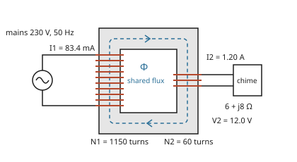

# Transformers: two coils sharing flux trade voltage against current

[Syllabus](../../../SYLLABUS.md) → [Engineering mathematics](../README.md) → [Circuits and Electromagnetism](../README.md#s06) → Transformers

---

## General Overview

A doorbell chime runs on 12 V. The house supply is 230 V at 50 Hz. Between them sits a small box by the fuse board: a transformer, rated about 15 VA (volt-amperes, volts times amps).

Inside it, two coils of copper wire are wound on one iron ring. The first coil, the **primary**, has 1,150 turns and connects to the mains. The second, the **secondary**, has 60 turns and connects to the chime. No wire joins the two. The mains current makes a magnetic flux (the amount of magnetic field threading the ring), and it swings 50 times a second. That changing flux runs round the iron and through the secondary, and induces a voltage there.

The engineer wants three numbers. What voltage reaches the chime: 12.0 V. What current the chime draws: 1.2 A. And what the mains sees: 62.6 mA as the chime's share, plus 24.4 mA that only keeps the iron magnetised. The two are out of step, so together they make 83.4 mA, not 87.0 mA. The same box that divides the voltage by 19.17 makes the chime's 10 Ω look like 3,674 Ω from the mains side.

**Every turn on the shared iron sees the same changing flux, so voltage divides in the ratio of the turns; the iron needs almost no net magnetising current, so current multiplies by the same ratio; and so a load seen through the transformer is scaled by the ratio squared.**

**What kind of fact this is:** a theorem that follows from Faraday's law once every turn shares one flux, proved on this card in Why it works; the "ideal transformer" (no lost flux, no magnetising current, no resistance) is a model, and the card measures how far a real one strays from it.

<p align="center"></p>

Schematic, not to scale: the mains drives 83.4 mA into the 1,150-turn primary; the dashed loop is the flux Φ shared by both coils; the 60-turn secondary drives 1.2 A through the chime at 12 V.

---

## The formula

Notation first. $N_1$ and $N_2$ are the turns on the primary and secondary. Their ratio is $n = N_1/N_2$. Voltages and currents are **phasors**: complex numbers carrying the rms (root-mean-square, the steady value with the same heating effect) size and the timing of a sine wave ([Phasors](02-phasors-and-impedance.md)). Engineers write $j$ for the square root of −1; the rest of the library writes $i$. Here $n$ is the turns ratio, not the turns per metre of [Magnetic fields](05-magnetism-and-faradays-law.md), and $k$, below, is the coupling coefficient.

The ideal rule:

$$\frac{V_1}{V_2} = \frac{N_1}{N_2} = n, \qquad \frac{I_1}{I_2} = \frac{1}{n}, \qquad Z_{\text{in}} = \frac{V_1}{I_1} = n^2 Z_L$$

**Read it aloud:** the voltage goes down by the turns ratio, the current goes up by the same ratio, and a load seen through the transformer looks bigger by the ratio squared.

The real rule, two coils with self-inductances $L_1$, $L_2$ and mutual inductance $M$:

$$Z_{\text{in}} = j\omega L_1 + \frac{(\omega M)^2}{Z_L + j\omega L_2}, \qquad M = k\sqrt{L_1 L_2}$$

**Read it aloud:** the primary looks like its own coil, plus the load reflected across by the mutual inductance. When every line of flux links both coils (coupling coefficient $k = 1$, in the table below), this is exactly the ideal $n^2 Z_L$ in parallel with the primary's own inductance $L_1$.

| Symbol | Plain meaning | In our example | Push it up and the answer… |
| --- | --- | --- | --- |
| $V_1$, $V_2$ | rms voltage across the primary and secondary (lowercase $v_1$, $v_2$: the value at one instant) | 230 V, 12.0 V | $V_1$ up: $V_2$ up in proportion |
| $I_1$, $I_2$ | rms current in the primary and secondary (lowercase $i_1$, $i_2$: the value at one instant) | 83.4 mA (62.6 mA ideal), 1.2 A | $I_2$ up: $I_1$ up by $I_2/n$ |
| $N_1$, $N_2$, $n$ | turns on each coil; the turns ratio $N_1/N_2$ | 1,150, 60, 19.1667 | $n$ up: $V_2$ falls, $Z_{\text{in}}$ grows as $n^2$ |
| $\Phi$ | flux through one turn of the core, in webers (Wb) | peak 0.9003 mWb | the iron saturates past about 2 T |
| $B$, $A$ | flux density (flux per area, in tesla, T); core cross-section | peak 1.2004 T; 7.5 cm² | $B$ up: core losses rise, then saturation |
| $\Lambda$ | permeance: flux the core carries per ampere-turn (amps times turns) | 22.6843 µH | magnetising current falls |
| $L_1$, $L_2$ | self-inductance of each coil: its own flux linkage per amp, $N^2\Lambda$ | 30 H, 0.0817 H | $L_1$ up: closer to ideal |
| $M$ | mutual inductance: flux linkage in one coil per amp in the other, $N_1N_2\Lambda$ | 1.5652 H | — |
| $k$ | coupling coefficient $M/\sqrt{L_1L_2}$: share of flux linking both coils | 1 (0.97 when leaky) | $k$ below 1: $V_2$ sags |
| $Z_L = R + jX$ | load impedance: the chime's resistance $R$ plus $j$ times its reactance $X$ | $6 + j8$ Ω ($R$ = 6 Ω, $X$ = 8 Ω), size 10 Ω | $I_2$ falls |
| $Z_{\text{in}}$ | impedance the mains sees at the primary | ideal $2204.17 + j2938.89$ Ω | $I_1$ falls |
| $\omega$, $f$, $t$ | angular frequency $2\pi f$; frequency; time | 314.16 rad/s; 50 Hz | the same turns carry less flux |

### When it holds

- **The flux is changing.** Faraday's law turns a *changing* flux into voltage. On direct current the secondary gives 0 V once the current settles, and only the winding's resistance limits the primary. With a 100 Ω primary winding, 230 V DC drives 2.3 A and 529 W of heat into a box rated 15 VA.
- **Every line of flux links both coils.** Flux that leaks round one coil and misses the other is **leakage**. At $k$ = 0.97 the open secondary gives 11.64 V, and with the chime connected, 10.3468 V, not 12.
- **The iron has plenty of inductance.** The current ratio needs the magnetising current to be small. With $L_1$ = 30 H that current is 24.4 mA, and the primary draws 83.4 mA, not the ideal 62.6 mA.
- **The iron is not saturated.** Iron carries flux easily only up to a little below 2 T. The turns are chosen to keep the peak at 1.2 T. Halve the frequency and the peak flux doubles.
- **No resistance or core loss.** Real windings heat, and the iron warms a little on every cycle. The card leaves both out, so its 8.64 W in equals 8.64 W out.

---

## Why it works

### Step 0: one flux, many turns

The two coils share no wire. They share one thing: the flux in the iron. Every turn of either coil wraps the same core, so every turn has the same flux through it and the same rate of change. Faraday's law gives each turn the same voltage. Turns are wired in series, so a coil's voltage is the per-turn voltage times its turns. That is the whole voltage rule. The current rule comes from asking how much current the iron needs.

### Step 1: the voltage ratio, from Faraday

Faraday's law ([Magnetic fields](05-magnetism-and-faradays-law.md)) says a loop around a changing flux $\Phi$ has a voltage $d\Phi/dt$ around it. A coil of $N$ turns adds $N$ such loops:

$$v_1 = N_1 \frac{d\Phi}{dt}, \qquad v_2 = N_2 \frac{d\Phi}{dt} \quad\Longrightarrow\quad \frac{v_1}{v_2} = \frac{N_1}{N_2}.$$

The sign that Lenz's law adds is the same on both coils and cancels in the ratio. The rate $d\Phi/dt$ cancels too. So the voltage ratio holds at every instant, for any wave shape, and needs only the shared flux.

For the doorbell: 1,150 turns on 230 V is 5 turns per volt, so each turn carries 0.2 V. Sixty turns give 12.0 V.

### Step 2: the current ratio, from what the iron needs

Current in a coil pushes flux round the core. The push is **ampere-turns**: amps times turns. The primary current pushes one way; the secondary current, flowing out to the load, pushes the other (that is Lenz's law: induced current opposes the change). The net push sets the flux through the permeance $\Lambda$, the core's flux per ampere-turn:

$$N_1 i_1 - N_2 i_2 = \frac{\Phi}{\Lambda}.$$

Good iron has a large $\Lambda$, so the right side is small. In the ideal limit it is zero, and $N_1 I_1 = N_2 I_2$. The current ratio is the turns ratio upside down: 1.2 A × 60 / 1,150 = 62.6 mA.

Power agrees. Volts down by $n$ and amps up by $n$ leave volts times amps unchanged: 230 V × 62.6 mA = 12 V × 1.2 A = 14.4 VA. A transformer cannot make power, so if the voltage drops the current has to rise.

The small right side does not vanish in a real core. It is the **magnetising current**, the current the mains spends keeping the flux swinging, even with no load. Step 4 computes it.

### Step 3: the same coils, as mutual inductance

Circuit equations do not mention flux. They use inductances. A coil's **self-inductance** $L$ is the flux linkage (flux times turns) it makes in itself per amp. Its **mutual inductance** $M$ to another coil is the flux linkage it makes in that coil per amp. One ampere-turn makes $\Lambda$ of flux, so

$$L_1 = N_1^2\Lambda, \qquad L_2 = N_2^2\Lambda, \qquad M = N_1N_2\Lambda.$$

The primary's 30 H gives $\Lambda$ = 22.6843 µH, $L_2$ = 0.0817 H and $M$ = 1.5652 H. Then $M^2 = L_1L_2$ exactly. The ratio $k = M/\sqrt{L_1L_2}$ is the **coupling coefficient**, and shared flux means $k = 1$. When some flux leaks, $M$ is smaller, $k < 1$, and Step 1's ratio no longer holds exactly.

With the primary current flowing in and the secondary current flowing out, each coil's voltage is its own inductance's share plus the other coil's:

$$v_1 = L_1\frac{di_1}{dt} - M\frac{di_2}{dt}, \qquad v_2 = M\frac{di_1}{dt} - L_2\frac{di_2}{dt}.$$

### Step 4: the reflected impedance

At one frequency each $d/dt$ becomes multiplication by $j\omega$ ([Phasors](02-phasors-and-impedance.md)). The load sets $V_2 = Z_L I_2$. The second equation gives the secondary current from the primary current:

$$I_2 = \frac{j\omega M}{Z_L + j\omega L_2}\,I_1.$$

Put that into the first equation and divide by $I_1$:

$$Z_{\text{in}} = \frac{V_1}{I_1} = j\omega L_1 + \frac{(\omega M)^2}{Z_L + j\omega L_2}.$$

The second term is the load **reflected** to the primary. When $k = 1$ this tidies into a parallel pair: the primary's own inductance $j\omega L_1$ beside $n^2 Z_L$.

<details>
<summary>Detailed proof: with k = 1, the input impedance is n²Z_L in parallel with jωL₁</summary>

Put $(\omega M)^2 = \omega^2 L_1L_2$ over the common denominator:

$$Z_{\text{in}} = \frac{j\omega L_1 (Z_L + j\omega L_2) + \omega^2 L_1 L_2}{Z_L + j\omega L_2} = \frac{j\omega L_1 Z_L}{Z_L + j\omega L_2}.$$

The $\omega^2L_1L_2$ terms cancel. Now $L_2 = L_1/n^2$. Multiply top and bottom by $n^2$:

$$Z_{\text{in}} = \frac{(j\omega L_1)(n^2 Z_L)}{n^2 Z_L + j\omega L_1},$$

which is the parallel-resistor rule, product over sum, for $n^2Z_L$ and $j\omega L_1$. As $L_1$ grows the $j\omega L_1$ branch carries less and less current and $Z_{\text{in}} \to n^2 Z_L$. The same algebra gives $V_2 = V_1/n$ exactly, whatever $L_1$ is.

</details>

So the two ideal limits are different. Shared flux ($k = 1$) alone fixes the voltage ratio. The current ratio and $n^2 Z_L$ also need $L_1$ to be large. For the doorbell, $\omega L_1$ = 9,425 Ω sits in parallel with the reflected 3,674 Ω, which is why the magnetising current is a large share of the total.

### Step 5: the turns ratio sets the voltage; the turns count sets the flux

Why 1,150 and 60, and not 115 and 6? The ratio is the same. But Step 1 read backwards gives the flux the core must carry. With $v_1 = \sqrt2\,V_1\cos\omega t$, the flux is $\Phi = \Phi_{\text{peak}}\sin\omega t$ with

$$\Phi_{\text{peak}} = \frac{\sqrt2\,V_1}{\omega N_1}, \qquad B_{\text{peak}} = \frac{\Phi_{\text{peak}}}{A}.$$

That is 0.9003 mWb, or 1.2004 T in a 7.5 cm² core. Designers write it as $V = 4.44\,f N A B_{\text{peak}}$, where 4.44 is $\sqrt2\,\pi$ rounded. Fewer turns mean more flux per turn. With 115 turns the core would need 12 T, six times what iron can carry.

---

## Worked numbers, by hand

The doorbell: 230 V at 50 Hz, $N_1$ = 1,150, $N_2$ = 60, chime $Z_L = 6 + j8$ Ω (a solenoid: 6 Ω of wire and 8 Ω of reactance), primary inductance $L_1$ = 30 H, core 7.5 cm².

| Step | Arithmetic | Value |
| --- | --- | --- |
| turns ratio $n$ | 1,150 ÷ 60 | 19.1667 |
| secondary voltage $V_2$ | 230 ÷ 19.1667 | 12.0 V |
| chime current $I_2$ | 12 ÷ $\sqrt{6^2 + 8^2}$ = 12 ÷ 10 | 1.2 A |
| chime power | 1.2² × 6 | 8.64 W |
| chime volt-amperes | 12 × 1.2 | 14.4 VA |
| ideal primary current | 1.2 ÷ 19.1667 | 62.6087 mA, 53.13° behind $V_1$ |
| ideal $Z_{\text{in}} = n^2Z_L$ | 367.36 × (6 + j8) | 2204.17 + j2938.89 Ω |
| its size | 367.36 × 10 | 3,673.61 Ω |
| magnetising current | 230 ÷ (314.16 × 30) | 24.4038 mA, a quarter cycle behind $V_1$ |
| real $Z_{\text{in}}$ | 2204.17 + j2938.89 Ω in parallel with j9,424.78 Ω | 1241.38 + j2461.61 Ω |
| **primary current** | 230 ÷ size of real $Z_{\text{in}}$ | **83.4267 mA**, 63.24° behind $V_1$ |
| peak flux density | $\sqrt2$ × 230 ÷ (314.16 × 1,150 × 0.00075) | 1.2004 T |

The chime gets its 12 V and 1.2 A. The mains supplies 83.4 mA, of which the chime's share is 62.6 mA. The 24.4 mA of magnetising current is a quarter cycle behind $V_1$. The chime's share is 53.13° behind it, because the chime is partly a coil. So the two are 36.87° apart, and they combine as two sides of a triangle, not end to end: 83.4 mA, less than their 87.0 mA sum.

```
primary current, mA
chime's share (ideal I2/n)  ████████████████████████            62.61
magnetising current         █████████                           24.40
the two combined, real I1   ████████████████████████████████    83.43
```

Power still balances: the mains delivers 8.64 W, all of it into the chime's 6 Ω. The magnetising current is lent and repaid each cycle and does no work.

### What breaks if you drop a piece

| Mistake | Comes out at | What went wrong |
| --- | --- | --- |
| Turns ratio upside down, $V_2 = nV_1$ | 4,408.33 V | That is a step-up transformer; the chime burns out |
| Reflect by $n$, not $n^2$ | 191.67 Ω | Voltage up by $n$ *and* current down by $n$: the impedance ratio is $n \times n$ |
| Current scaled like voltage, $I_1 = nI_2$ | 23 A | The mains would supply 5,290 VA for a 14.4 VA load: power from nowhere |
| Same ratio, fewer turns: 115 and 6 | peak 12.0042 T | Ten times the flux per turn; iron saturates near 2 T and the primary current soars |
| Ignore the magnetising current | 62.6087 mA | The real primary draws 83.4267 mA; $L_1$ = 30 H is not infinite |

---

## Code, from first principles, and it actually runs

The script builds the doorbell transformer and reaches the primary current and the input impedance by **three independent roads**, and the secondary voltage by two. Road 1 is phasor algebra: the ideal rule and the coupled-coil formula of Step 4, with the parallel form as a cross-check. Road 2 simulates the physics of Steps 1 and 2 directly: it steps the core flux forward from Faraday's law and the chime's current from its own resistance and inductance, by fourth-order Runge–Kutta (RK4, a standard step-by-step solver), and gets the primary current from the ampere-turn balance. It takes the secondary voltage from Step 1's turns rule, so it is not a road to that voltage. Road 3 simulates the coils as $L_1$, $L_2$ and $M$ from Step 3, which also lets the coupling leak ($k$ = 0.97). Both simulations start from rest at a voltage peak, run 20 cycles, and read each wave's size and timing from the last cycle. Python uses its built-in complex numbers; Rust writes a small complex type out.

### Python

```python
# Transformers and mutual inductance -- the check behind the card.  Standard library only.
# Mains 230 V, 50 Hz down to 12 V for a doorbell chime (6 ohm + j8 ohm).  Every number on
# the card is printed here.  Road 1: phasor algebra, the ideal rule and the coupled coils.
# Road 2: simulate the shared flux and the turns, step by step (RK4).  Road 3: simulate
# the coils as L1, L2 and M (RK4); it also handles leaky coupling, k below 1.
from math import pi, sqrt, cos, sin, atan2, degrees, radians

V1, f, N1, N2 = 230.0, 50.0, 1150, 60        # rms volts, hertz, turns
R, X = 6.0, 8.0                              # chime: resistance, reactance at 50 Hz, ohm
L1, A = 30.0, 7.5e-4                         # primary self-inductance (H), core area (m^2)
w, n = 2 * pi * f, N1 / N2                   # rad/s, turns ratio
ZL, Ll = complex(R, X), X / w                # chime impedance, chime inductance (H)

def coupled(k, L1, ZL=ZL):                   # road 1: phasor equations of two coupled coils
    L2 = L1 / n**2; M = k * sqrt(L1 * L2)
    Zin = 1j * w * L1 + (w * M)**2 / (ZL + 1j * w * L2)
    I1 = V1 / Zin; I2 = 1j * w * M * I1 / (ZL + 1j * w * L2)
    return Zin, I1, I2, ZL * I2

def rk4(fun, y, t, h):
    k1 = fun(t, y); k2 = fun(t + h/2, [a + h/2 * b for a, b in zip(y, k1)])
    k3 = fun(t + h/2, [a + h/2 * b for a, b in zip(y, k2)]); k4 = fun(t + h, [a + h * b for a, b in zip(y, k3)])
    return [a + h/6 * (b + 2*c + 2*d + e) for a, b, c, d, e in zip(y, k1, k2, k3, k4)]

def v1(t): return sqrt(2) * V1 * cos(w * t)  # switched on at a voltage peak
def simulate(fun, out, steps=2000, cycles=20):
    # run from rest, then take each signal's 50 Hz phasor (rms size) over the last cycle
    h, y, ph, Pm = 1 / f / steps, [0.0, 0.0], [0j, 0j], 0.0
    for s in range(steps * cycles):
        t = s * h
        if s >= steps * (cycles - 1):
            sig = out(t, y)
            ph = [p + sqrt(2) / steps * x * complex(cos(w * t), -sin(w * t)) for p, x in zip(ph, sig)]
            Pm += sig[0] * sig[2] / steps if len(sig) > 2 else 0.0
        y = rk4(fun, y, t, h)
    return ph, Pm

def flux_road(L1):                           # road 2: state = core flux, chime current
    Lam = L1 / N1**2                         # permeance: flux per ampere-turn
    fun = lambda t, y: [v1(t) / N1, (N2 * v1(t) / N1 - R * y[1]) / Ll]
    out = lambda t, y: [(y[0] / Lam + N2 * y[1]) / N1, N2 * v1(t) / N1, v1(t)]
    (I1, V2), Pin = simulate(fun, out)
    return V1 / I1, I1, V2, Pin

def coil_road(k):                            # road 3: state = i1, i2; matrix of L1, L2, M
    L2 = L1 / n**2; M = k * sqrt(L1 * L2); det = M * M - L1 * (L2 + Ll)
    fun = lambda t, y: [(M * R * y[1] - (L2 + Ll) * v1(t)) / det, (L1 * R * y[1] - M * v1(t)) / det]
    out = lambda t, y: [y[0], R * y[1] + Ll * fun(t, y)[1]]
    (I1, V2), _ = simulate(fun, out)
    return I1, V2

V2i = V1 / n; I2i = V2i / abs(ZL); I1i = I2i / n; Zi = n**2 * ZL
Zc, I1c, I2c, V2c = coupled(1.0, L1)
Zs, I1s, V2s, Pin = flux_road(L1)
Zbig = flux_road(3.0e6)[0]                   # nearly ideal core: 100,000 times the inductance
I1r, V2r = coil_road(1.0)
_, _, _, V2k = coupled(0.97, L1); _, _, _, V2k0 = coupled(0.97, L1, ZL=1e12)
I1rk, V2rk = coil_road(0.97)
Im = V1 / (w * L1); Phi = sqrt(2) * V1 / (w * N1)
sh, mg = V1 / Zi, V1 / (1j * w * L1)         # chime's share and magnetizing current, as phasors
lag_s, lag_m = -degrees(atan2(sh.imag, sh.real)), -degrees(atan2(mg.imag, mg.real))
rows = [("turns ratio n = N1/N2", n), ("n^2", n**2), ("omega = 2 pi f, rad/s", w),
  ("V2 = V1/n, V", V2i), ("I2 = V2/|ZL|, A", I2i),
  ("chime power I2^2 R, W", I2i**2 * R), ("chime volt-amperes V2 I2, VA", V2i * I2i),
  ("I1 = I2/n, mA", 1000 * I1i), ("ideal Zin = n^2 ZL, real part, ohm", Zi.real),
  ("ideal Zin, imaginary part, ohm", Zi.imag), ("ideal |Zin|, ohm", abs(Zi)),
  ("L2 = L1/n^2, H", L1 / n**2), ("M = sqrt(L1 L2), H", sqrt(L1 * L1 / n**2)),
  ("permeance L1/N1^2, microhenry", 1e6 * L1 / N1**2), ("magnetizing current V1/(w L1), mA", 1000 * Im),
  ("primary reactance w L1, ohm", w * L1),
  ("1 phasor  Zin real part, ohm", Zc.real), ("1 phasor  Zin imaginary part, ohm", Zc.imag),
  ("1 phasor  |I1|, mA", 1000 * abs(I1c)), ("1 phasor  I1 lag behind V1, degrees", -degrees(atan2(I1c.imag, I1c.real))),
  ("1 phasor  |V2|, V", abs(V2c)), ("1 parallel form |I1|, mA", 1000 * abs(V1 / Zi + Im * -1j)),
  ("2 flux    Zin real part, ohm", Zs.real), ("2 flux    Zin imaginary part, ohm", Zs.imag),
  ("2 flux    |I1|, mA", 1000 * abs(I1s)), ("2 flux    |V2|, V", abs(V2s)),
  ("2 flux    power in, mean v1 i1, W", Pin), ("2 flux, L1 = 3e6 H: Zin real, ohm", Zbig.real),
  ("2 flux, L1 = 3e6 H: Zin imaginary, ohm", Zbig.imag),
  ("3 coils   |I1|, mA", 1000 * abs(I1r)), ("3 coils   |V2|, V", abs(V2r)),
  ("peak flux, mWb", 1000 * Phi), ("peak flux density, T", Phi / A), ("turns per volt N1/V1", N1 / V1),
  ("volts per turn V1/N1, V", V1 / N1), ("sqrt(2) pi, the designers' 4.44", sqrt(2) * pi),
  ("k = 0.97: open-circuit V2, V", abs(V2k0)), ("k = 0.97: V2 with chime, phasor, V", abs(V2k)),
  ("k = 0.97: V2 with chime, simulated, V", abs(V2rk)), ("DC: 230 V into 100 ohm winding, A", V1 / 100),
  ("DC: heat in that winding, W", V1**2 / 100),
  ("wrong: ratio upside down, V2, V", V1 * n), ("wrong: Zin = n ZL, |Zin|, ohm", n * abs(ZL)),
  ("wrong: I1 = n I2, A", n * I2i), ("wrong: I1 = n I2, volt-amperes in, VA", V1 * n * I2i),
   ("wrong: 115 and 6 turns, peak B, T", sqrt(2) * V1 / (w * 115) / A),
  ("wrong: no magnetizing current, mA", 1000 * I1i),
  ("try: 60 Hz, peak B, T", sqrt(2) * V1 / (2 * pi * 60 * N1) / A),
  ("try: 60 Hz, magnetizing current, mA", 1000 * V1 / (2 * pi * 60 * L1)),
  ("try: N2 = 30, V2, V", V1 * 30 / N1), ("try: L1 = 300 H, |I1|, mA", 1000 * abs(coupled(1.0, 300.0)[1]))]
for label, val in rows:
    print(f"{label:<42}{val:12.4f}")
print(f"phase behind V1, deg: chime share {lag_s:.4f}, magnetizing {lag_m:.4f}, apart {lag_m - lag_s:.4f}; "
      f"sizes end to end {1000 * (abs(sh) + abs(mg)):.4f} mA")
print(f"figure, N1 {N1} turns, N2 {N2} turns, V1 {V1:.0f} V, V2 {V2i:.1f} V, I1 {1000*abs(I1c):.1f} mA, I2 {I2i:.2f} A")

assert abs(V2c - V2i) < 1e-9,                            "k = 1: V2 is V1/n exactly, at finite L1"
assert abs(Zs - Zc) < 0.05,                              "flux simulation vs phasor algebra"
assert abs(V2s - V2i) < 1e-6,                            "phasor read-out of the known wave N2 v1/N1"
assert abs(I1r - I1c) < 1e-5 and abs(V2r - V2i) < 1e-6,  "L-M simulation vs phasor algebra"
assert abs(Zbig - Zi) / abs(Zi) < 1e-4,                  "huge L1: Zin tends to n^2 ZL"
assert abs(Pin - I2i**2 * R) < 1e-4,                     "power in = power into the chime"
assert abs(V1 / Zc - (V1 / Zi - 1j * Im)) < 1e-9,        "Zin = n^2 ZL in parallel with j w L1"
assert abs(sqrt(abs(sh)**2 + abs(mg)**2 + 2 * abs(sh) * abs(mg) * cos(radians(lag_m - lag_s))) - abs(I1c)) < 1e-9, \
    "the two currents add as sides of a triangle"
assert abs(abs(V2rk) - abs(V2k)) < 1e-4 and abs(V2k) < V2i, "leaky coupling sags V2"
print("ALL CHECKS PASS")
```

**Ran 2026-11-11 on macOS, Python 3.14.10, standard library only. All checks passed. Output, pasted from the run:**

```
turns ratio n = N1/N2                          19.1667
n^2                                           367.3611
omega = 2 pi f, rad/s                         314.1593
V2 = V1/n, V                                   12.0000
I2 = V2/|ZL|, A                                 1.2000
chime power I2^2 R, W                           8.6400
chime volt-amperes V2 I2, VA                   14.4000
I1 = I2/n, mA                                  62.6087
ideal Zin = n^2 ZL, real part, ohm           2204.1667
ideal Zin, imaginary part, ohm               2938.8889
ideal |Zin|, ohm                             3673.6111
L2 = L1/n^2, H                                  0.0817
M = sqrt(L1 L2), H                              1.5652
permeance L1/N1^2, microhenry                  22.6843
magnetizing current V1/(w L1), mA              24.4038
primary reactance w L1, ohm                  9424.7780
1 phasor  Zin real part, ohm                 1241.3772
1 phasor  Zin imaginary part, ohm            2461.6142
1 phasor  |I1|, mA                             83.4267
1 phasor  I1 lag behind V1, degrees            63.2385
1 phasor  |V2|, V                              12.0000
1 parallel form |I1|, mA                       83.4267
2 flux    Zin real part, ohm                 1241.3772
2 flux    Zin imaginary part, ohm            2461.6142
2 flux    |I1|, mA                             83.4267
2 flux    |V2|, V                              12.0000
2 flux    power in, mean v1 i1, W               8.6400
2 flux, L1 = 3e6 H: Zin real, ohm            2204.1529
2 flux, L1 = 3e6 H: Zin imaginary, ohm       2938.8849
3 coils   |I1|, mA                             83.4267
3 coils   |V2|, V                              12.0000
peak flux, mWb                                  0.9003
peak flux density, T                            1.2004
turns per volt N1/V1                            5.0000
volts per turn V1/N1, V                         0.2000
sqrt(2) pi, the designers' 4.44                 4.4429
k = 0.97: open-circuit V2, V                   11.6400
k = 0.97: V2 with chime, phasor, V             10.3468
k = 0.97: V2 with chime, simulated, V          10.3468
DC: 230 V into 100 ohm winding, A               2.3000
DC: heat in that winding, W                   529.0000
wrong: ratio upside down, V2, V              4408.3333
wrong: Zin = n ZL, |Zin|, ohm                 191.6667
wrong: I1 = n I2, A                            23.0000
wrong: I1 = n I2, volt-amperes in, VA        5290.0000
wrong: 115 and 6 turns, peak B, T              12.0042
wrong: no magnetizing current, mA              62.6087
try: 60 Hz, peak B, T                           1.0004
try: 60 Hz, magnetizing current, mA            20.3365
try: N2 = 30, V2, V                             6.0000
try: L1 = 300 H, |I1|, mA                      64.5776
phase behind V1, deg: chime share 53.1301, magnetizing 90.0000, apart 36.8699; sizes end to end 87.0125 mA
figure, N1 1150 turns, N2 60 turns, V1 230 V, V2 12.0 V, I1 83.4 mA, I2 1.20 A
ALL CHECKS PASS
```

### Rust

```rust
// Transformers and mutual inductance -- the check behind the card.  std only, no crates.
// Mains 230 V, 50 Hz down to 12 V for a doorbell chime (6 ohm + j8 ohm).  Every number on
// the card is printed here.  Road 1: phasor algebra, the ideal rule and the coupled coils.
// Road 2: simulate the shared flux and the turns, step by step (RK4).  Road 3: simulate
// the coils as L1, L2 and M (RK4); it also handles leaky coupling, k below 1.
use std::f64::consts::PI;
use std::ops::{Add, Div, Mul, Sub};

#[derive(Clone, Copy)]
struct C { re: f64, im: f64 }
fn c(re: f64, im: f64) -> C { C { re, im } }
impl Add for C { type Output = C; fn add(self, o: C) -> C { c(self.re + o.re, self.im + o.im) } }
impl Sub for C { type Output = C; fn sub(self, o: C) -> C { c(self.re - o.re, self.im - o.im) } }
impl Mul for C { type Output = C; fn mul(self, o: C) -> C { c(self.re * o.re - self.im * o.im, self.re * o.im + self.im * o.re) } }
impl Div for C { type Output = C; fn div(self, o: C) -> C { let d = o.re * o.re + o.im * o.im; c((self.re * o.re + self.im * o.im) / d, (self.im * o.re - self.re * o.im) / d) } }
impl C { fn abs(self) -> f64 { self.re.hypot(self.im) } }
fn r(x: f64) -> C { c(x, 0.0) }

const V1: f64 = 230.0; const F: f64 = 50.0; const N1: f64 = 1150.0; const N2: f64 = 60.0;
const R: f64 = 6.0; const X: f64 = 8.0;          // chime: resistance, reactance at 50 Hz, ohm
const L1: f64 = 30.0; const A: f64 = 7.5e-4;     // primary self-inductance (H), core area (m^2)
fn w() -> f64 { 2.0 * PI * F }
fn n() -> f64 { N1 / N2 }
fn ll() -> f64 { X / w() }                       // chime inductance, H

// road 1: phasor equations of two coupled coils; returns Zin, I1, I2, V2
fn coupled(k: f64, l1: f64, zl: C) -> (C, C, C, C) {
    let (w, l2) = (w(), l1 / (n() * n()));
    let m = k * (l1 * l2).sqrt();
    let zin = c(0.0, w * l1) + r((w * m) * (w * m)) / (zl + c(0.0, w * l2));
    let i1 = r(V1) / zin;
    let i2 = c(0.0, w * m) * i1 / (zl + c(0.0, w * l2));
    (zin, i1, i2, zl * i2)
}
fn rk4(fun: &dyn Fn(f64, [f64; 2]) -> [f64; 2], y: [f64; 2], t: f64, h: f64) -> [f64; 2] {
    let st = |y: [f64; 2], k: [f64; 2], s: f64| [y[0] + s * k[0], y[1] + s * k[1]];
    let k1 = fun(t, y); let k2 = fun(t + h / 2.0, st(y, k1, h / 2.0));
    let k3 = fun(t + h / 2.0, st(y, k2, h / 2.0)); let k4 = fun(t + h, st(y, k3, h));
    [0, 1].map(|i| y[i] + h / 6.0 * (k1[i] + 2.0 * k2[i] + 2.0 * k3[i] + k4[i]))
}
fn v1(t: f64) -> f64 { 2f64.sqrt() * V1 * (w() * t).cos() }   // switched on at a voltage peak
// run from rest, then take each signal's 50 Hz phasor (rms size) over the last cycle
fn simulate(fun: &dyn Fn(f64, [f64; 2]) -> [f64; 2], out: &dyn Fn(f64, [f64; 2]) -> Vec<f64>) -> (Vec<C>, f64) {
    let (steps, cycles) = (2000usize, 20usize);
    let h = 1.0 / F / steps as f64;
    let (mut y, mut ph, mut pm) = ([0.0, 0.0], vec![c(0.0, 0.0); 2], 0.0);
    for s in 0..steps * cycles {
        let t = s as f64 * h;
        if s >= steps * (cycles - 1) {
            let sig = out(t, y);
            for j in 0..2 { ph[j] = ph[j] + r(2f64.sqrt() / steps as f64 * sig[j]) * c((w() * t).cos(), -(w() * t).sin()); }
            if sig.len() > 2 { pm += sig[0] * sig[2] / steps as f64; }
        }
        y = rk4(fun, y, t, h);
    }
    (ph, pm)
}
fn flux_road(l1: f64) -> (C, C, C, f64) {        // road 2: state = core flux, chime current
    let lam = l1 / (N1 * N1);                    // permeance: flux per ampere-turn
    let fun = |t: f64, y: [f64; 2]| [v1(t) / N1, (N2 * v1(t) / N1 - R * y[1]) / ll()];
    let out = |t: f64, y: [f64; 2]| vec![(y[0] / lam + N2 * y[1]) / N1, N2 * v1(t) / N1, v1(t)];
    let (ph, pin) = simulate(&fun, &out);
    (r(V1) / ph[0], ph[0], ph[1], pin)
}
fn coil_road(k: f64) -> (C, C) {                 // road 3: state = i1, i2; matrix of L1, L2, M
    let l2 = L1 / (n() * n()); let m = k * (L1 * l2).sqrt(); let det = m * m - L1 * (l2 + ll());
    let fun = move |t: f64, y: [f64; 2]| [(m * R * y[1] - (l2 + ll()) * v1(t)) / det, (L1 * R * y[1] - m * v1(t)) / det];
    let out = |t: f64, y: [f64; 2]| vec![y[0], R * y[1] + ll() * fun(t, y)[1]];
    let (ph, _) = simulate(&fun, &out);
    (ph[0], ph[1])
}
fn deg(z: C) -> f64 { -z.im.atan2(z.re).to_degrees() }

fn main() {
    let (w, n, zl) = (w(), n(), c(R, X));
    let v2i = V1 / n; let i2i = v2i / zl.abs(); let i1i = i2i / n; let zi = r(n * n) * zl;
    let (zc, i1c, _, v2c) = coupled(1.0, L1, zl);
    let (zs, i1s, v2s, pin) = flux_road(L1);
    let zbig = flux_road(3.0e6).0;               // nearly ideal core: 100,000 times the inductance
    let (i1r, v2r) = coil_road(1.0);
    let v2k = coupled(0.97, L1, zl).3; let v2k0 = coupled(0.97, L1, r(1e12)).3;
    let (_, v2rk) = coil_road(0.97);
    let im = V1 / (w * L1); let phi = 2f64.sqrt() * V1 / (w * N1);
    let par = r(V1) / zi - c(0.0, im);
    let (sh, mg) = (r(V1) / zi, r(V1) / c(0.0, w * L1)); // chime's share and magnetizing current, as phasors
    let (lag_s, lag_m) = (deg(sh), deg(mg));
    let rows: Vec<(&str, f64)> = vec![("turns ratio n = N1/N2", n), ("n^2", n * n), ("omega = 2 pi f, rad/s", w),
        ("V2 = V1/n, V", v2i), ("I2 = V2/|ZL|, A", i2i),
        ("chime power I2^2 R, W", i2i * i2i * R), ("chime volt-amperes V2 I2, VA", v2i * i2i),
        ("I1 = I2/n, mA", 1000.0 * i1i), ("ideal Zin = n^2 ZL, real part, ohm", zi.re),
        ("ideal Zin, imaginary part, ohm", zi.im), ("ideal |Zin|, ohm", zi.abs()),
        ("L2 = L1/n^2, H", L1 / (n * n)), ("M = sqrt(L1 L2), H", (L1 * L1 / (n * n)).sqrt()),
        ("permeance L1/N1^2, microhenry", 1e6 * L1 / (N1 * N1)), ("magnetizing current V1/(w L1), mA", 1000.0 * im),
        ("primary reactance w L1, ohm", w * L1),
        ("1 phasor  Zin real part, ohm", zc.re), ("1 phasor  Zin imaginary part, ohm", zc.im),
        ("1 phasor  |I1|, mA", 1000.0 * i1c.abs()), ("1 phasor  I1 lag behind V1, degrees", deg(i1c)),
        ("1 phasor  |V2|, V", v2c.abs()), ("1 parallel form |I1|, mA", 1000.0 * par.abs()),
        ("2 flux    Zin real part, ohm", zs.re), ("2 flux    Zin imaginary part, ohm", zs.im),
        ("2 flux    |I1|, mA", 1000.0 * i1s.abs()), ("2 flux    |V2|, V", v2s.abs()),
        ("2 flux    power in, mean v1 i1, W", pin), ("2 flux, L1 = 3e6 H: Zin real, ohm", zbig.re),
        ("2 flux, L1 = 3e6 H: Zin imaginary, ohm", zbig.im),
        ("3 coils   |I1|, mA", 1000.0 * i1r.abs()), ("3 coils   |V2|, V", v2r.abs()),
        ("peak flux, mWb", 1000.0 * phi), ("peak flux density, T", phi / A), ("turns per volt N1/V1", N1 / V1),
        ("volts per turn V1/N1, V", V1 / N1), ("sqrt(2) pi, the designers' 4.44", 2f64.sqrt() * PI),
        ("k = 0.97: open-circuit V2, V", v2k0.abs()), ("k = 0.97: V2 with chime, phasor, V", v2k.abs()),
        ("k = 0.97: V2 with chime, simulated, V", v2rk.abs()), ("DC: 230 V into 100 ohm winding, A", V1 / 100.0),
        ("DC: heat in that winding, W", V1 * V1 / 100.0),
        ("wrong: ratio upside down, V2, V", V1 * n), ("wrong: Zin = n ZL, |Zin|, ohm", n * zl.abs()),
        ("wrong: I1 = n I2, A", n * i2i), ("wrong: I1 = n I2, volt-amperes in, VA", V1 * n * i2i),
         ("wrong: 115 and 6 turns, peak B, T", 2f64.sqrt() * V1 / (w * 115.0) / A),
        ("wrong: no magnetizing current, mA", 1000.0 * i1i),
        ("try: 60 Hz, peak B, T", 2f64.sqrt() * V1 / (2.0 * PI * 60.0 * N1) / A),
        ("try: 60 Hz, magnetizing current, mA", 1000.0 * V1 / (2.0 * PI * 60.0 * L1)),
        ("try: N2 = 30, V2, V", V1 * 30.0 / N1), ("try: L1 = 300 H, |I1|, mA", 1000.0 * coupled(1.0, 300.0, zl).1.abs())];
    for (label, val) in &rows { println!("{:<42}{:12.4}", label, val); }
    println!("phase behind V1, deg: chime share {:.4}, magnetizing {:.4}, apart {:.4}; sizes end to end {:.4} mA",
        lag_s, lag_m, lag_m - lag_s, 1000.0 * (sh.abs() + mg.abs()));
    println!("figure, N1 {} turns, N2 {} turns, V1 {:.0} V, V2 {:.1} V, I1 {:.1} mA, I2 {:.2} A", N1, N2, V1, v2i, 1000.0 * i1c.abs(), i2i);

    assert!((v2c - r(v2i)).abs() < 1e-9, "k = 1: V2 is V1/n exactly, at finite L1");
    assert!((zs - zc).abs() < 0.05, "flux simulation vs phasor algebra");
    assert!((v2s - r(v2i)).abs() < 1e-6, "phasor read-out of the known wave N2 v1/N1");
    assert!((i1r - i1c).abs() < 1e-5 && (v2r - r(v2i)).abs() < 1e-6, "L-M simulation vs phasor algebra");
    assert!((zbig - zi).abs() / zi.abs() < 1e-4, "huge L1: Zin tends to n^2 ZL");
    assert!((pin - i2i * i2i * R).abs() < 1e-4, "power in = power into the chime");
    assert!((r(V1) / zc - par).abs() < 1e-9, "Zin = n^2 ZL in parallel with j w L1");
    let tri = (sh.abs().powi(2) + mg.abs().powi(2) + 2.0 * sh.abs() * mg.abs() * (lag_m - lag_s).to_radians().cos()).sqrt();
    assert!((tri - i1c.abs()).abs() < 1e-9, "the two currents add as sides of a triangle");
    assert!((v2rk.abs() - v2k.abs()).abs() < 1e-4 && v2k.abs() < v2i, "leaky coupling sags V2");
    println!("ALL CHECKS PASS");
}
```

**Ran 2026-11-11 on macOS, rustc 1.98.1, no crates. All checks passed. Output, pasted from the run:**

```
turns ratio n = N1/N2                          19.1667
n^2                                           367.3611
omega = 2 pi f, rad/s                         314.1593
V2 = V1/n, V                                   12.0000
I2 = V2/|ZL|, A                                 1.2000
chime power I2^2 R, W                           8.6400
chime volt-amperes V2 I2, VA                   14.4000
I1 = I2/n, mA                                  62.6087
ideal Zin = n^2 ZL, real part, ohm           2204.1667
ideal Zin, imaginary part, ohm               2938.8889
ideal |Zin|, ohm                             3673.6111
L2 = L1/n^2, H                                  0.0817
M = sqrt(L1 L2), H                              1.5652
permeance L1/N1^2, microhenry                  22.6843
magnetizing current V1/(w L1), mA              24.4038
primary reactance w L1, ohm                  9424.7780
1 phasor  Zin real part, ohm                 1241.3772
1 phasor  Zin imaginary part, ohm            2461.6142
1 phasor  |I1|, mA                             83.4267
1 phasor  I1 lag behind V1, degrees            63.2385
1 phasor  |V2|, V                              12.0000
1 parallel form |I1|, mA                       83.4267
2 flux    Zin real part, ohm                 1241.3772
2 flux    Zin imaginary part, ohm            2461.6142
2 flux    |I1|, mA                             83.4267
2 flux    |V2|, V                              12.0000
2 flux    power in, mean v1 i1, W               8.6400
2 flux, L1 = 3e6 H: Zin real, ohm            2204.1529
2 flux, L1 = 3e6 H: Zin imaginary, ohm       2938.8849
3 coils   |I1|, mA                             83.4267
3 coils   |V2|, V                              12.0000
peak flux, mWb                                  0.9003
peak flux density, T                            1.2004
turns per volt N1/V1                            5.0000
volts per turn V1/N1, V                         0.2000
sqrt(2) pi, the designers' 4.44                 4.4429
k = 0.97: open-circuit V2, V                   11.6400
k = 0.97: V2 with chime, phasor, V             10.3468
k = 0.97: V2 with chime, simulated, V          10.3468
DC: 230 V into 100 ohm winding, A               2.3000
DC: heat in that winding, W                   529.0000
wrong: ratio upside down, V2, V              4408.3333
wrong: Zin = n ZL, |Zin|, ohm                 191.6667
wrong: I1 = n I2, A                            23.0000
wrong: I1 = n I2, volt-amperes in, VA        5290.0000
wrong: 115 and 6 turns, peak B, T              12.0042
wrong: no magnetizing current, mA              62.6087
try: 60 Hz, peak B, T                           1.0004
try: 60 Hz, magnetizing current, mA            20.3365
try: N2 = 30, V2, V                             6.0000
try: L1 = 300 H, |I1|, mA                      64.5776
phase behind V1, deg: chime share 53.1301, magnetizing 90.0000, apart 36.8699; sizes end to end 87.0125 mA
figure, N1 1150 turns, N2 60 turns, V1 230 V, V2 12.0 V, I1 83.4 mA, I2 1.20 A
ALL CHECKS PASS
```

> [!TIP]
> **Try changing**
> - Guess first: set `f` to 60 Hz, as in North America. $V_2$ stays 12.0 V. The peak flux density falls to 1.0004 T and the magnetising current to 20.3365 mA: the same voltage needs less flux when it changes faster.
> - Guess first: set `N2` to 30. $V_2$ halves to 6.0 V, and the chime current halves with it.
> - Guess first: set `L1` to 300 H, a core with ten times the permeance. The primary current falls to 64.5776 mA, within 2 mA of the ideal 62.6087 mA.
> - Guess first: how far the chime's voltage drops if the coupling leaks to $k$ = 0.97. Change `coil_road(1.0)` to `coil_road(0.97)`. The `3 coils |V2|` line falls from 12.0 V to 10.3468 V, and the L–M assert stops the run, since the phasor road still has $k$ = 1. The `k = 0.97` lines already give 11.64 V with nothing connected: leakage acts like an inductor in series with the load.

---

## The usual mistake

> [!warning]
> **Treating the transformer as a power amplifier, or the current as following the voltage.** A step-down transformer lowers voltage and *raises* current by the same ratio. The chime's 1.2 A comes from 62.6 mA on the mains, not from 1.2 A, and certainly not from 23 A. Power in equals power out, less the losses: 8.64 W on each side here.
>
> Smaller traps:
> - **Reflecting by $n$ instead of $n^2$.** The chime's 10 Ω looks like 3,673.61 Ω from the mains, not 191.67 Ω.
> - **Choosing turns by the ratio alone.** 115 and 6 turns give the same 12 V on paper, but the core would need 12.0042 T. The turns count sets the flux; the ratio sets the voltage.
> - **Connecting to DC.** A transformer needs changing flux. On 230 V DC the chime gets nothing and a 100 Ω primary winding draws 2.3 A and burns 529 W.
> - **Assuming 12 V under load.** With leakage ($k$ = 0.97) the open-circuit 11.64 V sags to 10.3468 V when the chime rings.

---

## Where you meet it in real life

- **Doorbells, thermostats and garden lights.** Each runs on 8 to 24 V from a small transformer like this one, so the wiring to the button is safe to touch.
- **The street transformer.** The distribution grid runs at thousands of volts to keep currents and cable heating low, and a transformer on the pole or in a green box steps it down to 230 V.
- **Audio and radio.** A loudspeaker of 8 Ω behind a valve amplifier, or an antenna fed through a matching coil, is made to look like the impedance the source wants by choosing $n$ so that $n^2Z_L$ fits.
- **Isolation.** No wire joins the two coils, so a fault on the mains side cannot reach the low-voltage side by conduction. Medical equipment and bathroom shaver sockets rely on this.
- **Wireless phone chargers.** Two flat coils facing each other form a transformer with large leakage, $k$ well below 1, which is why they run at high frequency and lose more power than a wire.

> **Say it back**
> Two coils on one core share one changing flux, so each turn gets the same voltage and the voltage ratio is the turns ratio. The iron needs almost no net ampere-turns, so the current ratio is the turns ratio upside down, and in the ideal transformer volts times amps is the same on both sides. A load seen through the transformer is multiplied by the turns ratio squared: the chime's 10 Ω looks like 3,674 Ω. A real core adds a magnetising current, 24.4 mA here, which raises the mains current from 62.6 mA to 83.4 mA. The turns count, not just the ratio, sets how hard the iron works.

---

## What this builds on

- [Magnetic fields](05-magnetism-and-faradays-law.md): Faraday's law, a changing flux induces a voltage, and Lenz's law for its sign. This card applies it to many turns on one core.
- [Phasors](02-phasors-and-impedance.md): sine waves as complex numbers and impedance as $R + jX$, which turn the coil equations into the algebra of Step 4.
- [Kirchhoff's laws](01-kirchhoffs-laws-and-equivalent-circuits.md): loop voltages and the series and parallel rules used to read $Z_{\text{in}}$ as a parallel pair.

## Where this goes next

- [Maxwell's equations](07-maxwells-equations.md): the next card. Faraday's law joins Gauss's and Ampère's laws as one of four field equations, and the quasi-static picture used here becomes a special case.
- [AC power](09-power-and-three-phase.md): real and reactive power. The magnetising current here is pure reactive power, and the grid's transformers carry three phases.

This card assumed the core is linear; what happens when the flux reaches saturation, and why switching on at the wrong instant draws a current many times the normal one, is left open.

---

## Sources

Verified 2026-11-11: every link below resolves to the publisher's page.

- OpenStax. *University Physics Volume 2*, section 14.1, "Mutual Inductance." [Textbook page](https://openstax.org/books/university-physics-volume-2/pages/14-1-mutual-inductance). Mutual inductance as flux in one coil per amp in the other, a property of geometry.
- OpenStax. *University Physics Volume 2*, section 15.6, "Transformers." [Textbook page](https://openstax.org/books/university-physics-volume-2/pages/15-6-transformers). The voltage and current ratios from shared flux, step-up and step-down.
- Nilsson, James W., and Susan Riedel. *Electric Circuits*, 12th ed. Pearson, 2022. [Publisher page](https://www.pearson.com/en-us/subject-catalog/p/electric-circuits/P200000003451). Mutual inductance and the dot convention (chapter 6), and more on magnetically coupled coils and ideal transformers (appendix C).
- IEC. *IEC 60038:2009, IEC standard voltages*. [Publisher page](https://webstore.iec.ch/en/publication/153). The 230 V mains supply used as the primary voltage.
