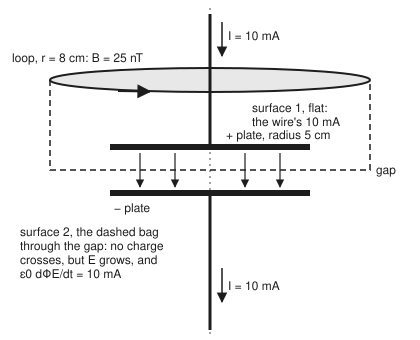
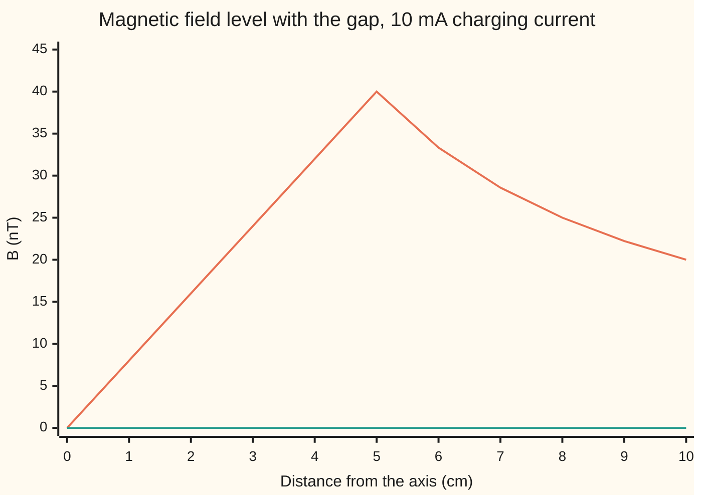

# Maxwell's equations: four statements holding all of classical electromagnetism

[Syllabus](../../../SYLLABUS.md) → [Engineering mathematics](../README.md) → [Circuits and Electromagnetism](../README.md#s06) → Maxwell's equations

---

## General Overview

Two round metal plates, each 5 cm in radius, face each other across a 1 mm air gap. That is a 69.54 pF capacitor, the kind of part found in a radio's tuner. A wire brings a steady 10 mA down onto the top plate, and another carries 10 mA away from the bottom plate. After 1 µs the top plate holds 10.00 nC and the gap holds 143.8 V.

No charge crosses the gap. Yet the current seems to carry on. The magnetic field 8 cm from the axis is 25.00 nT level with the wire, and 24.81 nT level with the gap. In the law for the magnetic field round a loop, something in the gap takes the place of the missing 10 mA.

That something is the electric field in the gap, growing by 143.8 kV/m every microsecond. Maxwell's fourth equation counts a growing electric field as a current, the **displacement current**. Leave it out, and the old loop law for magnetism gives two answers for one loop. Put it in, and the four equations agree with each other, with charge conservation, and with measurement from power lines to light.

**Four equations say what the fields do: electric field lines start and end on charge, magnetic field lines never end, a changing magnetic field drives an electric field round in loops, and current plus a changing electric field drives a magnetic field round in loops; that last term has to be there, or charge could never pile up anywhere.**

**What kind of fact this is:** a model: the laws of classical electromagnetism, confirmed from circuits to light, failing where single photons or atomic structure matter and quantum effects take over. Inside the model, the need for an extra term whose outflow matches the piling-up charge is a theorem, proved on this card in Why it works from charge conservation; that the term is exactly the displacement current was settled by experiment.

### The picture: one loop, two surfaces

<p align="center"></p>

Schematic: widths to scale at 2 px per mm (axis at x 210, plate edges at 110 and 310, loop at 50 and 370); the 1 mm gap is drawn 40 px tall. Both surfaces end on the same loop. The wire pierces the flat one. Only the growing field in the gap pierces the bag.

---

## The formula

Notation first. $\operatorname{div}$ and $\operatorname{curl}$ are the outflow and the spin of a field at a point, from [Divergence theorem](../../06-Calculus%20and%20analysis/09-Vector%20Calculus/07-divergence-theorem.md) and [Stokes' theorem](../../06-Calculus%20and%20analysis/09-Vector%20Calculus/08-stokes-theorem.md). $\partial/\partial t$ is the rate of change at a fixed point, with time $t$ in seconds.

$$\operatorname{div}\mathbf E = \frac{\rho}{\varepsilon_0} \qquad \operatorname{div}\mathbf B = 0 \qquad \operatorname{curl}\mathbf E = -\frac{\partial \mathbf B}{\partial t} \qquad \operatorname{curl}\mathbf B = \mu_0\mathbf J + \mu_0\varepsilon_0\frac{\partial \mathbf E}{\partial t}$$

**Read it aloud:** electric field spreads out from charge; magnetic field has no charge to spread out from; a changing magnetic field makes the electric field spin; current, and a changing electric field, make the magnetic field spin.

The same four as counts over a closed bag or round a loop. On a surface, $\mathbf n$ is the arrow of length one standing off it and $dS$ a small patch; $d\mathbf l$ is a short step along a loop. $\Phi_E$ and $\Phi_B$ are the fluxes of $\mathbf E$ and $\mathbf B$ through a surface on the loop: the field crossing it, added over its area.

$$\oint_{\text{bag}}\mathbf E\cdot\mathbf n\,dS = \frac{Q_{\text{in}}}{\varepsilon_0} \qquad \oint_{\text{bag}}\mathbf B\cdot\mathbf n\,dS = 0 \qquad \oint_{\text{loop}}\mathbf E\cdot d\mathbf l = -\frac{d\Phi_B}{dt} \qquad \oint_{\text{loop}}\mathbf B\cdot d\mathbf l = \mu_0 I_{\text{through}} + \mu_0\varepsilon_0\frac{d\Phi_E}{dt}$$

Left to right: Gauss's law, Gauss's law for magnetism, Faraday's law, the Ampère–Maxwell law. The last term of the last law is Maxwell's addition; $\varepsilon_0\,\partial\mathbf E/\partial t$ is the displacement current density.

| Symbol | Plain meaning | In our example | Push it up and the answer… |
| --- | --- | --- | --- |
| $\mathbf E$, $E_0$ | electric field: push per coulomb on a charge at rest, V/m; $E_0$ its value on the axis | 143.8 kV/m in the gap after 1 µs | only its rate of change moves $\mathbf B$ |
| $\mathbf B$ | magnetic field, in tesla (T) | 25.00 nT at 8 cm | — |
| $\rho$ | charge density: charge per cubic metre | zero in the gap; the charge sits on the plates | more field spreading out |
| $\mathbf J$ | current density: current per square metre of cross-section | 10 mA spread over the wire's cross-section; zero in the gap | more spin of $\mathbf B$ |
| $\varepsilon_0$ | permittivity of vacuum: how much field a coulomb makes | 8.8541878188 pF/m (CODATA 2022) | weaker $\mathbf E$ per coulomb |
| $\mu_0$ | permeability of vacuum: how much field an ampere makes | 1.25663706127 µN/A² (CODATA 2022) | stronger $\mathbf B$ per ampere |
| $c$, $f$, $u$, $J_0$, $\theta$ | speed of light $1/\sqrt{\mu_0\varepsilon_0}$; signal frequency, Hz; plate size against wavelength, $u = 2\pi f a/c$; the high-frequency profile of $\mathbf E$ across the plate; an angle used to write $J_0$ as an integral | 299,792,458.0 m/s; 1 GHz; 1.0479; rim 0.7437 of centre | higher $f$, deeper dip at the rim |
| $\operatorname{div}$, $\operatorname{curl}$, $\partial/\partial t$, $t$, $\mathbf F$, $x$, $y$, $z$ | outflow per volume; spin per area; rate of change; time, s; any field $(F_1, F_2, F_3)$; position | — | — |
| $\varepsilon_0\,\partial\mathbf E/\partial t$ | displacement current density, A/m² | 1.273 A/m² across the gap | more $\mathbf B$ round the gap |
| $Q_{\text{in}}$, $I_{\text{through}}$, $I$ | charge inside a closed bag; current crossing a surface; the charging current | 10.00 nC after 1 µs; 10 mA; 10 mA | more field out; more spin |
| $\Phi_E$, $\Phi_B$, $\mathbf n$, $dS$, $d\mathbf l$ | flux of $\mathbf E$ or $\mathbf B$ through a surface; unit normal; patch; step | $d\Phi_E/dt$ = 1129.4 V·m per µs | more displacement current |
| $a$, $d$, $r$ | plate radius; gap; distance from the axis | 5 cm; 1 mm; 8 cm and 2.5 cm | bigger $a$ spreads the 10 mA thinner |

### When it holds

- **Charge is conserved.** Every experiment agrees that charge appears or vanishes only by flowing. The displacement term is built on this.
- **Vacuum.** $\varepsilon_0$ and $\mu_0$ are the constants for empty space, and the card treats the air in the gap as empty space. Inside a solid insulator, part of the charge is bound in its molecules, and the equations gain two extra fields to track it.
- **Plates wide beside the gap.** The closed form $B = \mu_0 I r/(2\pi a^2)$ in the gap assumes a uniform field there. Here the plate's radius is 50 gaps. The Biot–Savart road in the code adds up the field of the real currents alone (Step 5); it gives 19.78 nT against 20.00 at 2.5 cm, and 38.55 nT against 40.00 at the rim, where the field fringes out past the edge.
- **Slow beside light crossing the plate.** The uniform field also needs the plate small beside the wavelength. At 1 MHz the wavelength is 299.79 m, and the field at the rim dips by 0.2745 parts per million. At 1 GHz the rim field is only 0.7437 of the centre's: outside the range, and the uniform-field formula no longer describes the gap.
- **Classical scales.** Many charges, distances far above atoms. Single photons and atomic electrons need quantum mechanics.

---

## Why it works

### Step 0: a curl never has net outflow

Two kinds of count run through the equations: what flows out of a closed bag, and what circulates round a loop. The divergence theorem turns the first into $\operatorname{div}$ at each point; Stokes' theorem turns the second into $\operatorname{curl}$.

The repair rests on one fact. Split a bag's skin along a loop into two caps. By Stokes' theorem, both caps carry the same curl flux as the circulation round that loop. Counted outward from the bag, one cap's flux has its sign flipped, so the two cancel. **The flux of any curl out of any closed bag is zero**; at a point, $\operatorname{div}\operatorname{curl} = 0$.

So whatever stands on the right of "$\operatorname{curl}\mathbf B = \ldots$" must have zero net outflow from every bag. Current alone fails that test at a charging plate. The growing electric field supplies exactly the missing outflow.

<details>
<summary>The point version: div of curl is zero, term by term</summary>

With $\mathbf F = (F_1, F_2, F_3)$,

$$\operatorname{div}\operatorname{curl}\mathbf F = \frac{\partial}{\partial x}\Big(\frac{\partial F_3}{\partial y}-\frac{\partial F_2}{\partial z}\Big)+\frac{\partial}{\partial y}\Big(\frac{\partial F_1}{\partial z}-\frac{\partial F_3}{\partial x}\Big)+\frac{\partial}{\partial z}\Big(\frac{\partial F_2}{\partial x}-\frac{\partial F_1}{\partial y}\Big).$$

Each mixed second derivative appears twice with opposite signs, and for smooth fields the order of differentiation does not matter. All six cancel. The code checks this with difference quotients on the field $(\sin yz,\; x^2 z,\; e^x y)$ at (0.3, 0.7, 0.2): 0.000000 to six places.

</details>

### Step 1: the two bag laws

Gauss's law says the electric flux out of a closed bag is the charge inside divided by $\varepsilon_0$; [Electric fields](04-electrostatics-gauss-and-potential.md) derives it from Coulomb's law. Shrink the bag round a point and the divergence theorem gives $\operatorname{div}\mathbf E = \rho/\varepsilon_0$.

In the capacitor, wrap a bag round the top plate. After 1 µs it holds 10.00 nC, and nearly all its electric flux leaves through the gap. That flux is $Q_{\text{in}}/\varepsilon_0$, so the field there is $Q_{\text{in}}/(\varepsilon_0\pi a^2)$ = 143.8 kV/m.

The magnetic bag law has nothing on the right, because no magnetic charge has ever been found. Lines of $\mathbf B$ close on themselves, like the circles round the capacitor's axis.

### Step 2: the two loop laws

Faraday's law says the push round a loop is minus the rate of change of magnetic flux through it; [Magnetic fields](05-magnetism-and-faradays-law.md) has it, minus sign and all. Stokes' theorem gives $\operatorname{curl}\mathbf E = -\partial\mathbf B/\partial t$. In the steadily charging capacitor $\mathbf B$ does not change, so Faraday's law adds nothing until the current alternates fast (the fold at the end of this section).

Ampère's law, as Ampère left it, says the circulation of $\mathbf B$ round a loop is $\mu_0$ times the current through it: $\operatorname{curl}\mathbf B = \mu_0\mathbf J$. Round a long wire it gives $B = \mu_0 I/(2\pi r)$: 25.00 nT at 8 cm.

### Step 3: the old law contradicts itself

Take the divergence of $\operatorname{curl}\mathbf B = \mu_0\mathbf J$. The left side is zero (Step 0), so $\operatorname{div}\mathbf J = 0$: current could never pile up.

Charge conservation says otherwise: current flowing out of a region drains its charge, $\operatorname{div}\mathbf J = -\partial\rho/\partial t$. At the top plate 10 mA flows in and nothing flows out, so its charge rises by 10.00 nC every microsecond.

The loop in the picture shows the clash in numbers. Its flat surface is cut by the wire: 10 mA, so 25.00 nT. Its bag surface passes through the gap: no conduction current, so 0.00 nT. The two surfaces together close a bag round the top plate. A curl's outflow from that bag is zero; the current's outflow is minus 10 mA. Ampère's old law claims those are equal.

### Step 4: the repair, and why it has to be this term

Gauss's law ties charge to field: $\rho = \varepsilon_0\operatorname{div}\mathbf E$. Differentiate in time and put it into charge conservation:

$$\operatorname{div}\mathbf J = -\frac{\partial\rho}{\partial t} = -\operatorname{div}\Big(\varepsilon_0\frac{\partial\mathbf E}{\partial t}\Big) \quad\Longrightarrow\quad \operatorname{div}\Big(\mathbf J + \varepsilon_0\frac{\partial\mathbf E}{\partial t}\Big) = 0.$$

The combination $\mathbf J + \varepsilon_0\,\partial\mathbf E/\partial t$ never has net outflow from any bag, which is exactly what the right side of the curl law needs. So Maxwell put it there. Through the gap, the new term carries

$$\varepsilon_0\frac{d\Phi_E}{dt} = \varepsilon_0\frac{d}{dt}\Big(\frac{Q_{\text{in}}}{\varepsilon_0}\Big) = \frac{dQ_{\text{in}}}{dt} = I,$$

10.000 mA, exactly the wire's current. Plate size, gap and fringing all drop out, because Gauss's law ties the flux to the charge. Both surfaces on the loop now give 25.00 nT.

One honest limit on "has to". Charge conservation fixes the outflow of whatever is added, not the term itself: an extra piece with zero outflow everywhere would also pass. The displacement term is the one built from fields already in the equations, and experiment settled the rest: in 1888 electrical effects were measured spreading through space at a finite speed, as the term predicts (Step 6).

### Step 5: the field inside the gap

The displacement current is spread evenly over the plate, at 1.273 A/m². A loop of radius $r$ inside the plate encloses the share $r^2/a^2$; at 2.5 cm that is 2.500 mA, so

$$B(r) = \frac{\mu_0 I}{2\pi r}\cdot\frac{r^2}{a^2} = \frac{\mu_0 I r}{2\pi a^2}, \qquad B(2.5\text{ cm}) = 20.00\text{ nT}.$$

Past the rim all 10 mA is enclosed, and $B$ falls as $1/r$ again: 25.00 nT at 8 cm.

The code reaches the same field a second way that never mentions displacement current. The Biot–Savart law adds up the magnetic field of every bit of real current: the two wires, plus the current fanning out over the top plate and in over the bottom one.

It gives 19.78 nT at 2.5 cm and 24.81 nT at 8 cm; the small differences come from the finite gap, and shrink when it is thinned to 0.1 mm (19.98 nT). With Maxwell's term, the loop law agrees with the field of the real currents. Without it, the loop law said 0.00 nT.

So the two roads are two ways of counting one field, not two causes of it: here the real currents set the field, and Maxwell's term keeps the loop law true for every surface on the loop.

### Step 6: what the term predicts

In empty space the loop laws become $\operatorname{curl}\mathbf E = -\partial\mathbf B/\partial t$ and $\operatorname{curl}\mathbf B = \mu_0\varepsilon_0\,\partial\mathbf E/\partial t$. A changing field of each kind makes the other, so a disturbance can carry itself through empty space at $1/\sqrt{\mu_0\varepsilon_0}$ = 299,792,458.0 m/s: the speed of light. In the 1850s that combination of the two constants was measured on the bench with charges and currents; today $\varepsilon_0$ is fixed as $1/(\mu_0 c^2)$, so the match is exact by construction. [Electromagnetic waves](08-electromagnetic-waves.md) derives the wave.

<details>
<summary>Detailed derivation: why the rim field dips at high frequency</summary>

Let the gap's field alternate at frequency $f$, so $\partial^2 E/\partial t^2 = -(2\pi f)^2 E$. Start from a uniform field $E_0$.

Ampère–Maxwell round a loop of radius $r$ in the gap: $2\pi r B = \mu_0\varepsilon_0\,\pi r^2\,\partial E/\partial t$, so $B = (r/2c^2)\,\partial E/\partial t$, using $\mu_0\varepsilon_0 = 1/c^2$.

Faraday round a thin rectangle in a plane through the axis, one long side on the axis and one at radius $r$, says the field changes across the plate as fast as $\mathbf B$ changes in time: $\partial E/\partial r = \partial B/\partial t = (r/2c^2)\,\partial^2 E/\partial t^2 = -(2\pi f)^2 r E_0/(2c^2)$. Integrate out from the axis:

$$E(r) \approx E_0\Big(1 - \frac{(2\pi f r)^2}{4c^2}\Big), \qquad \frac{E(a)}{E_0} \approx 1 - \frac{u^2}{4}, \quad u = \frac{2\pi f a}{c}.$$

Feed the corrected field back in and repeat; the corrections build the series $J_0(u) = 1 - u^2/4 + u^4/64 - \ldots$, the Bessel function. At 1 GHz, $u$ = 1.0479: the first correction gives 0.7255, the full series 0.7437, and the integral $J_0(u) = \frac{1}{\pi}\int_0^\pi \cos(u\sin\theta)\,d\theta$ gives 0.7437 too.

</details>

---

## Worked numbers, by hand

Plates 5 cm in radius, 1 mm apart, charged by 10 mA. $\varepsilon_0$ = 8.8541878188 pF/m, $\mu_0$ = 1.25663706127 µN/A².

| Step | Arithmetic | Value |
| --- | --- | --- |
| plate area $\pi a^2$ | $\pi \times 0.05^2$ m² | 78.54 cm² |
| capacitance $\varepsilon_0\pi a^2/d$ | $8.854\text{ pF/m} \times 0.007854\text{ m}^2 / 0.001\text{ m}$ | 69.54 pF |
| charge after 1 µs | $10\text{ mA} \times 1\text{ µs}$ | 10.00 nC |
| field in the gap (Gauss) | $10\text{ nC} / (\varepsilon_0 \times 78.54\text{ cm}^2)$ | 143.8 kV/m |
| voltage across the gap | $143.8\text{ kV/m} \times 1\text{ mm}$ | 143.8 V |
| rate of change of the field | the same every microsecond | 143.8 kV/m per µs |
| $d\Phi_E/dt$ | $143.8\text{ kV/m per µs} \times 78.54\text{ cm}^2$ | 1129.4 V·m per µs |
| **displacement current** $\varepsilon_0\,d\Phi_E/dt$ | $8.854\text{ pF/m} \times 1129.4\text{ V·m per µs}$ | **10.000 mA** |
| displacement current density | $10\text{ mA} / 78.54\text{ cm}^2$ | 1.273 A/m² |
| $B$ at 8 cm, either surface | $\mu_0 \times 10\text{ mA} / (2\pi \times 0.08\text{ m})$ | 25.00 nT |
| share inside 2.5 cm | $10\text{ mA} \times (2.5/5)^2$ | 2.500 mA |
| $B$ at 2.5 cm, in the gap | $\mu_0 \times 2.5\text{ mA} / (2\pi \times 0.025\text{ m})$ | 20.00 nT |

The gap passes 10.000 mA without a single charge crossing it. Counted with the growing field, the current round the circuit is unbroken, and so is the magnetic field round it.

### The field across the gap



Orange: Maxwell's equations. The field climbs in a straight line to 40.00 nT at the 5 cm rim as more displacement current is enclosed, then falls as $1/r$ like a wire's. Green, flat along the bottom: Ampère's law without the displacement term, which sees no current in the gap.

### What breaks if you drop a piece

| Mistake | Comes out at | What went wrong |
| --- | --- | --- |
| Ampère's law without Maxwell's term, bag surface, 8 cm | 0.00 nT (right: 25.00) | the bag sees no conduction current; the flat surface on the same loop sees 10 mA |
| Wire formula $\mu_0 I/(2\pi r)$ inside the gap, 2.5 cm | 80.00 nT (right: 20.00) | only 2.500 mA of displacement current passes inside 2.5 cm |
| Gap formula $\mu_0 I r/(2\pi a^2)$ past the rim, 8 cm | 64.00 nT (right: 25.00) | the displacement current stops at the rim; outside it, all 10 mA is enclosed |
| Uniform field across the plates at 1 GHz | rim equal to centre (right: 0.7437 of it) | the plate is no longer small beside the wavelength; Faraday's law bends the field |

---

## Code, from first principles, and it actually runs

The code computes every number on this card from the plate radius, the gap, the current and the two CODATA constants. It takes **two independent roads** to the magnetic field. Road 1 is the closed form from Maxwell's term. Road 2 is a Biot–Savart sum over the conduction currents alone, on a grid packed close to the point, with no displacement current anywhere.

They agree within 2% at 2.5 cm and 8 cm, the tolerance the asserts allow; at the rim, where the field fringes, road 2 gives 38.55 nT against 40.00. The 0.1 mm gap shows the difference is the gap's own.

The code also checks $\operatorname{div}\operatorname{curl} = 0$ by difference quotients, that $1/\sqrt{\mu_0\varepsilon_0}$ matches the defined speed of light, and the 1 GHz rim field by a series and by an integral.

### Python

```python
# Maxwell's equations -- the check behind the card.  Standard library only.
# Two round plates, radius 5 cm, 1 mm apart in air, charged by a steady 10 mA.
# Road 1: the field from Maxwell's term, in closed form.  Road 2: Biot-Savart summed over the
# conduction currents alone (the wires and the plates), with no displacement current anywhere.
# Plus div(curl F) = 0 by differences, and the rim field at 1 GHz by a series and by an integral.
from math import pi, sqrt, sin, cos, sinh, cosh, asinh, exp

EPS0 = 8.8541878188e-12     # F/m, CODATA 2022
MU0 = 1.25663706127e-6      # N/A^2, CODATA 2022
C_EXACT = 299792458.0       # m/s, exact: it defines the metre
a, d, I = 0.05, 0.001, 0.010  # plate radius (m), gap (m), charging current (A)
I_COND_GAP = 0.0             # A: conduction current crossing the bag surface in the gap

def show(label, value, unit, places=2):
    print(f"{label:<42}{value:>12.{places}f} {unit}".rstrip())

def b_maxwell(r, a=a, I=I):  # field round the axis in the gap: enclosed share of the 10 mA
    return MU0 * I * min(r, a) ** 2 / (a * a) / (2 * pi * r)

def b_old_ampere(r):          # Ampere's law without Maxwell's term, bag surface through the gap
    return MU0 * I_COND_GAP / (2 * pi * r)

def b_biot_savart(r, gap):   # road 2: wires plus plates' spreading currents, nothing else
    h = gap / 2
    wires = 2 * MU0 * I / (4 * pi * r) * (1 - h / sqrt(r * r + h * h))
    u0, u1, v0, nu, nv, tot = asinh(-r / h), asinh((a - r) / h), asinh(pi * r / h), 400, 300, 0.0
    du, dv = (u1 - u0) / nu, 2 * v0 / nv
    for i in range(nu):                      # grid packed close to the point, s = r + h sinh(u)
        u = u0 + (i + 0.5) * du
        s, ds = r + h * sinh(u), h * cosh(u) * du
        ks = I * (1 - s * s / (a * a)) / (2 * pi)   # sheet current K(s) times s
        for j in range(nv):
            v = -v0 + (j + 0.5) * dv
            ph, dph = h / r * sinh(v), h / r * cosh(v) * dv
            r2 = r * r + s * s - 2 * r * s * cos(ph) + h * h
            tot += ks * h * cos(ph) / r2 ** 1.5 * ds * dph
    return wires - 2 * MU0 / (4 * pi) * tot  # the two plates pull the same way, against the wires

def j0_series(x):
    term, total, k = 1.0, 1.0, 0
    while abs(term) > 1e-17:
        k += 1
        term *= -(x / 2) ** 2 / (k * k)
        total += term
    return total

def j0_integral(x, n=2000):  # (1/pi) times the integral of cos(x sin t) for t from 0 to pi
    return sum(cos(x * sin((k + 0.5) * pi / n)) for k in range(n)) / n

print("constants: eps0 8.8541878188 pF/m, mu0 1.25663706127 uN/A^2 (CODATA 2022)")
c = 1 / sqrt(MU0 * EPS0)
show("c = 1/sqrt(mu0 eps0)", c, "m/s", 1)
assert abs(c - C_EXACT) / C_EXACT < 1e-9
area = pi * a * a
show("plate area pi a^2", area * 1e4, "cm^2")
show("capacitance eps0 pi a^2 / d", EPS0 * area / d * 1e12, "pF")
q1 = I * 1e-6
E1 = q1 / (EPS0 * area)
show("plate charge after 1 us", q1 * 1e9, "nC")
show("E in the gap after 1 us (Gauss)", E1 / 1e3, "kV/m", 1)
show("voltage after 1 us", E1 * d, "V", 1)
dEdt = I / (EPS0 * area)
show("dE/dt in the gap", dEdt / 1e3 * 1e-6, "kV/m per us", 1)
show("dPhi_E/dt through the gap", dEdt * area * 1e-6, "V m per us", 1)
i_d = EPS0 * dEdt * area
show("displacement current eps0 dPhi_E/dt", i_d * 1e3, "mA", 3)
show("displacement current density", i_d / area, "A/m^2", 3)
show("road 1: B at 8 cm, flat surface (wire)", MU0 * I / (2 * pi * 0.08) * 1e9, "nT")
show("road 1: B at 8 cm, surface through gap", b_maxwell(0.08) * 1e9, "nT")
show("displacement current inside r = 2.5 cm", i_d * (0.025 / a) ** 2 * 1e3, "mA", 3)
show("road 1: B at 2.5 cm, in the gap", b_maxwell(0.025) * 1e9, "nT")
bs = {r: b_biot_savart(r, d) for r in (0.025, 0.05, 0.08)}
for r in (0.025, 0.05, 0.08):
    show(f"road 2: Biot-Savart, r = {r * 100:g} cm", bs[r] * 1e9, "nT")
assert abs(bs[0.025] - b_maxwell(0.025)) / b_maxwell(0.025) < 0.02
assert abs(bs[0.08] - b_maxwell(0.08)) / b_maxwell(0.08) < 0.02
bs_thin = b_biot_savart(0.025, 0.0001)
assert abs(bs_thin - b_maxwell(0.025)) < abs(bs[0.025] - b_maxwell(0.025)) / 5

def F(x, y, z): return (sin(y * z), x * x * z, exp(x) * y)
def curl(x, y, z, e=1e-4):
    def dd(k, axis):
        p = [x, y, z]; m = [x, y, z]; p[axis] += e; m[axis] -= e
        return (F(*p)[k] - F(*m)[k]) / (2 * e)
    return (dd(2, 1) - dd(1, 2), dd(0, 2) - dd(2, 0), dd(1, 0) - dd(0, 1))
e = 1e-3
dc = sum((curl(*[v + e * (ax == k) for ax, v in enumerate((0.3, 0.7, 0.2))])[k]
          - curl(*[v - e * (ax == k) for ax, v in enumerate((0.3, 0.7, 0.2))])[k]) / (2 * e) for k in range(3))
show("div(curl F) at (0.3, 0.7, 0.2), |value|", abs(dc), "", 6)
assert abs(dc) < 1e-5
assert abs(curl(0.3, 0.7, 0.2)[2] - (2 * 0.3 * 0.2 - 0.2 * cos(0.7 * 0.2))) < 1e-6  # against curl by hand

show("wrong: old Ampere, gap surface, 8 cm", b_old_ampere(0.08) * 1e9, "nT")
show("wrong: wire formula inside gap, 2.5 cm", MU0 * I / (2 * pi * 0.025) * 1e9, "nT")
show("wrong: gap formula past the rim, 8 cm", MU0 * I * 0.08 / (2 * pi * a * a) * 1e9, "nT")
x = 2 * pi * 1e9 * a / C_EXACT
show("1 GHz: u = 2 pi f a / c", x, "", 4)
js, ji = j0_series(x), j0_integral(x)
show("rim / centre E at 1 GHz, series", js, "", 4)
show("rim / centre E at 1 GHz, integral", ji, "", 4)
assert abs(js - ji) < 1e-9
show("rim / centre, first correction 1 - u^2/4", 1 - x * x / 4, "", 4)
x6 = 2 * pi * 1e6 * a / C_EXACT
show("1 MHz: rim dip 1 - J0, parts per million", (1 - j0_series(x6)) * 1e6, "ppm", 4)
show("1 MHz: wavelength c / f", C_EXACT / 1e6, "m")
show("try: a = 10 cm, B at 2.5 cm", b_maxwell(0.025, a=0.10) * 1e9, "nT")
show("try: a = 10 cm, B at 8 cm", b_maxwell(0.08, a=0.10) * 1e9, "nT")
show("try: I = 1 A, B at 8 cm", b_maxwell(0.08, I=1.0) * 1e6, "uT", 3)
show("try: 100 MHz, rim / centre", j0_series(2 * pi * 1e8 * a / C_EXACT), "", 5)
show("try: gap 0.1 mm, Biot-Savart at 2.5 cm", bs_thin * 1e9, "nT")
show("try: gap 2 mm, voltage after 1 us", E1 * 0.002, "V", 1)
rs = list(range(11))
print("chart, r (cm)        " + " ".join(f"{r:>6d}" for r in rs))
print("chart, B in gap (nT) " + " ".join(f"{b_maxwell(r / 100 if r else 1e-9) * 1e9:>6.2f}" for r in rs))
print("chart, old Ampere    " + " ".join(f"{b_old_ampere(r / 100 if r else 1e-9) * 1e9:>6.2f}" for r in rs))
print(f"figure, 2 px per mm across: axis x 210, plate edges x {210 - 2000 * a:g} and {210 + 2000 * a:g},"
      f" loop x {210 - 2000 * 0.08:g} and {210 + 2000 * 0.08:g}; 1 mm gap drawn 40 px (schematic)")
print("ALL CHECKS PASS")
```

**Ran 2026-11-11 on macOS, Python 3.14.10, standard library only. All checks passed. Output, pasted from the run:**

```
constants: eps0 8.8541878188 pF/m, mu0 1.25663706127 uN/A^2 (CODATA 2022)
c = 1/sqrt(mu0 eps0)                       299792458.0 m/s
plate area pi a^2                                78.54 cm^2
capacitance eps0 pi a^2 / d                      69.54 pF
plate charge after 1 us                          10.00 nC
E in the gap after 1 us (Gauss)                  143.8 kV/m
voltage after 1 us                               143.8 V
dE/dt in the gap                                 143.8 kV/m per us
dPhi_E/dt through the gap                       1129.4 V m per us
displacement current eps0 dPhi_E/dt             10.000 mA
displacement current density                     1.273 A/m^2
road 1: B at 8 cm, flat surface (wire)           25.00 nT
road 1: B at 8 cm, surface through gap           25.00 nT
displacement current inside r = 2.5 cm           2.500 mA
road 1: B at 2.5 cm, in the gap                  20.00 nT
road 2: Biot-Savart, r = 2.5 cm                  19.78 nT
road 2: Biot-Savart, r = 5 cm                    38.55 nT
road 2: Biot-Savart, r = 8 cm                    24.81 nT
div(curl F) at (0.3, 0.7, 0.2), |value|       0.000000
wrong: old Ampere, gap surface, 8 cm              0.00 nT
wrong: wire formula inside gap, 2.5 cm           80.00 nT
wrong: gap formula past the rim, 8 cm            64.00 nT
1 GHz: u = 2 pi f a / c                         1.0479
rim / centre E at 1 GHz, series                 0.7437
rim / centre E at 1 GHz, integral               0.7437
rim / centre, first correction 1 - u^2/4        0.7255
1 MHz: rim dip 1 - J0, parts per million        0.2745 ppm
1 MHz: wavelength c / f                         299.79 m
try: a = 10 cm, B at 2.5 cm                       5.00 nT
try: a = 10 cm, B at 8 cm                        16.00 nT
try: I = 1 A, B at 8 cm                          2.500 uT
try: 100 MHz, rim / centre                     0.99726
try: gap 0.1 mm, Biot-Savart at 2.5 cm           19.98 nT
try: gap 2 mm, voltage after 1 us                287.6 V
chart, r (cm)             0      1      2      3      4      5      6      7      8      9     10
chart, B in gap (nT)   0.00   8.00  16.00  24.00  32.00  40.00  33.33  28.57  25.00  22.22  20.00
chart, old Ampere      0.00   0.00   0.00   0.00   0.00   0.00   0.00   0.00   0.00   0.00   0.00
figure, 2 px per mm across: axis x 210, plate edges x 110 and 310, loop x 50 and 370; 1 mm gap drawn 40 px (schematic)
ALL CHECKS PASS
```

### Rust

The same checks in the same order, with the same labels. No crates.

```rust
// Maxwell's equations -- the same check as maxwells_equations_check.py, in Rust.  std only, no crates.
// Two round plates, radius 5 cm, 1 mm apart in air, charged by a steady 10 mA.
// Road 1: the field from Maxwell's term, in closed form.  Road 2: Biot-Savart summed over the
// conduction currents alone (the wires and the plates), with no displacement current anywhere.
// Plus div(curl F) = 0 by differences, and the rim field at 1 GHz by a series and by an integral.
// Compile: rustc --edition 2021 -O maxwells_equations_check.rs -o /tmp/maxwells_equations_check
use std::f64::consts::PI;

const EPS0: f64 = 8.8541878188e-12; // F/m, CODATA 2022
const MU0: f64 = 1.25663706127e-6; // N/A^2, CODATA 2022
const C_EXACT: f64 = 299792458.0; // m/s, exact: it defines the metre
const A: f64 = 0.05; // plate radius, m
const D: f64 = 0.001; // gap, m
const I: f64 = 0.010; // charging current, A
const I_COND_GAP: f64 = 0.0; // A: conduction current crossing the bag surface in the gap

fn show(label: &str, value: f64, unit: &str, places: usize) {
    let line = format!("{:<42}{:>12.*} {}", label, places, value, unit);
    println!("{}", line.trim_end());
}

// field round the axis in the gap: the enclosed share of the current
fn b_maxwell(r: f64, a: f64, i: f64) -> f64 {
    MU0 * i * r.min(a).powi(2) / (a * a) / (2.0 * PI * r)
}

// Ampere's law without Maxwell's term, bag surface through the gap
fn b_old_ampere(r: f64) -> f64 {
    MU0 * I_COND_GAP / (2.0 * PI * r)
}

// road 2: wires plus the plates' spreading currents, nothing else
fn b_biot_savart(r: f64, gap: f64) -> f64 {
    let h = gap / 2.0;
    let wires = 2.0 * MU0 * I / (4.0 * PI * r) * (1.0 - h / (r * r + h * h).sqrt());
    let (u0, u1, v0) = ((-r / h).asinh(), ((A - r) / h).asinh(), (PI * r / h).asinh());
    let (nu, nv) = (400, 300);
    let (du, dv) = ((u1 - u0) / nu as f64, 2.0 * v0 / nv as f64);
    let mut tot = 0.0;
    for i in 0..nu {
        // grid packed close to the point, s = r + h sinh(u)
        let u = u0 + (i as f64 + 0.5) * du;
        let (s, ds) = (r + h * u.sinh(), h * u.cosh() * du);
        let ks = I * (1.0 - s * s / (A * A)) / (2.0 * PI); // sheet current K(s) times s
        for j in 0..nv {
            let v = -v0 + (j as f64 + 0.5) * dv;
            let (ph, dph) = (h / r * v.sinh(), h / r * v.cosh() * dv);
            let r2 = r * r + s * s - 2.0 * r * s * ph.cos() + h * h;
            tot += ks * h * ph.cos() / r2.powf(1.5) * ds * dph;
        }
    }
    wires - 2.0 * MU0 / (4.0 * PI) * tot // the two plates pull the same way, against the wires
}

fn j0_series(x: f64) -> f64 {
    let (mut term, mut total, mut k) = (1.0f64, 1.0f64, 0.0f64);
    while term.abs() > 1e-17 {
        k += 1.0;
        term *= -(x / 2.0).powi(2) / (k * k);
        total += term;
    }
    total
}

// (1/pi) times the integral of cos(x sin t) for t from 0 to pi
fn j0_integral(x: f64, n: usize) -> f64 {
    (0..n).map(|k| (x * ((k as f64 + 0.5) * PI / n as f64).sin()).cos()).sum::<f64>() / n as f64
}

fn field(p: [f64; 3]) -> [f64; 3] {
    let [x, y, z] = p;
    [(y * z).sin(), x * x * z, x.exp() * y]
}

fn curl(p: [f64; 3]) -> [f64; 3] {
    let e = 1e-4;
    let dd = |k: usize, axis: usize| {
        let (mut q, mut m) = (p, p);
        q[axis] += e;
        m[axis] -= e;
        (field(q)[k] - field(m)[k]) / (2.0 * e)
    };
    [dd(2, 1) - dd(1, 2), dd(0, 2) - dd(2, 0), dd(1, 0) - dd(0, 1)]
}

fn main() {
    println!("constants: eps0 8.8541878188 pF/m, mu0 1.25663706127 uN/A^2 (CODATA 2022)");
    let c = 1.0 / (MU0 * EPS0).sqrt();
    show("c = 1/sqrt(mu0 eps0)", c, "m/s", 1);
    assert!((c - C_EXACT).abs() / C_EXACT < 1e-9);
    let area = PI * A * A;
    show("plate area pi a^2", area * 1e4, "cm^2", 2);
    show("capacitance eps0 pi a^2 / d", EPS0 * area / D * 1e12, "pF", 2);
    let q1 = I * 1e-6;
    let e1 = q1 / (EPS0 * area);
    show("plate charge after 1 us", q1 * 1e9, "nC", 2);
    show("E in the gap after 1 us (Gauss)", e1 / 1e3, "kV/m", 1);
    show("voltage after 1 us", e1 * D, "V", 1);
    let dedt = I / (EPS0 * area);
    show("dE/dt in the gap", dedt / 1e3 * 1e-6, "kV/m per us", 1);
    show("dPhi_E/dt through the gap", dedt * area * 1e-6, "V m per us", 1);
    let i_d = EPS0 * dedt * area;
    show("displacement current eps0 dPhi_E/dt", i_d * 1e3, "mA", 3);
    show("displacement current density", i_d / area, "A/m^2", 3);
    show("road 1: B at 8 cm, flat surface (wire)", MU0 * I / (2.0 * PI * 0.08) * 1e9, "nT", 2);
    show("road 1: B at 8 cm, surface through gap", b_maxwell(0.08, A, I) * 1e9, "nT", 2);
    show("displacement current inside r = 2.5 cm", i_d * (0.025 / A).powi(2) * 1e3, "mA", 3);
    show("road 1: B at 2.5 cm, in the gap", b_maxwell(0.025, A, I) * 1e9, "nT", 2);
    let bs: Vec<f64> = [0.025, 0.05, 0.08].iter().map(|&r| b_biot_savart(r, D)).collect();
    for (k, r) in [0.025f64, 0.05, 0.08].iter().enumerate() {
        show(&format!("road 2: Biot-Savart, r = {} cm", r * 100.0), bs[k] * 1e9, "nT", 2);
    }
    let bm = b_maxwell(0.025, A, I);
    assert!((bs[0] - bm).abs() / bm < 0.02);
    assert!((bs[2] - b_maxwell(0.08, A, I)).abs() / b_maxwell(0.08, A, I) < 0.02);
    let bs_thin = b_biot_savart(0.025, 0.0001);
    assert!((bs_thin - bm).abs() < (bs[0] - bm).abs() / 5.0);

    let (p, e) = ([0.3, 0.7, 0.2], 1e-3);
    let mut dc = 0.0;
    for k in 0..3 {
        let (mut q, mut m) = (p, p);
        q[k] += e;
        m[k] -= e;
        dc += (curl(q)[k] - curl(m)[k]) / (2.0 * e);
    }
    show("div(curl F) at (0.3, 0.7, 0.2), |value|", dc.abs(), "", 6);
    assert!(dc.abs() < 1e-5);
    assert!((curl(p)[2] - (2.0 * 0.3 * 0.2 - 0.2 * (0.7f64 * 0.2).cos())).abs() < 1e-6); // curl by hand

    show("wrong: old Ampere, gap surface, 8 cm", b_old_ampere(0.08) * 1e9, "nT", 2);
    show("wrong: wire formula inside gap, 2.5 cm", MU0 * I / (2.0 * PI * 0.025) * 1e9, "nT", 2);
    show("wrong: gap formula past the rim, 8 cm", MU0 * I * 0.08 / (2.0 * PI * A * A) * 1e9, "nT", 2);
    let x = 2.0 * PI * 1e9 * A / C_EXACT;
    show("1 GHz: u = 2 pi f a / c", x, "", 4);
    let (js, ji) = (j0_series(x), j0_integral(x, 2000));
    show("rim / centre E at 1 GHz, series", js, "", 4);
    show("rim / centre E at 1 GHz, integral", ji, "", 4);
    assert!((js - ji).abs() < 1e-9);
    show("rim / centre, first correction 1 - u^2/4", 1.0 - x * x / 4.0, "", 4);
    let x6 = 2.0 * PI * 1e6 * A / C_EXACT;
    show("1 MHz: rim dip 1 - J0, parts per million", (1.0 - j0_series(x6)) * 1e6, "ppm", 4);
    show("1 MHz: wavelength c / f", C_EXACT / 1e6, "m", 2);
    show("try: a = 10 cm, B at 2.5 cm", b_maxwell(0.025, 0.10, I) * 1e9, "nT", 2);
    show("try: a = 10 cm, B at 8 cm", b_maxwell(0.08, 0.10, I) * 1e9, "nT", 2);
    show("try: I = 1 A, B at 8 cm", b_maxwell(0.08, A, 1.0) * 1e6, "uT", 3);
    show("try: 100 MHz, rim / centre", j0_series(2.0 * PI * 1e8 * A / C_EXACT), "", 5);
    show("try: gap 0.1 mm, Biot-Savart at 2.5 cm", bs_thin * 1e9, "nT", 2);
    show("try: gap 2 mm, voltage after 1 us", e1 * 0.002, "V", 1);
    let rs: Vec<i32> = (0..11).collect();
    let row = |f: &dyn Fn(i32) -> String| rs.iter().map(|&r| f(r)).collect::<Vec<_>>().join(" ");
    println!("chart, r (cm)        {}", row(&|r| format!("{:>6}", r)));
    let gap_b = |r: i32| b_maxwell(if r > 0 { r as f64 / 100.0 } else { 1e-9 }, A, I) * 1e9;
    println!("chart, B in gap (nT) {}", row(&|r| format!("{:>6.2}", gap_b(r))));
    let old_b = |r: i32| b_old_ampere(if r > 0 { r as f64 / 100.0 } else { 1e-9 }) * 1e9;
    println!("chart, old Ampere    {}", row(&|r| format!("{:>6.2}", old_b(r))));
    println!(
        "figure, 2 px per mm across: axis x 210, plate edges x {} and {}, loop x {} and {}; 1 mm gap drawn 40 px (schematic)",
        210.0 - 2000.0 * A, 210.0 + 2000.0 * A, 210.0 - 2000.0 * 0.08, 210.0 + 2000.0 * 0.08
    );
    println!("ALL CHECKS PASS");
}
```

**Ran 2026-11-11 on macOS, rustc 1.98.1, no crates. All checks passed. Output, pasted from the run:**

```
constants: eps0 8.8541878188 pF/m, mu0 1.25663706127 uN/A^2 (CODATA 2022)
c = 1/sqrt(mu0 eps0)                       299792458.0 m/s
plate area pi a^2                                78.54 cm^2
capacitance eps0 pi a^2 / d                      69.54 pF
plate charge after 1 us                          10.00 nC
E in the gap after 1 us (Gauss)                  143.8 kV/m
voltage after 1 us                               143.8 V
dE/dt in the gap                                 143.8 kV/m per us
dPhi_E/dt through the gap                       1129.4 V m per us
displacement current eps0 dPhi_E/dt             10.000 mA
displacement current density                     1.273 A/m^2
road 1: B at 8 cm, flat surface (wire)           25.00 nT
road 1: B at 8 cm, surface through gap           25.00 nT
displacement current inside r = 2.5 cm           2.500 mA
road 1: B at 2.5 cm, in the gap                  20.00 nT
road 2: Biot-Savart, r = 2.5 cm                  19.78 nT
road 2: Biot-Savart, r = 5 cm                    38.55 nT
road 2: Biot-Savart, r = 8 cm                    24.81 nT
div(curl F) at (0.3, 0.7, 0.2), |value|       0.000000
wrong: old Ampere, gap surface, 8 cm              0.00 nT
wrong: wire formula inside gap, 2.5 cm           80.00 nT
wrong: gap formula past the rim, 8 cm            64.00 nT
1 GHz: u = 2 pi f a / c                         1.0479
rim / centre E at 1 GHz, series                 0.7437
rim / centre E at 1 GHz, integral               0.7437
rim / centre, first correction 1 - u^2/4        0.7255
1 MHz: rim dip 1 - J0, parts per million        0.2745 ppm
1 MHz: wavelength c / f                         299.79 m
try: a = 10 cm, B at 2.5 cm                       5.00 nT
try: a = 10 cm, B at 8 cm                        16.00 nT
try: I = 1 A, B at 8 cm                          2.500 uT
try: 100 MHz, rim / centre                     0.99726
try: gap 0.1 mm, Biot-Savart at 2.5 cm           19.98 nT
try: gap 2 mm, voltage after 1 us                287.6 V
chart, r (cm)             0      1      2      3      4      5      6      7      8      9     10
chart, B in gap (nT)   0.00   8.00  16.00  24.00  32.00  40.00  33.33  28.57  25.00  22.22  20.00
chart, old Ampere      0.00   0.00   0.00   0.00   0.00   0.00   0.00   0.00   0.00   0.00   0.00
figure, 2 px per mm across: axis x 210, plate edges x 110 and 310, loop x 50 and 370; 1 mm gap drawn 40 px (schematic)
ALL CHECKS PASS
```

The two outputs are identical, line for line.

### Lean

Lean proves Steps 0, 3 and 4 for any smooth fields, at every time and point, and checks the worked numbers.

- Take any smooth field $\mathbf F$. Then $\operatorname{div}\operatorname{curl}\mathbf F = 0$ at every point.
- Suppose $\mathbf B$ is smooth at every time, $\operatorname{curl}\mathbf B = \mu_0\mathbf J$ everywhere, and charge is conserved. Then $\partial\rho/\partial t = 0$ everywhere, so charge could never pile up.
- Suppose $\mathbf E$ is smooth in time and space, $\mathbf J$ can be differentiated in space, and Gauss's law and charge conservation hold everywhere. Then $\operatorname{div}(\mathbf J + \varepsilon_0\,\partial\mathbf E/\partial t) = 0$ at every time and point.
- The plate's radius is 50 gaps, and 10 mA for 1 µs gives 10 nC.
- A loop of radius 2.5 cm in the gap encloses 2.5 mA. The wire formula there is four times too big: 80 against 20 nT.
- Past the rim at 8 cm, the gap formula overshoots by the factor $(8/5)^2 = 64/25$.

The bag and loop forms, the field values in nT and the 1 GHz rim field are left to the Python and Rust checks.

```lean
-- Maxwell's equations: for smooth fields the flux of a curl out of any point is zero, so Ampère's old loop law forbids charge from ever piling up, while Gauss's law and charge conservation make the current plus Maxwell's displacement term have zero outflow everywhere.
import Mathlib.Analysis.Calculus.ContDiff.Basic
import Mathlib.Analysis.Calculus.Deriv.Basic
import Mathlib.Analysis.Calculus.FDeriv.Basic
import Mathlib.Data.Fin.VecNotation
import Mathlib.Analysis.Calculus.FDeriv.Symmetric
import Mathlib.Analysis.Calculus.FDeriv.Mul
import Mathlib.Analysis.Calculus.Deriv.Comp
import Mathlib.Analysis.Calculus.ContDiff.Comp

/-! Space is `Fin 3 → ℝ`, a point `x = (x 0, x 1, x 2)`. A vector field is a map
`(Fin 3 → ℝ) → (Fin 3 → ℝ)`. A field that also changes in time is a map
`ℝ → (Fin 3 → ℝ) → (Fin 3 → ℝ)`: its value at time `t` and point `x` is `E t x`. -/

/-- The partial derivative `∂f/∂xᵢ` at `x`: the rate of change of `f` along axis `i`. -/
noncomputable def partialAt (f : (Fin 3 → ℝ) → ℝ) (i : Fin 3) (x : Fin 3 → ℝ) : ℝ :=
  fderiv ℝ f x (Pi.single i 1)

/-- The divergence `div F = ∂F₁/∂x + ∂F₂/∂y + ∂F₃/∂z`: outflow per volume at `x`. -/
noncomputable def divergence (F : (Fin 3 → ℝ) → (Fin 3 → ℝ)) (x : Fin 3 → ℝ) : ℝ :=
  partialAt (fun y => F y 0) 0 x + partialAt (fun y => F y 1) 1 x + partialAt (fun y => F y 2) 2 x

/-- The curl `curl F = (∂F₃/∂y − ∂F₂/∂z, ∂F₁/∂z − ∂F₃/∂x, ∂F₂/∂x − ∂F₁/∂y)`: spin per area at `x`. -/
noncomputable def curl (F : (Fin 3 → ℝ) → (Fin 3 → ℝ)) (x : Fin 3 → ℝ) : Fin 3 → ℝ :=
  ![partialAt (fun y => F y 2) 1 x - partialAt (fun y => F y 1) 2 x,
    partialAt (fun y => F y 0) 2 x - partialAt (fun y => F y 2) 0 x,
    partialAt (fun y => F y 1) 0 x - partialAt (fun y => F y 0) 1 x]

/-- The rate of change `∂E/∂t` of a field at a fixed point `x`, at time `t`. -/
noncomputable def timeRate (E : ℝ → (Fin 3 → ℝ) → (Fin 3 → ℝ)) (t : ℝ) (x : Fin 3 → ℝ) :
    Fin 3 → ℝ :=
  deriv (fun s => E s x) t

/-- The rate of change `∂ρ/∂t` of a density at a fixed point `x`, at time `t`. -/
noncomputable def densityRate (ρ : ℝ → (Fin 3 → ℝ) → ℝ) (t : ℝ) (x : Fin 3 → ℝ) : ℝ :=
  deriv (fun s => ρ s x) t

/-- Applying a derivative-valued map to a fixed vector commutes with differentiation. -/
lemma fderiv_apply_const_vec {Z A : Type*} [NormedAddCommGroup Z] [NormedSpace ℝ Z]
    [NormedAddCommGroup A] [NormedSpace ℝ A]
    (Φ : Z → (A →L[ℝ] (Fin 3 → ℝ))) (z : Z) (hΦ : DifferentiableAt ℝ Φ z) (w : A) (v : Z)
    (k : Fin 3) :
    fderiv ℝ (fun z => Φ z w k) z v = fderiv ℝ Φ z v w k := by
  have h1 : DifferentiableAt ℝ (fun z => Φ z w) z := hΦ.clm_apply (differentiableAt_const w)
  rw [fderiv_apply h1 k, fderiv_clm_apply hΦ (differentiableAt_const w)]
  simp

/-- A partial derivative of a component is that component of the full derivative. -/
lemma partialAt_component (F : (Fin 3 → ℝ) → (Fin 3 → ℝ)) (x : Fin 3 → ℝ)
    (hF : DifferentiableAt ℝ F x) (k j : Fin 3) :
    partialAt (fun y => F y k) j x = fderiv ℝ F x (Pi.single j 1) k := by
  unfold partialAt
  rw [fderiv_apply hF k]
  simp

lemma partialAt_sub (a b : (Fin 3 → ℝ) → ℝ) (i : Fin 3) (x : Fin 3 → ℝ)
    (ha : DifferentiableAt ℝ a x) (hb : DifferentiableAt ℝ b x) :
    partialAt (fun y => a y - b y) i x = partialAt a i x - partialAt b i x := by
  unfold partialAt
  rw [fderiv_fun_sub ha hb]
  simp

lemma partialAt_add (a b : (Fin 3 → ℝ) → ℝ) (i : Fin 3) (x : Fin 3 → ℝ)
    (ha : DifferentiableAt ℝ a x) (hb : DifferentiableAt ℝ b x) :
    partialAt (fun y => a y + b y) i x = partialAt a i x + partialAt b i x := by
  unfold partialAt
  rw [fderiv_fun_add ha hb]
  simp

lemma partialAt_const_mul (c : ℝ) (a : (Fin 3 → ℝ) → ℝ) (i : Fin 3) (x : Fin 3 → ℝ)
    (ha : DifferentiableAt ℝ a x) :
    partialAt (fun y => c * a y) i x = c * partialAt a i x := by
  unfold partialAt
  rw [fderiv_const_mul ha]
  simp

/-- For a `C²` field, a partial derivative of a component is differentiable. -/
lemma partialAt_component_differentiable (F : (Fin 3 → ℝ) → (Fin 3 → ℝ)) (hF : ContDiff ℝ 2 F)
    (k j : Fin 3) : Differentiable ℝ (fun y => partialAt (fun z => F z k) j y) := by
  have hF1 : Differentiable ℝ F := hF.differentiable (by norm_num)
  have hd : Differentiable ℝ (fderiv ℝ F) :=
    (hF.fderiv_right (m := 1) (by norm_num)).differentiable (by norm_num)
  have : (fun y => partialAt (fun z => F z k) j y) = fun y => fderiv ℝ F y (Pi.single j 1) k := by
    funext y; exact partialAt_component F y (hF1 y) k j
  rw [this]
  intro y
  exact differentiableAt_pi.1 ((hd y).clm_apply (differentiableAt_const _)) k

/-- For a `C²` field, the second partial derivative is the second derivative on two axes. -/
lemma second_partialAt (F : (Fin 3 → ℝ) → (Fin 3 → ℝ)) (hF : ContDiff ℝ 2 F)
    (k i j : Fin 3) (x : Fin 3 → ℝ) :
    partialAt (fun y => partialAt (fun z => F z k) j y) i x =
      fderiv ℝ (fderiv ℝ F) x (Pi.single i 1) (Pi.single j 1) k := by
  have hF1 : Differentiable ℝ F := hF.differentiable (by norm_num)
  have hd : Differentiable ℝ (fderiv ℝ F) :=
    (hF.fderiv_right (m := 1) (by norm_num)).differentiable (by norm_num)
  have : (fun y => partialAt (fun z => F z k) j y) = fun y => fderiv ℝ F y (Pi.single j 1) k := by
    funext y; exact partialAt_component F y (hF1 y) k j
  rw [this]
  unfold partialAt
  exact fderiv_apply_const_vec (fderiv ℝ F) x (hd x) _ _ k

lemma curl_component_differentiable (F : (Fin 3 → ℝ) → (Fin 3 → ℝ)) (hF : ContDiff ℝ 2 F)
    (k : Fin 3) : Differentiable ℝ (fun y => curl F y k) := by
  have P := partialAt_component_differentiable F hF
  fin_cases k <;> simp [curl] <;> exact (P _ _).sub (P _ _)

/-- Freezing time: the space derivative of a field of time and space. -/
lemma fderiv_slice_space {Y : Type*} [NormedAddCommGroup Y] [NormedSpace ℝ Y]
    (V : ℝ × (Fin 3 → ℝ) → Y) (t : ℝ) (y : Fin 3 → ℝ) (hV : DifferentiableAt ℝ V (t, y))
    (v : Fin 3 → ℝ) : fderiv ℝ (fun y => V (t, y)) y v = fderiv ℝ V (t, y) (0, v) := by
  have h : HasFDerivAt (fun y : Fin 3 → ℝ => (t, y))
      ((0 : (Fin 3 → ℝ) →L[ℝ] ℝ).prod (ContinuousLinearMap.id ℝ (Fin 3 → ℝ))) y :=
    (hasFDerivAt_const t y).prodMk (hasFDerivAt_id y)
  have h2 : HasFDerivAt (fun y => V (t, y)) _ y := hV.hasFDerivAt.comp y h
  rw [h2.fderiv]
  simp

lemma differentiableAt_slice_space {Y : Type*} [NormedAddCommGroup Y] [NormedSpace ℝ Y]
    (V : ℝ × (Fin 3 → ℝ) → Y) (t : ℝ) (y : Fin 3 → ℝ) (hV : DifferentiableAt ℝ V (t, y)) :
    DifferentiableAt ℝ (fun y => V (t, y)) y := by
  have h : HasFDerivAt (fun y : Fin 3 → ℝ => (t, y))
      ((0 : (Fin 3 → ℝ) →L[ℝ] ℝ).prod (ContinuousLinearMap.id ℝ (Fin 3 → ℝ))) y :=
    (hasFDerivAt_const t y).prodMk (hasFDerivAt_id y)
  exact (hV.hasFDerivAt.comp y h).differentiableAt

/-- Freezing the point: the time derivative of a field of time and space. -/
lemma hasDerivAt_slice_time {Y : Type*} [NormedAddCommGroup Y] [NormedSpace ℝ Y]
    (V : ℝ × (Fin 3 → ℝ) → Y) (t : ℝ) (y : Fin 3 → ℝ) (hV : DifferentiableAt ℝ V (t, y)) :
    HasDerivAt (fun s => V (s, y)) (fderiv ℝ V (t, y) (1, 0)) t := by
  have h : HasDerivAt (fun s : ℝ => (s, y)) ((1 : ℝ), (0 : Fin 3 → ℝ)) t :=
    (hasDerivAt_id t).prodMk (hasDerivAt_const t y)
  exact hV.hasFDerivAt.comp_hasDerivAt t h

#print axioms fderiv_apply_const_vec
#print axioms partialAt_component
#print axioms partialAt_sub
#print axioms partialAt_add
#print axioms partialAt_const_mul
#print axioms partialAt_component_differentiable
#print axioms second_partialAt
#print axioms curl_component_differentiable
#print axioms fderiv_slice_space
#print axioms differentiableAt_slice_space
#print axioms hasDerivAt_slice_time

/-- Maxwell's repair (Step 4). Take an electric field `E` that is smooth in time and space
(twice continuously differentiable), a current density `J` that is differentiable in space, a
charge density `ρ`, and the vacuum constant `ε₀ > 0`. If Gauss's law `div E = ρ/ε₀` holds and
charge is conserved, `div J = −∂ρ/∂t`, at every time and point, then the current plus the
displacement current density, `J + ε₀ ∂E/∂t`, has zero divergence at every time and point:
it never has net outflow, which is what the right side of the curl law for `B` needs. -/
theorem current_plus_displacement_current_has_zero_divergence
    (ε₀ : ℝ) (hε₀ : 0 < ε₀)
    (E J : ℝ → (Fin 3 → ℝ) → (Fin 3 → ℝ)) (ρ : ℝ → (Fin 3 → ℝ) → ℝ)
    (hE : ContDiff ℝ 2 (Function.uncurry E)) (hJ : ∀ t, Differentiable ℝ (J t))
    (gauss : ∀ t x, divergence (E t) x = ρ t x / ε₀)
    (conservation : ∀ t x, divergence (J t) x = -densityRate ρ t x) :
    ∀ t x, divergence (fun y => J t y + ε₀ • timeRate E t y) x = 0 := by
  intro t x
  set U := Function.uncurry E with hUdef
  have hU1 : Differentiable ℝ U := hE.differentiable (by norm_num)
  have hdU : Differentiable ℝ (fderiv ℝ U) :=
    (hE.fderiv_right (m := 1) (by norm_num)).differentiable (by norm_num)
  have hs := (hE.contDiffAt (x := (t, x))).isSymmSndFDerivAt (by simp)
  -- the component maps `p ↦ (DU p w) k` are differentiable
  have hcomp : ∀ (w : ℝ × (Fin 3 → ℝ)) (k : Fin 3) p,
      DifferentiableAt ℝ (fun p => fderiv ℝ U p w k) p := fun w k p =>
    differentiableAt_pi.1 ((hdU p).clm_apply (differentiableAt_const w)) k
  -- space derivatives of `E s`
  have hEs : ∀ s y, DifferentiableAt ℝ (E s) y := fun s y =>
    differentiableAt_slice_space U s y (hU1 _)
  have hEsD : ∀ s y v, fderiv ℝ (E s) y v = fderiv ℝ U (s, y) (0, v) := fun s y v =>
    fderiv_slice_space U s y (hU1 _) v
  -- the time rate in terms of `DU`
  have hTR : ∀ y, timeRate E t y = fderiv ℝ U (t, y) (1, 0) := fun y =>
    (hasDerivAt_slice_time U t y (hU1 _)).deriv
  -- the charge density in terms of `DU`
  have hρ : (fun s => ρ s x) = fun s => ε₀ * (fderiv ℝ U (s, x) (0, Pi.single 0 1) 0 +
      fderiv ℝ U (s, x) (0, Pi.single 1 1) 1 + fderiv ℝ U (s, x) (0, Pi.single 2 1) 2) := by
    funext s
    have g := gauss s x
    unfold divergence at g
    rw [partialAt_component _ _ (hEs s x), partialAt_component _ _ (hEs s x),
      partialAt_component _ _ (hEs s x), hEsD, hEsD, hEsD] at g
    rw [g]
    field_simp
  have hd : ∀ k : Fin 3, HasDerivAt (fun s => fderiv ℝ U (s, x) (0, Pi.single k 1) k)
      (fderiv ℝ (fderiv ℝ U) (t, x) (1, 0) (0, Pi.single k 1) k) t := by
    intro k
    have := hasDerivAt_slice_time (fun p => fderiv ℝ U p (0, Pi.single k 1) k) t x
      (hcomp _ _ _)
    rwa [fderiv_apply_const_vec (fderiv ℝ U) (t, x) (hdU _)] at this
  have hrate : densityRate ρ t x = ε₀ * (fderiv ℝ (fderiv ℝ U) (t, x) (1, 0) (0, Pi.single 0 1) 0 +
      fderiv ℝ (fderiv ℝ U) (t, x) (1, 0) (0, Pi.single 1 1) 1 +
      fderiv ℝ (fderiv ℝ U) (t, x) (1, 0) (0, Pi.single 2 1) 2) := by
    unfold densityRate
    rw [hρ]
    exact ((((hd 0).add (hd 1)).add (hd 2)).const_mul ε₀).deriv
  -- each component of the sum field
  have hG : ∀ k : Fin 3, (fun y => (J t y + ε₀ • timeRate E t y) k) =
      fun y => J t y k + ε₀ * fderiv ℝ U (t, y) (1, 0) k := by
    intro k; funext y; simp [hTR]
  have hTd : ∀ k : Fin 3, DifferentiableAt ℝ (fun y => fderiv ℝ U (t, y) (1, 0) k) x := fun k =>
    differentiableAt_slice_space (fun p => fderiv ℝ U p (1, 0) k) t x (hcomp _ _ _)
  have hTp : ∀ k : Fin 3, partialAt (fun y => fderiv ℝ U (t, y) (1, 0) k) k x =
      fderiv ℝ (fderiv ℝ U) (t, x) (1, 0) (0, Pi.single k 1) k := by
    intro k
    unfold partialAt
    rw [fderiv_slice_space (fun p => fderiv ℝ U p (1, 0) k) t x (hcomp _ _ _),
      fderiv_apply_const_vec (fderiv ℝ U) (t, x) (hdU _), hs]
  have hJd : ∀ k : Fin 3, DifferentiableAt ℝ (fun y => J t y k) x := fun k =>
    differentiableAt_pi.1 (hJ t x) k
  have hc := conservation t x
  unfold divergence at hc ⊢
  rw [hG 0, hG 1, hG 2,
    partialAt_add _ _ _ _ (hJd 0) ((hTd 0).const_mul ε₀),
    partialAt_add _ _ _ _ (hJd 1) ((hTd 1).const_mul ε₀),
    partialAt_add _ _ _ _ (hJd 2) ((hTd 2).const_mul ε₀),
    partialAt_const_mul _ _ _ _ (hTd 0), partialAt_const_mul _ _ _ _ (hTd 1),
    partialAt_const_mul _ _ _ _ (hTd 2), hTp, hTp, hTp]
  rw [hrate] at hc
  linarith

/-- Step 0, at a point: for any twice continuously differentiable field `F`, the divergence of
its curl is zero everywhere, because each mixed second derivative appears twice with opposite
signs. -/
theorem divergence_curl_eq_zero (F : (Fin 3 → ℝ) → (Fin 3 → ℝ)) (hF : ContDiff ℝ 2 F) :
    ∀ x, divergence (curl F) x = 0 := by
  intro x
  have P := partialAt_component_differentiable F hF
  have S := second_partialAt F hF
  have hs := (hF.contDiffAt (x := x)).isSymmSndFDerivAt (by simp)
  have e0 : (fun y => curl F y 0) =
      fun y => partialAt (fun z => F z 2) 1 y - partialAt (fun z => F z 1) 2 y := by
    funext y; simp [curl]
  have e1 : (fun y => curl F y 1) =
      fun y => partialAt (fun z => F z 0) 2 y - partialAt (fun z => F z 2) 0 y := by
    funext y; simp [curl]
  have e2 : (fun y => curl F y 2) =
      fun y => partialAt (fun z => F z 1) 0 y - partialAt (fun z => F z 0) 1 y := by
    funext y; simp [curl]
  unfold divergence
  rw [e0, e1, e2, partialAt_sub _ _ _ _ (P _ _ _) (P _ _ _),
    partialAt_sub _ _ _ _ (P _ _ _) (P _ _ _), partialAt_sub _ _ _ _ (P _ _ _) (P _ _ _),
    S, S, S, S, S, S, hs (Pi.single 1 1) (Pi.single 0 1), hs (Pi.single 2 1) (Pi.single 0 1),
    hs (Pi.single 2 1) (Pi.single 1 1)]
  ring

/-- Step 3, the old law contradicts itself. Take a magnetic field `B` that is twice continuously
differentiable in space at every time, a current density `J`, a charge density `ρ`, and the
constant `μ₀ > 0`. If Ampère's law without Maxwell's term, `curl B = μ₀ J`, held at every time
and point, and charge is conserved, `div J = −∂ρ/∂t`, then `∂ρ/∂t = 0` everywhere: charge could
never pile up anywhere, so the old law cannot describe a charging capacitor. -/
theorem old_ampere_law_forbids_charge_piling_up
    (μ₀ : ℝ) (hμ₀ : 0 < μ₀)
    (B J : ℝ → (Fin 3 → ℝ) → (Fin 3 → ℝ)) (ρ : ℝ → (Fin 3 → ℝ) → ℝ)
    (hB : ∀ t, ContDiff ℝ 2 (B t))
    (ampere : ∀ t x, curl (B t) x = μ₀ • J t x)
    (conservation : ∀ t x, divergence (J t) x = -densityRate ρ t x) :
    ∀ t x, densityRate ρ t x = 0 := by
  intro t x
  have hJ : ∀ k, (fun y => J t y k) = fun y => μ₀⁻¹ * curl (B t) y k := by
    intro k; funext y
    rw [ampere t y]
    simp [smul_eq_mul, hμ₀.ne']
  have D := curl_component_differentiable (B t) (hB t)
  have h0 := divergence_curl_eq_zero (B t) (hB t) x
  have hdiv : divergence (J t) x = μ₀⁻¹ * divergence (curl (B t)) x := by
    unfold divergence
    rw [hJ 0, hJ 1, hJ 2, partialAt_const_mul _ _ _ _ (D 0 x),
      partialAt_const_mul _ _ _ _ (D 1 x), partialAt_const_mul _ _ _ _ (D 2 x)]
    ring
  have := conservation t x
  rw [hdiv, h0] at this
  linarith

-- Worked numbers, in exact fractions (lengths in m, currents in A, times in s).
-- Plate radius 5 cm against a 1 mm gap: the plate is 50 gaps wide in radius.
example : ((5 : ℚ) / 100) / (1 / 1000) = 50 := by norm_num
-- Charge after 1 µs at 10 mA: 10 nC.
example : ((10 : ℚ) / 1000) * (1 / 1000000) = 10 / 1000000000 := by norm_num
-- Share of the 10 mA displacement current inside 2.5 cm of a 5 cm plate: 2.5 mA.
example : (10 : ℚ) * ((25 / 10) / 5) ^ 2 = 25 / 10 := by norm_num
-- Wire formula inside the gap at 2.5 cm counts all 10 mA, not 2.5 mA: four times too big (80 against 20 nT).
example : (10 : ℚ) / (25 / 10) = 4 ∧ (20 : ℚ) * 4 = 80 := by norm_num
-- Gap formula past the rim at 8 cm overshoots by (8/5)²: 64 against 25 nT.
example : ((8 : ℚ) / 5) ^ 2 = 64 / 25 := by norm_num

#print axioms current_plus_displacement_current_has_zero_divergence
#print axioms divergence_curl_eq_zero
#print axioms old_ampere_law_forbids_charge_piling_up
```

**Checked 2026-11-14 on macOS, Lean 4.36.0-rc2, Mathlib v4.36.0-rc2. Every proof is complete and uses only Lean's standard axioms. Output, pasted from the run:**

```
'fderiv_apply_const_vec' depends on axioms: [propext, Classical.choice, Quot.sound]
'partialAt_component' depends on axioms: [propext, Classical.choice, Quot.sound]
'partialAt_sub' depends on axioms: [propext, Classical.choice, Quot.sound]
'partialAt_add' depends on axioms: [propext, Classical.choice, Quot.sound]
'partialAt_const_mul' depends on axioms: [propext, Classical.choice, Quot.sound]
'partialAt_component_differentiable' depends on axioms: [propext, Classical.choice, Quot.sound]
'second_partialAt' depends on axioms: [propext, Classical.choice, Quot.sound]
'curl_component_differentiable' depends on axioms: [propext, Classical.choice, Quot.sound]
'fderiv_slice_space' depends on axioms: [propext, Classical.choice, Quot.sound]
'differentiableAt_slice_space' depends on axioms: [propext, Classical.choice, Quot.sound]
'hasDerivAt_slice_time' depends on axioms: [propext, Classical.choice, Quot.sound]
'current_plus_displacement_current_has_zero_divergence' depends on axioms: [propext, Classical.choice, Quot.sound]
'divergence_curl_eq_zero' depends on axioms: [propext, Classical.choice, Quot.sound]
'old_ampere_law_forbids_charge_piling_up' depends on axioms: [propext, Classical.choice, Quot.sound]
```

> [!TIP]
> **Try changing**
> - Guess first: double the plate radius to 10 cm (`b_maxwell` with `a=0.10`). At 2.5 cm the field drops to **5.00 nT**; at 8 cm, now inside the plates, it is **16.00 nT** instead of 25.00.
> - Guess first: charge at 1 A instead of 10 mA (`I=1.0`). Everything scales: **2.500 µT** at 8 cm.
> - Guess first: drive the gap at 100 MHz, an FM radio frequency (`2 * pi * 1e8 * a / C_EXACT`). The rim field is **0.99726** of the centre's, so the uniform-field formula still serves.
> - Guess first: thin the gap to 0.1 mm (`b_biot_savart(0.025, 0.0001)`). Road 2 moves from 19.78 to **19.98 nT**, much closer to road 1's 20.00. Widen it to 2 mm instead and the voltage after 1 µs doubles to **287.6 V**, while the displacement current stays 10.000 mA.

---

## The usual mistake

> [!warning]
> **Thinking the displacement current is charge crossing the gap.** No charge crosses: the gap is air, and the plates fill up. The displacement current is the growing electric field, named a current only because it enters the loop law for the magnetic field exactly as a current would. It carries no charge and heats nothing.
>
> Smaller traps:
> - **Expecting no magnetic field in the gap.** There is 20.00 nT at 2.5 cm and 40.00 nT at the rim. Ampère's old law says 0.00 nT.
> - **Using the wire's formula inside the gap.** At 2.5 cm it gives 80.00 nT; the loop encloses only 2.500 mA, so the field is 20.00 nT.
> - **Using the field instead of its rate.** $\varepsilon_0\Phi_E$ after 1 µs is 10.00 nC: a charge, not a current. Only $\varepsilon_0\,d\Phi_E/dt$ gives the 10.000 mA.
> - **Saying Kirchhoff's current law fails at a capacitor.** It holds for the capacitor as a part: 10 mA in at one lead, 10 mA out at the other. Inside, the displacement current carries it across.

---

## Where you meet it in real life

- **The radio's tuner.** Its capacitor, like this card's 69.54 pF, passes all its current across a gap as displacement current. The tuning arithmetic is in [RLC resonance](03-rlc-circuits-and-resonance.md).
- **The antenna.** A changing current makes changing fields, and the two loop laws carry them outward at 299,792,458.0 m/s. Without the displacement term there is no radio: [Electromagnetic waves](08-electromagnetic-waves.md).
- **Transformers.** Faraday's law: a changing magnetic flux through a coil drives a voltage round it. See [Transformers](06-transformers-and-mutual-inductance.md).
- **Circuit diagrams.** [Kirchhoff's laws](01-kirchhoffs-laws-and-equivalent-circuits.md) are Maxwell's equations with the changing-field terms kept only inside capacitors and inductors. That holds while the circuit is small beside the wavelength; at 1 MHz the wavelength is 299.79 m.
- **Microwave cavities.** At 1 GHz the field across a plate 5 cm in radius sags to 0.7437 at the rim, and cavity filters are designed around that profile.

> **Say it back**
> Four equations hold classical electromagnetism. Two count what leaves a closed bag: electric flux is the charge inside over ε0, and magnetic flux is always zero. Two count what circulates round a loop: a changing magnetic flux drives an electric push, and current plus a changing electric flux drives a magnetic one. A curl never has net outflow from a bag, so without the changing-electric-flux term charge could never pile up on a plate. With it, the 10 mA in the wire continues across the 1 mm gap as a growing field, and the loop reads 25.00 nT whichever surface is used.

---

## What this builds on

- [Electric fields](04-electrostatics-gauss-and-potential.md): Gauss's law, derived from Coulomb's law; here it ties the gap's flux to the plate's charge.
- [Magnetic fields](05-magnetism-and-faradays-law.md): Ampère's original loop law and Faraday's law, the two loop laws this card puts into point form and repairs.
- [Divergence theorem](../../06-Calculus%20and%20analysis/09-Vector%20Calculus/07-divergence-theorem.md): turns a bag's flux into divergence at each point.
- [Stokes' theorem](../../06-Calculus%20and%20analysis/09-Vector%20Calculus/08-stokes-theorem.md): turns a loop's circulation into curl flux through any surface on it, which is why two surfaces on one loop must agree.

## Where this goes next

- [Electromagnetic waves](08-electromagnetic-waves.md): the two loop laws in empty space become the wave equation, with speed $1/\sqrt{\mu_0\varepsilon_0}$.
- Hodge star (planned): the four equations rewritten as two, with div and curl replaced by one operation on forms.
- Yang-Mills (planned): field equations of the same pattern, for the forces inside the nucleus.

Charge conservation fixes only the outflow of Maxwell's term; why nature adds nothing more than the simplest term that passes is the question the move to forms and gauge fields takes up.

---

## Sources

Verified 2026-11-11: every link below resolves to the publisher's page, and each DOI was checked against Crossref for title and first author.

- Maxwell, J. Clerk. "A Dynamical Theory of the Electromagnetic Field." *Philosophical Transactions of the Royal Society of London* 155 (1865): 459–512. [doi:10.1098/rstl.1865.0008](https://doi.org/10.1098/rstl.1865.0008). The full set of field equations with the displacement current, and the speed of the waves they predict.
- Hertz, H. "Ueber die Ausbreitungsgeschwindigkeit der electrodynamischen Wirkungen." *Annalen der Physik* 270, no. 7 (1888): 551–569. [doi:10.1002/andp.18882700708](https://doi.org/10.1002/andp.18882700708). The measurement that electrical effects spread through space at a finite speed.
- Bartlett, D. F. "Conduction current and the magnetic field in a circular capacitor." *American Journal of Physics* 58, no. 12 (1990): 1168–1172. [doi:10.1119/1.16247](https://doi.org/10.1119/1.16247). The magnetic field inside a round capacitor worked out from its conduction currents, the comparison road 2 makes in the code.
- Mohr, P. J., D. B. Newell, B. N. Taylor, and E. Tiesinga. "CODATA recommended values of the fundamental physical constants: 2022." *Reviews of Modern Physics* 97, no. 2 (2025): 025002. [doi:10.1103/RevModPhys.97.025002](https://doi.org/10.1103/RevModPhys.97.025002). The values of $\varepsilon_0$ and $\mu_0$ used throughout.
- Griffiths, David J. *Introduction to Electrodynamics*, 5th ed. Cambridge University Press, 2023. [doi:10.1017/9781009397735](https://doi.org/10.1017/9781009397735). The standard route through all four equations, the charging capacitor and the displacement current.
