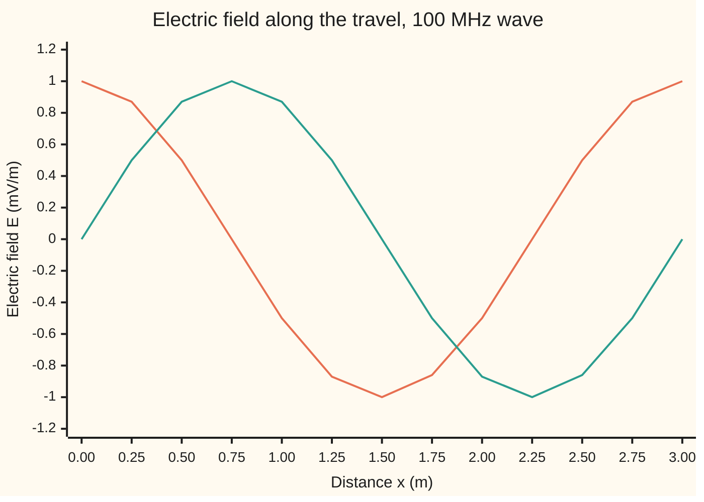

# Electromagnetic waves: the two curl equations feed each other and light falls out

[Syllabus](../../../SYLLABUS.md) → [Engineering mathematics](../README.md) → [Circuits and Electromagnetism](../README.md#s06) → Electromagnetic waves

---

## General Overview

A station broadcasts at 100 MHz, near the middle of the FM band. A radio set across town has a telescopic antenna on its back and an RLC tuner inside ([RLC resonance](03-rlc-circuits-and-resonance.md)). Nothing connects the two. Yet the set picks up 100 million swings a second from a mast it cannot see.

The engineer building the set wants three numbers. How long is one wave? That sets the antenna's length. How fast does it travel? That sets the delay from mast to set. Which way does the field point? That says how to hold the antenna. The answers: one wave is 2.9979 m long, about 3 m; it travels at 299,792,458 m/s; and the field points one fixed way across the direction of travel, so the antenna should lie along it. A whip a quarter of a wave long, 0.7495 m, is why so many radio antennas pull out to about 75 cm.

How can a field cross empty space with no wire to carry it? Two of Maxwell's equations do it between them. A magnetic field that changes in time makes an electric field that curls round it: Faraday's law. An electric field that changes in time makes a magnetic field that curls round it: Maxwell's added term. Each change makes the other, a little further along, so the pair hands itself forward. Work out how fast, and the answer depends on two electrical constants. In the 1850s their combination was measured on a laboratory bench with capacitors and coils, and it came out close to the measured speed of light. That is how light turned out to be an electromagnetic wave.

**In empty space each field's change in time drives the other's curl in space, the two curl equations combine into the wave equation, and its speed is one over the square root of the two electrical constants: the speed of light.**

**What kind of fact this is:** a theorem inside a model. Given Maxwell's equations in vacuum, the wave equation and its speed are derived on this card in Why it works. Maxwell's equations themselves are the classical model of fields: confirmed by every radio ever built, replaced only where single photons matter.

### The picture: the two fields keep each other going


Schematic. Each arrow is one of the two curl equations. Neither field needs a charge or a current to keep the loop running, so the pair can leave the mast and travel on its own.

---

## The formula

Start from the two curl equations of [Maxwell's equations](07-maxwells-equations.md), in empty space with no charges and no currents. This card writes the curl as $\nabla\times$ and the divergence as $\nabla\cdot$, as many books do: the same spin and outflow as on that card. Take the curl of the first, use the second, and out comes a wave equation:

$$\nabla\times\mathbf E = -\frac{\partial \mathbf B}{\partial t},\qquad \nabla\times\mathbf B = \mu_0\varepsilon_0\,\frac{\partial \mathbf E}{\partial t}\qquad\Longrightarrow\qquad \frac{\partial^2 \mathbf E}{\partial t^2} = c^2\,\nabla^2\mathbf E,\qquad c=\frac{1}{\sqrt{\mu_0\varepsilon_0}}$$

**Read it aloud:** the electric field's acceleration at each point equals the speed of light squared times how sharply the field bends round that point, and that speed is one over the square root of the two electrical constants.

One solution is the wave from the station, travelling along $x$:

$$\mathbf E = E_0\,\hat{\mathbf y}\,\cos(kx-\omega t),\qquad \mathbf B = \frac{E_0}{c}\,\hat{\mathbf z}\,\cos(kx-\omega t),\qquad \omega = 2\pi f,\quad k=\frac{2\pi}{\lambda},\quad \lambda=\frac{c}{f}$$

**Read it aloud:** the electric field points up and down, the magnetic field points sideways, both rise and fall in step as the wave slides along $x$, and one wavelength is the speed divided by the frequency.

| Symbol | Plain meaning | In our example | Push it up and the answer… |
| --- | --- | --- | --- |
| $\mathbf E$, $E_0$ | electric field, in volts per metre; its peak value | peak 1.000 mV/m, a clearly heard station (an illustrative input) | the antenna's voltage rises in proportion |
| $\mathbf B$, $B_0$ | magnetic field, in tesla (T); its peak value | 3.336 pT (picotesla, $10^{-12}$ T) | locked to $E$: always $B_0 = E_0/c$ |
| $\varepsilon_0$ | vacuum permittivity: how much electric field a charge makes; since 2019 fixed as $1/(\mu_0 c^2)$ | $8.8541878188\times10^{-12}$ F/m | the wave slows |
| $\mu_0$ | vacuum permeability: how much magnetic field a current makes; a measured constant (CODATA 2022) | $1.25663706127\times10^{-6}$ N/A² | the wave slows |
| $c$ | the wave's speed | 299,792,458 m/s | each wave is longer |
| $f$, $\omega$ | frequency in hertz (swings per second); angular frequency $2\pi f$ in rad/s | 100 MHz; $628.3\times10^6$ rad/s | each wave is shorter |
| $\lambda$, $k$ | wavelength, in metres; wavenumber $2\pi/\lambda$, in rad/m | 2.9979 m; 2.0958 rad/m | — |
| $x$, $t$ | distance along the direction of travel, in metres; time, in seconds | crest at 0.749 m after 2.5 ns | — |
| $\hat{\mathbf y}$, $\hat{\mathbf z}$ | arrows of length one across the travel: $\hat{\mathbf y}$ the polarisation (the way $\mathbf E$ points), $\hat{\mathbf z}$ the way $\mathbf B$ points | $\hat{\mathbf y}$ along the antenna | — |
| $\nabla\cdot$, $\nabla\times$, $\nabla^2$ | divergence (net outflow), curl (spin, or twist), Laplacian (bending: how far the average round a point sits above the value there) | all three act on $\mathbf E$ and $\mathbf B$ | — |
| $\partial/\partial t$ | rate of change in time at one fixed point | — | — |
| $\theta$ | angle between the antenna and $\mathbf E$ | 60° | the voltage falls as $\cos\theta$ |

### When it holds

- **Empty space, or close to it.** The derivation sets charge and current to zero and uses the vacuum constants. Air is close enough for radio. Inside a material the wave slows: in the polyethylene that fills most coaxial cable, with permittivity about 2.25 times $\varepsilon_0$, the 100 MHz wave is only 1.9986 m long.
- **Far from the antenna.** The plane wave above is the picture many wavelengths out. Within about a wavelength of the mast the fields are tangled with the mast's own charges and currents, and $E/B$ is not $c$.
- **A small patch of a spreading wave.** A real wave spreads out from the mast and thins with distance. Over the few metres round one radio set, its fronts are flat enough to treat as planes.
- **Linear fields.** Vacuum adds fields without changing them, so two stations pass through each other untouched. Very strong fields inside some crystals break this.
- **Classical fields.** At 100 MHz each photon (the smallest packet of light) carries so little energy that the field is smooth. For single photons the model gives way to the quantum shelf.

---

## Why it works

### Step 0: each field's change feeds the other's curl

Each curl equation links a change in time of one field to a twist in space of the other. Apply both in a row and the electric field's change in time is linked to a twist of a twist of itself. A vector identity says a twist of a twist is a bend, once the field has no net outflow. And "acceleration equals bending times a constant" is exactly the wave equation of a string ([The wave equation](../../08-Differential%20equations%20and%20dynamics/10-The%20Classical%20PDEs/05-the-wave-equation-and-dalemberts-formula.md)). The constant is the speed squared.

### Step 1: Maxwell's equations with nothing in the room

In empty space the charge density and current density are zero. The four equations of [Maxwell's equations](07-maxwells-equations.md) become:

$$\nabla\cdot\mathbf E = 0,\qquad \nabla\cdot\mathbf B = 0,\qquad \nabla\times\mathbf E = -\frac{\partial \mathbf B}{\partial t},\qquad \nabla\times\mathbf B = \mu_0\varepsilon_0\frac{\partial \mathbf E}{\partial t}.$$

The first two say neither field has a source or a sink here. The third is Faraday's law ([Magnetic fields](05-magnetism-and-faradays-law.md)). The fourth is Ampère's law with the current set to zero, leaving only Maxwell's term: a changing electric field acts like a current.

### Step 2: take the curl of Faraday's law

Apply $\nabla\times$ to both sides of the third equation. On the right, the curl acts on space and $\partial/\partial t$ on time, so they can swap order:

$$\nabla\times(\nabla\times\mathbf E) = -\frac{\partial}{\partial t}\left(\nabla\times\mathbf B\right) = -\mu_0\varepsilon_0\,\frac{\partial^2 \mathbf E}{\partial t^2}.$$

The second step used the fourth equation. This is the moment the two curl equations feed each other: Faraday's law turns $\mathbf E$ into a changing $\mathbf B$, and Maxwell's term turns that back into a changing $\mathbf E$.

### Step 3: a twist of a twist is a bend

For any smooth vector field, the curl of the curl equals the gradient of the divergence minus the Laplacian:

$$\nabla\times(\nabla\times\mathbf E) = \nabla(\nabla\cdot\mathbf E) - \nabla^2\mathbf E.$$

In empty space $\nabla\cdot\mathbf E = 0$, so the first term drops and the curl of the curl is just $-\nabla^2\mathbf E$.

<details>
<summary>Checking the identity on one component</summary>

Write $\mathbf E = (E_x, E_y, E_z)$, and $\partial_x$ for $\partial/\partial x$. The $x$-component of $\nabla\times\mathbf E$ is $\partial_y E_z - \partial_z E_y$, and similarly round the cycle. The $x$-component of the curl of the curl is

$$\partial_y(\partial_x E_y - \partial_y E_x) - \partial_z(\partial_z E_x - \partial_x E_z) = \partial_x(\partial_y E_y + \partial_z E_z) - (\partial_y^2 + \partial_z^2)E_x.$$

Add and subtract $\partial_x^2 E_x$: the first bracket becomes $\partial_x(\nabla\cdot\mathbf E)$ and the second becomes $\nabla^2 E_x$. The $y$ and $z$ components follow by renaming. The code checks the identity a different way, by finite differences on a field with no divergence that is not a wave: at the point (0.3, 0.7, 1.1) the curl of the curl comes out at −0.50893, −0.80423, −0.94490, and minus the Laplacian, worked by hand, gives the same three numbers.

</details>

### Step 4: the wave equation, and its speed

Put Step 3 into Step 2 and divide by $-\mu_0\varepsilon_0$:

$$\frac{\partial^2 \mathbf E}{\partial t^2} = \frac{1}{\mu_0\varepsilon_0}\,\nabla^2\mathbf E.$$

Each of the three components obeys the wave equation from wing 08, with $c^2 = 1/(\mu_0\varepsilon_0)$. The same steps, starting from the curl of the fourth equation, give the same equation for $\mathbf B$. With the CODATA 2022 constants, $c$ = 299,792,458 m/s. Today that match is built in: the metre is defined from $c$, and since 2019 $\varepsilon_0$ is fixed as $1/(\mu_0 c^2)$, so the code's check of $c$ confirms only that the constants are consistent. The real test came first. In the 1850s the combination $1/\sqrt{\mu_0\varepsilon_0}$ was measured on a bench with capacitors and coils, and Maxwell's 1865 paper set it beside the measured speed of light. They agreed within a few percent.

### Step 5: the wave must point across its travel

Try a wave that varies only with $x$. If $\mathbf E$ had a waving part along $x$, that part would change with $x$, and $\nabla\cdot\mathbf E$ would not be zero. So $\mathbf E$ lies across the direction of travel: the wave is **transverse**. Take $\mathbf E = E_0\hat{\mathbf y}\cos(kx-\omega t)$. Faraday's law then reads $\partial B_z/\partial t = -\partial E_y/\partial x$, which gives $\mathbf B$ along $\hat{\mathbf z}$ with peak $E_0 k/\omega$. The wave equation forces $\omega = ck$, so $B_0 = E_0/c$, and $\lambda = 2\pi/k = 2\pi c/\omega = c/f$. The two fields are at right angles to each other and to the travel, and they peak together.

### Step 6: polarisation is the direction of E

Nothing above fixes which way across the travel $\mathbf E$ points: up, sideways, or anything between. That direction is the wave's **polarisation**. An antenna is a wire, and only the part of $\mathbf E$ along the wire pushes its electrons. Tilt the wire by $\theta$ away from $\mathbf E$ and the pushing part is $E_0\cos\theta$. The voltage scales by $\cos\theta$ and the received power by $\cos^2\theta$.

---

## Worked numbers, by hand

The station: $f$ = 100 MHz, peak field $E_0$ = 1.000 mV/m.

| Step | Arithmetic | Value |
| --- | --- | --- |
| $\mu_0\varepsilon_0$ | $1.25663706127\times10^{-6} \times 8.8541878188\times10^{-12}$ | $1.1127\times10^{-17}$ s²/m² |
| speed, $c = 1/\sqrt{\mu_0\varepsilon_0}$ | $1/\sqrt{1.1127\times10^{-17}}$ | 299,792,458 m/s |
| period, $1/f$ | $1/(100\times10^6)$ | 10 ns |
| wavelength, $\lambda = c/f$ | $299{,}792{,}458 / 100{,}000{,}000$ | **2.9979 m** |
| quarter-wave whip, $\lambda/4$ | $2.9979/4$ | 0.7495 m |
| half-wave dipole, $\lambda/2$ | $2.9979/2$ | 1.4990 m |
| angular frequency, $\omega = 2\pi f$ | $2\pi\times100\times10^6$ | $628.3\times10^6$ rad/s |
| wavenumber, $k = 2\pi/\lambda$ | $2\pi/2.9979$ | 2.0958 rad/m |
| check, $\omega/k$ | $628.3\times10^6/2.0958$ | 299,792,458 m/s |
| magnetic peak, $B_0 = E_0/c$ | $0.001/299{,}792{,}458$ | 3.336 pT |
| antenna tilted 60°, voltage | $\cos 60°$ | × 0.500, which is −6.02 dB |

One wave is 2.9979 m long, so a pull-out whip of about 75 cm is a quarter wave, and a wire dipole for the FM band is about 1.5 m tip to tip. The magnetic part of the wave is tiny in tesla, 3.336 pT, but that is only a choice of units: $cB$ equals $E$ exactly.

### What breaks if you drop a piece

Correct answer: 2.9979 m wavelength at 299,792,458 m/s.

| Mistake | Comes out at | What went wrong |
| --- | --- | --- |
| Put $\omega$ where $f$ belongs, $\lambda = c/\omega$ | 0.4771 m, so a whip of 0.1193 m | Rad/s are not hertz; the answer is short by $2\pi$ |
| Forget the square root, $c = 1/(\mu_0\varepsilon_0)$ | $8.988\times10^{16}$ m/s | That is $c^2$, in the wrong units |
| Drop Maxwell's term from the fourth equation | no wave at all: nothing is left that changes $\mathbf E$ | The term is the only link from $\mathbf B$ back to $\mathbf E$, and its size sets the speed: at a quarter strength the simulated pulse runs at 0.4972 of $c$, about half |
| Use the vacuum wavelength inside coaxial cable (polyethylene) | the true length there is 1.9986 m, not 2.9979 m | Outside the model: the material slows the wave by $\sqrt{2.25}$ = 1.5 |

The last row is why a quarter-wave matching stub cut from coax is a third shorter than one cut from bare wire.

---

## How the wave moves

The puzzle: out in empty space there is no charge and no current, so what pushes the crest forward? Answer: the two feeds. Wherever $\mathbf E$ slopes across space, $\mathbf B$ changes in time there (Faraday). Wherever $\mathbf B$ slopes, $\mathbf E$ changes (Maxwell's term). Each field's slope just ahead of the crest builds the other there, so the crest reappears a little further on.

One crest, followed for one period:

| Time | Where the crest is |
| --- | --- |
| 0 ns | 0.000 m |
| 2.5 ns | 0.749 m |
| 5.0 ns | 1.499 m |
| 7.5 ns | 2.248 m |
| 10.0 ns | 2.998 m: one full wavelength, and the next crest is now where this one started |

The simulation in the code sends a short pulse of peak 1.000 mV/m down a line, stepping only the two curl equations. Its peak as it passes three points:

```
                          peak field at the point (mV/m)
both feeds, at 3 m        ████████████████████████████████████████  1.000
both feeds, at 6 m        ████████████████████████████████████████  1.000
both feeds, at 9 m        ████████████████████████████████████████  0.999
```

With both feeds the pulse arrives whole; a flat wave in vacuum does not fade.

Now weaken one feed. Run the simulation with Maxwell's term at a quarter of its size, and the pulse travels at 0.4972 of $c$, about half: the speed goes as the square root of the term's size. Remove the term altogether and the electric field has no equation left that changes it, so nothing can leave the source. That follows from the equations themselves; no simulation is needed to show it.

The two moments side by side, as a chart:



Orange: the field at 0 ns. Green: 2.5 ns later, every crest moved 0.749 m to the right. The magnetic field, scaled by $c$, lies exactly on each curve.

---

## Code, from first principles, and it actually runs

The code takes three independent roads. Road 1 is the closed form: the speed from the two constants, then wavelength, wavenumber and the magnetic peak. Its check of $c$ tests only that the constants are consistent (Step 4). Road 2 is a simulation that knows nothing but the two curl equations: it splits a 35 m line into 5 cm cells, keeps $E$ on the cell edges and $B$ halfway between, and steps each from the other's slope every 0.1 ns (Yee's leapfrog scheme). It measures the speed of a pulse, the wavelength of a steady 100 MHz drive, and the ratio $E/(cB)$, with no formula for any of them. The grid slows short waves very slightly, so the simulated speed is 0.9989 of $c$ and the wavelength 2.9970 m; both agree with road 1 within the half-percent the asserts allow. Run with Maxwell's term at a quarter of its size, the same simulation finds 0.4972 of $c$, within the 1% of half that its assert allows; the shorter waves sit on fewer cells and are slowed a little more. Road 3 checks the vector identity of Step 3 by finite differences on a field that is not a wave. Every number on this card is printed by both programs.

### Python

```python
# Electromagnetic waves -- the check behind the card.  Standard library only.
# Road 1: the closed form, c = 1/sqrt(mu0 eps0) and wavelength = c/f.
# Road 2: a simulation that knows only the two curl equations (Yee's leapfrog).
# Road 3: the vector identity the derivation rests on, by finite differences.
from math import sqrt, sin, cos, exp, pi, log10

MU0 = 1.25663706127e-6      # N/A^2, vacuum magnetic permeability (CODATA 2022)
EPS0 = 8.8541878188e-12     # F/m, vacuum electric permittivity (CODATA 2022)
C_DEF = 299792458.0         # m/s, exact: it defines the metre
F = 100e6                   # Hz, the station
E0 = 1e-3                   # V/m, field amplitude of a clearly heard station

# ---- Road 1: closed form
c = 1.0 / sqrt(MU0 * EPS0)
lam = c / F
omega, k = 2 * pi * F, 2 * pi / lam
print(f"mu0  = {MU0 * 1e6:.11f} x 10^-6 N/A^2, eps0 = {EPS0 * 1e12:.10f} x 10^-12 F/m")
print(f"mu0 eps0 = {MU0 * EPS0 * 1e17:.4f} x 10^-17 s^2/m^2")
print(f"c = 1/sqrt(mu0 eps0) = {c:.0f} m/s, defined value {C_DEF:.0f} m/s")
assert abs(c - C_DEF) / C_DEF < 1e-9     # consistency of the constants: since 2019 eps0 = 1/(mu0 c^2)
print(f"f = {F / 1e6:.0f} MHz: period {1e9 / F:.0f} ns, wavelength {lam:.4f} m")
print(f"omega = {omega / 1e6:.1f} x 10^6 rad/s, k = {k:.4f} rad/m, omega/k = {omega / k:.0f} m/s")
print(f"quarter-wave whip {lam / 4:.4f} m, half-wave dipole {lam / 2:.4f} m")
print(f"other waves: 50 Hz {c / 50 / 1e3:.0f} km, 2.45 GHz {c / 2.45e9:.4f} m, 3 GHz {c / 3e9:.4f} m;"
      f" light in 1 ns {c * 1e-9:.4f} m")
print(f"E0 = {E0 * 1e3:.3f} mV/m, B0 = E0/c = {E0 / c * 1e12:.3f} pT")
for ns in (0.0, 2.5, 5.0, 7.5, 10.0):
    print(f"crest at t = {ns:4.1f} ns: x = {c * ns * 1e-9:.3f} m")
def f2(v): return f"{v:6.2f}".replace("-0.00", " 0.00")   # no minus sign on a zero
xs = [0.25 * i for i in range(13)]
print("chart, x (m)         " + " ".join(f"{x:6.2f}" for x in xs))
print("chart, E at 0 ns     " + " ".join(f2(1e3 * E0 * cos(k * x)) for x in xs))
print("chart, E at 2.5 ns   " + " ".join(f2(1e3 * E0 * cos(k * x - omega * 2.5e-9)) for x in xs))
for deg in (0, 30, 45, 60, 90):
    g = cos(deg * pi / 180)
    db = f"{20 * log10(g):6.2f} dB" if g > 1e-9 else "   none"
    print(f"antenna tilted {deg:2d} deg: voltage x {g:.3f}, power x {g * g:.3f}, {db}")

# ---- Road 2: step the two curl equations on a line of cells, 60 cells per wavelength
DX, DT = 0.05, 1e-10                      # m, s; c*DT/DX = 0.6, under the stability limit 1
def simulate(steps, source, probes, term=1.0, dx=DX):   # term: size of Maxwell's term, 1 = true
    n = 700                               # 700 cells, 35 m at 5 cm; E at x = i*dx, B halfway between
    E, B = [0.0] * (n + 1), [0.0] * n
    trace = {p: [] for p in probes}
    for s in range(steps):
        for i in range(n):                # Faraday: dB/dt = -dE/dx
            B[i] -= DT * (E[i + 1] - E[i]) / dx
        for i in range(1, n):             # Ampere-Maxwell in vacuum: dE/dt = -(1/(mu0 eps0)) dB/dx
            E[i] -= term * DT / (MU0 * EPS0) * (B[i] - B[i - 1]) / dx
        E[0] = source((s + 1) * DT)       # the transmitter drives the left end
        for p in probes:
            trace[p].append(E[round(p / dx)])
    return E, B, trace

def peak_time(y):                         # time of the largest sample, refined by a parabola
    m = max(range(len(y)), key=lambda i: y[i])
    a, b, d = y[m - 1], y[m], y[m + 1]
    return (m + 1 + 0.5 * (a - d) / (a - 2 * b + d)) * DT

pulse = lambda t: E0 * exp(-((t - 8e-9) / 2e-9) ** 2)
probes = (3.0, 6.0, 9.0)
def pulse_speed(steps, term=1.0, dx=DX):  # time the pulse's peak from 3 m to 9 m
    tr = simulate(steps, pulse, probes, term, dx)[2]
    return (9.0 - 3.0) / (peak_time(tr[9.0]) - peak_time(tr[3.0])), tr
v, tr = pulse_speed(450)
print(f"simulated pulse speed, 3 m to 9 m: {v:.0f} m/s ({v / c:.4f} of c)")
assert abs(v / c - 1) < 5e-3
for p in probes:
    print(f"pulse peak at {p:.0f} m: {max(tr[p]) * 1e3:.3f} mV/m")
    assert abs(max(tr[p]) - E0) < 0.01 * E0

ramp = lambda t: 0.5 * (1 - cos(pi * t / 20e-9)) if t < 20e-9 else 1.0
def wavelength(f):                        # drive at f; zero crossings from 1 m to 11 m
    E, B, _ = simulate(600, lambda t: E0 * sin(2 * pi * f * t) * ramp(t), ())
    zs = [(i + E[i] / (E[i] - E[i + 1])) * DX for i in range(20, 220) if E[i] * E[i + 1] < 0]
    return 2 * (zs[-1] - zs[0]) / (len(zs) - 1), len(zs), E, B
lam_sim, nz, E, B = wavelength(F)
print(f"simulated wavelength, 1 m to 11 m: {lam_sim:.4f} m ({nz} zero crossings)")
assert abs(lam_sim / lam - 1) < 5e-3
ratio = max(abs(e) for e in E[20:220]) / (c * max(abs(b) for b in B[20:220]))
print(f"simulated E/(cB) = {ratio:.3f}")
assert abs(ratio - 1) < 1e-2

# ---- Road 3: curl of curl of a field with zero divergence equals minus its Laplacian
def field(x, y, z): return (z * z * sin(y), x ** 3 * cos(z), y * exp(x))
H = 1e-3
def partial(fn, j, a, pt):                # d(component j)/d(coordinate a), central difference
    up, dn = list(pt), list(pt)
    up[a] += H; dn[a] -= H
    return (fn(*up)[j] - fn(*dn)[j]) / (2 * H)
def curl(fn):
    return lambda *pt: (partial(fn, 2, 1, pt) - partial(fn, 1, 2, pt),
                        partial(fn, 0, 2, pt) - partial(fn, 2, 0, pt),
                        partial(fn, 1, 0, pt) - partial(fn, 0, 1, pt))
x, y, z = 0.3, 0.7, 1.1
num = curl(curl(field))(x, y, z)
exact = ((z * z - 2) * sin(y), (x ** 3 - 6 * x) * cos(z), -y * exp(x))   # -Laplacian, by hand
print("curl curl F, differences: " + " ".join(f"{a:.5f}" for a in num))
print("minus Laplacian, by hand: " + " ".join(f"{a:.5f}" for a in exact))
assert max(abs(a - b) for a, b in zip(num, exact)) < 1e-5

# ---- What breaks
print(f"wrong: omega in place of f: wavelength {c / omega:.4f} m, whip {c / omega / 4:.4f} m")
print(f"wrong: no square root: speed {1 / (MU0 * EPS0) / 1e16:.3f} x 10^16 m/s")
print(f"outside the model: in polyethylene (permittivity 2.25 eps0): wavelength {lam / sqrt(2.25):.4f} m")
vq = pulse_speed(800, term=0.25)[0]       # Maxwell's term at a quarter of its size
print(f"Maxwell's term at a quarter: pulse speed {vq:.0f} m/s ({vq / c:.4f} of c)")
assert abs(vq / (c / 2) - 1) < 1e-2       # a quarter of the term halves the speed
lam88 = wavelength(88e6)[0]
print(f"try: F = 88 MHz: wavelength {c / 88e6:.4f} m, whip {c / 88e6 / 4:.4f} m, simulated {lam88:.4f} m")
v20 = pulse_speed(450, dx=0.2)[0]
print(f"try: 20 cm cells, {lam / 0.2:.0f} per wavelength: pulse speed {v20 / c:.4f} of c")
print(f"try: 0.2 ns step: light crosses {c * 2e-10 / DX:.2f} cells per step, over the limit 1")
print("ALL CHECKS PASS")
```

**Ran 2026-11-11 on macOS, Python 3.14.10, standard library only. All checks passed. Output, pasted from the run:**

```
mu0  = 1.25663706127 x 10^-6 N/A^2, eps0 = 8.8541878188 x 10^-12 F/m
mu0 eps0 = 1.1127 x 10^-17 s^2/m^2
c = 1/sqrt(mu0 eps0) = 299792458 m/s, defined value 299792458 m/s
f = 100 MHz: period 10 ns, wavelength 2.9979 m
omega = 628.3 x 10^6 rad/s, k = 2.0958 rad/m, omega/k = 299792458 m/s
quarter-wave whip 0.7495 m, half-wave dipole 1.4990 m
other waves: 50 Hz 5996 km, 2.45 GHz 0.1224 m, 3 GHz 0.0999 m; light in 1 ns 0.2998 m
E0 = 1.000 mV/m, B0 = E0/c = 3.336 pT
crest at t =  0.0 ns: x = 0.000 m
crest at t =  2.5 ns: x = 0.749 m
crest at t =  5.0 ns: x = 1.499 m
crest at t =  7.5 ns: x = 2.248 m
crest at t = 10.0 ns: x = 2.998 m
chart, x (m)           0.00   0.25   0.50   0.75   1.00   1.25   1.50   1.75   2.00   2.25   2.50   2.75   3.00
chart, E at 0 ns       1.00   0.87   0.50   0.00  -0.50  -0.87  -1.00  -0.86  -0.50   0.00   0.50   0.87   1.00
chart, E at 2.5 ns     0.00   0.50   0.87   1.00   0.87   0.50   0.00  -0.50  -0.87  -1.00  -0.86  -0.50   0.00
antenna tilted  0 deg: voltage x 1.000, power x 1.000,   0.00 dB
antenna tilted 30 deg: voltage x 0.866, power x 0.750,  -1.25 dB
antenna tilted 45 deg: voltage x 0.707, power x 0.500,  -3.01 dB
antenna tilted 60 deg: voltage x 0.500, power x 0.250,  -6.02 dB
antenna tilted 90 deg: voltage x 0.000, power x 0.000,    none
simulated pulse speed, 3 m to 9 m: 299456671 m/s (0.9989 of c)
pulse peak at 3 m: 1.000 mV/m
pulse peak at 6 m: 1.000 mV/m
pulse peak at 9 m: 0.999 mV/m
simulated wavelength, 1 m to 11 m: 2.9970 m (7 zero crossings)
simulated E/(cB) = 1.000
curl curl F, differences: -0.50893 -0.80423 -0.94490
minus Laplacian, by hand: -0.50893 -0.80423 -0.94490
wrong: omega in place of f: wavelength 0.4771 m, whip 0.1193 m
wrong: no square root: speed 8.988 x 10^16 m/s
outside the model: in polyethylene (permittivity 2.25 eps0): wavelength 1.9986 m
Maxwell's term at a quarter: pulse speed 149071670 m/s (0.4972 of c)
try: F = 88 MHz: wavelength 3.4067 m, whip 0.8517 m, simulated 3.4060 m
try: 20 cm cells, 15 per wavelength: pulse speed 0.9820 of c
try: 0.2 ns step: light crosses 1.20 cells per step, over the limit 1
ALL CHECKS PASS
```

### Rust

```rust
// Electromagnetic waves -- the check behind the card.  std only, no crates.
// Road 1: the closed form, c = 1/sqrt(mu0 eps0) and wavelength = c/f.
// Road 2: a simulation that knows only the two curl equations (Yee's leapfrog).
// Road 3: the vector identity the derivation rests on, by finite differences.
use std::f64::consts::PI;

const MU0: f64 = 1.25663706127e-6; // N/A^2, vacuum magnetic permeability (CODATA 2022)
const EPS0: f64 = 8.8541878188e-12; // F/m, vacuum electric permittivity (CODATA 2022)
const C_DEF: f64 = 299792458.0; // m/s, exact: it defines the metre
const F: f64 = 100e6; // Hz, the station
const E0: f64 = 1e-3; // V/m, field amplitude of a clearly heard station
const DX: f64 = 0.05; // m
const DT: f64 = 1e-10; // s; c*DT/DX = 0.6, under the stability limit 1
const H: f64 = 1e-3;

fn f2(v: f64) -> String { format!("{:6.2}", v).replace("-0.00", " 0.00") } // no minus sign on a zero

// Step the two curl equations on a line of cells; returns final E, B and probe traces.
// term is the size of Maxwell's term (1 = true); dx is the cell size.
fn simulate(steps: usize, source: &dyn Fn(f64) -> f64, probes: &[f64], term: f64, dx: f64)
    -> (Vec<f64>, Vec<f64>, Vec<Vec<f64>>) {
    let n = 700; // 700 cells, 35 m at 5 cm; E at x = i*dx, B halfway between
    let (mut e, mut b) = (vec![0.0; n + 1], vec![0.0; n]);
    let mut trace = vec![Vec::new(); probes.len()];
    for s in 0..steps {
        for i in 0..n { b[i] -= DT * (e[i + 1] - e[i]) / dx; } // Faraday: dB/dt = -dE/dx
        // Ampere-Maxwell in vacuum: dE/dt = -(1/(mu0 eps0)) dB/dx
        for i in 1..n { e[i] -= term * DT / (MU0 * EPS0) * (b[i] - b[i - 1]) / dx; }
        e[0] = source((s + 1) as f64 * DT); // the transmitter drives the left end
        for (j, p) in probes.iter().enumerate() { trace[j].push(e[(p / dx).round() as usize]); }
    }
    (e, b, trace)
}

fn peak_time(y: &[f64]) -> f64 { // time of the largest sample, refined by a parabola
    let mut m = 0;
    for i in 1..y.len() { if y[i] > y[m] { m = i; } }
    let (a, b, d) = (y[m - 1], y[m], y[m + 1]);
    ((m + 1) as f64 + 0.5 * (a - d) / (a - 2.0 * b + d)) * DT
}

// time the pulse's peak from 3 m to 9 m
fn pulse_speed(steps: usize, term: f64, dx: f64) -> (f64, Vec<Vec<f64>>) {
    let pulse = |t: f64| E0 * (-((t - 8e-9) / 2e-9).powi(2)).exp();
    let (_, _, tr) = simulate(steps, &pulse, &[3.0, 6.0, 9.0], term, dx);
    ((9.0 - 3.0) / (peak_time(&tr[2]) - peak_time(&tr[0])), tr)
}

// drive at f; zero crossings from 1 m to 11 m
fn wavelength(f: f64) -> (f64, usize, Vec<f64>, Vec<f64>) {
    let ramp = |t: f64| if t < 20e-9 { 0.5 * (1.0 - (PI * t / 20e-9).cos()) } else { 1.0 };
    let (e, b, _) = simulate(600, &|t: f64| E0 * (2.0 * PI * f * t).sin() * ramp(t), &[], 1.0, DX);
    let zs: Vec<f64> = (20..220).filter(|&i| e[i] * e[i + 1] < 0.0)
        .map(|i| (i as f64 + e[i] / (e[i] - e[i + 1])) * DX).collect();
    (2.0 * (zs[zs.len() - 1] - zs[0]) / (zs.len() - 1) as f64, zs.len(), e, b)
}

fn maxabs(v: &[f64]) -> f64 { v.iter().fold(0.0, |m: f64, x| m.max(x.abs())) }

fn field(p: [f64; 3]) -> [f64; 3] { [p[2] * p[2] * p[1].sin(), p[0].powi(3) * p[2].cos(), p[1] * p[0].exp()] }

fn partial(f: &dyn Fn([f64; 3]) -> [f64; 3], j: usize, a: usize, pt: [f64; 3]) -> f64 {
    let (mut up, mut dn) = (pt, pt); // d(component j)/d(coordinate a), central difference
    up[a] += H; dn[a] -= H;
    (f(up)[j] - f(dn)[j]) / (2.0 * H)
}

fn curl(f: &dyn Fn([f64; 3]) -> [f64; 3], pt: [f64; 3]) -> [f64; 3] {
    [partial(f, 2, 1, pt) - partial(f, 1, 2, pt),
     partial(f, 0, 2, pt) - partial(f, 2, 0, pt),
     partial(f, 1, 0, pt) - partial(f, 0, 1, pt)]
}

fn main() {
    // ---- Road 1: closed form
    let c = 1.0 / (MU0 * EPS0).sqrt();
    let lam = c / F;
    let (omega, k) = (2.0 * PI * F, 2.0 * PI / lam);
    println!("mu0  = {:.11} x 10^-6 N/A^2, eps0 = {:.10} x 10^-12 F/m", MU0 * 1e6, EPS0 * 1e12);
    println!("mu0 eps0 = {:.4} x 10^-17 s^2/m^2", MU0 * EPS0 * 1e17);
    println!("c = 1/sqrt(mu0 eps0) = {:.0} m/s, defined value {:.0} m/s", c, C_DEF);
    assert!((c - C_DEF).abs() / C_DEF < 1e-9); // consistency of the constants: since 2019 eps0 = 1/(mu0 c^2)
    println!("f = {:.0} MHz: period {:.0} ns, wavelength {:.4} m", F / 1e6, 1e9 / F, lam);
    println!("omega = {:.1} x 10^6 rad/s, k = {:.4} rad/m, omega/k = {:.0} m/s", omega / 1e6, k, omega / k);
    println!("quarter-wave whip {:.4} m, half-wave dipole {:.4} m", lam / 4.0, lam / 2.0);
    println!("other waves: 50 Hz {:.0} km, 2.45 GHz {:.4} m, 3 GHz {:.4} m; light in 1 ns {:.4} m",
             c / 50.0 / 1e3, c / 2.45e9, c / 3e9, c * 1e-9);
    println!("E0 = {:.3} mV/m, B0 = E0/c = {:.3} pT", E0 * 1e3, E0 / c * 1e12);
    for ns in [0.0, 2.5, 5.0, 7.5, 10.0] {
        println!("crest at t = {:4.1} ns: x = {:.3} m", ns, c * ns * 1e-9);
    }
    let xs: Vec<f64> = (0..13).map(|i| 0.25 * i as f64).collect();
    let row = |g: &dyn Fn(f64) -> String| xs.iter().map(|&x| g(x)).collect::<Vec<_>>().join(" ");
    println!("chart, x (m)         {}", row(&|x| format!("{:6.2}", x)));
    println!("chart, E at 0 ns     {}", row(&|x| f2(1e3 * E0 * (k * x).cos())));
    println!("chart, E at 2.5 ns   {}", row(&|x| f2(1e3 * E0 * (k * x - omega * 2.5e-9).cos())));
    for deg in [0, 30, 45, 60, 90] {
        let g = (deg as f64 * PI / 180.0).cos();
        let db = if g > 1e-9 { format!("{:6.2} dB", 20.0 * g.log10()) } else { "   none".to_string() };
        println!("antenna tilted {:2} deg: voltage x {:.3}, power x {:.3}, {}", deg, g, g * g, db);
    }

    // ---- Road 2: step the two curl equations, 60 cells per wavelength
    let probes = [3.0, 6.0, 9.0];
    let (v, tr) = pulse_speed(450, 1.0, DX);
    println!("simulated pulse speed, 3 m to 9 m: {:.0} m/s ({:.4} of c)", v, v / c);
    assert!((v / c - 1.0).abs() < 5e-3);
    for (j, p) in probes.iter().enumerate() {
        let pk = tr[j].iter().cloned().fold(f64::MIN, f64::max);
        println!("pulse peak at {:.0} m: {:.3} mV/m", p, pk * 1e3);
        assert!((pk - E0).abs() < 0.01 * E0);
    }

    let (lam_sim, nz, e, b) = wavelength(F);
    println!("simulated wavelength, 1 m to 11 m: {:.4} m ({} zero crossings)", lam_sim, nz);
    assert!((lam_sim / lam - 1.0).abs() < 5e-3);
    let ratio = maxabs(&e[20..220]) / (c * maxabs(&b[20..220]));
    println!("simulated E/(cB) = {:.3}", ratio);
    assert!((ratio - 1.0).abs() < 1e-2);

    // ---- Road 3: curl of curl of a field with zero divergence equals minus its Laplacian
    let (x, y, z) = (0.3f64, 0.7f64, 1.1f64);
    let num = curl(&|p| curl(&field, p), [x, y, z]);
    let exact = [(z * z - 2.0) * y.sin(), (x.powi(3) - 6.0 * x) * z.cos(), -y * x.exp()]; // -Laplacian, by hand
    let s5 = |a: [f64; 3]| a.iter().map(|v| format!("{:.5}", v)).collect::<Vec<_>>().join(" ");
    println!("curl curl F, differences: {}", s5(num));
    println!("minus Laplacian, by hand: {}", s5(exact));
    assert!((0..3).all(|i| (num[i] - exact[i]).abs() < 1e-5));

    // ---- What breaks
    println!("wrong: omega in place of f: wavelength {:.4} m, whip {:.4} m", c / omega, c / omega / 4.0);
    println!("wrong: no square root: speed {:.3} x 10^16 m/s", 1.0 / (MU0 * EPS0) / 1e16);
    println!("outside the model: in polyethylene (permittivity 2.25 eps0): wavelength {:.4} m", lam / 2.25f64.sqrt());
    let vq = pulse_speed(800, 0.25, DX).0; // Maxwell's term at a quarter of its size
    println!("Maxwell's term at a quarter: pulse speed {:.0} m/s ({:.4} of c)", vq, vq / c);
    assert!((vq / (c / 2.0) - 1.0).abs() < 1e-2); // a quarter of the term halves the speed
    let lam88 = wavelength(88e6).0;
    println!("try: F = 88 MHz: wavelength {:.4} m, whip {:.4} m, simulated {:.4} m", c / 88e6, c / 88e6 / 4.0, lam88);
    let v20 = pulse_speed(450, 1.0, 0.2).0;
    println!("try: 20 cm cells, {:.0} per wavelength: pulse speed {:.4} of c", lam / 0.2, v20 / c);
    println!("try: 0.2 ns step: light crosses {:.2} cells per step, over the limit 1", c * 2e-10 / DX);
    println!("ALL CHECKS PASS");
}
```

**Ran 2026-11-11 on macOS, rustc 1.98.1, no crates. All checks passed. Output, pasted from the run:**

```
mu0  = 1.25663706127 x 10^-6 N/A^2, eps0 = 8.8541878188 x 10^-12 F/m
mu0 eps0 = 1.1127 x 10^-17 s^2/m^2
c = 1/sqrt(mu0 eps0) = 299792458 m/s, defined value 299792458 m/s
f = 100 MHz: period 10 ns, wavelength 2.9979 m
omega = 628.3 x 10^6 rad/s, k = 2.0958 rad/m, omega/k = 299792458 m/s
quarter-wave whip 0.7495 m, half-wave dipole 1.4990 m
other waves: 50 Hz 5996 km, 2.45 GHz 0.1224 m, 3 GHz 0.0999 m; light in 1 ns 0.2998 m
E0 = 1.000 mV/m, B0 = E0/c = 3.336 pT
crest at t =  0.0 ns: x = 0.000 m
crest at t =  2.5 ns: x = 0.749 m
crest at t =  5.0 ns: x = 1.499 m
crest at t =  7.5 ns: x = 2.248 m
crest at t = 10.0 ns: x = 2.998 m
chart, x (m)           0.00   0.25   0.50   0.75   1.00   1.25   1.50   1.75   2.00   2.25   2.50   2.75   3.00
chart, E at 0 ns       1.00   0.87   0.50   0.00  -0.50  -0.87  -1.00  -0.86  -0.50   0.00   0.50   0.87   1.00
chart, E at 2.5 ns     0.00   0.50   0.87   1.00   0.87   0.50   0.00  -0.50  -0.87  -1.00  -0.86  -0.50   0.00
antenna tilted  0 deg: voltage x 1.000, power x 1.000,   0.00 dB
antenna tilted 30 deg: voltage x 0.866, power x 0.750,  -1.25 dB
antenna tilted 45 deg: voltage x 0.707, power x 0.500,  -3.01 dB
antenna tilted 60 deg: voltage x 0.500, power x 0.250,  -6.02 dB
antenna tilted 90 deg: voltage x 0.000, power x 0.000,    none
simulated pulse speed, 3 m to 9 m: 299456671 m/s (0.9989 of c)
pulse peak at 3 m: 1.000 mV/m
pulse peak at 6 m: 1.000 mV/m
pulse peak at 9 m: 0.999 mV/m
simulated wavelength, 1 m to 11 m: 2.9970 m (7 zero crossings)
simulated E/(cB) = 1.000
curl curl F, differences: -0.50893 -0.80423 -0.94490
minus Laplacian, by hand: -0.50893 -0.80423 -0.94490
wrong: omega in place of f: wavelength 0.4771 m, whip 0.1193 m
wrong: no square root: speed 8.988 x 10^16 m/s
outside the model: in polyethylene (permittivity 2.25 eps0): wavelength 1.9986 m
Maxwell's term at a quarter: pulse speed 149071670 m/s (0.4972 of c)
try: F = 88 MHz: wavelength 3.4067 m, whip 0.8517 m, simulated 3.4060 m
try: 20 cm cells, 15 per wavelength: pulse speed 0.9820 of c
try: 0.2 ns step: light crosses 1.20 cells per step, over the limit 1
ALL CHECKS PASS
```

> [!TIP]
> **Try changing**
> - Guess first: how long is a wave at the bottom of the FM band? Set `F = 88e6`. The wavelength grows to 3.4067 m and the quarter-wave whip to 0.8517 m; the simulation finds 3.4060 m. The "try: F = 88 MHz" line prints all three.
> - Guess first: what happens with coarser cells? Set `DX, DT = 0.2, 1e-10`, about 15 cells per wavelength. The pulse comes out at 0.9820 of $c$, nearly 2% slow (the "try: 20 cm cells" line), and the speed assert fails. The grid, not the physics, is slowing it.
> - Guess first: what if the time step is too long? Set `DX, DT = 0.05, 2e-10`, so light would cross 1.20 cells per step (the "try: 0.2 ns step" line). The simulation blows up: the fields grow without bound, the measured "speed" is meaningless, and the assert fails. A step must not let the wave outrun a cell.
> - Guess first: what does a 45° tilt cost? Voltage × 0.707, power × 0.500, −3.01 dB: the "45 deg" line.

---

## The usual mistake

> [!warning]
> **Thinking the magnetic field is the small, unimportant half.** $B_0$ = 3.336 pT looks negligible beside $E_0$ = 1.000 mV/m, but the two are in different units, and $cB$ equals $E$ exactly; the simulation measures $E/(cB)$ = 1.000. Each half carries the same energy, and the wave needs both: in the simulation $\mathbf E$ changes only through the slope of $\mathbf B$, and $\mathbf B$ only through the slope of $\mathbf E$.
>
> Smaller traps:
> - **Mixing hertz and rad/s.** $\lambda = c/f$, not $c/\omega$. The slip gives 0.4771 m and a whip of 0.1193 m, cut for no station at all.
> - **Using the vacuum wavelength inside a cable.** In polyethylene-filled coax the 100 MHz wave is 1.9986 m long, not 2.9979 m.
> - **Holding the antenna across the field.** At 90° to $\mathbf E$ an ideal wire picks up nothing (× 0.000). In a real room reflections twist some of the field, so a little still arrives, but turning the antenna can cost far more than a 60° tilt's −6.02 dB.
> - **Leaving out the square root.** $c = 1/\sqrt{\mu_0\varepsilon_0}$. Without the root the "speed" is $8.988\times10^{16}$ m/s.

---

## Where you meet it in real life

- **The radio set itself.** Its antenna is cut to a fraction of the 2.9979 m wave, and its RLC tuner picks the one frequency out of the field the antenna feels ([RLC resonance](03-rlc-circuits-and-resonance.md)).
- **Circuit boards and the lumped-circuit rule.** [Kirchhoff's laws](01-kirchhoffs-laws-and-equivalent-circuits.md) hold while a circuit is small beside the wavelength. A tuner a few centimetres across is tiny beside 3 m; a board trace carrying 3 GHz, where the wave is 0.0999 m, is not, and designers treat it as a transmission line.
- **Coaxial cable and matching stubs.** Inside the cable the wave travels at about two-thirds of $c$, so every length cut to a fraction of a wave is cut shorter than in air.
- **Polarised sunglasses and satellite dishes.** Both choose a direction of $\mathbf E$. A sunglass lens blocks the horizontal glare; a satellite feed is turned to the polarisation the satellite sends.
- **Light, microwaves, X-rays.** All the same wave at other frequencies; only the wavelength changes. A microwave oven at 2.45 GHz uses a wave 0.1224 m long.
- **Timing and distance.** Radar and satellite positioning turn a measured delay into a distance through $c$; one nanosecond of timing error is 0.2998 m.

> **Say it back**
> A changing magnetic field makes a curling electric field, and a changing electric field makes a curling magnetic field. In empty space, putting the two curl equations together gives the wave equation, with speed $c = 1/\sqrt{\mu_0\varepsilon_0}$ = 299,792,458 m/s, the speed of light. The wave is transverse: $\mathbf E$ and $\mathbf B$ lie across the travel, at right angles to each other, with $B = E/c$. A 100 MHz station's wave is 2.9979 m long, so a quarter-wave whip is about 75 cm. The direction of $\mathbf E$ is the polarisation, and an antenna tilted by $\theta$ picks up $\cos\theta$ of the voltage.

---

## What this builds on

- [Maxwell's equations](07-maxwells-equations.md): the four equations, and the term Maxwell added to Ampère's law. This card sets the sources to zero and combines the two curl equations.
- [The wave equation](../../08-Differential%20equations%20and%20dynamics/10-The%20Classical%20PDEs/05-the-wave-equation-and-dalemberts-formula.md): the equation itself, its speed $c$, and why every solution is a shape sliding at that speed. This card only derives it from the fields.
- [Standing waves](../../08-Differential%20equations%20and%20dynamics/10-The%20Classical%20PDEs/06-standing-waves-on-a-string.md): what happens when the wave is held at both ends. A half-wave dipole is the electrical cousin of a string vibrating in its first harmonic.

## Where this goes next

- [AC power](09-power-and-three-phase.md): the next card, back in the wires. At 50 Hz the wavelength is 5,996 km, which is why the mains can be treated as lumped circuits.
- Hodge star (planned): the differential-geometry wing rewrites the same four equations as two equations on forms, and shows the wave's speed is built into the geometry of space and time.

The question left open: how much power does the wave carry, and how does an antenna turn a field of 1 mV/m into the microvolts a tuner works with?

---

## Sources

Verified 2026-11-11: every link below resolves to the publisher's page.

- Maxwell, James Clerk. "A Dynamical Theory of the Electromagnetic Field." *Philosophical Transactions of the Royal Society of London* 155 (1865): 459–512. [doi:10.1098/rstl.1865.0008](https://doi.org/10.1098/rstl.1865.0008). The original: the displacement term, the wave equation, and the speed computed from electrical measurements matching the speed of light.
- National Institute of Standards and Technology. CODATA 2022 recommended values: [vacuum magnetic permeability](https://physics.nist.gov/cgi-bin/cuu/Value?mu0) and [vacuum electric permittivity](https://physics.nist.gov/cgi-bin/cuu/Value?ep0). The two constants used on this card.
- Yee, Kane. "Numerical Solution of Initial Boundary Value Problems Involving Maxwell's Equations in Isotropic Media." *IEEE Transactions on Antennas and Propagation* 14, no. 3 (1966): 302–307. [doi:10.1109/TAP.1966.1138693](https://doi.org/10.1109/TAP.1966.1138693). The staggered leapfrog grid used as road 2, and its stability limit.
- OpenStax. *University Physics Volume 2*, sections 16.1 and 16.2. [Maxwell's equations and electromagnetic waves](https://openstax.org/books/university-physics-volume-2/pages/16-1-maxwells-equations-and-electromagnetic-waves); [Plane electromagnetic waves](https://openstax.org/books/university-physics-volume-2/pages/16-2-plane-electromagnetic-waves). The derivation from the curl equations and the plane wave with $B = E/c$, at textbook level.
