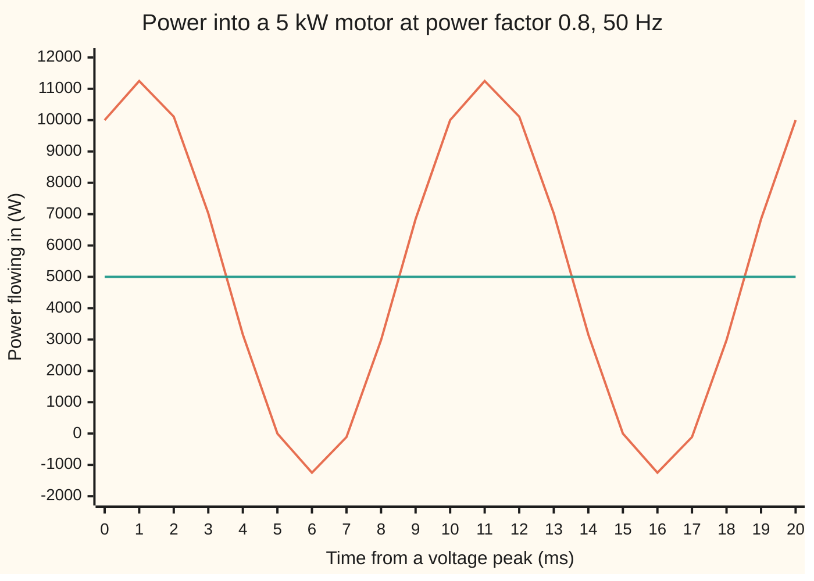

# AC power: real, reactive and apparent, and why the grid uses three phases

[Syllabus](../../../SYLLABUS.md) → [Engineering mathematics](../README.md) → [Circuits and Electromagnetism](../README.md#s06) → AC power

---

## General Overview

A workshop runs a 5 kilowatt motor on the 230 V, 50 Hz mains. The meter counts 5 kW, and the motor's rating plate says "power factor 0.8". Yet the cable to it carries 27.17 A, where a 5 kW heater on the same mains draws only 21.74 A.

Mains voltage swings back and forth 50 times a second. A motor's windings store energy in a magnetic field on each swing and hand it back on the next. That energy goes back and forth through the cable, heating the copper, and never reaches the shaft. So the motor's current has two parts: 21.74 A in step with the voltage, which does the work, and 16.30 A a quarter cycle behind, which only carries the stored energy back and forth. They add like the two short sides of a right triangle, giving 27.17 A as the long side. The power factor, 0.8 here, is the share of the cable's current that does work.

So engineers keep three books on one load. **Real power** P, in watts (W), is the 5,000 W that becomes motion and heat. **Reactive power** Q, in volt-amperes reactive (var), is the 3,750 var going back and forth. **Apparent power** S, in volt-amperes (VA), is the 6,250 VA the cable must be sized for. The same motor built for three-phase supply draws 9.06 A in each of three wires and needs no return wire at all.

**When current lags voltage by an angle φ, only the part of the current in step with the voltage delivers power: P = S cos φ, Q = S sin φ and P² + Q² = S²; three equal loads on three voltages a third of a cycle apart need no return current and draw perfectly steady power.**

**What kind of fact this is:** theorems about sine-wave voltages and currents, proved on this card in Why it works; "a motor behaves as a resistor and an inductor" is a model, good at a steady load.

### The picture: the power flowing into the motor over one mains cycle



Orange: the single-phase motor. Power surges to 11,250 W and dips to −1,250 W, twice in every 20 ms cycle; below zero, the motor is pushing energy back into the mains. Teal: the same motor on three phases, flat at 5,000 W. Both average 5,000 W.

---

## The formula

Notation first. The voltage $v(t)$ and current $i(t)$ swing as sine waves. The capital letters $V$ and $I$ are their **rms** (root-mean-square) values: the steady values that would heat a resistor equally, which for a sine wave is the peak divided by $\sqrt2$. Mains "230 V" is an rms value; its peak is 325.27 V. The current lags the voltage by the angle φ (phi), a fraction of the 360° cycle. Each quantity below is defined from those three.

$$p(t) = v(t)\,i(t), \qquad P = VI\cos\varphi, \qquad Q = VI\sin\varphi, \qquad S = VI, \qquad P^2 + Q^2 = S^2$$

**Read it aloud:** the power at each instant is voltage times current; its average is volts times amps times the cosine of the lag; the sine of the lag gives the part that goes back and forth; volts times amps is the size of both together.

For three phases, each with $V$ to the shared return wire (the **neutral**) and line current $I_L$:

$$P = 3VI_L\cos\varphi = \sqrt3\,V_L I_L\cos\varphi, \qquad V_L = \sqrt3\,V, \qquad I_N = 0 \ \text{(balanced)}$$

**Read it aloud:** three phases carry three times one phase's power; the voltage between two lines is root three times the voltage to neutral; with equal loads the neutral carries nothing.

| Symbol | Plain meaning | In our example | Push it up and the answer… |
| --- | --- | --- | --- |
| $V$, $v(t)$ | rms voltage, live wire to neutral; $v(t)$ the voltage at instant $t$ | 230 V; peak 325.2691 V | current falls for the same power |
| $I$, $I_L$, $i(t)$ | rms current in the cable; on three phases, in each line; $i(t)$ the current at instant $t$ | 27.1739 A; 9.0580 A | — |
| $\varphi$ | lag of current behind voltage | 36.8699° | power factor falls, current rises |
| $\cos\varphi$ | power factor, P ÷ S | 0.8 | current falls toward 21.7391 A |
| $\omega$, $t$, $T$ | angular frequency 2π × 50 rad/s, time, one cycle (20 ms) | 314.1593 rad/s, —, 20 ms | the inductor's reactance grows |
| $p(t)$ | power flowing in at instant $t$ | −1,250 W to 11,250 W | — |
| $P$ | real power, the average of $p(t)$ | 5,000 W | everything scales with it |
| $Q$ | reactive power, the back-and-forth part | 3,750 var | current rises |
| $S$ | apparent power, $V$ × $I$ | 6,250 VA | the cable must be thicker |
| $R$, $X$, $L$, $j$ | the motor as resistance and reactance in ohms; $L$ the inductance giving $X$; $j$ marks the part a quarter cycle out of step (the square root of −1 in phasors) | 6.7712 Ω, 5.0784 Ω, 16.1650 mH | $X$ up: φ grows |
| $V_L$ | rms voltage between two live lines | 398.3717 V | — |
| $I_N$ | current in the neutral | 0 A balanced | — |

### When it holds

- **Sine waves of one frequency.** Rectifiers in computers and chargers draw spiky currents. Their 150 Hz part (the third harmonic) adds in the neutral instead of cancelling: 3 A in each phase puts 9 A in the neutral.
- **Steady load.** The formulas describe a cycle repeating unchanged. A motor starting up draws several times its running current at a much worse power factor.
- **Balanced phases.** $I_N = 0$ needs three equal loads. Switch one phase's load off and the neutral carries 9.0580 A; halve it and the neutral carries 4.5290 A.
- **Three voltages a third of a cycle apart.** A fault that collapses one phase's voltage breaks the cancellation, and the total power starts to ripple.

---

## Why it works

### Step 0: power is a product, and a product of two waves has a steady part

At every instant, power is voltage times current. Two sine waves of the same frequency multiply into a constant plus a wave at twice the frequency. The constant is the average, the power that does work. The double-frequency part averages to nothing: energy lent and repaid each half cycle.

### Step 1: the average is $VI\cos\varphi$

Write the waves with their peaks, $\sqrt2V$ and $\sqrt2I$:

$$v = \sqrt2 V\cos\omega t, \qquad i = \sqrt2 I\cos(\omega t - \varphi)$$

Add the addition formulas for $\cos(\omega t + (\omega t - \varphi))$ and $\cos(\omega t - (\omega t - \varphi))$ from [Trig identities](../../05-Geometry%20and%20trig/03-Trigonometry/03-trig-identities.md): $2\cos\omega t\cos(\omega t - \varphi) = \cos\varphi + \cos(2\omega t - \varphi)$. So

$$p(t) = VI\cos\varphi + VI\cos(2\omega t - \varphi).$$

The second term swings symmetrically about zero, so over a cycle it averages to zero. The average is $P = VI\cos\varphi$. The swing about $P$ has size $VI = S$, so $p$ runs from $P - S$ to $P + S$: from −1,250 W to 11,250 W.

### Step 2: split the current, and the two powers appear

Expand $\cos(2\omega t - \varphi)$ by the addition formula and gather terms:

$$p(t) = P\,(1 + \cos 2\omega t) + Q\sin 2\omega t, \qquad Q = VI\sin\varphi.$$

The first term never goes below zero: energy flowing one way, into work. It comes from the current's part in step with the voltage, $I\cos\varphi$. The second term is positive for a quarter cycle and negative for the next: the lent energy. It comes from the part a quarter cycle behind, $I\sin\varphi$. Those two parts are at right angles as arrows on [The unit circle](../../05-Geometry%20and%20trig/03-Trigonometry/02-radians-and-the-unit-circle.md), so $P^2 + Q^2 = V^2I^2(\cos^2\varphi + \sin^2\varphi) = S^2$. That is the **power triangle**: P and Q as its two short sides, S as its long side.

### Step 3: the same split, seen in the circuit

The motor's impedance is $R + jX$, its opposition to current in phasor form ([Phasors](02-phasors-and-impedance.md)). In the resistance, current and voltage are in step; in the inductance, the current runs a quarter cycle behind its voltage. So $P = I^2R$ and $Q = I^2X$. For the motor, $R$ = 6.7712 Ω, $X$ = 5.0784 Ω, an inductance of 16.1650 mH. Wire those into a simulation, push 230 V through it, and the measured average is 5,000 W.

A capacitor's reactance is negative, so its $Q$ is negative: it gives energy back while a coil takes it in. In a tuned circuit at resonance ([RLC resonance](03-rlc-circuits-and-resonance.md)) the coil's $Q$ and the capacitor's $Q$ cancel, so the source supplies only $P$.

### Step 4: three phases cancel in the neutral

Three live wires carry voltages of the same size, each a third of a cycle (120°) behind the last. Each feeds a third of the motor, so each line carries the same current, lagging its own voltage by φ: 9.0580 A. All three return through one neutral. Its current is the sum of three equal arrows at 120° apart. Laid head to tail, they close a triangle back on their start, so the sum is zero: $\cos\omega t + \cos(\omega t + 120°) + \cos(\omega t + 240°) = 0$ at every instant, by the addition formula with $\cos 120° = -\tfrac12$, $\sin 120° = \tfrac{\sqrt3}{2}$. So a balanced load such as a three-phase motor needs no neutral: it connects to the three lines alone, and each line's current returns through the other two.

<details>
<summary>Detailed proof: the three cosines sum to zero</summary>

Expand the last two by the addition formula:

$$\cos(\omega t + 120°) + \cos(\omega t + 240°) = \cos\omega t\,(\cos 120° + \cos 240°) - \sin\omega t\,(\sin 120° + \sin 240°).$$

Here $\cos 120° = \cos 240° = -\tfrac12$ and $\sin 240° = -\sin 120°$, so the right side is $-\cos\omega t$. Adding $\cos\omega t$ gives 0 at every instant, not only on average. Each current is such a cosine, shifted by the same lag φ, so the same holds for them.

</details>

### Step 5: three phases deliver steady power

Each phase's power is Step 1's: $\tfrac13P$ plus a double-frequency wave. Doubling the phase shifts turns 0°, 120°, 240° into 0°, 240°, 480°, which is 0°, 240°, 120°: again three equal waves a third of a cycle apart. Step 4 cancels them. What is left is $3 \times \tfrac13P$ = 5,000 W, at every instant. A motor on steady power turns with a steady pull, without the 100 Hz shudder of one phase.

### Step 6: root three between the lines

The voltage between two live lines is the difference of two arrows of size $V$ with 120° between them. By the [Law of cosines](../../05-Geometry%20and%20trig/03-Trigonometry/06-law-of-cosines.md) its size is $\sqrt{V^2 + V^2 - 2V^2\cos120°} = \sqrt3\,V$ = 398.3717 V: the "400 V" of a three-phase supply. Substituting $V = V_L/\sqrt3$ gives $P = \sqrt3\,V_L I_L\cos\varphi$.

---

## Worked numbers, by hand

| Step | Arithmetic | Value |
| --- | --- | --- |
| lag φ | angle whose cosine is 0.8 | 36.8699° |
| apparent power $S$ | 5,000 ÷ 0.8 | 6,250 VA |
| reactive power $Q$ | the root of 6,250² − 5,000², or 6,250 × 0.6 | 3,750 var |
| single-phase current | 6,250 ÷ 230 | **27.1739 A** |
| same work at power factor 1 | 5,000 ÷ 230 | 21.7391 A |
| $p(t)$ range | 5,000 − 6,250 to 5,000 + 6,250 | −1,250 W to 11,250 W |
| $R$, $X$ | 5,000 ÷ 27.1739², 3,750 ÷ 27.1739² | 6.7712 Ω, 5.0784 Ω |
| line voltage | √3 × 230 | 398.3717 V |
| three-phase line current | (5,000 ÷ 3) ÷ 0.8 ÷ 230 | **9.0580 A** |
| wire loss, 0.1 Ω per wire | 2 × 27.1739² × 0.1, against 3 × 9.0580² × 0.1 | 147.6843 W against 24.6141 W |
| neutral current | three equal arrows 120° apart | **0 A** |

On one phase, 27.17 A runs out and back; on three, 9.06 A runs out on each line and nothing returns. With every wire the same, three wires lose a sixth of what two lose.

```
current in each wire, same 5 kW of work
single-phase, pf 0.8  ████████████████████████████████  27.17 A
single-phase, pf 1    ██████████████████████████        21.74 A
three-phase, a line   ███████████                        9.06 A
three-phase, neutral                                     0.00 A
```

### What breaks if you drop a piece

| Mistake | Comes out at | What went wrong |
| --- | --- | --- |
| Power as volts times amps | 6,250 W | That is S. The lagging current's quarter-cycle part does no work. |
| Adding the powers, $S = P + Q$ | 8,750 VA | P and Q are at right angles; they add like sides of a right triangle |
| Line voltage in $P = 3VI\cos\varphi$ | 5.2296 A per line | 398 V is between lines, not to neutral; the √3 got lost |
| Neutral current as the sum of sizes | 27.1739 A | The three currents point a third of a cycle apart and cancel |
| Assume the neutral is idle with computer loads | 9.0000 A, not 0 | Outside the model: their 150 Hz currents (the third harmonic, 3 A in each phase here) add in the neutral instead of cancelling |

---

## Code, from first principles, and it actually runs

The script takes the motor's 5 kW, its power factor and the 230 V, 50 Hz supply, and reaches the powers by **three independent roads**. Road 1 is the formulas. Road 2 samples the voltage and current 40,000 times over one cycle and averages: $p = vi$ for P, the rms values for S, and voltage delayed a quarter cycle times current for Q, as a digital power meter does. Road 3 builds the motor as a resistor and an inductor, and solves $L\,di/dt + Ri = v$ by fourth-order Runge–Kutta ([Runge-Kutta four](../../08-Differential%20equations%20and%20dynamics/05-Numerical%20Evolution/04-runge-kutta-four.md)) from rest for ten cycles. It measures the power drawn in the last cycle, and the power factor back from it as P ÷ (rms voltage × rms current). Then it samples three phases instant by instant: the neutral current, the total power, the line voltage, and the unbalanced cases. It also prints every wrong answer in the tables.

### Python

```python
# AC power and three phases -- the check behind the card.  Standard library only.
# A 5 kW motor at power factor 0.8 on 230 V, 50 Hz.  Every number on the card is
# printed here.  Road 1: the formulas.  Road 2: sample v(t) and i(t) over one cycle
# and average.  Road 3: simulate the motor as a resistor and inductor (RK4) and
# measure the power it draws.  Then three phases, sampled instant by instant.
from math import sqrt, cos, sin, acos, pi, degrees

V, f, P, pf = 230.0, 50.0, 5000.0, 0.8        # rms volts, hertz, watts, cos(phi)
w = 2 * pi * f                                # angular frequency, radians per second
T = 1 / f                                     # one cycle, seconds
phi = acos(pf)                                # current lags the voltage by phi

# ---- road 1: the formulas ----
S = P / pf
Q = S * sin(phi)
I = S / V
R, X = P / I**2, Q / I**2                     # the motor seen as resistance and reactance
L = X / w

def v(t, shift=0.0): return sqrt(2) * V * cos(w * t - shift)
def i(t, shift=0.0): return sqrt(2) * I * cos(w * t - phi - shift)

# ---- road 2: sample one cycle and average ----
n = 40000
ts = [k * T / n for k in range(n)]
P_avg = sum(v(t) * i(t) for t in ts) / n
S_rms = sqrt(sum(v(t)**2 for t in ts) / n) * sqrt(sum(i(t)**2 for t in ts) / n)
Q_avg = sum(v(t - T / 4) * i(t) for t in ts) / n        # voltage a quarter cycle late
def rms(g): return sqrt(sum(g(t)**2 for t in ts) / n)
p_one = [v(t) * i(t) for t in ts]

# ---- road 3: L di/dt = v - R i, from rest, ten cycles by RK4 ----
def didt(t, cur): return (v(t) - R * cur) / L
h, cur, t, P_sim, V2_sim, I2_sim = T / 2000, 0.0, 0.0, 0.0, 0.0, 0.0
for k in range(10 * 2000):
    if k >= 9 * 2000:
        P_sim += v(t) * cur / 2000                       # average over the last cycle
        V2_sim += v(t)**2 / 2000; I2_sim += cur**2 / 2000
    if L == 0:                                           # pf 1: no inductance, current follows v / R
        cur = v(t + h) / R; t += h; continue
    k1 = didt(t, cur); k2 = didt(t + h/2, cur + h*k1/2)
    k3 = didt(t + h/2, cur + h*k2/2); k4 = didt(t + h, cur + h*k3)
    cur += h * (k1 + 2*k2 + 2*k3 + k4) / 6
    t += h
pf_sim = P_sim / (sqrt(V2_sim) * sqrt(I2_sim))           # power factor, measured back

# ---- three phases: 230 V to neutral, 120 degrees apart, a third of the load each ----
sh = [0.0, 2*pi/3, 4*pi/3]
I3 = (P / 3) / pf / V
def i3(t, k, size=I3): return sqrt(2) * size * cos(w * t - phi - sh[k])
VL = sqrt(3) * V
VL_s = rms(lambda t: v(t) - v(t, sh[1]))
P3 = sqrt(3) * VL * I3 * pf
IN_ph = sqrt(sum(cos(phi + s) for s in sh)**2 + sum(sin(phi + s) for s in sh)**2) * I3
IN_s = max(abs(sum(i3(t, k) for k in range(3))) for t in ts)
p3 = [sum(v(t, sh[k]) * i3(t, k) for k in range(3)) for t in ts]
loss1, loss3 = 2 * I**2 * 0.1, 3 * I3**2 * 0.1          # 0.1 ohm in every wire
IN_off = rms(lambda t: i3(t, 0) + i3(t, 1))                     # phase c switched off
IN_half = rms(lambda t: i3(t, 0) + i3(t, 1) + i3(t, 2, I3 / 2))
IN_h3 = rms(lambda t: sum(sqrt(2) * 3 * cos(3 * (w * t - s)) for s in sh))

rows = [("phase angle phi, degrees", degrees(phi)), ("sin phi", sin(phi)),
        ("omega, rad/s", w), ("peak V, V", sqrt(2) * V), ("peak I, A", sqrt(2) * I),
        ("1 formula   S = P / pf, VA", S), ("1 formula   Q = S sin phi, var", Q),
        ("1 formula   I = S / V, A", I), ("  I sin phi, quarter-cycle part, A", I * sin(phi)),
        ("2 samples   P = mean of v i, W", P_avg), ("2 samples   S = rms v x rms i, VA", S_rms),
        ("2 samples   Q = mean of v(t-T/4) i, var", Q_avg),
        ("3 circuit   P drawn by R and L, W", P_sim),
        ("3 circuit   pf = P / (rms v x rms i)", pf_sim),
        ("  R, ohm", R), ("  X, ohm", X), ("  L, mH", L * 1000),
        ("  p(t) lowest sample, W", min(p_one)), ("  p(t) highest sample, W", max(p_one)),
        ("current at pf 1, A", P / V), ("wire loss ratio pf 0.8 : pf 1", (I / (P / V))**2),
        ("three-phase current per line, A", I3), ("line voltage sqrt3 V, V", VL),
        ("line voltage, sampled, V", VL_s), ("P = sqrt3 V_L I_L pf, W", P3),
        ("neutral, phasor sum, A", IN_ph), ("neutral, largest sample, A", IN_s),
        ("three-phase p(t) lowest, W", min(p3)), ("three-phase p(t) highest, W", max(p3)),
        ("wire loss single-phase, W", loss1), ("wire loss three-phase, W", loss3),
        ("unbalanced: phase c off, neutral, A", IN_off),
        ("unbalanced: phase c half, neutral, A", IN_half),
        ("third harmonic 3 A each, neutral, A", IN_h3),
        ("wrong: P = V I, W", V * I), ("wrong: S = P + Q, VA", P + Q),
        ("wrong: I = P / (3 V_L pf), A", P / (3 * VL * pf)),
        ("wrong: neutral = sum of sizes, A", 3 * I3),
        ("wrong: peak V x peak I x pf, W", 2 * V * I * pf),
        ("try: pf 0.5, current, A", P / 0.5 / V), ("try: pf 0.5, S, VA", P / 0.5), ("try: pf 1, Q, var", P / 1.0 * sin(acos(1.0))),
        ("try: 60 Hz, L, mH", X / (2 * pi * 60) * 1000)]
for label, val in rows:
    print(f"{label:<40}{val:12.4f}")
ms = [k * n // 20 for k in range(21)]                     # 0, 1, ..., 20 ms
print("chart, single-phase p(t), W " + " ".join(str(round(p_one[k % n])) for k in ms))
print("chart, three-phase p(t), W  " + " ".join(str(round(p3[k % n])) for k in ms))

assert abs(P_avg - P) < 1e-6 and abs(S_rms - S) < 1e-6,   "sampled averages vs formulas"
assert abs(Q_avg - Q) < 1e-6,                             "quarter-cycle average vs S sin phi"
assert abs(P_sim - P) < 0.01,                             "simulated motor draws 5 kW"
assert abs(pf_sim - pf) < 1e-5,                           "simulated motor's power factor is 0.8"
assert abs(VL_s - VL) < 1e-6,                             "sampled line voltage vs sqrt3 V"
assert IN_ph < 1e-9 and IN_s < 1e-9,                      "balanced neutral carries nothing"
assert max(p3) - min(p3) < 1e-6 and abs(p3[0] - P) < 1e-6, "three-phase power is flat at P"
assert abs(min(p_one) - (P - S)) < 1e-3,                  "single-phase dips to P - S"
assert abs(loss1 / loss3 - 6) < 1e-9,                     "three wires: a sixth of the loss"
print("ALL CHECKS PASS")
```

**Ran 2026-11-11 on macOS, Python 3.14.10, standard library only. All checks passed. Output, pasted from the run:**

```
phase angle phi, degrees                     36.8699
sin phi                                       0.6000
omega, rad/s                                314.1593
peak V, V                                   325.2691
peak I, A                                    38.4297
1 formula   S = P / pf, VA                 6250.0000
1 formula   Q = S sin phi, var             3750.0000
1 formula   I = S / V, A                     27.1739
  I sin phi, quarter-cycle part, A           16.3043
2 samples   P = mean of v i, W             5000.0000
2 samples   S = rms v x rms i, VA          6250.0000
2 samples   Q = mean of v(t-T/4) i, var    3750.0000
3 circuit   P drawn by R and L, W          5000.0000
3 circuit   pf = P / (rms v x rms i)          0.8000
  R, ohm                                      6.7712
  X, ohm                                      5.0784
  L, mH                                      16.1650
  p(t) lowest sample, W                   -1250.0000
  p(t) highest sample, W                  11250.0000
current at pf 1, A                           21.7391
wire loss ratio pf 0.8 : pf 1                 1.5625
three-phase current per line, A               9.0580
line voltage sqrt3 V, V                     398.3717
line voltage, sampled, V                    398.3717
P = sqrt3 V_L I_L pf, W                    5000.0000
neutral, phasor sum, A                        0.0000
neutral, largest sample, A                    0.0000
three-phase p(t) lowest, W                 5000.0000
three-phase p(t) highest, W                5000.0000
wire loss single-phase, W                   147.6843
wire loss three-phase, W                     24.6141
unbalanced: phase c off, neutral, A           9.0580
unbalanced: phase c half, neutral, A          4.5290
third harmonic 3 A each, neutral, A           9.0000
wrong: P = V I, W                          6250.0000
wrong: S = P + Q, VA                       8750.0000
wrong: I = P / (3 V_L pf), A                  5.2296
wrong: neutral = sum of sizes, A             27.1739
wrong: peak V x peak I x pf, W            10000.0000
try: pf 0.5, current, A                      43.4783
try: pf 0.5, S, VA                        10000.0000
try: pf 1, Q, var                             0.0000
try: 60 Hz, L, mH                            13.4709
chart, single-phase p(t), W 10000 11249 10112 7021 3159 0 -1249 -112 2979 6841 10000 11249 10112 7021 3159 0 -1249 -112 2979 6841 10000
chart, three-phase p(t), W  5000 5000 5000 5000 5000 5000 5000 5000 5000 5000 5000 5000 5000 5000 5000 5000 5000 5000 5000 5000 5000
ALL CHECKS PASS
```

### Rust

```rust
// AC power and three phases -- the check behind the card.  std only, no crates.
// A 5 kW motor at power factor 0.8 on 230 V, 50 Hz.  Every number on the card is
// printed here.  Road 1: the formulas.  Road 2: sample v(t) and i(t) over one cycle
// and average.  Road 3: simulate the motor as a resistor and inductor (RK4) and
// measure the power it draws.  Then three phases, sampled instant by instant.
use std::f64::consts::PI;

const V: f64 = 230.0; // rms volts
const F: f64 = 50.0; // hertz
const P: f64 = 5000.0; // watts
const PF: f64 = 0.8; // cos(phi)

fn main() {
    let w = 2.0 * PI * F; // angular frequency, radians per second
    let t_cyc = 1.0 / F; // one cycle, seconds
    let phi = PF.acos(); // current lags the voltage by phi
    let r2 = 2f64.sqrt();

    // ---- road 1: the formulas ----
    let s = P / PF;
    let q = s * phi.sin();
    let i_rms = s / V;
    let r = P / i_rms.powi(2); // the motor seen as resistance and reactance
    let x = q / i_rms.powi(2);
    let l = x / w;

    let v = |t: f64, shift: f64| r2 * V * (w * t - shift).cos();
    let i = |t: f64| r2 * i_rms * (w * t - phi).cos();

    // ---- road 2: sample one cycle and average ----
    let n = 40000usize;
    let ts: Vec<f64> = (0..n).map(|k| k as f64 * t_cyc / n as f64).collect();
    let nf = n as f64;
    let p_avg = ts.iter().map(|&t| v(t, 0.0) * i(t)).sum::<f64>() / nf;
    let rms = |g: &dyn Fn(f64) -> f64| (ts.iter().map(|&t| g(t).powi(2)).sum::<f64>() / nf).sqrt();
    let s_rms = rms(&|t| v(t, 0.0)) * rms(&|t| i(t));
    let q_avg = ts.iter().map(|&t| v(t - t_cyc / 4.0, 0.0) * i(t)).sum::<f64>() / nf; // voltage a quarter cycle late
    let p_one: Vec<f64> = ts.iter().map(|&t| v(t, 0.0) * i(t)).collect();

    // ---- road 3: L di/dt = v - R i, from rest, ten cycles by RK4 ----
    let didt = |t: f64, c: f64| (v(t, 0.0) - r * c) / l;
    let h = t_cyc / 2000.0;
    let (mut cur, mut t, mut p_sim, mut v2_sim, mut i2_sim) = (0.0f64, 0.0f64, 0.0f64, 0.0f64, 0.0f64);
    for k in 0..10 * 2000 {
        if k >= 9 * 2000 {
            p_sim += v(t, 0.0) * cur / 2000.0; // average over the last cycle
            v2_sim += v(t, 0.0).powi(2) / 2000.0;
            i2_sim += cur.powi(2) / 2000.0;
        }
        if l == 0.0 { cur = v(t + h, 0.0) / r; t += h; continue; } // pf 1: no inductance, current follows v / R
        let k1 = didt(t, cur);
        let k2 = didt(t + h / 2.0, cur + h * k1 / 2.0);
        let k3 = didt(t + h / 2.0, cur + h * k2 / 2.0);
        let k4 = didt(t + h, cur + h * k3);
        cur += h * (k1 + 2.0 * k2 + 2.0 * k3 + k4) / 6.0;
        t += h;
    }
    let pf_sim = p_sim / (v2_sim.sqrt() * i2_sim.sqrt()); // power factor, measured back

    // ---- three phases: 230 V to neutral, 120 degrees apart, a third of the load each ----
    let sh = [0.0, 2.0 * PI / 3.0, 4.0 * PI / 3.0];
    let i3n = (P / 3.0) / PF / V;
    let i3 = |t: f64, k: usize, size: f64| r2 * size * (w * t - phi - sh[k]).cos();
    let vl = 3f64.sqrt() * V;
    let vl_s = rms(&|t| v(t, 0.0) - v(t, sh[1]));
    let p3_formula = 3f64.sqrt() * vl * i3n * PF;
    let cs: f64 = sh.iter().map(|&a| (phi + a).cos()).sum();
    let sn: f64 = sh.iter().map(|&a| (phi + a).sin()).sum();
    let in_ph = (cs * cs + sn * sn).sqrt() * i3n;
    let in_s = ts.iter().map(|&t| (0..3).map(|k| i3(t, k, i3n)).sum::<f64>().abs()).fold(0.0, f64::max);
    let p3: Vec<f64> = ts.iter().map(|&t| (0..3).map(|k| v(t, sh[k]) * i3(t, k, i3n)).sum()).collect();
    let loss1 = 2.0 * i_rms.powi(2) * 0.1; // 0.1 ohm in every wire
    let loss3 = 3.0 * i3n.powi(2) * 0.1;
    let in_off = rms(&|t| i3(t, 0, i3n) + i3(t, 1, i3n)); // phase c switched off
    let in_half = rms(&|t| i3(t, 0, i3n) + i3(t, 1, i3n) + i3(t, 2, i3n / 2.0));
    let in_h3 = rms(&|t| sh.iter().map(|&a| r2 * 3.0 * (3.0 * (w * t - a)).cos()).sum());

    let mn = |xs: &[f64]| xs.iter().cloned().fold(f64::INFINITY, f64::min);
    let mx = |xs: &[f64]| xs.iter().cloned().fold(f64::NEG_INFINITY, f64::max);
    let rows: Vec<(&str, f64)> = vec![
        ("phase angle phi, degrees", phi.to_degrees()), ("sin phi", phi.sin()),
        ("omega, rad/s", w), ("peak V, V", r2 * V), ("peak I, A", r2 * i_rms),
        ("1 formula   S = P / pf, VA", s), ("1 formula   Q = S sin phi, var", q),
        ("1 formula   I = S / V, A", i_rms), ("  I sin phi, quarter-cycle part, A", i_rms * phi.sin()),
        ("2 samples   P = mean of v i, W", p_avg), ("2 samples   S = rms v x rms i, VA", s_rms),
        ("2 samples   Q = mean of v(t-T/4) i, var", q_avg),
        ("3 circuit   P drawn by R and L, W", p_sim),
        ("3 circuit   pf = P / (rms v x rms i)", pf_sim),
        ("  R, ohm", r), ("  X, ohm", x), ("  L, mH", l * 1000.0),
        ("  p(t) lowest sample, W", mn(&p_one)), ("  p(t) highest sample, W", mx(&p_one)),
        ("current at pf 1, A", P / V), ("wire loss ratio pf 0.8 : pf 1", (i_rms / (P / V)).powi(2)),
        ("three-phase current per line, A", i3n), ("line voltage sqrt3 V, V", vl),
        ("line voltage, sampled, V", vl_s), ("P = sqrt3 V_L I_L pf, W", p3_formula),
        ("neutral, phasor sum, A", in_ph), ("neutral, largest sample, A", in_s),
        ("three-phase p(t) lowest, W", mn(&p3)), ("three-phase p(t) highest, W", mx(&p3)),
        ("wire loss single-phase, W", loss1), ("wire loss three-phase, W", loss3),
        ("unbalanced: phase c off, neutral, A", in_off),
        ("unbalanced: phase c half, neutral, A", in_half),
        ("third harmonic 3 A each, neutral, A", in_h3),
        ("wrong: P = V I, W", V * i_rms), ("wrong: S = P + Q, VA", P + q),
        ("wrong: I = P / (3 V_L pf), A", P / (3.0 * vl * PF)),
        ("wrong: neutral = sum of sizes, A", 3.0 * i3n),
        ("wrong: peak V x peak I x pf, W", 2.0 * V * i_rms * PF),
        ("try: pf 0.5, current, A", P / 0.5 / V), ("try: pf 0.5, S, VA", P / 0.5), ("try: pf 1, Q, var", P / 1.0 * 1.0f64.acos().sin()),
        ("try: 60 Hz, L, mH", x / (2.0 * PI * 60.0) * 1000.0),
    ];
    for (label, val) in &rows {
        println!("{:<40}{:12.4}", label, val);
    }
    let ms: Vec<usize> = (0..21).map(|k| k * n / 20).collect(); // 0, 1, ..., 20 ms
    let line = |xs: &[f64]| ms.iter().map(|&k| format!("{}", xs[k % n].round() as i64)).collect::<Vec<_>>().join(" ");
    println!("chart, single-phase p(t), W {}", line(&p_one));
    println!("chart, three-phase p(t), W  {}", line(&p3));

    assert!((p_avg - P).abs() < 1e-6 && (s_rms - s).abs() < 1e-6, "sampled averages vs formulas");
    assert!((q_avg - q).abs() < 1e-6, "quarter-cycle average vs S sin phi");
    assert!((p_sim - P).abs() < 0.01, "simulated motor draws 5 kW");
    assert!((pf_sim - PF).abs() < 1e-5, "simulated motor's power factor is 0.8");
    assert!((vl_s - vl).abs() < 1e-6, "sampled line voltage vs sqrt3 V");
    assert!(in_ph < 1e-9 && in_s < 1e-9, "balanced neutral carries nothing");
    assert!(mx(&p3) - mn(&p3) < 1e-6 && (p3[0] - P).abs() < 1e-6, "three-phase power is flat at P");
    assert!((mn(&p_one) - (P - s)).abs() < 1e-3, "single-phase dips to P - S");
    assert!((loss1 / loss3 - 6.0).abs() < 1e-9, "three wires: a sixth of the loss");
    println!("ALL CHECKS PASS");
}
```

**Ran 2026-11-11 on macOS, rustc 1.98.1, no crates. All checks passed. Output, pasted from the run:**

```
phase angle phi, degrees                     36.8699
sin phi                                       0.6000
omega, rad/s                                314.1593
peak V, V                                   325.2691
peak I, A                                    38.4297
1 formula   S = P / pf, VA                 6250.0000
1 formula   Q = S sin phi, var             3750.0000
1 formula   I = S / V, A                     27.1739
  I sin phi, quarter-cycle part, A           16.3043
2 samples   P = mean of v i, W             5000.0000
2 samples   S = rms v x rms i, VA          6250.0000
2 samples   Q = mean of v(t-T/4) i, var    3750.0000
3 circuit   P drawn by R and L, W          5000.0000
3 circuit   pf = P / (rms v x rms i)          0.8000
  R, ohm                                      6.7712
  X, ohm                                      5.0784
  L, mH                                      16.1650
  p(t) lowest sample, W                   -1250.0000
  p(t) highest sample, W                  11250.0000
current at pf 1, A                           21.7391
wire loss ratio pf 0.8 : pf 1                 1.5625
three-phase current per line, A               9.0580
line voltage sqrt3 V, V                     398.3717
line voltage, sampled, V                    398.3717
P = sqrt3 V_L I_L pf, W                    5000.0000
neutral, phasor sum, A                        0.0000
neutral, largest sample, A                    0.0000
three-phase p(t) lowest, W                 5000.0000
three-phase p(t) highest, W                5000.0000
wire loss single-phase, W                   147.6843
wire loss three-phase, W                     24.6141
unbalanced: phase c off, neutral, A           9.0580
unbalanced: phase c half, neutral, A          4.5290
third harmonic 3 A each, neutral, A           9.0000
wrong: P = V I, W                          6250.0000
wrong: S = P + Q, VA                       8750.0000
wrong: I = P / (3 V_L pf), A                  5.2296
wrong: neutral = sum of sizes, A             27.1739
wrong: peak V x peak I x pf, W            10000.0000
try: pf 0.5, current, A                      43.4783
try: pf 0.5, S, VA                        10000.0000
try: pf 1, Q, var                             0.0000
try: 60 Hz, L, mH                            13.4709
chart, single-phase p(t), W 10000 11249 10112 7021 3159 0 -1249 -112 2979 6841 10000 11249 10112 7021 3159 0 -1249 -112 2979 6841 10000
chart, three-phase p(t), W  5000 5000 5000 5000 5000 5000 5000 5000 5000 5000 5000 5000 5000 5000 5000 5000 5000 5000 5000 5000 5000
ALL CHECKS PASS
```

Three roads, one 5,000 W. The sampled averages match the formulas to four decimals, and the simulated motor, which knows only its resistance and inductance, draws the same 5 kW at power factor 0.8000 once its start-up current has died away.

> [!TIP]
> **Try changing**
> - Guess first: set `pf` to 0.5. The current climbs to 43.4783 A for the same 5 kW, and S doubles to 10,000 VA.
> - Guess first: set `pf` to 1.0. Q falls to 0 var, the current to 21.7391 A, and $p(t)$ never dips below zero.
> - Guess first: set `f` to 60 Hz, as in North America. P, Q and the currents do not move; the inductance that gives the same reactance falls to 13.4709 mH.
> - Guess first: what the neutral carries if phase c's load is halved. The "phase c half" line says 4.5290 A: half of one phase's current, the half that phase c no longer cancels.

---

## The usual mistake

> [!warning]
> **Reading power factor 0.8 as 80% efficiency.** The motor does not waste 20% of its power. The 3,750 var is lent and repaid every cycle; the meter counts 5,000 W and the shaft gets all of it, less ordinary losses. The cost is in the cables: 27.17 A instead of 21.74 A, and wire heating, which grows with current squared, 1.5625 times as large.
>
> - **Volts times amps as watts.** 230 × 27.17 is 6,250, but that is VA, 25% above the real 5,000 W.
> - **Adding P and Q.** 5,000 + 3,750 = 8,750, not 6,250: they add as the sides of a right triangle.
> - **Peak values in the formula.** 325.27 V × 38.43 A × 0.8 gives 10,000 W, twice the truth. The formulas use rms values.
> - **The line voltage as if it were the phase voltage.** Putting 398 V into $P = 3VI\cos\varphi$ gives 5.2296 A per line, not 9.0580 A.

---

## Where you meet it in real life

- **The power grid.** Generators, transmission lines and the street transformer carry three phases. Homes and small appliances, a radio set among them, take one phase and the neutral.
- **Industrial tariffs.** Large users pay for kvar or for poor power factor. A capacitor bank supplying the motor's 3,750 var locally brings its cable current down from 27.17 A to 21.74 A.
- **Three-phase motors.** Steady three-phase power means a steady pull on the shaft, so large motors, pumps and compressors run on three phases.
- **Electrical installations.** 230 V to neutral and 400 V between lines is the European standard supply. A neutral shared by offices full of computers can run hot: the 150 Hz currents add instead of cancelling.

> **Say it back**
> Power at each instant is voltage times current. When current lags voltage by φ, the average, the real power, is $VI\cos\varphi$; the reactive power, $VI\sin\varphi$, measures the energy lent and repaid each cycle. The 5 kW motor at power factor 0.8 draws 6,250 VA and 27.17 A for 5,000 W of work. Three phases a third of a cycle apart carry it on 9.06 A per line, with nothing in the neutral, and the power arrives perfectly steady.

---

## What this builds on

- [Phasors](02-phasors-and-impedance.md): sine waves as arrows and impedance as $R + jX$; this card multiplies a voltage and a current and asks what the product does.
- [Trig identities](../../05-Geometry%20and%20trig/03-Trigonometry/03-trig-identities.md): the addition and product-to-sum formulas that split $p(t)$ into steady and swinging parts.
- [The unit circle](../../05-Geometry%20and%20trig/03-Trigonometry/02-radians-and-the-unit-circle.md): $\cos^2 + \sin^2 = 1$, which makes P, Q and S a right triangle.

## Where this goes next

This card assumed balanced loads; how an unbalanced three-phase system, or a fault on one line, splits into three balanced sets that each obey this card is the open question, answered by symmetrical components.

---

## Sources

Verified 2026-11-11: every link below resolves to the publisher's page.

- OpenStax. *University Physics Volume 2*, section 15.4, "Power in an AC Circuit." [Textbook page](https://openstax.org/books/university-physics-volume-2/pages/15-4-power-in-an-ac-circuit). Instantaneous and average power, rms values and the power factor.
- IEEE. *IEEE Standard Definitions for the Measurement of Electric Power Quantities Under Sinusoidal, Nonsinusoidal, Balanced, or Unbalanced Conditions*, IEEE Std 1459-2010. [doi:10.1109/IEEESTD.2010.5439063](https://doi.org/10.1109/IEEESTD.2010.5439063). The standard definitions of real, reactive and apparent power, single and three-phase.
- Fortescue, C. L. "Method of Symmetrical Co-Ordinates Applied to the Solution of Polyphase Networks." *Transactions of the American Institute of Electrical Engineers* 37 (1918): 1027–1140. [doi:10.1109/T-AIEE.1918.4765570](https://doi.org/10.1109/T-AIEE.1918.4765570). Balanced three-phase sets and the cancellation of their sum, the start of unbalanced analysis.
- IEC. *IEC 60038:2009, IEC standard voltages*. [Publisher page](https://webstore.iec.ch/en/publication/153). The 230 V / 400 V three-phase supply.
