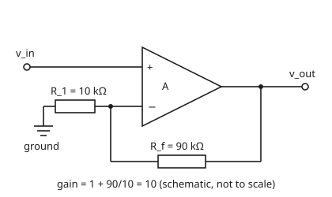
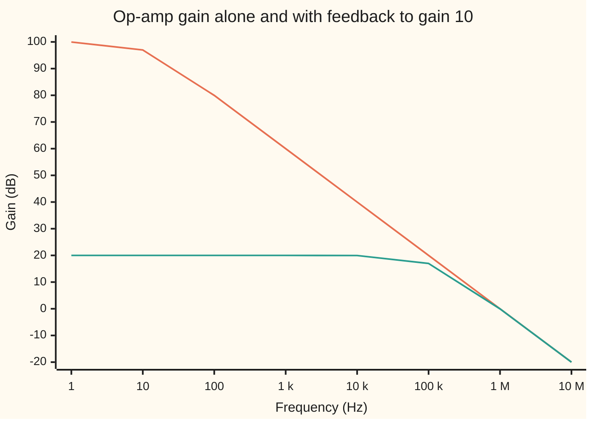

# Op-amps: huge gain wrapped in feedback, so two resistors set the answer

[Syllabus](../../../SYLLABUS.md) → [Engineering mathematics](../README.md) → [Circuits and Electromagnetism](../README.md#s06) → Op-amps

---

## General Overview

The radio of [RLC resonance](03-rlc-circuits-and-resonance.md) has picked its station and turned it back into an audio voltage. Before that voltage reaches the volume control, it needs a gain of exactly 10. That 10 must hold when the radio warms up, when a part is replaced, and across the range of hearing, up to 20 kHz (kilohertz).

The part that does it is an **operational amplifier**, or **op-amp**: a chip with two inputs, marked + and −, and one output. It multiplies the voltage difference between its two inputs by a huge number, here 100,000. That number is poorly controlled. It varies from chip to chip, drifts with temperature, and falls as the frequency rises.

So the op-amp is never used bare. Two resistors, 90 kΩ (kilohms) and 10 kΩ, feed one tenth of the output back to the − input. The gain is now 1 + 90/10 = 10, set by the resistors alone. The 100,000 shows only in the fourth decimal place: the real gain is 9.999. Halve it to 50,000 and the gain moves to 9.998, a change of 0.0100%.

The price is bandwidth: the range of frequencies the circuit passes at full gain. This op-amp has a 1 MHz (megahertz) **gain-bandwidth product**: gain times bandwidth stays at about 1 MHz. A gain of 10 keeps about 100 kHz, five times what the ear needs.

**Wrapped in negative feedback, an op-amp settles where the difference between its inputs is almost zero, so two resistors set the gain, and gain given up returns as bandwidth at a fixed product.**

**What kind of fact this is:** a theorem about a model. The op-amp as a gain block with one internal lag is a model, good from steady voltages up to near its gain-bandwidth product. Inside that model, the gain and bandwidth formulas are proved on this card in Why it works.

### The picture: the audio stage

<p align="center"></p>

Schematic, not to scale. The input goes straight to the + input. The 90 kΩ resistor runs from the output back to the − input, and the 10 kΩ resistor ties the − input to ground (0 V). The triangle marked A is the op-amp.

---

## The formula

Notation first, in words. The op-amp's output is $`v_\mathrm{out} = A\,(v_+ - v_-)`$: the **open-loop gain** $`A`$ times the difference between the voltages $`v_+`$ and $`v_-`$ at its two inputs. "Open loop" means with no feedback wired round it. The **feedback fraction** $`\beta`$ (beta) is the share of the output that the resistors return to the − input. As on [Feedback](../03-Feedback%20Control/01-feedback-and-closed-loop-transfer-functions.md), the **loop gain** is everything met once round the loop, here $`L = A\beta`$. In the audio stage, $`R_f`$ = 90 kΩ is the feedback resistor, from the output back to the − input, and $`R_1`$ = 10 kΩ ties the − input to ground.

```math
G = \frac{v_\mathrm{out}}{v_\mathrm{in}} = \frac{A}{1 + A\beta} \;\longrightarrow\; \frac{1}{\beta} \ \text{ as } A \to \infty, \qquad \beta = \frac{R_1}{R_1 + R_f}
```

**Read it aloud:** the closed-loop gain is the op-amp's gain over one plus the loop gain, and when the loop gain is huge that is just one over the feedback fraction.

For the audio stage, $`\beta = 10/(90 + 10) = 0.1`$, so $`G \to 10`$. The same idea gives four circuits. Each ideal gain below is the limit as $`A`$ grows without bound. In the table, $`R`$ is a resistor and $`C`$ a capacitor; $`s`$ is the Laplace variable of [Transfer functions](../02-Linear%20Systems%20and%20Transforms/02-impulse-response-and-transfer-functions.md), and setting $`s = j\omega`$ gives the response to a sine.

| Circuit | Where the input goes | What feeds back | Ideal gain | On this card |
| --- | --- | --- | --- | --- |
| Non-inverting amplifier | + input | $`R_f`$, with $`R_1`$ to ground | $`1 + R_f/R_1`$ | 1 + 90/10 = 10 |
| Inverting amplifier | through $`R_1`$ to the − input | $`R_f`$ | $`-R_f/R_1`$ | −90/10 = −9 |
| Integrator | through $`R`$ to the − input | a capacitor $`C`$ | $`-1/(sRC)`$ | ramps at −1333.3 V/s for 0.1 V in |
| Active low-pass filter | through $`R_1`$ to the − input | $`R_f`$ and $`C`$ side by side | $`-(R_f/R_1)/(1 + sR_fC)`$ | corner at 2122.07 Hz |

The op-amp's own gain falls with frequency, as one lag:

```math
A(s) = \frac{A_0}{1 + s/\omega_a}, \qquad f_\mathrm{CL} = f_a\,(1 + A_0\beta) \approx \beta\, f_T, \qquad f_T = A_0 f_a
```

**Read it aloud:** the op-amp's gain starts at A-nought and rolls off past the corner f-a. Feedback divides the gain by one plus the loop gain and multiplies the bandwidth by the same factor. So the closed-loop bandwidth is about beta times the gain-bandwidth product.

| Symbol | Plain meaning | In our example | Push it up and the answer… |
| --- | --- | --- | --- |
| $`v_\mathrm{in}`$, $`v_\mathrm{out}`$ | input and output voltages, in V | 1 V in gives 9.999 V out | output scales in proportion, up to the rails |
| $`v_+`$, $`v_-`$ | the voltages at the op-amp's + and − inputs | 10.0 µV apart at 1 V out | — |
| $`A`$, $`A_0`$ | open-loop gain; $`A_0`$ is its value for steady voltages | $`A_0`$ = 100,000 | $`G`$ creeps closer to $`1/\beta`$ |
| $`\beta`$, $`L = A\beta`$ | feedback fraction; loop gain | 0.1; 10,000, which is 80.0 dB | $`\beta`$ up: gain down, bandwidth up |
| $`G`$ | closed-loop gain, output over input | 9.999 | — |
| $`R_f`$, $`R_1`$, $`R`$ | feedback resistor; the other resistor; an integrator's input resistor | 90 kΩ, 10 kΩ; 75 kΩ in the filter | $`R_f`$ up: gain up, bandwidth down |
| $`C`$ | capacitor in the feedback path | 1 nF (nanofarad) | corner and ramp slow down |
| $`Z_f`$, $`Z_1`$ | impedances (complex resistances) of the feedback part and the input part | $`R_f`$ and $`1/(sC)`$ side by side | — |
| $`\tau = RC`$ | time constant of a resistor and capacitor, in s | 75 µs | corner frequency falls |
| $`f_T`$ | gain-bandwidth product, the frequency where $`\lvert A\rvert`$ falls to 1 | 1 MHz | every closed-loop bandwidth rises |
| $`f_a`$, $`\omega_a`$ | the op-amp's own corner, in Hz and rad/s | 10.0 Hz, $`2\pi \times 10`$ rad/s | — |
| $`f_\mathrm{CL}`$, $`f_c`$; $`s`$, $`j`$, $`\omega`$ | closed-loop bandwidth; filter corner; Laplace variable, √−1, angular frequency in rad/s | 100,010 Hz; 2122.07 Hz | — |

Engineers write $`j`$ for √−1; the rest of the library writes i. Frequencies are in hertz; $`\omega = 2\pi f`$ is in rad/s.

### When it holds

- **The feedback goes to the − input.** That makes the loop negative feedback. Swap the inputs and the formula $`-A/(1 - A\beta)`$ gives a tidy 10.0010, but the circuit is unstable: 1 µV of noise reaches the +12 V supply rail in 25.95 µs.
- **The output stays inside the supply rails.** The radio feeds the op-amp from ±12 V. A 2 V peak into the gain-10 stage wants 20.0 V and is clipped at 12.0 V. While clipped, the output no longer follows the inputs, and every formula here fails.
- **Frequencies well below $`f_T`$.** The one-lag model says the op-amp gain is −20 dB at 10 MHz. Real parts have more lags up there, so that number is not to be trusted. The output also has a top speed (the slew rate), a separate limit on large fast swings.
- **The inputs draw no current, and the output holds its voltage under load.** True enough with kilohm resistors. With resistors of a few ohms, the output stage's own resistance enters the divider.
- **A path for steady voltages round the loop.** A capacitor alone passes nothing steady. Without a resistor across it, a 1 mV input offset (a small built-in error between the inputs) ramps the integrator at 13.33 V/s, to the rail in 0.90 s.

---

## Why it works

### Step 0: the loop drives the difference to almost nothing

Suppose the output is too low. Then less comes back to the − input, the difference $`v_+ - v_-`$ grows, and the op-amp pushes the output up. Too high, and it pushes down. The loop settles where the difference is just big enough to hold the output: $`v_\mathrm{out}/A`$.

At 1 V out that is 10.0 µV. So the two inputs sit at almost the same voltage. Engineers call this the **virtual short**. It is not a property of the chip. It is what negative feedback does, and it is gone the moment the feedback is wrong or the output clips.

### Step 1: the non-inverting amplifier is the feedback formula

No current enters the − input, so the same current flows through $`R_f`$ and $`R_1`$. They form a divider ([Kirchhoff's laws](01-kirchhoffs-laws-and-equivalent-circuits.md)): $`v_- = \beta\, v_\mathrm{out}`$ with $`\beta = R_1/(R_1 + R_f) = 0.1`$. The input sits on the + input, so $`v_+ = v_\mathrm{in}`$. Put both into the op-amp's rule:

```math
v_\mathrm{out} = A\,(v_\mathrm{in} - \beta\, v_\mathrm{out}) \quad\Longrightarrow\quad G = \frac{A}{1 + A\beta} = \frac{1}{\beta}\cdot\frac{1}{1 + 1/(A\beta)}
```

This is the [Feedback](../03-Feedback%20Control/01-feedback-and-closed-loop-transfer-functions.md) formula: forward path $`A`$ over one plus the loop gain $`A\beta`$. It was published in 1934, to steady telephone amplifiers. The second form shows the limit: the gain is $`1/\beta`$ = 10, short by a factor $`1 + 1/(A\beta)`$. With $`A\beta`$ = 10,000 that is 100,000/10,001 = 9.999000.

### Step 2: why the chip's gain barely matters

Differentiate $`G`$ with respect to $`A`$: $`dG/dA = 1/(1 + A\beta)^2`$. Divide by $`G/A`$:

```math
\frac{dG}{G} = \frac{1}{1 + A\beta}\cdot\frac{dA}{A}
```

**Read it aloud:** a small relative change in the op-amp's gain reaches the circuit's gain divided by one plus the loop gain.

That factor is the sensitivity $`S = 1/(1 + L)`$ of [Sensitivity functions](../03-Feedback%20Control/02-sensitivity-and-the-gang-of-four.md), here 1/10,001. Halving $`A_0`$ is no small change, yet the gain only moves from 9.999000 to 9.998000: 0.0100% for a 50% fall. The small-change rule, 50% ÷ 10,001, predicts about half that. The rule holds only for small steps: as $`A_0`$ halves, the loop gain halves too, and the sensitivity doubles on the way down. This is the model-error test for the stage, and the stage passes it.

### Step 3: the inverting amplifier, where the − input becomes a virtual ground

Ground the + input and send the signal in through $`R_1`$ to the − input. The virtual short holds the − input at almost 0 V, a **virtual ground**. So the current in through $`R_1`$ is $`v_\mathrm{in}/R_1`$. None of it enters the op-amp, so all of it leaves through $`R_f`$, and the output must sit at $`-R_f\, v_\mathrm{in}/R_1`$.

With the same two resistors the gain is −90/10 = −9. The input now draws current: its input resistance is $`R_1`$ = 10 kΩ. The non-inverting stage feeds the + input, which draws almost nothing; that is why the radio uses it after a weak detector.

The finite gain still enters through the same loop. The output reaches the − input through the same divider, so $`\beta`$ is still 0.1, and the gain is $`-9 \times A\beta/(1 + A\beta)`$ = −8.999100.

<details>
<summary>Detailed derivation: Kirchhoff at the − input, for any two impedances</summary>

Call the impedance from the input to the − input $`Z_1`$ and the one from the output back $`Z_f`$. Current balance at the − input, with no current into the op-amp:

$`\displaystyle \frac{v_\mathrm{in} - v_-}{Z_1} + \frac{v_\mathrm{out} - v_-}{Z_f} = 0, \qquad v_\mathrm{out} = -A\, v_-`$

Put $`v_- = -v_\mathrm{out}/A`$ into the first equation and collect $`v_\mathrm{out}`$:

$`\displaystyle \frac{v_\mathrm{out}}{v_\mathrm{in}} = -\frac{Z_f}{Z_1}\cdot\frac{A\beta}{1 + A\beta}, \qquad \beta = \frac{Z_1}{Z_1 + Z_f}`$

As $`A`$ grows, the second factor goes to 1 and the gain to $`-Z_f/Z_1`$. With resistors this is $`-R_f/R_1`$. The code solves the same two equations as numbers, with no feedback formula, and gets −8.999100 and 9.999000 again.

</details>

### Step 4: swap a resistor for a capacitor: the integrator and the filter

[Phasors](02-phasors-and-impedance.md) gives a capacitor the impedance $`1/(j\omega C)`$, written $`1/(sC)`$ for a transfer function. The inverting rule $`-Z_f/Z_1`$ holds for any impedances.

- **Integrator.** Put $`C`$ alone in the feedback path: the gain is $`-1/(sRC)`$. Dividing by $`s`$ is integrating in time, so $`v_\mathrm{out}(t) = -\frac{1}{RC}\int_0^t v_\mathrm{in}\, dt`$. In plain terms: the virtual ground turns a held input into a steady current $`v_\mathrm{in}/R`$, and a steady current fills a capacitor at a steady rate. With $`R`$ = 75 kΩ and $`C`$ = 1 nF, 0.1 V held at the input ramps the output at −1333.3 V/s. That is −1.3333 V after 1 ms, and the −12 V rail after 9.0 ms.
- **Low-pass filter.** Put $`R_f`$ beside $`C`$: $`Z_f = R_f/(1 + sR_fC)`$, so the gain is $`-(R_f/R_1)/(1 + sR_fC)`$. One lag with time constant $`\tau = R_fC`$.

The radio needs this filter. US FM stations boost the treble before sending, with a 75 µs time constant (ITU-R BS.450). The receiver must cut it back with the same 75 µs. Hiss picked up on the way is cut with it. With $`R_1 = R_f`$ = 75 kΩ and $`C`$ = 1 nF, the corner is $`1/(2\pi \times 75\ \mu\mathrm{s})`$ = 2122.07 Hz. At 10 kHz the gain is 0.2076, which is −13.66 dB.

Above the corner, the capacitor carries most of the current and the filter behaves as the integrator: $`1/(\omega RC)`$ at 10 kHz is 0.2122. Below the corner, $`R_f`$ takes over and the gain returns to −1. That resistor also gives steady voltages a path round the loop. The same 1 mV offset now makes only 2.0 mV at the output, not a ramp to the rail.

The finite gain shows here too. At 1 ms the integrator reads −1.3302 V, 0.24% short of the ideal −1.3333 V, because the − input is not quite at 0 V.

### Step 5: gain times bandwidth stays fixed

Put the one-lag $`A(s)`$ into $`G = A/(1 + A\beta)`$ and clear the fractions:

```math
G(s) = \frac{A_0}{1 + A_0\beta}\cdot\frac{1}{1 + s/\big(\omega_a(1 + A_0\beta)\big)}
```

**Read it aloud:** the closed loop is one lag again, with its gain divided by one plus the loop gain and its corner multiplied by the same amount.

So gain times bandwidth is $`A_0 f_a = f_T`$ = 1 MHz, whatever the resistors. The open-loop corner is 1 MHz / 100,000 = 10.0 Hz, and the closed-loop corner is 10.0 Hz × 10,001 = 100,010 Hz. At 20 kHz, the top of hearing, the gain is 9.8049, only 0.17 dB down. This is the frequency-domain reading of [Bode plots](../02-Linear%20Systems%20and%20Transforms/04-frequency-response-and-bode-plots.md): a corner, then −20 dB per decade.



The upper line is the op-amp alone: 100 dB, falling 20 dB per decade from 10 Hz. The lower line is the audio stage: flat at 20 dB (a gain of 10) until it meets the upper line near 100 kHz, then the two run together. At 100 kHz it reads 16.99 dB, the 3 dB corner. Feedback trades the gain above 20 dB for flat response.

The inverting stage has the same bandwidth. Its loop sees $`\beta`$ = 0.1 whichever input the signal enters, so its corner is $`f_a(1 + A_0\beta)`$ = 100,010 Hz, about $`f_T\beta`$, not $`f_T/9`$.

---

## Worked numbers, by hand

The audio stage: 90 kΩ and 10 kΩ round an op-amp with $`A_0`$ = 100,000 and $`f_T`$ = 1 MHz.

| Step | Arithmetic | Value |
| --- | --- | --- |
| feedback fraction | 10 / (90 + 10) | 0.1 |
| ideal gain | 1 + 90/10 | 10 |
| loop gain | 100,000 × 0.1 | 10,000, or 80.0 dB |
| real gain | 100,000 / 10,001 | 9.999000 |
| gap between the inputs at 1 V out | 1 V / 100,000 | 10.0 µV |
| real gain, $`A_0`$ halved | 50,000 / 5,001 | 9.998000 |
| op-amp's own corner | 1,000,000 Hz / 100,000 | 10.0 Hz |
| closed-loop bandwidth | 10 Hz × 10,001 | **100,010 Hz** |
| gain at 20 kHz | 9.999 / √(1 + (20,000 / 100,010)²) | 9.8049 |

The stage gives a gain of 9.999 that a 50% change in the chip moves by 0.0100%. It stays flat to 100,010 Hz, five times the top of hearing.

### What breaks if you drop a piece

| Mistake | Comes out at | What went wrong |
| --- | --- | --- |
| Gain read as $`R_f/R_1`$ | 9.0000 instead of 10.0000 | That is the inverting gain's size; the non-inverting stage also passes the input itself |
| Inverting bandwidth as $`f_T/9`$ | 111,111 Hz instead of 100,010 Hz | The loop sees $`\beta`$ = 0.1, whichever input the signal enters |
| Integrator with no resistor across $`C`$ | 1 mV offset: 13.33 V/s, rail after 0.90 s | No path round the loop for steady voltages |
| + and − inputs swapped | 1 µV of noise reaches +12 V in 25.95 µs | Positive feedback: the loop's pole sits at +628,256 rad/s |

The code prints all four.

---

## Code, from first principles, and it actually runs

The script takes three independent roads. The first is the closed forms above. The second applies Kirchhoff's current law at the − input, with the op-amp as a gain block $`A(j\omega)`$. It solves the two complex equations by Cramer's rule, never using the feedback formula, and finds the −3 dB point by bisection. The third simulates the op-amp's internal lag in time with RK4 (the fourth-order Runge–Kutta method), drives the circuits with sines and steps, and measures what comes out. Complex numbers are built in to Python and written out as a small struct in Rust.

### Python

```python
# Op-amp circuits -- the check behind the card.  Standard library only.
# The radio's audio stage.  One op-amp part: open-loop gain A0 = 100,000 at DC and
# a 1 MHz gain-bandwidth product, so one internal pole at fa = 10 Hz; rails +/-12 V.
# Roads: (1) closed forms; (2) Kirchhoff's current law at the inverting input, with
# the op-amp as a gain block A(jw), solved as two complex equations (no feedback
# formula used); (3) an RK4 simulation in time of the op-amp's pole, wired up.
import math
A0, FT, RAIL = 100_000.0, 1.0e6, 12.0
FA = FT / A0                                  # open-loop corner frequency, Hz
WA = 2 * math.pi * FA                         # the same corner in rad/s
RF, R1 = 90e3, 10e3                           # the audio stage's two resistors, ohms
RD, CD = 75e3, 1e-9                           # de-emphasis: 75 kohm and 1 nF, so 75 us
INF = float("inf")

def opamp(f, a0=A0):                          # open-loop gain at f hertz
    return a0 / (1 + 1j * f / FA)

def par(z1, z2):                              # two impedances side by side
    return 1 / (1 / z1 + 1 / z2)

def node_solve(z1, zf, a, noninv):            # road 2, for 1 V in.  Unknowns v-, vout:
    va, vp = (0, 1) if noninv else (1, 0)     #   KCL: (v- - va)/z1 + (v- - vout)/zf = 0
    a11, a12, b1 = 1 / z1 + 1 / zf, -1 / zf, va / z1    # op-amp: a v- + vout = a v+
    return (a11 * a * vp - a * b1) / (a11 - a12 * a)    # Cramer's rule

def zcap(f):                                  # capacitor's impedance at f hertz
    return 1 / (2j * math.pi * f * CD)

def rk4(deriv, y, h, n, record=None):         # road 3: classic fourth-order Runge-Kutta
    t = 0.0
    for _ in range(n):
        k1 = deriv(t, y)
        k2 = deriv(t + h / 2, [a + h / 2 * b for a, b in zip(y, k1)])
        k3 = deriv(t + h / 2, [a + h / 2 * b for a, b in zip(y, k2)])
        k4 = deriv(t + h, [a + h * b for a, b in zip(y, k3)])
        y = [a + h / 6 * (p + 2 * q + 2 * r + s) for a, p, q, r, s in zip(y, k1, k2, k3, k4)]
        t += h
        if record is not None: record.append((t, y[0]))
    return y

def noninv_deriv(f, beta, sign=1.0):          # vout' = wa (A0 (v+ - v-) - vout), v- = beta vout
    return lambda t, y: [WA * (A0 * sign * (math.sin(2 * math.pi * f * t) - beta * y[0]) - y[0])]

def inv_c_deriv(vin, gf):                     # inverting, C (and conductance gf) in feedback
    def d(t, y):                              # y = [vout, u], u = vout - v- across C
        vn = y[0] - y[1]
        return [WA * (-A0 * vn - y[0]), -((vin(t) - vn) / RD + gf * y[1]) / CD]
    return d

def sine_amp(deriv, f, n_state, cycles=6):   # settled swing, by projection
    per = math.ceil(1 / f / 1e-7)             # time step at most 0.1 us
    rec, h = [], 1 / f / per
    rk4(deriv, [0.0] * n_state, h, cycles * per, rec)
    last = rec[-per:]
    s = sum(v * math.sin(2 * math.pi * f * t) for t, v in last) * 2 / per
    c = sum(v * math.cos(2 * math.pi * f * t) for t, v in last) * 2 / per
    return math.hypot(s, c), math.degrees(math.atan2(c, s))

def db(x): return 20 * math.log10(x)

beta = R1 / (R1 + RF)
g_ideal, g_fin = 1 + RF / R1, A0 / (1 + A0 * beta)
g_half = (A0 / 2) / (1 + A0 / 2 * beta)
g_node = node_solve(R1, RF, A0, True).real
inv_ideal, inv_fin = -RF / R1, -RF / R1 * A0 * beta / (1 + A0 * beta)
inv_node = node_solve(R1, RF, A0, False).real
f_cl = FA * (1 + A0 * beta)
lo, hi = 1e3, 1e7                             # road 2's -3 dB point, found by bisection
for _ in range(100):
    mid = math.sqrt(lo * hi)
    lo, hi = (mid, hi) if abs(node_solve(R1, RF, opamp(mid), True)) > g_fin / math.sqrt(2) else (lo, mid)
amp_cl, ph_cl = sine_amp(noninv_deriv(f_cl, beta), f_cl, 1)
print("op-amp: A0 = %.0f, gain-bandwidth %.0f Hz, open-loop corner fa = %.1f Hz" % (A0, FT, FA))
print("NON-INVERTING, Rf = 90 kohm, R1 = 10 kohm: feedback fraction beta = %.4f" % beta)
print("  ideal gain 1 + Rf/R1                     = %.4f" % g_ideal)
print("  finite A0: A0/(1 + A0 beta)               = %.6f" % g_fin)
print("  Kirchhoff, op-amp as a gain block          = %.6f" % g_node)
print("  loop gain A0 beta = %.0f, i.e. %.1f dB; voltage between inputs at 1 V out = %.1f uV"
      % (A0 * beta, db(A0 * beta), 1e6 / A0))
print("  A0 halved to %.0f: gain %.6f, change %.4f %% for a 50 %% change in A0"
      % (A0 / 2, g_half, 100 * (g_fin - g_half) / g_fin))
print("  closed-loop bandwidth fa (1 + A0 beta) = %.0f Hz; f_T x beta = %.0f Hz" % (f_cl, FT * beta))
print("  Kirchhoff -3 dB point, by bisection      = %.0f Hz" % lo)
print("  RK4 sine at %.0f Hz: settled swing %.4f V per V in, phase %.2f deg" % (f_cl, amp_cl, ph_cl))
print("  closed form there: %.4f V per V, -45.00 deg" % (g_fin / math.sqrt(2)))
print("  at 20 kHz, top of the audio band: gain %.4f, %.2f dB down"
      % (abs(node_solve(R1, RF, opamp(2e4), True)), db(g_fin / abs(node_solve(R1, RF, opamp(2e4), True)))))
print("INVERTING, same two resistors: ideal -Rf/R1 = %.4f, finite A0 = %.6f, Kirchhoff = %.6f"
      % (inv_ideal, inv_fin, inv_node))
print("  input resistance %.0f kohm; bandwidth set by 1/beta = 10, not 9: %.0f Hz" % (R1 / 1e3, f_cl))
fc = 1 / (2 * math.pi * RD * CD)
print("DE-EMPHASIS FILTER, Rin = Rf = 75 kohm, C = 1 nF: time constant %.0f us, corner %.2f Hz" % (RD * CD * 1e6, fc))
rows = []
for f in (1e3, fc, 1e4):
    ideal = 1 / math.sqrt(1 + (f / fc) ** 2)
    node = abs(node_solve(RD, par(RD, zcap(f)), opamp(f), False))
    sim, _ = sine_amp(inv_c_deriv(lambda t, f=f: math.sin(2 * math.pi * f * t), 1 / RD), f, 2, math.ceil(1.5e-3 * f) + 1)
    rows.append((ideal, node, sim))
    print("  %8.2f Hz: closed form %.4f (%.2f dB), Kirchhoff %.4f, RK4 %.4f" % (f, ideal, db(ideal), node, sim))
integ_10k = 1 / (2 * math.pi * 1e4 * RD * CD)
print("  above the corner it integrates: 1/(w RC) at 10 kHz = %.4f" % integ_10k)
print("INTEGRATOR, Rf removed, R = 75 kohm, C = 1 nF, 0.1 V held at the input")
slope = -0.1 / (RD * CD)
v_1ms = rk4(inv_c_deriv(lambda t: 0.1, 0.0), [0.0, 0.0], 2e-8, 50_000)[0]
k = 1 + 1 / (RD * CD * 2 * math.pi * FT)    # finite gain: the ramp is k times slower,
v_fin = slope / k * (1e-3 - 1 / (2 * math.pi * FT * k))   # and starts 1/(w_T k) late
print("  ramp -vin/(RC) = %.1f V/s; ideal output at 1 ms %.4f V" % (slope, slope * 1e-3))
print("  with the op-amp's finite gain: closed form %.4f V, RK4 %.4f V, %.2f %% short"
      % (v_fin, v_1ms, 100 * (1 - v_1ms / (slope * 1e-3))))
print("  reaches the -12 V rail after %.1f ms" % (RAIL / -slope * 1e3))
print("  a 1 mV input offset alone: drifts %.2f V/s, rail after %.2f s; with Rf back: %.1f mV"
      % (1e-3 / (RD * CD), RAIL / (1e-3 / (RD * CD)), 1e-3 * (1 + RD / RD) * 1e3))
p = WA * (A0 * beta - 1)                      # inputs swapped: the pole moves to +p
rec = []
rk4(lambda t, y: [WA * (A0 * beta * y[0] - y[0])], [1e-6], 1e-9, 40_000, rec)
t_rail = next(t for t, v in rec if v >= RAIL)
print("WHAT BREAKS")
print("  inputs swapped: formula -A/(1 - A beta) = %.4f, but pole at +%.0f rad/s" % (-A0 / (1 - A0 * beta), p))
print("    1 uV of noise reaches the +12 V rail: closed form %.2f us, RK4 %.2f us"
      % (math.log(RAIL / 1e-6) / p * 1e6, t_rail * 1e6))
print("  gain read as Rf/R1: %.4f instead of %.4f" % (RF / R1, g_ideal))
print("  inverting bandwidth from f_T / 9: %.0f Hz instead of %.0f Hz" % (FT / 9, f_cl))
print("  2 V peak into the gain-10 stage: wants %.1f V, rails clip it at %.1f V" % (2 * g_ideal, RAIL))
print("figure, schematic: Rf = %.0f kohm, R1 = %.0f kohm, gain %.0f" % (RF / 1e3, R1 / 1e3, g_ideal))
print("chart, Bode, f in Hz | open-loop dB | closed-loop dB")
for e in range(8):
    f = 10.0 ** e
    print("  %10.0f | %7.2f | %6.2f" % (f, round(db(abs(opamp(f))), 2) + 0.0, db(abs(node_solve(R1, RF, opamp(f), True)))))
assert abs(g_node - g_fin) < 1e-9 and abs(inv_node - inv_fin) < 1e-9        # road 2 = road 1
assert abs(lo - f_cl) < 1.0                                                   # -3 dB point
assert abs(amp_cl - g_fin / math.sqrt(2)) < 2e-3 and abs(ph_cl + 45) < 0.1    # road 3 = road 1
assert all(abs(i - n) < 2e-3 and abs(n - s) < 1e-4 for i, n, s in rows)       # filter, 3 roads
assert abs(v_1ms - v_fin) < 2e-4 and abs(v_1ms - slope * 1e-3) > 1e-3        # integrator ramp
assert abs(t_rail - math.log(RAIL / 1e-6) / p) < 2e-9                         # runaway time
assert 0 < g_fin - g_half < 2e-3
print("ALL CHECKS PASS")
```

**Ran 2026-11-23 on macOS, Python 3.14.10, standard library only. All checks passed. Output, pasted from the run:**

```
op-amp: A0 = 100000, gain-bandwidth 1000000 Hz, open-loop corner fa = 10.0 Hz
NON-INVERTING, Rf = 90 kohm, R1 = 10 kohm: feedback fraction beta = 0.1000
  ideal gain 1 + Rf/R1                     = 10.0000
  finite A0: A0/(1 + A0 beta)               = 9.999000
  Kirchhoff, op-amp as a gain block          = 9.999000
  loop gain A0 beta = 10000, i.e. 80.0 dB; voltage between inputs at 1 V out = 10.0 uV
  A0 halved to 50000: gain 9.998000, change 0.0100 % for a 50 % change in A0
  closed-loop bandwidth fa (1 + A0 beta) = 100010 Hz; f_T x beta = 100000 Hz
  Kirchhoff -3 dB point, by bisection      = 100010 Hz
  RK4 sine at 100010 Hz: settled swing 7.0704 V per V in, phase -45.00 deg
  closed form there: 7.0704 V per V, -45.00 deg
  at 20 kHz, top of the audio band: gain 9.8049, 0.17 dB down
INVERTING, same two resistors: ideal -Rf/R1 = -9.0000, finite A0 = -8.999100, Kirchhoff = -8.999100
  input resistance 10 kohm; bandwidth set by 1/beta = 10, not 9: 100010 Hz
DE-EMPHASIS FILTER, Rin = Rf = 75 kohm, C = 1 nF: time constant 75 us, corner 2122.07 Hz
   1000.00 Hz: closed form 0.9046 (-0.87 dB), Kirchhoff 0.9042, RK4 0.9042
   2122.07 Hz: closed form 0.7071 (-3.01 dB), Kirchhoff 0.7063, RK4 0.7063
  10000.00 Hz: closed form 0.2076 (-13.66 dB), Kirchhoff 0.2072, RK4 0.2072
  above the corner it integrates: 1/(w RC) at 10 kHz = 0.2122
INTEGRATOR, Rf removed, R = 75 kohm, C = 1 nF, 0.1 V held at the input
  ramp -vin/(RC) = -1333.3 V/s; ideal output at 1 ms -1.3333 V
  with the op-amp's finite gain: closed form -1.3303 V, RK4 -1.3302 V, 0.24 % short
  reaches the -12 V rail after 9.0 ms
  a 1 mV input offset alone: drifts 13.33 V/s, rail after 0.90 s; with Rf back: 2.0 mV
WHAT BREAKS
  inputs swapped: formula -A/(1 - A beta) = 10.0010, but pole at +628256 rad/s
    1 uV of noise reaches the +12 V rail: closed form 25.95 us, RK4 25.95 us
  gain read as Rf/R1: 9.0000 instead of 10.0000
  inverting bandwidth from f_T / 9: 111111 Hz instead of 100010 Hz
  2 V peak into the gain-10 stage: wants 20.0 V, rails clip it at 12.0 V
figure, schematic: Rf = 90 kohm, R1 = 10 kohm, gain 10
chart, Bode, f in Hz | open-loop dB | closed-loop dB
           1 |   99.96 |  20.00
          10 |   96.99 |  20.00
         100 |   79.96 |  20.00
        1000 |   60.00 |  20.00
       10000 |   40.00 |  19.96
      100000 |   20.00 |  16.99
     1000000 |    0.00 |  -0.04
    10000000 |  -20.00 | -20.00
ALL CHECKS PASS
```

### Rust

Same numbers, same labels, built with `rustc --edition 2021 -O`.

```rust
// Op-amp circuits -- the same check as the Python, in Rust.  No crates.
// The radio's audio stage.  One op-amp part: open-loop gain A0 = 100,000 at DC and
// a 1 MHz gain-bandwidth product, so one internal pole at fa = 10 Hz; rails +/-12 V.
// Roads: (1) closed forms; (2) Kirchhoff's current law at the inverting input, with
// the op-amp as a gain block A(jw), solved as two complex equations (no feedback
// formula used); (3) an RK4 simulation in time of the op-amp's pole, wired up.
use std::f64::consts::PI;
use std::ops::{Add, Div, Mul, Sub};
const A0: f64 = 100_000.0;
const FT: f64 = 1.0e6;
const RAIL: f64 = 12.0;
const FA: f64 = FT / A0;                          // open-loop corner frequency, Hz
const WA: f64 = 2.0 * PI * FA;                    // the same corner in rad/s
const RF: f64 = 90e3;                             // the audio stage's two resistors, ohms
const R1: f64 = 10e3;
const RD: f64 = 75e3;                             // de-emphasis: 75 kohm and 1 nF, so 75 us
const CD: f64 = 1e-9;

#[derive(Clone, Copy)]
struct C { re: f64, im: f64 }                     // a complex number, written out
fn c(re: f64, im: f64) -> C { C { re, im } }
impl Add for C { type Output = C; fn add(self, o: C) -> C { c(self.re + o.re, self.im + o.im) } }
impl Sub for C { type Output = C; fn sub(self, o: C) -> C { c(self.re - o.re, self.im - o.im) } }
impl Mul for C { type Output = C; fn mul(self, o: C) -> C {
    c(self.re * o.re - self.im * o.im, self.re * o.im + self.im * o.re) } }
impl Div for C { type Output = C; fn div(self, o: C) -> C {
    let d = o.re * o.re + o.im * o.im;
    c((self.re * o.re + self.im * o.im) / d, (self.im * o.re - self.re * o.im) / d) } }
impl C { fn abs(self) -> f64 { self.re.hypot(self.im) } }

fn opamp(f: f64, a0: f64) -> C { c(a0, 0.0) / c(1.0, f / FA) }   // open-loop gain at f hertz
fn par(z1: C, z2: C) -> C { let one = c(1.0, 0.0); one / (one / z1 + one / z2) }
fn node_solve(z1: C, zf: C, a: C, noninv: bool) -> C {   // road 2, for 1 V in
    let one = c(1.0, 0.0);
    let (va, vp) = if noninv { (0.0, 1.0) } else { (1.0, 0.0) };
    let (a11, a12, b1) = (one / z1 + one / zf, c(-1.0, 0.0) / zf, c(va, 0.0) / z1);
    (a11 * a * c(vp, 0.0) - a * b1) / (a11 - a12 * a)   // Cramer's rule
}
fn zcap(f: f64) -> C { c(1.0, 0.0) / c(0.0, 2.0 * PI * f * CD) }
fn rl(r: f64) -> C { c(r, 0.0) }

fn rk4(d: &dyn Fn(f64, &[f64]) -> Vec<f64>, y0: Vec<f64>, h: f64, n: usize,
       mut rec: Option<&mut Vec<(f64, f64)>>) -> Vec<f64> {   // road 3: classic RK4
    let (mut t, mut y) = (0.0, y0);
    let step = |y: &[f64], k: &[f64], s: f64| -> Vec<f64> { y.iter().zip(k).map(|(a, b)| a + s * b).collect() };
    for _ in 0..n {
        let k1 = d(t, &y);
        let k2 = d(t + h / 2.0, &step(&y, &k1, h / 2.0));
        let k3 = d(t + h / 2.0, &step(&y, &k2, h / 2.0));
        let k4 = d(t + h, &step(&y, &k3, h));
        y = (0..y.len()).map(|i| y[i] + h / 6.0 * (k1[i] + 2.0 * k2[i] + 2.0 * k3[i] + k4[i])).collect();
        t += h;
        if let Some(r) = rec.as_mut() { r.push((t, y[0])); }
    }
    y
}
fn noninv_deriv(f: f64, beta: f64) -> impl Fn(f64, &[f64]) -> Vec<f64> {   // v- = beta vout
    move |t, y| vec![WA * (A0 * ((2.0 * PI * f * t).sin() - beta * y[0]) - y[0])]
}
fn inv_c_deriv(vin: impl Fn(f64) -> f64, gf: f64) -> impl Fn(f64, &[f64]) -> Vec<f64> {
    move |t, y| {                                 // y = [vout, u], u = vout - v- across C
        let vn = y[0] - y[1];
        vec![WA * (-A0 * vn - y[0]), -((vin(t) - vn) / RD + gf * y[1]) / CD]
    }
}
fn sine_amp(d: &dyn Fn(f64, &[f64]) -> Vec<f64>, f: f64, n_state: usize, cycles: usize) -> (f64, f64) {
    let per = (1.0 / f / 1e-7).ceil() as usize;   // time step at most 0.1 us
    let h = 1.0 / f / per as f64;
    let mut rec = Vec::new();
    rk4(d, vec![0.0; n_state], h, cycles * per, Some(&mut rec));
    let last = &rec[rec.len() - per..];
    let s: f64 = last.iter().map(|(t, v)| v * (2.0 * PI * f * t).sin()).sum::<f64>() * 2.0 / per as f64;
    let cc: f64 = last.iter().map(|(t, v)| v * (2.0 * PI * f * t).cos()).sum::<f64>() * 2.0 / per as f64;
    (s.hypot(cc), cc.atan2(s).to_degrees())
}
fn db(x: f64) -> f64 { 20.0 * x.log10() }

fn main() {
    let beta = R1 / (R1 + RF);
    let (g_ideal, g_fin) = (1.0 + RF / R1, A0 / (1.0 + A0 * beta));
    let g_half = (A0 / 2.0) / (1.0 + A0 / 2.0 * beta);
    let g_node = node_solve(rl(R1), rl(RF), rl(A0), true).re;
    let (inv_ideal, inv_fin) = (-RF / R1, -RF / R1 * A0 * beta / (1.0 + A0 * beta));
    let inv_node = node_solve(rl(R1), rl(RF), rl(A0), false).re;
    let f_cl = FA * (1.0 + A0 * beta);
    let (mut lo, mut hi) = (1e3_f64, 1e7_f64);    // road 2's -3 dB point, found by bisection
    for _ in 0..100 {
        let mid = (lo * hi).sqrt();
        if node_solve(rl(R1), rl(RF), opamp(mid, A0), true).abs() > g_fin / 2f64.sqrt() { lo = mid } else { hi = mid }
    }
    let (amp_cl, ph_cl) = sine_amp(&noninv_deriv(f_cl, beta), f_cl, 1, 6);
    println!("op-amp: A0 = {:.0}, gain-bandwidth {:.0} Hz, open-loop corner fa = {:.1} Hz", A0, FT, FA);
    println!("NON-INVERTING, Rf = 90 kohm, R1 = 10 kohm: feedback fraction beta = {:.4}", beta);
    println!("  ideal gain 1 + Rf/R1                     = {:.4}", g_ideal);
    println!("  finite A0: A0/(1 + A0 beta)               = {:.6}", g_fin);
    println!("  Kirchhoff, op-amp as a gain block          = {:.6}", g_node);
    println!("  loop gain A0 beta = {:.0}, i.e. {:.1} dB; voltage between inputs at 1 V out = {:.1} uV",
             A0 * beta, db(A0 * beta), 1e6 / A0);
    println!("  A0 halved to {:.0}: gain {:.6}, change {:.4} % for a 50 % change in A0",
             A0 / 2.0, g_half, 100.0 * (g_fin - g_half) / g_fin);
    println!("  closed-loop bandwidth fa (1 + A0 beta) = {:.0} Hz; f_T x beta = {:.0} Hz", f_cl, FT * beta);
    println!("  Kirchhoff -3 dB point, by bisection      = {:.0} Hz", lo);
    println!("  RK4 sine at {:.0} Hz: settled swing {:.4} V per V in, phase {:.2} deg", f_cl, amp_cl, ph_cl);
    println!("  closed form there: {:.4} V per V, -45.00 deg", g_fin / 2f64.sqrt());
    let g20 = node_solve(rl(R1), rl(RF), opamp(2e4, A0), true).abs();
    println!("  at 20 kHz, top of the audio band: gain {:.4}, {:.2} dB down", g20, db(g_fin / g20));
    println!("INVERTING, same two resistors: ideal -Rf/R1 = {:.4}, finite A0 = {:.6}, Kirchhoff = {:.6}",
             inv_ideal, inv_fin, inv_node);
    println!("  input resistance {:.0} kohm; bandwidth set by 1/beta = 10, not 9: {:.0} Hz", R1 / 1e3, f_cl);
    let fc = 1.0 / (2.0 * PI * RD * CD);
    println!("DE-EMPHASIS FILTER, Rin = Rf = 75 kohm, C = 1 nF: time constant {:.0} us, corner {:.2} Hz", RD * CD * 1e6, fc);
    let mut rows = Vec::new();
    for f in [1e3, fc, 1e4] {
        let ideal = 1.0 / (1.0 + (f / fc).powi(2)).sqrt();
        let node = node_solve(rl(RD), par(rl(RD), zcap(f)), opamp(f, A0), false).abs();
        let (sim, _) = sine_amp(&inv_c_deriv(move |t| (2.0 * PI * f * t).sin(), 1.0 / RD), f, 2, (1.5e-3 * f).ceil() as usize + 1);
        rows.push((ideal, node, sim));
        println!("  {:8.2} Hz: closed form {:.4} ({:.2} dB), Kirchhoff {:.4}, RK4 {:.4}", f, ideal, db(ideal), node, sim);
    }
    println!("  above the corner it integrates: 1/(w RC) at 10 kHz = {:.4}", 1.0 / (2.0 * PI * 1e4 * RD * CD));
    println!("INTEGRATOR, Rf removed, R = 75 kohm, C = 1 nF, 0.1 V held at the input");
    let slope = -0.1 / (RD * CD);
    let v_1ms = rk4(&inv_c_deriv(|_t| 0.1, 0.0), vec![0.0, 0.0], 2e-8, 50_000, None)[0];
    let k = 1.0 + 1.0 / (RD * CD * 2.0 * PI * FT);   // finite gain: the ramp is k times slower,
    let v_fin = slope / k * (1e-3 - 1.0 / (2.0 * PI * FT * k));   // and starts 1/(w_T k) late
    println!("  ramp -vin/(RC) = {:.1} V/s; ideal output at 1 ms {:.4} V", slope, slope * 1e-3);
    println!("  with the op-amp's finite gain: closed form {:.4} V, RK4 {:.4} V, {:.2} % short",
             v_fin, v_1ms, 100.0 * (1.0 - v_1ms / (slope * 1e-3)));
    println!("  reaches the -12 V rail after {:.1} ms", RAIL / -slope * 1e3);
    println!("  a 1 mV input offset alone: drifts {:.2} V/s, rail after {:.2} s; with Rf back: {:.1} mV",
             1e-3 / (RD * CD), RAIL / (1e-3 / (RD * CD)), 1e-3 * (1.0 + RD / RD) * 1e3);
    let p = WA * (A0 * beta - 1.0);                // inputs swapped: the pole moves to +p
    let mut rec = Vec::new();
    rk4(&|_t: f64, y: &[f64]| vec![WA * (A0 * beta * y[0] - y[0])], vec![1e-6], 1e-9, 40_000, Some(&mut rec));
    let t_rail = rec.iter().find(|(_, v)| *v >= RAIL).unwrap().0;
    println!("WHAT BREAKS");
    println!("  inputs swapped: formula -A/(1 - A beta) = {:.4}, but pole at +{:.0} rad/s", -A0 / (1.0 - A0 * beta), p);
    println!("    1 uV of noise reaches the +12 V rail: closed form {:.2} us, RK4 {:.2} us",
             (RAIL / 1e-6).ln() / p * 1e6, t_rail * 1e6);
    println!("  gain read as Rf/R1: {:.4} instead of {:.4}", RF / R1, g_ideal);
    println!("  inverting bandwidth from f_T / 9: {:.0} Hz instead of {:.0} Hz", FT / 9.0, f_cl);
    println!("  2 V peak into the gain-10 stage: wants {:.1} V, rails clip it at {:.1} V", 2.0 * g_ideal, RAIL);
    println!("figure, schematic: Rf = {:.0} kohm, R1 = {:.0} kohm, gain {:.0}", RF / 1e3, R1 / 1e3, g_ideal);
    println!("chart, Bode, f in Hz | open-loop dB | closed-loop dB");
    for e in 0..8 {
        let f = 10f64.powi(e);
        let ol = (db(opamp(f, A0).abs()) * 100.0).round() / 100.0 + 0.0;
        println!("  {:10.0} | {:7.2} | {:6.2}", f, ol, db(node_solve(rl(R1), rl(RF), opamp(f, A0), true).abs()));
    }
    assert!((g_node - g_fin).abs() < 1e-9 && (inv_node - inv_fin).abs() < 1e-9);    // road 2 = road 1
    assert!((lo - f_cl).abs() < 1.0);                                               // -3 dB point
    assert!((amp_cl - g_fin / 2f64.sqrt()).abs() < 2e-3 && (ph_cl + 45.0).abs() < 0.1);   // road 3
    assert!(rows.iter().all(|&(i, n, s)| (i - n).abs() < 2e-3 && (n - s).abs() < 1e-4));  // filter
    assert!((v_1ms - v_fin).abs() < 2e-4 && (v_1ms - slope * 1e-3).abs() > 1e-3);   // integrator
    assert!((t_rail - (RAIL / 1e-6).ln() / p).abs() < 2e-9);                        // runaway time
    assert!(0.0 < g_fin - g_half && g_fin - g_half < 2e-3);
    println!("ALL CHECKS PASS");
}
```

**Ran 2026-11-23 on macOS, rustc 1.98.1, no crates. All checks passed. Output, pasted from the run:**

```
op-amp: A0 = 100000, gain-bandwidth 1000000 Hz, open-loop corner fa = 10.0 Hz
NON-INVERTING, Rf = 90 kohm, R1 = 10 kohm: feedback fraction beta = 0.1000
  ideal gain 1 + Rf/R1                     = 10.0000
  finite A0: A0/(1 + A0 beta)               = 9.999000
  Kirchhoff, op-amp as a gain block          = 9.999000
  loop gain A0 beta = 10000, i.e. 80.0 dB; voltage between inputs at 1 V out = 10.0 uV
  A0 halved to 50000: gain 9.998000, change 0.0100 % for a 50 % change in A0
  closed-loop bandwidth fa (1 + A0 beta) = 100010 Hz; f_T x beta = 100000 Hz
  Kirchhoff -3 dB point, by bisection      = 100010 Hz
  RK4 sine at 100010 Hz: settled swing 7.0704 V per V in, phase -45.00 deg
  closed form there: 7.0704 V per V, -45.00 deg
  at 20 kHz, top of the audio band: gain 9.8049, 0.17 dB down
INVERTING, same two resistors: ideal -Rf/R1 = -9.0000, finite A0 = -8.999100, Kirchhoff = -8.999100
  input resistance 10 kohm; bandwidth set by 1/beta = 10, not 9: 100010 Hz
DE-EMPHASIS FILTER, Rin = Rf = 75 kohm, C = 1 nF: time constant 75 us, corner 2122.07 Hz
   1000.00 Hz: closed form 0.9046 (-0.87 dB), Kirchhoff 0.9042, RK4 0.9042
   2122.07 Hz: closed form 0.7071 (-3.01 dB), Kirchhoff 0.7063, RK4 0.7063
  10000.00 Hz: closed form 0.2076 (-13.66 dB), Kirchhoff 0.2072, RK4 0.2072
  above the corner it integrates: 1/(w RC) at 10 kHz = 0.2122
INTEGRATOR, Rf removed, R = 75 kohm, C = 1 nF, 0.1 V held at the input
  ramp -vin/(RC) = -1333.3 V/s; ideal output at 1 ms -1.3333 V
  with the op-amp's finite gain: closed form -1.3303 V, RK4 -1.3302 V, 0.24 % short
  reaches the -12 V rail after 9.0 ms
  a 1 mV input offset alone: drifts 13.33 V/s, rail after 0.90 s; with Rf back: 2.0 mV
WHAT BREAKS
  inputs swapped: formula -A/(1 - A beta) = 10.0010, but pole at +628256 rad/s
    1 uV of noise reaches the +12 V rail: closed form 25.95 us, RK4 25.95 us
  gain read as Rf/R1: 9.0000 instead of 10.0000
  inverting bandwidth from f_T / 9: 111111 Hz instead of 100010 Hz
  2 V peak into the gain-10 stage: wants 20.0 V, rails clip it at 12.0 V
figure, schematic: Rf = 90 kohm, R1 = 10 kohm, gain 10
chart, Bode, f in Hz | open-loop dB | closed-loop dB
           1 |   99.96 |  20.00
          10 |   96.99 |  20.00
         100 |   79.96 |  20.00
        1000 |   60.00 |  20.00
       10000 |   40.00 |  19.96
      100000 |   20.00 |  16.99
     1000000 |    0.00 |  -0.04
    10000000 |  -20.00 | -20.00
ALL CHECKS PASS
```

The two outputs match line for line.

### Lean

Lean proves the non-inverting gain, its limit and the gain-bandwidth trade for any parts that meet the conditions, plus the audio stage's numbers.

- Take resistors $`R_1 > 0`$ and $`R_f \ge 0`$, with $`\beta = R_1/(R_1 + R_f)`$. Then $`A/(1 + A\beta)`$ tends to $`1 + R_f/R_1`$ as $`A`$ grows without bound.
- Suppose $`A \ge 0`$, $`\beta \ge 0`$ and $`v_\mathrm{out} = A\,(v_\mathrm{in} - \beta\, v_\mathrm{out})`$. Then $`v_\mathrm{out} = A/(1 + A\beta) \cdot v_\mathrm{in}`$.
- Take the one-lag $`A(s)`$, with $`A_0 \ge 0`$, $`\beta \ge 0`$, $`\omega_a > 0`$ and $`s \ne -\omega_a`$. Then the closed loop is one lag again, with gain $`A_0/(1 + A_0\beta)`$. Its corner is $`\omega_a(1 + A_0\beta)`$, so gain times corner is $`A_0\omega_a`$, whatever the resistors.
- The audio stage comes out in exact fractions: $`\beta`$ = 1/10, loop gain 10,000, real gain 100,000/10,001, between 9.999 and 10.
- Halving $`A_0`$ gives 50,000/5,001. The inverting stage gives −9 ideal and −90,000/10,001 with the finite gain.
- The corners are 10 Hz and 100,010 Hz, and gain times bandwidth is 1 MHz.
- With the inputs swapped, $`-A/(1 - A\beta)`$ still gives a tidy 100,000/9,999.

The filter, the integrator, the RK4 runs and the clipping at the rails are left to the Python and Rust checks.

```lean
-- Op-amps: the non-inverting stage's gain A/(1 + Aβ) tends to 1 + R_f/R_1 as the op-amp's gain grows, solving the loop gives that gain, and a one-lag op-amp under feedback is one lag again whose gain times corner is fixed.
import Mathlib.Topology.Algebra.Order.Field
import Mathlib.Analysis.Complex.Basic
import Mathlib.Tactic.FieldSimp
import Mathlib.Tactic.NormNum
import Mathlib.Tactic.LinearCombination

open Filter Topology

/-! The op-amp is a gain block: `v_out = A (v₊ - v₋)`. In the non-inverting stage the input sits
on the + input and the divider `R_f`, `R_1` feeds back `v₋ = β v_out` with feedback fraction
`β = R_1/(R_1 + R_f)`. Feedback to the − input is what puts the plus sign in `1 + Aβ`. -/

/-- The card's formula. With resistors `R_1 > 0` and `R_f ≥ 0` and feedback fraction
`β = R_1/(R_1 + R_f)`, the closed-loop gain `A/(1 + Aβ)` tends to `1/β = 1 + R_f/R_1` as the
op-amp's open-loop gain `A` grows without bound: two resistors set the gain. -/
theorem closed_loop_gain_tendsto_one_add_ratio (R1 Rf : ℝ) (hR1 : 0 < R1) (hRf : 0 ≤ Rf) :
    Tendsto (fun A : ℝ => A / (1 + A * (R1 / (R1 + Rf)))) atTop (𝓝 (1 + Rf / R1)) := by
  have hS : 0 < R1 + Rf := by linarith
  have hc : 0 < R1 / (R1 + Rf) := div_pos hR1 hS
  have h1 : Tendsto (fun A : ℝ => (A⁻¹ + R1 / (R1 + Rf))⁻¹) atTop (𝓝 ((0 + R1 / (R1 + Rf))⁻¹)) :=
    (tendsto_inv_atTop_zero.add tendsto_const_nhds).inv₀ (by rw [zero_add]; exact hc.ne')
  have hlim : (0 + R1 / (R1 + Rf))⁻¹ = 1 + Rf / R1 := by
    rw [zero_add, inv_div]; field_simp
  rw [hlim] at h1
  refine h1.congr' ?_
  filter_upwards [eventually_gt_atTop 0] with A hA
  field_simp

/-- Step 1. Solving the loop: if the output obeys `v_out = A (v_in - β v_out)` with `A ≥ 0` and
`β ≥ 0`, then `v_out = A/(1 + Aβ) · v_in`, the forward path over one plus the loop gain. -/
theorem noninverting_loop_solution (A β vin vout : ℝ) (hA : 0 ≤ A) (hβ : 0 ≤ β)
    (hloop : vout = A * (vin - β * vout)) :
    vout = A / (1 + A * β) * vin := by
  have hpos : 0 < 1 + A * β := by nlinarith [mul_nonneg hA hβ]
  rw [div_mul_eq_mul_div, eq_div_iff hpos.ne']
  linear_combination hloop

/-- Step 5. Gain times bandwidth stays fixed. Give the op-amp one lag,
`A(s) = A₀/(1 + s/ω_a)`, with `A₀ ≥ 0`, `β ≥ 0`, corner `ω_a > 0`, and `s` away from the
op-amp's own pole `-ω_a`. Then the closed loop `A(s)/(1 + A(s) β)` is one lag again, with gain
`A₀/(1 + A₀β)` and corner `ω_a (1 + A₀β)`, and the gain times the corner is `A₀ ω_a`, the same
whatever the resistors. -/
theorem closed_loop_one_lag_gain_bandwidth (A0 β ωa : ℝ) (s : ℂ) (hA0 : 0 ≤ A0) (hβ : 0 ≤ β)
    (hωa : 0 < ωa) (hs : s ≠ -(ωa : ℂ)) :
    ((A0 : ℂ) / (1 + s / ωa)) / (1 + (A0 : ℂ) / (1 + s / ωa) * β)
        = ((A0 : ℂ) / (1 + A0 * β)) * (1 / (1 + s / (ωa * (1 + A0 * β)))) ∧
      A0 / (1 + A0 * β) * (ωa * (1 + A0 * β)) = A0 * ωa := by
  have hk : (0 : ℝ) < 1 + A0 * β := by nlinarith [mul_nonneg hA0 hβ]
  have hωc : (ωa : ℂ) ≠ 0 := by exact_mod_cast hωa.ne'
  have hkc : (1 + (A0 : ℂ) * β) ≠ 0 := by exact_mod_cast hk.ne'
  have hu : (1 + s / ωa) ≠ 0 := by
    intro h
    apply hs
    field_simp at h
    linear_combination h
  refine ⟨?_, ?_⟩
  · have e1 : (1 + s / ωa) = (ωa + s) / ωa := by field_simp
    have e2 : (1 + s / (ωa * (1 + A0 * β))) = (ωa * (1 + A0 * β) + s) / (ωa * (1 + A0 * β)) := by
      field_simp
    have hws : (ωa : ℂ) + s ≠ 0 := by
      intro h; apply hs; linear_combination h
    rw [e1, e2]
    by_cases hD : (ωa : ℂ) * (1 + A0 * β) + s = 0
    · have hD' : (1 + (A0 : ℂ) / ((ωa + s) / ωa) * β) = 0 := by
        field_simp
        linear_combination hD
      rw [hD', hD]; simp
    · have hD' : (1 + (A0 : ℂ) / ((ωa + s) / ωa) * β) ≠ 0 := by
        intro h; apply hD
        field_simp at h
        linear_combination h
      have hD2 : (A0 : ℂ) * ωa * β + ωa + s ≠ 0 := by
        intro h; apply hD; linear_combination h
      rw [div_eq_iff hD']
      field_simp
      ring
  · field_simp

-- The audio stage: R_f = 90 kΩ, R_1 = 10 kΩ, A₀ = 100,000, f_T = 1 MHz.
example : (10 : ℚ) / (10 + 90) = 1 / 10 := by norm_num
example : 1 + (90 : ℚ) / 10 = 10 := by norm_num
example : (100000 : ℚ) * (1 / 10) = 10000 := by norm_num
example : (100000 : ℚ) / (1 + 100000 * (1 / 10)) = 100000 / 10001 := by norm_num
example : (9999 : ℚ) / 1000 < 100000 / 10001 ∧ (100000 : ℚ) / 10001 < 10 := by norm_num
example : (50000 : ℚ) / (1 + 50000 * (1 / 10)) = 50000 / 5001 := by norm_num
-- Inverting stage with the same resistors: ideal -9, finite gain -9 · Aβ/(1 + Aβ).
example : -(90 : ℚ) / 10 = -9 := by norm_num
example : -(90 : ℚ) / 10 * (10000 / (1 + 10000)) = -90000 / 10001 := by norm_num
-- Bandwidth: f_a = 1,000,000/100,000 = 10 Hz, f_CL = 10 · 10,001 = 100,010 Hz, gain × f_CL = 1 MHz.
example : (1000000 : ℚ) / 100000 = 10 := by norm_num
example : (10 : ℚ) * (1 + 100000 * (1 / 10)) = 100010 := by norm_num
example : (100000 : ℚ) / 10001 * 100010 = 1000000 := by norm_num
-- Inputs swapped: the formula -A/(1 - Aβ) still gives a tidy 100,000/9,999, about 10.0010.
example : -(100000 : ℚ) / (1 - 100000 * (1 / 10)) = 100000 / 9999 := by norm_num

#print axioms closed_loop_gain_tendsto_one_add_ratio
#print axioms noninverting_loop_solution
#print axioms closed_loop_one_lag_gain_bandwidth
```

**Checked 2026-11-23 on macOS, Lean 4.36.0-rc2, Mathlib v4.36.0-rc2. Every proof is complete and uses only Lean's standard axioms. Output, pasted from the run:**

```
'closed_loop_gain_tendsto_one_add_ratio' depends on axioms: [propext, Classical.choice, Quot.sound]
'noninverting_loop_solution' depends on axioms: [propext, Classical.choice, Quot.sound]
'closed_loop_one_lag_gain_bandwidth' depends on axioms: [propext, Classical.choice, Quot.sound]
```

> [!TIP]
> **Try changing**
> Guess first, then run it. The asserts at the end are pinned to the radio's numbers, so expect the run to stop before `ALL CHECKS PASS`. The lines printed before the stop are still right.
> - **A cheaper op-amp, same 1 MHz.** Set `A0` to `10_000.0`. Guess the bandwidth first. The gain drops to 9.990010, but the bandwidth barely moves, to 100,100 Hz: the gain-bandwidth product sets it, not $`A_0`$.
> - **Gain 20.** Set `RF` to `190e3`. Guess the bandwidth first. Gain and bandwidth trade: 19.996001 and 50,010 Hz, the same 1 MHz product.
> - **Double the capacitor.** Set `CD` to `2e-9`. Guess the new corner first. The corner halves to 1061.03 Hz, 10 kHz now loses 19.53 dB, and the integrator takes 18.0 ms to reach the rail.

---

## The usual mistake

> [!warning]
> **Treating the virtual short as a law of the chip.** The two inputs sit 10.0 µV apart only because negative feedback holds them there. Swap the inputs and the algebra still gives a tidy 10.0010, but the loop runs away: 1 µV of noise reaches the +12 V rail in 25.95 µs. Drive the output into a rail and the short fails too: a 2 V peak wants 20.0 V and gets 12.0 V.
>
> - Reading the non-inverting gain as $`R_f/R_1`$ gives 9.0000, not 10.0000.
> - Dividing $`f_T`$ by the inverting gain's size 9 gives 111,111 Hz; the loop's $`1/\beta`$ = 10 sets the bandwidth, 100,010 Hz.
> - Building an integrator with no resistor across the capacitor: a 1 mV offset reaches the rail in 0.90 s.
> - Trusting the one-lag model at 10 MHz, where it reads −20 dB; real op-amps have more lags there.

---

## Where you meet it in real life

- **Radio and audio.** Preamplifiers, tone controls, and the de-emphasis filter on this card. The 75 µs time constant is fixed by the broadcasting standard.
- **Sensor front ends.** Strain gauges, thermocouples and microphones give millivolts. A non-inverting stage scales them by a resistor ratio that does not drift with the chip.
- **Analog computing and control.** The integrator was built to solve differential equations with voltages in the 1940s. The I term of an analog [PID control](../03-Feedback%20Control/07-pid-control-and-tuning.md) is still this circuit, with the same need for a limit on its ramp.
- **Filters before sampling.** An active low-pass filter removes frequencies above half the sampling rate before a converter reads the signal ([Sampling](../05-Signals/01-sampling-and-the-nyquist-theorem.md)).
- **Telephone lines.** The 1934 feedback amplifier let many repeaters run in a chain without their gain errors adding up.

> **Say it back**
> An op-amp multiplies the difference between its inputs by a huge, unreliable gain. Negative feedback holds that difference near zero, so the gain becomes one over the feedback fraction: 1 + 90/10 = 10, really 9.999. A 50% change in the chip moves it by 0.0100%, because the error is divided by one plus the loop gain. Swapping a resistor for a capacitor gives an integrator or a low-pass filter, such as the radio's 75 µs de-emphasis. Gain times bandwidth stays at the 1 MHz product, so a gain of 10 keeps 100,010 Hz.

---

## What this builds on

- [Kirchhoff's laws](01-kirchhoffs-laws-and-equivalent-circuits.md): the current balance at the − input and the resistor divider that sets $`\beta`$.
- [Phasors](02-phasors-and-impedance.md): the capacitor's impedance $`1/(j\omega C)`$, which turns the inverting amplifier into an integrator and a filter.
- [Feedback](../03-Feedback%20Control/01-feedback-and-closed-loop-transfer-functions.md): forward path over one plus the loop gain, the formula every op-amp circuit uses.
- [Bode plots](../02-Linear%20Systems%20and%20Transforms/04-frequency-response-and-bode-plots.md): decibels, corner frequencies and the −20 dB per decade roll-off behind the gain-bandwidth product.
- [Poles and zeros](../02-Linear%20Systems%20and%20Transforms/03-poles-zeros-and-stability.md): why a pole at +628,256 rad/s means the swapped circuit runs to the rail.
- [Sensitivity functions](../03-Feedback%20Control/02-sensitivity-and-the-gang-of-four.md): the factor $`1/(1 + L)`$ that shrinks the chip's errors.

## Where this goes next

- [Transmission lines](11-transmission-lines-and-reflections.md): when the wires are long compared with a wavelength, a circuit stops being lumped parts and signals travel and reflect.
- [Two-ports](13-two-port-networks-and-s-parameters.md): an amplifier treated as a box with an input and an output, described by four numbers measured at its terminals.

Left open: a real op-amp has a second lag above $`f_T`$, so with heavy feedback ($`\beta`$ near 1) the loop can ring or oscillate. How much feedback is safe?

---

## Sources

Verified 2026-11-23: every link below resolves to the publisher's page.

- Black, H. S. "Stabilized Feedback Amplifiers." *Bell System Technical Journal* 13(1), 1934, pp. 1–18. [doi:10.1002/j.1538-7305.1934.tb00652.x](https://doi.org/10.1002/j.1538-7305.1934.tb00652.x). The feedback amplifier: gain set by the feedback network, the chip's errors divided by one plus the loop gain.
- Ragazzini, J. R., Randall, R. H., and Russell, F. A. "Analysis of Problems in Dynamics by Electronic Circuits." *Proceedings of the IRE* 35(5), 1947, pp. 444–452. [doi:10.1109/JRPROC.1947.232616](https://doi.org/10.1109/JRPROC.1947.232616). The paper that named the operational amplifier and used it to integrate and sum.
- ITU-R Recommendation BS.450-4, "Transmission standards for FM sound broadcasting at VHF," International Telecommunication Union, 2019. [Recommendation page](https://www.itu.int/rec/R-REC-BS.450/en). The 75 µs pre-emphasis used in the United States, which the receiver's filter undoes.
