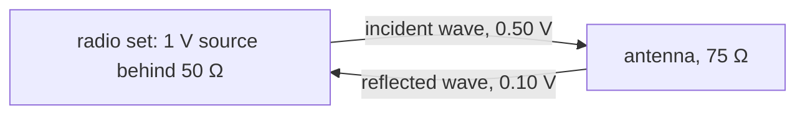
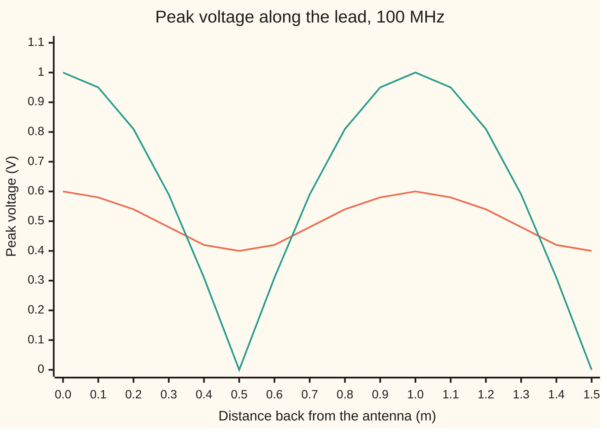

# Transmission lines: when the cable is long, the voltage travels and bounces

[Syllabus](../../../SYLLABUS.md) → [Engineering mathematics](../README.md) → [Circuits and Electromagnetism](../README.md#s06) → Transmission lines

---

## General Overview

A radio set sits on a bench. A 1.5 m coaxial lead joins it to an antenna on the windowsill. Coaxial cable (coax) is a centre wire inside a tube of braid, with plastic between. This lead is rated 50 Ω. The antenna is rated 75 Ω. The engineer tests the lead at 100 MHz, in the FM band, by sending a signal up it from the set.

On the [Kirchhoff's laws](01-kirchhoffs-laws-and-equivalent-circuits.md) card a wire is just a wire: the antenna would look like 75 Ω from the set. That holds only while the wire is short beside the wavelength. Inside this cable a 100 MHz wave is 2.0000 m long, so the 1.5 m lead holds three-quarters of a wave. The voltage cannot be the same all along it. It travels up the cable as a wave, and part of it bounces back where the cable meets a different impedance.

The engineer wants three numbers. What fraction of the wave bounces off the antenna? How uneven is the voltage along the cable? What impedance does the set actually see? The answers: 0.2 of the voltage bounces back, which is 4% of the power. The voltage swings between 0.6 V and 0.4 V along the lead, a standing-wave ratio of 1.5. And the set sees 33.33 Ω, not 75 Ω.

**A long cable is a chain of tiny coils and capacitors; Kirchhoff's laws on each piece give a wave equation, so voltage travels at a fixed speed with a fixed ratio of voltage to current (the characteristic impedance), and where the cable meets a different impedance a fixed fraction of the wave reflects.**

**What kind of fact this is:** a theorem inside a model. The model is the telegrapher's equations: Kirchhoff's laws applied to every short piece of cable. Given that model, the wave speed, the characteristic impedance, the reflection coefficient and the input impedance are derived on this card in Why it works.

### The picture: the wave goes up, a fifth of it comes back



Schematic. Both arrows run through the same 1.5 m of 50 Ω coax. The set's own 50 Ω matches the cable, so the 0.10 V that comes back is absorbed there and bounces no further.

---

## The formula

Notation first. A line is described per metre of its length: $`R`$ resistance and $`L`$ inductance in series along it, $`G`$ leakage conductance and $`C`$ capacitance across it. Position along the line is $`z`$, measured from the set. As on the [Phasors](02-phasors-and-impedance.md) card, $`j`$ is the square root of −1. This card uses peak values, not rms, so a wave of peak $`V`$ in a resistance $`Z`$ carries average power $`V^2/(2Z)`$.

The **telegrapher's equations** are Kirchhoff's two laws on a slice of line:

```math
\frac{\partial v}{\partial z} = -R\,i - L\,\frac{\partial i}{\partial t}, \qquad \frac{\partial i}{\partial z} = -G\,v - C\,\frac{\partial v}{\partial t}
```

**Read it aloud:** the voltage falls along the line by what the series resistance and coil take, and the current falls along the line by what leaks and what charges the capacitance.

With no loss ($`R = G = 0`$) they give a wave with a fixed speed and a fixed ratio of voltage to current:

```math
v_p = \frac{1}{\sqrt{LC}}, \qquad Z_0 = \sqrt{\frac{L}{C}}, \qquad \Gamma = \frac{Z_L - Z_0}{Z_L + Z_0}, \qquad \mathrm{SWR} = \frac{1 + \lvert\Gamma\rvert}{1 - \lvert\Gamma\rvert}
```

**Read it aloud:** the wave's speed is one over the square root of inductance times capacitance per metre; the characteristic impedance is the square root of their ratio; the reflection coefficient is the load's mismatch over the load plus the line; the standing-wave ratio is one plus its size over one minus its size.

Seen from the set, a line of length $`\ell`$ ending in $`Z_L`$ looks like

```math
Z_{in} = Z_0\,\frac{Z_L + jZ_0\tan\beta\ell}{Z_0 + jZ_L\tan\beta\ell}, \qquad \beta = \frac{2\pi}{\lambda} = \frac{\omega}{v_p}
```

**Read it aloud:** the input impedance is the line's impedance times the load plus $`j`$ line-times-tangent, over the line plus $`j`$ load-times-tangent, where the tangent is of the line's length in radians of wave.

For the antenna lead: $`Z_0`$ = 50.00 Ω, $`\Gamma`$ = (75 − 50)/(75 + 50) = 0.2, $`\mathrm{SWR}`$ = 1.2/0.8 = 1.5, $`\beta\ell`$ = 1.5π, so $`Z_{in}`$ = 33.33 Ω.

| Symbol | Plain meaning | In our example | Push it up and the answer… |
| --- | --- | --- | --- |
| $`z`$, $`d`$, $`\ell`$ | position along the line from the set; distance back from the load; the line's length, all in metres | $`\ell`$ = 1.5 m | $`\ell`$: $`Z_{in}`$ cycles, repeating every half wave |
| $`t`$, $`f`$, $`\omega`$, $`j`$ | time in seconds; frequency in hertz; angular frequency $`2\pi f`$ in rad/s; the square root of −1 | 100 MHz | the wave shortens and $`Z_{in}`$ cycles faster |
| $`v`$, $`i`$ | voltage across the line and current along it, at position $`z`$ and time $`t`$ | 0.50 V incident wave | — |
| $`R`$, $`G`$ | series resistance (Ω/m) and leakage conductance across the line (S/m), the losses | taken as 0; an illustrative 0.3 Ω/m checked in When it holds | the wave fades along the line |
| $`L`$, $`C`$, $`a`$, $`b`$, $`\mu_0`$, $`\varepsilon`$ | series inductance (H/m) and capacitance across the line (F/m); for coax, the radii of the centre wire and of the braid, the vacuum permeability and the plastic's permittivity | 250 nH/m, 100 pF/m; $`b/a`$ = 3.493 | $`L`$ up: $`Z_0`$ up, speed down; $`C`$ up: both down |
| $`Z_0`$ | characteristic impedance: voltage over current in one travelling wave, in ohms | 50.00 Ω | changes $`\Gamma`$ for a given load |
| $`v_p`$, $`c`$, $`\lambda`$, $`\beta`$ | wave speed in m/s; the speed of light in vacuum; wavelength in the cable in m; phase change per metre, $`2\pi/\lambda`$, in rad/m | $`2.0000\times10^8`$ m/s, 0.6671 of $`c`$; 2.0000 m; 3.1416 rad/m | — |
| $`V^+`$, $`V^-`$ | peak voltage of the wave travelling to the load, and of the wave coming back | 0.50 V, 0.10 V | — |
| $`Z_L`$ | load impedance at the end of the line | the antenna, 75 Ω | $`\Gamma`$ rises toward +1 |
| $`\Gamma`$ | reflection coefficient: $`V^-/V^+`$ at the load | 0.2000 | more bounces back |
| $`\mathrm{SWR}`$ | standing-wave ratio: largest over smallest voltage along the line | 1.5000 | the voltage is less even |
| $`Z_{in}`$, $`Z_S`$ | impedance the source sees at the line's input; the source's own impedance | 33.33 Ω; the set's 50 Ω | — |

### When it holds

- **Low loss: $`R \ll \omega L`$ and $`G \ll \omega C`$.** At 100 MHz, $`\omega L`$ = 157.08 Ω/m. With an illustrative copper loss of 0.3 Ω/m, $`Z_0`$ moves only to 50.00 − j0.05 Ω and the wave loses 0.0261 dB/m. That loss is well below a real RG-58 cable's (a common 50 Ω coax), which loses several times as much at 100 MHz and is still a low-loss line. At 50 Hz, $`\omega L`$ is only 78.54 µΩ/m, the loss dominates and $`Z_0`$ is not 50 Ω; but there the lead is short anyway.
- **One uniform cable.** The derivation assumes the same $`L`$ and $`C`$ in every metre. A kink, a crushed spot or a connector is a short stretch with a different $`Z_0`$, and it reflects a little of the wave itself.
- **One simple field pattern in the cable.** At much higher frequencies a coax also carries other field patterns, which per-metre $`L`$ and $`C`$ cannot describe.
- **A linear load at one steady frequency.** $`\mathrm{SWR}`$ and $`Z_{in}`$ assume one sine wave; a pulse needs the time-domain equations, as in the code.
- **The other way round: when a wire is just a wire.** If the line is short beside $`\lambda`$, $`\beta\ell`$ is small and $`Z_{in} \approx Z_L`$. At 1 MHz the lead is 1/133 of a 200 m wave, and $`Z_{in}`$ = 74.79 − j2.93 Ω, close to 75. At 100 MHz the lead is 0.75 of a wave, outside that range, and the set sees 33.33 Ω.

---

## Why it works

### Step 0: cut the cable into pieces short enough for Kirchhoff

Kirchhoff's laws fail for the whole cable, but they hold for a slice a millimetre long. So give each slice its own small coil and capacitor and apply the laws to each. Thin slices give two partial differential equations; without loss they combine into the wave equation, and the speed and impedance drop out.

### Step 1: Kirchhoff's laws on one slice

Take a slice from $`z`$ to $`z + \Delta z`$. Its series parts are $`R\,\Delta z`$ and $`L\,\Delta z`$; its parts across the line are $`G\,\Delta z`$ and $`C\,\Delta z`$.

- **Voltage law round the slice:** the voltage drop along it is what the series parts take, $`v(z) - v(z+\Delta z) = R\,\Delta z\, i + L\,\Delta z\,\partial i/\partial t`$.
- **Current law at its far end:** the current lost along it is what leaks and what charges the capacitance, $`i(z) - i(z+\Delta z) = G\,\Delta z\, v + C\,\Delta z\,\partial v/\partial t`$.

Divide by $`\Delta z`$ and let it shrink to zero. The left sides become $`-\partial v/\partial z`$ and $`-\partial i/\partial z`$: the telegrapher's equations.

### Step 2: no loss gives the wave equation

Set $`R = G = 0`$. Differentiate the first equation by $`z`$ and the second by $`t`$, and the current drops out:

```math
\frac{\partial^2 v}{\partial z^2} = -L\,\frac{\partial^2 i}{\partial z\,\partial t} = LC\,\frac{\partial^2 v}{\partial t^2}
```

This is the equation of [The wave equation](../../08-Differential%20equations%20and%20dynamics/10-The%20Classical%20PDEs/05-the-wave-equation-and-dalemberts-formula.md), with $`v_p^2 = 1/(LC)`$. Its solutions are a shape sliding toward the load plus a shape sliding back, both at $`v_p`$. For the lead, $`v_p`$ = 1/√(250 nH × 100 pF) = $`2.0000\times10^8`$ m/s, 0.6671 of the speed of light $`c`$.

That speed matches the field picture. For coax, $`L`$ and $`C`$ come from the two radii $`a`$ (centre wire) and $`b`$ (inside of the braid): $`L = (\mu_0/2\pi)\ln(b/a)`$ and $`C = 2\pi\varepsilon/\ln(b/a)`$, so $`LC = \mu_0\varepsilon`$ whatever the radii. A polyethylene coax (permittivity 2.25 $`\varepsilon_0`$) built for 50 Ω has $`b/a`$ = 3.493, $`L`$ = 250.2 nH/m and $`C`$ = 100.07 pF/m. Its speed is $`c/1.5`$, the speed that [Electromagnetic waves](08-electromagnetic-waves.md) finds for this plastic. The lead's 250 nH/m and 100 pF/m are these values rounded, so its 0.6671 of $`c`$ is slightly above $`1/1.5`$.

### Step 3: one travelling wave has a fixed voltage-to-current ratio

Take a wave going toward the load: $`v = f(z - v_p t)`$ and $`i = g(z - v_p t)`$. Put them in the first lossless equation, $`\partial v/\partial z = -L\,\partial i/\partial t`$. It reads $`f' = L v_p\, g'`$, so $`v = L v_p\, i`$ at every point. And $`L v_p = L/\sqrt{LC} = \sqrt{L/C}`$:

```math
\frac{v}{i} = Z_0 = \sqrt{\frac{L}{C}} = \sqrt{\frac{250\times10^{-9}}{100\times10^{-12}}} = 50\ \Omega
```

A wave going back toward the set has $`v/i = -Z_0`$, since its current flows the other way. $`Z_0`$ is not a resistance that burns power, and it does not depend on length. It is the ratio a lone travelling wave insists on: an endless line would look like 50 Ω.

### Step 4: at the load, the reflected wave fixes the mismatch

At the antenna the cable carries both waves. The voltage is $`V^+ + V^-`$ and the current is $`(V^+ - V^-)/Z_0`$. The antenna demands voltage over current equal to $`Z_L`$:

```math
\frac{V^+ + V^-}{(V^+ - V^-)/Z_0} = Z_L \quad\Longrightarrow\quad \Gamma = \frac{V^-}{V^+} = \frac{Z_L - Z_0}{Z_L + Z_0} = \frac{75 - 50}{75 + 50} = 0.2
```

The incident wave alone has ratio 50 Ω, not 75 Ω. The only other thing the cable can carry is a reflected wave, and exactly 0.2 of it fixes the ratio. A matched load ($`Z_L = Z_0`$) gives $`\Gamma`$ = 0; a short gives −1; an open end gives +1.

Power goes as voltage squared, so the reflected fraction is $`\Gamma^2`$ = 0.04, 4%. For any passive load, one with $`\mathrm{Re}\,Z_L \ge 0`$, $`\lvert\Gamma\rvert \le 1`$: no load sends back more than it gets.

<details>
<summary>Why a passive load never gives |Γ| above 1</summary>

Write $`Z_L = r + jx`$ with $`r \ge 0`$. Then

$`\displaystyle \lvert Z_L - Z_0\rvert^2 - \lvert Z_L + Z_0\rvert^2 = (r - Z_0)^2 - (r + Z_0)^2 = -4 r Z_0 \le 0,`$

since the $`x^2`$ terms cancel. So the top of $`\Gamma`$ is never longer than the bottom, and $`\lvert\Gamma\rvert = 1`$ exactly when $`r = 0`$: a short, an open or a pure coil or capacitor, none of which absorbs power.

</details>

### Step 5: the two waves add into a standing pattern

At a steady frequency, use phasors. At distance $`d`$ back from the load the incident wave has advanced its phase by $`\beta d`$ and the reflected one has fallen behind by $`\beta d`$:

```math
V(d) = V^+ e^{j\beta d}\left(1 + \Gamma e^{-2j\beta d}\right)
```

The bracket is 1 plus a short arrow of length $`\lvert\Gamma\rvert`$ that turns as $`d`$ grows. Its length swings between $`1 + \lvert\Gamma\rvert`$, where the arrow points along, and $`1 - \lvert\Gamma\rvert`$, where it points against. For the lead: 0.5 × 1.2 = 0.6 V at the antenna and every 1 m back from it; 0.5 × 0.8 = 0.4 V a quarter wave (0.5 m) further on. The ratio is $`\mathrm{SWR}`$ = 1.5, and the pattern repeats every half wave, 1.0 m.

### Step 6: the input impedance

Divide voltage by current at distance $`d`$:

```math
Z(d) = Z_0\,\frac{1 + \Gamma e^{-2j\beta d}}{1 - \Gamma e^{-2j\beta d}}
```

Put in $`\Gamma`$ and use $`e^{\mp j\beta d} = \cos\beta d \mp j\sin\beta d`$; this gives the $`\tan`$ form in The formula. Four cases are worth remembering:

| Line | $`Z_{in}`$ | The lead's case |
| --- | --- | --- |
| matched load, any length | $`Z_0`$ | 50.00 Ω |
| half wave, $`\beta\ell = \pi`$ | $`Z_L`$, repeated | a 1.0 m lead gives 75.00 Ω |
| quarter wave, or three-quarters | $`Z_0^2/Z_L`$ | 2500/75 = 33.33 Ω at 1.5 m |
| short or open end | $`jZ_0\tan\beta\ell`$ or $`-jZ_0\cot\beta\ell`$, a pure reactance | at 1.5 m a short looks open, an open looks shorted |

<details>
<summary>The algebra from Z(d) to the tan form</summary>

Multiply top and bottom of $`Z(d)`$ by $`(Z_L + Z_0)e^{j\beta d}`$, and write $`\Gamma(Z_L + Z_0) = Z_L - Z_0`$:

$`\displaystyle Z(d) = Z_0\,\frac{(Z_L + Z_0)e^{j\beta d} + (Z_L - Z_0)e^{-j\beta d}}{(Z_L + Z_0)e^{j\beta d} - (Z_L - Z_0)e^{-j\beta d}} = Z_0\,\frac{2Z_L\cos\beta d + 2jZ_0\sin\beta d}{2Z_0\cos\beta d + 2jZ_L\sin\beta d}.`$

Divide top and bottom by $`2\cos\beta d`$ and set $`d = \ell`$.

</details>

---

## Worked numbers, by hand

The lead: $`L`$ = 250 nH/m, $`C`$ = 100 pF/m, $`\ell`$ = 1.5 m, $`f`$ = 100 MHz, antenna $`Z_L`$ = 75 Ω, set: 1 V peak behind 50 Ω.

| Step | Arithmetic | Value |
| --- | --- | --- |
| characteristic impedance | $`\sqrt{250\times10^{-9}/100\times10^{-12}}`$ | 50.00 Ω |
| wave speed | $`1/\sqrt{250\times10^{-9}\times100\times10^{-12}}`$ | $`2.0000\times10^8`$ m/s |
| wavelength in the cable | $`2.0000\times10^8/100\times10^6`$ | 2.0000 m |
| lead in wavelengths; delay | 1.5/2.0; $`1.5/2.0000\times10^8`$ | 0.75; 7.50 ns |
| incident wave | 1 V × 50/(50 + 50) | 0.50 V, power $`0.5^2/(2\times50)`$ = 2.50 mW |
| reflection coefficient | (75 − 50)/(75 + 50) | 0.2000 |
| reflected wave | 0.2 × 0.50 | 0.10 V, 4.00% of the power = 0.10 mW |
| antenna voltage | 0.50 + 0.10 | 0.60 V, power $`0.6^2/(2\times75)`$ = 2.40 mW |
| standing-wave ratio | 1.2/0.8 | **1.5000** |
| return loss; mismatch loss | $`-20\log_{10}0.2`$; $`-10\log_{10}0.96`$ | 13.98 dB; 0.177 dB |
| input impedance, three-quarter wave | $`50^2/75`$ | **33.33 Ω** |
| voltage at the set | 1 V × 33.33/(33.33 + 50) | 0.40 V |

The antenna takes 2.40 mW of the 2.50 mW sent: the mismatch wastes 4%, only 0.177 dB. The bigger surprise is the 33.33 Ω the set sees, neither 50 Ω nor 75 Ω; its 0.40 V is the low point of the standing wave.

### What breaks if you drop a piece

Correct answers: $`\Gamma`$ = 0.2, 4% reflected, $`Z_{in}`$ = 33.33 Ω.

| Mistake | Comes out at | What went wrong |
| --- | --- | --- |
| Treat the lead as a plain wire (the lumped rule) | $`Z_{in}`$ = 75.00 Ω, 0.60 V at the set | Outside the model's range: 1.5 m is 0.75 of a wave. The simulation finds 33.34 Ω |
| Lump the whole lead into one T-section: half the coil, the capacitor, then the other half | $`Z_{in}`$ = 0.49 + j106.49 Ω | One piece is not short beside the wave. Ten 15 cm pieces give 31.52 + j1.26 Ω; a hundred give 33.31 + j0.01 Ω |
| Write $`\Gamma`$ upside down, (50 − 75)/(50 + 75) | −0.20, so 0.40 V at the antenna | The simulation puts 0.60 V there; the sign says where the voltage peaks |
| Use the vacuum wavelength, 2.9979 m | the lead looks like a half wave, $`Z_{in}`$ = 75.00 − j0.14 Ω | The wave in the plastic is 2.0000 m long |

---

## How the pulse moves

The puzzle: the set sends a short bump up the lead. How does it "know" the antenna is the wrong impedance before it gets there? It doesn't. It travels as a 50 Ω wave until it reaches the antenna, and only there does a reflected bump start back.

One 0.5 V bump, traced by the simulation (the peaks read 0.501 V and 0.602 V, a little high: the 1 cm cells add a small error at the source end, which shrinks as the cells shrink):

| Time after launch | Where | Peak voltage there |
| --- | --- | --- |
| 0.00 ns | at the set | 0.501 V, going up |
| 3.75 ns | halfway, 0.75 m | 0.501 V, going up |
| 7.50 ns | at the antenna | 0.602 V: incident plus reflected, 1 + Γ |
| 11.25 ns | halfway, 0.75 m | 0.100 V, coming back |
| 15.00 ns | at the set | 0.100 V, absorbed by the set's 50 Ω |

The same bump against four different loads. Each bar is the returning bump over the outgoing one, measured at 0.75 m:

```
                    returning bump / outgoing bump, at 0.75 m
75 ohm antenna      ████████                                   +0.2000
matched, 50 ohm                                                +0.0000
short circuit       ████████████████████████████████████████   -1.0000  (comes back upside down)
open end            ████████████████████████████████████████   +1.0000
```

At a steady 100 MHz the two waves overlap and add. Their sum's peak, at each point, against the distance back from the antenna:



Orange: the 75 Ω antenna, between 0.60 V and 0.40 V, a ratio of 1.5. Green: the lead with its end open, between 1.00 V and 0.00 V. A matched load gives a flat 0.50 V. The set sits at 1.5 m, at a low point, so it sees less than 50 Ω.

---

## Code, from first principles, and it actually runs

The code takes three independent roads. Road 1 is the closed forms: $`Z_0`$, $`v_p`$, $`\Gamma`$, $`\mathrm{SWR}`$, the powers and $`Z_{in}`$.

Road 2 knows only the telegrapher's equations. It splits the lead into 1 cm cells, keeps voltages on the cell edges and currents halfway between, and steps each from the other's slope (a leapfrog scheme). The time step is one cell divided by the speed, 50 ps, at which the scheme moves a wave exactly one cell per step. The two ends are half-cells where Kirchhoff's current law runs through the set's 50 Ω and the antenna's 75 Ω. A bump measures $`\Gamma`$; a 100 MHz sine, switched on gently over 20 ns, measures $`\mathrm{SWR}`$ and $`Z_{in}`$.

Road 3 is the lumped picture taken seriously: Kirchhoff's laws on a ladder of 3000 tiny coils and capacitors, solved in phasors from the antenna back to the set. All three agree on 0.2, 1.5 and 33.33 Ω. Every number on this card is printed by both programs.

### Python

```python
# Transmission lines and reflections -- the check behind the card.  Standard library only.
# 1.5 m of 50-ohm coax (250 nH/m, 100 pF/m) from a radio to a 75-ohm antenna, 100 MHz.
# Road 1: closed forms.  Road 2: step the telegrapher's equations in time (leapfrog).
# Road 3: Kirchhoff's laws on a ladder of 3000 tiny coils and capacitors, in phasors.
from math import sqrt, pi, cos, sin, exp, log, log10, tan

L, C = 250e-9, 100e-12          # H/m and F/m, per metre of line (typical RG-58 values)
ELL, F, ZL, RS, VS = 1.5, 100e6, 75.0, 50.0, 1.0   # m, Hz, ohm, ohm (radio), V peak
MU0, EPS0, C0 = 1.25663706127e-6, 8.8541878188e-12, 299792458.0   # CODATA 2022

def zin(zl, ell, f, vel=None):  # input impedance of a lossless line ending in zl
    t = tan(2 * pi * f * ell / (vel or v))
    return z0 * (zl + 1j * z0 * t) / (z0 + 1j * zl * t)
def fz(z):                      # print an impedance; no minus sign on a zero
    if abs(z) > 1e6: return "open circuit"
    s = f"{z.real:.2f} {'-' if z.imag < -0.005 else '+'} j{abs(z.imag):.2f} ohm"
    return s.replace("-0.00", "0.00")

# ---- Road 1: closed forms
z0, v = sqrt(L / C), 1 / sqrt(L * C)
lam, gam = v / F, (ZL - z0) / (ZL + z0)
swr = (1 + abs(gam)) / (1 - abs(gam))
print(f"Z0 = sqrt(L/C) = {z0:.2f} ohm, v = 1/sqrt(LC) = {v / 1e8:.4f} x 10^8 m/s = {v / C0:.4f} of c")
print(f"wavelength in the cable at 100 MHz {lam:.4f} m, beta {2 * pi / lam:.4f} rad/m, lead = {ELL / lam:.2f} wavelengths, delay {ELL / v * 1e9:.2f} ns")
lnba = 2 * pi * z0 * sqrt(2.25 * EPS0 / MU0)    # polyethylene coax, Z0 = 50 ohm
print(f"coax radii ratio b/a = {exp(lnba):.3f}: L = {MU0 / (2 * pi) * lnba * 1e9:.1f} nH/m, "
      f"C = {2 * pi * 2.25 * EPS0 / lnba * 1e12:.2f} pF/m")
pinc = (VS / 2) ** 2 / (2 * z0)
print(f"Gamma = ({ZL:.0f} - 50)/({ZL:.0f} + 50) = {gam:.4f}, SWR = {1 + gam:.1f}/{1 - gam:.1f} = {swr:.4f}")
print(f"power: incident {pinc * 1e3:.2f} mW, reflected {gam ** 2 * 100:.2f}% = {gam ** 2 * pinc * 1e3:.2f} mW, "
      f"delivered {(1 - gam ** 2) * pinc * 1e3:.2f} mW")
print(f"return loss {-20 * log10(abs(gam)) if gam else float('inf'):.2f} dB, mismatch loss {-10 * log10(1 - gam ** 2):.3f} dB")
print(f"antenna volts: incident {VS / 2:.2f} + reflected {gam * VS / 2:.2f} = {(1 + gam) * VS / 2:.2f} V; "
      f"check 0.6^2/(2*75) = {((1 + gam) * VS / 2) ** 2 / (2 * ZL) * 1e3:.2f} mW")
zi = zin(ZL, ELL, F)
vin = abs(VS * zi / (zi + RS))
print(f"Zin at 1.5 m = {fz(zi)} (Z0^2/ZL = {z0 ** 2 / ZL:.2f}), radio end {vin:.2f} V")
for name, zl in [("matched 50", 50.0), ("short", 0.0), ("open", 1e12)]:
    g = (zl - z0) / (zl + z0)
    s = "infinite" if abs(abs(g) - 1) < 1e-9 else f"{(1 + abs(g)) / (1 - abs(g)):.2f}"
    print(f"load {name:10s}: Gamma = {g:+.2f}, SWR {s}, Zin at 1.5 m = {fz(zin(zl, ELL, F))}")
R = 0.3                         # ohm/m, an illustrative copper loss at 100 MHz
z0c = ((R + 2j * pi * F * L) / (2j * pi * F * C)) ** 0.5
gl = ((R + 2j * pi * F * L) * (2j * pi * F * C)) ** 0.5
print(f"omega L = {2 * pi * F * L:.2f} ohm/m; at 50 Hz {2 * pi * 50 * L * 1e6:.2f} micro-ohm/m")
print(f"with R = 0.3 ohm/m: Z0 = {fz(z0c)}, loss {gl.real * 20 / log(10):.4f} dB/m")
for name, f in [("50 Hz", 50.0), ("1 MHz", 1e6)]:
    print(f"at {name}: wavelength {v / f:.0f} m, lead = 1/{v / f / ELL:.0f} of it, Zin {fz(zin(ZL, ELL, f))}")

# ---- Road 2: leapfrog on the telegrapher's equations, 1 cm cells, dt = dz/v
DZ = 0.01
N, DT = round(ELL / DZ), DZ / v
def run(zl, drive, steps, keep):
    V, I, a, out = [0.0] * (N + 1), [0.0] * N, C * DZ / (2 * DT), []
    for n in range(steps):
        for k in range(N): I[k] -= DT / (L * DZ) * (V[k + 1] - V[k])
        vs, g = drive((n + 0.5) * DT), 1 / (2 * RS)        # source node: radio, 50 ohm
        V[0] = ((a - g) * V[0] + vs / RS - I[0]) / (a + g)
        for k in range(1, N): V[k] -= DT / (C * DZ) * (I[k] - I[k - 1])
        g = 1 / (2 * zl) if zl > 0 else 1e30                 # load node: antenna
        V[N] = ((a - g) * V[N] + I[N - 1]) / (a + g)
        out.append((n * DT + DT, vs, [V[k] for k in keep]))
    return out
pulse = lambda t: exp(-((t - 3e-9) / 0.5e-9) ** 2)        # 1 V bump leaving the radio at 3 ns
sim_g, lab = {}, f"{ZL:.0f} ohm"
for name, zl in [(lab, ZL), ("matched", 50.0), ("short", 0.0), ("open", 1e12)]:
    tr = run(zl, pulse, 420, (0, N // 2, N))
    pk = lambda j, t0, t1: max(((r[2][j], r[0] * 1e9 - 3) for r in tr if t0 < r[0] * 1e9 - 3 < t1),
                               key=lambda p: abs(p[0]))
    sim_g[name] = pk(1, 6, 14)[0] / pk(1, 0, 6)[0]
    print(f"simulated pulse, {name:7s}: back/out at 0.75 m = {sim_g[name]:+.4f}")
    if name == lab:
        for j, t0, t1 in [(0, -1, 2), (1, 2, 6), (2, 6, 9), (1, 9, 13), (0, 13, 17)]:
            h, t = pk(j, t0, t1)
            print(f"  pulse peak {h:.3f} V at {(0, 0.75, 1.5)[j]:.2f} m from the radio, t = {t:.2f} ns")
assert abs(sim_g[lab] - gam) < 1e-4
assert abs(sim_g["short"] + 1) < 1e-4 and abs(sim_g["open"] - 1) < 1e-4
per = round(1 / (F * DT))
sine = lambda t: VS * cos(2 * pi * F * t) * min(1.0, t / 20e-9)   # ramped on over 20 ns
tr = run(ZL, sine, 1200, range(N + 1))[-per:]
env = [max(abs(r[2][k]) for r in tr) for k in range(N + 1)]
print(f"simulated sine: max {max(env):.4f} V, min {min(env):.4f} V, SWR {max(env) / min(env):.4f}")
ph = lambda xs: sum(x * complex(cos(2 * pi * F * r[0]), -sin(2 * pi * F * r[0])) for x, r in zip(xs, tr))
zsim = ph([r[2][0] for r in tr]) / ph([(VS * cos(2 * pi * F * r[0]) - r[2][0]) / RS for r in tr])
print(f"simulated Zin = {fz(zsim)}")
assert abs(max(env) / min(env) - swr) < 1e-3
assert abs(zsim - zi) < 0.05
ds = [i / 10 for i in range(16)]   # distance back from the antenna
print("chart, distance (m)  " + " ".join(f"{d:4.1f}" for d in ds))
for name, g in [(lab, gam), ("open  ", 1.0)]:
    print(f"chart, {name} |V| (V) " + " ".join(f"{VS / 2 * abs(1 + g * complex(cos(4 * pi * d / lam), -sin(4 * pi * d / lam))):4.2f}" for d in ds))
assert max(abs(env[N - round(d / DZ)] - VS / 2 * abs(1 + gam * complex(cos(4 * pi * d / lam), -sin(4 * pi * d / lam)))) for d in ds) < 1e-3

# ---- Road 3: Kirchhoff on a ladder of tiny series coils and shunt capacitors
def ladder(n, zl):
    z, w, dz = complex(zl), 2 * pi * F, ELL / n
    for _ in range(n):
        z = 1j * w * L * dz / 2 + 1 / (1j * w * C * dz + 1 / (z + 1j * w * L * dz / 2))
    return z
for n in (1, 10, 100):
    print(f"ladder of {n:3d} sections ({ELL / n * 100:5.1f} cm each): Zin = {fz(ladder(n, ZL))}")
zlad = ladder(3000, ZL)
print(f"ladder of 3000 sections: Zin = {fz(zlad)}")
assert abs(zlad - zi) < 0.01

# ---- What breaks, and try changing
print(f"wrong: lead as a plain wire: Zin = {fz(complex(ZL))}, radio end {VS * ZL / (ZL + RS):.2f} V")
print(f"wrong: Gamma upside down (50 - 75)/(50 + 75) = {-gam:.2f}: antenna {(1 - gam) * VS / 2:.2f} V, simulated {env[N]:.2f} V")
print(f"wrong: |Gamma| read as power: {abs(gam) * 100:.0f}% instead of {gam ** 2 * 100:.0f}%")
print(f"wrong: vacuum wavelength {C0 / F:.4f} m, so 1.5 m looks like a half wave: Zin {fz(zin(ZL, ELL, F, C0))}")
for zl in (100.0,):
    g = (zl - z0) / (zl + z0)
    print(f"try: ZL = 100 ohm: Gamma {g:.4f}, SWR {(1 + g) / (1 - g):.2f}, reflected {g * g * 100:.2f}%")
print(f"try: lead 1.0 m: Zin = {fz(zin(ZL, 1.0, F))}; lead 1.25 m: Zin = {fz(zin(ZL, 1.25, F))}")
print(f"try: F = 88 MHz: Zin = {fz(zin(ZL, ELL, 88e6))}")
print("ALL CHECKS PASS")
```

**Ran 2026-11-23 on macOS, Python 3.14.10, standard library only. All checks passed. Output, pasted from the run:**

```
Z0 = sqrt(L/C) = 50.00 ohm, v = 1/sqrt(LC) = 2.0000 x 10^8 m/s = 0.6671 of c
wavelength in the cable at 100 MHz 2.0000 m, beta 3.1416 rad/m, lead = 0.75 wavelengths, delay 7.50 ns
coax radii ratio b/a = 3.493: L = 250.2 nH/m, C = 100.07 pF/m
Gamma = (75 - 50)/(75 + 50) = 0.2000, SWR = 1.2/0.8 = 1.5000
power: incident 2.50 mW, reflected 4.00% = 0.10 mW, delivered 2.40 mW
return loss 13.98 dB, mismatch loss 0.177 dB
antenna volts: incident 0.50 + reflected 0.10 = 0.60 V; check 0.6^2/(2*75) = 2.40 mW
Zin at 1.5 m = 33.33 + j0.00 ohm (Z0^2/ZL = 33.33), radio end 0.40 V
load matched 50: Gamma = +0.00, SWR 1.00, Zin at 1.5 m = 50.00 + j0.00 ohm
load short     : Gamma = -1.00, SWR infinite, Zin at 1.5 m = open circuit
load open      : Gamma = +1.00, SWR infinite, Zin at 1.5 m = 0.00 + j0.00 ohm
omega L = 157.08 ohm/m; at 50 Hz 78.54 micro-ohm/m
with R = 0.3 ohm/m: Z0 = 50.00 - j0.05 ohm, loss 0.0261 dB/m
at 50 Hz: wavelength 4000000 m, lead = 1/2666667 of it, Zin 75.00 + j0.00 ohm
at 1 MHz: wavelength 200 m, lead = 1/133 of it, Zin 74.79 - j2.93 ohm
simulated pulse, 75 ohm : back/out at 0.75 m = +0.2000
  pulse peak 0.501 V at 0.00 m from the radio, t = 0.00 ns
  pulse peak 0.501 V at 0.75 m from the radio, t = 3.75 ns
  pulse peak 0.602 V at 1.50 m from the radio, t = 7.50 ns
  pulse peak 0.100 V at 0.75 m from the radio, t = 11.25 ns
  pulse peak 0.100 V at 0.00 m from the radio, t = 15.00 ns
simulated pulse, matched: back/out at 0.75 m = +0.0000
simulated pulse, short  : back/out at 0.75 m = -1.0000
simulated pulse, open   : back/out at 0.75 m = +1.0000
simulated sine: max 0.6001 V, min 0.4000 V, SWR 1.5000
simulated Zin = 33.34 + j0.00 ohm
chart, distance (m)   0.0  0.1  0.2  0.3  0.4  0.5  0.6  0.7  0.8  0.9  1.0  1.1  1.2  1.3  1.4  1.5
chart, 75 ohm |V| (V) 0.60 0.58 0.54 0.48 0.42 0.40 0.42 0.48 0.54 0.58 0.60 0.58 0.54 0.48 0.42 0.40
chart, open   |V| (V) 1.00 0.95 0.81 0.59 0.31 0.00 0.31 0.59 0.81 0.95 1.00 0.95 0.81 0.59 0.31 0.00
ladder of   1 sections (150.0 cm each): Zin = 0.49 + j106.49 ohm
ladder of  10 sections ( 15.0 cm each): Zin = 31.52 + j1.26 ohm
ladder of 100 sections (  1.5 cm each): Zin = 33.31 + j0.01 ohm
ladder of 3000 sections: Zin = 33.33 + j0.00 ohm
wrong: lead as a plain wire: Zin = 75.00 + j0.00 ohm, radio end 0.60 V
wrong: Gamma upside down (50 - 75)/(50 + 75) = -0.20: antenna 0.40 V, simulated 0.60 V
wrong: |Gamma| read as power: 20% instead of 4%
wrong: vacuum wavelength 2.9979 m, so 1.5 m looks like a half wave: Zin 75.00 - j0.14 ohm
try: ZL = 100 ohm: Gamma 0.3333, SWR 2.00, reflected 11.11%
try: lead 1.0 m: Zin = 75.00 + j0.00 ohm; lead 1.25 m: Zin = 46.15 - j19.23 ohm
try: F = 88 MHz: Zin = 39.66 - j14.95 ohm
ALL CHECKS PASS
```

### Rust

```rust
// Transmission lines and reflections -- the check behind the card.  std only, no crates.
// 1.5 m of 50-ohm coax (250 nH/m, 100 pF/m) from a radio to a 75-ohm antenna, 100 MHz.
// Road 1: closed forms.  Road 2: step the telegrapher's equations in time (leapfrog).
// Road 3: Kirchhoff's laws on a ladder of 3000 tiny coils and capacitors, in phasors.
use std::f64::consts::PI;
use std::ops::{Add, Div, Mul, Sub};

#[derive(Clone, Copy)]
struct Cx { re: f64, im: f64 }
fn cx(re: f64, im: f64) -> Cx { Cx { re, im } }
impl Add for Cx { type Output = Cx; fn add(self, o: Cx) -> Cx { cx(self.re + o.re, self.im + o.im) } }
impl Sub for Cx { type Output = Cx; fn sub(self, o: Cx) -> Cx { cx(self.re - o.re, self.im - o.im) } }
impl Mul for Cx { type Output = Cx;
    fn mul(self, o: Cx) -> Cx { cx(self.re * o.re - self.im * o.im, self.re * o.im + self.im * o.re) } }
impl Div for Cx { type Output = Cx;
    fn div(self, o: Cx) -> Cx { let d = o.re * o.re + o.im * o.im;
        cx((self.re * o.re + self.im * o.im) / d, (self.im * o.re - self.re * o.im) / d) } }
impl Cx {
    fn abs(self) -> f64 { self.re.hypot(self.im) }
    fn sqrt(self) -> Cx { let (r, a) = (self.abs().sqrt(), self.im.atan2(self.re) / 2.0); cx(r * a.cos(), r * a.sin()) }
}

const L: f64 = 250e-9; const C: f64 = 100e-12; // H/m and F/m, per metre of line (typical RG-58 values)
const ELL: f64 = 1.5; const F: f64 = 100e6; const ZL: f64 = 75.0; const RS: f64 = 50.0; const VS: f64 = 1.0;
const MU0: f64 = 1.25663706127e-6; const EPS0: f64 = 8.8541878188e-12; const C0: f64 = 299792458.0; // CODATA 2022
const DZ: f64 = 0.01;

fn zin(z0: f64, v: f64, zl: f64, ell: f64, f: f64) -> Cx { // input impedance of a lossless line ending in zl
    let t = (2.0 * PI * f * ell / v).tan();
    cx(z0, 0.0) * cx(zl, z0 * t) / cx(z0, zl * t)
}
fn fz(z: Cx) -> String { // print an impedance; no minus sign on a zero
    if z.abs() > 1e6 { return "open circuit".to_string(); }
    let s = format!("{:.2} {} j{:.2} ohm", z.re, if z.im < -0.005 { '-' } else { '+' }, z.im.abs());
    s.replace("-0.00", "0.00")
}
// leapfrog on the telegrapher's equations, 1 cm cells, dt = dz/v; returns (t, node voltages)
fn run(zl: f64, drive: &dyn Fn(f64) -> f64, steps: usize, keep: &[usize], n: usize, dt: f64) -> Vec<(f64, Vec<f64>)> {
    let (mut v, mut i, a) = (vec![0.0; n + 1], vec![0.0; n], C * DZ / (2.0 * dt));
    let mut out = Vec::new();
    for s in 0..steps {
        for k in 0..n { i[k] -= dt / (L * DZ) * (v[k + 1] - v[k]); }
        let (vs, g) = (drive((s as f64 + 0.5) * dt), 1.0 / (2.0 * RS)); // source node: radio, 50 ohm
        v[0] = ((a - g) * v[0] + vs / RS - i[0]) / (a + g);
        for k in 1..n { v[k] -= dt / (C * DZ) * (i[k] - i[k - 1]); }
        let g = if zl > 0.0 { 1.0 / (2.0 * zl) } else { 1e30 }; // load node: antenna
        v[n] = ((a - g) * v[n] + i[n - 1]) / (a + g);
        out.push((s as f64 * dt + dt, keep.iter().map(|&k| v[k]).collect()));
    }
    out
}
fn ladder(nsec: usize, zl: f64) -> Cx { // Kirchhoff on a ladder of tiny series coils and shunt capacitors
    let (mut z, w, dz) = (cx(zl, 0.0), 2.0 * PI * F, ELL / nsec as f64);
    let one = cx(1.0, 0.0);
    for _ in 0..nsec {
        z = cx(0.0, w * L * dz / 2.0) + one / (cx(0.0, w * C * dz) + one / (z + cx(0.0, w * L * dz / 2.0)));
    }
    z
}

fn main() {
    // ---- Road 1: closed forms
    let (z0, v) = ((L / C).sqrt(), 1.0 / (L * C).sqrt());
    let (lam, gam) = (v / F, (ZL - z0) / (ZL + z0));
    let swr = (1.0 + gam.abs()) / (1.0 - gam.abs());
    println!("Z0 = sqrt(L/C) = {:.2} ohm, v = 1/sqrt(LC) = {:.4} x 10^8 m/s = {:.4} of c", z0, v / 1e8, v / C0);
    println!("wavelength in the cable at 100 MHz {:.4} m, beta {:.4} rad/m, lead = {:.2} wavelengths, delay {:.2} ns", lam, 2.0 * PI / lam, ELL / lam, ELL / v * 1e9);
    let lnba = 2.0 * PI * z0 * (2.25 * EPS0 / MU0).sqrt(); // polyethylene coax, Z0 = 50 ohm
    println!("coax radii ratio b/a = {:.3}: L = {:.1} nH/m, C = {:.2} pF/m",
        lnba.exp(), MU0 / (2.0 * PI) * lnba * 1e9, 2.0 * PI * 2.25 * EPS0 / lnba * 1e12);
    let pinc = (VS / 2.0).powi(2) / (2.0 * z0);
    println!("Gamma = ({:.0} - 50)/({:.0} + 50) = {:.4}, SWR = {:.1}/{:.1} = {:.4}", ZL, ZL, gam, 1.0 + gam, 1.0 - gam, swr);
    println!("power: incident {:.2} mW, reflected {:.2}% = {:.2} mW, delivered {:.2} mW",
        pinc * 1e3, gam * gam * 100.0, gam * gam * pinc * 1e3, (1.0 - gam * gam) * pinc * 1e3);
    println!("return loss {:.2} dB, mismatch loss {:.3} dB", -20.0 * gam.abs().log10(), -10.0 * (1.0 - gam * gam).log10());
    println!("antenna volts: incident {:.2} + reflected {:.2} = {:.2} V; check 0.6^2/(2*75) = {:.2} mW",
        VS / 2.0, gam * VS / 2.0, (1.0 + gam) * VS / 2.0, ((1.0 + gam) * VS / 2.0).powi(2) / (2.0 * ZL) * 1e3);
    let zi = zin(z0, v, ZL, ELL, F);
    let vin = (cx(VS, 0.0) * zi / (zi + cx(RS, 0.0))).abs();
    println!("Zin at 1.5 m = {} (Z0^2/ZL = {:.2}), radio end {:.2} V", fz(zi), z0 * z0 / ZL, vin);
    for (name, zl) in [("matched 50", 50.0), ("short", 0.0), ("open", 1e12)] {
        let g: f64 = (zl - z0) / (zl + z0);
        let s = if (g.abs() - 1.0).abs() < 1e-9 { "infinite".to_string() } else { format!("{:.2}", (1.0 + g.abs()) / (1.0 - g.abs())) };
        println!("load {:10}: Gamma = {:+.2}, SWR {}, Zin at 1.5 m = {}", name, g, s, fz(zin(z0, v, zl, ELL, F)));
    }
    let r = 0.3; // ohm/m, an illustrative copper loss at 100 MHz
    let (ser, sh) = (cx(r, 2.0 * PI * F * L), cx(0.0, 2.0 * PI * F * C));
    let (z0c, gl) = ((ser / sh).sqrt(), (ser * sh).sqrt());
    println!("omega L = {:.2} ohm/m; at 50 Hz {:.2} micro-ohm/m", 2.0 * PI * F * L, 2.0 * PI * 50.0 * L * 1e6);
    println!("with R = 0.3 ohm/m: Z0 = {}, loss {:.4} dB/m", fz(z0c), gl.re * 20.0 / 10f64.ln());
    for (name, f) in [("50 Hz", 50.0), ("1 MHz", 1e6)] {
        println!("at {}: wavelength {:.0} m, lead = 1/{:.0} of it, Zin {}", name, v / f, v / f / ELL, fz(zin(z0, v, ZL, ELL, f)));
    }

    // ---- Road 2: leapfrog on the telegrapher's equations
    let (n, dt) = ((ELL / DZ).round() as usize, DZ / v);
    let pulse = |t: f64| (-((t - 3e-9) / 0.5e-9).powi(2)).exp(); // 1 V bump leaving the radio at 3 ns
    let (mut sim_g, lab) = (Vec::new(), format!("{:.0} ohm", ZL));
    for (name, zl) in [(lab.as_str(), ZL), ("matched", 50.0), ("short", 0.0), ("open", 1e12)] {
        let tr = run(zl, &pulse, 420, &[0, n / 2, n], n, dt);
        let pk = |j: usize, t0: f64, t1: f64| {
            let mut best = (0.0f64, 0.0f64);
            let mut found = false;
            for (t, vs) in &tr {
                let tt = t * 1e9 - 3.0;
                if t0 < tt && tt < t1 && (!found || vs[j].abs() > best.0.abs()) { best = (vs[j], tt); found = true; }
            }
            best
        };
        let g = pk(1, 6.0, 14.0).0 / pk(1, 0.0, 6.0).0;
        sim_g.push(g);
        println!("simulated pulse, {:7}: back/out at 0.75 m = {:+.4}", name, g);
        if name == lab {
            for (j, t0, t1) in [(0, -1.0, 2.0), (1, 2.0, 6.0), (2, 6.0, 9.0), (1, 9.0, 13.0), (0, 13.0, 17.0)] {
                let (h, t) = pk(j, t0, t1);
                println!("  pulse peak {:.3} V at {:.2} m from the radio, t = {:.2} ns", h, [0.0, 0.75, 1.5][j], t);
            }
        }
    }
    assert!((sim_g[0] - gam).abs() < 1e-4);
    assert!((sim_g[2] + 1.0).abs() < 1e-4 && (sim_g[3] - 1.0).abs() < 1e-4);
    let per = (1.0 / (F * dt)).round() as usize;
    let sine = |t: f64| VS * (2.0 * PI * F * t).cos() * (t / 20e-9).min(1.0); // ramped on over 20 ns
    let all: Vec<usize> = (0..=n).collect();
    let full = run(ZL, &sine, 1200, &all, n, dt);
    let tr = &full[full.len() - per..];
    let env: Vec<f64> = (0..=n).map(|k| tr.iter().map(|r| r.1[k].abs()).fold(0.0, f64::max)).collect();
    let (emax, emin) = (env.iter().cloned().fold(0.0, f64::max), env.iter().cloned().fold(f64::INFINITY, f64::min));
    println!("simulated sine: max {:.4} V, min {:.4} V, SWR {:.4}", emax, emin, emax / emin);
    let ph = |xs: &Vec<f64>| xs.iter().zip(tr.iter()).fold(cx(0.0, 0.0), |acc, (x, r)| {
        let w = 2.0 * PI * F * r.0; acc + cx(x * w.cos(), -x * w.sin()) });
    let vin_t: Vec<f64> = tr.iter().map(|r| r.1[0]).collect();
    let iin_t: Vec<f64> = tr.iter().map(|r| (VS * (2.0 * PI * F * r.0).cos() - r.1[0]) / RS).collect();
    let zsim = ph(&vin_t) / ph(&iin_t);
    println!("simulated Zin = {}", fz(zsim));
    assert!((emax / emin - swr).abs() < 1e-3);
    assert!((zsim - zi).abs() < 0.05);
    let ds: Vec<f64> = (0..16).map(|i| i as f64 / 10.0).collect(); // distance back from the antenna
    let pat = |g: f64, d: f64| VS / 2.0 * (cx(1.0, 0.0) + cx(g * (4.0 * PI * d / lam).cos(), -g * (4.0 * PI * d / lam).sin())).abs();
    println!("chart, distance (m)  {}", ds.iter().map(|d| format!("{:4.1}", d)).collect::<Vec<_>>().join(" "));
    for (name, g) in [(lab.as_str(), gam), ("open  ", 1.0)] {
        println!("chart, {} |V| (V) {}", name, ds.iter().map(|&d| format!("{:4.2}", pat(g, d))).collect::<Vec<_>>().join(" "));
    }
    assert!(ds.iter().map(|&d| (env[n - (d / DZ).round() as usize] - pat(gam, d)).abs()).fold(0.0, f64::max) < 1e-3);

    // ---- Road 3: Kirchhoff on a ladder
    for ns in [1usize, 10, 100] {
        println!("ladder of {:3} sections ({:5.1} cm each): Zin = {}", ns, ELL / ns as f64 * 100.0, fz(ladder(ns, ZL)));
    }
    let zlad = ladder(3000, ZL);
    println!("ladder of 3000 sections: Zin = {}", fz(zlad));
    assert!((zlad - zi).abs() < 0.01);

    // ---- What breaks, and try changing
    println!("wrong: lead as a plain wire: Zin = {}, radio end {:.2} V", fz(cx(ZL, 0.0)), VS * ZL / (ZL + RS));
    println!("wrong: Gamma upside down (50 - 75)/(50 + 75) = {:.2}: antenna {:.2} V, simulated {:.2} V", -gam, (1.0 - gam) * VS / 2.0, env[n]);
    println!("wrong: |Gamma| read as power: {:.0}% instead of {:.0}%", gam.abs() * 100.0, gam * gam * 100.0);
    println!("wrong: vacuum wavelength {:.4} m, so 1.5 m looks like a half wave: Zin {}", C0 / F, fz(zin(z0, C0, ZL, ELL, F)));
    let g = (100.0 - z0) / (100.0 + z0);
    println!("try: ZL = 100 ohm: Gamma {:.4}, SWR {:.2}, reflected {:.2}%", g, (1.0 + g) / (1.0 - g), g * g * 100.0);
    println!("try: lead 1.0 m: Zin = {}; lead 1.25 m: Zin = {}", fz(zin(z0, v, ZL, 1.0, F)), fz(zin(z0, v, ZL, 1.25, F)));
    println!("try: F = 88 MHz: Zin = {}", fz(zin(z0, v, ZL, ELL, 88e6)));
    println!("ALL CHECKS PASS");
}
```

**Ran 2026-11-23 on macOS, rustc 1.98.1, no crates. All checks passed. Output, pasted from the run:**

```
Z0 = sqrt(L/C) = 50.00 ohm, v = 1/sqrt(LC) = 2.0000 x 10^8 m/s = 0.6671 of c
wavelength in the cable at 100 MHz 2.0000 m, beta 3.1416 rad/m, lead = 0.75 wavelengths, delay 7.50 ns
coax radii ratio b/a = 3.493: L = 250.2 nH/m, C = 100.07 pF/m
Gamma = (75 - 50)/(75 + 50) = 0.2000, SWR = 1.2/0.8 = 1.5000
power: incident 2.50 mW, reflected 4.00% = 0.10 mW, delivered 2.40 mW
return loss 13.98 dB, mismatch loss 0.177 dB
antenna volts: incident 0.50 + reflected 0.10 = 0.60 V; check 0.6^2/(2*75) = 2.40 mW
Zin at 1.5 m = 33.33 + j0.00 ohm (Z0^2/ZL = 33.33), radio end 0.40 V
load matched 50: Gamma = +0.00, SWR 1.00, Zin at 1.5 m = 50.00 + j0.00 ohm
load short     : Gamma = -1.00, SWR infinite, Zin at 1.5 m = open circuit
load open      : Gamma = +1.00, SWR infinite, Zin at 1.5 m = 0.00 + j0.00 ohm
omega L = 157.08 ohm/m; at 50 Hz 78.54 micro-ohm/m
with R = 0.3 ohm/m: Z0 = 50.00 - j0.05 ohm, loss 0.0261 dB/m
at 50 Hz: wavelength 4000000 m, lead = 1/2666667 of it, Zin 75.00 + j0.00 ohm
at 1 MHz: wavelength 200 m, lead = 1/133 of it, Zin 74.79 - j2.93 ohm
simulated pulse, 75 ohm : back/out at 0.75 m = +0.2000
  pulse peak 0.501 V at 0.00 m from the radio, t = 0.00 ns
  pulse peak 0.501 V at 0.75 m from the radio, t = 3.75 ns
  pulse peak 0.602 V at 1.50 m from the radio, t = 7.50 ns
  pulse peak 0.100 V at 0.75 m from the radio, t = 11.25 ns
  pulse peak 0.100 V at 0.00 m from the radio, t = 15.00 ns
simulated pulse, matched: back/out at 0.75 m = +0.0000
simulated pulse, short  : back/out at 0.75 m = -1.0000
simulated pulse, open   : back/out at 0.75 m = +1.0000
simulated sine: max 0.6001 V, min 0.4000 V, SWR 1.5000
simulated Zin = 33.34 + j0.00 ohm
chart, distance (m)   0.0  0.1  0.2  0.3  0.4  0.5  0.6  0.7  0.8  0.9  1.0  1.1  1.2  1.3  1.4  1.5
chart, 75 ohm |V| (V) 0.60 0.58 0.54 0.48 0.42 0.40 0.42 0.48 0.54 0.58 0.60 0.58 0.54 0.48 0.42 0.40
chart, open   |V| (V) 1.00 0.95 0.81 0.59 0.31 0.00 0.31 0.59 0.81 0.95 1.00 0.95 0.81 0.59 0.31 0.00
ladder of   1 sections (150.0 cm each): Zin = 0.49 + j106.49 ohm
ladder of  10 sections ( 15.0 cm each): Zin = 31.52 + j1.26 ohm
ladder of 100 sections (  1.5 cm each): Zin = 33.31 + j0.01 ohm
ladder of 3000 sections: Zin = 33.33 + j0.00 ohm
wrong: lead as a plain wire: Zin = 75.00 + j0.00 ohm, radio end 0.60 V
wrong: Gamma upside down (50 - 75)/(50 + 75) = -0.20: antenna 0.40 V, simulated 0.60 V
wrong: |Gamma| read as power: 20% instead of 4%
wrong: vacuum wavelength 2.9979 m, so 1.5 m looks like a half wave: Zin 75.00 - j0.14 ohm
try: ZL = 100 ohm: Gamma 0.3333, SWR 2.00, reflected 11.11%
try: lead 1.0 m: Zin = 75.00 + j0.00 ohm; lead 1.25 m: Zin = 46.15 - j19.23 ohm
try: F = 88 MHz: Zin = 39.66 - j14.95 ohm
ALL CHECKS PASS
```

### Lean

Lean proves the three algebra steps of Why it works for any lossless line, and checks the worked numbers.

- Suppose $`V^+ \ne 0`$, $`Z_L + Z_0 \ne 0`$, and the load's voltage is $`Z_L`$ times its current. Then $`V^-/V^+ = (Z_L - Z_0)/(Z_L + Z_0)`$.
- Take a passive load, $`\mathrm{Re}\,Z_L \ge 0`$. Then $`\lvert\Gamma\rvert \le 1`$, with $`\lvert\Gamma\rvert = 1`$ exactly when $`\mathrm{Re}\,Z_L = 0`$.
- Suppose $`\cos\beta\ell \ne 0`$ and $`Z(\ell)`$ is finite. Then $`Z(\ell)`$ equals the tan form of $`Z_{in}`$ in The formula.
- The antenna numbers come out exactly: $`\Gamma`$ = 1/5, $`\mathrm{SWR}`$ = 3/2, 4% of the power reflected and 96% delivered.
- So do the voltages: 0.60 V at the antenna, 0.40 V at the low point, and 0.40 V at the set.
- A three-quarter-wave lead gives $`Z_0^2/Z_L`$ = 100/3 Ω. A matched load gives $`\Gamma`$ = 0, and a short gives −1.

Lean starts at Step 4, so the telegrapher's equations, the wave speed, the pulse and the ladder are left to the Python and Rust checks.

```lean
-- Transmission lines: at a load the reflected wave is the fraction Γ = (Z_L − Z₀)/(Z_L + Z₀) of the incident one, a passive load never gives |Γ| above 1, and the two waves together make the line look like Z₀ (Z_L + jZ₀ tan βℓ)/(Z₀ + jZ_L tan βℓ) from its input.
import Mathlib.Analysis.Complex.Basic
import Mathlib.Analysis.SpecialFunctions.Trigonometric.Basic
import Mathlib.Tactic.FieldSimp
import Mathlib.Tactic.NormNum
import Mathlib.Tactic.LinearCombination

open Complex

/-! A lossless line has a real, positive characteristic impedance `Z₀ = √(L/C)`. At a steady
frequency the line carries an incident wave of complex amplitude `V⁺` and a reflected wave `V⁻`.
At the load the voltage is `V⁺ + V⁻` and the current is `(V⁺ − V⁻)/Z₀`. Here `j` is written
`Complex.I`. -/

/-- Step 4. The reflected wave fixes the mismatch. On a line with characteristic impedance
`Z₀ > 0`, let the incident wave `V⁺` be nonzero and the load `Z_L` satisfy `Z_L + Z₀ ≠ 0`. If the
load's rule "voltage equals `Z_L` times current" holds at the end of the line,
`V⁺ + V⁻ = Z_L (V⁺ − V⁻)/Z₀`, then the reflected wave is the fixed fraction
`Γ = V⁻/V⁺ = (Z_L − Z₀)/(Z_L + Z₀)` of the incident wave. -/
theorem reflection_coefficient_at_load (Z₀ : ℝ) (hZ₀ : 0 < Z₀) (ZL Vp Vm : ℂ)
    (hVp : Vp ≠ 0) (hsum : ZL + Z₀ ≠ 0)
    (hload : Vp + Vm = ZL * ((Vp - Vm) / Z₀)) :
    Vm / Vp = (ZL - Z₀) / (ZL + Z₀) := by
  have hZ : (Z₀ : ℂ) ≠ 0 := by exact_mod_cast hZ₀.ne'
  have h : (Z₀ : ℂ) * (Vp + Vm) = ZL * (Vp - Vm) := by
    rw [hload]; field_simp
  rw [div_eq_div_iff hVp hsum]
  linear_combination h

/-- A passive load never sends back more than it gets. With `Z₀ > 0` and a load with
`Re Z_L ≥ 0`, the reflection coefficient has `|Γ| ≤ 1`, and `|Γ| = 1` exactly when
`Re Z_L = 0` (a short, an open, or a pure coil or capacitor). -/
theorem passive_load_reflection_le_one (Z₀ : ℝ) (hZ₀ : 0 < Z₀) (ZL : ℂ) (hpass : 0 ≤ ZL.re) :
    ‖(ZL - Z₀) / (ZL + Z₀)‖ ≤ 1 ∧ (‖(ZL - Z₀) / (ZL + Z₀)‖ = 1 ↔ ZL.re = 0) := by
  have hsq : normSq (ZL - Z₀) + 4 * ZL.re * Z₀ = normSq (ZL + Z₀) := by
    simp only [normSq_apply, sub_re, add_re, sub_im, add_im, ofReal_re, ofReal_im]
    ring
  have hpos : 0 < ‖ZL + Z₀‖ := by
    rw [norm_pos_iff]
    intro h
    have := congrArg Complex.re h
    simp at this
    linarith
  rw [norm_div]
  constructor
  · rw [div_le_one hpos, norm_def, norm_def]
    apply Real.sqrt_le_sqrt
    nlinarith
  · rw [div_eq_one_iff_eq hpos.ne', norm_def, norm_def]
    constructor
    · intro h
      have h2 := congrArg (fun x => x ^ 2) h
      rw [Real.sq_sqrt (normSq_nonneg _), Real.sq_sqrt (normSq_nonneg _)] at h2
      have : ZL.re * Z₀ = 0 := by linarith
      rcases mul_eq_zero.mp this with h | h
      · exact h
      · exact absurd h hZ₀.ne'
    · intro h
      rw [← hsq, h]
      simp

/-- Step 6. The input impedance. A line of characteristic impedance `Z₀ > 0` ends in a load
`Z_L` with `Z_L + Z₀ ≠ 0`, so `Γ = (Z_L − Z₀)/(Z_L + Z₀)`. At electrical length `βℓ` back from
the load, voltage over current is `Z₀ (1 + Γe^{−2jβℓ})/(1 − Γe^{−2jβℓ})`. Where that is finite
(`1 − Γe^{−2jβℓ} ≠ 0`) and `cos βℓ ≠ 0`, it equals the card's tan form
`Z₀ (Z_L + jZ₀ tan βℓ)/(Z₀ + jZ_L tan βℓ)`. -/
theorem input_impedance_tan_form (Z₀ : ℝ) (hZ₀ : 0 < Z₀) (ZL : ℂ) (hsum : ZL + Z₀ ≠ 0)
    (β ℓ : ℝ) (hcos : Real.cos (β * ℓ) ≠ 0)
    (hfin : 1 - (ZL - Z₀) / (ZL + Z₀) * Complex.exp (-2 * I * (β * ℓ)) ≠ 0) :
    (Z₀ : ℂ) * ((1 + (ZL - Z₀) / (ZL + Z₀) * Complex.exp (-2 * I * (β * ℓ))) /
        (1 - (ZL - Z₀) / (ZL + Z₀) * Complex.exp (-2 * I * (β * ℓ)))) =
      Z₀ * ((ZL + I * Z₀ * (Real.tan (β * ℓ) : ℂ)) / (Z₀ + I * ZL * (Real.tan (β * ℓ) : ℂ))) := by
  clear hZ₀
  have e : (β : ℂ) * (ℓ : ℂ) = ((β * ℓ : ℝ) : ℂ) := by push_cast; ring
  rw [e] at hfin ⊢
  generalize β * ℓ = θ at *
  set E := Complex.exp (-2 * I * (θ : ℂ)) with hEdef
  set Γ := (ZL - Z₀) / (ZL + Z₀) with hΓdef
  set c : ℂ := (Real.cos θ : ℂ) with hc
  set s : ℂ := (Real.sin θ : ℂ) with hs
  set t : ℂ := (Real.tan θ : ℂ) with ht
  have hc0 : c ≠ 0 := ofReal_ne_zero.mpr hcos
  have hT : t * c = s := by
    rw [ht, Real.tan_eq_sin_div_cos, ofReal_div, ← hc, ← hs]; field_simp
  have hexp : Complex.exp ((θ : ℂ) * I) = c + s * I := by
    rw [Complex.exp_mul_I, hc, hs, ← ofReal_cos, ← ofReal_sin]
  have hexpn : Complex.exp (-((θ : ℂ) * I)) = c - s * I := by
    rw [← neg_mul, ← ofReal_neg, Complex.exp_mul_I, hc, hs, ofReal_neg, Complex.cos_neg,
      Complex.sin_neg, ← ofReal_cos, ← ofReal_sin]; ring
  have hE : E * (c + s * I) = c - s * I := by
    rw [← hexp, ← hexpn, hEdef, ← Complex.exp_add]; congr 1; ring
  have hcs : c + s * I ≠ 0 := by rw [← hexp]; exact Complex.exp_ne_zero _
  have hΓ : Γ * (ZL + Z₀) = ZL - Z₀ := by rw [hΓdef]; field_simp
  have hK : (ZL + Z₀) * (c + s * I) ≠ 0 := mul_ne_zero hsum hcs
  -- key identities
  have hA : (ZL + Z₀) * (c + s * I) * (1 + Γ * E) = 2 * c * (ZL + I * Z₀ * t) := by
    linear_combination (c + s * I) * E * hΓ + (ZL - Z₀) * hE - 2 * I * Z₀ * hT
  have hB : (ZL + Z₀) * (c + s * I) * (1 - Γ * E) = 2 * c * (Z₀ + I * ZL * t) := by
    linear_combination -(c + s * I) * E * hΓ - (ZL - Z₀) * hE - 2 * I * ZL * hT
  have hD : (Z₀ + I * ZL * t) ≠ 0 := by
    intro h0
    apply hK
    have := hB
    rw [h0, mul_zero] at this
    exact (mul_eq_zero.mp this).resolve_right hfin
  congr 1
  rw [div_eq_div_iff hfin hD]
  apply mul_left_cancel₀ hK
  linear_combination (Z₀ + I * ZL * t) * hA - (ZL + I * Z₀ * t) * hB

-- The radio's antenna lead: 50 Ω coax into a 75 Ω antenna gives Γ = 25/125 = 1/5.
example : ((75 : ℚ) - 50) / (75 + 50) = 1 / 5 := by norm_num
-- Standing-wave ratio 1.2/0.8 = 3/2.
example : (1 + (1 : ℚ) / 5) / (1 - 1 / 5) = 3 / 2 := by norm_num
-- Reflected power fraction Γ² = 1/25 = 4%.
example : ((1 : ℚ) / 5) ^ 2 = 4 / 100 := by norm_num
-- Antenna voltage 0.50 × 1.2 = 0.60 V and the low point 0.50 × 0.8 = 0.40 V.
example : (1 : ℚ) / 2 * (1 + 1 / 5) = 3 / 5 ∧ (1 : ℚ) / 2 * (1 - 1 / 5) = 2 / 5 := by norm_num
-- Power: incident 0.5²/(2·50) = 2.5 mW, delivered 0.6²/(2·75) = 2.4 mW, 96% of it.
example : ((3 : ℚ) / 5) ^ 2 / (2 * 75) = (1 - 4 / 100) * (((1 : ℚ) / 2) ^ 2 / (2 * 50)) := by norm_num
-- Three-quarter-wave lead: Z_in = Z₀²/Z_L = 2500/75 = 100/3 Ω, and the set sees 1 V × (100/3)/(100/3 + 50) = 0.4 V.
example : (50 : ℚ) ^ 2 / 75 = 100 / 3 ∧ ((100 : ℚ) / 3) / (100 / 3 + 50) = 2 / 5 := by norm_num
-- Matched load gives Γ = 0, a short gives −1.
example : ((50 : ℚ) - 50) / (50 + 50) = 0 ∧ ((0 : ℚ) - 50) / (0 + 50) = -1 := by norm_num

#print axioms reflection_coefficient_at_load
#print axioms passive_load_reflection_le_one
#print axioms input_impedance_tan_form
```

**Checked 2026-11-23 on macOS, Lean 4.36.0-rc2, Mathlib v4.36.0-rc2. Every proof is complete and uses only Lean's standard axioms. Output, pasted from the run:**

```
'reflection_coefficient_at_load' depends on axioms: [propext, Classical.choice, Quot.sound]
'passive_load_reflection_le_one' depends on axioms: [propext, Classical.choice, Quot.sound]
'input_impedance_tan_form' depends on axioms: [propext, Classical.choice, Quot.sound]
```

> [!TIP]
> **Try changing**
> - Guess first: how much does a 100 Ω load reflect? Set `ZL = 100.0`. $`\Gamma`$ = 0.3333, $`\mathrm{SWR}`$ = 2.00, and 11.11% of the power comes back (the "try: ZL = 100 ohm" line). The simulation asserts follow the new load.
> - Guess first: what does the set see through a 1.0 m lead? The "try: lead" line puts 1.0 m into `zin` in place of `ELL`. A half wave repeats the load: 75.00 + j0.00 Ω. At 1.25 m, an eighth of a wave shorter than 1.5 m, it is 46.15 − j19.23 Ω (the "try: lead" line).
> - Guess first: does the 33.33 Ω hold across the FM band? At 88 MHz the same lead gives 39.66 − j14.95 Ω (the "try: F = 88 MHz" line): the impedance the set sees moves with frequency.
> - Guess first: what happens with a matched antenna? Set `ZL = 50.0`. $`\Gamma`$ = 0, $`\mathrm{SWR}`$ = 1.00, the voltage is 0.50 V everywhere, and $`Z_{in}`$ = 50.00 Ω at any length (the "load matched 50" line).

---

## The usual mistake

> [!warning]
> **Treating a long lead as a plain wire.** The lumped rule says the set sees the antenna's 75 Ω. At 100 MHz the 1.5 m lead is 0.75 of a wave, and the set sees 33.33 Ω; the simulation finds 33.34 Ω. Check $`\ell/\lambda`$ first. At 1 MHz the lead is 1/133 of a wave and the wire picture is close (74.79 − j2.93 Ω); at 100 MHz it is wrong by more than half.
>
> Smaller traps:
> - **Reading $`\lvert\Gamma\rvert`$ as the power reflected.** 0.2 is the voltage fraction. The power fraction is its square, 4%, not 20%.
> - **Writing $`\Gamma`$ upside down.** (50 − 75)/(50 + 75) = −0.20 predicts 0.40 V at the antenna; the simulation finds 0.60 V.
> - **Using the vacuum wavelength.** 2.9979 m makes the lead a half wave, predicting 75.00 − j0.14 Ω. In the polyethylene the wave is 2.0000 m long.
> - **Thinking $`Z_0`$ is a resistance.** An ohmmeter across 1.5 m of open coax reads open, not 50 Ω. $`Z_0`$ is the voltage-to-current ratio of a travelling wave; it is set by the radii and the plastic, not by the length.

---

## Where you meet it in real life

- **Aerials and receivers.** Television aerials use 75 Ω coax; radio transmitters and test gear use 50 Ω. Joining the two costs $`\Gamma^2`$ = 4% of the power, a 0.177 dB loss, the same in either direction.
- **SWR meters.** A meter in a transmitter's lead reads the standing-wave ratio. A reading of 1.5 means $`\lvert\Gamma\rvert`$ = 0.2; a reading far higher warns of a broken antenna or a crushed cable, since the reflected power heats the transmitter.
- **Finding a cable fault.** A time-domain reflectometer sends a bump down a cable and times the echo. In this coax an echo after 15.00 ns means a fault 1.5 m away: half the round trip at $`2.0000\times10^8`$ m/s. The echo's sign tells a short (−1) from a break (+1).
- **Circuit boards.** At gigahertz frequencies the wave on a board is only centimetres long, so traces are drawn as transmission lines with a set $`Z_0`$, and each end is terminated to stop reflections.
- **Network and data cables.** Ethernet and USB cables are built to a set $`Z_0`$, so fast edges arrive clean instead of ringing.

> **Say it back**
> A cable longer than a small fraction of a wavelength is not a plain wire: Kirchhoff's laws on each short piece give the telegrapher's equations. Without loss they give a wave equation, so voltage travels at $`v_p = 1/\sqrt{LC}`$ with a fixed ratio $`Z_0 = \sqrt{L/C}`$ of voltage to current. At a load $`Z_L`$ the fraction $`\Gamma = (Z_L - Z_0)/(Z_L + Z_0)`$ of the voltage reflects, and $`\Gamma^2`$ of the power. For 50 Ω coax into a 75 Ω antenna, $`\Gamma`$ = 0.2, the standing-wave ratio is 1.5 and 4% of the power comes back. The set at the far end of a 1.5 m lead sees 33.33 Ω, because the line transforms the load.

---

## What this builds on

- [Electromagnetic waves](08-electromagnetic-waves.md): the wave's speed in a material, $`c`$ divided by the square root of the relative permittivity. The coax's $`LC = \mu_0\varepsilon`$ gives the same speed.
- [Phasors](02-phasors-and-impedance.md): impedance, $`j`$, and steady sine waves as complex numbers. Steps 5 and 6 and road 3 are phasor arithmetic.
- [Kirchhoff's laws](01-kirchhoffs-laws-and-equivalent-circuits.md): the two laws, applied here to each thin slice of cable; and the lumped condition that this card shows failing.
- [The wave equation](../../08-Differential%20equations%20and%20dynamics/10-The%20Classical%20PDEs/05-the-wave-equation-and-dalemberts-formula.md): the equation the lossless line obeys, and why every solution is one shape going each way at speed $`v_p`$.

## Where this goes next

- [Impedance matching](12-impedance-matching-and-the-smith-chart.md): the next card. It removes the 4% loss, for example with a quarter-wave section of the right $`Z_0`$, and plots $`\Gamma`$ and $`Z_{in}`$ on the Smith chart.
- [Two-ports](13-two-port-networks-and-s-parameters.md): describes any network by the waves that go in and come out, with $`\Gamma`$ as its simplest entry.

The question left open: since a three-quarter-wave lead turns 75 Ω into 33.33 Ω, which line of which impedance would turn the antenna into exactly 50 Ω?

---

## Sources

Verified 2026-11-23: every link below resolves to the publisher's page.

- Pozar, David M. *Microwave Engineering*, 4th ed. Wiley, 2012. [Publisher's page](https://www.wiley.com/en-us/Microwave+Engineering%2C+4th+Edition-p-9780470631553). Chapter 2, Transmission Line Theory: the slice model, the telegrapher's equations, $`Z_0`$, $`\Gamma`$, the standing-wave ratio, the input impedance and the low-loss approximations.
- Griffiths, David J. *Introduction to Electrodynamics*, 5th ed. Cambridge University Press, 2023. [doi:10.1017/9781009397735](https://doi.org/10.1017/9781009397735). Chapter 9: reflection of waves at a boundary (9.1.3) and the coaxial transmission line from the fields (9.5.3), behind $`LC = \mu_0\varepsilon`$.
- National Institute of Standards and Technology. CODATA 2022 recommended values: [vacuum magnetic permeability](https://physics.nist.gov/cgi-bin/cuu/Value?mu0) and [vacuum electric permittivity](https://physics.nist.gov/cgi-bin/cuu/Value?ep0). The constants used for the coax radii in Step 2.
- Yee, Kane. "Numerical Solution of Initial Boundary Value Problems Involving Maxwell's Equations in Isotropic Media." *IEEE Transactions on Antennas and Propagation* 14, no. 3 (1966): 302–307. [doi:10.1109/TAP.1966.1138693](https://doi.org/10.1109/TAP.1966.1138693). The staggered leapfrog grid that road 2 applies to the telegrapher's equations.
