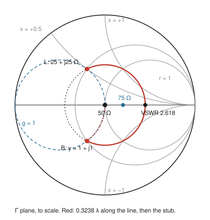
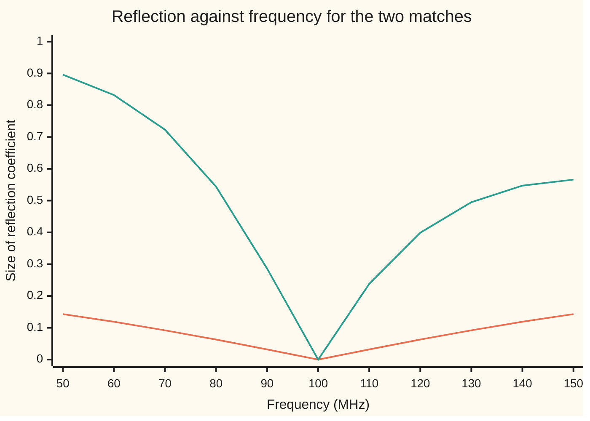

# Impedance matching: a quarter wave or a stub, read off the Smith chart

[Syllabus](../../../SYLLABUS.md) → [Engineering mathematics](../README.md) → [Circuits and Electromagnetism](../README.md#s06) → Impedance matching

---

## General Overview

An FM radio antenna on a mast presents 75 Ω at 100 MHz. The receiver and its coax cable are built for 50 Ω. Join them directly and a fifth of every voltage wave bounces back at the joint: the reflection coefficient is 0.2 and the VSWR is 1.5. The engineer wants zero reflection at 100 MHz, made from nothing but more cable.

The first fix is a short piece of cable with an in-between impedance, $`\sqrt{50 \times 75}`$ = 61.2372 Ω, exactly a quarter wavelength long. In cable with velocity factor 0.66 (waves travel at 0.66 of light speed), a wavelength at 100 MHz is 1.9786 m, so the piece is 0.4947 m. Its far end sees 75 Ω; its near end shows the receiver exactly 50 Ω. The 0.66 is the rating of solid-plastic coax; [Transmission lines](11-transmission-lines-and-reflections.md) rounds the same cable's inductance and capacitance per metre, so the wave on that card runs slightly faster and is slightly longer.

The second fix handles a harder load, a whip antenna that measures 25 + j25 Ω at 100 MHz. It has reactance (the out-of-step part of an impedance; positive here, so the whip acts partly like a coil), so a quarter-wave section at the antenna cannot match it. Here the engineer walks 0.6407 m down the line, then hangs a 0.2473 m length of cable with a shorted end across it. That side branch is a **stub**. Both fixes are read off one drawing, the **Smith chart**.

**A lossless line only turns the reflection coefficient round a circle, so matching means choosing lengths that carry the load's point to the centre of the Smith chart: a quarter wave inverts a real load about the line's impedance, and a walk to the g = 1 circle (where the conductance, the real part of one over the impedance, matches the cable's) followed by a shorted stub cancels any load.**

**What kind of fact this is:** the matching formulas are theorems about the lossless line equations, proved on this card in Why it works. The line itself is a model: no loss, a load that keeps the same impedance at every frequency, and a perfect short at the stub's end.

### The picture: one load walked to the centre

<p align="center"></p>

Drawn to scale: the outer circle is a reflection coefficient of size 1. The load L sits at Γ = −0.2 + j0.4. Moving 0.3238 wavelengths along the cable turns it 233.13° clockwise to B, on the blue g = 1 circle. The stub then slides it to the centre, where the line sees exactly 50 Ω. The dashed circle crosses the right-hand axis at 2.618: that crossing is the load's VSWR, read straight off the chart.

---

## The formula

Notation first, in words. Engineers write **j** for the square root of −1, as on the [Phasors](02-phasors-and-impedance.md) card; the rest of this library writes i. An impedance $`Z`$ is a complex resistance in ohms: real part resistance, imaginary part reactance.

From [Transmission lines](11-transmission-lines-and-reflections.md): a line has a **characteristic impedance** $`Z_0`$, the voltage-to-current ratio of a single travelling wave. A load $`Z_L`$ sends back a fraction $`\Gamma`$ of each incoming voltage wave. A load seen through a length $`\ell`$ of line looks like

```math
Z_{in} = Z_0\,\frac{Z_L + jZ_0\tan\beta\ell}{Z_0 + jZ_L\tan\beta\ell}, \qquad \beta = \frac{2\pi}{\lambda}
```

**Read it aloud:** the impedance seen at the input is the line's impedance times the load plus a twist, over the line plus the load's twist, where the twist grows with the length in wavelengths.

This card adds four formulas. First, the Smith chart's map, from **normalised impedance** $`z = Z/Z_0`$ to the reflection coefficient:

```math
\Gamma = \frac{z - 1}{z + 1}, \qquad \mathrm{VSWR} = \frac{1 + |\Gamma|}{1 - |\Gamma|}
```

**Read it aloud:** the reflection is the load's excess over the line divided by their sum, and the standing-wave ratio is one plus the reflection's size over one minus it.

Second, the quarter-wave transformer for a real load $`Z_L`$:

```math
Z_1 = \sqrt{Z_0 Z_L}, \qquad \ell = \frac{\lambda}{4} \quad\Longrightarrow\quad Z_{in} = \frac{Z_1^2}{Z_L} = Z_0
```

**Read it aloud:** a quarter wave of cable whose impedance is the geometric mean of the line and the load shows the line its own impedance.

Third, the single shorted stub. Walk a distance $`d`$ from the load until the normalised admittance $`y = 1/z`$ reads $`1 + jb`$, then add a shorted stub of length $`\ell_s`$ in parallel:

```math
y(d) = 1 + jb, \qquad \cot\beta\ell_s = b \quad\Longrightarrow\quad y(d) - j\cot\beta\ell_s = 1
```

**Read it aloud:** go to where the conductance is one, then add a stub whose susceptance is minus the leftover $`b`$, and what is left is exactly the line.

For the 25 + j25 Ω whip: $`z = 0.5 + j0.5`$, $`\Gamma = -0.2 + j0.4`$, $`|\Gamma|`$ = 0.4472, VSWR = 2.618. At $`d`$ = 0.3238 λ, $`y = 1 + j1`$, so $`b = 1`$, $`\cot\beta\ell_s = 1`$ and $`\ell_s = \lambda/8`$ = 0.2473 m.

| Symbol | Plain meaning | In our example | Push it up and the answer… |
| --- | --- | --- | --- |
| $`Z_0`$ | characteristic impedance of the main cable, ohms | 50 Ω | the antenna's mismatch changes; the designs change |
| $`Z_L`$, $`R_L`$, $`X_L`$ | load impedance at the cable's far end; its resistance and reactance | 75 Ω antenna; 25 + j25 Ω whip | further from 50 Ω: more reflection, narrower match |
| $`Z_1`$ | impedance of the quarter-wave section | 61.2372 Ω | away from $`\sqrt{Z_0 Z_L}`$, the match is lost |
| $`Z_{in}`$ | impedance seen looking into a line towards its load | 50 Ω after matching | — |
| $`z`$, $`r`$, $`x`$ | normalised impedance $`Z/Z_0`$; its real part (resistance) and imaginary part (reactance) | 0.5 + j0.5 | — |
| $`y`$, $`g`$, $`b`$ | normalised admittance $`1/z`$; its real part (conductance) and imaginary part (susceptance) | 1 − j1 at the load; 1 + j1 at B | — |
| $`\Gamma`$, $`\lvert\Gamma\rvert`$, $`u`$, $`v`$ | reflection coefficient: reflected voltage wave over incoming; its size; its real and imaginary parts | −0.2 + j0.4; 0.4472 | more power bounces back: $`\lvert\Gamma\rvert^2`$ of it |
| VSWR, return loss | voltage standing-wave ratio, peak over trough of the voltage along the line; return loss $`-20\log_{10}\lvert\Gamma\rvert`$ in decibels (dB) | 2.618; 6.9897 dB | VSWR up, return loss down: worse match |
| $`f`$, $`c`$, $`v_f`$, $`\lambda`$ | frequency; light speed, 299 792 458 m/s; velocity factor; wavelength in the cable $`v_f c/f`$ | 100 MHz; 0.66; 1.9786 m | $`f`$ up: every length fixed in metres grows in wavelengths |
| $`\beta`$, $`\ell`$, $`d`$, $`t`$ | phase constant $`2\pi/\lambda`$, in rad/m; length of a line section; distance from the load to the stub; $`\tan\beta d`$ | 2π ÷ 1.9786 m; 0.4947 m; 0.6407 m | — |
| $`\ell_s`$ | length of the shorted stub | 0.2473 m (λ/8) | its susceptance $`-\cot\beta\ell_s`$ rises from −∞ through 0 at λ/4 |
| $`\Gamma_m`$ | the largest reflection accepted when measuring bandwidth | 0.1 (return loss 20 dB) | wider bandwidth |

### When it holds

- **Lossless line.** Loss makes $`\lvert\Gamma\rvert`$ shrink as the wave travels, so the circle becomes an inward spiral. A real match then needs the lossy formula; the lengths here are a first design.
- **One frequency.** Every length is fixed in wavelengths at 100 MHz. At 200 MHz the quarter wave becomes a half wave, which repeats its load: $`\lvert\Gamma\rvert`$ is back to 0.2000, as if nothing were there.
- **A load that holds still.** The bandwidth figures assume the whip stays at 25 + j25 Ω across the sweep. A real antenna's impedance drifts with frequency, usually making the match narrower still.
- **Quarter wave needs a real load.** On the 25 + j25 Ω whip a quarter-wave section returns a complex impedance, and no choice of $`Z_1`$ gives 50 Ω. That is why the stub exists.
- **Small junctions.** The tee where the stub joins and the shorted end are treated as points. At 100 MHz a tee a few centimetres across is small beside the 1.9786 m wavelength; at 10 GHz the wavelength is a hundred times shorter and the tee is not small.

---

## Why it works

### Step 0: a lossless line only turns the reflection

A wave travelling down a lossless line keeps its size and only shifts its phase. Move a distance $`d`$ back from the load and the reflected wave has travelled $`d`$ out and $`d`$ back, so it lags by $`2\beta d`$ against the incoming one:

```math
\Gamma(d) = \Gamma_L\,e^{-j2\beta d}
```

So $`\lvert\Gamma\rvert`$ stays fixed and the angle of $`\Gamma`$ turns clockwise, one full turn every half wavelength. Matching is then a question about where on that circle the point sits, and how to push it to $`\Gamma = 0`$. The Smith chart is the drawing that makes this a geometry problem.

### Step 1: the Smith chart is a Mobius map of impedances into a disc

The map $`\Gamma = (z - 1)/(z + 1)`$ is a Mobius transformation, a map that divides one first-degree expression in $`z`$ by another ([Mobius transformations](../../07-Complex%20analysis/07-Conformal%20Maps%20and%20Harmonic%20Functions/02-mobius-transformations-and-the-point-at-infinity.md)). It is that card's Cayley map applied to $`jz`$. Three facts follow:

- Every passive load has $`r \ge 0`$, and the right half plane lands inside the unit disc: $`\lvert z - 1\rvert \le \lvert z + 1\rvert`$ exactly when $`r \ge 0`$.
- Mobius maps send lines to circles. So the vertical line "resistance $`r`$" becomes a circle with centre $`r/(1 + r)`$ on the real axis and radius $`1/(1 + r)`$. The horizontal line "reactance $`x`$" becomes a circle centred at $`1 + j/x`$, radius $`1/\lvert x\rvert`$, of which only an arc lies inside the disc.
- The 50 Ω point $`z = 1`$ goes to the centre, $`\Gamma = 0`$. A short circuit goes to −1, an open circuit to +1.

A Smith chart is this disc, printed with those circles. Find the circle of $`r`$ and the arc of $`x`$, and their crossing is $`\Gamma`$. No division is needed.

<details>
<summary>Derivation: why the resistance lines become circles</summary>

Write $`\Gamma = u + jv`$. Undo the map: $`z = (1 + \Gamma)/(1 - \Gamma)`$. Multiply top and bottom by the conjugate of $`1 - \Gamma`$:

$`\displaystyle r = \frac{1 - u^2 - v^2}{(1 - u)^2 + v^2}, \qquad x = \frac{2v}{(1 - u)^2 + v^2}`$

Fix $`r`$, multiply out and complete the square in $`u`$:

$`\displaystyle \Big(u - \frac{r}{1 + r}\Big)^2 + v^2 = \Big(\frac{1}{1 + r}\Big)^2`$

That is a circle with centre $`r/(1 + r)`$ and radius $`1/(1 + r)`$. Every such circle passes through $`\Gamma = 1`$. The same steps on $`x`$ give $`(u - 1)^2 + (v - 1/x)^2 = (1/x)^2`$.

For the whip, $`r = 0.5`$: centre 1/3, radius 2/3. The point −0.2 + j0.4 lies on it, since $`(-0.2 - 1/3)^2 + 0.4^2 = 64/225 + 36/225 = 4/9`$.

</details>

### Step 2: three readings come free

- **Admittance is a half turn.** Replacing $`z`$ by $`1/z`$ flips the sign of $`\Gamma`$: $`(1/z - 1)/(1/z + 1) = -(z - 1)/(z + 1)`$. So the same chart reads admittances once each point is turned 180° about the centre. The g = 1 circle is the r = 1 circle turned round: centre −0.5, radius 0.5.
- **A quarter wave is a half turn too.** Moving λ/4 turns $`\Gamma`$ by $`2\beta\ell = \pi`$, so a quarter wave of the main line shows the line $`1/z`$: it inverts the normalised load.
- **VSWR is a crossing.** The circle of constant $`\lvert\Gamma\rvert`$ meets the right-hand real axis where $`z`$ is real and largest, at $`r = (1 + \lvert\Gamma\rvert)/(1 - \lvert\Gamma\rvert)`$. That resistance is the VSWR. For the whip it is 2.618.

### Step 3: the quarter-wave transformer

Put $`\beta\ell = \pi/2`$ in the input-impedance formula. Then $`\tan\beta\ell`$ runs off to infinity. Divide the top and bottom by it, and only the $`\tan`$ terms survive:

```math
Z_{in} = Z_1\,\frac{jZ_1}{jZ_L} = \frac{Z_1^2}{Z_L}
```

Ask for $`Z_{in} = Z_0`$ and the answer is $`Z_1 = \sqrt{Z_0 Z_L}`$. For the antenna, $`61.2372^2/75 = 50`$ Ω. On a chart normalised to $`Z_1`$, this is Step 2's half turn: the section inverts $`75/Z_1`$ into $`Z_1/75`$, and $`Z_1 \times Z_1/75`$ is 50 Ω.

The formula needs $`Z_L`$ real. With a complex load, $`Z_1^2/Z_L`$ is complex for every real $`Z_1`$, so the reflection cannot vanish.

### Step 4: the single stub

Two pieces in parallel add their admittances. So the plan works in admittances:

1. Walk along the line from the load. The point turns clockwise on its circle of radius $`\lvert\Gamma\rvert`$.
2. Stop where the circle meets the g = 1 circle. There $`y = 1 + jb`$: the conductance is right and only a leftover susceptance $`b`$ remains.
3. Hang a stub across the line there, with susceptance $`-b`$. The sum is $`y = 1`$, the centre.

A shorted stub of length $`\ell_s`$ has input impedance $`jZ_0\tan\beta\ell_s`$, from the input formula with $`Z_L = 0`$. Its normalised admittance is $`-j\cot\beta\ell_s`$, so the stub needs $`\cot\beta\ell_s = b`$.

Any circle round the centre with radius below 1 meets the g = 1 circle twice, so there are always two answers. For the whip:

- **Solution A, at the antenna.** The load's admittance is already $`1 - j1`$, on the g = 1 circle, so $`d = 0`$. The stub must give $`+j1`$: $`\cot\beta\ell_s = -1`$, $`\beta\ell_s = 3\pi/4`$, a stub of 0.375 λ = 0.7420 m.
- **Solution B, down the line.** Turn 233.13° clockwise, which is 0.3238 λ = 0.6407 m, to $`y = 1 + j1`$. The stub must give $`-j1`$: $`\beta\ell_s = \pi/4`$, a stub of 0.125 λ = 0.2473 m.

<details>
<summary>The same distances without the chart: the tangent formula</summary>

Write $`t = \tan\beta d`$ and $`Z_L = R_L + jX_L`$. Requiring $`\mathrm{Re}\,y(d) = 1`$ in the input formula gives a quadratic in $`t`$ whose roots are

$`\displaystyle t = \frac{X_L \pm \sqrt{R_L\big((Z_0 - R_L)^2 + X_L^2\big)/Z_0}}{R_L - Z_0}`$

For $`R_L = 25`$, $`X_L = 25`$, $`Z_0 = 50`$, the square root is 25, so $`t = 0`$ or $`t = -2`$. The first is Solution A. The second gives $`\beta d = \pi - \arctan 2`$, so $`d = 0.3238`$ λ, Solution B. The code finds both and checks them against the walk round the chart.

</details>

---

## Worked numbers, by hand

| Step | Arithmetic | Value |
| --- | --- | --- |
| wavelength in the cable $`\lambda`$ | 0.66 × 299 792 458 ÷ 100 000 000 | 1.9786 m |
| bare antenna on coax $`\Gamma`$ | (75 − 50) ÷ (75 + 50) | 0.2000, VSWR 1.5000 |
| return loss, bare | −20 × log₁₀ 0.2 | 13.9794 dB |
| quarter-wave section $`Z_1`$ | √(50 × 75) | **61.2372 Ω** |
| its length | 1.9786 ÷ 4 | **0.4947 m** |
| check | 61.2372² ÷ 75 | 50.0000 Ω |
| whip, normalised $`z`$ | (25 + j25) ÷ 50 | 0.5 + j0.5 |
| whip $`\Gamma`$ | (−0.5 + j0.5) ÷ (1.5 + j0.5) | −0.2000 + j0.4000 |
| size and angle | √(0.04 + 0.16); arctan | 0.4472 at 116.5651° |
| VSWR | 1.4472 ÷ 0.5528 | 2.6180 |
| power bounced back | 0.4472² | 20.0000 % |
| whip admittance $`y`$ | 1 ÷ (0.5 + j0.5) | 1 − j1 |
| turn to the other g = 1 crossing | 116.57° to −116.57°, clockwise | 233.1301° |
| distance $`d`$ | 233.13 ÷ 720 λ; × 1.9786 | 0.3238 λ, **0.6407 m** |
| admittance there | (1 + 0.2 + j0.4) ÷ (1 − 0.2 − j0.4) | 1 + j1 |
| stub length $`\ell_s`$ | $`\cot\beta\ell_s = 1`$, so λ ÷ 8 | 0.1250 λ, **0.2473 m** |

The antenna needs 0.4947 m of 61.2372 Ω cable spliced in. The whip needs a tee 0.6407 m from its terminals and a 0.2473 m shorted stub on the tee. At 100 MHz both then reflect nothing.

### What breaks if you drop a piece

| Mistake | Comes out at | What went wrong |
| --- | --- | --- |
| Section of 62.5 Ω, the average of 50 and 75 | $`\lvert\Gamma\rvert`$ = 0.0204 | The inversion multiplies, so the right middle is the geometric mean. Close here because 75 and 50 are close |
| Cut the quarter wave from the free-space wavelength | 0.7495 m long, $`\lvert\Gamma\rvert`$ = 0.1461 | The wave is slower in the cable, so 0.7495 m is far more than a quarter wave of cable |
| Quarter wave of √(50 × 25) Ω on the whip | $`\lvert\Gamma\rvert`$ = 0.4472, no better | The load is complex. $`Z_1^2/Z_L`$ = 25 − j25: the same mismatch, mirrored |
| Open-ended stub where a shorted one is needed | $`\lvert\Gamma\rvert`$ = 0.7071 | An open λ/8 stub gives $`+j1`$, not $`-j1`$. The leftover doubles to $`1 + j2`$ |
| Walk 0.3238 λ round the chart the wrong way | $`\lvert\Gamma\rvert`$ = 0.6667 | Towards the generator is clockwise. Counterclockwise leaves the point off the g = 1 circle |

---

## How the match moves with frequency

A match is exact at one frequency only. Every length is fixed in metres, so at another frequency it is a different number of wavelengths, and the point no longer lands on the centre. The question an engineer asks is how wide a band stays under $`\lvert\Gamma\rvert`$ = 0.1, a return loss of 20 dB.

The whole FM band runs from 88 to 108 MHz, so one antenna feed must cover 20 MHz.

| Frequency (MHz) | 50 | 70 | 90 | 100 | 110 | 130 | 150 |
| --- | --- | --- | --- | --- | --- | --- | --- |
| quarter wave, $`\lvert\Gamma\rvert`$ | 0.143 | 0.092 | 0.032 | 0.000 | 0.032 | 0.092 | 0.143 |
| stub B, $`\lvert\Gamma\rvert`$ | 0.896 | 0.723 | 0.286 | 0.000 | 0.238 | 0.495 | 0.566 |

The quarter wave drifts slowly. Its worst case is the bare antenna's 0.2, reached only at 0 and 200 MHz. The stub design wanders fast, because a load with reactance and two line sections all change at once.

Width of the band with $`\lvert\Gamma\rvert \le 0.1`$, as a percentage of 100 MHz:

```
quarter wave, 75 ohm  |##########################################################| 65.5471 %
stub A, at antenna    |########                                                  |  8.5878 %
stub B, 0.6407 m down |#######                                                   |  7.4158 %
```

The quarter wave covers the FM band with room to spare. Neither stub does: 7.42 MHz is well under half of the 20 MHz band. Solution A is wider than B because it uses less line in total: a 0.375 λ stub, against 0.3238 λ of line plus a 0.125 λ stub.



Orange: the quarter-wave section on the 75 Ω antenna. Teal: stub B on the 25 + j25 Ω whip, with the whip held at that impedance. Both touch zero at 100 MHz. The quarter wave stays under 0.1 across most of the plot; the stub stays under 0.1 for a band only 7.42 MHz wide.

A harder mismatch narrows even the quarter wave: for a 300 Ω load on 50 Ω cable its band shrinks to 12.5583 %. A load with reactance faces a harder limit, which no matching network of any kind can beat (Fano, 1950, in Sources): a load that stores energy can be matched well only over a band that shrinks as the stored energy grows.

---

## Code, from first principles, and it actually runs

The script designs both matches and confirms each by three independent roads. Road 1 is the closed forms: the square root for the quarter wave, and the tangent and cotangent formulas for the stub. Road 2 walks round the Smith chart: it turns $`\Gamma`$ by $`e^{-j4\pi d/\lambda}`$ and finds where the conductance reaches 1 by bisection (halving an interval until it is tiny), using no tangent formula. Road 3 builds each cable from 4,000 tiny coils and capacitors, the physical picture behind a transmission line, and computes the input impedance cell by cell with no line formula at all. The bandwidth comes two ways: a closed formula, and a sweep with bisection on the exact line formula. The script also prints every wrong answer, the "Try changing" numbers, the chart points and the figure's coordinates. Rust writes its own complex type; Python uses the built-in one.

### Python

```python
# Impedance matching and the Smith chart -- the check behind the card.  Standard library only.
# A 75-ohm antenna onto 50-ohm coax at 100 MHz by a quarter-wave section, then a
# 25 + j25 ohm load matched by one short-circuited stub.  Roads: closed forms; a walk
# round the Smith chart (rotate, then bisect); and a ladder of tiny coils and capacitors.
from math import pi, sqrt, tan, atan, atan2, cos, sin, acos, log10, degrees

C0, VF, F0, Z0 = 299792458.0, 0.66, 100e6, 50.0    # m/s (CODATA, exact), velocity factor, Hz, ohm
LAM = VF * C0 / F0                                  # wavelength in the cable, m

def zin(zl, zc, turns):                             # line of zc ohms, length in wavelengths
    t = tan(2 * pi * turns)
    return zc * (zl + 1j * zc * t) / (zc + 1j * zl * t)

def gam(z, z0=Z0):                                  # reflection coefficient
    return (z - z0) / (z + z0)

def vswr(g):
    return (1 + abs(g)) / (1 - abs(g))

def ladder(zl, zc, metres, f, n=4000):              # road 3: n T-cells of L' dx and C' dx
    v = VF * C0; dx = metres / n; w = 2 * pi * f
    xl, bc = w * (zc / v) * dx, w * dx / (zc * v)   # L' = zc/v, C' = 1/(zc v)
    z = zl
    for _ in range(n):
        z = z + 0.5j * xl
        z = 1 / (1 / z + 1j * bc) + 0.5j * xl
    return z

def root(fn, lo, hi):                               # bisection, fn changes sign on [lo, hi]
    for _ in range(100):
        mid = (lo + hi) / 2
        if (fn(lo) < 0) == (fn(mid) < 0): lo = mid
        else: hi = mid
    return (lo + hi) / 2

def stub_match(zl, f_ratio, d, s):                  # line d, shorted stub s (wavelengths at F0)
    y = 1 / zin(zl, Z0, d * f_ratio) + 1 / zin(0, Z0, s * f_ratio)
    return gam(1 / y)

# ---- part 1: quarter-wave transformer, 75 ohm antenna to 50 ohm coax ----
ZA = 75.0
Z1 = sqrt(Z0 * ZA)
q_len = LAM / 4
z_q = zin(ZA, Z1, 0.25)
z_q_lad = ladder(ZA, Z1, q_len, F0)
g_raw = gam(ZA)
# ---- part 2: single shorted stub for 25 + j25 ohm ----
ZL = 25 + 25j
gL, yL = gam(ZL), Z0 / ZL
rl, xl = ZL.real, ZL.imag                           # road 1: tan(beta d), then cot(beta l)
disc = sqrt(rl * ((Z0 - rl) ** 2 + xl ** 2) / Z0)
sols = []
for t in ((xl + disc) / (rl - Z0), (xl - disc) / (rl - Z0)):
    bd = atan(t) % pi
    b = (1 / zin(ZL, Z0, bd / (2 * pi))).imag * Z0
    sols.append((bd / (2 * pi), (atan(1 / b) % pi) / (2 * pi), b))   # -j cot(bl) = -j b
sols.sort()
# road 2: walk round the chart.  Moving d wavelengths to the generator turns Gamma by -4 pi d.
turn = lambda g, d: g * complex(cos(4 * pi * d), -sin(4 * pi * d))
gy = lambda g: ((1 - g) / (1 + g))                  # normalised admittance read off Gamma
d_walk = root(lambda d: gy(turn(gL, d)).real - 1, 0.25, 0.45)
b_walk = gy(turn(gL, d_walk)).imag
s_walk = root(lambda s: gy(turn(-1 + 0j, s)).imag + b_walk, 0.01, 0.24)   # short is Gamma = -1
g_lad = gam(1 / (1 / ladder(ZL, Z0, d_walk * LAM, F0) + 1 / ladder(0, Z0, s_walk * LAM, F0)))
dB, sB = sols[1][0], sols[1][1]
# ---- bandwidth: |Gamma| <= 0.1 (return loss 20 dB) ----
GM = 0.1
bw_formula = 2 - 4 / pi * acos(GM / sqrt(1 - GM ** 2) * 2 * sqrt(Z0 * ZA) / abs(ZA - Z0))
qw = lambda r: abs(gam(zin(ZA, Z1, 0.25 * r))) - GM
bw_sweep = root(qw, 1.0, 1.99) - root(qw, 0.01, 1.0)
sw = lambda d, s: (lambda r: abs(stub_match(ZL, r, d, s)) - GM)
bwB = root(sw(dB, sB), 1.0, 1.3) - root(sw(dB, sB), 0.7, 1.0)
bwA = root(sw(0, sols[0][1]), 1.0, 1.3) - root(sw(0, sols[0][1]), 0.7, 1.0)

rows = [
    ("cable wavelength at 100 MHz, m", LAM), ("quarter-wave section Z1, ohm", Z1),
    ("quarter-wave length, m", q_len), ("antenna on bare coax |Gamma|", abs(g_raw)),
    ("antenna on bare coax VSWR", vswr(g_raw)), ("  return loss, dB", -20 * log10(abs(g_raw))),
    ("1 formula: Zin real, ohm", z_q.real), ("1 formula: Zin imag, ohm", z_q.imag),
    ("3 ladder: Zin real, ohm", z_q_lad.real), ("3 ladder: Zin imag, ohm", z_q_lad.imag),
    ("load 25+j25: Gamma real", gL.real), ("load 25+j25: Gamma imag", gL.imag),
    ("  |Gamma|", abs(gL)), ("  angle, deg", degrees(atan2(gL.imag, gL.real))),
    ("  VSWR", vswr(gL)), ("  return loss, dB", -20 * log10(abs(gL))),
    ("  power reflected, %", 100 * abs(gL) ** 2), ("  admittance y real", yL.real),
    ("  admittance y imag", yL.imag),
    ("1 sol A: d, wavelengths", sols[0][0]), ("1 sol A: line b at d", sols[0][2]),
    ("1 sol A: stub, wavelengths", sols[0][1]), ("1 sol A: stub, m", sols[0][1] * LAM),
    ("1 sol B: d, wavelengths", dB), ("1 sol B: d, m", dB * LAM),
    ("1 sol B: line b at d", sols[1][2]), ("1 sol B: stub, wavelengths", sB),
    ("1 sol B: stub, m", sB * LAM), ("2 chart walk: d, wavelengths", d_walk),
    ("2 chart walk: turn, deg", 720 * d_walk), ("2 chart walk: b at d", b_walk),
    ("2 chart walk: stub, wavelengths", s_walk), ("3 ladder: |Gamma| after match", abs(g_lad)),
    ("bandwidth QW formula, % of 100 MHz", 100 * bw_formula),
    ("bandwidth QW sweep, % of 100 MHz", 100 * bw_sweep),
    ("bandwidth stub B, % of 100 MHz", 100 * bwB), ("bandwidth stub A, % of 100 MHz", 100 * bwA),
    ("outside: QW at 200 MHz |Gamma|", abs(gam(zin(ZA, Z1, 0.5)))),
    ("wrong: mean 62.5 ohm section |Gamma|", abs(gam(zin(ZA, 62.5, 0.25)))),
    ("wrong: free-space quarter, cut m", C0 / F0 / 4),
    ("wrong: free-space quarter |Gamma|", abs(gam(zin(ZA, Z1, 0.25 / VF)))),
    ("wrong: QW sqrt(50x25) on 25+j25 |Gamma|", abs(gam(zin(ZL, sqrt(Z0 * 25), 0.25)))),
    ("  its Zin real, ohm", zin(ZL, sqrt(Z0 * 25), 0.25).real), ("  its Zin imag, ohm", zin(ZL, sqrt(Z0 * 25), 0.25).imag),
    ("wrong: open stub for short |Gamma|", abs(gam(1 / (1 / zin(ZL, Z0, dB) + 1j * tan(2 * pi * sB) / Z0)))),
    ("wrong: walk toward load |Gamma|", abs(stub_match(ZL, 1.0, 0.5 - dB, sB))),
    ("try: 100 ohm load, Z1 ohm", sqrt(Z0 * 100)), ("try: foam VF 0.85, quarter m", 0.85 * C0 / F0 / 4),
    ("try: 300 ohm load, QW bandwidth %", 100 * (2 - 4 / pi * acos(GM / sqrt(1 - GM ** 2) * 2 * sqrt(Z0 * 300) / 250))),
]
for name, v in rows:
    print(f"{name:<40} {round(v, 9) + 0.0:>10.4f}")
fs = [50 + 10 * k for k in range(11)]
print("chart, MHz         " + " ".join(f"{f:>5d}" for f in fs))
print("chart, QW |Gamma|  " + " ".join(f"{abs(gam(zin(ZA, Z1, 0.25 * f / 100))):>5.3f}" for f in fs))
print("chart, stub B      " + " ".join(f"{abs(stub_match(ZL, f / 100, dB, sB)):>5.3f}" for f in fs))
P = lambda g: f"({210 + 180 * g.real:.1f}, {210 - 180 * g.imag:.1f})"
print(f"figure, L {P(gL)} B {P(turn(gL, dB))} Q {P(g_raw)} S {P(abs(gL) + 0j)} rG {180 * abs(gL):.1f}")

assert abs(z_q - Z0) < 1e-9,                          "quarter-wave formula: Zin = Z0 at a quarter wave"
assert abs(z_q_lad - Z0) < 1e-3,                       "coil-and-capacitor ladder agrees with the formula"
assert abs(d_walk - dB) < 1e-9 and abs(s_walk - sB) < 1e-9, "chart walk agrees with the tan/cot formulas"
assert abs(g_lad) < 1e-4,                              "ladder model of the stub design reflects nothing"
assert abs(bw_sweep - bw_formula) < 1e-9,              "bandwidth sweep agrees with the closed form"
assert abs(vswr(gL) - (1 + sqrt(5)) ** 2 / 4) < 1e-9,  "hand value: VSWR = golden ratio squared"
print("ALL CHECKS PASS")
```

**Ran 2026-11-23 on macOS, Python 3.14.10, standard library only. All checks passed. Output, pasted from the run:**

```
cable wavelength at 100 MHz, m               1.9786
quarter-wave section Z1, ohm                61.2372
quarter-wave length, m                       0.4947
antenna on bare coax |Gamma|                 0.2000
antenna on bare coax VSWR                    1.5000
  return loss, dB                           13.9794
1 formula: Zin real, ohm                    50.0000
1 formula: Zin imag, ohm                     0.0000
3 ladder: Zin real, ohm                     50.0000
3 ladder: Zin imag, ohm                      0.0000
load 25+j25: Gamma real                     -0.2000
load 25+j25: Gamma imag                      0.4000
  |Gamma|                                    0.4472
  angle, deg                               116.5651
  VSWR                                       2.6180
  return loss, dB                            6.9897
  power reflected, %                        20.0000
  admittance y real                          1.0000
  admittance y imag                         -1.0000
1 sol A: d, wavelengths                      0.0000
1 sol A: line b at d                        -1.0000
1 sol A: stub, wavelengths                   0.3750
1 sol A: stub, m                             0.7420
1 sol B: d, wavelengths                      0.3238
1 sol B: d, m                                0.6407
1 sol B: line b at d                         1.0000
1 sol B: stub, wavelengths                   0.1250
1 sol B: stub, m                             0.2473
2 chart walk: d, wavelengths                 0.3238
2 chart walk: turn, deg                    233.1301
2 chart walk: b at d                         1.0000
2 chart walk: stub, wavelengths              0.1250
3 ladder: |Gamma| after match                0.0000
bandwidth QW formula, % of 100 MHz          65.5471
bandwidth QW sweep, % of 100 MHz            65.5471
bandwidth stub B, % of 100 MHz               7.4158
bandwidth stub A, % of 100 MHz               8.5878
outside: QW at 200 MHz |Gamma|               0.2000
wrong: mean 62.5 ohm section |Gamma|         0.0204
wrong: free-space quarter, cut m             0.7495
wrong: free-space quarter |Gamma|            0.1461
wrong: QW sqrt(50x25) on 25+j25 |Gamma|      0.4472
  its Zin real, ohm                         25.0000
  its Zin imag, ohm                        -25.0000
wrong: open stub for short |Gamma|           0.7071
wrong: walk toward load |Gamma|              0.6667
try: 100 ohm load, Z1 ohm                   70.7107
try: foam VF 0.85, quarter m                 0.6371
try: 300 ohm load, QW bandwidth %           12.5583
chart, MHz            50    60    70    80    90   100   110   120   130   140   150
chart, QW |Gamma|  0.143 0.119 0.092 0.063 0.032 0.000 0.032 0.063 0.092 0.119 0.143
chart, stub B      0.896 0.832 0.723 0.544 0.286 0.000 0.238 0.399 0.495 0.547 0.566
figure, L (174.0, 138.0) B (174.0, 282.0) Q (246.0, 210.0) S (290.5, 210.0) rG 80.5
ALL CHECKS PASS
```

### Rust

```rust
// Impedance matching and the Smith chart -- the check behind the card.  std only, no crates.
// A 75-ohm antenna onto 50-ohm coax at 100 MHz by a quarter-wave section, then a
// 25 + j25 ohm load matched by one short-circuited stub.  Roads: closed forms; a walk
// round the Smith chart (rotate, then bisect); and a ladder of tiny coils and capacitors.
use std::f64::consts::PI;

#[derive(Clone, Copy)]
struct C { re: f64, im: f64 }                       // a complex number, written out
fn c(re: f64, im: f64) -> C { C { re, im } }
impl C {
    fn add(self, o: C) -> C { c(self.re + o.re, self.im + o.im) }
    fn sub(self, o: C) -> C { c(self.re - o.re, self.im - o.im) }
    fn mul(self, o: C) -> C { c(self.re * o.re - self.im * o.im, self.re * o.im + self.im * o.re) }
    fn div(self, o: C) -> C {                       // times the conjugate, over |o| squared
        let d = o.re * o.re + o.im * o.im;
        c((self.re * o.re + self.im * o.im) / d, (self.im * o.re - self.re * o.im) / d)
    }
    fn inv(self) -> C { c(1.0, 0.0).div(self) }
    fn abs(self) -> f64 { self.re.hypot(self.im) }
}

const C0: f64 = 299792458.0; const VF: f64 = 0.66; const F0: f64 = 100e6; const Z0: f64 = 50.0;
const ZA: f64 = 75.0;                               // the antenna, ohm

fn zin(zl: C, zc: f64, turns: f64) -> C {           // line of zc ohms, length in wavelengths
    let t = (2.0 * PI * turns).tan();
    c(zc, 0.0).mul(zl.add(c(0.0, zc * t))).div(c(zc, 0.0).add(zl.mul(c(0.0, t))))
}
fn gam(z: C) -> C { z.sub(c(Z0, 0.0)).div(z.add(c(Z0, 0.0))) }
fn vswr(g: C) -> f64 { (1.0 + g.abs()) / (1.0 - g.abs()) }
fn ladder(zl: C, zc: f64, metres: f64, f: f64) -> C {   // road 3: n T-cells of L' dx and C' dx
    let n = 4000; let v = VF * C0; let dx = metres / n as f64; let w = 2.0 * PI * f;
    let (xl, bc) = (w * (zc / v) * dx, w * dx / (zc * v));   // L' = zc/v, C' = 1/(zc v)
    let mut z = zl;
    for _ in 0..n {
        z = z.add(c(0.0, 0.5 * xl));
        z = z.inv().add(c(0.0, bc)).inv().add(c(0.0, 0.5 * xl));
    }
    z
}
fn root<Fn1: Fn(f64) -> f64>(f: Fn1, mut lo: f64, mut hi: f64) -> f64 {   // bisection
    for _ in 0..100 {
        let mid = (lo + hi) / 2.0;
        if (f(lo) < 0.0) == (f(mid) < 0.0) { lo = mid } else { hi = mid }
    }
    (lo + hi) / 2.0
}
fn stub_match(zl: C, r: f64, d: f64, s: f64) -> C { // line d, shorted stub s (wavelengths at F0)
    let y = zin(zl, Z0, d * r).inv().add(zin(c(0.0, 0.0), Z0, s * r).inv());
    gam(y.inv())
}
fn turn(g: C, d: f64) -> C { g.mul(c((4.0 * PI * d).cos(), -(4.0 * PI * d).sin())) }
fn gy(g: C) -> C { c(1.0, 0.0).sub(g).div(c(1.0, 0.0).add(g)) }   // admittance read off Gamma
fn bw_qw(zl: f64, gm: f64) -> f64 {
    2.0 - 4.0 / PI * (gm / (1.0 - gm * gm).sqrt() * 2.0 * (Z0 * zl).sqrt() / (zl - Z0).abs()).acos()
}

fn main() {
    let lam = VF * C0 / F0;
    // ---- part 1: quarter-wave transformer, 75 ohm antenna to 50 ohm coax ----
    let za = c(ZA, 0.0);
    let z1 = (Z0 * ZA).sqrt();
    let q_len = lam / 4.0;
    let z_q = zin(za, z1, 0.25);
    let z_q_lad = ladder(za, z1, q_len, F0);
    let g_raw = gam(za);
    // ---- part 2: single shorted stub for 25 + j25 ohm ----
    let zl = c(25.0, 25.0);
    let (gl, yl) = (gam(zl), c(Z0, 0.0).div(zl));
    let (rl, xl) = (zl.re, zl.im);                  // road 1: tan(beta d), then cot(beta l)
    let disc = (rl * ((Z0 - rl).powi(2) + xl * xl) / Z0).sqrt();
    let mut sols: Vec<(f64, f64, f64)> = Vec::new();
    for t in [(xl + disc) / (rl - Z0), (xl - disc) / (rl - Z0)] {
        let bd = t.atan().rem_euclid(PI);
        let b = zin(zl, Z0, bd / (2.0 * PI)).inv().im * Z0;
        sols.push((bd / (2.0 * PI), (1.0 / b).atan().rem_euclid(PI) / (2.0 * PI), b));
    }
    sols.sort_by(|a, b| a.0.partial_cmp(&b.0).unwrap());
    // road 2: walk round the chart.  Moving d wavelengths to the generator turns Gamma by -4 pi d.
    let d_walk = root(|d| gy(turn(gl, d)).re - 1.0, 0.25, 0.45);
    let b_walk = gy(turn(gl, d_walk)).im;
    let s_walk = root(|s| gy(turn(c(-1.0, 0.0), s)).im + b_walk, 0.01, 0.24);   // short is Gamma = -1
    let g_lad = gam(ladder(zl, Z0, d_walk * lam, F0).inv().add(ladder(c(0.0, 0.0), Z0, s_walk * lam, F0).inv()).inv());
    let (db, sb) = (sols[1].0, sols[1].1);
    // ---- bandwidth: |Gamma| <= 0.1 (return loss 20 dB) ----
    let gm = 0.1;
    let bw_formula = bw_qw(ZA, gm);
    let qw = |r: f64| gam(zin(za, z1, 0.25 * r)).abs() - gm;
    let bw_sweep = root(qw, 1.0, 1.99) - root(qw, 0.01, 1.0);
    let sw = |d: f64, s: f64| move |r: f64| stub_match(zl, r, d, s).abs() - gm;
    let bw_b = root(sw(db, sb), 1.0, 1.3) - root(sw(db, sb), 0.7, 1.0);
    let bw_a = root(sw(0.0, sols[0].1), 1.0, 1.3) - root(sw(0.0, sols[0].1), 0.7, 1.0);
    let open = zin(zl, Z0, db).inv().add(c(0.0, (2.0 * PI * sb).tan() / Z0)).inv();

    let rows: Vec<(&str, f64)> = vec![
        ("cable wavelength at 100 MHz, m", lam), ("quarter-wave section Z1, ohm", z1),
        ("quarter-wave length, m", q_len), ("antenna on bare coax |Gamma|", g_raw.abs()),
        ("antenna on bare coax VSWR", vswr(g_raw)), ("  return loss, dB", -20.0 * g_raw.abs().log10()),
        ("1 formula: Zin real, ohm", z_q.re), ("1 formula: Zin imag, ohm", z_q.im),
        ("3 ladder: Zin real, ohm", z_q_lad.re), ("3 ladder: Zin imag, ohm", z_q_lad.im),
        ("load 25+j25: Gamma real", gl.re), ("load 25+j25: Gamma imag", gl.im),
        ("  |Gamma|", gl.abs()), ("  angle, deg", gl.im.atan2(gl.re).to_degrees()),
        ("  VSWR", vswr(gl)), ("  return loss, dB", -20.0 * gl.abs().log10()),
        ("  power reflected, %", 100.0 * gl.abs().powi(2)), ("  admittance y real", yl.re),
        ("  admittance y imag", yl.im),
        ("1 sol A: d, wavelengths", sols[0].0), ("1 sol A: line b at d", sols[0].2),
        ("1 sol A: stub, wavelengths", sols[0].1), ("1 sol A: stub, m", sols[0].1 * lam),
        ("1 sol B: d, wavelengths", db), ("1 sol B: d, m", db * lam),
        ("1 sol B: line b at d", sols[1].2), ("1 sol B: stub, wavelengths", sb),
        ("1 sol B: stub, m", sb * lam), ("2 chart walk: d, wavelengths", d_walk),
        ("2 chart walk: turn, deg", 720.0 * d_walk), ("2 chart walk: b at d", b_walk),
        ("2 chart walk: stub, wavelengths", s_walk), ("3 ladder: |Gamma| after match", g_lad.abs()),
        ("bandwidth QW formula, % of 100 MHz", 100.0 * bw_formula),
        ("bandwidth QW sweep, % of 100 MHz", 100.0 * bw_sweep),
        ("bandwidth stub B, % of 100 MHz", 100.0 * bw_b), ("bandwidth stub A, % of 100 MHz", 100.0 * bw_a),
        ("outside: QW at 200 MHz |Gamma|", gam(zin(za, z1, 0.5)).abs()),
        ("wrong: mean 62.5 ohm section |Gamma|", gam(zin(za, 62.5, 0.25)).abs()),
        ("wrong: free-space quarter, cut m", C0 / F0 / 4.0),
        ("wrong: free-space quarter |Gamma|", gam(zin(za, z1, 0.25 / VF)).abs()),
        ("wrong: QW sqrt(50x25) on 25+j25 |Gamma|", gam(zin(zl, (Z0 * 25.0).sqrt(), 0.25)).abs()),
        ("  its Zin real, ohm", zin(zl, (Z0 * 25.0).sqrt(), 0.25).re), ("  its Zin imag, ohm", zin(zl, (Z0 * 25.0).sqrt(), 0.25).im),
        ("wrong: open stub for short |Gamma|", gam(open).abs()),
        ("wrong: walk toward load |Gamma|", stub_match(zl, 1.0, 0.5 - db, sb).abs()),
        ("try: 100 ohm load, Z1 ohm", (Z0 * 100.0).sqrt()), ("try: foam VF 0.85, quarter m", 0.85 * C0 / F0 / 4.0),
        ("try: 300 ohm load, QW bandwidth %", 100.0 * bw_qw(300.0, gm)),
    ];
    for (name, v) in &rows {
        println!("{:<40} {:>10.4}", name, (v * 1e9).round() / 1e9 + 0.0);
    }
    let fs: Vec<i32> = (0..11).map(|k| 50 + 10 * k).collect();
    let line = |v: Vec<String>| v.join(" ");
    println!("chart, MHz         {}", line(fs.iter().map(|f| format!("{:>5}", f)).collect()));
    println!("chart, QW |Gamma|  {}", line(fs.iter().map(|&f| format!("{:>5.3}", gam(zin(za, z1, 0.25 * f as f64 / 100.0)).abs())).collect()));
    println!("chart, stub B      {}", line(fs.iter().map(|&f| format!("{:>5.3}", stub_match(zl, f as f64 / 100.0, db, sb).abs())).collect()));
    let p = |g: C| format!("({:.1}, {:.1})", 210.0 + 180.0 * g.re, 210.0 - 180.0 * g.im);
    println!("figure, L {} B {} Q {} S {} rG {:.1}", p(gl), p(turn(gl, db)), p(g_raw), p(c(gl.abs(), 0.0)), 180.0 * gl.abs());

    assert!(z_q.sub(c(Z0, 0.0)).abs() < 1e-9, "quarter-wave formula: Zin = Z0 at a quarter wave");
    assert!(z_q_lad.sub(c(Z0, 0.0)).abs() < 1e-3, "coil-and-capacitor ladder agrees with the formula");
    assert!((d_walk - db).abs() < 1e-9 && (s_walk - sb).abs() < 1e-9, "chart walk agrees with the tan/cot formulas");
    assert!(g_lad.abs() < 1e-4, "ladder model of the stub design reflects nothing");
    assert!((bw_sweep - bw_formula).abs() < 1e-9, "bandwidth sweep agrees with the closed form");
    assert!((vswr(gl) - (1.0 + 5f64.sqrt()).powi(2) / 4.0).abs() < 1e-9, "hand value: VSWR = golden ratio squared");
    println!("ALL CHECKS PASS");
}
```

**Ran 2026-11-23 on macOS, rustc 1.98.1, no crates. All checks passed. Output, pasted from the run:**

```
cable wavelength at 100 MHz, m               1.9786
quarter-wave section Z1, ohm                61.2372
quarter-wave length, m                       0.4947
antenna on bare coax |Gamma|                 0.2000
antenna on bare coax VSWR                    1.5000
  return loss, dB                           13.9794
1 formula: Zin real, ohm                    50.0000
1 formula: Zin imag, ohm                     0.0000
3 ladder: Zin real, ohm                     50.0000
3 ladder: Zin imag, ohm                      0.0000
load 25+j25: Gamma real                     -0.2000
load 25+j25: Gamma imag                      0.4000
  |Gamma|                                    0.4472
  angle, deg                               116.5651
  VSWR                                       2.6180
  return loss, dB                            6.9897
  power reflected, %                        20.0000
  admittance y real                          1.0000
  admittance y imag                         -1.0000
1 sol A: d, wavelengths                      0.0000
1 sol A: line b at d                        -1.0000
1 sol A: stub, wavelengths                   0.3750
1 sol A: stub, m                             0.7420
1 sol B: d, wavelengths                      0.3238
1 sol B: d, m                                0.6407
1 sol B: line b at d                         1.0000
1 sol B: stub, wavelengths                   0.1250
1 sol B: stub, m                             0.2473
2 chart walk: d, wavelengths                 0.3238
2 chart walk: turn, deg                    233.1301
2 chart walk: b at d                         1.0000
2 chart walk: stub, wavelengths              0.1250
3 ladder: |Gamma| after match                0.0000
bandwidth QW formula, % of 100 MHz          65.5471
bandwidth QW sweep, % of 100 MHz            65.5471
bandwidth stub B, % of 100 MHz               7.4158
bandwidth stub A, % of 100 MHz               8.5878
outside: QW at 200 MHz |Gamma|               0.2000
wrong: mean 62.5 ohm section |Gamma|         0.0204
wrong: free-space quarter, cut m             0.7495
wrong: free-space quarter |Gamma|            0.1461
wrong: QW sqrt(50x25) on 25+j25 |Gamma|      0.4472
  its Zin real, ohm                         25.0000
  its Zin imag, ohm                        -25.0000
wrong: open stub for short |Gamma|           0.7071
wrong: walk toward load |Gamma|              0.6667
try: 100 ohm load, Z1 ohm                   70.7107
try: foam VF 0.85, quarter m                 0.6371
try: 300 ohm load, QW bandwidth %           12.5583
chart, MHz            50    60    70    80    90   100   110   120   130   140   150
chart, QW |Gamma|  0.143 0.119 0.092 0.063 0.032 0.000 0.032 0.063 0.092 0.119 0.143
chart, stub B      0.896 0.832 0.723 0.544 0.286 0.000 0.238 0.399 0.495 0.547 0.566
figure, L (174.0, 138.0) B (174.0, 282.0) Q (246.0, 210.0) S (290.5, 210.0) rG 80.5
ALL CHECKS PASS
```

### Lean

Lean proves three facts about lossless lines and the Smith chart, for every load meeting each bullet's conditions.

- Suppose a quarter wave of $`Z_1 = \sqrt{Z_0 Z_L}`$ feeds a real load, with $`Z_0`$ and $`Z_L`$ both positive. Then the input formula gives exactly $`Z_{in} = Z_0`$, so the cable sees no reflection.
- Suppose a load has resistance at least zero, and $`Z_{in}`$ is finite a distance $`d`$ back along a lossless line. Then $`\Gamma(d) = \Gamma_L e^{-j2\beta d}`$: the size of $`\Gamma`$ stays fixed and only its angle turns.
- Take any normalised impedance $`z`$ other than −1. Then $`\lvert(z - 1)/(z + 1)\rvert \le 1`$ exactly when its resistance $`r`$ is at least zero.
- Lean also checks the card's exact whip numbers: $`\Gamma = -0.2 + j0.4`$, $`y = 1 - j1`$, and $`y = 1 + j1`$ at B.

The lengths in metres, the stub design, the bandwidths and the circle formulas are left to the Python and Rust checks.

```lean
-- Impedance matching: a quarter-wave section of impedance sqrt(Z0 ZL) shows a line of impedance Z0 its own impedance, a lossless line only turns the reflection coefficient, and the Smith map sends passive loads into the unit disc.
import Mathlib.Analysis.SpecialFunctions.Trigonometric.Basic
import Mathlib.Analysis.SpecialFunctions.Sqrt

open Complex

/-- The impedance seen looking into a lossless line of characteristic impedance `Zc`, electrical
length `θ = βℓ`, ending in a load `ZL`: the card's formula
`Zc (ZL + j Zc tan βℓ) / (Zc + j ZL tan βℓ)` with top and bottom multiplied by `cos βℓ`,
so that it stays finite at a quarter wave. Mathlib writes `I` for the card's `j`. -/
noncomputable def zin (Zc ZL : ℂ) (θ : ℝ) : ℂ :=
  Zc * (ZL * Real.cos θ + I * Zc * Real.sin θ) / (Zc * Real.cos θ + I * ZL * Real.sin θ)

/-- The reflection coefficient of an impedance `Z` on a line of characteristic impedance `Z0`. -/
noncomputable def gamma (Z0 Z : ℂ) : ℂ := (Z - Z0) / (Z + Z0)

/-- Helper: `e^(-j 2θ) = (cos θ - j sin θ)²`. -/
theorem exp_neg_two_mul (θ : ℝ) :
    exp (-(2 * θ : ℝ) * I) = ((Real.cos θ : ℂ) - I * Real.sin θ) ^ 2 := by
  have : -(2 * θ : ℝ) * I = ((-θ : ℝ) * I) + ((-θ : ℝ) * I) := by push_cast; ring
  rw [this, Complex.exp_add, Complex.exp_mul_I]
  rw [← Complex.ofReal_cos, ← Complex.ofReal_sin, Real.cos_neg, Real.sin_neg]
  push_cast; ring

#print axioms exp_neg_two_mul

/-- Quarter-wave transformer: a real load `ZL` seen through a quarter wave (`βℓ = π/2`) of
lossless line whose impedance is the geometric mean `Z1 = √(Z0 ZL)` looks exactly like `Z0`,
so the main line sees no reflection. -/
theorem quarter_wave_transformer_matches (Z0 ZL : ℝ) (h0 : 0 < Z0) (hL : 0 < ZL) :
    zin (Real.sqrt (Z0 * ZL) : ℂ) (ZL : ℂ) (Real.pi / 2) = (Z0 : ℂ) := by
  unfold zin
  have hs : ((Real.sqrt (Z0 * ZL) : ℂ)) ^ 2 = (Z0 : ℂ) * ZL := by
    rw [← Complex.ofReal_pow, Real.sq_sqrt (by positivity)]; push_cast; ring
  have hL' : (ZL : ℂ) ≠ 0 := by exact_mod_cast hL.ne'
  rw [Real.cos_pi_div_two, Real.sin_pi_div_two]
  push_cast
  simp only [mul_zero, zero_add, mul_one]
  rw [div_eq_iff (mul_ne_zero I_ne_zero hL')]
  linear_combination I * hs

/-- A lossless line only turns the reflection coefficient: moving an electrical length `θ = βd`
back from a passive load (resistance `≥ 0`) multiplies its reflection coefficient by
`e^(-j 2βd)`, so its size stays fixed and its angle turns clockwise. The hypothesis `hfin` says the
input impedance is finite at that point. -/
theorem lossless_line_turns_reflection (Z0 : ℝ) (h0 : 0 < Z0) (ZL : ℂ) (hL : 0 ≤ ZL.re) (θ : ℝ)
    (hfin : (Z0 : ℂ) * Real.cos θ + I * ZL * Real.sin θ ≠ 0) :
    gamma Z0 (zin Z0 ZL θ) = gamma Z0 ZL * exp (-(2 * θ : ℝ) * I) := by
  rw [exp_neg_two_mul]
  set c : ℂ := (Real.cos θ : ℂ) with hc
  set s : ℂ := (Real.sin θ : ℂ) with hs
  have hcs : c ^ 2 + s ^ 2 = 1 := by
    rw [hc, hs]; exact_mod_cast Real.cos_sq_add_sin_sq θ
  have hZ0 : (Z0 : ℂ) ≠ 0 := by exact_mod_cast h0.ne'
  have hsum : ZL + (Z0 : ℂ) ≠ 0 := by
    intro h
    have := congrArg Complex.re h
    simp at this
    linarith
  have hE : c + I * s ≠ 0 := by
    intro h
    have : (c - I * s) * (c + I * s) = 1 := by linear_combination hcs - s ^ 2 * I_sq
    rw [h, mul_zero] at this
    exact zero_ne_one this
  have e : (ZL - Z0) / (ZL + Z0) * (ZL + Z0) = ZL - Z0 := div_mul_cancel₀ _ hsum
  unfold gamma zin
  have h1 : (Z0 : ℂ) * (ZL * c + I * Z0 * s) / (Z0 * c + I * ZL * s) - Z0
      = Z0 * (ZL - Z0) * (c - I * s) / (Z0 * c + I * ZL * s) := by
    rw [eq_div_iff hfin, sub_mul, div_mul_cancel₀ _ hfin]; ring
  have h2 : (Z0 : ℂ) * (ZL * c + I * Z0 * s) / (Z0 * c + I * ZL * s) + Z0
      = Z0 * (ZL + Z0) * (c + I * s) / (Z0 * c + I * ZL * s) := by
    rw [eq_div_iff hfin, add_mul, div_mul_cancel₀ _ hfin]; ring
  rw [h1, h2, div_div_div_cancel_right₀ hfin]
  rw [div_eq_iff (mul_ne_zero (mul_ne_zero hZ0 hsum) hE)]
  linear_combination (Z0 : ℂ) * (c - I * s) *
    (-(ZL - Z0) * hcs + (ZL - Z0) * s ^ 2 * I_sq - (c - I * s) * (c + I * s) * e)

/-- The Smith chart: the map `Γ = (z - 1)/(z + 1)` sends a normalised impedance `z` into the
closed unit disc exactly when its resistance `r = Re z` is at least zero, so every passive load
lands inside the chart. -/
theorem smith_map_disc_iff_passive (z : ℂ) (hz : z ≠ -1) :
    ‖(z - 1) / (z + 1)‖ ≤ 1 ↔ 0 ≤ z.re := by
  have hz1 : z + 1 ≠ 0 := by
    intro h; exact hz (eq_neg_of_add_eq_zero_left h)
  have hpos : 0 < ‖z + 1‖ := norm_pos_iff.mpr hz1
  rw [norm_div, div_le_one hpos, ← sq_le_sq₀ (norm_nonneg _) (norm_nonneg _),
    Complex.sq_norm, Complex.sq_norm, Complex.normSq_apply, Complex.normSq_apply]
  simp
  constructor <;> intro h <;> nlinarith

/-! The card's exact worked numbers. -/

-- The 75 Ω antenna on bare 50 Ω coax: Γ = (75 - 50)/(75 + 50) = 1/5 and VSWR = 3/2.
example : ((75 : ℚ) - 50) / (75 + 50) = 1 / 5 := by norm_num
example : (1 + (1 / 5 : ℚ)) / (1 - 1 / 5) = 3 / 2 := by norm_num

-- The quarter-wave check: Z1² = 50 × 75 = 3750, and 3750 / 75 = 50 Ω.
example : ((50 : ℚ) * 75) / 75 = 50 := by norm_num

-- The 25 + j25 Ω whip: z = 1/2 + j/2, Γ = -1/5 + 2j/5, |Γ|² = 1/5 (20 % of the power), y = 1 - j.
example : ((25 + 25 * I) / 50 : ℂ) = 1 / 2 + 1 / 2 * I := by
  apply Complex.ext <;> norm_num
example : (((1 / 2 + 1 / 2 * I) - 1) / ((1 / 2 + 1 / 2 * I) + 1) : ℂ) = -1 / 5 + 2 / 5 * I := by
  apply Complex.ext <;> norm_num [Complex.div_re, Complex.div_im, Complex.normSq]
example : Complex.normSq (-1 / 5 + 2 / 5 * I) = 1 / 5 := by
  norm_num [Complex.normSq_apply]
example : (1 / (1 / 2 + 1 / 2 * I) : ℂ) = 1 - I := by
  apply Complex.ext <;> norm_num [Complex.div_re, Complex.div_im, Complex.normSq]

-- The whip's point lies on the r = 1/2 circle, centre 1/3, radius 2/3.
example : ((-1 / 5 : ℚ) - 1 / 3) ^ 2 + (2 / 5) ^ 2 = (2 / 3) ^ 2 := by norm_num

-- At point B the admittance is (1 + 1/5 + 2j/5)/(1 - 1/5 - 2j/5) = 1 + j.
example : ((1 + 1 / 5 + 2 / 5 * I) / (1 - 1 / 5 - 2 / 5 * I) : ℂ) = 1 + I := by
  apply Complex.ext <;> norm_num [Complex.div_re, Complex.div_im, Complex.normSq]

-- The wrong quarter wave on the whip: Z1² = 50 × 25 = 1250, and 1250 / (25 + j25) = 25 - j25.
example : ((1250 : ℂ) / (25 + 25 * I)) = 25 - 25 * I := by
  apply Complex.ext <;> norm_num [Complex.div_re, Complex.div_im, Complex.normSq]

#print axioms quarter_wave_transformer_matches
#print axioms lossless_line_turns_reflection
#print axioms smith_map_disc_iff_passive
```

**Checked 2026-11-23 on macOS, Lean 4.36.0-rc2, Mathlib v4.36.0-rc2. Every proof is complete and uses only Lean's standard axioms. Output, pasted from the run:**

```
'exp_neg_two_mul' depends on axioms: [propext, Classical.choice, Quot.sound]
'quarter_wave_transformer_matches' depends on axioms: [propext, Classical.choice, Quot.sound]
'lossless_line_turns_reflection' depends on axioms: [propext, Classical.choice, Quot.sound]
'smith_map_disc_iff_passive' depends on axioms: [propext, Classical.choice, Quot.sound]
```

> [!TIP]
> **Try changing**
> - Guess first: a 100 Ω load instead of 75 Ω. What section impedance? Set `ZA = 100.0`. The section becomes √(50 × 100) = 70.7107 Ω. Every assert still passes.
> - Guess first: foam-filled cable, velocity factor 0.85. Longer or shorter quarter wave? Set `VF = 0.85`. It grows to 0.6371 m, because the wave runs faster in foam. Every assert still passes.
> - Guess first: a 300 Ω folded dipole on 50 Ω cable. Wider or narrower band than 65.55 %? Set `ZA = 300.0`. Narrower: both bandwidth QW lines read 12.5583 %, the same as the last "try" line. Every assert still passes.

---

## The usual mistake

> [!warning]
> **Using the quarter-wave transformer on a load with reactance.** The formula $`Z_1 = \sqrt{Z_0 Z_L}`$ assumes a real load. On the 25 + j25 Ω whip, a section of √(50 × 25) Ω returns 25 − j25 Ω, and $`\lvert\Gamma\rvert`$ stays at 0.4472. A complex load first needs its reactance cancelled, by a stub or by moving to a point on the line where the impedance is real.
>
> Smaller traps:
> - **Free-space wavelength.** A quarter wave cut to 0.7495 m instead of 0.4947 m leaves $`\lvert\Gamma\rvert`$ = 0.1461. Always multiply by the cable's velocity factor.
> - **Arithmetic mean instead of geometric.** A 62.5 Ω section gives 0.0204, harmless here but wrong further from 50 Ω.
> - **Turning the wrong way.** Towards the generator is clockwise on the chart. Going counterclockwise by the same 0.3238 λ gives 0.6667.
> - **Short or open.** An open stub at the same length gives the opposite susceptance and 0.7071. Shorted stubs are preferred: a cut end radiates and its length is less sharply defined.

---

## Where you meet it in real life

- **FM and TV antenna feeds.** A quarter-wave section, often called a Q-section, joins an antenna to a feed cable of a different impedance; its wide band covers the whole 88 to 108 MHz band.
- **Circuit boards for radios.** On a phone's circuit board a quarter-wave trace of chosen width matches a power amplifier to its antenna; trace width sets $`Z_1`$.
- **Stub tuners.** Broadcast and amateur radio transmitters use adjustable shorted stubs to cancel an antenna's reactance at one working frequency.
- **Network analysers.** The instrument that measures $`\Gamma`$ at radio frequencies shows its results on a Smith chart, so engineers read impedance, VSWR and the needed line lengths straight off the screen.
- **MRI scanners.** Each receive coil is matched to 50 Ω at the scanner's working frequency, and the match is tuned and checked on a Smith chart display.

> **Say it back**
> A lossless line keeps the size of the reflection coefficient and only turns its angle, a full turn every half wavelength. The Smith chart is the Mobius map Γ = (z − 1)/(z + 1), which draws impedances as points in a disc with 50 Ω at the centre. A quarter wave of $`\sqrt{Z_0 Z_L}`$ inverts a real load into a match: 61.2372 Ω and 0.4947 m for the 75 Ω antenna. A single shorted stub matches any load: walk to the g = 1 circle, then cancel what is left, 0.6407 m and 0.2473 m for the 25 + j25 Ω whip. The quarter wave is broadband; the stub is narrow.

---

## What this builds on

- [Transmission lines](11-transmission-lines-and-reflections.md): the characteristic impedance, the reflection coefficient, VSWR and the input-impedance formula. This card turns them into designs.
- [Mobius transformations](../../07-Complex%20analysis/07-Conformal%20Maps%20and%20Harmonic%20Functions/02-mobius-transformations-and-the-point-at-infinity.md): why lines of constant resistance and reactance become circles, and why the half plane fills the disc.
- [Phasors](02-phasors-and-impedance.md): impedance as a complex number, and $`j`$ for the square root of −1.
- [Electromagnetic waves](08-electromagnetic-waves.md): why a wave in a cable travels slower than light, which sets the velocity factor.

## Where this goes next

- [Two-ports](13-two-port-networks-and-s-parameters.md): the next card. It describes a whole network, such as an amplifier or a matching section, by its reflection and transmission coefficients, the S-parameters a network analyser measures.

This card matches one frequency, or a band where the load holds still; how wide a band any network can match for a load that stores energy is the question it leaves open.

---

## Sources

Verified 2026-11-23: every link below resolves to the publisher's page.

- Pozar, David M. *Microwave Engineering*, 4th ed. Wiley, 2012. [Publisher page](https://www.wiley.com/en-us/Microwave+Engineering%2C+4th+Edition-p-9780470631553). Chapter 2 gives the input-impedance formula, the Smith chart and the quarter-wave transformer; chapter 5 gives single-stub tuning, the tangent formula used here and the quarter-wave bandwidth formula.
- Fano, R. M. "Theoretical limitations on the broadband matching of arbitrary impedances." *Journal of the Franklin Institute* 249 (1950): 57–83. [doi:10.1016/0016-0032(50)90006-8](https://doi.org/10.1016/0016-0032(50)90006-8). The limit on how wide a band any matching network can cover.
- NIST. "CODATA Value: speed of light in vacuum." [NIST page](https://physics.nist.gov/cgi-bin/cuu/Value?c). The exact 299 792 458 m/s used for the wavelength.
