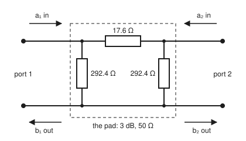

# Two-ports: four numbers describe any box with an input and an output

[Syllabus](../../../SYLLABUS.md) → [Engineering mathematics](../README.md) → [Circuits and Electromagnetism](../README.md#s06) → Two-ports

---

## General Overview

A technician tests a radio receiver on the bench. A signal generator sends it 1 milliwatt (mW) down 50 Ω coaxial cable. The receiver's input is not a perfect 50 Ω, so part of the signal bounces back up the cable and upsets the generator. The usual fix is a **3 dB pad**: three resistors in a small metal can, screwed in between cable and receiver.

The pad on this card is a **pi attenuator**, named for its shape: a 292.4 Ω resistor from each terminal to the return wire and a 17.6 Ω resistor in series between them. The engineer wants three numbers. How much signal gets through? How much bounces back? And what do two pads in a row do?

The answers: 0.7079 of the signal voltage gets through, which is half the power, 3 dB down. Nothing bounces back. Two pads in a row pass 0.5012 of the voltage, 6 dB down, still with no echo.

Those answers come from one fact. The pad is linear (doubling what goes in doubles what comes out), and it has two **ports**: two pairs of terminals, one where the signal enters and one where it leaves. A linear box with two ports, called a **two-port**, is described completely by four numbers in a 2 × 2 matrix. The rest of the card shows four ways to choose those numbers, how to convert between them, and why chaining boxes is matrix multiplication.

**Any linear box with an input port and an output port is described by a 2 × 2 matrix; the Z, Y, ABCD and S matrices are four ways of writing the same box, the ABCD matrix of a chain is the product of the ABCD matrices, and the S matrix says how much of each incoming wave is reflected and how much is passed on.**

**What kind of fact this is:** theorems about linear circuits, proved on this card in Why it works. "The pad is three ideal resistors" is a model: good for small chip resistors in a shielded can up to a few gigahertz, where wire length starts to matter.

### The picture: the pad and its four waves

<p align="center"></p>

A schematic, not to scale. The dashed box is the pad. Port 1 is on the left, port 2 on the right, and the bottom wire is the shared return. At each port a wave $`a`$ arrives and a wave $`b`$ leaves.

---

## The formula

Notation first. At port 1 the voltage across the terminals is $`V_1`$ and the current flowing in is $`I_1`$; at port 2 they are $`V_2`$ and $`I_2`$, with $`I_2`$ also counted flowing **in**. Four quantities, two equations: choose any two as the causes, and the other two are fixed by them. Each choice gives a matrix.

```math
\begin{bmatrix} V_1 \\ V_2 \end{bmatrix} = \mathbf{Z} \begin{bmatrix} I_1 \\ I_2 \end{bmatrix}, \qquad \begin{bmatrix} I_1 \\ I_2 \end{bmatrix} = \mathbf{Y} \begin{bmatrix} V_1 \\ V_2 \end{bmatrix}, \qquad \begin{bmatrix} V_1 \\ I_1 \end{bmatrix} = \begin{bmatrix} A & B \\ C & D \end{bmatrix} \begin{bmatrix} V_2 \\ -I_2 \end{bmatrix}, \qquad \begin{bmatrix} b_1 \\ b_2 \end{bmatrix} = \mathbf{S} \begin{bmatrix} a_1 \\ a_2 \end{bmatrix}
```

**Read it aloud:** the impedance matrix turns the two currents into the two voltages; the admittance matrix does the reverse; the chain matrix turns what leaves port 2 into what enters port 1; and the scattering matrix turns the two arriving waves into the two leaving waves.

The waves are measured against a **reference impedance** $`Z_0`$, here 50 Ω, the impedance of the cable. The arriving wave is $`a = (V + Z_0 I)/2`$ and the leaving wave is $`b = (V - Z_0 I)/2`$, so $`V = a + b`$ ([Transmission lines](11-transmission-lines-and-reflections.md) splits a line's voltage into these two travelling parts). The four entries of $`\mathbf{S}`$ are the **S-parameters**.

The conversions and the chaining rule, with $`\mathbf{1}`$ the 2 × 2 identity matrix:

```math
\mathbf{Y} = \mathbf{Z}^{-1}, \qquad \mathbf{S} = (\mathbf{Z} - Z_0\mathbf{1})(\mathbf{Z} + Z_0\mathbf{1})^{-1}, \qquad S_{21} = \frac{2}{A + B/Z_0 + CZ_0 + D}, \qquad S_{11} = \frac{A + B/Z_0 - CZ_0 - D}{A + B/Z_0 + CZ_0 + D}
```

```math
\begin{bmatrix} A & B \\ C & D \end{bmatrix}_{\text{chain}} = \begin{bmatrix} A & B \\ C & D \end{bmatrix}_{\text{first}} \begin{bmatrix} A & B \\ C & D \end{bmatrix}_{\text{second}}, \qquad S_{21,\text{chain}} = \frac{S_{21,\text{first}}\, S_{21,\text{second}}}{1 - S_{22,\text{first}}\, S_{11,\text{second}}}
```

**Read it aloud:** the admittance matrix is the inverse of the impedance matrix; the scattering matrix is the impedance matrix minus the reference, divided by the impedance matrix plus the reference; the chain matrix of two boxes in a row is their product; and in scattering terms, the signal through two boxes is the product of their transmissions, boosted by the echo bouncing between them.

The pad itself is designed from its loss in decibels. The decibel is 20 log₁₀ of a voltage ratio, so a loss of $`L`$ dB is a voltage ratio $`K = 10^{L/20}`$:

```math
K = 10^{L/20}, \qquad R_p = Z_0\,\frac{K + 1}{K - 1}, \qquad R_s = Z_0\,\frac{K^2 - 1}{2K}, \qquad S_{21} = \frac{1}{K}, \qquad S_{11} = 0
```

**Read it aloud:** the voltage ratio is ten to the loss over twenty; each shunt resistor is the reference times K plus one over K minus one; the series resistor is the reference times K squared minus one over twice K; and the pad then passes one over K of the voltage and reflects nothing.

| Symbol | Plain meaning | In our example | Push it up and the answer… |
| --- | --- | --- | --- |
| $`V_1, I_1, V_2, I_2`$ | voltage across each port, in volts (V), and current flowing into it, in amps (A) | per 1 V of arriving wave, with a 50 Ω load: $`V_1`$ = 1.0000 V, $`V_2`$ = 0.7079 V | — |
| $`Z_0`$ | reference impedance: the cable's impedance, against which waves are measured | 50 Ω | the same pad stops being matched |
| $`\mathbf{Z}`$ ($`Z_{11}, Z_{12}, Z_{21}, Z_{22}`$) | impedance matrix, in ohms: voltage at a port per amp fed into a port, other port open | 150.4760 Ω on the diagonal, 141.9262 Ω off it | — |
| $`\mathbf{Y}`$ | admittance matrix, in millisiemens (mS; one siemens is one amp per volt): current per volt, other port shorted | 60.1904 mS on the diagonal, −56.7705 mS off it | — |
| $`A, B, C, D`$ | chain (ABCD) matrix: $`A`$, $`D`$ plain ratios, $`B`$ in ohms, $`C`$ in siemens | 1.0602, 17.6148 Ω, 7.0459 mS, 1.0602 | — |
| $`a_1, a_2`$; $`b_1, b_2`$ | waves arriving at port 1 and port 2; waves leaving them, in volts | arriving: 1 V at port 1 (only ratios matter), 0 at port 2 when it ends in 50 Ω; leaving: 0 V and 0.7079 V | — |
| $`S_{11}, S_{22}`$ | reflection: the share of an arriving wave sent back out of the same port | 0.0000 | more echo up the cable |
| $`S_{21}, S_{12}`$ | transmission: the share of a wave arriving at one port that leaves the other | 0.7079 | less loss |
| $`L`$, $`K`$ | loss in decibels (dB), and the voltage ratio it stands for | 3 dB, 1.4125 | the pad absorbs more |
| $`R_p`$, $`R_s`$ | shunt resistors (port to return wire) and series resistor | 292.40 Ω, 17.61 Ω | — |
| $`\Gamma_L`$, $`\Gamma_\text{in}`$, $`Z_L`$ | reflection coefficient of a load $`\Gamma = (Z_L - Z_0)/(Z_L + Z_0)`$, and of the pad with that load behind it; $`Z_L`$ is the load's impedance | $`Z_L`$ = 75 Ω: 0.2000 bare, 0.1002 through the pad | more echo |
| $`Z_e, Z_o`$; $`r`$ | impedance one port sees when both ports are driven alike (even) or opposite (odd); round-trip echo between two boxes, $`S_{22}`$ of the first times $`S_{11}`$ of the second | 292.40 Ω, 8.5499 Ω; 0 for two matched pads | — |

### When it holds

- **The box is linear.** Superposition, the rule that two causes give the sum of their two effects, is what makes four numbers enough. A transistor amplifier is linear only for small signals; drive it hard and its S-parameters change with the drive level.
- **One frequency at a time.** With coils or capacitors inside, the four numbers are complex (they carry a phase) and change with frequency. This pad is pure resistance, so its numbers are real and the same at every frequency in the model.
- **Each port is a true port.** The current into one terminal of a port must come out of the other. If current leaks along the cable's outer shield, the four numbers no longer describe the box.
- **S is tied to its reference impedance.** $`S_{11} = 0`$ promises no echo only when port 2 ends in 50 Ω. Put a 75 Ω load behind the pad and the echo at port 1 is 0.1002, not 0.
- **A pad is matched only in the impedance it was designed for.** The same pad designed for 75 Ω and measured in 50 Ω shows $`S_{11}`$ = 0.1018.

---

## Why it works

### Step 0: linearity makes four numbers enough

A port has a voltage and a current. Two ports give four quantities. Kirchhoff's laws and Ohm's law ([Kirchhoff's laws](01-kirchhoffs-laws-and-equivalent-circuits.md)) inside the box are linear equations. Solve them for the voltages inside the box, and two linear equations remain that tie the four port quantities together.

Pick any two quantities as the inputs. By superposition, each of the other two is a weighted sum of them, with two weights each. Four weights in all: a 2 × 2 matrix. Each choice of inputs gives one of the matrices above, and all describe the same box.

### Step 1: the Z matrix, from two open-circuit tests

Feed 1 A into port 1 and leave port 2 open. The current splits between the first 292.40 Ω shunt and the path through 17.61 Ω and the second shunt. The port 1 voltage is the two in parallel:

```math
Z_{11} = \frac{R_p\,(R_s + R_p)}{2R_p + R_s} = 150.4760\ \Omega, \qquad Z_{21} = \frac{R_p^2}{2R_p + R_s} = 141.9262\ \Omega
```

$`Z_{21}`$ is the voltage that appears at the open port 2. The pad is the same seen from either end, so $`Z_{22} = Z_{11}`$ and $`Z_{12} = Z_{21}`$.

The Y matrix is the inverse: $`Y_{11}`$ = 60.1904 mS and $`Y_{21}`$ = −56.7705 mS. Y is measured with the other port shorted instead of open.

### Step 2: the ABCD matrix makes a chain a product

The ABCD matrix takes port 2's voltage and the current **leaving** port 2, and returns port 1's voltage and current. In a chain, what leaves the first box's port 2 is exactly what enters the second box's port 1. So the second box's input is the first box's output, and "do this, then that" is matrix multiplication ([Matrix multiplication](../../03-Algebra/04-Matrices/03-matrix-multiplication.md)). That is why the ABCD matrix uses $`-I_2`$.

Each single part has a simple chain matrix. A series resistor $`R`$ drops voltage but passes the current on unchanged. A shunt resistor $`R`$ keeps the voltage but takes a current $`V/R`$ to the return wire:

```math
\text{series: } \begin{bmatrix} 1 & R \\ 0 & 1 \end{bmatrix}, \qquad \text{shunt: } \begin{bmatrix} 1 & 0 \\ 1/R & 1 \end{bmatrix}, \qquad \text{pad} = \text{shunt}(R_p)\ \text{series}(R_s)\ \text{shunt}(R_p) = \begin{bmatrix} 1 + R_s/R_p & R_s \\ (2 + R_s/R_p)/R_p & 1 + R_s/R_p \end{bmatrix}
```

With the pad's resistors: $`A = D`$ = 1.0602, $`B`$ = 17.6148 Ω, $`C`$ = 7.0459 mS. Its determinant $`AD - BC`$ is 1.0000. That holds for every **reciprocal** box, one built from resistors, coils, capacitors and transformers: it passes signals equally well in both directions.

### Step 3: waves, and why high-frequency engineers use S

Open and short circuits are easy to make at mains frequency. At gigahertz frequencies an "open" end radiates and a "short" has inductance, and an amplifier tested that way may oscillate. A 50 Ω load is easy at any frequency. So at radio frequencies, engineers measure with every port ended in $`Z_0`$, and describe the box by waves.

Split each port's voltage and current into an arriving wave $`a`$ and a leaving wave $`b`$, as on a cable: $`V = a + b`$ and $`Z_0 I = a - b`$. With port 2 ended in 50 Ω, nothing comes back into port 2, so $`a_2 = 0`$. Then $`S_{11} = b_1/a_1`$ is the echo at port 1 and $`S_{21} = b_2/a_1`$ is what gets through.

Put $`V = a + b`$ and $`I = (a - b)/Z_0`$ into $`V = \mathbf{Z} I`$ for both ports at once. Collect the $`b`$ terms on one side: $`(\mathbf{Z} + Z_0\mathbf{1})\,b = (\mathbf{Z} - Z_0\mathbf{1})\,a`$. So $`\mathbf{S} = (\mathbf{Z} + Z_0\mathbf{1})^{-1}(\mathbf{Z} - Z_0\mathbf{1})`$. The two factors commute (give the same product in either order), because both are built from $`\mathbf{Z}`$ alone, so the order does not matter.

For a single load of impedance $`Z_L`$, the same formula reads $`\Gamma = (Z_L - Z_0)/(Z_L + Z_0)`$: the reflection coefficient from [Transmission lines](11-transmission-lines-and-reflections.md). The S matrix is that formula, made into a matrix.

<details>
<summary>Derivation: S from the ABCD matrix</summary>

End port 2 in $`Z_0`$, so $`a_2 = 0`$. Then $`V_2 = b_2`$, and the current leaving port 2 is $`-I_2 = b_2/Z_0`$.

The chain matrix gives port 1:

$`\displaystyle V_1 = A b_2 + B b_2 / Z_0, \qquad I_1 = C b_2 + D b_2 / Z_0`$

The wave arriving at port 1 is

$`\displaystyle a_1 = \frac{V_1 + Z_0 I_1}{2} = \frac{b_2}{2}\left(A + \frac{B}{Z_0} + C Z_0 + D\right)`$

so $`S_{21} = b_2/a_1 = 2/(A + B/Z_0 + CZ_0 + D)`$. The leaving wave is $`b_1 = (V_1 - Z_0 I_1)/2`$, which gives the numerator $`A + B/Z_0 - CZ_0 - D`$ for $`S_{11}`$.

For the pad, $`A + B/Z_0`$ = 1.4125 and $`CZ_0 + D`$ = 1.4125. They are equal, so $`S_{11} = 0`$. Their sum is 2.8251, so $`S_{21}`$ = 2 ÷ 2.8251 = 0.7079.

</details>

### Step 4: where the design formulas come from

The pad is symmetric, so drive both ports with the same wave (**even mode**) or with opposite waves (**odd mode**). Any drive is a sum of the two.

- **Even mode.** Both ends sit at the same voltage, so no current flows in the series resistor. Each port sees one shunt alone: $`Z_e = R_p`$ = 292.40 Ω. Its reflection is (292.40 − 50) ÷ (292.40 + 50) = 0.7079.
- **Odd mode.** The middle of the series resistor sits at 0 V. Each port sees a shunt in parallel with half the series resistor: $`Z_o`$ = 8.5499 Ω. Its reflection is −0.7079.

A wave into port 1 alone is half even plus half odd. Its echo is the average of the two reflections, 0. What leaves port 2 is half their difference, 0.7079.

So the pad is matched when the two reflections are equal and opposite. That happens when $`Z_e Z_o = Z_0^2`$: here 292.40 × 8.5499 = 2,500 Ω². Setting the even reflection to $`1/K`$ gives $`R_p`$; the match condition then gives $`R_s`$. Those are the design formulas in The formula.

### Step 5: two pads in a row, two ways

**By ABCD.** Multiply the pad's matrix by itself: $`A`$ = 1.2482, $`B`$ = 37.3519 Ω, $`C`$ = 14.9408 mS. Convert: $`S_{21}`$ = 0.5012, $`S_{11}`$ = 0.

**By waves.** A wave through the first pad meets the second. Part of it goes through; part reflects back, and the first pad reflects part of that forward again. The echoes form a geometric series ([Infinite series](../../06-Calculus%20and%20analysis/06-Series/01-series-convergence.md)): $`S_{21}`$ of the chain is $`S_{21,\text{first}} S_{21,\text{second}}(1 + r + r^2 + \dots)`$, with $`r = S_{22,\text{first}} S_{11,\text{second}}`$, the round-trip echo. The sum is $`1/(1 - r)`$.

For matched pads $`r = 0`$, so the chain passes 0.7079 × 0.7079 = 0.5012. In decibels, the losses add: 3 + 3 = 6.0000 dB.

---

## Worked numbers, by hand

The 3 dB pad for 50 Ω, then two in a row.

| Step | Arithmetic | Value |
| --- | --- | --- |
| voltage ratio | $`10^{3/20}`$ | K = 1.4125 |
| shunt resistor | 50 Ω × (K + 1) ÷ (K − 1) | 292.40 Ω |
| series resistor | 50 Ω × (K² − 1) ÷ 2K | 17.61 Ω |
| chain matrix | $`A = 1 + R_s/R_p`$, $`B = R_s`$, $`C = (2 + R_s/R_p)/R_p`$ | 1.0602, 17.6148 Ω, 7.0459 mS |
| denominator | (1.0602 + 17.6148 Ω ÷ 50 Ω) + (7.0459 mS × 50 Ω + 1.0602) = 1.4125 + 1.4125 | 2.8251 |
| transmission | 2 ÷ 2.8251 | $`S_{21}`$ = 0.7079 |
| reflection | (1.4125 − 1.4125) ÷ 2.8251 | $`S_{11}`$ = 0.0000 |
| power to the receiver | 0.7079² × 1 mW | 0.5012 mW |
| power in the pad | 0.1710 + 0.2421 + 0.0857 mW, input shunt, series, output shunt | 0.4988 mW |
| two pads, chain matrix | the pad's matrix squared | 1.2482, 37.3519 Ω, 14.9408 mS |
| two pads, transmission | 2 ÷ (1.2482 + 37.3519 Ω ÷ 50 Ω + 14.9408 mS × 50 Ω + 1.2482) | **0.5012, 6.0000 dB** |

One pad delivers half the generator's milliwatt to the receiver and turns the other half into heat; two pads deliver a quarter, 6 dB down, with no echo at either end.

The power balance is a check: 1 − 0.0000² − 0.7079² = 0.4988, the same 0.4988 mW the code finds by adding $`V^2/R`$ over the three resistors.

The resistors as built are rounded to 292.4 Ω and 17.6 Ω. Their $`S_{11}`$ is −0.000103, an echo too small to matter, and $`S_{21}`$ is 0.7080.

### What breaks if you drop a piece

| Mistake | Comes out at | What went wrong |
| --- | --- | --- |
| Using 10 log₁₀ for the voltage ratio | 150.48 Ω and 37.35 Ω, $`S_{21}`$ = 0.5012 | that is the power ratio; the pad built is a 6 dB pad |
| Chaining by multiplying S matrices | $`S_{11}`$ = 0.5012, $`S_{21}`$ = 0.0000 | S maps waves in to waves out at both ends; it does not chain |
| Chaining by multiplying Z matrices | $`S_{11}`$ = 0.5932, $`S_{21}`$ = 0.4056 | Z maps currents to voltages; a box's output voltage is not the next box's input current |
| Two 75 Ω pads in a 50 Ω system, transmissions multiplied | 0.4810 against the true 0.4860 | each pad reflects 0.1018; the echo between them adds signal, 6.2669 dB in all |
| Reading $`S_{11} = 0`$ as "no echo whatever the load" | 0.1002 with a 75 Ω load | $`S_{11}`$ assumes a 50 Ω load behind the pad |

The code prints all five.

---

## Code, from first principles, and it actually runs

The script designs the 3 dB pad and finds its S matrix by **four independent roads**.

1. Road 1 is the design formulas: $`S_{21} = 1/K`$ and $`S_{11} = 0`$.
2. Road 2 multiplies the three parts' chain matrices and converts the product to S.
3. Road 3 solves the circuit by Kirchhoff's node equations, with a 50 Ω generator and a 50 Ω load, and reads the waves off the node voltages.
4. Road 4 finds Z by feeding 1 A into each port in turn with the other open, then computes $`\mathbf{S} = (\mathbf{Z} - Z_0\mathbf{1})(\mathbf{Z} + Z_0\mathbf{1})^{-1}`$.

Then it chains two pads three ways, by ABCD product, by the echo formula and by node equations for the whole six-resistor circuit, and checks the power balance resistor by resistor. It also prints every wrong answer in the table above. Power is counted against a 1 mW arriving wave (0 dBm: zero decibels above one milliwatt). Nothing is imported but `log10`; the matrix inverse and the Gaussian elimination are written out.

### Python

```python
# Two-port networks and S-parameters -- the check behind the card.  Standard library only.
# A 3 dB pi attenuator for a 50 ohm system, then two of them in a row.  Every number on
# the card is printed here.  Road 1: the design formulas.  Road 2: multiply the three
# element ABCD matrices and convert to S.  Road 3: solve the circuit by Kirchhoff's node
# equations with a 50 ohm source and load.  Road 4: Z from open-circuit node solves,
# then S = (Z - Z0)(Z + Z0)^-1.  The cascade is checked by ABCD, by S algebra and by nodes.
from math import log10
Z0, DB = 50.0, 3.0                                   # ohms; attenuation in decibels

def design(db, z0):                                  # matched pi pad: shunt, series
    k = 10 ** (db / 20)                              # voltage ratio for db decibels
    return k, z0 * (k + 1) / (k - 1), z0 * (k * k - 1) / (2 * k)

def mul(p, q): return [[sum(p[i][k] * q[k][j] for k in range(2)) for j in range(2)] for i in range(2)]
def inv(m):
    d = m[0][0] * m[1][1] - m[0][1] * m[1][0]
    return [[m[1][1] / d, -m[0][1] / d], [-m[1][0] / d, m[0][0] / d]]
def series(z): return [[1.0, z], [0.0, 1.0]]
def shunt(r): return [[1.0, 0.0], [1.0 / r, 1.0]]
def pad_abcd(rp, rs): return mul(mul(shunt(rp), series(rs)), shunt(rp))
def abcd_to_s(m, z0):                                # (S11, S21, S12, S22) from (A, B, C, D)
    (a, b), (c, d) = m
    den = a + b / z0 + c * z0 + d
    return ((a + b / z0 - c * z0 - d) / den, 2 / den, 2 * (a * d - b * c) / den,
            (-a + b / z0 - c * z0 + d) / den)
def z_to_s(z, z0):
    s = mul([[z[0][0] - z0, z[0][1]], [z[1][0], z[1][1] - z0]],
            inv([[z[0][0] + z0, z[0][1]], [z[1][0], z[1][1] + z0]]))
    return s[0][0], s[1][0], s[0][1], s[1][1]
def solve(g, rhs):                                   # Gaussian elimination, any size
    n = len(rhs); m = [row[:] + [rhs[i]] for i, row in enumerate(g)]
    for c in range(n):
        for r in range(c + 1, n):
            f = m[r][c] / m[c][c]
            m[r] = [x - f * y for x, y in zip(m[r], m[c])]
    v = [0.0] * n
    for r in reversed(range(n)):
        v[r] = (m[r][n] - sum(m[r][j] * v[j] for j in range(r + 1, n))) / m[r][r]
    return v
def nodes(shunts, serie, g_src, g_load, inj):        # ladder: shunt R at each node
    n = len(shunts); g = [[0.0] * n for _ in range(n)]
    for i, r in enumerate(shunts): g[i][i] += 1 / r
    for i, r in enumerate(serie):
        g[i][i] += 1 / r; g[i + 1][i + 1] += 1 / r; g[i][i + 1] -= 1 / r; g[i + 1][i] -= 1 / r
    g[0][0] += g_src; g[-1][-1] += g_load
    return solve(g, [inj] + [0.0] * (n - 1))
def s_by_nodes(shunts, serie, z0):                   # source EMF 2 V: incident wave 1 V
    v = nodes(shunts, serie, 1 / z0, 1 / z0, 2.0 / z0)
    return v[0] - 1.0, v[-1], v
def z_by_nodes(shunts, serie):                       # 1 A in at a port, other port open
    a, b = nodes(shunts, serie, 0, 0, 1.0), nodes(shunts[::-1], serie[::-1], 0, 0, 1.0)
    return [[a[0], b[-1]], [a[-1], b[0]]]
def cascade_s(p, q):                                 # S algebra with the echo between
    e = 1 - p[3] * q[0]
    return p[0] + p[2] * p[1] * q[0] / e, p[1] * q[1] / e
def f(x): return f"{(0.0 if abs(x) < 5e-9 else x):.4f}"    # no "-0.0000"
def row(*xs): print(", ".join(xs))

k, rp, rs = design(DB, Z0)
row("design", f"K {f(k)}", f"shunt {rp:.2f} ohm", f"series {rs:.2f} ohm")
m = pad_abcd(rp, rs)
row("ABCD", *[f(x) for x in (m[0][0], m[0][1], m[1][0] * 1000, m[1][1])], f"AD-BC {f(m[0][0] * m[1][1] - m[0][1] * m[1][0])}")
s_abcd = abcd_to_s(m, Z0)
s11_n, s21_n, v = s_by_nodes([rp, rp], [rs], Z0)
z = z_by_nodes([rp, rp], [rs]); s_z = z_to_s(z, Z0); y = inv(z)
row("Z ohm", *[f(x) for x in (z[0][0], z[0][1], z[1][0], z[1][1])])
row("Y mS", *[f(1000 * x) for x in (y[0][0], y[0][1], y[1][0], y[1][1])])
row("Y from ABCD mS", f(1000 * m[1][1] / m[0][1]), f(-1000 / m[0][1]))
row("even odd ohm", f(z[0][0] + z[0][1]), f(z[0][0] - z[0][1]))
ze, zo = z[0][0] + z[0][1], z[0][0] - z[0][1]       # both ports driven alike, or opposite
row("even odd reflections", f((ze - Z0) / (ze + Z0)), f((zo - Z0) / (zo + Z0)), f"Ze Zo {f(ze * zo)} ohm^2")
row("ABCD to S", f"A+B/Z0 {f(m[0][0] + m[0][1] / Z0)}", f"C Z0+D {f(m[1][0] * Z0 + m[1][1])}",
    f"sum {f(m[0][0] + m[0][1] / Z0 + m[1][0] * Z0 + m[1][1])}")
row("S road 1", "S11 0.0000", f"S21 {f(1 / k)}")
for name, s in (("S road 2 ABCD", s_abcd), ("S road 4 Z", s_z)):
    row(name, *[f"{lab} {f(x)}" for lab, x in zip(("S11", "S21", "S12", "S22"), s)])
row("S road 3 nodes", f"S11 {f(s11_n)}", f"S21 {f(s21_n)}", f"V1 {f(v[0])} V", f"V2 {f(v[1])} V")
p_res = (v[0] ** 2 + v[1] ** 2) / rp + (v[0] - v[1]) ** 2 / rs
p_inc = 1.0 / Z0                                     # reference power of the 1 V wave; only ratios are printed
row("power share", f"to load {f(s21_n ** 2)}", f"in resistors {f(p_res / p_inc)}", f"from S {f(1 - s11_n ** 2 - s21_n ** 2)}")
row("0 dBm in, mW", f"to load {f(s21_n ** 2)}", f"shunt in {f(v[0] ** 2 / rp / p_inc)}",
    f"series {f((v[0] - v[1]) ** 2 / rs / p_inc)}", f"shunt out {f(v[1] ** 2 / rp / p_inc)}")
m2 = mul(m, m); c_abcd = abcd_to_s(m2, Z0); c_alg = cascade_s(s_abcd, s_abcd)
c_n = s_by_nodes([rp, rp / 2, rp], [rs, rs], Z0)
row("two pads ABCD", *[f(x) for x in (m2[0][0], m2[0][1], m2[1][0] * 1000, m2[1][1])])
row("two pads S21", f"ABCD {f(c_abcd[1])}", f"S algebra {f(c_alg[1])}", f"nodes {f(c_n[1])}", f"loss {-20 * log10(c_abcd[1]):.4f} dB")
row("two pads S11", f"ABCD {f(c_abcd[0])}", f"S algebra {f(c_alg[0])}", f"nodes {f(c_n[0])}")
# ---- what breaks ----
k6, rp6, rs6 = design(2 * DB, Z0)                    # 10 log used for a voltage ratio
row("wrong: 10 log", f"shunt {rp6:.2f} ohm", f"series {rs6:.2f} ohm", f"S21 {f(abcd_to_s(pad_abcd(rp6, rs6), Z0)[1])}")
ss = mul([[s_abcd[0], s_abcd[2]], [s_abcd[1], s_abcd[3]]], [[s_abcd[0], s_abcd[2]], [s_abcd[1], s_abcd[3]]])
row("wrong: S times S", f"S11 {f(ss[0][0])}", f"S21 {f(ss[1][0])}")
zz = z_to_s(mul(z, z), Z0)
row("wrong: Z times Z", f"S11 {f(zz[0])}", f"S21 {f(zz[1])}")
_, rp75, rs75 = design(DB, 75.0); s75 = abcd_to_s(pad_abcd(rp75, rs75), Z0)
c75 = abcd_to_s(mul(pad_abcd(rp75, rs75), pad_abcd(rp75, rs75)), Z0); c75a = cascade_s(s75, s75)
row("75 ohm pads in 50", f"S11 {f(s75[0])}", f"S21 {f(s75[1])}", f"product {f(s75[1] ** 2)}",
    f"true {f(c75[1])}", f"S algebra {f(c75a[1])}", f"loss {-20 * log10(c75[1]):.4f} dB")
gl = (75 - Z0) / (75 + Z0); gin = s_abcd[0] + s_abcd[2] * s_abcd[1] * gl / (1 - s_abcd[3] * gl)
a, b = m[0][0] * 75 + m[0][1], m[1][0] * 75 + m[1][1]   # input impedance by ABCD: (A RL + B)/(C RL + D)
row("75 ohm load", f"bare {f(gl)}", f"through pad {f(gin)}", f"Zin {f(a / b)} ohm", f"from Zin {f((a / b - Z0) / (a / b + Z0))}")
for d in (6.0, 10.0, 20.0):
    kk, p1, p2 = design(d, Z0); row(f"try {d:.0f} dB", f"shunt {p1:.2f} ohm", f"series {p2:.2f} ohm", f"S21 {f(1 / kk)}")
_, p1, p2 = design(DB, 75.0); row("try 75 ohm", f"shunt {p1:.2f} ohm", f"series {p2:.2f} ohm")
row("try three pads", f"S21 {f(abcd_to_s(mul(m2, m), Z0)[1])}", f"loss {-20 * log10(abcd_to_s(mul(m2, m), Z0)[1]):.4f} dB")
rr = abcd_to_s(pad_abcd(292.4, 17.6), Z0)
row("rounded 292.4 and 17.6", f"S11 {rr[0]:.6f}", f"S21 {f(rr[1])}")
row("figure", "pad x 120 to 300", "shunts at x 140 and 280", "ports at x 40 and 380")
assert abs(s11_n) < 1e-12 and abs(s_z[0]) < 1e-12 and abs(s_abcd[0]) < 1e-12
assert abs(s21_n - 1 / k) < 1e-12 and abs(s_z[1] - s_abcd[1]) < 1e-12 and abs(s_abcd[2] - s21_n) < 1e-12
assert abs(y[0][0] - m[1][1] / m[0][1]) < 1e-12 and abs(y[1][0] + 1 / m[0][1]) < 1e-12
assert abs(p_res / p_inc - (1 - s21_n ** 2)) < 1e-12
assert abs(c_abcd[1] - c_n[1]) < 1e-12 and abs(c_alg[1] - c_n[1]) < 1e-12 and abs(c_abcd[1] - 10 ** (-6 / 20)) < 1e-12
assert abs(c75[1] - c75a[1]) < 1e-12 and abs(c75[1] - s75[1] ** 2) > 1e-4
assert abs(gin - (a / b - Z0) / (a / b + Z0)) < 1e-12
print("ALL CHECKS PASS")
```

**Ran 2026-11-23 on macOS, Python 3.14.10, standard library only. All checks passed. Output, pasted from the run:**

```
design, K 1.4125, shunt 292.40 ohm, series 17.61 ohm
ABCD, 1.0602, 17.6148, 7.0459, 1.0602, AD-BC 1.0000
Z ohm, 150.4760, 141.9262, 141.9262, 150.4760
Y mS, 60.1904, -56.7705, -56.7705, 60.1904
Y from ABCD mS, 60.1904, -56.7705
even odd ohm, 292.4022, 8.5499
even odd reflections, 0.7079, -0.7079, Ze Zo 2500.0000 ohm^2
ABCD to S, A+B/Z0 1.4125, C Z0+D 1.4125, sum 2.8251
S road 1, S11 0.0000, S21 0.7079
S road 2 ABCD, S11 0.0000, S21 0.7079, S12 0.7079, S22 0.0000
S road 4 Z, S11 0.0000, S21 0.7079, S12 0.7079, S22 0.0000
S road 3 nodes, S11 0.0000, S21 0.7079, V1 1.0000 V, V2 0.7079 V
power share, to load 0.5012, in resistors 0.4988, from S 0.4988
0 dBm in, mW, to load 0.5012, shunt in 0.1710, series 0.2421, shunt out 0.0857
two pads ABCD, 1.2482, 37.3519, 14.9408, 1.2482
two pads S21, ABCD 0.5012, S algebra 0.5012, nodes 0.5012, loss 6.0000 dB
two pads S11, ABCD 0.0000, S algebra 0.0000, nodes 0.0000
wrong: 10 log, shunt 150.48 ohm, series 37.35 ohm, S21 0.5012
wrong: S times S, S11 0.5012, S21 0.0000
wrong: Z times Z, S11 0.5932, S21 0.4056
75 ohm pads in 50, S11 0.1018, S21 0.6935, product 0.4810, true 0.4860, S algebra 0.4860, loss 6.2669 dB
75 ohm load, bare 0.2000, through pad 0.1002, Zin 61.1404 ohm, from Zin 0.1002
try 6 dB, shunt 150.48 ohm, series 37.35 ohm, S21 0.5012
try 10 dB, shunt 96.25 ohm, series 71.15 ohm, S21 0.3162
try 20 dB, shunt 61.11 ohm, series 247.50 ohm, S21 0.1000
try 75 ohm, shunt 438.60 ohm, series 26.42 ohm
try three pads, S21 0.3548, loss 9.0000 dB
rounded 292.4 and 17.6, S11 -0.000103, S21 0.7080
figure, pad x 120 to 300, shunts at x 140 and 280, ports at x 40 and 380
ALL CHECKS PASS
```

### Rust

```rust
// Two-port networks and S-parameters -- the check behind the card.  std only, no crates.
// A 3 dB pi attenuator for a 50 ohm system, then two of them in a row.  Every number on
// the card is printed here.  Road 1: the design formulas.  Road 2: multiply the three
// element ABCD matrices and convert to S.  Road 3: solve the circuit by Kirchhoff's node
// equations with a 50 ohm source and load.  Road 4: Z from open-circuit node solves,
// then S = (Z - Z0)(Z + Z0)^-1.  The cascade is checked by ABCD, by S algebra and by nodes.
type M = [[f64; 2]; 2];
type S4 = (f64, f64, f64, f64); // (S11, S21, S12, S22)
const Z0: f64 = 50.0; // ohms
const DB: f64 = 3.0; // attenuation in decibels

fn design(db: f64, z0: f64) -> (f64, f64, f64) {
    let k = 10f64.powf(db / 20.0); // voltage ratio for db decibels
    (k, z0 * (k + 1.0) / (k - 1.0), z0 * (k * k - 1.0) / (2.0 * k))
}
fn mul(p: M, q: M) -> M {
    let mut r = [[0.0; 2]; 2];
    for i in 0..2 { for j in 0..2 { r[i][j] = p[i][0] * q[0][j] + p[i][1] * q[1][j]; } }
    r
}
fn inv(m: M) -> M {
    let d = m[0][0] * m[1][1] - m[0][1] * m[1][0];
    [[m[1][1] / d, -m[0][1] / d], [-m[1][0] / d, m[0][0] / d]]
}
fn series(z: f64) -> M { [[1.0, z], [0.0, 1.0]] }
fn shunt(r: f64) -> M { [[1.0, 0.0], [1.0 / r, 1.0]] }
fn pad_abcd(rp: f64, rs: f64) -> M { mul(mul(shunt(rp), series(rs)), shunt(rp)) }
fn abcd_to_s(m: M, z0: f64) -> S4 {
    let (a, b, c, d) = (m[0][0], m[0][1], m[1][0], m[1][1]);
    let den = a + b / z0 + c * z0 + d;
    ((a + b / z0 - c * z0 - d) / den, 2.0 / den, 2.0 * (a * d - b * c) / den,
     (-a + b / z0 - c * z0 + d) / den)
}
fn z_to_s(z: M, z0: f64) -> S4 {
    let s = mul([[z[0][0] - z0, z[0][1]], [z[1][0], z[1][1] - z0]],
                inv([[z[0][0] + z0, z[0][1]], [z[1][0], z[1][1] + z0]]));
    (s[0][0], s[1][0], s[0][1], s[1][1])
}
fn solve(mut g: Vec<Vec<f64>>, mut rhs: Vec<f64>) -> Vec<f64> { // Gaussian elimination
    let n = rhs.len();
    for c in 0..n {
        for r in c + 1..n {
            let f = g[r][c] / g[c][c];
            for j in 0..n { g[r][j] -= f * g[c][j]; }
            rhs[r] -= f * rhs[c];
        }
    }
    let mut v = vec![0.0; n];
    for r in (0..n).rev() {
        let s: f64 = (r + 1..n).map(|j| g[r][j] * v[j]).sum();
        v[r] = (rhs[r] - s) / g[r][r];
    }
    v
}
fn nodes(sh: &[f64], se: &[f64], g_src: f64, g_load: f64, inj: f64) -> Vec<f64> {
    let n = sh.len();
    let mut g = vec![vec![0.0; n]; n];
    for (i, r) in sh.iter().enumerate() { g[i][i] += 1.0 / r; }
    for (i, r) in se.iter().enumerate() {
        g[i][i] += 1.0 / r; g[i + 1][i + 1] += 1.0 / r; g[i][i + 1] -= 1.0 / r; g[i + 1][i] -= 1.0 / r;
    }
    g[0][0] += g_src; g[n - 1][n - 1] += g_load;
    let mut rhs = vec![0.0; n]; rhs[0] = inj;
    solve(g, rhs)
}
fn s_by_nodes(sh: &[f64], se: &[f64], z0: f64) -> (f64, f64, Vec<f64>) { // EMF 2 V: incident 1 V
    let v = nodes(sh, se, 1.0 / z0, 1.0 / z0, 2.0 / z0);
    (v[0] - 1.0, v[v.len() - 1], v)
}
fn z_by_nodes(sh: &[f64], se: &[f64]) -> M { // 1 A in at a port, other port open
    let (shr, ser): (Vec<f64>, Vec<f64>) = (sh.iter().rev().cloned().collect(), se.iter().rev().cloned().collect());
    let (a, b) = (nodes(sh, se, 0.0, 0.0, 1.0), nodes(&shr, &ser, 0.0, 0.0, 1.0));
    [[a[0], b[b.len() - 1]], [a[a.len() - 1], b[0]]]
}
fn cascade_s(p: S4, q: S4) -> (f64, f64) { // S algebra with the echo between
    let e = 1.0 - p.3 * q.0;
    (p.0 + p.2 * p.1 * q.0 / e, p.1 * q.1 / e)
}
fn f(x: f64) -> String { format!("{:.4}", if x.abs() < 5e-9 { 0.0 } else { x }) } // no "-0.0000"
fn row(xs: &[String]) { println!("{}", xs.join(", ")); }
macro_rules! r { ($($x:expr),*) => { row(&[$($x.to_string()),*]) }; }

fn main() {
    let (k, rp, rs) = design(DB, Z0);
    r!("design", format!("K {}", f(k)), format!("shunt {:.2} ohm", rp), format!("series {:.2} ohm", rs));
    let m = pad_abcd(rp, rs);
    r!("ABCD", f(m[0][0]), f(m[0][1]), f(m[1][0] * 1000.0), f(m[1][1]), format!("AD-BC {}", f(m[0][0] * m[1][1] - m[0][1] * m[1][0])));
    let s_abcd = abcd_to_s(m, Z0);
    let (s11_n, s21_n, v) = s_by_nodes(&[rp, rp], &[rs], Z0);
    let z = z_by_nodes(&[rp, rp], &[rs]);
    let s_z = z_to_s(z, Z0);
    let y = inv(z);
    r!("Z ohm", f(z[0][0]), f(z[0][1]), f(z[1][0]), f(z[1][1]));
    r!("Y mS", f(1000.0 * y[0][0]), f(1000.0 * y[0][1]), f(1000.0 * y[1][0]), f(1000.0 * y[1][1]));
    r!("Y from ABCD mS", f(1000.0 * m[1][1] / m[0][1]), f(-1000.0 / m[0][1]));
    r!("even odd ohm", f(z[0][0] + z[0][1]), f(z[0][0] - z[0][1]));
    let (ze, zo) = (z[0][0] + z[0][1], z[0][0] - z[0][1]); // both ports driven alike, or opposite
    r!("even odd reflections", f((ze - Z0) / (ze + Z0)), f((zo - Z0) / (zo + Z0)), format!("Ze Zo {} ohm^2", f(ze * zo)));
    r!("ABCD to S", format!("A+B/Z0 {}", f(m[0][0] + m[0][1] / Z0)), format!("C Z0+D {}", f(m[1][0] * Z0 + m[1][1])),
       format!("sum {}", f(m[0][0] + m[0][1] / Z0 + m[1][0] * Z0 + m[1][1])));
    r!("S road 1", "S11 0.0000", format!("S21 {}", f(1.0 / k)));
    for (name, s) in [("S road 2 ABCD", s_abcd), ("S road 4 Z", s_z)] {
        r!(name, format!("S11 {}", f(s.0)), format!("S21 {}", f(s.1)), format!("S12 {}", f(s.2)), format!("S22 {}", f(s.3)));
    }
    r!("S road 3 nodes", format!("S11 {}", f(s11_n)), format!("S21 {}", f(s21_n)), format!("V1 {} V", f(v[0])), format!("V2 {} V", f(v[1])));
    let p_res = (v[0] * v[0] + v[1] * v[1]) / rp + (v[0] - v[1]).powi(2) / rs;
    let p_inc = 1.0 / Z0; // reference power of the 1 V wave; only ratios are printed
    r!("power share", format!("to load {}", f(s21_n * s21_n)), format!("in resistors {}", f(p_res / p_inc)),
       format!("from S {}", f(1.0 - s11_n * s11_n - s21_n * s21_n)));
    r!("0 dBm in, mW", format!("to load {}", f(s21_n * s21_n)), format!("shunt in {}", f(v[0] * v[0] / rp / p_inc)),
       format!("series {}", f((v[0] - v[1]).powi(2) / rs / p_inc)), format!("shunt out {}", f(v[1] * v[1] / rp / p_inc)));
    let m2 = mul(m, m);
    let (c_abcd, c_alg) = (abcd_to_s(m2, Z0), cascade_s(s_abcd, s_abcd));
    let c_n = s_by_nodes(&[rp, rp / 2.0, rp], &[rs, rs], Z0);
    r!("two pads ABCD", f(m2[0][0]), f(m2[0][1]), f(m2[1][0] * 1000.0), f(m2[1][1]));
    r!("two pads S21", format!("ABCD {}", f(c_abcd.1)), format!("S algebra {}", f(c_alg.1)), format!("nodes {}", f(c_n.1)),
       format!("loss {:.4} dB", -20.0 * c_abcd.1.log10()));
    r!("two pads S11", format!("ABCD {}", f(c_abcd.0)), format!("S algebra {}", f(c_alg.0)), format!("nodes {}", f(c_n.0)));
    // ---- what breaks ----
    let (_, rp6, rs6) = design(2.0 * DB, Z0); // 10 log used for a voltage ratio
    r!("wrong: 10 log", format!("shunt {:.2} ohm", rp6), format!("series {:.2} ohm", rs6), format!("S21 {}", f(abcd_to_s(pad_abcd(rp6, rs6), Z0).1)));
    let sm = [[s_abcd.0, s_abcd.2], [s_abcd.1, s_abcd.3]];
    let ss = mul(sm, sm);
    r!("wrong: S times S", format!("S11 {}", f(ss[0][0])), format!("S21 {}", f(ss[1][0])));
    let zz = z_to_s(mul(z, z), Z0);
    r!("wrong: Z times Z", format!("S11 {}", f(zz.0)), format!("S21 {}", f(zz.1)));
    let (_, rp75, rs75) = design(DB, 75.0);
    let s75 = abcd_to_s(pad_abcd(rp75, rs75), Z0);
    let c75 = abcd_to_s(mul(pad_abcd(rp75, rs75), pad_abcd(rp75, rs75)), Z0);
    let c75a = cascade_s(s75, s75);
    r!("75 ohm pads in 50", format!("S11 {}", f(s75.0)), format!("S21 {}", f(s75.1)), format!("product {}", f(s75.1 * s75.1)),
       format!("true {}", f(c75.1)), format!("S algebra {}", f(c75a.1)), format!("loss {:.4} dB", -20.0 * c75.1.log10()));
    let gl = (75.0 - Z0) / (75.0 + Z0);
    let gin = s_abcd.0 + s_abcd.2 * s_abcd.1 * gl / (1.0 - s_abcd.3 * gl);
    let (a, b) = (m[0][0] * 75.0 + m[0][1], m[1][0] * 75.0 + m[1][1]); // (A RL + B)/(C RL + D)
    r!("75 ohm load", format!("bare {}", f(gl)), format!("through pad {}", f(gin)), format!("Zin {} ohm", f(a / b)),
       format!("from Zin {}", f((a / b - Z0) / (a / b + Z0))));
    for d in [6.0, 10.0, 20.0] {
        let (kk, p1, p2) = design(d, Z0);
        r!(format!("try {:.0} dB", d), format!("shunt {:.2} ohm", p1), format!("series {:.2} ohm", p2), format!("S21 {}", f(1.0 / kk)));
    }
    let (_, p1, p2) = design(DB, 75.0);
    r!("try 75 ohm", format!("shunt {:.2} ohm", p1), format!("series {:.2} ohm", p2));
    let t3 = abcd_to_s(mul(m2, m), Z0).1;
    r!("try three pads", format!("S21 {}", f(t3)), format!("loss {:.4} dB", -20.0 * t3.log10()));
    let rr = abcd_to_s(pad_abcd(292.4, 17.6), Z0);
    r!("rounded 292.4 and 17.6", format!("S11 {:.6}", rr.0), format!("S21 {}", f(rr.1)));
    r!("figure", "pad x 120 to 300", "shunts at x 140 and 280", "ports at x 40 and 380");
    assert!(s11_n.abs() < 1e-12 && s_z.0.abs() < 1e-12 && s_abcd.0.abs() < 1e-12);
    assert!((s21_n - 1.0 / k).abs() < 1e-12 && (s_z.1 - s_abcd.1).abs() < 1e-12 && (s_abcd.2 - s21_n).abs() < 1e-12);
    assert!((y[0][0] - m[1][1] / m[0][1]).abs() < 1e-12 && (y[1][0] + 1.0 / m[0][1]).abs() < 1e-12);
    assert!((p_res / p_inc - (1.0 - s21_n * s21_n)).abs() < 1e-12);
    assert!((c_abcd.1 - c_n.1).abs() < 1e-12 && (c_alg.1 - c_n.1).abs() < 1e-12 && (c_abcd.1 - 10f64.powf(-6.0 / 20.0)).abs() < 1e-12);
    assert!((c75.1 - c75a.1).abs() < 1e-12 && (c75.1 - s75.1 * s75.1).abs() > 1e-4);
    assert!((gin - (a / b - Z0) / (a / b + Z0)).abs() < 1e-12);
    println!("ALL CHECKS PASS");
}
```

**Ran 2026-11-23 on macOS, rustc 1.98.1, no crates. All checks passed. Output, pasted from the run:**

```
design, K 1.4125, shunt 292.40 ohm, series 17.61 ohm
ABCD, 1.0602, 17.6148, 7.0459, 1.0602, AD-BC 1.0000
Z ohm, 150.4760, 141.9262, 141.9262, 150.4760
Y mS, 60.1904, -56.7705, -56.7705, 60.1904
Y from ABCD mS, 60.1904, -56.7705
even odd ohm, 292.4022, 8.5499
even odd reflections, 0.7079, -0.7079, Ze Zo 2500.0000 ohm^2
ABCD to S, A+B/Z0 1.4125, C Z0+D 1.4125, sum 2.8251
S road 1, S11 0.0000, S21 0.7079
S road 2 ABCD, S11 0.0000, S21 0.7079, S12 0.7079, S22 0.0000
S road 4 Z, S11 0.0000, S21 0.7079, S12 0.7079, S22 0.0000
S road 3 nodes, S11 0.0000, S21 0.7079, V1 1.0000 V, V2 0.7079 V
power share, to load 0.5012, in resistors 0.4988, from S 0.4988
0 dBm in, mW, to load 0.5012, shunt in 0.1710, series 0.2421, shunt out 0.0857
two pads ABCD, 1.2482, 37.3519, 14.9408, 1.2482
two pads S21, ABCD 0.5012, S algebra 0.5012, nodes 0.5012, loss 6.0000 dB
two pads S11, ABCD 0.0000, S algebra 0.0000, nodes 0.0000
wrong: 10 log, shunt 150.48 ohm, series 37.35 ohm, S21 0.5012
wrong: S times S, S11 0.5012, S21 0.0000
wrong: Z times Z, S11 0.5932, S21 0.4056
75 ohm pads in 50, S11 0.1018, S21 0.6935, product 0.4810, true 0.4860, S algebra 0.4860, loss 6.2669 dB
75 ohm load, bare 0.2000, through pad 0.1002, Zin 61.1404 ohm, from Zin 0.1002
try 6 dB, shunt 150.48 ohm, series 37.35 ohm, S21 0.5012
try 10 dB, shunt 96.25 ohm, series 71.15 ohm, S21 0.3162
try 20 dB, shunt 61.11 ohm, series 247.50 ohm, S21 0.1000
try 75 ohm, shunt 438.60 ohm, series 26.42 ohm
try three pads, S21 0.3548, loss 9.0000 dB
rounded 292.4 and 17.6, S11 -0.000103, S21 0.7080
figure, pad x 120 to 300, shunts at x 140 and 280, ports at x 40 and 380
ALL CHECKS PASS
```

### Lean

Lean proves the S formula and chaining rule for any two-port, the pad design for any loss, and the 20 dB pad's numbers.

- Suppose $`\mathbf{Z} + Z_0\mathbf{1}`$ has an inverse, and $`a`$, $`b`$ are the arriving and leaving waves at both ports. Then $`b = \mathbf{S}a`$, with $`\mathbf{S}`$ given by the conversion formula above.
- Take any two boxes, and wire port 2 of the first to port 1 of the second. Then the chain's ABCD matrix is the first box's ABCD matrix times the second's.
- Take $`n`$ pads in a row, each designed by the formulas above for $`K > 1`$, with the last ending in $`Z_0`$. Then $`S_{11} = 0`$ and $`S_{21} = 1/K^n`$, so the losses in decibels add.
- Take the 20 dB pad for 50 Ω, so $`K = 10`$. Then $`R_p`$ = 550/9 Ω and $`R_s`$ = 495/2 Ω exactly.
- Take the same pad. Then $`S_{11} = 0`$, $`S_{21}`$ = 0.1000 and $`AD - BC = 1`$, by exact fractions.
- Take the same pad driven in even mode. Then it reflects 1/10, and $`Z_e Z_o`$ = 2,500 Ω², which is $`Z_0^2`$.
- Take a bare 75 Ω load on 50 Ω cable. Then it reflects 0.2000.

The echo series, mismatched pads, the node solves and the wrong ways of chaining are left to the Python and Rust checks.

```lean
-- Two-ports: the waves leaving a two-port are S = (Z − Z₀1)(Z + Z₀1)⁻¹ times the waves arriving, the chain matrix of two boxes in a row is the product of their chain matrices, and a pi pad designed for a voltage ratio K in Z₀ reflects nothing and passes 1/K of the wave per pad.
import Mathlib.Analysis.Complex.Basic
import Mathlib.LinearAlgebra.Matrix.NonsingularInverse
import Mathlib.LinearAlgebra.Matrix.Notation
import Mathlib.Tactic.FieldSimp
import Mathlib.Tactic.NormNum
import Mathlib.Tactic.LinearCombination

open Matrix

/-! A linear two-port at one frequency. Port `k` (`k = 0` for port 1, `k = 1` for port 2) has
voltage `V k` and current `I k` flowing in; both are complex numbers (phasors). The reference
impedance `Z₀` is a positive real number (50 Ω on the card). The wave arriving at a port is
`a = (V + Z₀ I)/2` and the wave leaving it is `b = (V − Z₀ I)/2`. The chain (ABCD) matrix takes
port 2's voltage and the current leaving port 2, `(V₂, −I₂)`, to port 1's `(V₁, I₁)`. -/

/-- The chain matrix of a series resistor `R`: `[[1, R], [0, 1]]`. -/
def seriesABCD (R : ℝ) : Matrix (Fin 2) (Fin 2) ℝ := !![1, R; 0, 1]

/-- The chain matrix of a shunt resistor `R` to the return wire: `[[1, 0], [1/R, 1]]`. -/
noncomputable def shuntABCD (R : ℝ) : Matrix (Fin 2) (Fin 2) ℝ := !![1, 0; 1 / R, 1]

/-- The pi pad: a shunt `R_p`, then a series `R_s`, then a shunt `R_p`. -/
noncomputable def piPadABCD (Rp Rs : ℝ) : Matrix (Fin 2) (Fin 2) ℝ :=
  shuntABCD Rp * seriesABCD Rs * shuntABCD Rp

/-- Step 3, the S matrix from the Z matrix. A linear two-port at one frequency has impedance
matrix `Z`: its port voltages are `V = Z I`. Measure waves against a reference impedance
`Z₀ > 0`, with arriving waves `a = (V + Z₀ I)/2` and leaving waves `b = (V − Z₀ I)/2`. Where
`Z + Z₀1` is invertible, the leaving waves are the scattering matrix
`S = (Z − Z₀1)(Z + Z₀1)⁻¹` times the arriving waves: `b = S a`. -/
theorem s_matrix_from_z_matrix (Z₀ : ℝ) (hZ₀ : 0 < Z₀) (Z : Matrix (Fin 2) (Fin 2) ℂ)
    (hinv : IsUnit (Z + (Z₀ : ℂ) • (1 : Matrix (Fin 2) (Fin 2) ℂ)).det)
    (V I a b : Fin 2 → ℂ)
    (hZ : V = Z *ᵥ I)
    (ha : a = (1 / 2 : ℂ) • (V + (Z₀ : ℂ) • I))
    (hb : b = (1 / 2 : ℂ) • (V - (Z₀ : ℂ) • I)) :
    b = ((Z - (Z₀ : ℂ) • (1 : Matrix (Fin 2) (Fin 2) ℂ)) *
        (Z + (Z₀ : ℂ) • (1 : Matrix (Fin 2) (Fin 2) ℂ))⁻¹) *ᵥ a := by
  set M := Z + (Z₀ : ℂ) • (1 : Matrix (Fin 2) (Fin 2) ℂ) with hM
  have haM : a = (1 / 2 : ℂ) • (M *ᵥ I) := by
    rw [ha, hZ, hM, Matrix.add_mulVec, Matrix.smul_mulVec, Matrix.one_mulVec]
  have hinvI : M⁻¹ *ᵥ a = (1 / 2 : ℂ) • I := by
    rw [haM, Matrix.mulVec_smul, Matrix.mulVec_mulVec, Matrix.nonsing_inv_mul _ hinv,
      Matrix.one_mulVec]
  rw [← Matrix.mulVec_mulVec, hinvI, Matrix.mulVec_smul, Matrix.sub_mulVec, Matrix.smul_mulVec,
    Matrix.one_mulVec, hb, hZ]

/-- Step 2, chaining is matrix multiplication. The first box has chain matrix `T₁`:
`(V₁, I₁) = T₁ (V₂, −I₂)`. The second box has chain matrix `T₂`:
`(V₁', I₁') = T₂ (V₂', −I₂')`. Wire the first box's port 2 to the second box's port 1, so the
voltages agree, `V₁' = V₂`, and the current leaving the first box enters the second,
`I₁' = −I₂`. Then the chain's matrix is the product: `(V₁, I₁) = (T₁ T₂) (V₂', −I₂')`. -/
theorem abcd_of_chain_is_product (T₁ T₂ : Matrix (Fin 2) (Fin 2) ℂ)
    (V₁ I₁ V₂ I₂ V₁' I₁' V₂' I₂' : ℂ)
    (h₁ : ![V₁, I₁] = T₁ *ᵥ ![V₂, -I₂])
    (h₂ : ![V₁', I₁'] = T₂ *ᵥ ![V₂', -I₂'])
    (hV : V₁' = V₂) (hI : I₁' = -I₂) :
    ![V₁, I₁] = (T₁ * T₂) *ᵥ ![V₂', -I₂'] := by
  rw [← Matrix.mulVec_mulVec, ← h₂, hV, hI, h₁]

/-- Steps 4 and 5, the matched pad and a chain of them. Design a pi pad for a voltage ratio
`K > 1` in a reference impedance `Z₀ > 0`: shunts `R_p = Z₀ (K + 1)/(K − 1)` and series
`R_s = Z₀ (K² − 1)/(2K)`. Chain `n` such pads and end the last port in `Z₀`, so no wave arrives
there (`a₂ = (V₂ + Z₀ I₂)/2 = 0`). Then nothing is reflected at port 1 (`b₁ = 0`, so
`S₁₁ = 0`), and the wave leaving port 2 is `1/Kⁿ` of the wave arriving at port 1
(`S₂₁ = 1/Kⁿ`): one pad passes `1/K`, two pads `1/K²`, and the losses in decibels add. -/
theorem matched_pi_pads_in_chain (Z₀ K : ℝ) (hZ₀ : 0 < Z₀) (hK : 1 < K) (n : ℕ)
    (V₁ I₁ V₂ I₂ : ℝ)
    (hchain : ![V₁, I₁] =
      piPadABCD (Z₀ * (K + 1) / (K - 1)) (Z₀ * (K ^ 2 - 1) / (2 * K)) ^ n *ᵥ ![V₂, -I₂])
    (hload : (V₂ + Z₀ * I₂) / 2 = 0) :
    (V₁ - Z₀ * I₁) / 2 = 0 ∧ (V₂ - Z₀ * I₂) / 2 = (1 / K) ^ n * ((V₁ + Z₀ * I₁) / 2) := by
  set M := piPadABCD (Z₀ * (K + 1) / (K - 1)) (Z₀ * (K ^ 2 - 1) / (2 * K)) with hM
  have hK0 : K ≠ 0 := by linarith
  have hK1 : K - 1 ≠ 0 := by linarith
  have hK2 : K + 1 ≠ 0 := by linarith
  have hZ0 : Z₀ ≠ 0 := hZ₀.ne'
  have heig : M *ᵥ ![Z₀, 1] = K • ![Z₀, 1] := by
    ext i
    fin_cases i <;>
      simp [hM, piPadABCD, shuntABCD, seriesABCD, Matrix.mulVec, dotProduct,
        Fin.sum_univ_two] <;> field_simp <;> ring
  have hpow : ∀ m : ℕ, M ^ m *ᵥ ![Z₀, 1] = K ^ m • ![Z₀, 1] := by
    intro m
    induction m with
    | zero => simp
    | succ m ih =>
      rw [pow_succ, ← Matrix.mulVec_mulVec, heig, Matrix.mulVec_smul, ih, smul_smul, pow_succ,
        mul_comm]
  have hV₂ : V₂ = -(Z₀ * I₂) := by linarith
  have hvec : ![V₂, -I₂] = (-I₂) • ![Z₀, (1 : ℝ)] := by
    ext i; fin_cases i <;> simp [hV₂]; ring
  rw [hvec, Matrix.mulVec_smul, hpow, smul_smul] at hchain
  have e0 := congrFun hchain 0
  have e1 := congrFun hchain 1
  simp at e0 e1
  refine ⟨?_, ?_⟩
  · rw [e0, e1]; ring
  · rw [e0, e1, hV₂]
    have : (1 / K) ^ n * K ^ n = 1 := by rw [← mul_pow]; simp [hK0]
    linear_combination (Z₀ * I₂) * this

-- The 20 dB pad for 50 Ω: K = 10, shunts 50·11/9 = 550/9 ≈ 61.11 Ω, series 50·99/20 = 247.50 Ω.
example : (50 : ℚ) * (10 + 1) / (10 - 1) = 550 / 9 ∧ (50 : ℚ) * (10 ^ 2 - 1) / (2 * 10) = 495 / 2 := by
  norm_num
-- Its chain matrix A = D = 1 + R_s/R_p, B = R_s, C = (2 + R_s/R_p)/R_p gives A + B/Z₀ = C Z₀ + D = 10,
-- so S₁₁ = 0 and S₂₁ = 2/20 = 0.1000.
example :
    let Rp : ℚ := 550 / 9; let Rs : ℚ := 495 / 2
    let A := 1 + Rs / Rp; let B := Rs; let C := (2 + Rs / Rp) / Rp; let D := 1 + Rs / Rp
    A + B / 50 = 10 ∧ C * 50 + D = 10 ∧ (A + B / 50 - C * 50 - D) / (A + B / 50 + C * 50 + D) = 0 ∧
      2 / (A + B / 50 + C * 50 + D) = 1 / 10 ∧ A * D - B * C = 1 := by
  norm_num
-- Even mode for the 20 dB pad: Z_e = R_p reflects (550/9 − 50)/(550/9 + 50) = 1/10 = 1/K,
-- and Z_e Z_o = Z₀² = 2500 Ω², with Z_o = R_p ∥ (R_s/2).
example : ((550 : ℚ) / 9 - 50) / (550 / 9 + 50) = 1 / 10 ∧
    (550 : ℚ) / 9 * ((550 / 9) * (495 / 4) / (550 / 9 + 495 / 4)) = 2500 := by
  norm_num
-- A bare 75 Ω load on 50 Ω cable reflects (75 − 50)/(75 + 50) = 0.2000.
example : ((75 : ℚ) - 50) / (75 + 50) = 1 / 5 := by norm_num

#print axioms s_matrix_from_z_matrix
#print axioms abcd_of_chain_is_product
#print axioms matched_pi_pads_in_chain
```

**Checked 2026-11-23 on macOS, Lean 4.36.0-rc2, Mathlib v4.36.0-rc2. Every proof is complete and uses only Lean's standard axioms. Output, pasted from the run:**

```
's_matrix_from_z_matrix' depends on axioms: [propext, Classical.choice, Quot.sound]
'abcd_of_chain_is_product' depends on axioms: [propext, Classical.choice, Quot.sound]
'matched_pi_pads_in_chain' depends on axioms: [propext, Classical.choice, Quot.sound]
```

> [!TIP]
> **Try changing**
> The asserts at the end are pinned to the 3 dB pad in 50 Ω, so the first two experiments stop before `ALL CHECKS PASS`. The lines printed before the stop are still right.
> - Guess first: set `DB = 10.0`. The shunts fall to 96.25 Ω, the series resistor rises to 71.15 Ω, and $`S_{21}`$ = 0.3162. At 20 dB: 61.11 Ω, 247.50 Ω, $`S_{21}`$ = 0.1000.
> - Guess first: set `Z0 = 75.0`, the impedance of television and antenna cable. The 3 dB pad becomes 438.60 Ω and 26.42 Ω: every resistor scales by 1.5.
> - Guess first: chain three pads with `mul(m2, m)`. $`S_{21}`$ = 0.3548, a loss of 9.0000 dB: matched losses add.
> - Guess first: put a 75 Ω load behind the pad. Bare, it reflects 0.2000; through the pad it reflects 0.1002. The echo passes the pad twice, so it loses 3 dB each way.

---

## The usual mistake

> [!warning]
> **Chaining S matrices by multiplying them.** S takes the waves arriving at both ends and gives the waves leaving both ends. It is not "input in, output out", so a product of S matrices means nothing. For two matched pads it gives $`S_{21}`$ = 0.0000 and $`S_{11}`$ = 0.5012: a chain that passes nothing and reflects a quarter of the power, where the truth is 0.5012 through and nothing back. Chain with ABCD matrices, or with the echo formula.
>
> - **10 log for a voltage ratio.** S-parameters are ratios of wave voltages, so 3 dB is $`10^{-3/20}`$ = 0.7079. Using $`10^{-3/10}`$ = 0.5012 designs a 6 dB pad: 150.48 Ω and 37.35 Ω.
> - **Forgetting the minus sign on $`I_2`$.** The chain matrix uses the current leaving port 2; Z and Y use the current entering. Mix the two conventions and $`B`$ and $`D`$ change sign, so every chain built from them is wrong.
> - **Multiplying transmissions when the boxes are not matched.** Two 75 Ω pads in a 50 Ω system: 0.6935 × 0.6935 = 0.4810, but the echo between them lifts the truth to 0.4860.
> - **Treating S as a property of the box alone.** It is the box measured in $`Z_0`$. The same 75 Ω pad shows $`S_{11}`$ = 0 in 75 Ω and 0.1018 in 50 Ω.

---

## Where you meet it in real life

- **Network analysers.** The instrument that characterises radio parts sends a wave into each port in turn and measures $`a`$ and $`b`$ at both ends. Its output is an S matrix at each frequency, saved as a Touchstone file (extension `.s2p` for two ports).
- **Datasheets for radio-frequency amplifiers and filters.** Makers publish S-parameters, not Z or Y, because S is what can be measured at gigahertz frequencies. Designers chain them in circuit simulators with the rules on this card.
- **Test benches and receivers.** A pad in front of a receiver halves a reflection, as the 75 Ω load showed: 0.2000 becomes 0.1002. Many signal generators carry a fixed pad at their output for the same reason.
- **Power lines.** Grid engineers describe a long transmission line by its A, B, C, D constants, and a chain of lines and transformers by their product.
- **Amplifier chains.** An op-amp stage ([Op-amps](10-op-amp-circuits.md)) is an active two-port; its input and output impedances and its gain fill one of these matrices.

> **Say it back**
> A linear box with an input port and an output port is fixed by four numbers, a 2 × 2 matrix. Z, Y, ABCD and S are four choices of which two port quantities count as inputs, and each converts into the others. The ABCD matrix of a chain is the product of its parts' matrices, because one box's output is the next one's input. S describes the box by the waves arriving and leaving in a reference impedance: the 3 dB pad passes 0.7079 of the wave and reflects none. Two pads pass 0.5012, 6 dB, and when boxes are not matched the echo between them must be added.

---

## What this builds on

- [Kirchhoff's laws](01-kirchhoffs-laws-and-equivalent-circuits.md): the node equations that solve the pad as a circuit, and the linearity that makes four numbers enough.
- [Matrix multiplication](../../03-Algebra/04-Matrices/03-matrix-multiplication.md): "do this, then that" as a product, which is why a chain of boxes is a product of ABCD matrices.
- [Transmission lines](11-transmission-lines-and-reflections.md): arriving and leaving waves and the reflection coefficient $`\Gamma`$, which the S matrix turns into a matrix.
- [Op-amps](10-op-amp-circuits.md): an amplifier stage with an input and an output, the commonest active two-port.
- [Impedance matching](12-impedance-matching-and-the-smith-chart.md): how to make a load look like $`Z_0`$, so that $`S_{11}`$ comes out 0.
- [Infinite series](../../06-Calculus%20and%20analysis/06-Series/01-series-convergence.md): the geometric series and its sum $`1/(1 - r)`$ behind the echo between two boxes.

## Where this goes next

- [Writing down model error](../10-Robustness%20and%20Adaptation/01-model-uncertainty-and-the-small-gain-theorem.md): the echo between two boxes is a loop with gain $`r`$; the small gain rule says when such a loop is safe, and here it is safe because $`|r| < 1`$.
- [Passivity](../10-Robustness%20and%20Adaptation/05-passivity-and-absolute-stability.md): a box that only absorbs energy has every reflection and transmission no larger than 1; passivity turns that into a stability guarantee for loops.

This card stayed at one frequency and with passive boxes. It leaves open the question: when an amplifier with gain is ended in the wrong impedance, at which frequencies does the echo grow instead of dying away, so that it oscillates?

---

## Sources

Verified 2026-11-23: every link below resolves to the publisher's page.

- Pozar, David M. *Microwave Engineering*, 4th ed. Wiley, 2012. [Publisher page](https://www.wiley.com/en-us/Microwave+Engineering%2C+4th+Edition-p-9780470631553). Chapter 4, "Microwave Network Analysis": the Z, Y, S and ABCD matrices and their conversions. Section 7.3, on the Wilkinson divider: even-odd mode analysis of a symmetric network.
- Kurokawa, K. "Power Waves and the Scattering Matrix." *IEEE Transactions on Microwave Theory and Techniques* 13, no. 2 (1965): 194–202. [doi:10.1109/TMTT.1965.1125964](https://doi.org/10.1109/TMTT.1965.1125964). Defines arriving and leaving waves at a port, and the scattering matrix built from them.
- Frickey, Dean A. "Conversions between S, Z, Y, H, ABCD, and T Parameters which are Valid for Complex Source and Load Impedances." *IEEE Transactions on Microwave Theory and Techniques* 42, no. 2 (1994): 205–211. [doi:10.1109/22.275248](https://doi.org/10.1109/22.275248). The conversion table this card's formulas are a real-impedance special case of.
