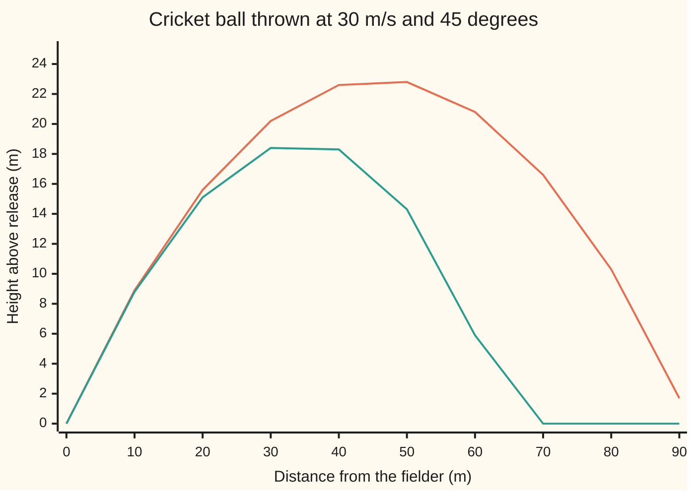

# Newton's laws: force sets acceleration, and work becomes energy

[Syllabus](../../../SYLLABUS.md) → [Engineering mathematics](../README.md) → [Mechanics and Structures](../README.md#s07) → Newton's laws

---

## General Overview

A fielder on the cricket boundary throws the ball back towards the stumps. It leaves the hand at 30 m/s, 45° above level ground. The ball has a mass of 160 g and is 72 mm across, inside the limits the Laws of Cricket set for a men's ball. Take the release and the landing at the same height. The captain wants to know how far that throw carries, and so whether a relay fielder is needed.

The school formula ignores the air and says 91.77 m. Put the air into the equation of motion, step it forward, and the ball comes down at 64.83 m, almost 27 m short. At release the air pushes back on the ball with 0.8978 N, more than half its weight of 1.5691 N. A force that big cannot be left out.

Newton's second law is what turns those two forces into a flight path. It says force does not set the velocity; it sets the acceleration, the rate the velocity changes. So the law is a differential equation, and stepping it forward gives the 64.83 m. Two bookkeeping rules come out of the same law. Add up the force times each small step along the path and the total, the **work**, equals the change in the ball's energy of motion: it leaves with 72 J and lands with 38.76 J, so the air took 33.24 J. Add up the force times each small slice of time and the total, the **impulse**, equals the change in the ball's momentum.

**Newton's second law makes the total force on a body set its rate of change of momentum, so motion is a differential equation; added up along the path it says work equals the change in kinetic energy, and added up over time it says impulse equals the change in momentum.**

**What kind of fact this is:** Newton's laws are a model: a law of physics that fits to many decimal places at everyday speeds, but fails near the speed of light and at atomic sizes. The two balances are theorems, proved from the second law in Why it works. The drag law is a measured model, good in the range stated below.

### The picture: the same throw, with and without air



Orange: no air, a symmetric arch that lands at 91.77 m. Green: with drag, a lower arch that peaks at 18.80 m, falls more steeply than it rose and lands at 64.83 m; it is drawn flat at 0 m after landing. Both are read from the simulation in the code.

---

## The formula

Notation first, in words. A bold letter is a vector, an arrow with a size and a direction: $\mathbf{v}$ is the ball's velocity, and plain $v = |\mathbf{v}|$ is its speed. A dot over a letter is its rate of change in time, so $\dot{\mathbf{v}}$ is the acceleration.

$$m\,\dot{\mathbf{v}} = m\,\mathbf{g} \;-\; \tfrac12 \rho\, C_d\, A\; v\,\mathbf{v}$$

**Read it aloud:** mass times acceleration equals the weight, pulling straight down, plus the drag, which points straight back along the path and grows with the square of the speed.

Divide by $m$ and the drag collects into one constant:

$$\dot{\mathbf{v}} = \mathbf{g} - k\,v\,\mathbf{v}, \qquad k = \frac{\rho\, C_d\, A}{2m}$$

Two balances follow from it, for any stretch of the flight from state 0 to state 1:

$$W = \int_C \mathbf{F}\cdot d\mathbf{r} = \tfrac12 m v_1^2 - \tfrac12 m v_0^2, \qquad \mathbf{J} = \int_{t_0}^{t_1} \mathbf{F}\,dt = m\mathbf{v}_1 - m\mathbf{v}_0$$

**Read them aloud:** the work done by all the forces along the path equals the change in kinetic energy; the impulse of all the forces over the time equals the change in momentum.

| Symbol | Plain meaning | In our example | Push it up and the answer… |
| --- | --- | --- | --- |
| $m$ | the ball's mass, kg | 0.160 kg | drag matters less: a heavier ball flies further |
| $\mathbf{g}$, $g$ | gravity's pull per kilogram, straight down, m/s² | 9.80665 m/s² | shorter flight, lower arch |
| $\mathbf{v}$, $v$, $v_0$ | velocity (vector), speed, speed at release, m/s | $v_0$ = 30 m/s | longer throw, but drag grows as $v^2$ |
| $\theta$ | release angle above level | 45°, $\pi/4$ rad | higher and shorter past about 42° |
| $\rho$, $\nu$ | the air's density, kg/m³, and kinematic viscosity, m²/s | 1.225 kg/m³; 1.46e-5 m²/s | $\rho$: more drag, shorter throw; $\nu$: lower Re, same drag at fixed $C_d$ |
| $C_d$, $\text{Re}$ | drag coefficient, how blunt the shape is to the air; Reynolds number $vD/\nu$; both pure numbers | 0.40; 147,945 at release | $C_d$: more drag; Re: nearer the drag crisis |
| $A$, $D$ | frontal area, the disc the ball shows the air, m²; diameter, m | 0.004072 m²; 0.072 m | more drag |
| $k$ | drag constant, deceleration per (m/s)², 1/m | 0.006234 1/m | shorter throw |
| $\mathbf{F}$ | total force on the ball: weight plus drag, N | 0.8978 N drag and 1.5691 N weight at release | bigger acceleration |
| $W$, $C$, $d\mathbf{r}$ | work, J; the path; a small step along it | drag work −33.24 J | bigger change in kinetic energy |
| $\mathbf{J}$, $\mathbf{p} = m\mathbf{v}$ | impulse, the force added up over time, and momentum, both kg m/s | across: −1.2985 kg m/s | bigger change in momentum |
| $t$, $T$; $x$, $y$, $H$ | time and flight time, s; distance across, height above release and peak height, m | $T$ = 3.91 s; peak 18.80 m | — |

Kinetic energy $\tfrac12 m v^2$ is the energy of motion, in joules (J, newton metres). A newton (N) is the force that gives 1 kg an acceleration of 1 m/s².

### When it holds

- **An inertial frame**: one that is not itself accelerating or turning. The ground is close enough for a throw of 3.91 s; the Earth's spin bends long-range artillery shells, where the frame fails.
- **Speeds far below light's, bodies far above atoms.** Both hold here by many powers of ten. Outside them the second law needs relativity or quantum mechanics.
- **Fixed mass.** A cricket ball keeps its 160 g. A rocket burning fuel does not, and then neither $m\dot{\mathbf{v}} = \mathbf{F}$ nor $\dot{\mathbf{p}} = \mathbf{F}$ works as written: the rocket needs an extra thrust term, the rate it throws out mass times the exhaust speed relative to the rocket.
- **Drag as $\tfrac12\rho C_d A v^2$ with a fixed $C_d$.** This holds while the Reynolds number (this wing's ratio of inertia to viscosity, $\text{Re} = vD/\nu$) stays below the drag crisis, a sudden fall in $C_d$ at a few hundred thousand for a smooth sphere. At release here $\text{Re}$ = 147,945. The model also ignores spin and the seam, which make a real ball swing sideways.
- **The no-air formula** holds only when drag is small beside weight. For a gentle 10 m/s lob it gives 10.20 m against 9.72 m with drag; for the 30 m/s throw it gives 91.77 m against 64.83 m.

---

## Why it works

### Step 0: force changes motion; it does not cause it

Newton's first law: a body with no net force on it keeps its velocity, in a straight line at a steady speed. So a force is not needed to keep the ball moving, only to change how it moves. The second law says how much: the rate of change of momentum equals the total force, $\dot{\mathbf{p}} = \mathbf{F}$; with fixed mass that is $m\dot{\mathbf{v}} = \mathbf{F}$. The third law says forces come in opposite pairs: the air pushes the ball back with 0.8978 N at release, and the ball pushes the air forward with the same 0.8978 N.

Because force fixes a rate, the second law is a differential equation, a rule for the rate plus a starting value, as on [A differential equation](../../08-Differential%20equations%20and%20dynamics/01-Rate%20Equations/01-what-a-differential-equation-says.md). The starting value here is the release: position at the hand, velocity 30 m/s at 45°.

### Step 1: the equation of motion for the ball

Two forces act. The weight $m\mathbf{g}$ points down. The drag points against the velocity; wind-tunnel tests give its size as $\tfrac12\rho C_d A v^2$. Point it along $-\mathbf{v}/v$ and it becomes $-\tfrac12\rho C_d A\, v\,\mathbf{v}$. Write $x$ for the distance across, $y$ for the height, and the vector law splits into two lines:

$$\ddot x = -k\,v\,\dot x, \qquad \ddot y = -g - k\,v\,\dot y, \qquad v = \sqrt{\dot x^2 + \dot y^2}$$

Without air ($k = 0$) the lines separate. Across, the speed stays at $v_0\cos\theta$ = 21.2132 m/s. Up, the speed $v_0\sin\theta$ = 21.2132 m/s falls by $g$ each second, so the ball is back down after $T = 2v_0\sin\theta/g$ = 4.3263 s, and the range is $v_0\cos\theta \cdot T = v_0^2\sin 2\theta / g$ = 91.7745 m.

With air the speed $v$ appears in both lines, so each depends on the other. There is no formula for the range. The code steps the equations forward with RK4, the fourth-order Runge–Kutta method of [Runge-Kutta four](../../08-Differential%20equations%20and%20dynamics/05-Numerical%20Evolution/04-runge-kutta-four.md): it samples the rate four times inside each 1 ms step and takes a weighted average.

### Step 2: work equals the change in kinetic energy

Dot the second law with the velocity. On the left, $m\,\dot{\mathbf{v}}\cdot\mathbf{v}$ is exactly the rate of change of $\tfrac12 m v^2$, by the chain rule. So

$$\frac{d}{dt}\Big(\tfrac12 m v^2\Big) = \mathbf{F}\cdot\mathbf{v}.$$

The right side is the **power**, force times velocity along the motion, in watts. Add it up over the flight. Because $\mathbf{v}\,dt = d\mathbf{r}$, the small step along the path, the sum is the line integral of the force along the path, as on [Line integrals of a field](../../06-Calculus%20and%20analysis/09-Vector%20Calculus/02-line-integrals.md). That is the work–energy theorem: $W = \Delta\big(\tfrac12 m v^2\big)$.

The two forces behave very differently along the path.

- **Weight** has work $-mg\,\Delta y$. That depends only on the change in height, not the route, so it can be stored as **potential energy** $mgy$. On a throw that lands at release height it adds up to zero.
- **Drag** always points against the motion, so its power, $-mkv^3$, is negative at every instant. Its work depends on the whole route and can never be won back.

So kinetic energy, plus potential energy, plus the energy already lost to drag, stays at the 72 J the ball started with. For the throw, drag's work is −33.2443 J and the kinetic energy falls from 72 J to 38.7557 J: the same −33.2443 J. At the peak, kinetic energy has fallen by 50.2704 J: weight took $mg \times$ 18.7957 m, and drag took the rest.

### Step 3: impulse equals the change in momentum

Add the second law up over time instead of along the path. The left side is a rate, so its total is the change: $\int \mathbf{F}\,dt = m\mathbf{v}_1 - m\mathbf{v}_0$. No dot product this time, so this balance keeps its direction: one equation across and one up.

- **Across**, only drag acts. Its impulse is −1.2985 kg m/s, and the ball's sideways speed falls from 21.2132 m/s to 13.0973 m/s: $0.160 \times (13.0973 - 21.2132)$ = −1.2985 kg m/s.
- **Up**, weight gives $-mgT$ = −6.1330 kg m/s and drag only −0.0914 kg m/s. Drag pushes down while the ball rises and up while it falls, so the two halves nearly cancel. Together: −6.2244 kg m/s.

By the third law the air receives the opposite of the drag impulse, and the Earth the opposite of weight's. That is momentum conservation: what the ball loses to drag, the air gains; what it loses to weight, the Earth gains.

### Step 4: one throw with drag that has a formula

Straight up, the motion is along one line, so the speed is just $\dot y$ and a formula exists. This is the check on the drag code: the simulation must reproduce it.

<details>
<summary>Detailed proof: the peak height of a ball thrown straight up into air</summary>

On the way up, $\dot v = -g - kv^2$. Change the variable from time to height: $\dot v = v\,\dfrac{dv}{dy}$, so

$$v\,\frac{dv}{dy} = -(g + kv^2), \qquad \frac{v\,dv}{g + kv^2} = -dy.$$

The left side integrates to $\frac{1}{2k}\ln(g + kv^2)$. Run the speed from $v_0$ down to 0 at the peak $H$:

$$H = \frac{1}{2k}\ln\!\Big(1 + \frac{k v_0^2}{g}\Big).$$

For time, $\dfrac{dv}{g + kv^2} = -dt$ integrates to $\dfrac{1}{\sqrt{gk}}\arctan\!\Big(v\sqrt{k/g}\Big)$, so the time to the peak is $\dfrac{1}{\sqrt{gk}}\arctan\!\Big(v_0\sqrt{k/g}\Big)$.

</details>

For the cricket ball thrown straight up at 30 m/s, $H$ = 36.2864 m, reached after 2.6190 s.

---

## Worked numbers, by hand

The fielder's throw: $m$ = 0.160 kg, diameter 0.072 m, $C_d$ = 0.40, $\rho$ = 1.225 kg/m³, $g$ = 9.80665 m/s², $v_0$ = 30 m/s, $\theta$ = 45°.

| Step | Arithmetic | Value |
| --- | --- | --- |
| frontal area $A$ | $\pi \times 0.072^2 / 4$ | 0.004072 m² |
| drag constant $k$ | $1.225 \times 0.40 \times 0.004072 / (2 \times 0.160)$ | 0.006234 1/m |
| drag at release | $0.160 \times 0.006234 \times 30^2$ | 0.8978 N |
| weight | $0.160 \times 9.80665$ | 1.5691 N |
| terminal speed, where drag equals weight | $\sqrt{9.80665 / 0.006234}$ | 39.6607 m/s |
| launch velocity, each part | $30 \times \cos 45°$ | 21.2132 m/s |
| range with no air | $30^2 \times \sin 90° / 9.80665$ | 91.7745 m |
| kinetic energy at release | $\tfrac12 \times 0.160 \times 30^2$ | 72.0000 J |
| kinetic energy at landing | $\tfrac12 \times 0.160 \times 22.0101^2$ | 38.7557 J |
| change in kinetic energy | $38.7557 - 72$ | −33.2443 J |
| drag work along the path | from the simulation | −33.2443 J |
| **range with drag** | from the simulation, 1 ms steps | **64.83 m** |

The throw carries 64.83 m on the full, 26.9462 m short of the no-air formula. The energy balance closes: every joule the ball lost was work done against the air.

### What breaks if you drop a piece

| Mistake | Comes out at | What went wrong |
| --- | --- | --- |
| Leave out the air | 91.7745 m | Drag at release is more than half the weight; it cannot be dropped at 30 m/s |
| Drag without the ½, $\rho C_d A v^2$ | 51.2930 m | Twice the real drag, so the ball stops too soon |
| Drag linear in speed, matched at 30 m/s | 58.3680 m | Too much drag at the slower speeds later in the flight; real drag falls as $v^2$ |
| Assume energy is kept, so it lands at release speed | 30.0000 m/s, really 22.0101 m/s | Only weight's work is stored; drag's work is gone |

---

## Where the energy goes during the flight

The ball starts with 72 J, all as motion. Three accounts then share it: kinetic energy (motion), potential energy (height, $mgy$), and the energy already handed to the air. Follow the throw half a second at a time:

| Time (s) | Height (m) | Speed (m/s) | Kinetic (J) | Potential (J) | Lost to drag (J) | Total (J) |
| --- | --- | --- | --- | --- | --- | --- |
| 0.00 | 0.00 | 30.00 | 72.00 | 0.00 | 0.00 | 72.00 |
| 0.50 | 8.96 | 24.47 | 47.89 | 14.07 | 10.05 | 72.00 |
| 1.00 | 14.90 | 20.31 | 33.01 | 23.38 | 15.61 | 72.00 |
| 1.50 | 18.09 | 17.56 | 24.67 | 28.38 | 18.95 | 72.00 |
| 2.00 | 18.72 | 16.32 | 21.30 | 29.38 | 21.32 | 72.00 |
| 2.50 | 16.93 | 16.56 | 21.94 | 26.57 | 23.49 | 72.00 |
| 3.00 | 12.84 | 17.97 | 25.82 | 20.15 | 26.03 | 72.00 |
| 3.50 | 6.60 | 20.06 | 32.21 | 10.35 | 29.45 | 72.00 |
| 3.91 | 0.00 | 22.01 | 38.76 | 0.00 | 33.24 | 72.00 |

The drag account fills fastest early on: 10.05 J in the first half second, when the ball is fastest, because drag's power grows as $v^3$. Near the top the ball is slow and the account barely moves. Weight's account fills on the way up and empties again on the way down. One bar per account, 1 character per 2 J:

```
release, 0.00 s
  kinetic   ████████████████████████████████████ 72.00 J
  potential                                       0.00 J
  drag                                            0.00 J
near the top, 2.00 s
  kinetic   ███████████                          21.30 J
  potential ███████████████                      29.38 J
  drag      ███████████                          21.32 J
landing, 3.91 s
  kinetic   ███████████████████                  38.76 J
  potential                                       0.00 J
  drag      █████████████████                    33.24 J
```

The total column is the work–energy theorem in action: it never moves from 72.00 J. That is why the ball lands slower than it left, 22.01 m/s against 30 m/s, and why it falls more steeply than it rose in the picture at the top.

---

## Code, from first principles, and it actually runs

Both programs step Newton's law forward with RK4 written out, carrying the drag work as an extra running total, then find the peak and the landing exactly by Newton steps in time. They take five independent roads. (1) With no air, the simulation must match the closed-form range, flight time and peak. (2) Thrown straight up into air, it must match the closed-form peak and time of Step 4, which tests the drag code. (3) Halving the step must not change the range. (4) The change in kinetic energy must equal the drag work added along the path, at landing and at the peak. (5) Both parts of the momentum change must equal the drag impulse plus weight's, with the drag impulse added up separately by Simpson's rule: the drag force read at the start, middle and end of each step, weighted 1, 4, 1. That sum never uses the RK4 velocity update, so a faulty stepper shows up as a mismatch.

### Python

```python
# Newton's laws on a thrown cricket ball: the check behind the card. Standard library only.
# The equation of motion m dv/dt = m g + drag is stepped with RK4 written out. The drag work
# rides along as an extra state; the drag impulse is added up apart, by Simpson's rule.
from math import sqrt, sin, cos, atan, log, radians, pi

G, RHO = 9.80665, 1.225            # standard gravity, m/s^2; sea-level air density, kg/m^3
M, DIAM, CD = 0.160, 0.072, 0.40   # ball mass, kg; diameter, m; drag coefficient
AREA = pi * DIAM * DIAM / 4.0      # frontal area, m^2
K = RHO * CD * AREA / (2.0 * M)    # drag deceleration per (m/s)^2, 1/m
V0, DEG = 30.0, 45.0               # the throw: 30 m/s at 45 degrees, from ground level

def drag(s, k, lin):                # drag deceleration across and up, m/s^2: straight against v
    f = k * V0 if lin else k * sqrt(s[2] * s[2] + s[3] * s[3])   # per m/s, 1/s
    return -f * s[2], -f * s[3]

def deriv(s, k, lin):               # s = [x, y, vx, vy, W]: position, velocity, drag work
    ax, ay = drag(s, k, lin)
    return [s[2], s[3], ax, ay - G, M * (ax * s[2] + ay * s[3])]

def rk4(s, h, k, lin):
    a = deriv(s, k, lin)
    b = deriv([p + h / 2 * q for p, q in zip(s, a)], k, lin)
    c = deriv([p + h / 2 * q for p, q in zip(s, b)], k, lin)
    d = deriv([p + h * q for p, q in zip(s, c)], k, lin)
    return [p + h / 6 * (qa + 2 * qb + 2 * qc + qd) for p, qa, qb, qc, qd in zip(s, a, b, c, d)]

def to_zero(s, t, i, k, lin):
    for _ in range(4):             # Newton steps in time until s[i] is zero
        hh = -s[i] / deriv(s, k, lin)[i]
        s, t = rk4(s, hh, k, lin), t + hh
    return s, t

def fly(v0, deg, k, lin=False, h=1e-3, y0=0.0):
    th = radians(deg)
    s, t, top, path = [0.0, y0, v0 * cos(th), v0 * sin(th), 0.0], 0.0, None, []
    while True:
        path.append(s)
        n = rk4(s, h, k, lin)
        if top is None and n[3] <= 0.0:
            top = to_zero(s, t, 3, k, lin)
        if n[1] < 0.0:
            return to_zero(s, t, 1, k, lin), top, path
        s, t = n, t + h

def impulse(path, land, T, k, h=1e-3):
    # Drag impulse by Simpson's rule: drag at the start, middle and end of each step, weighted
    # 1, 4, 1. It never uses the RK4 velocity update, so it is a second road to the momentum change.
    J, n = [0.0, 0.0], len(path) - 1
    for i, (p, q) in enumerate(zip(path, path[1:] + [land])):
        dt = h if i < n else T - n * h             # the last step is cut short at the landing
        f0, fm, f1 = drag(p, k, False), drag(rk4(p, dt / 2, k, False), k, False), drag(q, k, False)
        J = [J[j] + M * dt / 6 * (f0[j] + 4 * fm[j] + f1[j]) for j in (0, 1)]
    return J

def ke(s): return 0.5 * M * (s[2] * s[2] + s[3] * s[3])
def speed(s): return sqrt(s[2] * s[2] + s[3] * s[3])

def height_at(path, land, x):      # straight-line read-off between steps; 0 m once landed
    if x >= land[0]: return 0.0
    for p, q in zip(path, path[1:] + [land]):
        if p[0] <= x <= q[0]:
            return p[1] + (q[1] - p[1]) * (x - p[0]) / (q[0] - p[0])

def line(name, *vals, unit="", d=4): print(f"{name:<38}" + "".join(f"{v:>11.{d}f}" for v in vals) + " " + unit)

th = radians(DEG)
R0, T0, H0 = V0 * V0 * sin(2 * th) / G, 2 * V0 * sin(th) / G, (V0 * sin(th)) ** 2 / (2 * G)
(vac, tv), (vtop, _), vpath = fly(V0, DEG, 0.0)
(land, T), (top, ttop), path = fly(V0, DEG, K)
Jx, Jy = impulse(path, land, T, K)
(land2, _), _, _ = fly(V0, DEG, K, h=5e-4)
_, (up, tup), _ = fly(V0, 90.0, K)
H_up, t_up = log(1 + K * V0 * V0 / G) / (2 * K), atan(V0 * sqrt(K / G)) / sqrt(G * K)
s0 = path[0]
lob, lob0 = fly(10.0, DEG, K)[0][0][0], 100.0 / G
best = max(range(30, 51), key=lambda a: fly(V0, a, K)[0][0][0])

line("frontal area A", AREA, unit="m^2", d=6)
line("drag constant k = rho Cd A / 2m", K, unit="1/m", d=6)
line("weight m g / drag at release m k v0^2", M * G, M * K * V0 * V0, unit="N")
line("terminal speed sqrt(g/k)", sqrt(G / K), unit="m/s")
line("launch velocity across / up", s0[2], s0[3], unit="m/s")
line("Reynolds number v0 D / nu, nu=1.46e-5", V0 * DIAM / 1.46e-5, unit="(pure number)", d=0)
print(f"{'':<38}{'formula':>11}{'RK4':>11}")
line("1 no air: range", R0, vac[0], unit="m")
line("  no air: flight time", T0, tv, unit="s")
line("  no air: peak height", H0, vtop[1], unit="m")
line("2 straight up, drag: peak height", H_up, up[1], unit="m")
line("  straight up, drag: time to peak", t_up, tup, unit="s")
print(f"{'3 with drag':<38}{'step 1 ms':>11}{'step 0.5ms':>11}")
line("  range", land[0], land2[0], unit="m")
line("  range lost to the air, vs no air", R0 - land[0], unit="m")
line("  landing velocity across / up", land[2], land[3], unit="m/s")
line("  flight time / landing speed", T, speed(land), unit="s, m/s")
line("  peak height / time of peak", top[1], ttop, unit="m, s")
line("4 kinetic energy at release / landing", ke(s0), ke(land), unit="J")
line("  change in KE / drag work on path", ke(land) - ke(s0), land[4], unit="J")
line("  at peak: change in KE / -mgH + W", ke(top) - ke(s0), -M * G * top[1] + top[4], unit="J")
line("5 across: momentum change / impulse", M * (land[2] - s0[2]), Jx, unit="kg m/s")
line("  up: momentum change / impulse", M * (land[3] - s0[3]), Jy - M * G * T, unit="kg m/s")
line("  up: drag impulse / gravity impulse", Jy, -M * G * T, unit="kg m/s")
line("wrong: no air, range", R0, unit="m")
line("wrong: drag without the 1/2, range", fly(V0, DEG, 2 * K)[0][0][0], unit="m")
line("wrong: drag linear in v, range", fly(V0, DEG, K, lin=True)[0][0][0], unit="m")
line("wrong: energy kept, landing speed", V0, unit="m/s")
line("lob 10 m/s: range with drag / no air", lob, lob0, unit="m")
line("try: best angle / range there", best, fly(V0, best, K)[0][0][0], unit="deg, m")
line("try: Cd = 0.5, range", fly(V0, DEG, K * 0.5 / CD)[0][0][0], unit="m")
line("try: 40 m/s, range drag / no air", fly(40.0, DEG, K)[0][0][0], 1600.0 / G, unit="m")
line("try: release 2 m up, range", fly(V0, DEG, K, y0=2.0)[0][0][0], unit="m")

print(f"{'time s':>8}{'height m':>10}{'speed m/s':>11}{'KE J':>8}{'PE J':>8}{'lost J':>8}{'total J':>9}")
for i in (0, 500, 1000, 1500, 2000, 2500, 3000, 3500, None):
    s, t = (land, T) if i is None else (path[i], i * 1e-3)
    pe, lost = M * G * abs(s[1]), 0.0 - s[4]
    print(f"{t:>8.2f}{abs(s[1]):>10.2f}{speed(s):>11.2f}{ke(s):>8.2f}{pe:>8.2f}{lost:>8.2f}{ke(s) + pe + lost:>9.2f}")
xs = [10.0 * i for i in range(10)]
print("chart, distance m      " + " ".join(f"{x:5.0f}" for x in xs))
print("chart, height no air m " + " ".join(f"{height_at(vpath, vac, x):5.1f}" for x in xs))
print("chart, height drag m   " + " ".join(f"{height_at(path, land, x):5.1f}" for x in xs))

assert abs(vac[0] - R0) < 1e-6
assert abs(tv - T0) < 1e-9
assert abs(vtop[1] - H0) < 1e-6
assert abs(up[1] - H_up) < 1e-6
assert abs(tup - t_up) < 1e-9
assert abs(land[0] - land2[0]) < 1e-6
assert abs((ke(land) - ke(s0)) - land[4]) < 1e-6
assert abs((ke(top) - ke(s0)) - (-M * G * top[1] + top[4])) < 1e-6
assert abs(M * (land[2] - s0[2]) - Jx) < 1e-9
assert abs(M * (land[3] - s0[3]) - (Jy - M * G * T)) < 1e-9
assert land[0] < 0.8 * R0
assert abs(lob - lob0) / lob0 < 0.05
print("ALL CHECKS PASS")
```

**Ran 2026-11-11 on macOS, Python 3.14.10, standard library only. All checks passed. Output, pasted from the run:**

```
frontal area A                           0.004072 m^2
drag constant k = rho Cd A / 2m          0.006234 1/m
weight m g / drag at release m k v0^2      1.5691     0.8978 N
terminal speed sqrt(g/k)                  39.6607 m/s
launch velocity across / up               21.2132    21.2132 m/s
Reynolds number v0 D / nu, nu=1.46e-5      147945 (pure number)
                                          formula        RK4
1 no air: range                           91.7745    91.7745 m
  no air: flight time                      4.3263     4.3263 s
  no air: peak height                     22.9436    22.9436 m
2 straight up, drag: peak height          36.2864    36.2864 m
  straight up, drag: time to peak          2.6190     2.6190 s
3 with drag                             step 1 ms step 0.5ms
  range                                   64.8283    64.8283 m
  range lost to the air, vs no air        26.9462 m
  landing velocity across / up            13.0973   -17.6891 m/s
  flight time / landing speed              3.9087    22.0101 s, m/s
  peak height / time of peak              18.7957     1.8768 m, s
4 kinetic energy at release / landing     72.0000    38.7557 J
  change in KE / drag work on path       -33.2443   -33.2443 J
  at peak: change in KE / -mgH + W       -50.2704   -50.2704 J
5 across: momentum change / impulse       -1.2985    -1.2985 kg m/s
  up: momentum change / impulse           -6.2244    -6.2244 kg m/s
  up: drag impulse / gravity impulse      -0.0914    -6.1330 kg m/s
wrong: no air, range                      91.7745 m
wrong: drag without the 1/2, range        51.2930 m
wrong: drag linear in v, range            58.3680 m
wrong: energy kept, landing speed         30.0000 m/s
lob 10 m/s: range with drag / no air       9.7178    10.1972 m
try: best angle / range there             42.0000    65.0613 deg, m
try: Cd = 0.5, range                      60.6957 m
try: 40 m/s, range drag / no air          95.4827   163.1546 m
try: release 2 m up, range                66.2650 m
  time s  height m  speed m/s    KE J    PE J  lost J  total J
    0.00      0.00      30.00   72.00    0.00    0.00    72.00
    0.50      8.96      24.47   47.89   14.07   10.05    72.00
    1.00     14.90      20.31   33.01   23.38   15.61    72.00
    1.50     18.09      17.56   24.67   28.38   18.95    72.00
    2.00     18.72      16.32   21.30   29.38   21.32    72.00
    2.50     16.93      16.56   21.94   26.57   23.49    72.00
    3.00     12.84      17.97   25.82   20.15   26.03    72.00
    3.50      6.60      20.06   32.21   10.35   29.45    72.00
    3.91      0.00      22.01   38.76    0.00   33.24    72.00
chart, distance m          0    10    20    30    40    50    60    70    80    90
chart, height no air m   0.0   8.9  15.6  20.2  22.6  22.8  20.8  16.6  10.3   1.7
chart, height drag m     0.0   8.8  15.1  18.4  18.3  14.3   5.9   0.0   0.0   0.0
ALL CHECKS PASS
```

### Rust

```rust
// Newton's laws on a thrown cricket ball: the check behind the card. Rust std only.
// The equation of motion m dv/dt = m g + drag is stepped with RK4 written out. The drag work
// rides along as an extra state; the drag impulse is added up apart, by Simpson's rule.
use std::f64::consts::PI;

const G: f64 = 9.80665; const RHO: f64 = 1.225; // standard gravity, m/s^2; air density, kg/m^3
const M: f64 = 0.160; const DIAM: f64 = 0.072; const CD: f64 = 0.40; // mass kg, diameter m, drag coefficient
const V0: f64 = 30.0; const DEG: f64 = 45.0; // the throw: 30 m/s at 45 degrees, from ground level

type S = [f64; 5]; // x, y, vx, vy, drag work W

fn drag(s: &S, k: f64, lin: bool) -> [f64; 2] { // drag deceleration across and up, m/s^2: straight against v
    let f = if lin { k * V0 } else { k * (s[2] * s[2] + s[3] * s[3]).sqrt() }; // per m/s, 1/s
    [-f * s[2], -f * s[3]]
}

fn deriv(s: &S, k: f64, lin: bool) -> S {
    let [ax, ay] = drag(s, k, lin);
    [s[2], s[3], ax, ay - G, M * (ax * s[2] + ay * s[3])]
}

fn add(s: &S, h: f64, d: &S) -> S { let mut r = *s; for i in 0..5 { r[i] += h * d[i]; } r }

fn rk4(s: &S, h: f64, k: f64, lin: bool) -> S {
    let a = deriv(s, k, lin);
    let b = deriv(&add(s, h / 2.0, &a), k, lin);
    let c = deriv(&add(s, h / 2.0, &b), k, lin);
    let d = deriv(&add(s, h, &c), k, lin);
    let mut r = *s;
    for i in 0..5 { r[i] += h / 6.0 * (a[i] + 2.0 * b[i] + 2.0 * c[i] + d[i]); }
    r
}

fn to_zero(mut s: S, mut t: f64, i: usize, k: f64, lin: bool) -> (S, f64) {
    for _ in 0..4 { // Newton steps in time until s[i] is zero
        let hh = -s[i] / deriv(&s, k, lin)[i];
        s = rk4(&s, hh, k, lin); t += hh;
    }
    (s, t)
}

struct Flight { land: S, t: f64, top: S, ttop: f64, path: Vec<S> }

fn fly(v0: f64, deg: f64, k: f64, lin: bool, h: f64, y0: f64) -> Flight {
    let th = deg.to_radians();
    let mut s: S = [0.0, y0, v0 * th.cos(), v0 * th.sin(), 0.0];
    let (mut t, mut top, mut path) = (0.0, None, Vec::new());
    loop {
        path.push(s);
        let n = rk4(&s, h, k, lin);
        if top.is_none() && n[3] <= 0.0 { top = Some(to_zero(s, t, 3, k, lin)); }
        if n[1] < 0.0 {
            let (land, tl) = to_zero(s, t, 1, k, lin);
            let (tp, ttop) = top.unwrap();
            return Flight { land, t: tl, top: tp, ttop, path };
        }
        s = n;
        t += h;
    }
}

// Drag impulse by Simpson's rule: drag at the start, middle and end of each step, weighted
// 1, 4, 1. It never uses the RK4 velocity update, so it is a second road to the momentum change.
fn impulse(f: &Flight, k: f64) -> [f64; 2] {
    let (h, n, mut j) = (1e-3, f.path.len() - 1, [0.0; 2]);
    for i in 0..=n {
        let (p, q) = (&f.path[i], if i < n { &f.path[i + 1] } else { &f.land });
        let dt = if i < n { h } else { f.t - n as f64 * h }; // the last step is cut short at the landing
        let (f0, fm, f1) = (drag(p, k, false), drag(&rk4(p, dt / 2.0, k, false), k, false), drag(q, k, false));
        for c in 0..2 { j[c] += M * dt / 6.0 * (f0[c] + 4.0 * fm[c] + f1[c]); }
    }
    j
}

fn range(v0: f64, deg: f64, k: f64) -> f64 { fly(v0, deg, k, false, 1e-3, 0.0).land[0] }
fn ke(s: &S) -> f64 { 0.5 * M * (s[2] * s[2] + s[3] * s[3]) }
fn speed(s: &S) -> f64 { (s[2] * s[2] + s[3] * s[3]).sqrt() }

fn height_at(path: &[S], land: &S, x: f64) -> f64 { // straight-line read-off between steps; 0 m once landed
    if x >= land[0] { return 0.0; }
    for i in 0..path.len() {
        let (p, q) = (&path[i], if i + 1 < path.len() { &path[i + 1] } else { land });
        if p[0] <= x && x <= q[0] { return p[1] + (q[1] - p[1]) * (x - p[0]) / (q[0] - p[0]); }
    }
    f64::NAN
}

fn line(name: &str, vals: &[f64], unit: &str, d: usize) {
    let v: String = vals.iter().map(|v| format!("{:>11.*}", d, v)).collect();
    println!("{:<38}{} {}", name, v, unit);
}

fn main() {
    let area = PI * DIAM * DIAM / 4.0; // frontal area, m^2
    let k = RHO * CD * area / (2.0 * M); // drag deceleration per (m/s)^2, 1/m
    let th = DEG.to_radians();
    let (r0, t0, h0) = (V0 * V0 * (2.0 * th).sin() / G, 2.0 * V0 * th.sin() / G, (V0 * th.sin()).powi(2) / (2.0 * G));
    let vac = fly(V0, DEG, 0.0, false, 1e-3, 0.0);
    let dr = fly(V0, DEG, k, false, 1e-3, 0.0);
    let dr2 = fly(V0, DEG, k, false, 5e-4, 0.0);
    let up = fly(V0, 90.0, k, false, 1e-3, 0.0);
    let h_up = (1.0 + k * V0 * V0 / G).ln() / (2.0 * k);
    let t_up = (V0 * (k / G).sqrt()).atan() / (G * k).sqrt();
    let (land, top, s0) = (dr.land, dr.top, dr.path[0]);
    let [jx, jy] = impulse(&dr, k);
    let (lob, lob0) = (range(10.0, DEG, k), 100.0 / G);
    let best = (31..=50).fold(30, |b, a| if range(V0, a as f64, k) > range(V0, b as f64, k) { a } else { b });

    line("frontal area A", &[area], "m^2", 6);
    line("drag constant k = rho Cd A / 2m", &[k], "1/m", 6);
    line("weight m g / drag at release m k v0^2", &[M * G, M * k * V0 * V0], "N", 4);
    line("terminal speed sqrt(g/k)", &[(G / k).sqrt()], "m/s", 4);
    line("launch velocity across / up", &[s0[2], s0[3]], "m/s", 4);
    line("Reynolds number v0 D / nu, nu=1.46e-5", &[V0 * DIAM / 1.46e-5], "(pure number)", 0);
    println!("{:<38}{:>11}{:>11}", "", "formula", "RK4");
    line("1 no air: range", &[r0, vac.land[0]], "m", 4);
    line("  no air: flight time", &[t0, vac.t], "s", 4);
    line("  no air: peak height", &[h0, vac.top[1]], "m", 4);
    line("2 straight up, drag: peak height", &[h_up, up.top[1]], "m", 4);
    line("  straight up, drag: time to peak", &[t_up, up.ttop], "s", 4);
    println!("{:<38}{:>11}{:>11}", "3 with drag", "step 1 ms", "step 0.5ms");
    line("  range", &[land[0], dr2.land[0]], "m", 4);
    line("  range lost to the air, vs no air", &[r0 - land[0]], "m", 4);
    line("  landing velocity across / up", &[land[2], land[3]], "m/s", 4);
    line("  flight time / landing speed", &[dr.t, speed(&land)], "s, m/s", 4);
    line("  peak height / time of peak", &[top[1], dr.ttop], "m, s", 4);
    line("4 kinetic energy at release / landing", &[ke(&s0), ke(&land)], "J", 4);
    line("  change in KE / drag work on path", &[ke(&land) - ke(&s0), land[4]], "J", 4);
    line("  at peak: change in KE / -mgH + W", &[ke(&top) - ke(&s0), -M * G * top[1] + top[4]], "J", 4);
    line("5 across: momentum change / impulse", &[M * (land[2] - s0[2]), jx], "kg m/s", 4);
    line("  up: momentum change / impulse", &[M * (land[3] - s0[3]), jy - M * G * dr.t], "kg m/s", 4);
    line("  up: drag impulse / gravity impulse", &[jy, -M * G * dr.t], "kg m/s", 4);
    line("wrong: no air, range", &[r0], "m", 4);
    line("wrong: drag without the 1/2, range", &[range(V0, DEG, 2.0 * k)], "m", 4);
    line("wrong: drag linear in v, range", &[fly(V0, DEG, k, true, 1e-3, 0.0).land[0]], "m", 4);
    line("wrong: energy kept, landing speed", &[V0], "m/s", 4);
    line("lob 10 m/s: range with drag / no air", &[lob, lob0], "m", 4);
    line("try: best angle / range there", &[best as f64, range(V0, best as f64, k)], "deg, m", 4);
    line("try: Cd = 0.5, range", &[range(V0, DEG, k * 0.5 / CD)], "m", 4);
    line("try: 40 m/s, range drag / no air", &[range(40.0, DEG, k), 1600.0 / G], "m", 4);
    line("try: release 2 m up, range", &[fly(V0, DEG, k, false, 1e-3, 2.0).land[0]], "m", 4);

    println!("{:>8}{:>10}{:>11}{:>8}{:>8}{:>8}{:>9}", "time s", "height m", "speed m/s", "KE J", "PE J", "lost J", "total J");
    for i in [0usize, 500, 1000, 1500, 2000, 2500, 3000, 3500, usize::MAX] {
        let (s, t) = if i == usize::MAX { (land, dr.t) } else { (dr.path[i], i as f64 * 1e-3) };
        let (pe, lost) = (M * G * s[1].abs(), 0.0 - s[4]);
        println!("{:>8.2}{:>10.2}{:>11.2}{:>8.2}{:>8.2}{:>8.2}{:>9.2}", t, s[1].abs(), speed(&s), ke(&s), pe, lost, ke(&s) + pe + lost);
    }
    let xs: Vec<f64> = (0..10).map(|i| 10.0 * i as f64).collect();
    let row = |f: &dyn Fn(f64) -> f64, d: usize| xs.iter().map(|&x| format!("{:5.*}", d, f(x))).collect::<Vec<_>>().join(" ");
    println!("chart, distance m      {}", row(&|x| x, 0));
    println!("chart, height no air m {}", row(&|x| height_at(&vac.path, &vac.land, x), 1));
    println!("chart, height drag m   {}", row(&|x| height_at(&dr.path, &land, x), 1));

    assert!((vac.land[0] - r0).abs() < 1e-6);
    assert!((vac.t - t0).abs() < 1e-9);
    assert!((vac.top[1] - h0).abs() < 1e-6);
    assert!((up.top[1] - h_up).abs() < 1e-6);
    assert!((up.ttop - t_up).abs() < 1e-9);
    assert!((land[0] - dr2.land[0]).abs() < 1e-6);
    assert!(((ke(&land) - ke(&s0)) - land[4]).abs() < 1e-6);
    assert!(((ke(&top) - ke(&s0)) - (-M * G * top[1] + top[4])).abs() < 1e-6);
    assert!((M * (land[2] - s0[2]) - jx).abs() < 1e-9);
    assert!((M * (land[3] - s0[3]) - (jy - M * G * dr.t)).abs() < 1e-9);
    assert!(land[0] < 0.8 * r0);
    assert!((lob - lob0).abs() / lob0 < 0.05);
    println!("ALL CHECKS PASS");
}
```

**Ran 2026-11-11 on macOS, rustc 1.98.1, no crates. All checks passed. Output, pasted from the run:**

```
frontal area A                           0.004072 m^2
drag constant k = rho Cd A / 2m          0.006234 1/m
weight m g / drag at release m k v0^2      1.5691     0.8978 N
terminal speed sqrt(g/k)                  39.6607 m/s
launch velocity across / up               21.2132    21.2132 m/s
Reynolds number v0 D / nu, nu=1.46e-5      147945 (pure number)
                                          formula        RK4
1 no air: range                           91.7745    91.7745 m
  no air: flight time                      4.3263     4.3263 s
  no air: peak height                     22.9436    22.9436 m
2 straight up, drag: peak height          36.2864    36.2864 m
  straight up, drag: time to peak          2.6190     2.6190 s
3 with drag                             step 1 ms step 0.5ms
  range                                   64.8283    64.8283 m
  range lost to the air, vs no air        26.9462 m
  landing velocity across / up            13.0973   -17.6891 m/s
  flight time / landing speed              3.9087    22.0101 s, m/s
  peak height / time of peak              18.7957     1.8768 m, s
4 kinetic energy at release / landing     72.0000    38.7557 J
  change in KE / drag work on path       -33.2443   -33.2443 J
  at peak: change in KE / -mgH + W       -50.2704   -50.2704 J
5 across: momentum change / impulse       -1.2985    -1.2985 kg m/s
  up: momentum change / impulse           -6.2244    -6.2244 kg m/s
  up: drag impulse / gravity impulse      -0.0914    -6.1330 kg m/s
wrong: no air, range                      91.7745 m
wrong: drag without the 1/2, range        51.2930 m
wrong: drag linear in v, range            58.3680 m
wrong: energy kept, landing speed         30.0000 m/s
lob 10 m/s: range with drag / no air       9.7178    10.1972 m
try: best angle / range there             42.0000    65.0613 deg, m
try: Cd = 0.5, range                      60.6957 m
try: 40 m/s, range drag / no air          95.4827   163.1546 m
try: release 2 m up, range                66.2650 m
  time s  height m  speed m/s    KE J    PE J  lost J  total J
    0.00      0.00      30.00   72.00    0.00    0.00    72.00
    0.50      8.96      24.47   47.89   14.07   10.05    72.00
    1.00     14.90      20.31   33.01   23.38   15.61    72.00
    1.50     18.09      17.56   24.67   28.38   18.95    72.00
    2.00     18.72      16.32   21.30   29.38   21.32    72.00
    2.50     16.93      16.56   21.94   26.57   23.49    72.00
    3.00     12.84      17.97   25.82   20.15   26.03    72.00
    3.50      6.60      20.06   32.21   10.35   29.45    72.00
    3.91      0.00      22.01   38.76    0.00   33.24    72.00
chart, distance m          0    10    20    30    40    50    60    70    80    90
chart, height no air m   0.0   8.9  15.6  20.2  22.6  22.8  20.8  16.6  10.3   1.7
chart, height drag m     0.0   8.8  15.1  18.4  18.3  14.3   5.9   0.0   0.0   0.0
ALL CHECKS PASS
```

The two outputs are identical, line for line.

> [!TIP]
> **Try changing**
> - **Guess first: is 45° still the best angle?** The script tries every whole degree from 30° to 50°. With drag the best is 42°, at 65.0613 m. Drag punishes the long, high flight of a steep throw.
> - **Guess first: what does a rougher, older ball do?** Set `CD = 0.5`. The range falls from 64.8283 m to 60.6957 m.
> - **Guess first: does a faster arm help in proportion?** Call `fly(40.0, DEG, K)`. Without air the range would rise to 163.1546 m; with drag it reaches only 95.4827 m. Above the terminal speed of 39.6607 m/s, drag outweighs gravity at release.
> - **Guess first: how much is a 2 m release height worth?** Pass `y0=2.0` to `fly`. The ball lands at 66.2650 m, against 64.8283 m, because it now has 2 m further to fall at the end.

---

## The usual mistake

> [!warning]
> **Using the no-air range formula, $v_0^2 \sin 2\theta / g$, for a hard throw.** It assumes the only force is weight. At 30 m/s the drag is already 0.8978 N against a weight of 1.5691 N, so the formula's 91.7745 m overshoots the real 64.8283 m by 26.9462 m. The formula is fine for a gentle 10 m/s lob, 10.1972 m against 9.7178 m. Check drag against weight before using it.
>
> - **Assuming mechanical energy is conserved.** Only forces like weight, whose work depends on height alone, store energy. Drag does not. Assume it does and the ball lands at 30.0000 m/s instead of 22.0101 m/s.
> - **Dropping the ½ in the drag law.** $\tfrac12\rho C_d A v^2$ is how $C_d$ is defined. Without the ½ the drag doubles and the range falls to 51.2930 m.
> - **Drag linear in speed.** Matched at release, a drag proportional to $v$ gives 58.3680 m. Air drag on a ball this size and speed grows as $v^2$; linear drag belongs to tiny or very slow bodies.
> - **Forgetting weight's impulse because the ball lands at release height.** Weight's work over the throw is zero; its impulse is not. The upward momentum changes by −6.2244 kg m/s, almost all of it the −6.1330 kg m/s from weight.

---

## Where you meet it in real life

- **The cricket field.** Coaches place a relay fielder when the throw is longer than the arm can carry on the full. The 64.83 m here, not 91.77 m, is the number that sets where the relay stands.
- **Car crash testing.** Engineers design crumple zones with the impulse balance: the same change in momentum spread over a longer time means a smaller average force on the people inside.
- **Braking distance.** The work–energy theorem gives it without solving for the motion: the brakes must do work equal to the car's kinetic energy, so the distance grows with the square of the speed.
- **Ballistics and sports engineering.** Golf, baseball and artillery tables are built by stepping this equation, with measured drag coefficients, a lift term from spin for golf and baseball, and, for artillery, the Earth's spin.
- **Structures.** A footbridge deck obeys the same second law, with the crowd's footfalls as the force. [Vibration modes](06-vibration-modes-and-resonance.md) takes it from there.

> **Say it back**
> Newton's second law says the total force on a body sets the rate its momentum changes, so a motion is a differential equation plus a starting state. For a cricket ball thrown at 30 m/s and 45°, weight and drag give a pair of coupled equations with no formula for the range; stepping them gives 64.83 m, not the 91.77 m of the no-air formula. Added up along the path, the law says work equals the change in kinetic energy: drag took 33.24 J of the ball's 72 J. Added up over time, it says impulse equals the change in momentum. Weight's work can be stored as height; drag's cannot.

---

## What this builds on

- [A differential equation](../../08-Differential%20equations%20and%20dynamics/01-Rate%20Equations/01-what-a-differential-equation-says.md): a rule for the rate plus a starting value picks one curve. Newton's law is that kind of rule for velocity.
- [Line integrals of a field](../../06-Calculus%20and%20analysis/09-Vector%20Calculus/02-line-integrals.md): work as the force along the motion, added up along a directed path. Here it is the drag work, and why it depends on the route while gravity's does not.

## Where this goes next

- [Rotation](02-rigid-body-rotation-and-moment-of-inertia.md): the second law for a turning body, where torque sets angular acceleration and the moment of inertia plays the part of mass.
- [Lagrangian and Hamiltonian mechanics](04-lagrangian-and-hamiltonian-mechanics-for-engineers.md): writes the kinetic and potential energies first and gets the equations of motion from them, without drawing forces.
- [Stress, strain and bending](07-stress-strain-and-beam-bending.md): the same force balance applied inside a beam, where no part accelerates and every slice is in equilibrium.
- [Orbits](09-orbital-mechanics-and-the-kepler-problem.md): the same law with gravity that weakens with distance, where energy and momentum balances give Kepler's laws.

This card's ball flies in still air without spin; how a spinning, seamed ball swings sideways, and so where a real throw lands, is left open.

---

## Sources

Verified 2026-11-11: every link below resolves to the publisher's page.

- Parker, G. W. "Projectile motion with air resistance quadratic in the speed." *American Journal of Physics* 45, no. 7 (1977): 606–610. [doi:10.1119/1.10812](https://doi.org/10.1119/1.10812). The coupled equations of Step 1 for drag that grows as the square of the speed, and how far their solutions fall short of the no-air parabola.
- Mehta, R. D. "Aerodynamics of Sports Balls." *Annual Review of Fluid Mechanics* 17 (1985): 151–189. [doi:10.1146/annurev.fl.17.010185.001055](https://doi.org/10.1146/annurev.fl.17.010185.001055). Drag and swing of cricket balls and other sports balls, and the drag crisis.
- NIST. "Standard acceleration of gravity", CODATA value. [NIST CODATA page](https://physics.nist.gov/cgi-bin/cuu/Value?gn). The 9.80665 m/s² used throughout.
- Marylebone Cricket Club. *The Laws of Cricket*, Law 4: The Ball. [MCC Law 4 page](https://www.lords.org/mcc/the-laws/the-ball). The weight and size limits the 160 g, 72 mm ball sits inside.
- White, Frank M., and Henry Xue. *Fluid Mechanics*, 9th ed. McGraw Hill. [Publisher page](https://www.mheducation.com/highered/product/fluid-mechanics-white/M9781260258318.html). The drag coefficient of a sphere against Reynolds number, and sea-level air density and viscosity.
