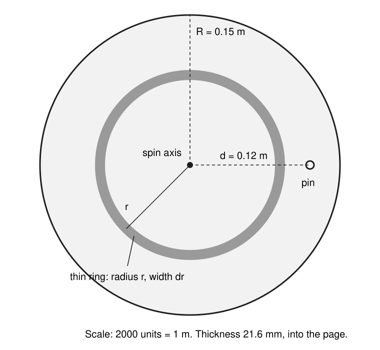
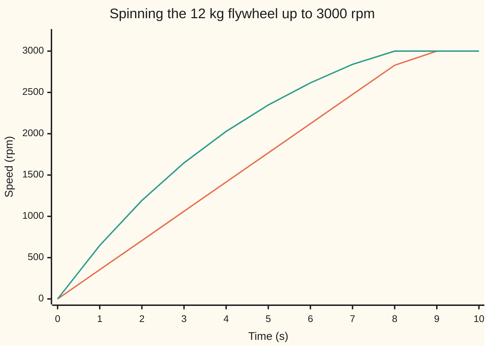

# Rotation: moment of inertia is the mass that resists being spun

[Syllabus](../../../SYLLABUS.md) → [Engineering mathematics](../README.md) → [Mechanics and Structures](../README.md#s07) → Rotation

---

## General Overview

A flywheel is a heavy wheel kept spinning to store energy or to smooth out jerky power. Ours is a solid steel disc: 12 kg, 300 mm across, 21.6 mm thick. A motor spins it up to 3000 rpm (revolutions per minute: 3000 full turns each minute).

An engineer wants three numbers. How long does a motor giving a steady 5 N m of twist take to get it there? How much energy is then stored in it? And if the disc is hung on a pin to check it on the bench, how fast should it swing? The answers are 8.482 s, 6662.0 J, and one swing every 0.9276 s.

All three hang on one number: how hard the disc is to spin. Mass alone does not settle that. A bit of steel at the rim moves faster than a bit near the axle, for the same turning speed, and it resists the turn through a longer lever arm. Distance from the axis counts twice, so it enters squared. Add up every bit's mass times its distance squared and you get the disc's **moment of inertia**, the term used from here on: 0.135 kg m^2 for this disc.

**Moment of inertia is mass weighted by the square of its distance from the spin axis; a twisting push (torque) changes spin at a rate set by that number, exactly as a force changes speed at a rate set by mass.**

**What kind of fact this is:** moment of inertia is a definition; "torque is the rate of change of angular momentum" and the shift-of-axis rule are theorems, proved on this card in Why it works from Newton's laws for each bit of the body.

### The picture: the flywheel's face

<p align="center"></p>

Drawn to scale, 2000 units to 1 m. The shaded ring is one slice of the integral: every bit of it sits the same distance r from the axis. The open circle is the pin the disc hangs on for the bench test, 0.12 m from the centre.

---

## The formula

Notation first, in words. The spin speed is written $\omega$ (omega), in radians per second: one turn is $2\pi$ radians, so 3000 rpm is $3000 \times 2\pi / 60 = 314.159$ rad/s. A tiny bit of the body has mass $dm$, and $r$ is its distance from the spin axis, measured square to the axis.

$$I = \iiint_{\text{body}} r^2 \, \rho \, dV \qquad L = I\omega \qquad \tau = \frac{dL}{dt} \qquad I_P = I + m d^2$$

**Read it aloud:** the moment of inertia adds up each bit's mass times its distance squared; the angular momentum is that number times the spin speed; the torque on the body is how fast its angular momentum changes; and about a parallel axis a distance $d$ away, the moment of inertia grows by the whole mass times $d$ squared.

For a uniform solid disc the integral comes out (Step 3 below) as

$$I = \tfrac12 m R^2 = \tfrac12 \times 12 \times 0.15^2 = 0.135 \text{ kg m}^2,$$

and the energy stored in the spin is $E = \tfrac12 I \omega^2$. In the wing's dimension brackets, $I$ has dimensions $[M][L]^2$: a mass times a length squared.

| Symbol | Plain meaning | In our example | Push it up and the answer… |
| --- | --- | --- | --- |
| $m$ | the body's mass | 12 kg | $I$ rises in step |
| $R$, $h$ | disc radius; disc thickness | 0.15 m; 0.0216 m | $I$ rises as $R^2$; $h$ only through the mass |
| $r$, $dm$ | one bit's distance from the spin axis; that bit's mass | 0 to 0.15 m | far bits count most |
| $\rho$, $dV$ | density, mass per cubic metre; one tiny piece's volume | 7860 kg/m^3, uniform (steel); boxes 1 mm square on the face | — |
| $I$ | moment of inertia about the spin axis | 0.135 kg m^2 | slower spin-up, more energy stored |
| $\omega$ | spin speed in radians per second | 314.159 rad/s (3000 rpm) | energy rises as $\omega^2$ |
| $L$ | angular momentum, "amount of spin" | 42.412 kg m^2/s | longer to build, longer to stop |
| $\tau$, $\alpha$ | torque, a twisting push in newton metres; angular acceleration, how fast $\omega$ rises | 5 N m; 37.037 rad/s^2 | shorter spin-up |
| $t$, $E$ | time; kinetic energy of the spin | 8.482 s; 6662.0 J | — |
| $d$, $I_P$, $x$, $y$ | distance from the centre to a parallel axis (the pin); moment of inertia about it; position across the face | 0.12 m; 0.307800 kg m^2 | $I_P$ rises as $d^2$ |
| $g$, $T$, $\theta$, $\ddot\theta$ | standard gravity; time for one full swing on the pin; swing angle from straight down; its angular acceleration | 9.80665 m/s^2; 0.9276 s; 5 degrees | — |
| $\tau_0$, $\omega_0$, $t_c$, $\tau_f$ | a real motor's torque at standstill, its top speed, and its time constant; a clutch's friction torque | 10 N m, 4000 rpm, 5.655 s; 20 N m | — |

### When it holds

- **The body is rigid: every bit keeps its distance from the axis.** A skater pulling in her arms changes $I$ while spinning; then $L = I\omega$ still holds moment by moment, but $\tau = I\alpha$ does not.
- **The spin axis keeps its direction.** Tilt the axle of a spinning wheel and the torque turns the axis sideways instead of speeding the spin: that is [Precession](03-gyroscopes-and-precession.md).
- **The shift rule starts from the centre of mass.** $I_P = I + md^2$ needs $I$ about the axis through the centre of mass. Shifting from one off-centre axis to another by the gap between them gives a wrong answer; go through the centre.
- **$\tfrac12 mR^2$ needs uniform density.** A flywheel with a heavy rim and a thin web has more, up to $mR^2 = 0.270$ kg m^2 if all the mass sat on the rim.
- **The swing formula needs small swings.** Released at 5 degrees the disc swings in 0.9281 s against the formula's 0.9276 s. Released at 60 degrees it takes 0.9955 s, and the $I$ worked back from that reads 34.6% high.

---

## Why it works

### Step 0: a spinning body is a crowd of bits, each obeying Newton's law

Nothing new is needed. Each bit of the disc moves in a circle, and [Newton's laws](01-newtons-laws-work-and-energy.md) govern each bit separately. A bit at distance $r$ from the axis moves at speed $r\omega$. When the spin speeds up at rate $\alpha$, that bit speeds up at $r\alpha$, so the push along its path must be $dm \times r\alpha$. The rest of the card is adding the crowd up.

### Step 1: the distance enters twice, so it is squared

A push along the bit's path, at distance $r$, twists the body by push times lever arm: $r \times dm\, r\alpha = r^2\, dm\, \alpha$. One $r$ comes from the bit's speed, the other from its lever. Add over the body:

$$\tau = \left(\iiint r^2\, \rho\, dV\right)\alpha = I\alpha.$$

The energy shows the same squaring. A bit's kinetic energy is $\tfrac12 dm (r\omega)^2$; add them and get $\tfrac12 I\omega^2$, the spinning twin of $\tfrac12 m v^2$.

### Step 2: torque is the rate of change of angular momentum

A bit's angular momentum (its momentum times its lever arm) is $r \times dm\, r\omega$. Added up, $L = I\omega$. For a rigid body $I$ is fixed, so $dL/dt = I\, d\omega/dt = I\alpha = \tau$.

What about the forces the bits exert on each other, the forces that hold the steel together? Each pair pushes equally and oppositely along the line joining them (Newton's third law). Equal and opposite pushes on the same line have the same lever arm, so their twists cancel. Only torques from outside the body survive.

That cancellation is what makes the clutch problem easy. When the spinning flywheel is clutched to an identical, still disc, the clutch twists them equally and oppositely. The total angular momentum cannot change, so the pair locks at half the speed, 1500.0 rpm. Energy is not kept: the slipping clutch turns 3331.0 J, exactly half, into heat.

### Step 3: the integral for a solid disc

Cut the disc into thin rings, as in the picture. A ring of radius $r$ and width $dr$ has volume $2\pi r\, h\, dr$, and every bit of it sits at distance $r$. Adding rings is a [Triple integrals](../../06-Calculus%20and%20analysis/08-Multiple%20Integrals/02-triple-integrals.md) sum done in cylindrical coordinates, with the angle and the height already added:

$$I = \int_0^R r^2 \, \rho \, 2\pi r h \, dr = 2\pi\rho h \frac{R^4}{4} = \tfrac12 (\rho\, \pi R^2 h) R^2 = \tfrac12 m R^2.$$

The bracket $\rho \pi R^2 h$ is density times volume: the mass. So the disc behaves as if all 12 kg sat at $R/\sqrt2$ from the axis, a little over two-thirds of the way out.

### Step 4: shifting the axis

Put the pin at distance $d$ along the $x$ direction. A bit at position $(x, y)$ on the face is at squared distance $(x - d)^2 + y^2$ from the pin. Multiply out:

$$(x-d)^2 + y^2 = (x^2 + y^2) - 2d\,x + d^2.$$

Add over the body, each term times the bit's mass. The first term adds to $I$. The last adds to $m d^2$. The middle adds to $-2d$ times the body's first moment, $\iiint x\, \rho\, dV$, and that is zero because the centre is the centre of mass ([Centre of mass](../../06-Calculus%20and%20analysis/05-Curves%20and%20Solids/05-centre-of-mass-and-pappus.md)): bits to the left balance bits to the right. What is left is $I_P = I + md^2$.

<details>
<summary>The bench swing: why the period gives the moment of inertia</summary>

Hung on the pin, the disc's weight $mg$ acts at the centre, a lever arm $d \sin\theta$ from the pin. Step 2 about the pin gives $I_P\, \ddot\theta = -m g d \sin\theta$, where $\ddot\theta$ is the angular acceleration of the swing. For small swings $\sin\theta \approx \theta$, the motion is a pure oscillation, and one full swing takes

$$T = 2\pi \sqrt{\frac{I_P}{m g d}}.$$

Turned round, a stopwatch gives $I_P = mgd\,(T/2\pi)^2$, and Step 4 gives $I = I_P - md^2$. That is how odd-shaped parts, such as a connecting rod, are measured. The small-swing step is the weak point: see When it holds.

</details>

---

## Worked numbers, by hand

The flywheel, $m = 12$ kg, $R = 0.15$ m, spun to 3000 rpm by a steady 5 N m.

| Step | Arithmetic | Value |
| --- | --- | --- |
| spin speed $\omega$ | $3000 \times 2\pi / 60$ | 314.159 rad/s |
| moment of inertia $I$ | $\tfrac12 \times 12 \times 0.15^2$ | 0.135000 kg m^2 |
| angular momentum $L$ | $0.135 \times 314.159$ | 42.412 kg m^2/s |
| angular acceleration $\alpha$ | $5 / 0.135$ | 37.037 rad/s^2 |
| energy stored $E$ | $\tfrac12 \times 0.135 \times 314.159^2$ | 6662.0 J = 1.851 Wh (watt-hours; 1 Wh = 3600 J) |
| turns during spin-up | $\tfrac12 \omega t / 2\pi$ | 212.1 |
| work done by the motor | $5 \times$ angle turned | 6662.0 J |
| moment of inertia about the pin $I_P$ | $0.135 + 12 \times 0.12^2$ | 0.307800 kg m^2 |
| one swing on the pin $T$ | $2\pi\sqrt{0.3078 / (12 \times 9.80665 \times 0.12)}$ | 0.9276 s |
| **spin-up time** $t = L/\tau$ | $42.412 / 5$ | **8.482 s** |

So a 5 N m motor needs 8.482 s to bring the disc to 3000 rpm, and the disc then holds 6662.0 J, the same as the work the motor put in. That is 1.851 Wh, small for storage, which is why storage flywheels spin far faster: energy grows as the square of speed.

### What breaks if you drop a piece

| Mistake | Comes out at | What went wrong |
| --- | --- | --- |
| rpm put in where rad/s belongs | $E$ = 607500 J (right: 6662.0 J) | rpm counts turns per minute; $\omega$ must be radians per second |
| all the mass treated as sitting at the rim, $I = mR^2$ | $I$ = 0.270 kg m^2, spin-up 16.96 s, $E$ = 13324 J | a solid disc has most of its steel well inside the rim |
| diameter used for radius | $I$ = 0.540 kg m^2 | $R$ is squared, so the error is squared too |
| pin swing worked out with $I$, not $I_P$ | 0.6143 s (right: 0.9276 s) | the disc turns about the pin, not about its centre |
| $I$ worked back from a 60-degree swing | 0.1817 kg m^2, 34.6% high | the swing formula is for small angles only |
| clutch worked out by keeping energy | 2121.3 rpm (right: 1500.0 rpm) | the slipping clutch makes heat; only angular momentum is kept |

---

## Spinning it up with a real motor

A real electric motor does not give a steady torque. It pushes hardest at standstill and its torque falls to nothing at its top speed. Take one with $\tau_0 = 10$ N m at standstill and a top speed $\omega_0$ of 4000 rpm, so its torque is $\tau = \tau_0 (1 - \omega/\omega_0)$. Does $\tau = dL/dt$ still give the spin-up time? Yes: it holds at every instant, whatever the torque is doing.

### One spin-up, two seconds at a time

| Time | Speed | Motor torque | Angular momentum |
| --- | --- | --- | --- |
| 0.00 s | 0 rpm | 10.00 N m | 0.00 kg m^2/s |
| 2.00 s | 1192 rpm | 7.02 N m | 16.85 kg m^2/s |
| 4.00 s | 2028 rpm | 4.93 N m | 28.67 kg m^2/s |
| 6.00 s | 2616 rpm | 3.46 N m | 36.98 kg m^2/s |
| 7.84 s | 3000 rpm | 2.50 N m | 42.41 kg m^2/s |

Each row's angular momentum is the area under the torque curve so far. The flywheel reaches 3000 rpm in 7.839 s, faster than the steady 5 N m motor. This motor pushes harder than 5 N m only until 3.92 s, half the run, but its surplus early on outweighs its shortfall later: its average torque, 42.412 / 7.839, is 5.41 N m.

### The torque, one moment at a time

```
t 0.00 s  ████████████████████████████████████████  10.00 N m
t 2.00 s  ████████████████████████████              7.02 N m
t 4.00 s  ████████████████████                      4.93 N m
t 6.00 s  ██████████████                            3.46 N m
t 7.84 s  ██████████                                2.50 N m
```

The equation $I\, d\omega/dt = \tau_0 (1 - \omega/\omega_0)$ has the solution $\omega = \omega_0 (1 - e^{-t/t_c})$ with time constant $t_c = I\omega_0/\tau_0 = 5.655$ s. Setting $\omega$ to 3000 rpm gives $t = t_c \ln 4 = 7.839$ s, matching the step-by-step simulation. And the work the motor did, added up along the way, is again 6662.0 J: the energy stored depends only on the final speed, not on how the motor got there.

### Both motors on one chart



First line (orange): the steady 5 N m motor, a straight line to 3000 rpm at 8.482 s. Second line (teal): the real motor, steep at first and bending over as its torque fades, reaching 3000 rpm at 7.839 s. Both are cut off at 3000 rpm.

---

## Code, from first principles, and it actually runs

The script takes four roads. The moment of inertia comes from the closed form $\tfrac12 mR^2$, from 1000 thin rings added up, and from brute force: the disc filled with tiny boxes, each box's mass times its squared distance added up, at box sides from 10 mm down to 1 mm. The same boxes, measured from the pin, check the shift rule. Then an RK4 simulation (the four-stage step-by-step solver of [Runge-Kutta four](../../08-Differential%20equations%20and%20dynamics/05-Numerical%20Evolution/04-runge-kutta-four.md)) spins the disc up under both motors and adds up the motor's work, swings it on the pin at 5 and 60 degrees, and slips the clutch until the two discs lock. Every number on the card is printed below.

### Python

```python
# Rotation and moment of inertia -- the check behind the card.  Standard library only.
# A 12 kg solid disc flywheel, 0.15 m radius, spun to 3000 rpm.  Roads to each answer:
# the closed form, a ring-by-ring sum, a brute-force box sum, and RK4 simulations.
from math import pi, sqrt, sin, log, exp

m, R, h = 12.0, 0.15, 0.0216            # mass kg, radius m, thickness m
rpm = 3000.0
w = rpm * 2 * pi / 60                   # angular speed, rad/s
g = 9.80665                             # standard gravity, m/s^2 (NIST)
d = 0.12                                # pivot pin, m from the centre
rho = m / (pi * R * R * h)              # uniform density, kg/m^3

I = 0.5 * m * R * R                     # road 1: the closed form
I_rings = 0.0                           # road 2: thin rings, midpoint rule
n = 1000
for k in range(n):
    r = (k + 0.5) * R / n
    I_rings += r * r * rho * h * 2 * pi * r * (R / n)

def box_sum(n):                         # road 3: boxes over x, y and z
    s, nz = 2 * R / n, 4
    dm = rho * s * s * (h / nz)
    M = Ic = Ip = Qx = 0.0
    for i in range(n):
        x = -R + (i + 0.5) * s
        for j in range(n):
            y = -R + (j + 0.5) * s
            if x * x + y * y <= R * R:
                for _ in range(nz):
                    M += dm; Qx += x * dm
                    Ic += (x * x + y * y) * dm
                    Ip += ((x - d) * (x - d) + y * y) * dm
    return M, Ic, Ip, Qx

L = I * w
E = 0.5 * I * w * w
Ip = I + m * d * d                      # parallel-axis theorem

def spin(tau0, w0, dt=0.001):           # RK4 on dw/dt = tau/I, work dW/dt = tau*w
    f = lambda om: tau0 * (1 - om / w0) / I
    t, om, W, pts = 0.0, 0.0, 0.0, []
    while True:
        if abs(t - round(t)) < 1e-9: pts.append(om * 60 / (2 * pi))
        k1 = f(om); k2 = f(om + dt / 2 * k1); k3 = f(om + dt / 2 * k2); k4 = f(om + dt * k3)
        new = om + dt / 6 * (k1 + 2 * k2 + 2 * k3 + k4)
        dW = dt / 6 * (I * k1 * om + 2 * I * k2 * (om + dt / 2 * k1)
                       + 2 * I * k3 * (om + dt / 2 * k2) + I * k4 * (om + dt * k3))
        if new >= w:                    # hit 3000 rpm inside this step: take that part
            frac = (w - om) / (new - om)
            return t + frac * dt, W + frac * dW, pts
        t, om, W = t + dt, new, W + dW

def swing(theta0_deg, dt=1e-4):        # RK4 pendulum about the pin; returns the period
    k = m * g * d / Ip
    th, om, t = theta0_deg * pi / 180, 0.0, 0.0
    while True:
        a1, v1 = -k * sin(th), om
        a2, v2 = -k * sin(th + dt / 2 * v1), om + dt / 2 * a1
        a3, v3 = -k * sin(th + dt / 2 * v2), om + dt / 2 * a2
        a4, v4 = -k * sin(th + dt * v3), om + dt * a3
        nth = th + dt / 6 * (v1 + 2 * v2 + 2 * v3 + v4)
        if nth <= 0:                    # first pass through the bottom: a quarter swing
            return 4 * (t + dt * th / (th - nth))
        om += dt / 6 * (a1 + 2 * a2 + 2 * a3 + a4); th = nth; t += dt

def clutch(tf, dt=1e-4):                # flywheel grabs an identical still disc
    w1, w2, t, heat = w, 0.0, 0.0, 0.0
    while True:
        step = min(dt, (w1 - w2) / (2 * tf / I))
        slip0 = w1 - w2
        w1 -= tf / I * step; w2 += tf / I * step
        heat += tf * (slip0 + (w1 - w2)) / 2 * step; t += step
        if w1 - w2 <= 1e-12: return t, w1, w2, heat

print(f"flywheel: m {m:.0f} kg, R {R:.3f} m, thickness {h:.4f} m, density {rho:.0f} kg/m^3, {rpm:.0f} rpm = {w:.3f} rad/s")
print(f"I closed form 1/2 m R^2        {I:.6f} kg m^2")
print(f"I 1000 thin rings              {I_rings:.6f} kg m^2")
for nb in (30, 60, 150, 300):
    M, Ic_b, Ip_b, Qx = box_sum(nb)
    print(f"I boxes of side {2000 * R / nb:4.1f} mm        {Ic_b:.6f} kg m^2 (mass {M:.4f} kg)")
print(f"I about pin, boxes 1 mm        {Ip_b:.6f} kg m^2; I + m d^2 = {Ip:.6f}")
print(f"first moment about centre      {Qx:.6f} kg m")
print(f"L = I w {L:.3f} kg m^2/s;  E = I w^2/2 {E:.1f} J = {E / 3600:.3f} Wh")
t5 = L / 5.0
print(f"5 N m constant: alpha {5.0 / I:.3f} rad/s^2, t = L/tau {t5:.3f} s, turns {0.5 * w * t5 / (2 * pi):.1f}, work {5.0 * 0.5 * w * t5:.1f} J")
ts, Ws, pc = spin(5.0, float('inf'))
w0 = 4000 * 2 * pi / 60
tc = I * w0 / 10.0
t_exact = -tc * log(1 - w / w0)
tm, Wm, pm = spin(10.0, w0)
print(f"RK4 constant: t {ts:.3f} s, work {Ws:.1f} J")
print(f"real motor (10 N m stall, 4000 rpm free): time constant {tc:.3f} s, t {t_exact:.3f} s, RK4 t {tm:.3f} s, work {Wm:.1f} J")
print(f"real motor: average torque L/t {L / t_exact:.2f} N m; above 5 N m until {tc * log(2):.2f} s, below after")
for s in (0.0, 2.0, 4.0, 6.0, t_exact):
    om = w0 * (1 - exp(-s / tc))
    print(f"story t {s:.2f} s: {om * 60 / (2 * pi):6.0f} rpm, torque {10.0 * (1 - om / w0):5.2f} N m, L {I * om:6.2f} kg m^2/s")
cap = lambda p: [min(rpm, x) for x in p] + [rpm] * (11 - len(p))
print("chart, t s         " + " ".join(f"{s:5d}" for s in range(11)))
print("chart, 5 N m rpm   " + " ".join(f"{x:5.0f}" for x in cap(pc)))
print("chart, motor rpm   " + " ".join(f"{x:5.0f}" for x in cap(pm)))
T0 = 2 * pi * sqrt(Ip / (m * g * d))
T5, T60 = swing(5.0), swing(60.0)
Ic_60 = m * g * d * (T60 / (2 * pi)) ** 2 - m * d * d
print(f"swing on pin: formula {T0:.4f} s, RK4 5 deg {T5:.4f} s, RK4 60 deg {T60:.4f} s")
print(f"I from a 60 deg swing {Ic_60:.4f} kg m^2 ({100 * (Ic_60 / I - 1):.1f}% high)")
tl, w1, w2, heat = clutch(20.0)
print(f"clutch 20 N m: locks {tl:.4f} s at {w1 * 60 / (2 * pi):.1f} rpm, heat {heat:.1f} J")
# what breaks
print(f"break, rpm used as rad/s: E {0.5 * I * rpm * rpm:.0f} J")
print(f"break, all mass at rim m R^2: I {m * R * R:.3f}, t {m * R * R * w / 5.0:.2f} s, E {0.5 * m * R * R * w * w:.0f} J")
print(f"break, diameter for radius: I {0.5 * m * (2 * R) ** 2:.3f} kg m^2")
print(f"break, swing period with I not I_P: {2 * pi * sqrt(I / (m * g * d)):.4f} s")
print(f"break, clutch by energy: {rpm / sqrt(2):.1f} rpm")
t40, _, _, heat40 = clutch(40.0)
print(f"try, 6000 rpm: L {2 * L:.3f} kg m^2/s, E {0.5 * I * (2 * w) ** 2:.1f} J; clutch 40 N m: locks {t40:.4f} s, heat {heat40:.1f} J")
print("figure, scale 2000 per m, centre (380,330), rim r 300, ring r 180 width 20, pin (620,330)")

assert abs(I_rings - I) < 1e-6                           # ring sum agrees with 1/2 m R^2
assert abs(Ic_b - I) / I < 2e-3                          # box sum at 1 mm agrees
assert abs(Ip_b - (Ic_b + M * d * d)) < 1e-9 * Ip        # shift of axes, box by box
assert abs(Ip_b - Ip) / Ip < 2e-3
assert abs(ts - t5) < 1e-6 and abs(Ws - E) < 1e-6 * E    # tau = dL/dt; work = energy
assert abs(tm - t_exact) < 1e-4 and abs(Wm - E) < 1e-6 * E
assert abs(T5 - T0) / T0 < 1e-3 and T60 > 1.05 * T0      # small swing obeys formula; big does not
assert abs(w1 - w / 2) < 1e-6 and abs(heat - E / 2) < 1e-6 * E   # L kept, half the energy lost
print("ALL CHECKS PASS")
```

**Ran 2026-11-11 on macOS, Python 3.14.10, standard library only. All checks passed. Output, pasted from the run:**

```
flywheel: m 12 kg, R 0.150 m, thickness 0.0216 m, density 7860 kg/m^3, 3000 rpm = 314.159 rad/s
I closed form 1/2 m R^2        0.135000 kg m^2
I 1000 thin rings              0.135000 kg m^2
I boxes of side 10.0 mm        0.138484 kg m^2 (mass 12.1552 kg)
I boxes of side  5.0 mm        0.135047 kg m^2 (mass 12.0024 kg)
I boxes of side  2.0 mm        0.135314 kg m^2 (mass 12.0139 kg)
I boxes of side  1.0 mm        0.135008 kg m^2 (mass 12.0004 kg)
I about pin, boxes 1 mm        0.307814 kg m^2; I + m d^2 = 0.307800
first moment about centre      0.000000 kg m
L = I w 42.412 kg m^2/s;  E = I w^2/2 6662.0 J = 1.851 Wh
5 N m constant: alpha 37.037 rad/s^2, t = L/tau 8.482 s, turns 212.1, work 6662.0 J
RK4 constant: t 8.482 s, work 6662.0 J
real motor (10 N m stall, 4000 rpm free): time constant 5.655 s, t 7.839 s, RK4 t 7.839 s, work 6662.0 J
real motor: average torque L/t 5.41 N m; above 5 N m until 3.92 s, below after
story t 0.00 s:      0 rpm, torque 10.00 N m, L   0.00 kg m^2/s
story t 2.00 s:   1192 rpm, torque  7.02 N m, L  16.85 kg m^2/s
story t 4.00 s:   2028 rpm, torque  4.93 N m, L  28.67 kg m^2/s
story t 6.00 s:   2616 rpm, torque  3.46 N m, L  36.98 kg m^2/s
story t 7.84 s:   3000 rpm, torque  2.50 N m, L  42.41 kg m^2/s
chart, t s             0     1     2     3     4     5     6     7     8     9    10
chart, 5 N m rpm       0   354   707  1061  1415  1768  2122  2476  2829  3000  3000
chart, motor rpm       0   648  1192  1647  2028  2348  2616  2840  3000  3000  3000
swing on pin: formula 0.9276 s, RK4 5 deg 0.9281 s, RK4 60 deg 0.9955 s
I from a 60 deg swing 0.1817 kg m^2 (34.6% high)
clutch 20 N m: locks 1.0603 s at 1500.0 rpm, heat 3331.0 J
break, rpm used as rad/s: E 607500 J
break, all mass at rim m R^2: I 0.270, t 16.96 s, E 13324 J
break, diameter for radius: I 0.540 kg m^2
break, swing period with I not I_P: 0.6143 s
break, clutch by energy: 2121.3 rpm
try, 6000 rpm: L 84.823 kg m^2/s, E 26647.9 J; clutch 40 N m: locks 0.5301 s, heat 3331.0 J
figure, scale 2000 per m, centre (380,330), rim r 300, ring r 180 width 20, pin (620,330)
ALL CHECKS PASS
```

### Rust

```rust
// Rotation and moment of inertia -- the check behind the card.  Rust std only.
// A 12 kg solid disc flywheel, 0.15 m radius, spun to 3000 rpm.  Roads to each answer:
// the closed form, a ring-by-ring sum, a brute-force box sum, and RK4 simulations.
use std::f64::consts::PI;

const M: f64 = 12.0; // mass, kg
const R: f64 = 0.15; // radius, m
const H: f64 = 0.0216; // thickness, m
const RPM: f64 = 3000.0;
const G: f64 = 9.80665; // standard gravity, m/s^2 (NIST)
const D: f64 = 0.12; // pivot pin, m from the centre

fn rho() -> f64 { M / (PI * R * R * H) }

// road 3: boxes over x, y and z; returns mass, I about centre, I about pin, first moment
fn box_sum(n: usize) -> (f64, f64, f64, f64) {
    let (s, nz) = (2.0 * R / n as f64, 4);
    let dm = rho() * s * s * (H / nz as f64);
    let (mut m, mut ic, mut ip, mut qx) = (0.0, 0.0, 0.0, 0.0);
    for i in 0..n {
        let x = -R + (i as f64 + 0.5) * s;
        for j in 0..n {
            let y = -R + (j as f64 + 0.5) * s;
            if x * x + y * y <= R * R {
                for _ in 0..nz {
                    m += dm; qx += x * dm;
                    ic += (x * x + y * y) * dm;
                    ip += ((x - D) * (x - D) + y * y) * dm;
                }
            }
        }
    }
    (m, ic, ip, qx)
}

// RK4 on dw/dt = tau/I, work dW/dt = tau*w; stops at the target speed
fn spin(i: f64, w: f64, tau0: f64, w0: f64) -> (f64, f64, Vec<f64>) {
    let dt = 0.001;
    let f = |om: f64| tau0 * (1.0 - om / w0) / i;
    let (mut t, mut om, mut wk, mut pts) = (0.0f64, 0.0f64, 0.0f64, Vec::new());
    loop {
        if (t - t.round()).abs() < 1e-9 { pts.push(om * 60.0 / (2.0 * PI)); }
        let k1 = f(om); let k2 = f(om + dt / 2.0 * k1); let k3 = f(om + dt / 2.0 * k2); let k4 = f(om + dt * k3);
        let new = om + dt / 6.0 * (k1 + 2.0 * k2 + 2.0 * k3 + k4);
        let dw = dt / 6.0 * (i * k1 * om + 2.0 * i * k2 * (om + dt / 2.0 * k1)
            + 2.0 * i * k3 * (om + dt / 2.0 * k2) + i * k4 * (om + dt * k3));
        if new >= w {
            let frac = (w - om) / (new - om);
            return (t + frac * dt, wk + frac * dw, pts);
        }
        t += dt; om = new; wk += dw;
    }
}

// RK4 pendulum about the pin; returns the period
fn swing(ip: f64, theta0_deg: f64) -> f64 {
    let dt = 1e-4;
    let k = M * G * D / ip;
    let (mut th, mut om, mut t) = (theta0_deg * PI / 180.0, 0.0f64, 0.0f64);
    loop {
        let (a1, v1) = (-k * th.sin(), om);
        let (a2, v2) = (-k * (th + dt / 2.0 * v1).sin(), om + dt / 2.0 * a1);
        let (a3, v3) = (-k * (th + dt / 2.0 * v2).sin(), om + dt / 2.0 * a2);
        let (a4, v4) = (-k * (th + dt * v3).sin(), om + dt * a3);
        let nth = th + dt / 6.0 * (v1 + 2.0 * v2 + 2.0 * v3 + v4);
        if nth <= 0.0 { return 4.0 * (t + dt * th / (th - nth)); }
        om += dt / 6.0 * (a1 + 2.0 * a2 + 2.0 * a3 + a4); th = nth; t += dt;
    }
}

// flywheel grabs an identical still disc through a slipping clutch
fn clutch(i: f64, w: f64, tf: f64) -> (f64, f64, f64, f64) {
    let dt: f64 = 1e-4;
    let (mut w1, mut w2, mut t, mut heat) = (w, 0.0f64, 0.0f64, 0.0f64);
    loop {
        let step = dt.min((w1 - w2) / (2.0 * tf / i));
        let slip0 = w1 - w2;
        w1 -= tf / i * step; w2 += tf / i * step;
        heat += tf * (slip0 + (w1 - w2)) / 2.0 * step; t += step;
        if w1 - w2 <= 1e-12 { return (t, w1, w2, heat); }
    }
}

fn main() {
    let w = RPM * 2.0 * PI / 60.0;
    let i = 0.5 * M * R * R; // road 1: the closed form
    let n = 1000;
    let mut i_rings = 0.0; // road 2: thin rings, midpoint rule
    for k in 0..n {
        let r = (k as f64 + 0.5) * R / n as f64;
        i_rings += r * r * rho() * H * 2.0 * PI * r * (R / n as f64);
    }
    let l = i * w;
    let e = 0.5 * i * w * w;
    let ip = i + M * D * D; // parallel-axis theorem

    println!("flywheel: m {:.0} kg, R {:.3} m, thickness {:.4} m, density {:.0} kg/m^3, {:.0} rpm = {:.3} rad/s", M, R, H, rho(), RPM, w);
    println!("I closed form 1/2 m R^2        {:.6} kg m^2", i);
    println!("I 1000 thin rings              {:.6} kg m^2", i_rings);
    let mut last = (0.0, 0.0, 0.0, 0.0);
    for nb in [30usize, 60, 150, 300] {
        last = box_sum(nb);
        println!("I boxes of side {:4.1} mm        {:.6} kg m^2 (mass {:.4} kg)", 2000.0 * R / nb as f64, last.1, last.0);
    }
    let (mb, ic_b, ip_b, qx) = last;
    println!("I about pin, boxes 1 mm        {:.6} kg m^2; I + m d^2 = {:.6}", ip_b, ip);
    println!("first moment about centre      {:.6} kg m", qx);
    println!("L = I w {:.3} kg m^2/s;  E = I w^2/2 {:.1} J = {:.3} Wh", l, e, e / 3600.0);
    let t5 = l / 5.0;
    println!("5 N m constant: alpha {:.3} rad/s^2, t = L/tau {:.3} s, turns {:.1}, work {:.1} J",
        5.0 / i, t5, 0.5 * w * t5 / (2.0 * PI), 5.0 * 0.5 * w * t5);
    let (ts, ws, pc) = spin(i, w, 5.0, f64::INFINITY);
    let w0 = 4000.0 * 2.0 * PI / 60.0;
    let tc = i * w0 / 10.0;
    let t_exact = -tc * (1.0 - w / w0).ln();
    let (tm, wm, pm) = spin(i, w, 10.0, w0);
    println!("RK4 constant: t {:.3} s, work {:.1} J", ts, ws);
    println!("real motor (10 N m stall, 4000 rpm free): time constant {:.3} s, t {:.3} s, RK4 t {:.3} s, work {:.1} J", tc, t_exact, tm, wm);
    println!("real motor: average torque L/t {:.2} N m; above 5 N m until {:.2} s, below after", l / t_exact, tc * 2f64.ln());
    for s in [0.0, 2.0, 4.0, 6.0, t_exact] {
        let om = w0 * (1.0 - (-s / tc).exp());
        println!("story t {:.2} s: {:6.0} rpm, torque {:5.2} N m, L {:6.2} kg m^2/s", s, om * 60.0 / (2.0 * PI), 10.0 * (1.0 - om / w0), i * om);
    }
    let cap = |p: &Vec<f64>| { let mut v: Vec<f64> = p.iter().map(|x| x.min(RPM)).collect(); while v.len() < 11 { v.push(RPM); } v };
    println!("chart, t s         {}", (0..11).map(|s| format!("{:5}", s)).collect::<Vec<_>>().join(" "));
    println!("chart, 5 N m rpm   {}", cap(&pc).iter().map(|x| format!("{:5.0}", x)).collect::<Vec<_>>().join(" "));
    println!("chart, motor rpm   {}", cap(&pm).iter().map(|x| format!("{:5.0}", x)).collect::<Vec<_>>().join(" "));
    let t0 = 2.0 * PI * (ip / (M * G * D)).sqrt();
    let (t5d, t60) = (swing(ip, 5.0), swing(ip, 60.0));
    let ic_60 = M * G * D * (t60 / (2.0 * PI)).powi(2) - M * D * D;
    println!("swing on pin: formula {:.4} s, RK4 5 deg {:.4} s, RK4 60 deg {:.4} s", t0, t5d, t60);
    println!("I from a 60 deg swing {:.4} kg m^2 ({:.1}% high)", ic_60, 100.0 * (ic_60 / i - 1.0));
    let (tl, w1, _w2, heat) = clutch(i, w, 20.0);
    println!("clutch 20 N m: locks {:.4} s at {:.1} rpm, heat {:.1} J", tl, w1 * 60.0 / (2.0 * PI), heat);
    println!("break, rpm used as rad/s: E {:.0} J", 0.5 * i * RPM * RPM);
    println!("break, all mass at rim m R^2: I {:.3}, t {:.2} s, E {:.0} J", M * R * R, M * R * R * w / 5.0, 0.5 * M * R * R * w * w);
    println!("break, diameter for radius: I {:.3} kg m^2", 0.5 * M * (2.0 * R).powi(2));
    println!("break, swing period with I not I_P: {:.4} s", 2.0 * PI * (i / (M * G * D)).sqrt());
    println!("break, clutch by energy: {:.1} rpm", RPM / 2f64.sqrt());
    let (t40, _, _, heat40) = clutch(i, w, 40.0);
    println!("try, 6000 rpm: L {:.3} kg m^2/s, E {:.1} J; clutch 40 N m: locks {:.4} s, heat {:.1} J", 2.0 * l, 0.5 * i * (2.0 * w) * (2.0 * w), t40, heat40);
    println!("figure, scale 2000 per m, centre (380,330), rim r 300, ring r 180 width 20, pin (620,330)");

    assert!((i_rings - i).abs() < 1e-6); // ring sum agrees with 1/2 m R^2
    assert!((ic_b - i).abs() / i < 2e-3); // box sum at 1 mm agrees
    assert!((ip_b - (ic_b + mb * D * D)).abs() < 1e-9 * ip); // shift of axes, box by box
    assert!((ip_b - ip).abs() / ip < 2e-3);
    assert!((ts - t5).abs() < 1e-6 && (ws - e).abs() < 1e-6 * e); // tau = dL/dt; work = energy
    assert!((tm - t_exact).abs() < 1e-4 && (wm - e).abs() < 1e-6 * e);
    assert!((t5d - t0).abs() / t0 < 1e-3 && t60 > 1.05 * t0); // small swing obeys formula; big does not
    assert!((w1 - w / 2.0).abs() < 1e-6 && (heat - e / 2.0).abs() < 1e-6 * e); // L kept, half the energy lost
    println!("ALL CHECKS PASS");
}
```

**Ran 2026-11-11 on macOS, rustc 1.98.1, no crates. All checks passed. Output, pasted from the run:**

```
flywheel: m 12 kg, R 0.150 m, thickness 0.0216 m, density 7860 kg/m^3, 3000 rpm = 314.159 rad/s
I closed form 1/2 m R^2        0.135000 kg m^2
I 1000 thin rings              0.135000 kg m^2
I boxes of side 10.0 mm        0.138484 kg m^2 (mass 12.1552 kg)
I boxes of side  5.0 mm        0.135047 kg m^2 (mass 12.0024 kg)
I boxes of side  2.0 mm        0.135314 kg m^2 (mass 12.0139 kg)
I boxes of side  1.0 mm        0.135008 kg m^2 (mass 12.0004 kg)
I about pin, boxes 1 mm        0.307814 kg m^2; I + m d^2 = 0.307800
first moment about centre      0.000000 kg m
L = I w 42.412 kg m^2/s;  E = I w^2/2 6662.0 J = 1.851 Wh
5 N m constant: alpha 37.037 rad/s^2, t = L/tau 8.482 s, turns 212.1, work 6662.0 J
RK4 constant: t 8.482 s, work 6662.0 J
real motor (10 N m stall, 4000 rpm free): time constant 5.655 s, t 7.839 s, RK4 t 7.839 s, work 6662.0 J
real motor: average torque L/t 5.41 N m; above 5 N m until 3.92 s, below after
story t 0.00 s:      0 rpm, torque 10.00 N m, L   0.00 kg m^2/s
story t 2.00 s:   1192 rpm, torque  7.02 N m, L  16.85 kg m^2/s
story t 4.00 s:   2028 rpm, torque  4.93 N m, L  28.67 kg m^2/s
story t 6.00 s:   2616 rpm, torque  3.46 N m, L  36.98 kg m^2/s
story t 7.84 s:   3000 rpm, torque  2.50 N m, L  42.41 kg m^2/s
chart, t s             0     1     2     3     4     5     6     7     8     9    10
chart, 5 N m rpm       0   354   707  1061  1415  1768  2122  2476  2829  3000  3000
chart, motor rpm       0   648  1192  1647  2028  2348  2616  2840  3000  3000  3000
swing on pin: formula 0.9276 s, RK4 5 deg 0.9281 s, RK4 60 deg 0.9955 s
I from a 60 deg swing 0.1817 kg m^2 (34.6% high)
clutch 20 N m: locks 1.0603 s at 1500.0 rpm, heat 3331.0 J
break, rpm used as rad/s: E 607500 J
break, all mass at rim m R^2: I 0.270, t 16.96 s, E 13324 J
break, diameter for radius: I 0.540 kg m^2
break, swing period with I not I_P: 0.6143 s
break, clutch by energy: 2121.3 rpm
try, 6000 rpm: L 84.823 kg m^2/s, E 26647.9 J; clutch 40 N m: locks 0.5301 s, heat 3331.0 J
figure, scale 2000 per m, centre (380,330), rim r 300, ring r 180 width 20, pin (620,330)
ALL CHECKS PASS
```

The box sums wobble on the way down (0.138484, 0.135047, 0.135314, 0.135008 kg m^2) because square boxes cannot follow a round edge: the boxes' total mass wobbles with them, 12.1552 kg at 10 mm sides and 12.0004 kg at 1 mm. The first moment about the centre prints as 0.000000 kg m, which is the term Step 4 throws away.

> [!TIP]
> **Try changing**
> - Guess first: double the speed to 6000 rpm. What happens to the energy? Angular momentum doubles to 84.823 kg m^2/s, but the energy goes up four times, to 26647.9 J.
> - Guess first: grip the clutch twice as hard, `clutch(40.0)`. The discs lock in 0.5301 s instead of 1.0603 s, yet the heat is still 3331.0 J. The heat depends only on the speeds, not on the grip.
> - Guess first: release the bench swing at 60 degrees, `swing(60.0)`. One swing takes 0.9955 s, not 0.9276 s.
> - Guess first: move all 12 kg to the rim, `I = m * R * R`. The steady motor now needs 16.96 s.

---

## The usual mistake

> [!warning]
> **Treating moment of inertia as a fixed property of the body, like its mass.** It is not. It belongs to a body *and an axis*. The same 12 kg disc has 0.135000 kg m^2 about its axle and 0.307800 kg m^2 about the pin 0.12 m away. Use the axle figure for the swing and the period comes out 0.6143 s instead of 0.9276 s.
>
> Smaller traps:
> - **rpm in a formula that wants radians per second.** The energy comes out 607500 J instead of 6662.0 J. Convert first: multiply rpm by $2\pi/60$.
> - **Diameter for radius.** $I$ comes out 0.540 kg m^2, four times too big, because the radius is squared.
> - **Keeping energy when two spinning parts lock together.** The clutch gives 2121.3 rpm that way; the right answer, from angular momentum, is 1500.0 rpm. Any slipping contact makes heat.
> - **Trusting a big swing.** The bench formula is for small angles. A 60-degree release makes the measured $I$ 0.1817 kg m^2, 34.6% high, and the shift rule then subtracts a correct $md^2$ from a wrong $I_P$, which makes the error a bigger share of the answer, not a smaller one.

---

## Where you meet it in real life

- **Flywheel energy storage.** Energy goes in as $\tfrac12 I\omega^2$ and comes back out through a motor run as a generator. Because energy rises as the square of speed, storage units use strong composite rims spun many times faster than our disc, which holds only 1.851 Wh.
- **Car engines.** The pistons push in pulses; a flywheel on the crankshaft soaks up each pulse and hands it back between them, so the shaft turns smoothly.
- **Clutches.** Every time a car pulls away, a slipping clutch brings two spinning parts to one speed, and part of the energy becomes heat in the clutch plate, as in Step 2.
- **Satellites.** A reaction wheel inside the craft spins one way and the craft turns the other: no outside torque, so total angular momentum stays the same.
- **The test bench.** Connecting rods, wheels and propellers are hung on a pin and swung, and the period, small swings only, gives their moment of inertia through the shift rule.

> **Say it back**
> Moment of inertia is mass weighted by distance squared from the spin axis: one factor of distance from each bit's speed, one from its lever. Torque changes angular momentum, $L = I\omega$, at exactly the rate it is applied, and twists between parts of the body cancel. For a solid disc the integral gives $\tfrac12 mR^2$: 0.135 kg m^2 for our flywheel, which a 5 N m motor brings to 3000 rpm in 8.482 s, storing 6662.0 J. About a parallel axis a distance $d$ from the centre of mass, add $md^2$. When two spinning parts lock together, angular momentum is kept and energy is not.

---

## What this builds on

- [Newton's laws](01-newtons-laws-work-and-energy.md): force sets acceleration, and work becomes energy. This card applies both to every bit of a spinning body and adds them up.
- [Triple integrals](../../06-Calculus%20and%20analysis/08-Multiple%20Integrals/02-triple-integrals.md): adding density times volume over a solid. The moment of inertia is the same sum with each piece also times its distance squared.
- [Centre of mass](../../06-Calculus%20and%20analysis/05-Curves%20and%20Solids/05-centre-of-mass-and-pappus.md): the balance point, where the first moment is zero. That zero is what makes the shift rule work.

## Where this goes next

- [Precession](03-gyroscopes-and-precession.md): what happens when the torque is not along the spin axis. The angular momentum still changes at the rate of the torque, but now it turns sideways.
- [Lagrangian and Hamiltonian mechanics](04-lagrangian-and-hamiltonian-mechanics-for-engineers.md): write the energies, including $\tfrac12 I\omega^2$, and get the equations of motion without drawing every force.
- [Vibration modes](06-vibration-modes-and-resonance.md): the bench swing is one mass ringing at one frequency; connected masses and springs ring in several shapes at several frequencies, and a turning part enters those equations through its moment of inertia.

This card spun the disc about one fixed axis. The question it leaves open is what a body does when it is free to tumble about all three directions at once.

---

## Sources

Verified 2026-11-11: every link below resolves to the publisher's page.

- OpenStax. *University Physics Volume 1*, section 10.5, "Calculating Moments of Inertia". [OpenStax page](https://openstax.org/books/university-physics-volume-1/pages/10-5-calculating-moments-of-inertia). Moment of inertia as an integral, the solid disc, and the parallel-axis theorem.
- OpenStax. *University Physics Volume 1*, section 11.2, "Angular Momentum". [OpenStax page](https://openstax.org/books/university-physics-volume-1/pages/11-2-angular-momentum). Net external torque as the rate of change of angular momentum for a system of particles.
- Bolund, Björn, Hans Bernhoff, and Mats Leijon. "Flywheel energy and power storage systems." *Renewable and Sustainable Energy Reviews* 11, no. 2 (2007): 235–258. [doi:10.1016/j.rser.2005.01.004](https://doi.org/10.1016/j.rser.2005.01.004). How flywheels store energy as $\tfrac12 I\omega^2$, and why rim speed limits them.
- NIST. *CODATA Value: standard acceleration of gravity*. [NIST page](https://physics.nist.gov/cgi-bin/cuu/Value?gn). The conventional value 9.80665 m/s^2 used for the bench swing.
