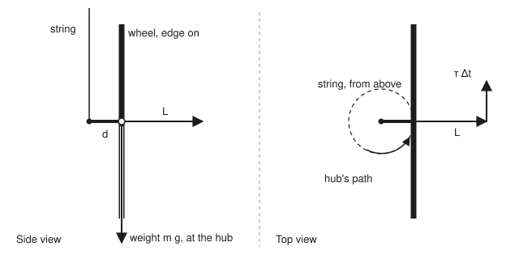
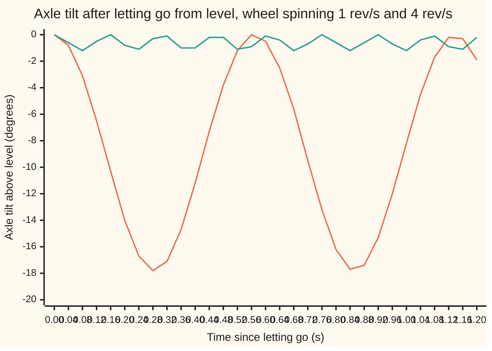

# Precession: push a spinning wheel sideways and it turns at right angles

[Syllabus](../../../SYLLABUS.md) → [Engineering mathematics](../README.md) → [Mechanics and Structures](../README.md#s07) → Precession

---

## General Overview

Take a bicycle wheel off its bike. Tie a string to one end of its axle, 0.10 m from the hub, and hang it from the ceiling. Hold the axle level and let go: the wheel drops and swings from the string like a dead weight.

Now spin it first, once a second, hold the axle level, and let go with a gentle sideways push at the right speed. It does not fall. The axle stays level and swings round the string, one full circle every 3.6231 s. (Let go with no push and it nods down first; the card comes back to that.) That slow sideways turn is **precession**: the turning of a spinning thing's axle under a steady twist.

The engineer's question is: how fast does it turn, and what sets that speed? The answer is one division. Divide the twist from the wheel's weight by the wheel's spin, measured the right way, and you get 1.7342 rad/s. That is the turning speed in radians (the angle unit where a full circle is 2π) per second. The same division explains why a spinning wheel fights your hands when you try to turn it. Holding it by the axle, hands 0.30 m apart, and turning it a quarter turn in half a second takes 11.8435 N at each hand, at right angles to the turn.

**A spinning wheel carries its spin as an arrow along its axle; a twist adds to that arrow sideways, so the arrow, and the axle with it, swings round instead of tipping, at a rate equal to the twist divided by the arrow's length.**

**What kind of fact this is:** a theorem of rigid-body mechanics, proved on this card in Why it works from torque equals rate of change of angular momentum. For an axle held level in steady turning it is exact. For a wheel let go from rest it is an approximation that needs fast spin, and the card shows where it fails.

### The picture: the wheel on its string

<p align="center"></p>

Drawn to scale, 400 units per metre: a 0.30 m rim radius and a 0.10 m axle stub from string to hub. On the left, from the side: the string, the axle stub of length d, the wheel edge on, its weight m g acting at the hub, and the spin arrow L pointing out along the axle. On the right, from above: the hub's dashed circular path round the string, and the small sideways change τ Δt added at the tip of L. The arrows L and τ Δt show direction only; their lengths are not to scale.

---

## The formula

Notation first. An arrow (a vector) is written in bold, and its length in plain type. **L** is the wheel's **angular momentum**: its spin, as an arrow along the axle. **τ** is the **torque**: the twist that a force applies about a point. Both are defined on [Rotation](02-rigid-body-rotation-and-moment-of-inertia.md); this card uses their arrow form.

$$\boldsymbol{\tau} = \frac{d\mathbf{L}}{dt}, \qquad \Omega = \frac{\tau}{L} = \frac{m\,g\,d}{I_3\,\omega}$$

**Read it aloud:** torque is the rate at which the spin arrow changes; when the torque is side-on to the arrow, the arrow swings round at a rate equal to torque divided by spin, which for the hanging wheel is weight times stub length, divided by spin inertia times spin rate.

The units check: τ is in newton metres, kg m²/s², and L is in kg m²/s, so τ/L is in 1/s, a rate. In the wing's dimension brackets, [M][L]²[T]⁻² over [M][L]²[T]⁻¹ is [T]⁻¹.

| Symbol | Plain meaning | In our example | Push it up and the answer… |
| --- | --- | --- | --- |
| $m$ | the wheel's mass | 2.0 kg | more weight, more torque, faster turning; but $I_3$ grows with it, so the two cancel |
| $g$ | standard gravity (NIST CODATA $g_n$, exact) | 9.80665 m/s² | faster turning |
| $d$ | distance along the axle from string to hub: the lever arm | 0.10 m | faster turning, in proportion |
| $R$ | rim radius | 0.30 m | bigger spin inertia, slower turning |
| $I_3$ | spin inertia: the wheel's moment of inertia about its axle, taken as a hoop, $m R^2$ | 0.1800 kg m² | slower turning |
| $I_1$ | tilt inertia: moment of inertia about a line across the wheel through the string, $\tfrac12 m R^2 + m d^2$ | 0.1100 kg m² | deeper nodding when let go from rest |
| $\omega$ | spin rate, in rad/s (one turn a second is 2π rad/s) | 6.2832 rad/s | slower turning, and a stiffer wheel |
| $\mathbf{L}$, $L$ | angular momentum: spin arrow along the axle, length $I_3\omega$ | 1.1310 kg m²/s | slower turning |
| $\boldsymbol{\tau}$, $\tau$ | torque of the weight about the string, $\mathbf{r}\times\mathbf{F}$ (string-to-hub arrow times the weight arrow), length $m g d$ | 1.9613 N m | faster turning |
| $\Omega$ | precession rate: how fast the axle swings round the string | 1.7342 rad/s, a circle every 3.6231 s | — |
| $\Delta t$, $\Delta\varphi$ | a short time, and the angle the axle swings through in it | — | $\Delta\varphi = \tau\,\Delta t / L$ |
| $\Omega_t$ | a turn rate forced on the axle by hand | 3.1416 rad/s, a quarter turn in 0.5 s | the hands need torque $L\,\Omega_t$ |

### When it holds

- **The axle stays level and is already turning.** Then the formula is exact: the simulation keeps the axle level to 1e-6 degrees for 2 s. Let the wheel go from rest instead and it nods down first; at once a second the dip reaches 17.81° and the average turning rate runs 7.7% below the formula.
- **Spin is fast.** Fast enough that the wheel's nodding stays small. At 4 rev/s the dip is 1.21° and the average rate is within 0.6%.
- **The string end stays put.** The hub's circle needs a small sideways pull, so the string leans 1.7566° from vertical. A long, slack string lets the top wander and blurs the numbers.
- **The spin holds steady.** Friction at the hub and air drag slow the spin. As $L$ shrinks, $\Omega = \tau/L$ grows: a dying wheel turns faster and faster, then droops.
- **One rigid wheel, symmetric about its axle.** A buckled rim or a loose spoke adds wobble the formula does not see.

---

## Why it works

### Step 0: spin is an arrow, and torque changes the arrow

A spinning wheel's angular momentum has a size and a direction. The direction lies along the axle, set by the right-hand rule: curl the fingers of the right hand the way the rim moves, and the thumb points along **L**. [Rotation](02-rigid-body-rotation-and-moment-of-inertia.md) gives the size, $L = I_3\,\omega$, and the law that torque sets the rate of change of spin. Written as arrows, that law is $\boldsymbol{\tau} = d\mathbf{L}/dt$. It says nothing about the direction of the force. It says the change in the spin arrow points along the torque.

That is the whole surprise. The weight pulls down. Its torque points sideways. So the spin arrow moves sideways.

### Step 1: the weight's torque is horizontal and side-on to the axle

Put the string at the origin, east along the axle, north to the left of it, and up. The hub sits at $\mathbf{r} = (d, 0, 0)$ and the weight is $\mathbf{F} = (0, 0, -m g)$. The torque is their cross product ([Cross product](../../05-Geometry%20and%20trig/05-Vectors%20in%20Space/01-cross-product-and-oriented-area.md)):

$$\boldsymbol{\tau} = \mathbf{r}\times\mathbf{F} = (0,\; m g d,\; 0).$$

It points north: square to the axle and square to the weight. Its size is $2.0 \times 9.80665 \times 0.10 = 1.9613$ N m.

### Step 2: a side-on change turns the arrow without stretching it

In a short time $\Delta t$ the spin arrow gains $\boldsymbol{\tau}\,\Delta t$, pointing north, at the tip of an arrow pointing east. Adding a short arrow side-on to a long one changes its direction, not its length (to first order: the length grows only by the square of the small piece). The angle it turns through is the short side over the long side:

$$\Delta\varphi = \frac{\tau\,\Delta t}{L}.$$

Then the axle points a little north of east, the torque swings with it, and the next kick is side-on again. Divide by $\Delta t$:

$$\Omega = \frac{\Delta\varphi}{\Delta t} = \frac{\tau}{L} = \frac{1.9613}{1.1310} = 1.7342 \text{ rad/s}.$$

The code does this literally as road 3: ten thousand kicks of $\tau\,\Delta t$ in half a second turn the arrow at 1.7342 rad/s.

### Step 3: the exact version, with the turning counted in

The turning itself is a second, slow rotation about the vertical, and it carries angular momentum too: $I_1\,\Omega$, pointing up. So the full arrow has two parts: the spin part $I_3\,\omega$ along the axle, and the turning part $I_1\,\Omega$ straight up. With the axle level and turning steadily, the up part never changes. Only the axle part swings, at rate $\Omega$, so its rate of change has size $I_3\,\omega\,\Omega$, pointing north. Set that equal to the torque and $\Omega = m g d/(I_3\,\omega)$ exactly, at any spin. Road 2, a full simulation of the rigid wheel launched this way, agrees to the fourth decimal: 1.7342 rad/s.

### Step 4: why a wheel let go from rest nods first

Let go from rest and the wheel is not yet turning, so the up part $I_1\,\Omega$ starts at zero. The torque is horizontal, so the total up part of the angular momentum can never change. To start turning, the wheel must borrow up-momentum from its spin: the axle dips, which tips the spin arrow downward. Steady turning needs a dip angle of about $I_1\Omega/(I_3\omega)$, which is $\tau I_1/L^2$. The wheel overshoots, nods down to about twice that, and bounces back up, again and again. That bobbing is **nutation**.

Energy says the same thing: the dip lowers the weight, and that lost height pays for the turning motion.

At 4 rev/s, the estimate $2\tau I_1/L^2$ gives 1.21° and the simulation gives 1.21°. At once a second the estimate says 19.33° and the simulation 17.81°: the angle is no longer small, and the average turning rate comes out 7.7% low, at 1.6004 rad/s.

### Step 5: the stubborn wheel

Now run it backwards. Hold a spinning wheel by both ends of its axle, hands 0.30 m apart, and swing the axle round a quarter turn in half a second: $\Omega_t = 3.1416$ rad/s. The spin arrow must swing at that rate, which by Step 2 takes a torque of $L\,\Omega_t = 1.1310 \times 3.1416 = 3.5531$ N m. That torque points along the line square to both the axle and the turn: the hands must twist the axle up at one end and down at the other, 11.8435 N each. A still wheel turned at a steady rate needs no such twist. The spinning one pushes back at right angles, which feels like the wheel has a mind of its own. Spin it at 5 rev/s and each hand needs 59.2176 N.

---

## Worked numbers, by hand

| Step | Arithmetic | Value |
| --- | --- | --- |
| weight | 2.0 × 9.80665 | 19.6133 N |
| torque about the string, $m g d$ | 19.6133 × 0.10 | 1.9613 N m |
| spin inertia, hoop, $m R^2$ | 2.0 × 0.30 × 0.30 | 0.1800 kg m² |
| spin rate, once a second | 2π × 1 | 6.2832 rad/s |
| spin angular momentum, $I_3\omega$ | 0.1800 × 6.2832 | 1.1310 kg m²/s |
| precession rate, $\tau / L$ | 1.9613 ÷ 1.1310 | **1.7342 rad/s** |
| time for one circle, $2\pi/\Omega$ | 6.2832 ÷ 1.7342 | **3.6231 s** |
| hub speed round the string | 1.7342 × 0.10 | 0.1734 m/s |

The wheel's hub walks round the string at 0.1734 m/s, a full circle every 3.6231 s, with the axle level, for as long as the spin lasts.

### What breaks if you drop a piece

| Mistake | Comes out at | What went wrong |
| --- | --- | --- |
| Spin entered as 1 because it turns once a second | 10.8963 rad/s | One turn is 2π radians; the formula needs rad/s |
| Wheel treated as a flat disc, $\tfrac12 m R^2$ | 3.4684 rad/s | A bicycle wheel's mass sits at the rim, so it is a hoop, $m R^2$ |
| Rim radius used as the lever arm | 5.2026 rad/s | The weight acts at the hub, 0.10 m from the string, not at the rim |
| Period taken as $1/\Omega$ | 0.5766 s | One circle is 2π radians, so the period is $2\pi/\Omega$ = 3.6231 s |

---

## Let go from rest: the wheel nods before it turns

The puzzle: Step 3 says the axle stays level, but a wheel let go by hand clearly dips first. Both are true. A hand that lets go gives no sideways push, so the wheel has no turning momentum yet. It gets some by dipping, overshoots, and bobs.

Two stories, traced: the wheel spinning 1 rev/s and 4 rev/s, each let go with the axle level.

| Time | Axle tilt, 1 rev/s | Axle tilt, 4 rev/s |
| --- | --- | --- |
| 0.00 s | 0.0° | 0.0° |
| 0.12 s | −6.5° | −0.5° |
| 0.28 s | −17.8° | −0.3° |
| 0.56 s | −0.0° | −0.9° |
| 0.84 s | −17.7° | −1.2° |

The deepest dip, one spin rate at a time, 2 characters per degree:

```
deepest dip   1 rev/s   ████████████████████████████████████     17.81°
deepest dip   4 rev/s   ██                                        1.21°
```

The dip falls with the square of the spin, as the estimate $2\tau I_1/L^2$ says: 19.33° at 1 rev/s, 1.21° at 4 rev/s.



The deep, slow wave is the wheel spinning once a second. The shallow, fast ripple is the wheel spinning 4 rev/s. In a real wheel, friction at the string damps the nodding over a few seconds. What is left is steady turning near the middle of the nod, dipped by about $\tau I_1/L^2$ from Step 4: half the 19.33° estimate at 1 rev/s, well below level, and a fraction of a degree at 4 rev/s. Only fast spin gives the level turning of Step 3.

---

## Code, from first principles, and it actually runs

The code builds the hanging wheel and reaches its precession rate three independent ways: the formula $\tau/L$; a full simulation of the rigid wheel, stepping its axle direction and angular momentum forward with the fourth-order Runge–Kutta method of [Runge-Kutta four](../../08-Differential%20equations%20and%20dynamics/05-Numerical%20Evolution/04-runge-kutta-four.md) (RK4: four slope samples per step); and the axle turned by ten thousand small sideways kicks in half a second. It then checks the stubborn-wheel torque by differencing the spin arrow in time, lets the wheel go from rest at 1 and 4 rev/s, and checks that the simulation keeps the energy constant. Nothing imported knows any mechanics.

### Python

```python
# Gyroscopes and precession -- the check behind the card.  Standard library only.
# A bicycle wheel hangs from a string tied to its axle and spins once a second.
# Roads to the precession rate: the formula tau/L; a full rigid-body simulation (RK4);
# the axle turned by many small sideways kicks.  Then a release from rest, where the
# formula holds only on average and only once the spin is fast.
from math import pi, atan2, asin, degrees, sqrt, cos, sin

G = 9.80665                      # standard gravity, m/s^2 (NIST CODATA g_n, exact)
M, R, D = 2.0, 0.30, 0.10        # wheel mass kg, rim radius m, string-to-hub distance m
I3 = M * R * R                   # spin inertia, all mass at the rim (a hoop), kg m^2
I1 = M * R * R / 2 + M * D * D   # inertia about a diameter, moved out to the string, kg m^2
W = 2 * pi * 1.0                 # once a second, in rad/s

def add(a, b, k=1.0): return [x + k * y for x, y in zip(a, b)]
def dot(a, b): return sum(x * y for x, y in zip(a, b))
def cross(a, b): return [a[1]*b[2] - a[2]*b[1], a[2]*b[0] - a[0]*b[2], a[0]*b[1] - a[1]*b[0]]

def rates(s):                    # s = axle direction a (3), then angular momentum H about the string (3)
    a, H = s[:3], s[3:]
    along = dot(H, a)            # spin part of H; the rest turns the axle, with inertia I1
    w = add([along / I3 * x for x in a], [(h - along * x) / I1 for h, x in zip(H, a)])
    return cross(w, a) + cross([D * x for x in a], [0.0, 0.0, -M * G])   # da/dt, then dH/dt = torque

def run(H0, t_end, dt=1e-4):     # RK4 from a level axle pointing east; a sample every 0.04 s, lowest axle
    s, path, low = [1.0, 0.0, 0.0] + H0, [], 0.0
    for n in range(round(t_end / dt) + 1):
        if n % 400 == 0: path.append(s)
        low = min(low, s[2])
        k1 = rates(s); k2 = rates(add(s, k1, dt/2)); k3 = rates(add(s, k2, dt/2)); k4 = rates(add(s, k3, dt))
        s = [x + dt / 6 * (p + 2*q + 2*u + v) for x, p, q, u, v in zip(s, k1, k2, k3, k4)]
    return path, -degrees(asin(low))

def energy(s):
    along = dot(s[3:], s[:3])
    return along**2 / (2 * I3) + (dot(s[3:], s[3:]) - along**2) / (2 * I1) + M * G * D * s[2]

def tilt(s): return degrees(asin(s[2]))                      # axle angle above level, degrees
def turned(path):                                            # angle swept round the string, unwrapped, rad
    tot, prev = 0.0, 0.0
    for s in path:
        ang = atan2(s[1], s[0]); d = ang - prev
        tot += d - 2 * pi * round(d / (2 * pi)); prev = ang
    return tot

L, tau = I3 * W, M * G * D
om = tau / L                                                 # road 1
steady, _ = run([L, 0.0, I1 * om], 2.0)                      # launched already turning at om
om_sim = turned(steady) / 2.0                                # road 2
Lv, n = [L, 0.0, 0.0], 10000                                 # road 3: kicks of tau*dt, side-on to L
for _ in range(n):
    Lv = add(Lv, cross([0.0, 0.0, 1.0], [x / sqrt(dot(Lv, Lv)) for x in Lv]), tau * 0.5 / n)
om_kick = atan2(Lv[1], Lv[0]) / 0.5                          # angle turned in 0.5 s, per second
print(f"wheel {M:.1f} kg, rim radius {R:.2f} m, string to hub {D:.2f} m, g {G} m/s^2")
print(f"weight m g                       {M*G:9.4f} N")
print(f"spin inertia I3 = m R^2          {I3:9.4f} kg m^2")
print(f"tilt inertia I1, about the string{I1:9.4f} kg m^2")
print(f"spin, once a second              {W:9.4f} rad/s")
print(f"angular momentum L = I3 w        {L:9.4f} kg m^2/s")
print(f"gravity torque tau = m g d       {tau:9.4f} N m")
print(f"road 1  formula tau / L          {om:9.4f} rad/s")
print(f"road 2  rigid-body simulation    {om_sim:9.4f} rad/s")
print(f"road 3  10000 kicks in 0.5 s     {om_kick:9.4f} rad/s")
print(f"precession period 2 pi / Omega   {2*pi/om:9.4f} s")
print(f"hub speed round the string       {om*D:9.4f} m/s")
print(f"string lean, m d Omega^2 vs m g  {degrees(atan2(om*om*D, G)):9.4f} degrees")
level = max(abs(tilt(s)) for s in steady) < 1e-6
print(f"axle level to 1e-6 deg for 2 s   {'yes' if level else 'no':>9}")

# ---- the stubborn wheel: hands 0.30 m apart turn the axle a quarter turn in 0.5 s ----
Wt, h = (pi / 2) / 0.5, 1e-6
def Lvec(t):                     # spin part along the turning axle, plus the slow turn about a diameter
    return [I3 * W * cos(Wt * t), I3 * W * sin(Wt * t), M * R * R / 2 * Wt]
need = [(p - q) / (2 * h) for p, q in zip(Lvec(h), Lvec(-h))]
print(f"turn rate, quarter turn in 0.5 s {Wt:9.4f} rad/s")
print(f"torque needed, L times turn rate {L*Wt:9.4f} N m")
print(f"  same, by differencing L(t)     {sqrt(dot(need, need)):9.4f} N m")
print(f"  force at each hand, 0.30 m     {L*Wt/0.30:9.4f} N")
print(f"  the same at 5 rev/s            {5*L*Wt/0.30:9.4f} N")

# ---- release from rest, axle level: the formula only on average, only at fast spin ----
print("time s      " + " ".join(f"{0.04*k:5.2f}" for k in range(31)))
out = {}
for rps in (1, 4):
    Ls = I3 * 2 * pi * rps
    out[rps] = run([Ls, 0.0, 0.0], 3.0) + (Ls,)
    print(f"tilt {rps} rev/s  " + " ".join(f"{tilt(s):5.1f}" for s in out[rps][0][:31]))
for rps, (p, dip, Ls) in out.items():
    print(f"{rps} rev/s: deepest dip {dip:6.2f} deg, estimate 2 tau I1/L^2"
          f" {degrees(2*tau*I1/Ls**2):6.2f} deg; mean turn {turned(p)/3.0:.4f} rad/s vs tau/L {tau/Ls:.4f},"
          f" {100*(turned(p)/3.0*Ls/tau-1):+.1f}%")
drift = max(abs(energy(s) - energy(out[1][0][0])) for s in out[1][0])

# ---- what breaks ----
print(f"wrong: spin 1 rev/s as w = 1     {tau / (I3 * 1.0):9.4f} rad/s")
print(f"wrong: disc inertia m R^2 / 2    {tau / (I3 / 2 * W):9.4f} rad/s")
print(f"wrong: rim radius as lever arm   {M*G*R / L:9.4f} rad/s")
print(f"wrong: period as 1 / Omega       {1/om:9.4f} s")
x, top = 110 + 400 * D, 470 + 400 * D
print(f"figure, 400 units per m: side pivot (110,150) hub ({x:.0f},150) rim ({x:.0f},{150-400*R:.0f})"
      f" to ({x:.0f},{150+400*R:.0f}); top pivot (470,150) hub ({top:.0f},150) path radius {400*D:.0f}")

p1, dip1, L1 = out[1]
p4, dip4, L4 = out[4]
assert abs(om_sim - om) < 1e-6 * om and level                # simulation against the formula
assert abs(om_kick - om) < 1e-3 * om                         # kicks against the formula
assert abs(sqrt(dot(need, need)) - L * Wt) < 1e-6            # torque by differencing against L times rate
assert abs(turned(p4) / 3.0 - tau / L4) < 0.02 * tau / L4    # fast spin: the formula holds on average
assert abs(dip4 - degrees(2*tau*I1/L4**2)) < 0.05 * degrees(2*tau*I1/L4**2)
assert abs(turned(p1) / 3.0 - tau / L1) > 0.05 * tau / L1    # slow spin: off by more than 5%
assert drift < 1e-9                                          # energy kept by the simulation
print("ALL CHECKS PASS")
```

**Ran 2026-11-11 on macOS, Python 3.14.10, standard library only. All checks passed. Output, pasted from the run:**

```
wheel 2.0 kg, rim radius 0.30 m, string to hub 0.10 m, g 9.80665 m/s^2
weight m g                         19.6133 N
spin inertia I3 = m R^2             0.1800 kg m^2
tilt inertia I1, about the string   0.1100 kg m^2
spin, once a second                 6.2832 rad/s
angular momentum L = I3 w           1.1310 kg m^2/s
gravity torque tau = m g d          1.9613 N m
road 1  formula tau / L             1.7342 rad/s
road 2  rigid-body simulation       1.7342 rad/s
road 3  10000 kicks in 0.5 s        1.7342 rad/s
precession period 2 pi / Omega      3.6231 s
hub speed round the string          0.1734 m/s
string lean, m d Omega^2 vs m g     1.7566 degrees
axle level to 1e-6 deg for 2 s         yes
turn rate, quarter turn in 0.5 s    3.1416 rad/s
torque needed, L times turn rate    3.5531 N m
  same, by differencing L(t)        3.5531 N m
  force at each hand, 0.30 m       11.8435 N
  the same at 5 rev/s              59.2176 N
time s       0.00  0.04  0.08  0.12  0.16  0.20  0.24  0.28  0.32  0.36  0.40  0.44  0.48  0.52  0.56  0.60  0.64  0.68  0.72  0.76  0.80  0.84  0.88  0.92  0.96  1.00  1.04  1.08  1.12  1.16  1.20
tilt 1 rev/s    0.0  -0.8  -3.1  -6.5 -10.3 -14.0 -16.7 -17.8 -17.1 -14.7 -11.2  -7.3  -3.8  -1.2  -0.0  -0.5  -2.5  -5.6  -9.5 -13.2 -16.2 -17.7 -17.4 -15.3 -12.0  -8.2  -4.5  -1.7  -0.2  -0.3  -1.9
tilt 4 rev/s    0.0  -0.6  -1.2  -0.5  -0.0  -0.8  -1.1  -0.3  -0.1  -1.0  -1.0  -0.2  -0.2  -1.1  -0.9  -0.1  -0.4  -1.2  -0.7  -0.0  -0.6  -1.2  -0.6  -0.0  -0.7  -1.2  -0.4  -0.1  -0.9  -1.1  -0.2
1 rev/s: deepest dip  17.81 deg, estimate 2 tau I1/L^2  19.33 deg; mean turn 1.6004 rad/s vs tau/L 1.7342, -7.7%
4 rev/s: deepest dip   1.21 deg, estimate 2 tau I1/L^2   1.21 deg; mean turn 0.4362 rad/s vs tau/L 0.4335, +0.6%
wrong: spin 1 rev/s as w = 1       10.8963 rad/s
wrong: disc inertia m R^2 / 2       3.4684 rad/s
wrong: rim radius as lever arm      5.2026 rad/s
wrong: period as 1 / Omega          0.5766 s
figure, 400 units per m: side pivot (110,150) hub (150,150) rim (150,30) to (150,270); top pivot (470,150) hub (510,150) path radius 40
ALL CHECKS PASS
```

### Rust

```rust
// Gyroscopes and precession -- the check behind the card.  std only, no crates.
// A bicycle wheel hangs from a string tied to its axle and spins once a second.
// Roads to the precession rate: the formula tau/L; a full rigid-body simulation (RK4);
// the axle turned by many small sideways kicks.  Then a release from rest, where the
// formula holds only on average and only once the spin is fast.
use std::f64::consts::PI;

const G: f64 = 9.80665;          // standard gravity, m/s^2 (NIST CODATA g_n, exact)
const M: f64 = 2.0;              // wheel mass, kg
const R: f64 = 0.30;             // rim radius, m
const D: f64 = 0.10;             // string-to-hub distance, m
const I3: f64 = M * R * R;       // spin inertia, all mass at the rim (a hoop), kg m^2
const I1: f64 = M * R * R / 2.0 + M * D * D; // inertia about a diameter, moved out to the string
type S = [f64; 6];               // axle direction a (3), then angular momentum H about the string (3)

fn dot(a: &[f64], b: &[f64]) -> f64 { a.iter().zip(b).fold(0.0, |t, (x, y)| t + x * y) }
fn cross(a: &[f64], b: &[f64]) -> [f64; 3] {
    [a[1]*b[2] - a[2]*b[1], a[2]*b[0] - a[0]*b[2], a[0]*b[1] - a[1]*b[0]]
}
fn rates(s: &S) -> S {
    let (a, h) = (&s[..3], &s[3..]);
    let along = dot(h, a);       // spin part of H; the rest turns the axle, with inertia I1
    let w: Vec<f64> = (0..3).map(|i| along / I3 * a[i] + (h[i] - along * a[i]) / I1).collect();
    let da = cross(&w, a);
    let tq = cross(&[D * a[0], D * a[1], D * a[2]], &[0.0, 0.0, -M * G]);
    [da[0], da[1], da[2], tq[0], tq[1], tq[2]]
}
fn step(s: &S, k: &S, c: f64) -> S { let mut o = *s; for i in 0..6 { o[i] = s[i] + c * k[i]; } o }
// RK4 from a level axle pointing east; a sample every 0.04 s, and the lowest the axle went
fn run(h0: [f64; 3], t_end: f64) -> (Vec<S>, f64) {
    let dt = 1e-4;
    let mut s: S = [1.0, 0.0, 0.0, h0[0], h0[1], h0[2]];
    let (mut path, mut low) = (Vec::new(), 0.0f64);
    for n in 0..((t_end / dt).round() as usize + 1) {
        if n % 400 == 0 { path.push(s); }
        low = low.min(s[2]);
        let k1 = rates(&s); let k2 = rates(&step(&s, &k1, dt / 2.0));
        let k3 = rates(&step(&s, &k2, dt / 2.0)); let k4 = rates(&step(&s, &k3, dt));
        for i in 0..6 { s[i] = s[i] + dt / 6.0 * (k1[i] + 2.0 * k2[i] + 2.0 * k3[i] + k4[i]); }
    }
    (path, -low.asin().to_degrees())
}
fn energy(s: &S) -> f64 {
    let along = dot(&s[3..], &s[..3]);
    along * along / (2.0 * I3) + (dot(&s[3..], &s[3..]) - along * along) / (2.0 * I1) + M * G * D * s[2]
}
fn tilt(s: &S) -> f64 { s[2].asin().to_degrees() }   // axle angle above level, degrees
fn turned(path: &[S]) -> f64 {                       // angle swept round the string, unwrapped, rad
    let (mut tot, mut prev) = (0.0, 0.0);
    for s in path {
        let ang = s[1].atan2(s[0]); let d = ang - prev;
        tot += d - 2.0 * PI * (d / (2.0 * PI)).round(); prev = ang;
    }
    tot
}

fn main() {
    let w = 2.0 * PI * 1.0;                          // once a second, in rad/s
    let (l, tau) = (I3 * w, M * G * D);
    let om = tau / l;                                // road 1
    let (steady, _) = run([l, 0.0, I1 * om], 2.0);   // launched already turning at om
    let om_sim = turned(&steady) / 2.0;              // road 2
    let (mut lv, n) = ([l, 0.0, 0.0], 10000);        // road 3: kicks of tau*dt, side-on to L
    for _ in 0..n {
        let m = dot(&lv, &lv).sqrt();
        let side = cross(&[0.0, 0.0, 1.0], &[lv[0] / m, lv[1] / m, lv[2] / m]);
        for i in 0..3 { lv[i] = lv[i] + tau * 0.5 / n as f64 * side[i]; }
    }
    let om_kick = lv[1].atan2(lv[0]) / 0.5;          // angle turned in 0.5 s, per second
    println!("wheel {:.1} kg, rim radius {:.2} m, string to hub {:.2} m, g {} m/s^2", M, R, D, G);
    println!("weight m g                       {:9.4} N", M * G);
    println!("spin inertia I3 = m R^2          {:9.4} kg m^2", I3);
    println!("tilt inertia I1, about the string{:9.4} kg m^2", I1);
    println!("spin, once a second              {:9.4} rad/s", w);
    println!("angular momentum L = I3 w        {:9.4} kg m^2/s", l);
    println!("gravity torque tau = m g d       {:9.4} N m", tau);
    println!("road 1  formula tau / L          {:9.4} rad/s", om);
    println!("road 2  rigid-body simulation    {:9.4} rad/s", om_sim);
    println!("road 3  10000 kicks in 0.5 s     {:9.4} rad/s", om_kick);
    println!("precession period 2 pi / Omega   {:9.4} s", 2.0 * PI / om);
    println!("hub speed round the string       {:9.4} m/s", om * D);
    println!("string lean, m d Omega^2 vs m g  {:9.4} degrees", (om * om * D).atan2(G).to_degrees());
    let level = steady.iter().map(|s| tilt(s).abs()).fold(0.0, f64::max) < 1e-6;
    println!("axle level to 1e-6 deg for 2 s   {:>9}", if level { "yes" } else { "no" });

    // ---- the stubborn wheel: hands 0.30 m apart turn the axle a quarter turn in 0.5 s ----
    let (wt, h) = ((PI / 2.0) / 0.5, 1e-6);
    let lvec = |t: f64| [I3 * w * (wt * t).cos(), I3 * w * (wt * t).sin(), M * R * R / 2.0 * wt]; // turn about a diameter
    let (p, q) = (lvec(h), lvec(-h));
    let need: Vec<f64> = (0..3).map(|i| (p[i] - q[i]) / (2.0 * h)).collect();
    let need_mag = dot(&need, &need).sqrt();
    println!("turn rate, quarter turn in 0.5 s {:9.4} rad/s", wt);
    println!("torque needed, L times turn rate {:9.4} N m", l * wt);
    println!("  same, by differencing L(t)     {:9.4} N m", need_mag);
    println!("  force at each hand, 0.30 m     {:9.4} N", l * wt / 0.30);
    println!("  the same at 5 rev/s            {:9.4} N", 5.0 * l * wt / 0.30);

    // ---- release from rest, axle level: the formula only on average, only at fast spin ----
    let ts: Vec<String> = (0..31).map(|k| format!("{:5.2}", 0.04 * k as f64)).collect();
    println!("time s      {}", ts.join(" "));
    let mut out = Vec::new();
    for rps in [1, 4] {
        let ls = I3 * 2.0 * PI * rps as f64;
        let (p, dip) = run([ls, 0.0, 0.0], 3.0);
        let row: Vec<String> = p[..31].iter().map(|s| format!("{:5.1}", tilt(s))).collect();
        println!("tilt {} rev/s  {}", rps, row.join(" "));
        out.push((rps, p, dip, ls));
    }
    for (rps, p, dip, ls) in &out {
        println!("{} rev/s: deepest dip {:6.2} deg, estimate 2 tau I1/L^2 {:6.2} deg; mean turn {:.4} rad/s vs tau/L {:.4}, {:+.1}%",
                 rps, dip, (2.0 * tau * I1 / (ls * ls)).to_degrees(), turned(p) / 3.0, tau / ls,
                 100.0 * (turned(p) / 3.0 * ls / tau - 1.0));
    }
    let e0 = energy(&out[0].1[0]);
    let drift = out[0].1.iter().map(|s| (energy(s) - e0).abs()).fold(0.0, f64::max);

    // ---- what breaks ----
    println!("wrong: spin 1 rev/s as w = 1     {:9.4} rad/s", tau / (I3 * 1.0));
    println!("wrong: disc inertia m R^2 / 2    {:9.4} rad/s", tau / (I3 / 2.0 * w));
    println!("wrong: rim radius as lever arm   {:9.4} rad/s", M * G * R / l);
    println!("wrong: period as 1 / Omega       {:9.4} s", 1.0 / om);
    let (x, top) = (110.0 + 400.0 * D, 470.0 + 400.0 * D);
    println!("figure, 400 units per m: side pivot (110,150) hub ({:.0},150) rim ({:.0},{:.0}) to ({:.0},{:.0}); top pivot (470,150) hub ({:.0},150) path radius {:.0}",
             x, x, 150.0 - 400.0 * R, x, 150.0 + 400.0 * R, top, 400.0 * D);

    let (p1, l1) = (&out[0].1, out[0].3);
    let (p4, dip4, l4) = (&out[1].1, out[1].2, out[1].3);
    assert!((om_sim - om).abs() < 1e-6 * om && level);           // simulation against the formula
    assert!((om_kick - om).abs() < 1e-3 * om);                   // kicks against the formula
    assert!((need_mag - l * wt).abs() < 1e-6);                   // torque by differencing against L times rate
    assert!((turned(p4) / 3.0 - tau / l4).abs() < 0.02 * tau / l4); // fast spin: formula holds on average
    let est4 = (2.0 * tau * I1 / (l4 * l4)).to_degrees();
    assert!((dip4 - est4).abs() < 0.05 * est4);
    assert!((turned(p1) / 3.0 - tau / l1).abs() > 0.05 * tau / l1); // slow spin: off by more than 5%
    assert!(drift < 1e-9);                                       // energy kept by the simulation
    println!("ALL CHECKS PASS");
}
```

**Ran 2026-11-11 on macOS, rustc 1.98.1, no crates. All checks passed. Output, pasted from the run:**

```
wheel 2.0 kg, rim radius 0.30 m, string to hub 0.10 m, g 9.80665 m/s^2
weight m g                         19.6133 N
spin inertia I3 = m R^2             0.1800 kg m^2
tilt inertia I1, about the string   0.1100 kg m^2
spin, once a second                 6.2832 rad/s
angular momentum L = I3 w           1.1310 kg m^2/s
gravity torque tau = m g d          1.9613 N m
road 1  formula tau / L             1.7342 rad/s
road 2  rigid-body simulation       1.7342 rad/s
road 3  10000 kicks in 0.5 s        1.7342 rad/s
precession period 2 pi / Omega      3.6231 s
hub speed round the string          0.1734 m/s
string lean, m d Omega^2 vs m g     1.7566 degrees
axle level to 1e-6 deg for 2 s         yes
turn rate, quarter turn in 0.5 s    3.1416 rad/s
torque needed, L times turn rate    3.5531 N m
  same, by differencing L(t)        3.5531 N m
  force at each hand, 0.30 m       11.8435 N
  the same at 5 rev/s              59.2176 N
time s       0.00  0.04  0.08  0.12  0.16  0.20  0.24  0.28  0.32  0.36  0.40  0.44  0.48  0.52  0.56  0.60  0.64  0.68  0.72  0.76  0.80  0.84  0.88  0.92  0.96  1.00  1.04  1.08  1.12  1.16  1.20
tilt 1 rev/s    0.0  -0.8  -3.1  -6.5 -10.3 -14.0 -16.7 -17.8 -17.1 -14.7 -11.2  -7.3  -3.8  -1.2  -0.0  -0.5  -2.5  -5.6  -9.5 -13.2 -16.2 -17.7 -17.4 -15.3 -12.0  -8.2  -4.5  -1.7  -0.2  -0.3  -1.9
tilt 4 rev/s    0.0  -0.6  -1.2  -0.5  -0.0  -0.8  -1.1  -0.3  -0.1  -1.0  -1.0  -0.2  -0.2  -1.1  -0.9  -0.1  -0.4  -1.2  -0.7  -0.0  -0.6  -1.2  -0.6  -0.0  -0.7  -1.2  -0.4  -0.1  -0.9  -1.1  -0.2
1 rev/s: deepest dip  17.81 deg, estimate 2 tau I1/L^2  19.33 deg; mean turn 1.6004 rad/s vs tau/L 1.7342, -7.7%
4 rev/s: deepest dip   1.21 deg, estimate 2 tau I1/L^2   1.21 deg; mean turn 0.4362 rad/s vs tau/L 0.4335, +0.6%
wrong: spin 1 rev/s as w = 1       10.8963 rad/s
wrong: disc inertia m R^2 / 2       3.4684 rad/s
wrong: rim radius as lever arm      5.2026 rad/s
wrong: period as 1 / Omega          0.5766 s
figure, 400 units per m: side pivot (110,150) hub (150,150) rim (150,30) to (150,270); top pivot (470,150) hub (510,150) path radius 40
ALL CHECKS PASS
```

The two outputs match line for line.

> [!TIP]
> **Try changing**
> Guess first, then run it. An assert is a line that stops the program if a number comes out wrong.
> - **Guess first: spin it four times faster.** Set `W = 2 * pi * 4.0`. Road 1 drops to 0.4335 rad/s, a quarter of before: four times the spin, a quarter of the turning. All three roads still agree.
> - **Guess first: a disc instead of a hoop.** Set `I3 = M * R * R / 2`. The wheel turns at 3.4684 rad/s, twice as fast, because half the spin inertia means half the spin arrow. The release runs nod far deeper, but every check still passes.
> - **Guess first: tie the string out at 0.30 m.** Set `D = 0.30`. The torque triples and the rate triples, to 5.2026 rad/s. Now even 4 rev/s is too slow: the release run's average misses the formula by more than 2%, and the fourth assert stops the program.
> - **Guess first: let it go without the push.** In the `steady` line, change `I1 * om` to `0.0`. The axle dips, road 2 falls below road 1, and the first assert stops the program.

---

## The usual mistake

> [!warning]
> **Expecting the weight to make the wheel fall.** Force and torque are different arrows. The weight points down, but its torque about the string points sideways, and torque changes the spin arrow in its own direction. So the axle swings sideways at 1.7342 rad/s instead of tipping down. Nothing holds the wheel up except the string; the spin only decides which way the wheel moves under its weight.
>
> - **Spin in turns per second, not radians per second.** Entering once a second as 1 gives 10.8963 rad/s instead of 1.7342 rad/s.
> - **Treating a bicycle wheel as a disc.** Its mass is at the rim. The disc formula gives 3.4684 rad/s.
> - **Measuring the lever arm to the rim.** The weight acts at the hub. Using the rim radius gives 5.2026 rad/s.
> - **Trusting the formula for a slow wheel let go by hand.** At once a second it dips 17.81° and averages 1.6004 rad/s, 7.7% under the formula.

---

## Where you meet it in real life

- **Bicycles.** A leaning bike's front wheel precesses toward the lean, which helps steer it under the fall. It is not the main reason a bike stays up: a bike built with a counter-spinning extra wheel, cancelling the spin arrow, can still be ridden.
- **Spacecraft attitude control.** Control moment gyroscopes, like those on the International Space Station, are spinning wheels whose axles motors turn on purpose. By Step 5, turning the axle at rate $\Omega_t$ makes a torque $L\,\Omega_t$ on the craft, with no fuel burnt.
- **Propeller aircraft and helicopters.** Pitch the nose of a single-propeller plane up and the propeller's spin arrow is forced to turn, so the plane yaws sideways: the stubborn wheel at aircraft scale.
- **The Earth.** The Sun and Moon pull on Earth's equatorial bulge. That torque is side-on to the spin arrow, so the axis sweeps a slow cone over thousands of years, and the pole star changes.
- **Spinning tops and gyroscopic toys.** The same formula, with the tilted axle adding a small correction term.

> **Say it back**
> A spinning wheel's angular momentum is an arrow along its axle, of length spin inertia times spin rate. Torque changes that arrow in the torque's own direction, and the weight's torque about the string is sideways. So the arrow swings round instead of tipping, at the rate torque divided by angular momentum: 1.7342 rad/s for a 2.0 kg wheel spinning once a second on a 0.10 m stub. Turning a spinning wheel's axle by hand needs a torque equal to angular momentum times the turn rate, at right angles to the turn. A wheel let go from rest dips and nods first, and only fast spin makes that dip small.

---

## What this builds on

- [Rotation](02-rigid-body-rotation-and-moment-of-inertia.md): moment of inertia, angular momentum $L = I\omega$, and torque as the rate of change of spin. This card puts arrows on them.
- [Cross product](../../05-Geometry%20and%20trig/05-Vectors%20in%20Space/01-cross-product-and-oriented-area.md): the torque $\mathbf{r}\times\mathbf{F}$, square to both the lever arm and the force. It is why the downward weight gives a sideways torque.

## Where this goes next

- [Lagrangian and Hamiltonian mechanics](04-lagrangian-and-hamiltonian-mechanics-for-engineers.md): equations of motion from kinetic and potential energy, one per angle. The same method gives the hanging wheel's nodding in its tilt and turning angles, without arrows.
- [Equations of motion of a vehicle](05-vehicle-equations-of-motion.md): a craft's rotation written in its own turning axes, where the same cross-product terms, turning rate times spin arrow, appear in its moment equations.
- [Orbits](09-orbital-mechanics-and-the-kepler-problem.md): angular momentum kept constant when no torque acts, which gives Kepler's equal areas.

The question left open: how a slowly dying spin and friction at the string together carry the wheel from steady turning into its final droop.

---

## Sources

Verified 2026-11-11: every link below resolves to the publisher's page, and each DOI was checked against Crossref for title and first author.

- Kleppner, Daniel, and Robert Kolenkow. *An Introduction to Mechanics*, 2nd ed. Cambridge University Press, 2013. [doi:10.1017/CBO9781139013963](https://doi.org/10.1017/CBO9781139013963). Angular momentum as a vector, torque as its rate of change, and the gyroscope's precession rate derived the way this card does.
- Butikov, Eugene. "Precession and nutation of a gyroscope." *European Journal of Physics* 27(5), 2006, pp. 1071–1081. [doi:10.1088/0143-0807/27/5/006](https://doi.org/10.1088/0143-0807/27/5/006). Where the nodding that comes with forced precession comes from, treated as simply as the topic allows.
- Jones, David E. H. "The stability of the bicycle." *Physics Today* 23(4), 1970, pp. 34–40. [doi:10.1063/1.3022064](https://doi.org/10.1063/1.3022064). The bicycle with a counter-spinning wheel, showing that gyroscopic action is not what keeps a bike up.
- NIST. "CODATA Value: standard acceleration of gravity." [NIST reference page](https://physics.nist.gov/cgi-bin/cuu/Value?gn). The exact value 9.80665 m/s² used for $g$.
