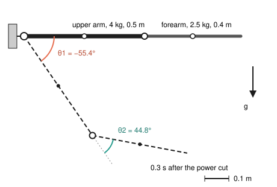
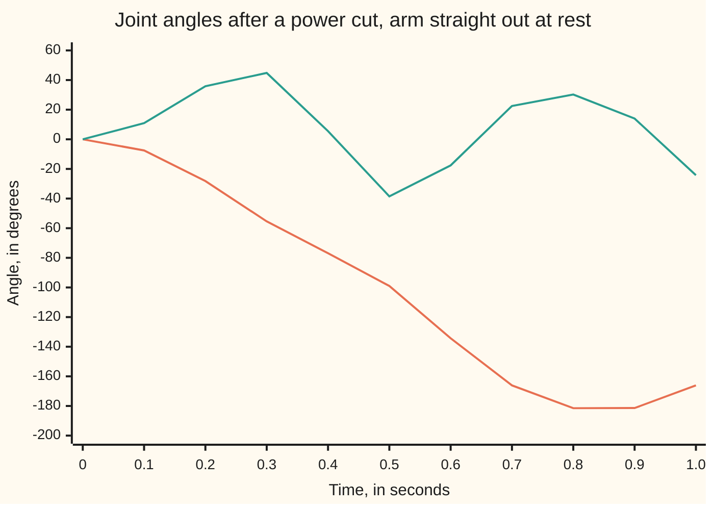

# Lagrangian and Hamiltonian mechanics: write the energies, get the equations

[Syllabus](../../../SYLLABUS.md) → [Engineering mathematics](../README.md) → [Mechanics and Structures](../README.md#s07) → Lagrangian and Hamiltonian mechanics

---

## General Overview

A small pick-and-place robot arm works in a vertical plane. It has two links. The upper arm is 0.5 m long and weighs 4 kg. The forearm is 0.4 m long and weighs 2.5 kg. A motor at the shoulder and a motor at the elbow turn the joints. The engineer has to buy those motors, so the question is plain: how much torque (turning force, in newton metres, N m) must each one give?

Newton's way is a free-body diagram for each link. Each pin carries an unknown push in two directions, so there are four pin-force unknowns before the motor torques appear. Lagrange's way skips them. Write the arm's kinetic energy and its potential energy in the two joint angles. Feed the difference through Lagrange's equation once per angle. Out come two equations whose right-hand sides are the two motor torques, and nothing else.

Held straight out, the shoulder needs **26.9775 N m** and the elbow **4.9050 N m**. To start lifting the shoulder at 6 rad/s² with the elbow locked, the shoulder needs 36.5275 N m and the elbow **7.2050 N m**, 2.3000 N m more than holding, though the elbow joint does not move. The equations show where that comes from: the two links share one mass matrix, and its off-diagonal entry couples them.

Two more tools finish the kit. A **Lagrange multiplier** brings back a pin or rod force when one is wanted: a 2 kg pendulum released from 60 degrees pulls its rod at twice its weight at the bottom. The **Hamiltonian form** trades joint speeds for joint momenta and gives first-order equations that conserve energy, which a simulator uses to test itself.

**Write the kinetic and potential energy in whatever angles describe the machine; Lagrange's equation then gives one equation per angle, with the motor torques on the right and the pin forces gone, and swapping speeds for momenta gives the same motion as Hamilton's first-order equations.**

**What kind of fact this is:** a theorem: for rigid links, frictionless pins and forces from a potential, Lagrange's equations are Newton's laws rewritten, proved on [Lagrangian mechanics](../../08-Differential%20equations%20and%20dynamics/12-Calculus%20of%20Variations%20and%20Optimal%20Control/04-lagrangian-mechanics.md). The arm itself is a model: rigid uniform links, frictionless joints, ideal motors.

### The picture: the arm, held and falling

<p align="center"></p>

Scale: 400 units per metre, shoulder at (40, 60). Solid: held straight out. Dashed: 0.3 s after the motors lose power. Two numbers, the shoulder angle θ1 and the elbow angle θ2, place every point of the arm.

---

## The formula

Notation, in words first. The arm's **generalised coordinates** (the numbers that fix where it is) are the two joint angles, collected as $q = (\theta_1, \theta_2)$. A prime is a rate in time: $q'$ holds the two joint speeds, $q''$ the two joint accelerations. $T$ is kinetic energy, $V$ potential energy, and $L = T - V$ the Lagrangian. Lagrange's equation, with a motor torque $\tau_i$ on joint $i$:

$$\frac{d}{dt}\,\frac{\partial L}{\partial \theta_i'} - \frac{\partial L}{\partial \theta_i} = \tau_i, \qquad i = 1, 2$$

**Read it aloud:** for each joint, the rate of change of the slope of $L$ in that joint's speed, minus the slope of $L$ in that joint's angle, equals the motor torque on that joint.

Worked through for the arm (Why it works, Steps 1 to 3), it always takes the same shape, the **manipulator equation**:

$$M(q)\,q'' + c(q, q') + w(q) = \tau$$

**Read it aloud:** mass matrix times accelerations, plus the speed terms, plus the gravity torques, equals the motor torques.

The pieces, with $a_1 = l_1/2$ and $a_2 = l_2/2$ the distances from each joint to its link's centre of mass and $h = m_2 l_1 a_2$:

$$M = \begin{pmatrix} I_1 + I_2 + m_1 a_1^2 + m_2(l_1^2 + a_2^2 + 2 l_1 a_2\cos\theta_2) & I_2 + m_2(a_2^2 + l_1 a_2 \cos\theta_2) \\ I_2 + m_2(a_2^2 + l_1 a_2\cos\theta_2) & I_2 + m_2 a_2^2 \end{pmatrix}$$

$$c = h\sin\theta_2 \begin{pmatrix} -\theta_2'(2\theta_1' + \theta_2') \\ \theta_1'^2 \end{pmatrix}, \qquad w = g\begin{pmatrix} (m_1 a_1 + m_2 l_1)\cos\theta_1 + m_2 a_2\cos(\theta_1 + \theta_2) \\ m_2 a_2 \cos(\theta_1 + \theta_2) \end{pmatrix}$$

The Hamiltonian form uses the joint momenta $p = M(q)\,q'$ in place of the speeds:

$$H(q, p) = \tfrac12\,p^{\mathsf T} M(q)^{-1} p + V(q), \qquad q' = \frac{\partial H}{\partial p}, \qquad p' = -\frac{\partial H}{\partial q} + \tau$$

**Read it aloud:** the energy written in angles and momenta; the angles change at its slope in the momenta, the momenta at minus its slope in the angles, plus the motor torques.

| Symbol | Plain meaning | In our example | Push it up and the answer… |
| --- | --- | --- | --- |
| $\theta_1$, $\theta_2$, $q$, $t$ | shoulder angle above horizontal; elbow angle measured from the upper arm's line; both together; time, s; $\delta$ marks a small change; $i$ numbers the joint | 0 and 0 when held straight out | $\theta_2 \ne 0$ shrinks $M_{11}$ and $M_{12}$ |
| $m_1$, $l_1$, $a_1$, $I_1$ | upper arm: mass, length, joint to centre, its own spin inertia $m_1 l_1^2/12$ | 4 kg, 0.5 m, 0.25 m, 0.083333 kg m² | more shoulder torque |
| $m_2$, $l_2$, $a_2$, $I_2$ | forearm, the same four | 2.5 kg, 0.4 m, 0.2 m, 0.033333 kg m² | more torque at both joints |
| $g$ | gravity, standard 9.80665 m/s² rounded | 9.81 m/s² | gravity torques scale with it |
| $T$, $V$, $L$ | kinetic, potential energy (zero with the arm at shoulder height), $T - V$; J | 0 J held | — |
| $M(q)$; $M_{11}$, $M_{12}$, $M_{22}$ | mass matrix: inertia felt by the joints | 1.591667, 0.383333, 0.133333 kg m² straight out | more torque per rad/s² |
| $c$, $h$ | speed terms: torque the joints need because the links whirl (centrifugal) and because one joint's speed drags on the other (Coriolis); their size $m_2 l_1 a_2$ | 0.25 kg m²; 2.2500 N m at the elbow, bent 90° with the shoulder turning at 3 rad/s | grow with speed squared |
| $w$ | gravity torques $\partial V/\partial q$ | 26.9775, 4.9050 N m straight out | — |
| $\tau_1$, $\tau_2$ | motor torques at shoulder and elbow, N m | 36.5275, 7.2050 to start the lift | larger joint acceleration |
| $p_1$, $p_2$, $H$, ${}^{\mathsf T}$ | joint momenta $M q'$, kg m²/s; energy in angles and momenta, J; a superscript T (transpose) turns the column $p$ into a row, so $p^{\mathsf T} M^{-1} p$ is one number | −7.4040, −1.7099 at 0.3 s after a power cut; $H$ = 0 J throughout | — |
| $m$, $l$, $\theta_0$, $x$, $y$, $v$ | pendulum: bob mass, rod length, release angle from straight down; bob across and up from the pivot; bob speed | 2 kg, 0.5 m, 60° | — |
| $F$, $\lambda$ | rod tension, N; the multiplier, here $\lambda = -F$ | 39.2400 N at the bottom | longer drop: more tension |

### When it holds

- **Rigid links.** A flexible link adds coordinates of its own, its bending modes ([Vibration modes](06-vibration-modes-and-resonance.md)); a two-angle model misses the ringing at the tip.
- **Frictionless joints and ideal motors.** Gearbox friction is not a potential, so it adds a torque the energies cannot see; it must be added to $\tau$ by hand, and the energy then drains instead of staying fixed.
- **The constraint can push and pull.** A pin or rod can; a cable can only pull. When the multiplier says the tension is negative, the constraint model is wrong: a cable released from 120 degrees gives −9.8100 N, and in fact goes slack.
- **One coordinate per way the machine can move.** A locked elbow is not free; its torque must be found as on this card, from the equation with $\theta_2''$ set to zero, not by deleting $\theta_2$ before differentiating.

---

## Why it works

### Step 0: energies are single numbers, and pins do no work

A free-body diagram needs every force, including the pins' pushes. Lagrange's route needs two numbers, kinetic and potential energy. A pin pushes at right angles to every motion the joint allows, so it does no work, never enters the energies, and never enters the equations. Measuring motion by the joint angles builds the pins in from the start. Lagrange's equation itself is Newton's law rewritten, proved on [Lagrangian mechanics](../../08-Differential%20equations%20and%20dynamics/12-Calculus%20of%20Variations%20and%20Optimal%20Control/04-lagrangian-mechanics.md); this card spends its effort on the machine.

### Step 1: kinetic energy in the joint angles

Put the shoulder at the origin. The upper arm's centre sits at $a_1(\cos\theta_1, \sin\theta_1)$, so it moves at speed $a_1\theta_1'$, and the link also spins at $\theta_1'$. By [Rotation](02-rigid-body-rotation-and-moment-of-inertia.md), a body's kinetic energy is its centre's motion plus its spin about the centre:

$$T_1 = \tfrac12 m_1 a_1^2\,\theta_1'^2 + \tfrac12 I_1\,\theta_1'^2.$$

The forearm's centre is the elbow, $l_1(\cos\theta_1, \sin\theta_1)$, plus $a_2$ along the forearm, whose angle from horizontal is $\theta_1 + \theta_2$. Its velocity has two parts: $l_1\theta_1'$ at right angles to the upper arm, and $a_2(\theta_1' + \theta_2')$ at right angles to the forearm. The angle between those two directions is $\theta_2$, so the speed squared is

$$l_1^2\theta_1'^2 + a_2^2(\theta_1' + \theta_2')^2 + 2 l_1 a_2\cos\theta_2\,\theta_1'(\theta_1' + \theta_2').$$

That cross term is the whole story of coupling. Collect $T = T_1 + \tfrac12 m_2(\text{speed}^2) + \tfrac12 I_2(\theta_1' + \theta_2')^2$ into $\tfrac12(M_{11}\theta_1'^2 + 2M_{12}\theta_1'\theta_2' + M_{22}\theta_2'^2)$ and the matrix in The formula falls out. Straight out ($\theta_2 = 0$): $M_{11}$ = 0.083333 + 0.033333 + 0.25 + 2.5 × (0.25 + 0.04 + 0.2) = 1.591667 kg m².

### Step 2: potential energy

Heights above the shoulder: $a_1\sin\theta_1$ for the upper arm's centre and $l_1\sin\theta_1 + a_2\sin(\theta_1 + \theta_2)$ for the forearm's. So

$$V = g\big[m_1 a_1\sin\theta_1 + m_2\big(l_1\sin\theta_1 + a_2\sin(\theta_1 + \theta_2)\big)\big],$$

and its two slopes are the gravity torques $w$. Straight out, $w_1$ = 9.81 × (4 × 0.25 + 2.5 × 0.7) = 26.9775 N m: each link's weight times the horizontal distance from the shoulder to its centre, which is what a statics check gives.

### Step 3: turn the crank

The elbow first, because it is shorter. The slope of $L$ in $\theta_2'$ is $M_{12}\theta_1' + M_{22}\theta_2'$. Its rate in time is $M_{12}\theta_1'' + M_{22}\theta_2''$ plus a term from $M_{12}$ changing as the elbow bends: $-h\sin\theta_2\,\theta_2'\theta_1'$. The slope of $L$ in $\theta_2$ is $-h\sin\theta_2(\theta_1'^2 + \theta_1'\theta_2') - w_2$, because only the cosines in $M$ and the sine in $V$ hold $\theta_2$. Subtract:

$$M_{12}\theta_1'' + M_{22}\theta_2'' + h\sin\theta_2\,\theta_1'^2 + w_2 = \tau_2.$$

The $\theta_1'\theta_2'$ pieces cancel. The shoulder runs the same way and gives the first row.

<details>
<summary>Detailed working: the shoulder row</summary>

The slope of $L$ in $\theta_1'$ is $M_{11}\theta_1' + M_{12}\theta_2'$. Along the motion, $M_{11}$ changes at $-2h\sin\theta_2\,\theta_2'$ and $M_{12}$ at $-h\sin\theta_2\,\theta_2'$. So its rate is

$$M_{11}\theta_1'' + M_{12}\theta_2'' - h\sin\theta_2\,\theta_2'(2\theta_1' + \theta_2').$$

$M$ contains no $\theta_1$, so the slope of $L$ in $\theta_1$ is only $-\partial V/\partial\theta_1 = -w_1$. Subtracting gives $M_{11}\theta_1'' + M_{12}\theta_2'' - h\sin\theta_2\,\theta_2'(2\theta_1' + \theta_2') + w_1 = \tau_1$, the first row of the manipulator equation.

</details>

Read the elbow row for the lift: $\theta_1''$ = 6 rad/s², $\theta_2''$ = 0, at rest. Then $\tau_2 = M_{12} \times 6 + w_2$ = 0.383333 × 6 + 4.905 = 7.2050 N m. The elbow motor must hold the forearm straight while the upper arm accelerates under it. That 2.3000 N m is the off-diagonal entry at work.

### Step 4: why the motor torques land on the right, one each

The right-hand side of Lagrange's equation is the **generalised force** (the work a force does per unit change of the coordinate). The shoulder motor turns the upper arm against the base: work $\tau_1\,\delta\theta_1$ for a small turn $\delta\theta_1$. The elbow motor turns the forearm one way and the upper arm the other, so its work is $\tau_2\,\delta(\theta_1 + \theta_2) - \tau_2\,\delta\theta_1 = \tau_2\,\delta\theta_2$. Measuring the elbow relative to the upper arm puts each motor in exactly one equation. With absolute angles the elbow motor would appear in both.

### Step 5: getting a constraint force back, with a multiplier

Sometimes the pin force is the answer: a bearing or a rod must be sized. Then do not build the constraint into the coordinates. Use more coordinates than needed, and add the constraint with a multiplier, as in [Lagrange multipliers](../../06-Calculus%20and%20analysis/07-Several%20Variables/08-lagrange-multipliers.md).

Take a 2 kg pendulum bob on a 0.5 m rod. Describe the bob by $x$ and $y$, across and up from the pivot, with $L = \tfrac12 m(x'^2 + y'^2) - m g y$ and the rule $\sqrt{x^2 + y^2} - l = 0$. Lagrange's equation with a multiplier $\lambda$ adds $\lambda$ times the rule's slope:

$$m x'' = \lambda\,\frac{x}{l}, \qquad m y'' = -m g + \lambda\,\frac{y}{l}.$$

The extra force points along the rod, so $\lambda$ is the rod force; a rod in tension $F$ pulls toward the pivot, so $\lambda = -F$. The rule must hold at every instant, so its second rate is zero: $x x'' + y y'' + x'^2 + y'^2 = 0$. Substitute and solve:

$$F = \frac{m\,(v^2 - g y)}{l},$$

with $v$ the bob's speed. At the bottom $y = -l$ and energy gives $v^2 = 2 g l(1 - \cos\theta_0)$, so $F = m g(3 - 2\cos\theta_0)$: 2 × 9.81 × 2 = 39.2400 N, twice the bob's weight. The code simulates the bob in $x$ and $y$ with this multiplier and reads the same 39.2400 N at the bottom.

For the arm, the same move would return the elbow pin force. The code takes it from Newton–Euler (free-body diagrams, link by link) instead: 24.5250 N up while holding, the forearm's weight, and 35.0250 N at the start of the lift.

### Step 6: the Hamiltonian form of the arm

[Hamilton's equations](../../08-Differential%20equations%20and%20dynamics/12-Calculus%20of%20Variations%20and%20Optimal%20Control/05-hamiltons-equations.md) does the swap for one angle; the arm needs the matrix version. The momenta are the slopes of $L$ in the speeds, $p = M(q)\,q'$. Kinetic energy is $\tfrac12 q'^{\mathsf T} M q' = \tfrac12 p^{\mathsf T} M^{-1} p$, so $H$ is the total energy in angles and momenta: four first-order equations, the form a simulator steps.

Two readings matter to an engineer. First, $M$ holds no $\theta_1$, so $p_1' = \tau_1 - w_1$: the shoulder momentum (the whole arm's angular momentum about the shoulder) changes only by motor torque minus gravity torque. Second, with the motors off, $H$ cannot change: $H' = \frac{\partial H}{\partial q}q' + \frac{\partial H}{\partial p}p' = 0$ because the two products cancel. A simulation whose energy drifts has a bug or too large a step.

---

## Worked numbers, by hand

The arm straight out, at rest: $\theta_1 = \theta_2 = 0$, so every cosine is 1 and $c = 0$.

| Step | Arithmetic | Value |
| --- | --- | --- |
| spin inertias | $I_1$ = 4 × 0.5² ÷ 12; $I_2$ = 2.5 × 0.4² ÷ 12 | 0.083333, 0.033333 kg m² |
| $M_{11}$ | 0.083333 + 0.033333 + 4 × 0.25² + 2.5 × (0.25 + 0.04 + 0.2) | 1.591667 kg m² |
| $M_{12}$ | 0.033333 + 2.5 × (0.04 + 0.1) | 0.383333 kg m² |
| $M_{22}$ | 0.033333 + 2.5 × 0.04 | 0.133333 kg m² |
| hold, shoulder $w_1$ | 9.81 × (4 × 0.25 + 2.5 × 0.5 + 2.5 × 0.2) | 26.9775 N m |
| hold, elbow $w_2$ | 9.81 × 2.5 × 0.2 | 4.9050 N m |
| lift, shoulder | 1.591667 × 6 + 26.9775 = 9.5500 + 26.9775 | **36.5275 N m** |
| lift, elbow | 0.383333 × 6 + 4.9050 = 2.3000 + 4.9050 | **7.2050 N m** |
| pendulum, bottom tension | 2 × 9.81 × (3 − 2 × 0.5) | 39.2400 N |

The shoulder motor needs 36.5275 N m at the gearbox output to start the lift, and the elbow motor 7.2050 N m. Sizing the elbow for its holding torque alone would leave it 2.3000 N m short.

The torque budget, one piece at a time:

```
shoulder, gravity    ███████████████████████████   26.9775 N m
shoulder, inertia    ██████████                     9.5500 N m
elbow, gravity       █████                          4.9050 N m
elbow, coupling      ██                             2.3000 N m
```

### What breaks if you drop a piece

| Mistake | Comes out at | What went wrong |
| --- | --- | --- |
| Drop the coupling $M_{12}$: size each motor for its own link | elbow 4.9050 N m at the start of the lift (true 7.2050) | The forearm rides on an accelerating upper arm; the elbow must push it along |
| $L = T + V$ | shoulder −17.4275, elbow −2.6050 N m | Gravity's sign flips: the motors would drive the arm into the floor |
| Simulate without the speed terms $c$ | elbow 75.32° at 0.3 s after a power cut (true 44.84°); 0.5730 J of energy from nowhere | The whirling and Coriolis torques are part of $d/dt$ of the momenta, not optional |
| Treat a cable as a rod past horizontal | tension −9.8100 N at release from 120° | A cable cannot push; it goes slack and the bob falls free until it snaps taut |

---

## How the arm falls when the power cuts

The arm is held straight out and both motors lose power. Set $\tau = 0$. Gravity alone, on a forearm hinged to a fixed elbow, would swing it down at 36.7875 rad/s². On the real arm the elbow starts by bending *upward*, at +38.8226 rad/s², while the shoulder drops at −26.2991 rad/s². The upper arm falls out from under the elbow, and the forearm's own inertia keeps its far end high: its angle from horizontal starts rising, at 12.5234 rad/s². The off-diagonal mass entry $M_{12}$, not gravity on the forearm, decides which way the elbow first moves.

| $t$ (s) | 0 | 0.1 | 0.2 | 0.3 | 0.4 | 0.5 |
| --- | --- | --- | --- | --- | --- | --- |
| shoulder $\theta_1$ (deg) | 0.0 | −7.5 | −28.2 | −55.4 | −76.9 | −99.0 |
| elbow $\theta_2$ (deg) | 0.0 | 10.9 | 35.8 | 44.8 | 5.5 | −38.5 |

At 0.3 s the joint speeds are −4.7337 and −1.7970 rad/s and the momenta are $p_1$ = −7.4040 and $p_2$ = −1.7099 kg m²/s. The tip reaches its peak speed in the first second, 7.035 m/s, at 0.410 s, as the arm whips through the bottom. A safety brake has well under half a second before the tip is at full speed.



Orange: the shoulder angle, falling past straight down (−90°) between 0.4 and 0.5 s and swinging up the far side. Teal: the elbow angle, flapping back and forth as the forearm is whipped around. The energy stays at 0 J on both roads, between −3.94e-9 and 2.81e-9 J: the check that the equations and the steps are right.

---

## Code, from first principles, and it actually runs

The code takes two independent roads to the motor torques: the manipulator equation from $T - V$, and Newton–Euler free-body diagrams that know nothing of energies, compared on five moving states and against statics. It also checks the mass matrix against kinetic energy summed over 2000 thin slices of the links, which uses no inertia formula. It simulates the power cut two ways, by Lagrange's equations with the hand-derived speed terms and by Hamilton's equations with $\partial H/\partial q$ from numerical slopes of $H$, and requires them to agree and the energy to stay at its starting value, zero here. It simulates the pendulum in $x$ and $y$ with the multiplier and compares the bottom tension with the energy formula. Both use Runge–Kutta 4 ([Runge-Kutta four](../../08-Differential%20equations%20and%20dynamics/05-Numerical%20Evolution/04-runge-kutta-four.md)) with a 0.001 s step for the arm and 0.0001 s for the pendulum.

### Python

```python
# Lagrangian and Hamiltonian mechanics for engineers -- the check behind the card.
# Standard library only. Road 1: equations from T - V. Road 2: Newton-Euler free-body
# diagrams, link by link. Road 3: Hamilton's equations with dH/dq by numerical slopes.
from math import sin, cos, pi, sqrt
G = 9.81                                      # m/s^2, standard gravity 9.80665 rounded
GA = G                                        # gravity in the arm's plane, m/s^2: 0.0 lays the arm flat
M1, L1, M2, L2 = 4.0, 0.5, 2.5, 0.4           # upper arm and forearm: kg, m (uniform links)
A1, A2 = L1 / 2, L2 / 2                       # joint to centre of mass, m
I1, I2 = M1 * L1**2 / 12, M2 * L2**2 / 12     # each link about its own centre, kg m^2
def mass(q):                                  # the mass matrix, read off T
    c = cos(q[1]); m12 = I2 + M2 * (A2**2 + L1 * A2 * c)
    return [[I1 + I2 + M1 * A1**2 + M2 * (L1**2 + A2**2 + 2 * L1 * A2 * c), m12], [m12, I2 + M2 * A2**2]]
def grav(q, g=GA):                             # dV/dq: the torque gravity asks of each motor
    return [g * ((M1 * A1 + M2 * L1) * cos(q[0]) + M2 * A2 * cos(q[0] + q[1])), g * M2 * A2 * cos(q[0] + q[1])]
def vterm(q, v):                              # velocity terms of d/dt(dL/dq') - dL/dq
    h = M2 * L1 * A2 * sin(q[1]); return [-h * v[1] * (2 * v[0] + v[1]), h * v[0]**2]
def solve(m, b):                              # 2 x 2 linear solve, by Cramer's rule
    d = m[0][0] * m[1][1] - m[0][1] * m[1][0]
    return [(b[0] * m[1][1] - m[0][1] * b[1]) / d, (m[0][0] * b[1] - m[1][0] * b[0]) / d]
def torque_lagrange(q, v, a, sign=1.0):       # tau = M a + velocity terms + gravity; sign -1: L = T + V
    m, c, g = mass(q), vterm(q, v), grav(q)
    return [m[i][0] * a[0] + m[i][1] * a[1] + c[i] + sign * g[i] for i in range(2)]
def cross(r, f): return r[0] * f[1] - r[1] * f[0]
def newton_euler(q, v, a):                    # free-body diagrams; returns torques and elbow pin force
    u1, n1 = (cos(q[0]), sin(q[0])), (-sin(q[0]), cos(q[0]))
    u2, n2 = (cos(q[0] + q[1]), sin(q[0] + q[1])), (-sin(q[0] + q[1]), cos(q[0] + q[1]))
    w2, al2 = v[0] + v[1], a[0] + a[1]
    ac1 = [A1 * (a[0] * n1[i] - v[0]**2 * u1[i]) for i in range(2)]
    ae = [L1 * (a[0] * n1[i] - v[0]**2 * u1[i]) for i in range(2)]
    ac2 = [ae[i] + A2 * (al2 * n2[i] - w2**2 * u2[i]) for i in range(2)]
    f2 = [M2 * ac2[0], M2 * (ac2[1] + GA)]     # pin force of upper arm on forearm, N
    t2 = I2 * al2 + cross([A2 * u2[0], A2 * u2[1]], f2)
    t1 = t2 + cross([L1 * u1[0], L1 * u1[1]], f2) + I1 * a[0] + cross([A1 * u1[0], A1 * u1[1]], [M1 * ac1[0], M1 * (ac1[1] + GA)])
    return [t1, t2], f2
def V(q): return GA * (M1 * A1 * sin(q[0]) + M2 * (L1 * sin(q[0]) + A2 * sin(q[0] + q[1])))
def energy(q, v):
    m = mass(q); return 0.5 * sum(v[i] * m[i][j] * v[j] for i in range(2) for j in range(2)) + V(q)
def t_slices(q, v, n=2000):                   # T summed over thin slices of each link: no inertia formula used
    n1, n2 = (-sin(q[0]), cos(q[0])), (-sin(q[0] + q[1]), cos(q[0] + q[1]))
    return sum(0.5 * M1 / n * (s * L1 * v[0])**2 + 0.5 * M2 / n * sum((L1 * v[0] * n1[i] + s * L2 * (v[0] + v[1]) * n2[i])**2 for i in range(2)) for s in ((k + 0.5) / n for k in range(n)))
def H(q, p):                                  # Hamiltonian: kinetic energy in momenta, plus V
    v = solve(mass(q), p); return 0.5 * (p[0] * v[0] + p[1] * v[1]) + V(q)
def mom(s):                                   # joint momenta p = M q' from a state (angles, speeds)
    m = mass(s[:2]); return [m[i][0] * s[2] + m[i][1] * s[3] for i in range(2)]
def rk4(f, s, h, n):
    out = [s]
    for _ in range(n):
        k1 = f(s); k2 = f([x + h / 2 * k for x, k in zip(s, k1)])
        k3 = f([x + h / 2 * k for x, k in zip(s, k2)]); k4 = f([x + h * k for x, k in zip(s, k3)])
        s = [x + h / 6 * (a + 2 * b + 2 * c + d) for x, a, b, c, d in zip(s, k1, k2, k3, k4)]; out.append(s)
    return out
def lag_rate(s, vt=True):                     # power cut: tau = 0, solve M a = -(velocity terms) - gravity
    q, v = s[:2], s[2:]; c = vterm(q, v) if vt else [0.0, 0.0]; g = grav(q)
    return v + solve(mass(q), [-c[0] - g[0], -c[1] - g[1]])
def ham_rate(s, e=1e-6):                      # q' = dH/dp = M^-1 p,  p' = -dH/dq by central slopes
    q, p = s[:2], s[2:]
    dq = [(H([q[0] + e * (i == 0), q[1] + e * (i == 1)], p) - H([q[0] - e * (i == 0), q[1] - e * (i == 1)], p)) / (2 * e) for i in range(2)]
    return solve(mass(q), p) + [-dq[0], -dq[1]]
deg = lambda x: x * 180 / pi
sci = lambda x: f"{x:.2e}".replace("e-0", "e-")      # exponent written as Rust writes it
m0, h0 = mass([0.0, 0.0]), M2 * L1 * A2
print(f"arm: m1 {M1} kg, l1 {L1} m, m2 {M2} kg, l2 {L2} m, g {GA} m/s^2; I1 {I1:.6f}, I2 {I2:.6f} kg m^2")
print(f"mass matrix, arm straight out: M11 {m0[0][0]:.6f}, M12 {m0[0][1]:.6f}, M22 {m0[1][1]:.6f} kg m^2; h = m2 l1 a2 = {h0:.6f} kg m^2")
hold = torque_lagrange([0.0, 0.0], [0.0, 0.0], [0.0, 0.0]); hold_ne, f_hold = newton_euler([0.0, 0.0], [0.0, 0.0], [0.0, 0.0])
print(f"hold straight out: shoulder {hold[0]:.4f} N m, elbow {hold[1]:.4f} N m (Newton-Euler {hold_ne[0]:.4f}, {hold_ne[1]:.4f})")
lift = torque_lagrange([0.0, 0.0], [0.0, 0.0], [6.0, 0.0]); lift_ne, f_lift = newton_euler([0.0, 0.0], [0.0, 0.0], [6.0, 0.0])
print(f"start lift, shoulder 6 rad/s^2, elbow locked: shoulder {lift[0]:.4f} N m, elbow {lift[1]:.4f} N m (Newton-Euler {lift_ne[0]:.4f}, {lift_ne[1]:.4f})")
print(f"lift budget: shoulder gravity {hold[0]:.4f} + inertia {lift[0] - hold[0]:.4f}; elbow gravity {hold[1]:.4f} + coupling {lift[1] - hold[1]:.4f} N m")
print(f"elbow pin force on forearm: holding {f_hold[0] + 0.0:.4f}, {f_hold[1]:.4f} N; start of lift {f_lift[0] + 0.0:.4f}, {f_lift[1]:.4f} N (across, up)")
tests = [([0.3, 0.8], [1.5, -2.0], [4.0, -3.0]), ([-1.2, 2.1], [-0.7, 3.3], [-2.5, 6.0]), ([2.0, -1.0], [2.2, 1.1], [0.5, 1.5]),
         ([0.0, pi / 2], [3.0, 0.0], [0.0, 0.0]), ([-pi / 2, 0.4], [0.0, -4.0], [1.0, 1.0])]
ts, tm = t_slices([0.3, 0.8], [1.5, -2.0]), energy([0.3, 0.8], [1.5, -2.0]) - V([0.3, 0.8])
print(f"kinetic energy at 0.3, 0.8 rad moving at 1.5, -2.0 rad/s: mass matrix {tm:.6f} J, 2000 thin slices {ts:.6f} J")
gap = max(abs(x - y) for q, v, a in tests for x, y in zip(torque_lagrange(q, v, a), newton_euler(q, v, a)[0]))
spin = torque_lagrange([0.0, pi / 2], [3.0, 0.0], [0.0, 0.0])
print(f"Lagrange against Newton-Euler, 5 moving states: largest torque gap {sci(gap)} N m")
print(f"elbow bent 90 deg, shoulder turning 3 rad/s steadily: shoulder {spin[0]:.4f}, elbow {spin[1]:.4f} N m, of which velocity term {spin[1] - grav([0.0, pi / 2])[1]:.4f}")
S0 = [0.0, 0.0, 0.0, 0.0]                     # power-cut start: shoulder, elbow angles, rad; their speeds, rad/s
lag = rk4(lag_rate, S0, 0.001, 1000)
ham = rk4(ham_rate, S0[:2] + mom(S0), 0.001, 1000)
bad = rk4(lambda s: lag_rate(s, False), S0, 0.001, 300)
a0 = lag_rate(S0)[2:]
print(f"power cut, first instant: shoulder {a0[0]:.4f}, elbow {a0[1]:.4f}, forearm absolute {a0[0] + a0[1]:.4f} rad/s^2; forearm alone on a fixed elbow {-grav([0.0, 0.0])[1] / m0[1][1]:.4f}")
print("power cut, arm straight out at rest; t = 0, 0.1 ... 1 s")
print("  shoulder angle, deg:", " ".join(f"{deg(lag[k][0]):.1f}" for k in range(0, 1001, 100)))
print("  elbow angle, deg:   ", " ".join(f"{deg(lag[k][1]):.1f}" for k in range(0, 1001, 100)))
e_lag = [energy(s[:2], s[2:]) for s in lag]; e_ham = [H(s[:2], s[2:]) for s in ham]
print(f"at 1 s: Lagrange road {lag[-1][0]:.6f}, {lag[-1][1]:.6f} rad; Hamilton road {ham[-1][0]:.6f}, {ham[-1][1]:.6f} rad")
print(f"energy, J: Lagrange road {sci(min(e_lag))} to {sci(max(e_lag))}; Hamilton road {sci(min(e_ham))} to {sci(max(e_ham))}")
print(f"shoulder momentum p1: start {mom(lag[0])[0]:.4f}; at 1 s Lagrange road {mom(lag[-1])[0]:.4f}, Hamilton road {ham[-1][2]:.4f} kg m^2/s")
s3 = ham[300]; v3 = solve(mass(s3[:2]), s3[2:])
print(f"at 0.3 s: angles {deg(s3[0]):.2f}, {deg(s3[1]):.2f} deg; momenta p1 {s3[2]:.4f}, p2 {s3[3]:.4f} kg m^2/s; speeds {v3[0]:.4f}, {v3[1]:.4f} rad/s")
tip = lambda s: sqrt((L1 * s[2] * sin(s[0]) + L2 * (s[2] + s[3]) * sin(s[0] + s[1]))**2 + (L1 * s[2] * cos(s[0]) + L2 * (s[2] + s[3]) * cos(s[0] + s[1]))**2)
kpk = max(range(1001), key=lambda k: tip(lag[k]))
print(f"peak tip speed in the first second {tip(lag[kpk]):.3f} m/s at {kpk / 1000:.3f} s")
print(f"mistake, velocity terms dropped: elbow at 0.3 s {deg(bad[-1][1]):.2f} deg (true {deg(lag[300][1]):.2f}); energy {energy(bad[-1][:2], bad[-1][2:]):.4f} J (true 0)")
mist = torque_lagrange([0.0, 0.0], [0.0, 0.0], [6.0, 0.0], -1.0)
print(f"mistake, L = T + V: start-lift torques {mist[0]:.4f}, {mist[1]:.4f} N m; mistake, coupling M12 dropped: elbow {grav([0.0, 0.0])[1]:.4f} N m")
MP, LP, TH0 = 2.0, 0.5, pi / 3                # pendulum: 2 kg on a 0.5 m rod, released at 60 deg
def pend_rate(s):                             # Cartesian x, y with the rod as a constraint; lambda = -T
    x, y, vx, vy = s; t = MP * (vx * vx + vy * vy - G * y) / LP
    return [vx, vy, -t * x / (MP * LP), -G - t * y / (MP * LP)]
pend = rk4(pend_rate, [LP * sin(TH0), -LP * cos(TH0), 0.0, 0.0], 0.0001, 5000)
k = next(i for i in range(5000) if pend[i][0] > 0 >= pend[i + 1][0])
ten = [MP * (s[2]**2 + s[3]**2 - G * s[1]) / LP for s in pend[k:k + 2]]; fr = pend[k][0] / (pend[k][0] - pend[k + 1][0])
t_sim, t_energy = ten[0] + fr * (ten[1] - ten[0]), MP * G * (3 - 2 * cos(TH0))
print(f"pendulum 2 kg, 0.5 m, from 60 deg: tension at release {MP * G * cos(TH0):.4f} N; at the bottom, simulated {t_sim:.4f} N, energy formula {t_energy:.4f} N ({t_energy / (MP * G):.4f} x weight)")
print(f"  bottom reached at {(k + fr) / 10000:.4f} s; rod length drift {sci(sqrt(pend[k][0]**2 + pend[k][1]**2) - LP)} m")
print(f"outside the model: cable released from 120 deg, multiplier says tension {MP * G * cos(2 * pi / 3):.4f} N: a cable cannot push, it goes slack")
print(f"try: forearm 1.25 kg, holding {GA * (M1 * A1 + 1.25 * L1 + 1.25 * A2):.4f} N m; elbow up 90 deg, holding {grav([0.0, pi / 2])[0]:.4f} N m; pendulum from 90 deg, bottom tension {MP * G * 3:.4f} N")
fig = [(40 + 400 * L1 * cos(s[0]), 60 - 400 * L1 * sin(s[0]), 40 + 400 * (L1 * cos(s[0]) + L2 * cos(s[0] + s[1])), 60 - 400 * (L1 * sin(s[0]) + L2 * sin(s[0] + s[1]))) for s in (lag[0], lag[300])]
print("figure, 400 units per metre, shoulder 40.0,60.0: held elbow %.1f,%.1f tip %.1f,%.1f; at 0.3 s elbow %.1f,%.1f tip %.1f,%.1f" % (fig[0] + fig[1]))
com = [(40 + 400 * A1 * cos(s[0]), 60 - 400 * A1 * sin(s[0]), 40 + 400 * (L1 * cos(s[0]) + A2 * cos(s[0] + s[1])), 60 - 400 * (L1 * sin(s[0]) + A2 * sin(s[0] + s[1]))) for s in (lag[0], lag[300])]
print("figure, centres of mass: held %.1f,%.1f and %.1f,%.1f; at 0.3 s %.1f,%.1f and %.1f,%.1f" % (com[0] + com[1]))
assert abs(hold[0] - GA * (M1 * A1 + M2 * (L1 + A2))) < 1e-9 and gap < 1e-9          # Lagrange = statics = Newton-Euler
assert abs(ts - tm) < 1e-6 * tm                                                      # mass matrix = slice-by-slice energy
assert abs(lift[1] - lift_ne[1]) < 1e-9 and abs(lift[0] - lift_ne[0]) < 1e-9          # coupling torque seen by both roads
assert abs(lag[-1][0] - ham[-1][0]) < 1e-6 and abs(lag[-1][1] - ham[-1][1]) < 1e-6     # Lagrange road = Hamilton road
assert max(abs(e - e_lag[0]) for e in e_lag + e_ham) < 1e-6                         # energy conserved with motors off
assert abs(t_sim - t_energy) < 1e-3 * t_energy                                        # multiplier = energy + circular motion
print("ALL CHECKS PASS")
```

**Ran 2026-11-11 on macOS, Python 3.14.10, standard library only. All checks passed. Output, pasted from the run:**

```
arm: m1 4.0 kg, l1 0.5 m, m2 2.5 kg, l2 0.4 m, g 9.81 m/s^2; I1 0.083333, I2 0.033333 kg m^2
mass matrix, arm straight out: M11 1.591667, M12 0.383333, M22 0.133333 kg m^2; h = m2 l1 a2 = 0.250000 kg m^2
hold straight out: shoulder 26.9775 N m, elbow 4.9050 N m (Newton-Euler 26.9775, 4.9050)
start lift, shoulder 6 rad/s^2, elbow locked: shoulder 36.5275 N m, elbow 7.2050 N m (Newton-Euler 36.5275, 7.2050)
lift budget: shoulder gravity 26.9775 + inertia 9.5500; elbow gravity 4.9050 + coupling 2.3000 N m
elbow pin force on forearm: holding 0.0000, 24.5250 N; start of lift 0.0000, 35.0250 N (across, up)
kinetic energy at 0.3, 0.8 rad moving at 1.5, -2.0 rad/s: mass matrix 0.964159 J, 2000 thin slices 0.964159 J
Lagrange against Newton-Euler, 5 moving states: largest torque gap 3.55e-15 N m
elbow bent 90 deg, shoulder turning 3 rad/s steadily: shoulder 22.0725, elbow 2.2500 N m, of which velocity term 2.2500
power cut, first instant: shoulder -26.2991, elbow 38.8226, forearm absolute 12.5234 rad/s^2; forearm alone on a fixed elbow -36.7875
power cut, arm straight out at rest; t = 0, 0.1 ... 1 s
  shoulder angle, deg: 0.0 -7.5 -28.2 -55.4 -76.9 -99.0 -134.3 -166.1 -181.5 -181.4 -166.1
  elbow angle, deg:    0.0 10.9 35.8 44.8 5.5 -38.5 -17.6 22.5 30.2 14.0 -24.2
at 1 s: Lagrange road -2.899062, -0.423013 rad; Hamilton road -2.899062, -0.423013 rad
energy, J: Lagrange road -8.62e-10 to 2.81e-9; Hamilton road -3.94e-9 to 2.57e-9
shoulder momentum p1: start 0.0000; at 1 s Lagrange road 3.0250, Hamilton road 3.0250 kg m^2/s
at 0.3 s: angles -55.38, 44.84 deg; momenta p1 -7.4040, p2 -1.7099 kg m^2/s; speeds -4.7337, -1.7970 rad/s
peak tip speed in the first second 7.035 m/s at 0.410 s
mistake, velocity terms dropped: elbow at 0.3 s 75.32 deg (true 44.84); energy 0.5730 J (true 0)
mistake, L = T + V: start-lift torques -17.4275, -2.6050 N m; mistake, coupling M12 dropped: elbow 4.9050 N m
pendulum 2 kg, 0.5 m, from 60 deg: tension at release 9.8100 N; at the bottom, simulated 39.2400 N, energy formula 39.2400 N (2.0000 x weight)
  bottom reached at 0.3806 s; rod length drift -2.22e-16 m
outside the model: cable released from 120 deg, multiplier says tension -9.8100 N: a cable cannot push, it goes slack
try: forearm 1.25 kg, holding 18.3938 N m; elbow up 90 deg, holding 22.0725 N m; pendulum from 90 deg, bottom tension 58.8600 N
figure, 400 units per metre, shoulder 40.0,60.0: held elbow 240.0,60.0 tip 400.0,60.0; at 0.3 s elbow 153.6,224.6 tip 310.9,253.8
figure, centres of mass: held 140.0,60.0 and 320.0,60.0; at 0.3 s 96.8,142.3 and 232.3,239.2
ALL CHECKS PASS
```

### Rust

```rust
// Lagrangian and Hamiltonian mechanics for engineers -- the check behind the card.
// std only. Road 1: equations from T - V. Road 2: Newton-Euler free-body diagrams,
// link by link. Road 3: Hamilton's equations with dH/dq by numerical slopes.
use std::f64::consts::PI;
const G: f64 = 9.81; // m/s^2, standard gravity 9.80665 rounded
const GA: f64 = G; // gravity in the arm's plane, m/s^2: 0.0 lays the arm flat
const M1: f64 = 4.0; const L1: f64 = 0.5; const M2: f64 = 2.5; const L2: f64 = 0.4; // kg, m
const A1: f64 = L1 / 2.0; const A2: f64 = L2 / 2.0; // joint to centre of mass, m
fn i1() -> f64 { M1 * L1.powi(2) / 12.0 }
fn i2() -> f64 { M2 * L2.powi(2) / 12.0 }
type S = Vec<f64>;
fn mass(q: &[f64]) -> [[f64; 2]; 2] { // the mass matrix, read off T
    let c = q[1].cos(); let m12 = i2() + M2 * (A2.powi(2) + L1 * A2 * c);
    [[i1() + i2() + M1 * A1.powi(2) + M2 * (L1.powi(2) + A2.powi(2) + 2.0 * L1 * A2 * c), m12], [m12, i2() + M2 * A2.powi(2)]]
}
fn grav(q: &[f64]) -> [f64; 2] { // dV/dq: the torque gravity asks of each motor
    [GA * ((M1 * A1 + M2 * L1) * q[0].cos() + M2 * A2 * (q[0] + q[1]).cos()), GA * M2 * A2 * (q[0] + q[1]).cos()]
}
fn vterm(q: &[f64], v: &[f64]) -> [f64; 2] {
    let h = M2 * L1 * A2 * q[1].sin(); [-h * v[1] * (2.0 * v[0] + v[1]), h * v[0].powi(2)]
}
fn solve(m: [[f64; 2]; 2], b: [f64; 2]) -> [f64; 2] { // 2 x 2 solve, Cramer's rule
    let d = m[0][0] * m[1][1] - m[0][1] * m[1][0];
    [(b[0] * m[1][1] - m[0][1] * b[1]) / d, (m[0][0] * b[1] - m[1][0] * b[0]) / d]
}
fn torque_lagrange(q: &[f64], v: &[f64], a: &[f64], sign: f64) -> [f64; 2] {
    let (m, c, g) = (mass(q), vterm(q, v), grav(q));
    [m[0][0] * a[0] + m[0][1] * a[1] + c[0] + sign * g[0], m[1][0] * a[0] + m[1][1] * a[1] + c[1] + sign * g[1]]
}
fn cross(r: [f64; 2], f: [f64; 2]) -> f64 { r[0] * f[1] - r[1] * f[0] }
fn newton_euler(q: &[f64], v: &[f64], a: &[f64]) -> ([f64; 2], [f64; 2]) {
    let (u1, n1) = ([q[0].cos(), q[0].sin()], [-q[0].sin(), q[0].cos()]);
    let (u2, n2) = ([(q[0] + q[1]).cos(), (q[0] + q[1]).sin()], [-(q[0] + q[1]).sin(), (q[0] + q[1]).cos()]);
    let (w2, al2) = (v[0] + v[1], a[0] + a[1]);
    let ac1: Vec<f64> = (0..2).map(|i| A1 * (a[0] * n1[i] - v[0].powi(2) * u1[i])).collect();
    let ae: Vec<f64> = (0..2).map(|i| L1 * (a[0] * n1[i] - v[0].powi(2) * u1[i])).collect();
    let ac2: Vec<f64> = (0..2).map(|i| ae[i] + A2 * (al2 * n2[i] - w2.powi(2) * u2[i])).collect();
    let f2 = [M2 * ac2[0], M2 * (ac2[1] + GA)]; // pin force of upper arm on forearm, N
    let t2 = i2() * al2 + cross([A2 * u2[0], A2 * u2[1]], f2);
    let t1 = t2 + cross([L1 * u1[0], L1 * u1[1]], f2) + i1() * a[0] + cross([A1 * u1[0], A1 * u1[1]], [M1 * ac1[0], M1 * (ac1[1] + GA)]);
    ([t1, t2], f2)
}
fn pot(q: &[f64]) -> f64 { GA * (M1 * A1 * q[0].sin() + M2 * (L1 * q[0].sin() + A2 * (q[0] + q[1]).sin())) }
fn energy(q: &[f64], v: &[f64]) -> f64 {
    let m = mass(q); let mut s = 0.0;
    for i in 0..2 { for j in 0..2 { s += v[i] * m[i][j] * v[j]; } }
    0.5 * s + pot(q)
}
fn t_slices(q: &[f64], v: &[f64], n: usize) -> f64 { // T summed over thin slices of each link: no inertia formula used
    let (n1, n2, nf) = ([-q[0].sin(), q[0].cos()], [-(q[0] + q[1]).sin(), (q[0] + q[1]).cos()], n as f64);
    (0..n).map(|k| { let s = (k as f64 + 0.5) / nf;
        0.5 * M1 / nf * (s * L1 * v[0]).powi(2) + 0.5 * M2 / nf * (0..2).map(|i| (L1 * v[0] * n1[i] + s * L2 * (v[0] + v[1]) * n2[i]).powi(2)).sum::<f64>() }).sum()
}
fn ham(q: &[f64], p: &[f64]) -> f64 { let v = solve(mass(q), [p[0], p[1]]); 0.5 * (p[0] * v[0] + p[1] * v[1]) + pot(q) }
fn mom(s: &[f64]) -> [f64; 2] { // joint momenta p = M q' from a state (angles, speeds)
    let m = mass(&s[0..2]); [m[0][0] * s[2] + m[0][1] * s[3], m[1][0] * s[2] + m[1][1] * s[3]]
}
fn rk4(f: &dyn Fn(&S) -> S, s0: S, h: f64, n: usize) -> Vec<S> {
    let mut out = vec![s0.clone()]; let mut s = s0;
    let step = |s: &S, k: &S, c: f64| -> S { s.iter().zip(k).map(|(x, k)| x + c * k).collect() };
    for _ in 0..n {
        let k1 = f(&s); let k2 = f(&step(&s, &k1, h / 2.0)); let k3 = f(&step(&s, &k2, h / 2.0)); let k4 = f(&step(&s, &k3, h));
        s = (0..s.len()).map(|i| s[i] + h / 6.0 * (k1[i] + 2.0 * k2[i] + 2.0 * k3[i] + k4[i])).collect(); out.push(s.clone());
    }
    out
}
fn lag_rate(s: &S, vt: bool) -> S { // power cut: tau = 0, solve M a = -(velocity terms) - gravity
    let (q, v) = (&s[0..2], &s[2..4]); let c = if vt { vterm(q, v) } else { [0.0, 0.0] }; let g = grav(q);
    let a = solve(mass(q), [-c[0] - g[0], -c[1] - g[1]]); vec![v[0], v[1], a[0], a[1]]
}
fn ham_rate(s: &S) -> S { // q' = dH/dp = M^-1 p,  p' = -dH/dq by central slopes
    let (q, p, e) = (&s[0..2], &s[2..4], 1e-6);
    let d = |i: usize| { let (a, b) = (if i == 0 { e } else { 0.0 }, if i == 1 { e } else { 0.0 });
        (ham(&[q[0] + a, q[1] + b], p) - ham(&[q[0] - a, q[1] - b], p)) / (2.0 * e) };
    let v = solve(mass(q), [p[0], p[1]]); vec![v[0], v[1], -d(0), -d(1)]
}
fn deg(x: f64) -> f64 { x * 180.0 / PI }
const MP: f64 = 2.0; const LP: f64 = 0.5; // pendulum: 2 kg on a 0.5 m rod
fn pend_rate(s: &S) -> S { // Cartesian x, y with the rod as a constraint; lambda = -T
    let (x, y, vx, vy) = (s[0], s[1], s[2], s[3]); let t = MP * (vx * vx + vy * vy - G * y) / LP;
    vec![vx, vy, -t * x / (MP * LP), -G - t * y / (MP * LP)]
}
fn tip(s: &S) -> f64 {
    ((L1 * s[2] * s[0].sin() + L2 * (s[2] + s[3]) * (s[0] + s[1]).sin()).powi(2) + (L1 * s[2] * s[0].cos() + L2 * (s[2] + s[3]) * (s[0] + s[1]).cos()).powi(2)).sqrt()
}
fn main() {
    let z = [0.0, 0.0]; let m0 = mass(&z); let h0 = M2 * L1 * A2;
    println!("arm: m1 {:?} kg, l1 {:?} m, m2 {:?} kg, l2 {:?} m, g {:?} m/s^2; I1 {:.6}, I2 {:.6} kg m^2", M1, L1, M2, L2, GA, i1(), i2());
    println!("mass matrix, arm straight out: M11 {:.6}, M12 {:.6}, M22 {:.6} kg m^2; h = m2 l1 a2 = {:.6} kg m^2", m0[0][0], m0[0][1], m0[1][1], h0);
    let hold = torque_lagrange(&z, &z, &z, 1.0); let (hold_ne, f_hold) = newton_euler(&z, &z, &z);
    println!("hold straight out: shoulder {:.4} N m, elbow {:.4} N m (Newton-Euler {:.4}, {:.4})", hold[0], hold[1], hold_ne[0], hold_ne[1]);
    let lift = torque_lagrange(&z, &z, &[6.0, 0.0], 1.0); let (lift_ne, f_lift) = newton_euler(&z, &z, &[6.0, 0.0]);
    println!("start lift, shoulder 6 rad/s^2, elbow locked: shoulder {:.4} N m, elbow {:.4} N m (Newton-Euler {:.4}, {:.4})", lift[0], lift[1], lift_ne[0], lift_ne[1]);
    println!("lift budget: shoulder gravity {:.4} + inertia {:.4}; elbow gravity {:.4} + coupling {:.4} N m", hold[0], lift[0] - hold[0], hold[1], lift[1] - hold[1]);
    println!("elbow pin force on forearm: holding {:.4}, {:.4} N; start of lift {:.4}, {:.4} N (across, up)", f_hold[0] + 0.0, f_hold[1], f_lift[0] + 0.0, f_lift[1]);
    let (ts, tm) = (t_slices(&[0.3, 0.8], &[1.5, -2.0], 2000), energy(&[0.3, 0.8], &[1.5, -2.0]) - pot(&[0.3, 0.8]));
    println!("kinetic energy at 0.3, 0.8 rad moving at 1.5, -2.0 rad/s: mass matrix {:.6} J, 2000 thin slices {:.6} J", tm, ts);
    let tests: [([f64; 2], [f64; 2], [f64; 2]); 5] = [([0.3, 0.8], [1.5, -2.0], [4.0, -3.0]), ([-1.2, 2.1], [-0.7, 3.3], [-2.5, 6.0]), ([2.0, -1.0], [2.2, 1.1], [0.5, 1.5]),
        ([0.0, PI / 2.0], [3.0, 0.0], [0.0, 0.0]), ([-PI / 2.0, 0.4], [0.0, -4.0], [1.0, 1.0])];
    let mut gap: f64 = 0.0;
    for (q, v, a) in tests.iter() { let (tl, tn) = (torque_lagrange(q, v, a, 1.0), newton_euler(q, v, a).0); for i in 0..2 { gap = gap.max((tl[i] - tn[i]).abs()); } }
    let spin = torque_lagrange(&[0.0, PI / 2.0], &[3.0, 0.0], &z, 1.0);
    println!("Lagrange against Newton-Euler, 5 moving states: largest torque gap {:.2e} N m", gap);
    println!("elbow bent 90 deg, shoulder turning 3 rad/s steadily: shoulder {:.4}, elbow {:.4} N m, of which velocity term {:.4}", spin[0], spin[1], spin[1] - grav(&[0.0, PI / 2.0])[1]);
    let s0: S = vec![0.0, 0.0, 0.0, 0.0]; // power-cut start: shoulder, elbow angles, rad; their speeds, rad/s
    let lag = rk4(&|s| lag_rate(s, true), s0.clone(), 0.001, 1000);
    let p0 = mom(&s0); let hm = rk4(&ham_rate, vec![s0[0], s0[1], p0[0], p0[1]], 0.001, 1000);
    let bad = rk4(&|s| lag_rate(s, false), s0.clone(), 0.001, 300);
    let a0 = lag_rate(&s0, true);
    println!("power cut, first instant: shoulder {:.4}, elbow {:.4}, forearm absolute {:.4} rad/s^2; forearm alone on a fixed elbow {:.4}", a0[2], a0[3], a0[2] + a0[3], -grav(&z)[1] / m0[1][1]);
    println!("power cut, arm straight out at rest; t = 0, 0.1 ... 1 s");
    let row = |j: usize| (0..=10).map(|k| format!("{:.1}", deg(lag[100 * k][j]))).collect::<Vec<_>>().join(" ");
    println!("  shoulder angle, deg: {}", row(0)); println!("  elbow angle, deg:    {}", row(1));
    let e_lag: Vec<f64> = lag.iter().map(|s| energy(&s[0..2], &s[2..4])).collect();
    let e_ham: Vec<f64> = hm.iter().map(|s| ham(&s[0..2], &s[2..4])).collect();
    let mn = |v: &Vec<f64>| v.iter().cloned().fold(f64::INFINITY, f64::min); let mx = |v: &Vec<f64>| v.iter().cloned().fold(f64::NEG_INFINITY, f64::max);
    println!("at 1 s: Lagrange road {:.6}, {:.6} rad; Hamilton road {:.6}, {:.6} rad", lag[1000][0], lag[1000][1], hm[1000][0], hm[1000][1]);
    println!("energy, J: Lagrange road {:.2e} to {:.2e}; Hamilton road {:.2e} to {:.2e}", mn(&e_lag), mx(&e_lag), mn(&e_ham), mx(&e_ham));
    println!("shoulder momentum p1: start {:.4}; at 1 s Lagrange road {:.4}, Hamilton road {:.4} kg m^2/s", mom(&lag[0])[0], mom(&lag[1000])[0], hm[1000][2]);
    let s3 = &hm[300]; let v3 = solve(mass(&s3[0..2]), [s3[2], s3[3]]);
    println!("at 0.3 s: angles {:.2}, {:.2} deg; momenta p1 {:.4}, p2 {:.4} kg m^2/s; speeds {:.4}, {:.4} rad/s", deg(s3[0]), deg(s3[1]), s3[2], s3[3], v3[0], v3[1]);
    let mut kpk = 0; for k in 0..=1000 { if tip(&lag[k]) > tip(&lag[kpk]) { kpk = k; } }
    println!("peak tip speed in the first second {:.3} m/s at {:.3} s", tip(&lag[kpk]), kpk as f64 / 1000.0);
    println!("mistake, velocity terms dropped: elbow at 0.3 s {:.2} deg (true {:.2}); energy {:.4} J (true 0)", deg(bad[300][1]), deg(lag[300][1]), energy(&bad[300][0..2], &bad[300][2..4]));
    let mist = torque_lagrange(&z, &z, &[6.0, 0.0], -1.0);
    println!("mistake, L = T + V: start-lift torques {:.4}, {:.4} N m; mistake, coupling M12 dropped: elbow {:.4} N m", mist[0], mist[1], grav(&z)[1]);
    let th0 = PI / 3.0;
    let pend = rk4(&pend_rate, vec![LP * th0.sin(), -LP * th0.cos(), 0.0, 0.0], 0.0001, 5000);
    let k = (0..5000).find(|&i| pend[i][0] > 0.0 && 0.0 >= pend[i + 1][0]).unwrap();
    let ten: Vec<f64> = pend[k..k + 2].iter().map(|s| MP * (s[2].powi(2) + s[3].powi(2) - G * s[1]) / LP).collect();
    let fr = pend[k][0] / (pend[k][0] - pend[k + 1][0]);
    let (t_sim, t_energy) = (ten[0] + fr * (ten[1] - ten[0]), MP * G * (3.0 - 2.0 * th0.cos()));
    println!("pendulum 2 kg, 0.5 m, from 60 deg: tension at release {:.4} N; at the bottom, simulated {:.4} N, energy formula {:.4} N ({:.4} x weight)", MP * G * th0.cos(), t_sim, t_energy, t_energy / (MP * G));
    println!("  bottom reached at {:.4} s; rod length drift {:.2e} m", (k as f64 + fr) / 10000.0, (pend[k][0].powi(2) + pend[k][1].powi(2)).sqrt() - LP);
    println!("outside the model: cable released from 120 deg, multiplier says tension {:.4} N: a cable cannot push, it goes slack", MP * G * (2.0 * PI / 3.0).cos());
    println!("try: forearm 1.25 kg, holding {:.4} N m; elbow up 90 deg, holding {:.4} N m; pendulum from 90 deg, bottom tension {:.4} N", GA * (M1 * A1 + 1.25 * L1 + 1.25 * A2), grav(&[0.0, PI / 2.0])[0], MP * G * 3.0);
    let fig: Vec<[f64; 4]> = [&lag[0], &lag[300]].iter().map(|s| [40.0 + 400.0 * L1 * s[0].cos(), 60.0 - 400.0 * L1 * s[0].sin(),
        40.0 + 400.0 * (L1 * s[0].cos() + L2 * (s[0] + s[1]).cos()), 60.0 - 400.0 * (L1 * s[0].sin() + L2 * (s[0] + s[1]).sin())]).collect();
    println!("figure, 400 units per metre, shoulder 40.0,60.0: held elbow {:.1},{:.1} tip {:.1},{:.1}; at 0.3 s elbow {:.1},{:.1} tip {:.1},{:.1}", fig[0][0], fig[0][1], fig[0][2], fig[0][3], fig[1][0], fig[1][1], fig[1][2], fig[1][3]);
    let com: Vec<[f64; 4]> = [&lag[0], &lag[300]].iter().map(|s| [40.0 + 400.0 * A1 * s[0].cos(), 60.0 - 400.0 * A1 * s[0].sin(),
        40.0 + 400.0 * (L1 * s[0].cos() + A2 * (s[0] + s[1]).cos()), 60.0 - 400.0 * (L1 * s[0].sin() + A2 * (s[0] + s[1]).sin())]).collect();
    println!("figure, centres of mass: held {:.1},{:.1} and {:.1},{:.1}; at 0.3 s {:.1},{:.1} and {:.1},{:.1}", com[0][0], com[0][1], com[0][2], com[0][3], com[1][0], com[1][1], com[1][2], com[1][3]);
    assert!((hold[0] - GA * (M1 * A1 + M2 * (L1 + A2))).abs() < 1e-9 && gap < 1e-9); // Lagrange = statics = Newton-Euler
    assert!((ts - tm).abs() < 1e-6 * tm); // mass matrix = slice-by-slice energy
    assert!((lift[1] - lift_ne[1]).abs() < 1e-9 && (lift[0] - lift_ne[0]).abs() < 1e-9); // coupling torque seen by both roads
    assert!((lag[1000][0] - hm[1000][0]).abs() < 1e-6 && (lag[1000][1] - hm[1000][1]).abs() < 1e-6); // Lagrange road = Hamilton road
    assert!(e_lag.iter().chain(e_ham.iter()).all(|e| (e - e_lag[0]).abs() < 1e-6)); // energy conserved with motors off
    assert!((t_sim - t_energy).abs() < 1e-3 * t_energy); // multiplier = energy + circular motion
    println!("ALL CHECKS PASS");
}
```

**Ran 2026-11-11 on macOS, rustc 1.98.1, no crates. All checks passed. Output, pasted from the run:**

```
arm: m1 4.0 kg, l1 0.5 m, m2 2.5 kg, l2 0.4 m, g 9.81 m/s^2; I1 0.083333, I2 0.033333 kg m^2
mass matrix, arm straight out: M11 1.591667, M12 0.383333, M22 0.133333 kg m^2; h = m2 l1 a2 = 0.250000 kg m^2
hold straight out: shoulder 26.9775 N m, elbow 4.9050 N m (Newton-Euler 26.9775, 4.9050)
start lift, shoulder 6 rad/s^2, elbow locked: shoulder 36.5275 N m, elbow 7.2050 N m (Newton-Euler 36.5275, 7.2050)
lift budget: shoulder gravity 26.9775 + inertia 9.5500; elbow gravity 4.9050 + coupling 2.3000 N m
elbow pin force on forearm: holding 0.0000, 24.5250 N; start of lift 0.0000, 35.0250 N (across, up)
kinetic energy at 0.3, 0.8 rad moving at 1.5, -2.0 rad/s: mass matrix 0.964159 J, 2000 thin slices 0.964159 J
Lagrange against Newton-Euler, 5 moving states: largest torque gap 3.55e-15 N m
elbow bent 90 deg, shoulder turning 3 rad/s steadily: shoulder 22.0725, elbow 2.2500 N m, of which velocity term 2.2500
power cut, first instant: shoulder -26.2991, elbow 38.8226, forearm absolute 12.5234 rad/s^2; forearm alone on a fixed elbow -36.7875
power cut, arm straight out at rest; t = 0, 0.1 ... 1 s
  shoulder angle, deg: 0.0 -7.5 -28.2 -55.4 -76.9 -99.0 -134.3 -166.1 -181.5 -181.4 -166.1
  elbow angle, deg:    0.0 10.9 35.8 44.8 5.5 -38.5 -17.6 22.5 30.2 14.0 -24.2
at 1 s: Lagrange road -2.899062, -0.423013 rad; Hamilton road -2.899062, -0.423013 rad
energy, J: Lagrange road -8.62e-10 to 2.81e-9; Hamilton road -3.94e-9 to 2.57e-9
shoulder momentum p1: start 0.0000; at 1 s Lagrange road 3.0250, Hamilton road 3.0250 kg m^2/s
at 0.3 s: angles -55.38, 44.84 deg; momenta p1 -7.4040, p2 -1.7099 kg m^2/s; speeds -4.7337, -1.7970 rad/s
peak tip speed in the first second 7.035 m/s at 0.410 s
mistake, velocity terms dropped: elbow at 0.3 s 75.32 deg (true 44.84); energy 0.5730 J (true 0)
mistake, L = T + V: start-lift torques -17.4275, -2.6050 N m; mistake, coupling M12 dropped: elbow 4.9050 N m
pendulum 2 kg, 0.5 m, from 60 deg: tension at release 9.8100 N; at the bottom, simulated 39.2400 N, energy formula 39.2400 N (2.0000 x weight)
  bottom reached at 0.3806 s; rod length drift -2.22e-16 m
outside the model: cable released from 120 deg, multiplier says tension -9.8100 N: a cable cannot push, it goes slack
try: forearm 1.25 kg, holding 18.3938 N m; elbow up 90 deg, holding 22.0725 N m; pendulum from 90 deg, bottom tension 58.8600 N
figure, 400 units per metre, shoulder 40.0,60.0: held elbow 240.0,60.0 tip 400.0,60.0; at 0.3 s elbow 153.6,224.6 tip 310.9,253.8
figure, centres of mass: held 140.0,60.0 and 320.0,60.0; at 0.3 s 96.8,142.3 and 232.3,239.2
ALL CHECKS PASS
```

> [!TIP]
> **Try changing**
> - Guess first: halve the forearm to 1.25 kg. Does the shoulder's holding torque halve? Set `M2 = 1.25`. It falls from 26.9775 to 18.3938 N m, not to half: the upper arm's own share stays.
> - Guess first: bend the elbow 90 degrees up and hold. Change the hold state to `[0.0, pi / 2]`. The shoulder needs 22.0725 N m, because the forearm's centre now sits straight above the elbow, nearer the shoulder.
> - Guess first: release the pendulum from 90 degrees. Set `TH0 = pi / 2`. The rod pulls 58.8600 N at the bottom, three times the bob's weight, whatever the rod's length.
> - Guess first: lay the arm flat, as on a horizontal assembly robot, by setting `GA = 0.0` (the pendulum keeps `G`). Start the power cut with the elbow bent and only the shoulder turning, `S0 = [0.0, 0.5, 2.0, 0.0]`. Does the shoulder keep turning at 2 rad/s? No. Nothing exerts a torque about the shoulder, so $p_1$ cannot change: both roads print the same $p_1$ at the start and at 1 s, while the elbow swings back and forth and the shoulder speed trades against it. With gravity on, as printed, $p_1$ goes from 0 to 3.0250 kg m²/s in the first second.

---

## The usual mistake

> [!warning]
> **Sizing each motor for the link it carries.** The elbow motor seems to hold only the forearm, so it is sized for 4.9050 N m. But the forearm rides on the upper arm. When the shoulder accelerates, the off-diagonal mass entry $M_{12}$ puts 2.3000 N m more on the elbow, 7.2050 N m in all. The equations are coupled, and a decoupled sizing leaves the elbow 2.3000 N m short.
>
> - **Writing $L = T + V$.** Gravity's torques flip sign: −17.4275 and −2.6050 N m to start the lift.
> - **Dropping the speed terms because the arm "moves slowly".** They grow with speed squared: with the elbow at 90 degrees and the shoulder at 3 rad/s the elbow needs 2.2500 N m from them alone. In the power cut, dropping them puts the elbow at 75.32° instead of 44.84° after 0.3 s.
> - **Trusting a constraint force with the wrong sign.** The multiplier gives −9.8100 N for a cable released from 120 degrees: the model has failed, not the cable.

---

## Where you meet it in real life

- **Robot controllers.** Industrial arm controllers compute $M q'' + c + w$ for the planned motion and feed that torque forward, so the feedback loop only corrects small errors. This is the "computed torque" or inverse-dynamics method.
- **Motor and gearbox sizing.** Peak torque on a planned move, as in the lift above, sets the motor, the gear ratio and the brake.
- **Cranes and hoists.** A load swinging on a rope pulls hardest at the bottom of the swing, up to three times its weight from a horizontal start; a rope that goes slack and snaps taut takes a shock load the steady model never shows.
- **Multibody simulation software.** Vehicle, aircraft-landing-gear and machine simulators step the first-order Hamiltonian or Lagrangian form, and watch the energy to catch errors.

> **Say it back**
> Write the kinetic and potential energy of a machine in its joint angles. Lagrange's equation then gives one equation per joint, $M q'' + c + w = \tau$, with the motor torques on the right and the pin forces gone. The off-diagonal entries of the mass matrix couple the joints, so the elbow of the arm needs 7.2050 N m, not 4.9050, to start a lift. A multiplier brings back a constraint force when it is needed, such as a pendulum rod's 39.2400 N, twice the bob's weight. Swapping speeds for momenta gives Hamilton's first-order equations, which keep the energy fixed when the motors are off.

---

## What this builds on

- [Newton's laws](01-newtons-laws-work-and-energy.md): force, work and kinetic and potential energy, the raw material of $L$.
- [Rotation](02-rigid-body-rotation-and-moment-of-inertia.md): a link's kinetic energy is its centre's motion plus its spin, and a uniform rod's spin inertia is $m l^2/12$.
- [Lagrangian mechanics](../../08-Differential%20equations%20and%20dynamics/12-Calculus%20of%20Variations%20and%20Optimal%20Control/04-lagrangian-mechanics.md): Lagrange's equation and the proof that it is Newton's law in any coordinates.
- [Hamilton's equations](../../08-Differential%20equations%20and%20dynamics/12-Calculus%20of%20Variations%20and%20Optimal%20Control/05-hamiltons-equations.md): the Legendre swap from speed to momentum and why $H$ is conserved, for one angle.
- [Lagrange multipliers](../../06-Calculus%20and%20analysis/07-Several%20Variables/08-lagrange-multipliers.md): a constraint added with a multiplier, which here is a rod's force.

## Where this goes next

- [Equations of motion of a vehicle](05-vehicle-equations-of-motion.md): an aircraft's six freedoms, written by Newton and Euler in axes that turn with it, then linearised into modes.
- [Orbits](09-orbital-mechanics-and-the-kepler-problem.md): an angle missing from the Lagrangian, like $\theta_1$ from the mass matrix, gives a conserved momentum, and the orbit follows.
- [Symmetry and conservation](../09-Quantum%20Mechanics%20in%20Outline/08-symmetry-and-conserved-quantities.md): why each symmetry of $L$ or $H$ conserves a quantity, and how the Hamiltonian carries into quantum mechanics.

The arm here is rigid with frictionless joints; how much a flexible link or a gearbox's friction changes the torques is left open.

---

## Sources

Verified 2026-11-11: every link below resolves to the publisher's page.

- Hamilton, William Rowan. "Second essay on a general method in dynamics." *Philosophical Transactions of the Royal Society of London* 125 (1835), 95–144. [doi:10.1098/rstl.1835.0009](https://doi.org/10.1098/rstl.1835.0009). The first-order equations in positions and momenta.
- Luh, J. Y. S., M. W. Walker and R. P. C. Paul. "On-Line Computational Scheme for Mechanical Manipulators." *Journal of Dynamic Systems, Measurement, and Control* 102 (1980), 69–76. [doi:10.1115/1.3149599](https://doi.org/10.1115/1.3149599). The link-by-link Newton–Euler method used here as the second road.
- Spong, Mark W., Seth Hutchinson and M. Vidyasagar. *Robot Modeling and Control*, 2nd ed. Wiley, 2020. [Publisher's page](https://www.wiley.com/en-us/Robot+Modeling+and+Control%2C+2nd+Edition-p-9781119524045). The manipulator equation from Euler–Lagrange, the two-link planar arm and computed-torque control.
- National Institute of Standards and Technology. "Standard acceleration of gravity." CODATA value. [NIST page](https://physics.nist.gov/cgi-bin/cuu/Value?gn). The 9.80665 m/s² rounded to 9.81 here.
