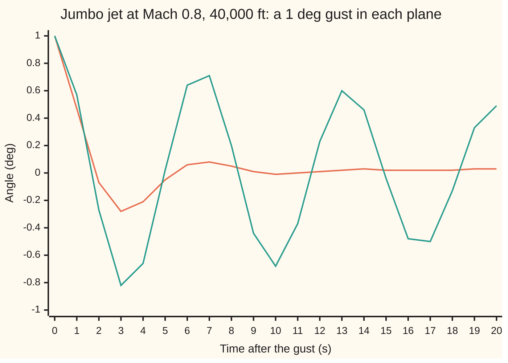

# Equations of motion of a vehicle: six freedoms and the small-disturbance split

[Syllabus](../../../SYLLABUS.md) → [Engineering mathematics](../README.md) → [Mechanics and Structures](../README.md#s07) → Equations of motion of a vehicle

---

## General Overview

A jumbo jet cruises at 40,000 ft (12,192 m) and Mach 0.8 (0.8 times the speed of sound), which there is 235.909 m/s. An updraft tips its nose 1° further into the oncoming air. A moment later a side gust swings the air 1° across its nose. What does the jet do next, and does it settle by itself?

It does two quite different things. After the updraft the nose bobs: the 1° shrinks to 0.47° after one second, overshoots to −0.28° at three seconds, and is gone inside ten seconds. After the side gust the jet wags: the nose swings left and right while the wings rock, every 6.64 s, and the swing only halves every 21.05 s. Flight engineers call the first motion the **short-period pitch mode** and the second the **Dutch roll**, after the rolling, weaving gait of a skater.

An aircraft is a rigid body free in six ways: it slides along three axes and turns about three. Written out, that gives six coupled, nonlinear equations. For small knocks they fall apart into two independent sets of four: the up-and-down motions in one, the sideways motions in the other.

Each set holds three of the six freedoms plus the one angle that tips gravity into it: the pitch angle θ for the first, the bank angle φ for the second. Each set is linear, and its eigenvalues are the aircraft's natural motions, its **modes**. An eigenvalue here is a rate at which one fixed pattern of motion grows, dies away or swings by itself. Five modes come out for this jet, with periods and time constants from 1.78 s to 137.40 s.

**Write Newton's laws in axes fixed to the aircraft, keep only first-order terms in a small disturbance, and the left-right mirror symmetry splits the six freedoms into a longitudinal set and a lateral set, whose eigenvalues are the named modes.**

**What kind of fact this is:** the body-axis equations are Newton's laws, exact for a rigid body; the split is a theorem about their first-order part, proved in Why it works; the aerodynamic numbers are a model: measured slopes, valid near one flight condition.

### The picture: two gusts, two modes



Orange: the change in angle of attack (how far the air comes from below the nose) after the updraft, the short-period mode, dead in two swings. Teal: the sideslip (how far the air comes from the side) after the side gust, the Dutch roll, still swinging at half size after 20 s. Both come from flying the nonlinear equations in the code below. The small 0.03° left on the orange line is the start of a third, much slower mode, the phugoid.

---

## The formula

Fix three axes to the aircraft at its centre of mass: x out of the nose, y out of the right wing, z down through the floor. Six numbers say how the aircraft moves in them, and three angles say how it sits.

| Freedom | Along or about | Speed or rate | Felt as |
| --- | --- | --- | --- |
| surge | x, the nose | u | speeding up |
| sway | y, the right wing | v | sliding sideways |
| heave | z, the floor | w | rising and sinking |
| roll | x | p | one wing dropping |
| pitch | y | q | nose up or down |
| yaw | z | r | nose swinging left or right |

The bank angle φ, pitch angle θ and heading ψ give the attitude. A dot over a letter means its rate of change per second.

**Body-axis equations.** Forces, then moments, then attitude:

$$m(\dot u + qw - rv) = X - mg\sin\theta, \quad m(\dot v + ru - pw) = Y + mg\cos\theta\sin\phi, \quad m(\dot w + pv - qu) = Z + mg\cos\theta\cos\phi$$

$$I_x\dot p - I_{xz}\dot r + (I_z - I_y)qr - I_{xz}pq = L, \quad I_y\dot q + (I_x - I_z)rp + I_{xz}(p^2 - r^2) = M, \quad I_z\dot r - I_{xz}\dot p + (I_y - I_x)pq + I_{xz}qr = N$$

$$\dot\phi = p + (q\sin\phi + r\cos\phi)\tan\theta, \qquad \dot\theta = q\cos\phi - r\sin\phi$$

**The small-disturbance split.** About steady level flight at airspeed V, called **trim** (steady flight with the forces and moments balanced), with u, w, q, θ, β, p, r, φ now meaning small changes from that flight:

$$\begin{bmatrix}\dot u\\ \dot w\\ \dot q\\ \dot\theta\end{bmatrix} = \begin{bmatrix}X_u & X_w & 0 & -g\\ Z_u & Z_w & V & 0\\ M_u & M_w & M_q & 0\\ 0 & 0 & 1 & 0\end{bmatrix}\begin{bmatrix}u\\ w\\ q\\ \theta\end{bmatrix}, \qquad \begin{bmatrix}\dot\beta\\ \dot r\\ \dot p\\ \dot\phi\end{bmatrix} = \begin{bmatrix}Y_\beta & -\cos\alpha_0 & \sin\alpha_0 & g\cos\alpha_0/V\\ N_\beta & N_r & N_p & 0\\ L_\beta & L_r & L_p & 0\\ 0 & \tan\alpha_0 & 1 & 0\end{bmatrix}\begin{bmatrix}\beta\\ r\\ p\\ \phi\end{bmatrix}$$

Call the two matrices $A_{lon}$ and $A_{lat}$. Each mode is an eigenvalue $\lambda$ of one of them.

**Read it aloud:** mass times the rate of change of velocity, as seen from the turning aircraft, equals the forces; spin inertia times the rate of change of rotation equals the moments; and once the knock is small, the up-and-down freedoms and the sideways freedoms obey two separate linear systems whose eigenvalues are the modes.

| Symbol | Plain meaning | In our example | Push it up and the answer… |
| --- | --- | --- | --- |
| $u, v, w$ | velocity along the nose, right wing and floor, m/s; a dot is a rate per second | trim: V cos α0, 0, V sin α0 | — |
| $p, q, r$; $\boldsymbol\omega$, $\mathbf H$ | roll, pitch and yaw rates, rad/s; $\boldsymbol\omega$ is the turn rate (p, q, r) as one arrow; $\mathbf H$ is the spin arrow (angular momentum) | 0 in trim | — |
| $\phi, \theta, \psi$ | bank, pitch and heading angles, rad | trim pitch 0.0803 rad | — |
| $X, Y, Z$ | air and engine forces along the axes, N | balance gravity in trim | — |
| $L, M, N$ | rolling, pitching and yawing moments, N·m (here L is a moment, not the loop gain of shelf 03) | zero in trim | — |
| $m$, $g$ | mass, kg; gravity, m/s² | g 9.8146, the data set's 32.2 ft/s² | — |
| $I_x, I_y, I_z, I_{xz}$ | resistance to roll, pitch and yaw, kg·m²; $I_{xz}$ couples roll with yaw | absorbed into the derivatives below | — |
| $V, \alpha, \beta$ | airspeed; angle of attack (air from below the nose); sideslip (air from the side). $\alpha_0$ is trim | 235.909 m/s; $\alpha_0$ = 0.0803 rad = 4.60° | V up stiffens the short period |
| $X_u, Z_w, M_w, M_q$ … | **derivatives**: change in force over mass, or moment over inertia, per unit change of one variable | $Z_w$ −0.3151 /s, $M_w$ −0.003366 /(m s), $M_q$ −0.4285 /s | $M_w$ more negative: faster short period |
| $Y_\beta, N_\beta, L_\beta, N_r$ … | the same for the sideways set | $N_\beta$ 0.598 /s², $L_\beta$ −3.05 /s², $N_r$ −0.115 /s | $N_r$ more negative: better-damped Dutch roll |
| $A_{lon}, A_{lat}, \lambda$ | the two 4×4 matrices; an eigenvalue, per second | $\lambda$ = −0.37194 ± 0.88754j | real part above 0: the mode grows |
| $\sigma, \omega_d$; $\omega_n, \zeta$ | decay rate, /s, and swing rate, rad/s, of a pair $\lambda = -\sigma \pm j\omega_d$; natural frequency, rad/s, and damping ratio | Dutch roll 0.03294, 0.94665; $\omega_n$, $\zeta$: short period 0.9623, 0.3865, Dutch roll 0.9472, 0.0348 | σ or ζ up: the swing dies sooner |

A complex pair $\lambda = -\sigma \pm j\omega_d$ gives $\omega_n = |\lambda|$ and $\zeta = \sigma/|\lambda|$, as in [Damping ratio and natural frequency](../02-Linear%20Systems%20and%20Transforms/06-second-order-systems-damping-and-natural-frequency.md). Here j is the square root of −1, as engineers write it. The rest of the library writes i.

The longitudinal numbers are quoted in axes lined up with the trim airflow, which is the standard choice. The lateral ones are in axes along the fuselage, which sits 4.60° nose-up. That tilt is where the cos α0, sin α0 and tan α0 come from.

### When it holds

- **Small disturbances.** Products of changes are dropped. A 15° sideslip gust moves the angle of attack by 3.150° in the nonlinear equations, while the linear sets say it cannot move at all.
- **Left-right symmetry.** The split needs a mirror-symmetric aircraft in symmetric flight. One engine out, a fuel imbalance or a steady turn couples the two sets from the first order.
- **One flight condition.** The derivatives are slopes measured at Mach 0.8 and 40,000 ft. On approach at low speed every number changes, and so does every mode.
- **A rigid airframe.** A long, flexible jet also bends and twists. When a bending frequency comes near a rigid-body mode, the two interact, and the rigid model misses it.

---

## Why it works

### Step 0: small knocks plus a mirror image split the problem

Two facts do all the work. First, if every change is small, a product of two changes is smaller still and can be dropped, leaving a linear system. Second, the aircraft is its own mirror image. A nose-up knock is the same as its mirror image, so it cannot make the aircraft prefer the left wing over the right. A sideways knock flips in the mirror, so to first order it cannot change the lift, the drag or the pitching moment. The up-and-down set and the sideways set therefore cannot feed each other to first order.

### Step 1: Newton's law in axes that turn

Newton's second law holds in axes that do not rotate. The aircraft's own axes turn with rate ω = (p, q, r). A velocity measured in turning axes changes for two reasons: it really changes, and the axes swing under it. The rate seen from the ground is

$$\frac{d\mathbf V}{dt}\Big|_{\text{ground}} = \dot{\mathbf V} + \boldsymbol\omega \times \mathbf V.$$

The cross product gives the extra terms qw − rv, ru − pw and pv − qu. The same rule applied to the spin arrow, the angular momentum, gives the moment equations. That is the rule of [Precession](03-gyroscopes-and-precession.md), torque equals the rate of change of the spin arrow, written in turning axes, with the inertias of [Rotation](02-rigid-body-rotation-and-moment-of-inertia.md). Gravity points straight down, and three turns through ψ, θ and φ carry it into body axes. That gives the sin θ and cos θ terms.

<details>
<summary>Detailed derivation: the moment equations</summary>

The aircraft is symmetric about its x–z plane, so the only off-axis inertia is $I_{xz}$. The spin arrow is

$$\mathbf H = (I_x p - I_{xz} r,\; I_y q,\; I_z r - I_{xz} p).$$

The moment equals $\dot{\mathbf H} + \boldsymbol\omega \times \mathbf H$. The x part of the cross product is $q(I_z r - I_{xz}p) - r I_y q = (I_z - I_y)qr - I_{xz}pq$. The y part is $r(I_x p - I_{xz} r) - p(I_z r - I_{xz}p) = (I_x - I_z)rp + I_{xz}(p^2 - r^2)$. The z part is $pI_y q - q(I_x p - I_{xz} r) = (I_y - I_x)pq + I_{xz}qr$. Add $\dot{\mathbf H}$ and these are the three moment equations above.

</details>

### Step 2: linearise about steady flight

Write each variable as its trim value plus a small change: forward speed V plus u, every rate zero plus a small p, q or r. Expand and keep first-order terms ([Linearisation](../04-State%20Space%20and%20Optimal%20Control/02-linearisation-about-an-equilibrium.md) does this in general).

Watch the heave equation. The term qu is a small q times the large trim speed V, so it survives as **V q**. That term is the whole reason the nose bobs: pitching the nose up swings the velocity arrow downwards relative to the body, which is the same as the air arriving from further below. The term pv is small times small, so it goes. Gravity's −g sin θ becomes −g θ.

The air forces are smooth functions of the state. To first order each is a slope times a change: $Z = Z_{\text{trim}} + m(Z_u u + Z_w w + \dots)$. Divide by the mass or the inertia and the slopes become the derivatives in the table. They are measured in wind tunnels and flight tests. The inertias are absorbed into them, which is why no inertia appears in the matrices.

### Step 3: the mirror kills the cross terms

Reflect the aircraft in its own plane of symmetry. Then u, w, q and θ stay the same, while v, p, r and φ flip sign. The lift, drag and pitching moment (X, Z, M) do not change in a mirror, so they are even functions of the sideways variables. An even function has zero slope at zero. The side force and the roll and yaw moments (Y, L, N) do flip, so they are zero whenever the sideways variables are zero, whatever the others do: again zero slope.

Every slope that would join the two sets is zero, so the 8×8 matrix is two 4×4 blocks. Heading ψ appears nowhere: the jet behaves the same flying north or east.

The code writes its air forces with no cross terms, as this argument allows, so its check covers the rest: the turning-axes and gravity terms add no first-order coupling either. Its finite-difference slopes across the two blocks are 0.000000.

### Step 4: modes are eigenvalues

A linear system $\dot x = Ax$, where x now stands for the set's four variables, not the nose axis, moves as a sum of patterns $e^{\lambda t}$, one for each eigenvalue λ of A ([The eigenvalue method](../../08-Differential%20equations%20and%20dynamics/04-Systems%20and%20the%20Matrix%20Exponential/02-the-eigenvalue-method.md)): a complex pair swings, a real λ decays or grows.

The longitudinal set has two pairs: the **short period**, a fast pitch bob at nearly constant speed, and the **phugoid**, a slow trade of height for speed. The lateral set has one pair, the **Dutch roll**, where yaw and roll swing together, and two real roots: **roll subsidence**, a roll rate dying away, and the **spiral**, a slow tightening or loosening of a bank.

Because the modes are so far apart in speed, two-state approximations can work. Freeze speed and pitch angle, keep (w, q), and you get the **short-period approximation**. Its 2×2 trace and determinant give ω_n and ζ directly ([Trace and determinant](../../08-Differential%20equations%20and%20dynamics/04-Systems%20and%20the%20Matrix%20Exponential/05-classifying-equilibria-by-trace-and-determinant.md)). The same trick for the Dutch roll, keeping (β, r), works less well. The worked numbers show why.

---

## Worked numbers, by hand

Short-period approximation, from the second and third rows of $A_{lon}$, with states (w, q):

| Step | Arithmetic | Value |
| --- | --- | --- |
| trace, $Z_w + M_q$ | −0.3151 + (−0.4285) | −0.7436 /s |
| determinant, $Z_w M_q - V M_w$ | (−0.3151)(−0.4285) − (235.909)(−0.003366) | 0.9291 /s² |
| $\omega_n = \sqrt{\det}$ | √0.9291 | 0.9639 rad/s |
| $\zeta = -\text{trace}/(2\omega_n)$ | 0.7436 / (2 × 0.9639) | 0.3857 |
| period, $2\pi/\sqrt{\det - \text{trace}^2/4}$ | 2π / √(0.9291 − 0.7436²/4) | 7.07 s |
| full 4×4, from the code | eigenvalues −0.37194 ± 0.88754j | ω_n 0.9623, ζ 0.3865, 7.08 s |
| Dutch roll 2×2, states (β, r): trace | −0.0558 + (−0.115) | −0.1708 /s |
| determinant | (−0.0558)(−0.115) − (−0.9968)(0.598) | 0.6025 /s² |
| $\omega_n$, $\zeta$, period | √0.6025; 0.1708 / (2 × 0.7762) | 0.7762 rad/s, 0.1100, 8.14 s |
| full 4×4, from the code | eigenvalues −0.03294 ± 0.94665j | **ω_n 0.9472 rad/s, ζ 0.0348, period 6.64 s** |

**The short period swings every 7.08 s with ζ 0.3865, and the Dutch roll every 6.64 s with ζ 0.0348.** The pitch bob is well damped and half-gone in 1.86 s. The Dutch roll halves only every 21.05 s, a little over three swings, so passengers feel a slow wallow. That is why large jets carry a **yaw damper**: a feedback loop that moves the rudder against the yaw rate.

The 2×2 short period nearly matches the full set: ω_n 0.9639 against 0.9623. The 2×2 Dutch roll does not: 8.14 s against 6.64 s, and three times too well damped. The reason is $L_\beta$ = −3.05: every degree of sideslip rolls the jet hard, and the roll feeds back into the sideslip through the gravity term. Freezing roll removed half the mode. Set $L_\beta$ to 0 in the code and the full Dutch roll moves to 8.04 s and ζ 0.1340, close to the 2×2.

All five modes, from the code:

| Mode | Eigenvalue, /s | Period or time constant | Half-life |
| --- | --- | --- | --- |
| short period | −0.37194 ± 0.88754j | 7.08 s | 1.86 s |
| phugoid | −0.00329 ± 0.06723j | 93.46 s | 210.72 s |
| Dutch roll | −0.03294 ± 0.94665j | 6.64 s | 21.05 s |
| roll subsidence | −0.56265 | 1.78 s | 1.23 s |
| spiral | −0.00728 | 137.40 s | 95.24 s |

### What breaks if you drop a piece

| Mistake | Comes out at | What went wrong |
| --- | --- | --- |
| Drop the V q term: Newton's law in body axes as if they did not turn | short period 0.4258 rad/s with ζ 0.9707, barely swinging; phugoid ζ −0.2508, doubling every 18.17 s | the turning-axes term ω × V carries the restoring swing; without it the model is wrong and even unstable |
| Dutch roll from the 2-state (β, r) model | ζ 0.1100, period 8.14 s (right: 0.0348, 6.64 s) | roll was frozen, but $L_\beta$ = −3.05 makes sideslip roll the jet hard |
| Read ω = 0.9472 rad/s as hertz | period 1.06 s (right: 6.64 s) | rad/s needs a 2π: the period is 2π/ω_d |
| Linear sets after a 15° side gust | angle of attack stays put; the nonlinear equations give 3.150°, with a 46.69° bank | far outside small disturbances, dropped products are no longer small |

---

## The split holds for small knocks only

The linear sets say a side gust never touches the angle of attack. The nonlinear equations disagree, by an amount that grows as the square of the gust. Three side gusts, each flown for 40 s in the code's nonlinear equations (exact kinematics and gravity, aerodynamics kept linear, the small inertial cross terms left out):

| Side gust | Linear sets: angle of attack moves | Nonlinear equations: peak change | Peak bank | Times the 1° case |
| --- | --- | --- | --- | --- |
| 1° | 0 | 0.017° | 3.33° | 1.0 |
| 5° | 0 | 0.408° | 16.52° | 24.5 |
| 15° | 0 | 3.150° | 46.69° | 188.8 |

```
peak change in angle of attack after a side gust
  1 deg   |                                           0.017 deg
  5 deg   █████                                       0.408 deg
 15 deg   ████████████████████████████████████████    3.150 deg
```

A square law would give 25 and 225 times. The 5° case gives 24.5: the coupling is second order, exactly the terms Step 2 dropped. It comes mainly from one of them, the product $pv$ in the heave equation: rolling while slipping sideways swings the sideways speed into the floor direction, which changes the angle of attack. Drop that one product and the 5° case falls from 0.408° to 0.106°. By 15° even the square law fails, because a 46.69° bank is far from level flight.

---

## Code, from first principles, and it actually runs

The code reaches the modes by **three independent roads**.

- Road 1 takes the published 4×4 matrices, builds each characteristic polynomial (the polynomial whose roots are the eigenvalues) by the Faddeev–LeVerrier recursion, and finds its roots by the Durand–Kerner iteration.
- Road 2 writes the nonlinear body-axis equations, with the turning-axes terms, gravity and the attitude equations. It then takes their slopes by finite differences at trim. They reproduce the published matrices, the cos α0, sin α0, g cos α0/V and tan α0 entries included, and the slopes across the two blocks come out zero; its air forces have no cross terms by construction, so that zero tests the turning-axes and gravity terms.
- Road 3 flies the nonlinear equations by fourth-order Runge–Kutta (RK4) after a 0.1° nudge, records the motion once a second for 300 s, and fits the modes to the record. A sum of four modes obeys a fixed four-term recurrence, and the roots of that recurrence are $e^{\lambda \cdot 1\,\text{s}}$. That is Prony's method, the flight-test engineer's road.

The nonlinear model leaves out the second-order spin terms such as $(I_z - I_y)qr$, which would need the inertias.

### Python

```python
# Vehicle equations of motion: a jumbo jet at Mach 0.8, 40,000 ft.  Standard library only.
# Road 1: modes as eigenvalues of the published linear sets (characteristic polynomial, roots).
# Road 2: the nonlinear body-axis equations, linearised by finite differences: same matrices, zero coupling.
# Road 3: fly the nonlinear equations (RK4), then fit the modes to the recorded motion (Prony).
import cmath
from math import sin, cos, tan, asin, atan2, sqrt, pi, log, radians, degrees
FT = 0.3048
V, G, A0 = 773.98 * FT, 32.2 * FT, 0.0803          # airspeed m/s, gravity m/s^2, trim alpha = trim pitch, rad
XU, XW, ZU, ZW = -0.006868, 0.01395, -0.09055, -0.3151        # per s
MU, MW, MQ = 0.0001187 / FT, -0.001026 / FT, -0.4285          # per (m s), per (m s), per s
ALON = [[XU, XW, 0, -G], [ZU, ZW, V, 0], [MU, MW, MQ, 0], [0, 0, 1, 0]]          # states u, w, q, theta
ALAT = [[-0.0558, -0.9968, 0.0802, 0.0415], [0.598, -0.115, -0.0318, 0],
        [-3.05, 0.388, -0.4650, 0], [0, 0.0805, 1, 0]]                          # states beta, r, p, phi
c, s = cos(A0), sin(A0)

def f(x, pv=1.0):   # body-axis equations: x = u, w, q, theta, v, r, p, phi (m/s, rad/s, rad); pv 0 drops p v from heave
    u, w, q, th, v, r, p, ph = x
    us, ws = c * u + s * w, -s * u + c * w                  # velocity in axes along the trim airflow
    xs, zs = XU * (us - V) + XW * ws, ZU * (us - V) + ZW * ws - G
    b = asin(v / sqrt(u * u + v * v + w * w))              # sideslip
    return [r * v - q * w - G * sin(th) + c * xs - s * zs,
            q * u - pv * p * v + G * cos(th) * cos(ph) + s * xs + c * zs,
            MU * (us - V) + MW * ws + MQ * q,
            q * cos(ph) - r * sin(ph),
            p * w - r * u + G * cos(th) * sin(ph) - 0.0558 * V * b,
            0.598 * b - 0.115 * r - 0.0318 * p,
            -3.05 * b + 0.388 * r - 0.465 * p,
            p + (q * sin(ph) + r * cos(ph)) * tan(th)]
def mm(a, b): return [[sum(a[i][k] * b[k][j] for k in range(len(b))) for j in range(len(b[0]))] for i in range(len(a))]
def roots(cf):          # Durand-Kerner: all roots of a monic polynomial at once
    n = len(cf) - 1
    z = [(0.4 + 0.9j) ** k for k in range(n)]
    for _ in range(500):
        for i in range(n):
            pv, d = 0j, 1 + 0j
            for k in range(n + 1): pv = pv * z[i] + cf[k]
            for j in range(n):
                if j != i: d *= z[i] - z[j]
            z[i] -= pv / d
    return sorted(z, key=lambda t: (round(t.real, 9), round(t.imag, 9)))
def eig(a):             # Faddeev-LeVerrier characteristic polynomial, then its roots
    n, m, cf = len(a), [[0.0] * len(a) for _ in a], [1.0]
    for k in range(1, n + 1):
        am = mm(a, m)
        m = [[am[i][j] + (cf[-1] if i == j else 0) for j in range(n)] for i in range(n)]
        am = mm(a, m)
        cf.append(-sum(am[i][i] for i in range(n)) / k)
    return roots(cf)
def show(tag, lam, lo=0.0, hi=9.0):    # print each mode once: rate, frequency, damping, time scale
    for z in lam:
        if z.imag < -1e-6 or not lo < abs(z) < hi: continue
        tail = f"half-life {log(2) / -z.real:7.2f} s" if z.real < 0 else f"doubles in {log(2) / z.real:5.2f} s"
        if abs(z.imag) < 1e-6:
            print(f"{tag:<9} real {z.real:9.5f} /s  time constant {1 / abs(z.real):8.2f} s  {tail}")
        else:
            print(f"{tag:<9} {z.real:8.5f} +/- {z.imag:7.5f}j  wn {abs(z):7.4f} rad/s  zeta {-z.real / abs(z):7.4f}"
                  f"  period {2 * pi / z.imag:6.2f} s  {tail}")
def two(tag, a, b, cc, d):   # 2x2 approximation by trace and determinant
    tr, de = a + d, a * d - b * cc
    print(f"{tag:<20} trace {tr:8.4f}  det {de:7.4f}  wn {sqrt(de):6.4f} rad/s  zeta {-tr / (2 * sqrt(de)):6.4f}"
          f"  period {2 * pi / sqrt(de - tr * tr / 4):5.2f} s")
    return sqrt(de), -tr / (2 * sqrt(de))
def rk4(x, dt, pv=1.0):
    k1 = f(x, pv); k2 = f([a + dt / 2 * b for a, b in zip(x, k1)], pv)
    k3 = f([a + dt / 2 * b for a, b in zip(x, k2)], pv); k4 = f([a + dt * b for a, b in zip(x, k3)], pv)
    return [a + dt / 6 * (b1 + 2 * b2 + 2 * b3 + b4) for a, b1, b2, b3, b4 in zip(x, k1, k2, k3, k4)]
def fly(da, db, tend, dt=0.02, pv=1.0):   # start disturbed by da (angle of attack) and db (sideslip), radians
    x = [V * cos(db) * cos(A0 + da), V * cos(db) * sin(A0 + da), 0, A0, V * sin(db), 0, 0, 0]
    rec = [x]
    for _ in range(round(tend / dt)):
        x = rk4(x, dt, pv); rec.append(x)
    return rec
def prony(y, dt):       # fit y[k+4] + a1 y[k+3] + ... + a4 y[k] = 0 by least squares; roots are e^(lambda dt)
    rows = [[y[k + 3], y[k + 2], y[k + 1], y[k], -y[k + 4]] for k in range(len(y) - 4)]
    m = [[sum(r[i] * r[j] for r in rows) for j in range(5)] for i in range(4)]
    for i in range(4):
        for k in range(i + 1, 4):
            fk = m[k][i] / m[i][i]; m[k] = [a - fk * b for a, b in zip(m[k], m[i])]
    a = [0.0] * 4
    for i in (3, 2, 1, 0): a[i] = (m[i][4] - sum(m[i][j] * a[j] for j in range(i + 1, 4))) / m[i][i]
    return sorted([cmath.log(z) / dt for z in roots([1.0] + a)], key=lambda t: (round(t.real, 6), round(t.imag, 6)))
# ---- road 2: linearise the body-axis equations by finite differences ----
x0 = [V * c, V * s, 0, A0, 0, 0, 0, 0]
jac = [[0.0] * 8 for _ in range(8)]
for j in range(8):
    h = 1e-6 * max(1.0, abs(x0[j]))
    fp = f([x0[k] + (h if k == j else 0) for k in range(8)]); fm = f([x0[k] - (h if k == j else 0) for k in range(8)])
    for i in range(8): jac[i][j] = (fp[i] - fm[i]) / (2 * h)
rot, back = [[c, s, 0, 0], [-s, c, 0, 0], [0, 0, 1, 0], [0, 0, 0, 1]], [[c, -s, 0, 0], [s, c, 0, 0], [0, 0, 1, 0], [0, 0, 0, 1]]
jlon = mm(mm(rot, [r[:4] for r in jac[:4]]), back)
jlat = [[jac[4 + i][4 + j] * (V if j == 0 else 1) / (V if i == 0 else 1) for j in range(4)] for i in range(4)]
dlon = max(abs(jlon[i][j] - ALON[i][j]) for i in range(4) for j in range(4))
dlat = max(abs(jlat[i][j] - ALAT[i][j]) for i in range(4) for j in range(4))
cross = max(abs(jac[i][j]) for i in range(8) for j in range(8) if (i < 4) != (j < 4))
print(f"trim: altitude {40000 * FT:.0f} m, V {V:.3f} m/s, g {G:.4f} m/s^2, alpha = theta = {A0} rad = {degrees(A0):.2f} deg, Mw {MW:.6f} /(m s)")
print(f"jacobian vs published: longitudinal max diff {dlon:.6f}, lateral max diff {dlat:.6f}")
print(f"jacobian coupling blocks, largest entry {cross:.6f}")
print(f"lateral kinematics: -cos a0 {jlat[0][1]:.5f}, sin a0 {jlat[0][2]:.5f}, g cos a0 / V {jlat[0][3]:.5f}, tan a0 {jlat[3][1]:.5f}")
# ---- road 1: eigenvalues of the published sets ----
lon, lat = eig(ALON), eig(ALAT)
show("lon", lon); show("lat", lat)
# ---- road 3: fly a 0.1 deg nudge for 300 s, sample once a second, fit the modes ----
plon = prony([x[2] for x in fly(radians(0.1), 0, 300)[::50]], 1.0)
plat = prony([x[6] for x in fly(0, radians(0.1), 300)[::50]], 1.0)
show("fit lon", plon); show("fit lat", plat)
# ---- by hand: the two-state approximations ----
wsp, _ = two("short period 2x2", ZW, V, MW, MQ)
_, zdr = two("dutch roll 2x2", -0.0558, -0.9968, 0.598, -0.115)
# ---- what breaks ----
show("no V*q", eig([[XU, XW, 0, -G], [ZU, ZW, 0, 0], [MU, MW, MQ, 0], [0, 0, 1, 0]]))
print(f"dutch roll {abs(lat[2]):.4f} rad/s read as Hz: period {1 / abs(lat[2]):.2f} s (right {2 * pi / lat[2].imag:.2f} s)")
amp = []
for b0 in (1, 5, 15):
    rec = fly(0, radians(b0), 40)
    da = max(abs(atan2(x[1], x[0]) - A0) for x in rec); amp.append(da)
    print(f"sideslip {b0:2d} deg: linear says alpha moves 0; nonlinear peak alpha change {degrees(da):6.3f} deg,"
          f" peak bank {max(abs(degrees(x[7])) for x in rec):5.2f} deg, x{da / amp[0]:6.1f} the 1 deg case")
npv = max(abs(atan2(x[1], x[0]) - A0) for x in fly(0, radians(5), 40, pv=0.0))   # roll-times-sideslip p v dropped
print(f"sideslip  5 deg, p v dropped from heave: peak alpha change {degrees(npv):6.3f} deg")
# ---- try changing ----
def lon_with(mw): return eig([[XU, XW, 0, -G], [ZU, ZW, V, 0], [MU, mw, MQ, 0], [0, 0, 1, 0]])
def lat_with(nr, lb): return eig([[-0.0558, -0.9968, 0.0802, 0.0415], [0.598, nr, -0.0318, 0], [lb, 0.388, -0.465, 0], [0, 0.0805, 1, 0]])
show("Mw/2", lon_with(MW / 2), 0.3); show("Mw flip", lon_with(-MW), 0.3)
show("Nr -0.6", [z for z in lat_with(-0.6, -3.05) if abs(z.imag) > 0.1]); show("Lb 0", [z for z in lat_with(-0.115, 0) if abs(z.imag) > 0.1])
# ---- chart: 1 deg gusts, nonlinear, once a second ----
ra, rb = fly(radians(1), 0, 20)[::50], fly(0, radians(1), 20)[::50]
print("chart alpha change, deg:", " ".join(f"{degrees(atan2(x[1], x[0]) - A0):.2f}" for x in ra))
print("chart sideslip, deg:    ", " ".join(f"{degrees(asin(x[4] / sqrt(x[0]**2 + x[1]**2 + x[4]**2))):.2f}" for x in rb))
# ---- checks ----
assert dlon < 1e-6, "linearised body-axis equations must reproduce the published longitudinal set"
assert dlat < 1e-4, "... and the published lateral set, to its 3-4 figure rounding"
assert cross < 1e-9, "turning-axes and gravity terms must not couple the two sets to first order"
for a, b in zip(lon + lat, plon + plat):
    assert abs(a - b) < 0.01 * abs(a) + 1e-4, "modes fitted to the flight record must match the eigenvalues"
assert abs(wsp - abs(eig([[ZW, V], [MW, MQ]])[0])) < 1e-9, "trace-determinant formula must match the 2x2 eigenvalues"
assert abs(wsp / abs(lon[0]) - 1) < 0.01, "2x2 short period within 1% of the full set"
assert zdr / (-lat[2].real / abs(lat[2])) > 2, "2x2 dutch roll over-states the damping"
assert abs(amp[1] / amp[0] - 25) < 2.5, "coupling grows as the square of the disturbance"
assert npv < amp[1] / 2, "the roll-times-sideslip product p v carries most of the coupling"
print("ALL CHECKS PASS")
```

**Ran 2026-11-11 on macOS, Python 3.14.10, standard library only. All checks passed. Output, pasted from the run:**

```
trim: altitude 12192 m, V 235.909 m/s, g 9.8146 m/s^2, alpha = theta = 0.0803 rad = 4.60 deg, Mw -0.003366 /(m s)
jacobian vs published: longitudinal max diff 0.000000, lateral max diff 0.000031
jacobian coupling blocks, largest entry 0.000000
lateral kinematics: -cos a0 -0.99678, sin a0 0.08021, g cos a0 / V 0.04147, tan a0 0.08047
lon       -0.37194 +/- 0.88754j  wn  0.9623 rad/s  zeta  0.3865  period   7.08 s  half-life    1.86 s
lon       -0.00329 +/- 0.06723j  wn  0.0673 rad/s  zeta  0.0489  period  93.46 s  half-life  210.72 s
lat       real  -0.56265 /s  time constant     1.78 s  half-life    1.23 s
lat       -0.03294 +/- 0.94665j  wn  0.9472 rad/s  zeta  0.0348  period   6.64 s  half-life   21.05 s
lat       real  -0.00728 /s  time constant   137.40 s  half-life   95.24 s
fit lon   -0.37191 +/- 0.88756j  wn  0.9623 rad/s  zeta  0.3865  period   7.08 s  half-life    1.86 s
fit lon   -0.00326 +/- 0.06722j  wn  0.0673 rad/s  zeta  0.0485  period  93.47 s  half-life  212.42 s
fit lat   real  -0.56257 /s  time constant     1.78 s  half-life    1.23 s
fit lat   -0.03299 +/- 0.94664j  wn  0.9472 rad/s  zeta  0.0348  period   6.64 s  half-life   21.01 s
fit lat   real  -0.00732 /s  time constant   136.62 s  half-life   94.70 s
short period 2x2     trace  -0.7436  det  0.9291  wn 0.9639 rad/s  zeta 0.3857  period  7.07 s
dutch roll 2x2       trace  -0.1708  det  0.6025  wn 0.7762 rad/s  zeta 0.1100  period  8.14 s
no V*q    -0.41339 +/- 0.10225j  wn  0.4258 rad/s  zeta  0.9707  period  61.45 s  half-life    1.68 s
no V*q     0.03816 +/- 0.14725j  wn  0.1521 rad/s  zeta -0.2508  period  42.67 s  doubles in 18.17 s
dutch roll 0.9472 rad/s read as Hz: period 1.06 s (right 6.64 s)
sideslip  1 deg: linear says alpha moves 0; nonlinear peak alpha change  0.017 deg, peak bank  3.33 deg, x   1.0 the 1 deg case
sideslip  5 deg: linear says alpha moves 0; nonlinear peak alpha change  0.408 deg, peak bank 16.52 deg, x  24.5 the 1 deg case
sideslip 15 deg: linear says alpha moves 0; nonlinear peak alpha change  3.150 deg, peak bank 46.69 deg, x 188.8 the 1 deg case
sideslip  5 deg, p v dropped from heave: peak alpha change  0.106 deg
Mw/2      -0.37246 +/- 0.62489j  wn  0.7275 rad/s  zeta  0.5120  period  10.05 s  half-life    1.86 s
Mw flip   real  -1.26601 /s  time constant     0.79 s  half-life    0.55 s
Mw flip   real   0.52080 /s  time constant     1.92 s  doubles in  1.33 s
Nr -0.6   -0.19147 +/- 0.89102j  wn  0.9114 rad/s  zeta  0.2101  period   7.05 s  half-life    3.62 s
Lb 0      -0.10566 +/- 0.78127j  wn  0.7884 rad/s  zeta  0.1340  period   8.04 s  half-life    6.56 s
chart alpha change, deg: 1.00 0.47 -0.07 -0.28 -0.21 -0.05 0.06 0.08 0.05 0.01 -0.01 -0.00 0.01 0.02 0.03 0.02 0.02 0.02 0.02 0.03 0.03
chart sideslip, deg:     1.00 0.57 -0.27 -0.82 -0.66 0.02 0.64 0.71 0.20 -0.44 -0.68 -0.37 0.23 0.60 0.46 -0.04 -0.48 -0.50 -0.13 0.33 0.49
ALL CHECKS PASS
```

### Rust

```rust
// Vehicle equations of motion: a jumbo jet at Mach 0.8, 40,000 ft.  std only, no crates.
// Road 1: modes as eigenvalues of the published linear sets (characteristic polynomial, roots).
// Road 2: the nonlinear body-axis equations, linearised by finite differences: same matrices, zero coupling.
// Road 3: fly the nonlinear equations (RK4), then fit the modes to the recorded motion (Prony).
use std::f64::consts::PI;
#[derive(Clone, Copy)]
struct C { re: f64, im: f64 }
impl C {
    fn add(self, o: C) -> C { C { re: self.re + o.re, im: self.im + o.im } }
    fn sub(self, o: C) -> C { C { re: self.re - o.re, im: self.im - o.im } }
    fn mul(self, o: C) -> C { C { re: self.re * o.re - self.im * o.im, im: self.re * o.im + self.im * o.re } }
    fn div(self, o: C) -> C { let d = o.re * o.re + o.im * o.im;
        C { re: (self.re * o.re + self.im * o.im) / d, im: (self.im * o.re - self.re * o.im) / d } }
    fn abs(self) -> f64 { self.re.hypot(self.im) }
    fn ln(self) -> C { C { re: self.abs().ln(), im: self.im.atan2(self.re) } }
}
const FT: f64 = 0.3048;
const XU: f64 = -0.006868; const XW: f64 = 0.01395; const ZU: f64 = -0.09055; const ZW: f64 = -0.3151;
const MQ: f64 = -0.4285; const A0: f64 = 0.0803;
fn v0() -> f64 { 773.98 * FT } fn g0() -> f64 { 32.2 * FT } // airspeed, m/s; gravity, m/s^2
fn mu() -> f64 { 0.0001187 / FT } fn mw() -> f64 { -0.001026 / FT }
fn alon(mwv: f64, vq: f64) -> Vec<Vec<f64>> {
    vec![vec![XU, XW, 0.0, -g0()], vec![ZU, ZW, vq, 0.0], vec![mu(), mwv, MQ, 0.0], vec![0.0, 0.0, 1.0, 0.0]] }
fn alat(nr: f64, lb: f64) -> Vec<Vec<f64>> {
    vec![vec![-0.0558, -0.9968, 0.0802, 0.0415], vec![0.598, nr, -0.0318, 0.0], vec![lb, 0.388, -0.4650, 0.0], vec![0.0, 0.0805, 1.0, 0.0]] }
fn f(x: &[f64], pv: f64) -> Vec<f64> { // body-axis equations: x = u, w, q, theta, v, r, p, phi; pv 0 drops p v from heave
    let (u, w, q, th, v, r, p, ph) = (x[0], x[1], x[2], x[3], x[4], x[5], x[6], x[7]);
    let (c, s, vv, g) = (A0.cos(), A0.sin(), v0(), g0());
    let (us, ws) = (c * u + s * w, -s * u + c * w);
    let (xs, zs) = (XU * (us - vv) + XW * ws, ZU * (us - vv) + ZW * ws - g);
    let b = (v / (u * u + v * v + w * w).sqrt()).asin();
    vec![r * v - q * w - g * th.sin() + c * xs - s * zs,
         q * u - pv * p * v + g * th.cos() * ph.cos() + s * xs + c * zs,
         mu() * (us - vv) + mw() * ws + MQ * q,
         q * ph.cos() - r * ph.sin(),
         p * w - r * u + g * th.cos() * ph.sin() - 0.0558 * vv * b,
         0.598 * b - 0.115 * r - 0.0318 * p,
         -3.05 * b + 0.388 * r - 0.465 * p,
         p + (q * ph.sin() + r * ph.cos()) * th.tan()]
}
fn mm(a: &[Vec<f64>], b: &[Vec<f64>]) -> Vec<Vec<f64>> {
    (0..a.len()).map(|i| (0..b[0].len()).map(|j| (0..b.len()).map(|k| a[i][k] * b[k][j]).sum()).collect()).collect() }
fn key(z: &C, d: f64) -> (f64, f64) { ((z.re * d).round(), (z.im * d).round()) }
fn roots(cf: &[f64]) -> Vec<C> { // Durand-Kerner
    let n = cf.len() - 1;
    let (mut z, mut pw): (Vec<C>, C) = (Vec::new(), C { re: 1.0, im: 0.0 });
    for _ in 0..n { z.push(pw); pw = pw.mul(C { re: 0.4, im: 0.9 }); }
    for _ in 0..500 { for i in 0..n {
        let (mut pv, mut d) = (C { re: 0.0, im: 0.0 }, C { re: 1.0, im: 0.0 });
        for k in 0..=n { pv = pv.mul(z[i]).add(C { re: cf[k], im: 0.0 }); }
        for j in 0..n { if j != i { d = d.mul(z[i].sub(z[j])); } }
        z[i] = z[i].sub(pv.div(d));
    } }
    z.sort_by(|a, b| key(a, 1e9).partial_cmp(&key(b, 1e9)).unwrap());
    z
}
fn eig(a: &[Vec<f64>]) -> Vec<C> { // Faddeev-LeVerrier, then roots
    let n = a.len();
    let (mut m, mut cf) = (vec![vec![0.0; n]; n], vec![1.0]);
    for k in 1..=n {
        let am = mm(a, &m);
        m = (0..n).map(|i| (0..n).map(|j| am[i][j] + if i == j { cf[k - 1] } else { 0.0 }).collect()).collect();
        let am = mm(a, &m); cf.push(-(0..n).map(|i| am[i][i]).sum::<f64>() / k as f64);
    }
    roots(&cf)
}
fn show(tag: &str, lam: &[C], lo: f64) {
    for z in lam {
        if z.im < -1e-6 || !(lo < z.abs() && z.abs() < 9.0) { continue; }
        let tail = if z.re < 0.0 { format!("half-life {:7.2} s", 2f64.ln() / -z.re) } else { format!("doubles in {:5.2} s", 2f64.ln() / z.re) };
        if z.im.abs() < 1e-6 {
            println!("{:<9} real {:9.5} /s  time constant {:8.2} s  {}", tag, z.re, 1.0 / z.re.abs(), tail);
        } else {
            println!("{:<9} {:8.5} +/- {:7.5}j  wn {:7.4} rad/s  zeta {:7.4}  period {:6.2} s  {}",
                     tag, z.re, z.im, z.abs(), -z.re / z.abs(), 2.0 * PI / z.im, tail);
        }
    }
}
fn two(tag: &str, a: f64, b: f64, cc: f64, d: f64) -> (f64, f64) {
    let (tr, de) = (a + d, a * d - b * cc);
    println!("{:<20} trace {:8.4}  det {:7.4}  wn {:6.4} rad/s  zeta {:6.4}  period {:5.2} s",
             tag, tr, de, de.sqrt(), -tr / (2.0 * de.sqrt()), 2.0 * PI / (de - tr * tr / 4.0).sqrt());
    (de.sqrt(), -tr / (2.0 * de.sqrt()))
}
fn axpy(x: &[f64], h: f64, k: &[f64]) -> Vec<f64> { x.iter().zip(k).map(|(a, b)| a + h * b).collect() }
fn rk4(x: &[f64], dt: f64, pv: f64) -> Vec<f64> {
    let k1 = f(x, pv); let k2 = f(&axpy(x, dt / 2.0, &k1), pv);
    let k3 = f(&axpy(x, dt / 2.0, &k2), pv); let k4 = f(&axpy(x, dt, &k3), pv);
    (0..8).map(|i| x[i] + dt / 6.0 * (k1[i] + 2.0 * k2[i] + 2.0 * k3[i] + k4[i])).collect()
}
fn fly(da: f64, db: f64, tend: f64, pv: f64) -> Vec<Vec<f64>> {
    let v = v0();
    let mut x = vec![v * db.cos() * (A0 + da).cos(), v * db.cos() * (A0 + da).sin(), 0.0, A0, v * db.sin(), 0.0, 0.0, 0.0];
    let mut rec = vec![x.clone()];
    for _ in 0..(tend / 0.02).round() as usize { x = rk4(&x, 0.02, pv); rec.push(x.clone()); }
    rec
}
fn prony(y: &[f64], dt: f64) -> Vec<C> {
    let rows: Vec<[f64; 5]> = (0..y.len() - 4).map(|k| [y[k + 3], y[k + 2], y[k + 1], y[k], -y[k + 4]]).collect();
    let mut m: Vec<Vec<f64>> = (0..4).map(|i| (0..5).map(|j| rows.iter().map(|r| r[i] * r[j]).sum()).collect()).collect();
    for i in 0..4 { for k in i + 1..4 { let fk = m[k][i] / m[i][i]; m[k] = (0..5).map(|j| m[k][j] - fk * m[i][j]).collect(); } }
    let mut a = [0.0; 4];
    for i in (0..4).rev() { a[i] = (m[i][4] - (i + 1..4).map(|j| m[i][j] * a[j]).sum::<f64>()) / m[i][i]; }
    let mut z: Vec<C> = roots(&[1.0, a[0], a[1], a[2], a[3]]).iter().map(|r| { let l = r.ln(); C { re: l.re / dt, im: l.im / dt } }).collect();
    z.sort_by(|a, b| key(a, 1e6).partial_cmp(&key(b, 1e6)).unwrap());
    z
}
fn alpha(x: &[f64]) -> f64 { x[1].atan2(x[0]) - A0 }
fn main() {
    let (v, g, c, s) = (v0(), g0(), A0.cos(), A0.sin());
    let x0 = vec![v * c, v * s, 0.0, A0, 0.0, 0.0, 0.0, 0.0];
    let mut jac = vec![vec![0.0; 8]; 8];
    for j in 0..8 {
        let h = 1e-6 * x0[j].abs().max(1.0);
        let (mut xp, mut xm) = (x0.clone(), x0.clone());
        xp[j] += h; xm[j] -= h; let (fp, fm) = (f(&xp, 1.0), f(&xm, 1.0));
        for i in 0..8 { jac[i][j] = (fp[i] - fm[i]) / (2.0 * h); }
    }
    let rot = vec![vec![c, s, 0.0, 0.0], vec![-s, c, 0.0, 0.0], vec![0.0, 0.0, 1.0, 0.0], vec![0.0, 0.0, 0.0, 1.0]];
    let back = vec![vec![c, -s, 0.0, 0.0], vec![s, c, 0.0, 0.0], vec![0.0, 0.0, 1.0, 0.0], vec![0.0, 0.0, 0.0, 1.0]];
    let jlon = mm(&mm(&rot, &(0..4).map(|i| jac[i][..4].to_vec()).collect::<Vec<_>>()), &back);
    let jlat: Vec<Vec<f64>> = (0..4).map(|i| (0..4).map(|j| jac[4 + i][4 + j] * (if j == 0 { v } else { 1.0 }) / (if i == 0 { v } else { 1.0 })).collect()).collect();
    let (pl, pa) = (alon(mw(), v), alat(-0.115, -3.05));
    let (mut dlon, mut dlat, mut cross) = (0.0f64, 0.0f64, 0.0f64);
    for i in 0..4 { for j in 0..4 { dlon = dlon.max((jlon[i][j] - pl[i][j]).abs()); dlat = dlat.max((jlat[i][j] - pa[i][j]).abs()); } }
    for i in 0..8 { for j in 0..8 { if (i < 4) != (j < 4) { cross = cross.max(jac[i][j].abs()); } } }
    println!("trim: altitude {:.0} m, V {:.3} m/s, g {:.4} m/s^2, alpha = theta = {} rad = {:.2} deg, Mw {:.6} /(m s)", 40000.0 * FT, v, g, A0, A0.to_degrees(), mw());
    println!("jacobian vs published: longitudinal max diff {:.6}, lateral max diff {:.6}", dlon, dlat);
    println!("jacobian coupling blocks, largest entry {:.6}", cross);
    println!("lateral kinematics: -cos a0 {:.5}, sin a0 {:.5}, g cos a0 / V {:.5}, tan a0 {:.5}", jlat[0][1], jlat[0][2], jlat[0][3], jlat[3][1]);
    let (lon, lat) = (eig(&pl), eig(&pa));
    show("lon", &lon, 0.0); show("lat", &lat, 0.0);
    let plon = prony(&fly(0.1f64.to_radians(), 0.0, 300.0, 1.0).iter().step_by(50).map(|x| x[2]).collect::<Vec<f64>>(), 1.0);
    let plat = prony(&fly(0.0, 0.1f64.to_radians(), 300.0, 1.0).iter().step_by(50).map(|x| x[6]).collect::<Vec<f64>>(), 1.0);
    show("fit lon", &plon, 0.0); show("fit lat", &plat, 0.0);
    let (wsp, _) = two("short period 2x2", ZW, v, mw(), MQ);
    let (_, zdr) = two("dutch roll 2x2", -0.0558, -0.9968, 0.598, -0.115);
    show("no V*q", &eig(&alon(mw(), 0.0)), 0.0);
    println!("dutch roll {:.4} rad/s read as Hz: period {:.2} s (right {:.2} s)", lat[2].abs(), 1.0 / lat[2].abs(), 2.0 * PI / lat[2].im);
    let mut amp: Vec<f64> = Vec::new();
    for b0 in [1.0f64, 5.0, 15.0] {
        let rec = fly(0.0, b0.to_radians(), 40.0, 1.0);
        let da = rec.iter().map(|x| alpha(x).abs()).fold(0.0, f64::max); amp.push(da);
        let bank = rec.iter().map(|x| x[7].to_degrees().abs()).fold(0.0, f64::max);
        println!("sideslip {:2} deg: linear says alpha moves 0; nonlinear peak alpha change {:6.3} deg, peak bank {:5.2} deg, x{:6.1} the 1 deg case",
                 b0 as i32, da.to_degrees(), bank, da / amp[0]);
    }
    let npv = fly(0.0, 5f64.to_radians(), 40.0, 0.0).iter().map(|x| alpha(x).abs()).fold(0.0, f64::max); // roll-times-sideslip p v dropped
    println!("sideslip  5 deg, p v dropped from heave: peak alpha change {:6.3} deg", npv.to_degrees());
    let osc = |l: Vec<C>| -> Vec<C> { l.into_iter().filter(|z| z.im.abs() > 0.1).collect() };
    show("Mw/2", &eig(&alon(mw() / 2.0, v)), 0.3); show("Mw flip", &eig(&alon(-mw(), v)), 0.3);
    show("Nr -0.6", &osc(eig(&alat(-0.6, -3.05))), 0.0); show("Lb 0", &osc(eig(&alat(-0.115, 0.0))), 0.0);
    let ra: Vec<String> = fly(1f64.to_radians(), 0.0, 20.0, 1.0).iter().step_by(50).map(|x| format!("{:.2}", alpha(x).to_degrees())).collect();
    let rb: Vec<String> = fly(0.0, 1f64.to_radians(), 20.0, 1.0).iter().step_by(50)
        .map(|x| format!("{:.2}", (x[4] / (x[0].powi(2) + x[1].powi(2) + x[4].powi(2)).sqrt()).asin().to_degrees())).collect();
    println!("chart alpha change, deg: {}", ra.join(" "));
    println!("chart sideslip, deg:     {}", rb.join(" "));
    assert!(dlon < 1e-6, "linearised body-axis equations must reproduce the published longitudinal set");
    assert!(dlat < 1e-4, "... and the published lateral set, to its 3-4 figure rounding");
    assert!(cross < 1e-9, "turning-axes and gravity terms must not couple the two sets to first order");
    for (a, b) in lon.iter().chain(lat.iter()).zip(plon.iter().chain(plat.iter())) {
        assert!(a.sub(*b).abs() < 0.01 * a.abs() + 1e-4, "modes fitted to the flight record must match the eigenvalues");
    }
    assert!((wsp - eig(&vec![vec![ZW, v], vec![mw(), MQ]])[0].abs()).abs() < 1e-9, "trace-determinant formula must match the 2x2 eigenvalues");
    assert!((wsp / lon[0].abs() - 1.0).abs() < 0.01, "2x2 short period within 1% of the full set");
    assert!(zdr / (-lat[2].re / lat[2].abs()) > 2.0, "2x2 dutch roll over-states the damping");
    assert!((amp[1] / amp[0] - 25.0).abs() < 2.5, "coupling grows as the square of the disturbance");
    assert!(npv < amp[1] / 2.0, "the roll-times-sideslip product p v carries most of the coupling");
    println!("ALL CHECKS PASS");
}
```

**Ran 2026-11-11 on macOS, rustc 1.98.1, no crates. All checks passed. Output, pasted from the run:**

```
trim: altitude 12192 m, V 235.909 m/s, g 9.8146 m/s^2, alpha = theta = 0.0803 rad = 4.60 deg, Mw -0.003366 /(m s)
jacobian vs published: longitudinal max diff 0.000000, lateral max diff 0.000031
jacobian coupling blocks, largest entry 0.000000
lateral kinematics: -cos a0 -0.99678, sin a0 0.08021, g cos a0 / V 0.04147, tan a0 0.08047
lon       -0.37194 +/- 0.88754j  wn  0.9623 rad/s  zeta  0.3865  period   7.08 s  half-life    1.86 s
lon       -0.00329 +/- 0.06723j  wn  0.0673 rad/s  zeta  0.0489  period  93.46 s  half-life  210.72 s
lat       real  -0.56265 /s  time constant     1.78 s  half-life    1.23 s
lat       -0.03294 +/- 0.94665j  wn  0.9472 rad/s  zeta  0.0348  period   6.64 s  half-life   21.05 s
lat       real  -0.00728 /s  time constant   137.40 s  half-life   95.24 s
fit lon   -0.37191 +/- 0.88756j  wn  0.9623 rad/s  zeta  0.3865  period   7.08 s  half-life    1.86 s
fit lon   -0.00326 +/- 0.06722j  wn  0.0673 rad/s  zeta  0.0485  period  93.47 s  half-life  212.42 s
fit lat   real  -0.56257 /s  time constant     1.78 s  half-life    1.23 s
fit lat   -0.03299 +/- 0.94664j  wn  0.9472 rad/s  zeta  0.0348  period   6.64 s  half-life   21.01 s
fit lat   real  -0.00732 /s  time constant   136.62 s  half-life   94.70 s
short period 2x2     trace  -0.7436  det  0.9291  wn 0.9639 rad/s  zeta 0.3857  period  7.07 s
dutch roll 2x2       trace  -0.1708  det  0.6025  wn 0.7762 rad/s  zeta 0.1100  period  8.14 s
no V*q    -0.41339 +/- 0.10225j  wn  0.4258 rad/s  zeta  0.9707  period  61.45 s  half-life    1.68 s
no V*q     0.03816 +/- 0.14725j  wn  0.1521 rad/s  zeta -0.2508  period  42.67 s  doubles in 18.17 s
dutch roll 0.9472 rad/s read as Hz: period 1.06 s (right 6.64 s)
sideslip  1 deg: linear says alpha moves 0; nonlinear peak alpha change  0.017 deg, peak bank  3.33 deg, x   1.0 the 1 deg case
sideslip  5 deg: linear says alpha moves 0; nonlinear peak alpha change  0.408 deg, peak bank 16.52 deg, x  24.5 the 1 deg case
sideslip 15 deg: linear says alpha moves 0; nonlinear peak alpha change  3.150 deg, peak bank 46.69 deg, x 188.8 the 1 deg case
sideslip  5 deg, p v dropped from heave: peak alpha change  0.106 deg
Mw/2      -0.37246 +/- 0.62489j  wn  0.7275 rad/s  zeta  0.5120  period  10.05 s  half-life    1.86 s
Mw flip   real  -1.26601 /s  time constant     0.79 s  half-life    0.55 s
Mw flip   real   0.52080 /s  time constant     1.92 s  doubles in  1.33 s
Nr -0.6   -0.19147 +/- 0.89102j  wn  0.9114 rad/s  zeta  0.2101  period   7.05 s  half-life    3.62 s
Lb 0      -0.10566 +/- 0.78127j  wn  0.7884 rad/s  zeta  0.1340  period   8.04 s  half-life    6.56 s
chart alpha change, deg: 1.00 0.47 -0.07 -0.28 -0.21 -0.05 0.06 0.08 0.05 0.01 -0.01 -0.00 0.01 0.02 0.03 0.02 0.02 0.02 0.02 0.03 0.03
chart sideslip, deg:     1.00 0.57 -0.27 -0.82 -0.66 0.02 0.64 0.71 0.20 -0.44 -0.68 -0.37 0.23 0.60 0.46 -0.04 -0.48 -0.50 -0.13 0.33 0.49
ALL CHECKS PASS
```

### Lean

Lean proves the mirror split, the turning-axes moment terms and the 2×2 trace and determinant formulas, for any aircraft numbers.

- Suppose reflecting the aircraft keeps the rates of u, w, q, θ and flips the rates of v, r, p, φ. Then, linearised about a trim with v, r, p, φ all zero, neither set feeds the other.
- Take the spin arrow $\mathbf H$ of an aircraft symmetric about its x–z plane, as in the moment derivation. Then $\boldsymbol\omega \times \mathbf H$ gives exactly the three turning-axes terms of the moment equations.
- Suppose a real 2×2 matrix has a complex pair $\lambda = -\sigma \pm j\omega_d$, with $\omega_d > 0$. Then $\omega_n = \sqrt{\det}$, $\zeta = -\text{trace}/(2\omega_n)$ and $\omega_d = \sqrt{\det - \text{trace}^2/4}$.

Every number, the force and attitude equations, the 4×4 eigenvalues and the flights are left to the Python and Rust checks.

```lean
-- Equations of motion of a vehicle: mirror symmetry makes the linearised equations split into a longitudinal block and a lateral block, the turning-axes moment terms are the stated cross product, and a 2×2 block's trace and determinant give a complex mode's natural frequency, damping ratio and swing rate.
import Mathlib.Analysis.Calculus.FDeriv.Prod
import Mathlib.Analysis.Calculus.FDeriv.Comp
import Mathlib.Analysis.Complex.Basic
import Mathlib.Analysis.SpecialFunctions.Pow.Real
import Mathlib.LinearAlgebra.CrossProduct
import Mathlib.LinearAlgebra.Matrix.Charpoly.Coeff

open Matrix

/-- In a real vector space, a vector equal to its own negative is zero. -/
lemma eq_zero_of_eq_neg_real {M : Type*} [AddCommGroup M] [Module ℝ M] {w : M}
    (h : w = -w) : w = 0 := by
  have h2 : (2 : ℝ) • w = w - -w := by rw [two_smul, sub_neg_eq_add]
  rw [← h, sub_self] at h2
  exact (smul_eq_zero.mp h2).resolve_left two_ne_zero

#print axioms eq_zero_of_eq_neg_real

/-- The small-disturbance split. Let the state be a pair (x, y): x the longitudinal
variables (u, w, q, θ) and y the lateral variables (v, r, p, φ), and let `F` give their
rates of change. Left-right mirror symmetry means that reflecting the aircraft
(y ↦ -y) leaves the longitudinal rates unchanged and flips the lateral rates.
Linearise about a symmetric trim point (x₀, 0) where `F` is differentiable: then a
longitudinal change produces no first-order lateral rate, and a lateral change
produces no first-order longitudinal rate, so the linear system is two separate
blocks. -/
theorem mirror_symmetry_splits_linearised_motion
    {E L : Type*} [NormedAddCommGroup E] [NormedSpace ℝ E]
    [NormedAddCommGroup L] [NormedSpace ℝ L]
    (F : E × L → E × L)
    (hmirror : ∀ x y, F (x, -y) = ((F (x, y)).1, -(F (x, y)).2))
    (x₀ : E) (hF : DifferentiableAt ℝ F (x₀, 0)) :
    (∀ u : E, (fderiv ℝ F (x₀, 0) (u, 0)).2 = 0) ∧
    (∀ v : L, (fderiv ℝ F (x₀, 0) (0, v)).1 = 0) := by
  set S : E × L →L[ℝ] E × L :=
    (ContinuousLinearMap.fst ℝ E L).prod (-(ContinuousLinearMap.snd ℝ E L)) with hS
  have hSp : S (x₀, 0) = (x₀, 0) := by simp [hS]
  have hfun : F ∘ S = S ∘ F := by
    funext ⟨x, y⟩
    simp only [Function.comp_apply, hS, ContinuousLinearMap.prod_apply,
      ContinuousLinearMap.coe_fst', neg_apply,
      ContinuousLinearMap.coe_snd']
    rw [hmirror]
  have h1 : HasFDerivAt (F ∘ S) ((fderiv ℝ F (x₀, 0)).comp S) (x₀, 0) := by
    have hF' : HasFDerivAt F (fderiv ℝ F (x₀, 0)) (S (x₀, 0)) := by
      rw [hSp]; exact hF.hasFDerivAt
    exact hF'.comp (x₀, 0) S.hasFDerivAt
  have h2 : HasFDerivAt (S ∘ F) (S.comp (fderiv ℝ F (x₀, 0))) (x₀, 0) :=
    S.hasFDerivAt.comp (x₀, 0) hF.hasFDerivAt
  rw [hfun] at h1
  have heq := h1.unique h2
  have key : ∀ w, fderiv ℝ F (x₀, 0) (S w) = S (fderiv ℝ F (x₀, 0) w) := fun w => by
    have := congrArg (fun T : E × L →L[ℝ] E × L => T w) heq
    simpa using this
  constructor
  · intro u
    have h := congrArg Prod.snd (key (u, 0))
    have h' : (fderiv ℝ F (x₀, 0) (u, 0)).2 = -(fderiv ℝ F (x₀, 0) (u, 0)).2 := by
      simpa [hS] using h
    exact eq_zero_of_eq_neg_real h'
  · intro v
    have h := congrArg Prod.fst (key (0, v))
    have hS0 : S ((0 : E), v) = -((0 : E), v) := by
      ext <;> simp [hS]
    have hS1 : (S (fderiv ℝ F (x₀, 0) (0, v))).1 = (fderiv ℝ F (x₀, 0) (0, v)).1 := by
      simp [hS]
    rw [hS0, map_neg, hS1, Prod.fst_neg] at h
    exact eq_zero_of_eq_neg_real h.symm

/-- The turning-axes terms of the moment equations. For an aircraft symmetric about
its x–z plane the spin arrow is H = (I_x p - I_xz r, I_y q, I_z r - I_xz p), and the
cross product ω × H with ω = (p, q, r) is
((I_z - I_y) q r - I_xz p q, (I_x - I_z) r p + I_xz (p² - r²), (I_y - I_x) p q + I_xz q r). -/
theorem moment_equation_turning_terms (p q r Ix Iy Iz Ixz : ℝ) :
    ![p, q, r] ⨯₃ ![Ix * p - Ixz * r, Iy * q, Iz * r - Ixz * p] =
      ![(Iz - Iy) * q * r - Ixz * p * q,
        (Ix - Iz) * r * p + Ixz * (p ^ 2 - r ^ 2),
        (Iy - Ix) * p * q + Ixz * q * r] := by
  ext i
  fin_cases i <;> simp [cross_apply] <;> ring

/-- Two-state approximations by trace and determinant. If a real 2×2 matrix has a
complex (non-real) eigenvalue z = -σ + j ω_d, then its natural frequency
ω_n = |z| is the square root of the determinant, its damping ratio ζ = σ / |z|
equals -trace / (2 ω_n), and its swing rate ω_d is √(det - trace² / 4). -/
theorem two_by_two_mode_from_trace_and_det
    (A : Matrix (Fin 2) (Fin 2) ℝ) (z : ℂ)
    (heig : (A.charpoly.map (algebraMap ℝ ℂ)).IsRoot z) (hcomplex : z.im ≠ 0) :
    ‖z‖ = Real.sqrt A.det ∧
    -z.re / ‖z‖ = -A.trace / (2 * Real.sqrt A.det) ∧
    |z.im| = Real.sqrt (A.det - A.trace ^ 2 / 4) := by
  rw [Matrix.charpoly_fin_two] at heig
  simp only [Polynomial.IsRoot, Polynomial.eval_map, Polynomial.eval₂_add, Polynomial.eval₂_sub,
    Polynomial.eval₂_mul, Polynomial.eval₂_pow, Polynomial.eval₂_X, Polynomial.eval₂_C] at heig
  have hre := congrArg Complex.re heig
  have him := congrArg Complex.im heig
  simp [pow_two] at hre him
  have ht : A.trace = 2 * z.re := by
    have : (2 * z.re - A.trace) * z.im = 0 := by linarith
    rcases mul_eq_zero.mp this with h | h
    · linarith
    · exact absurd h hcomplex
  have hd : A.det = z.re ^ 2 + z.im ^ 2 := by
    rw [ht] at hre; linear_combination hre
  have hn : ‖z‖ = Real.sqrt A.det := by
    rw [Complex.norm_def, Complex.normSq_apply, hd]; congr 1; ring
  refine ⟨hn, ?_, ?_⟩
  · rw [← hn, ht]; ring
  · rw [hd, ht, ← Real.sqrt_sq_eq_abs]; congr 1; ring

#print axioms mirror_symmetry_splits_linearised_motion
#print axioms moment_equation_turning_terms
#print axioms two_by_two_mode_from_trace_and_det
```

**Checked 2026-11-14 on macOS, Lean 4.36.0-rc2, Mathlib v4.36.0-rc2. Every proof is complete and uses only Lean's standard axioms. Output, pasted from the run:**

```
'eq_zero_of_eq_neg_real' depends on axioms: [propext, Classical.choice, Quot.sound]
'mirror_symmetry_splits_linearised_motion' depends on axioms: [propext, Classical.choice, Quot.sound]
'moment_equation_turning_terms' depends on axioms: [propext, Classical.choice, Quot.sound]
'two_by_two_mode_from_trace_and_det' depends on axioms: [propext, Classical.choice, Quot.sound]
```

> [!TIP]
> **Try changing**
> - Guess first: halve the pitch stiffness $M_w$, as moving the centre of gravity aft does. Faster or slower bob? Call `lon_with(MW / 2)`. The short period slows to 10.05 s and ζ rises to 0.5120, with the half-life unchanged at 1.86 s.
> - Guess first: flip the sign of $M_w$, a centre of gravity behind the neutral point (the centre-of-gravity position where $M_w$ is zero). Call `lon_with(-MW)`. The short-period pair splits into two real roots, and one grows: the nose diverges, doubling in 1.33 s. Only a flight computer can fly that.
> - Guess first: a yaw damper that makes $N_r$ −0.6 instead of −0.115. Call `lat_with(-0.6, -3.05)`. The Dutch roll damping ratio rises from 0.0348 to 0.2101, and the half-life falls from 21.05 s to 3.62 s.
> - Guess first: remove the roll-from-sideslip slope, `lat_with(-0.115, 0)`. The Dutch roll becomes 8.04 s with ζ 0.1340, close to the 2×2 answer.

---

## The usual mistake

> [!warning]
> **Writing F = ma in the aircraft's own axes and forgetting that they turn.** Newton's law needs the rate of change seen from the ground, which is the body-axis rate plus ω × V. The term most often lost is V q in the heave equation. Drop it and this jet's short period becomes a sluggish 0.4258 rad/s with ζ 0.9707, and its phugoid turns unstable, doubling every 18.17 s.
>
> Smaller traps:
> - **Trusting a two-state model for the Dutch roll.** It predicts ζ 0.1100 against the true 0.0348, three times too optimistic, because it leaves out the roll that sideslip causes.
> - **Mixing rad/s and hertz.** The Dutch roll's 0.9472 rad/s read as hertz gives a 1.06 s period instead of 6.64 s.
> - **Using the linear sets after a big upset.** At a 15° side gust they promise no change in angle of attack; the nonlinear equations give 3.150° and a 46.69° bank.

---

## Where you meet it in real life

- **Aircraft certification and flight test.** Test pilots kick the rudder or pulse the elevator. Engineers then fit the short period and Dutch roll to the record, the third road in the code, and compare them with the handling-qualities limits.
- **Yaw dampers and autopilots.** The jet's Dutch roll ζ of 0.0348 is why airliners carry a yaw damper. Autopilot pitch and roll loops are designed on $A_{lon}$ and $A_{lat}$.
- **Fly-by-wire fighters.** Some are built with $M_w$ of the wrong sign, the diverging short period in Try changing, for agility. The flight computer supplies the missing stiffness many times a second.
- **Ships, cars, drones and rockets.** The same six equations, with water, tyres, rotors or thrust in place of wings, and the same split wherever there is a mirror plane.

> **Say it back**
> An aircraft moves in six ways, and Newton's laws in axes fixed to it carry extra terms because those axes turn. For a small knock from steady flight, products of changes drop out and the mirror symmetry stops the up-and-down freedoms feeding the sideways ones. That leaves two linear sets of four. Their eigenvalues are the modes: short period and phugoid in one set, Dutch roll, roll subsidence and spiral in the other. For this jet at Mach 0.8 the short period swings every 7.08 s with ζ 0.3865, and the Dutch roll every 6.64 s with only ζ 0.0348.

---

## What this builds on

- [Lagrangian and Hamiltonian mechanics](04-lagrangian-and-hamiltonian-mechanics-for-engineers.md): one equation per freedom from the energies. This card writes the same six freedoms by Newton and Euler in turning axes.
- [Linearisation](../04-State%20Space%20and%20Optimal%20Control/02-linearisation-about-an-equilibrium.md): replacing a nonlinear system by its slopes at an operating point. This card does it for flight and shows where it stops holding.
- [Trace and determinant](../../08-Differential%20equations%20and%20dynamics/04-Systems%20and%20the%20Matrix%20Exponential/05-classifying-equilibria-by-trace-and-determinant.md): two numbers that settle a 2×2 system. This card uses them for the short-period and Dutch roll approximations.

## Where this goes next

- [Vibration modes](06-vibration-modes-and-resonance.md): the next card. It applies the same eigenvalue idea to a structure that rings in a few shapes at a few frequencies, the flexible wing this card left out.
- [Stability of a state-space model](../04-State%20Space%20and%20Optimal%20Control/05-hurwitz-schur-and-lyapunov-stability.md): tests that certify all eigenvalues sit in the left half-plane without computing them.
- [The LQR](../04-State%20Space%20and%20Optimal%20Control/06-linear-quadratic-regulator.md): choosing feedback gains, such as a yaw damper's, on a linear model like $A_{lat}$.

This card leaves one question open: how much damping should each mode have before a pilot rates the aircraft good to fly?

---

## Sources

Verified 2026-11-11: every link below resolves to the publisher's page.

- R. K. Heffley and W. F. Jewell, [*Aircraft Handling Qualities Data*, NASA CR-2144](https://ntrs.nasa.gov/citations/19730003312), 1972. Source of the large-jet derivatives at Mach 0.8 and 40,000 ft behind the two matrices.
- B. Etkin and L. D. Reid, [*Dynamics of Flight: Stability and Control*, 3rd ed.](https://www.wiley.com/en-us/Dynamics+of+Flight%3A+Stability+and+Control%2C+3rd+Edition-p-9780471034186), Wiley. Body-axis equations, the small-disturbance split, and the jumbo jet's longitudinal modes as a worked example.
- G. F. Franklin, J. D. Powell and A. Emami-Naeini, [*Feedback Control of Dynamic Systems*, 8th ed.](https://www.pearson.com/en-us/subject-catalog/p/feedback-control-of-dynamic-systems/P200000003343/9780134685717), Pearson. The lateral matrix of the same jet, and its yaw-damper design.
- B. L. Stevens, F. L. Lewis and E. N. Johnson, [*Aircraft Control and Simulation*, 3rd ed.](https://www.wiley.com/en-us/Aircraft+Control+and+Simulation%3A+Dynamics%2C+Controls+Design%2C+and+Autonomous+Systems%2C+3rd+Edition-p-9781118870983), Wiley. The full nonlinear six-freedom equations and their linearisation by finite differences.
