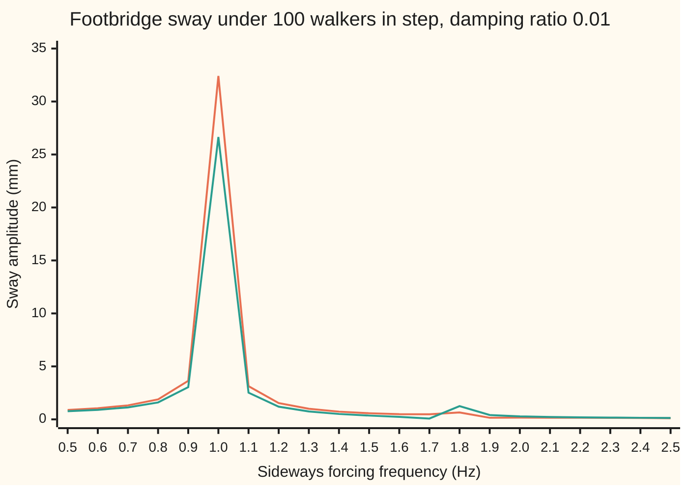
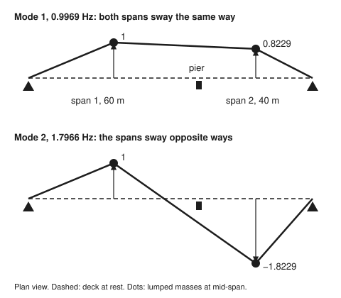
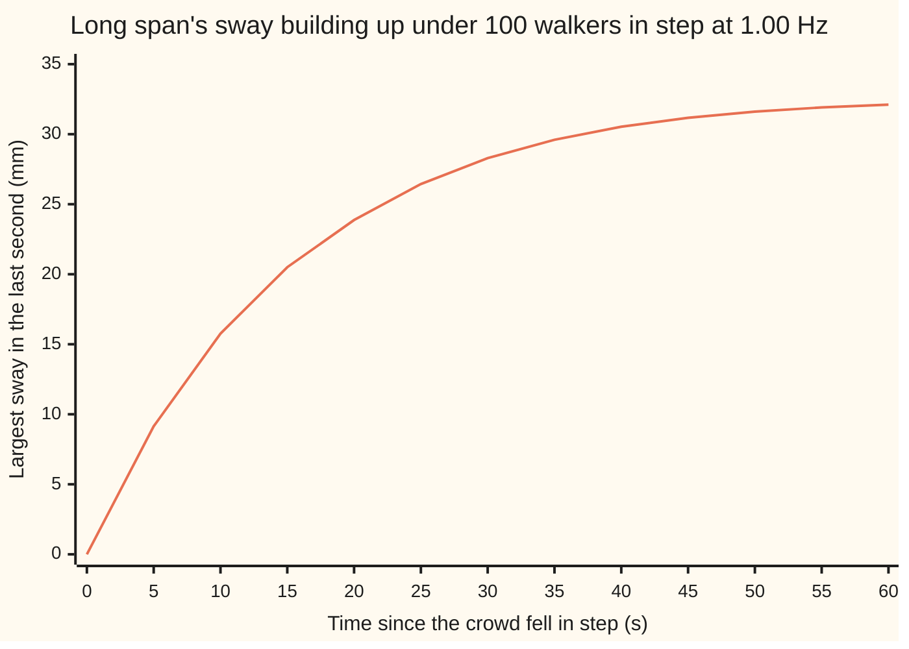

# Vibration modes: a structure rings in a few shapes at a few frequencies

[Syllabus](../../../SYLLABUS.md) → [Engineering mathematics](../README.md) → [Mechanics and Structures](../README.md#s07) → Vibration modes

---

## General Overview

A steel footbridge crosses a river in two spans, 60 m and 40 m long, with a pier between them. A crowd of 100 people walks across. Each footstep pushes the deck a little sideways: left foot one way, right foot the other. A full left-right cycle of steps takes about a second, so the sideways push repeats at 1.00 Hz.

The bridge has its own preferred ways to sway. Push it once and let go, and it swings sideways in a fixed pattern at a fixed rate. This bridge has two such patterns. In the slow one both spans swing the same way, 0.9969 times a second. In the fast one the spans swing in opposite directions, 1.7966 times a second. Each pattern is a **vibration mode**: a shape (how far each part moves, relative to the others) together with a frequency.

The crowd's 1.00 Hz sits almost exactly on the slow mode. If all 100 walkers fall into step, the middle of the long span sways ±32.41 mm, back and forth once a second. The same push held still would bend it 0.6667 mm. Timing turns a sub-millimetre nudge into a swing a pedestrian can feel. The engineer wants to know which mode the crowd can drive, how far it will swing, and how much damping brings that down.

**A structure of connected masses and springs vibrates in a few modes, found by solving K v = λ M v; a repeating force drives each mode separately, and the one that sways most is the one the force matches in both frequency and shape.**

**What kind of fact this is:** the existence of the modes and the split into one-mass problems is a theorem about linear mass-spring systems, proved on this card in Why it works. The footbridge with two lumped masses is a model, an assumption that fits small sways well enough, and the crowd's push is an assumed force.

### The picture: how far the long span sways, against the crowd's sideways frequency



The first line (orange) is the middle of the 60 m span; the second (green) is the middle of the 40 m span. Both spike at 1.0 Hz, the slow mode. The fast mode, at 1.8 Hz, barely shows: a push at its own frequency sways the spans by only 0.72 mm and 1.23 mm. Why the fast mode stays quiet is the second half of this card.

---

## The formula

Notation, in words first. This is the engineer's first frame model of the deck, a two-mass frame. The sideways sway of each span is lumped into one mass at its middle: $m_1$ = 60000 kg for the long span and $m_2$ = 40000 kg for the short one.

Three springs, each of stiffness $k$ = 2000000 N/m, stand for what holds the deck sideways. There is one from each abutment (the bank-side support) to its span, and one between the spans for the deck's continuity over the pier. The pier is taken as a slender column that gives the deck almost no sideways restraint, so it has no spring of its own. The three stiffnesses are set equal, at a value chosen to put the slow mode near 1 Hz; they are not measured from a real bridge.

The two sways, in metres, form a vector $x$; a dot over it is a rate of change in time $t$, so $\ddot x$ is acceleration.

Newton's second law for both masses at once, with the crowd's push $F$ repeating at angular frequency $\Omega$ (rad/s):

$$M\ddot x + C\dot x + Kx = F\sin\Omega t, \qquad M = \begin{pmatrix} m_1 & 0 \\ 0 & m_2 \end{pmatrix}, \qquad K = \begin{pmatrix} 2k & -k \\ -k & 2k \end{pmatrix}.$$

**Read it aloud:** mass times acceleration, plus damping times speed, plus stiffness times sway, equals the crowd's push, for both spans at once.

$M$ is the **mass matrix** and $K$ the **stiffness matrix**: row i of $Kx$ is the total spring force on mass i. $C$ is the **damping matrix**, the force per unit speed; it is set below. A mode is a shape $v_r$ (r = 1, 2) and a number $\lambda_r$ with

$$K v_r = \lambda_r M v_r, \qquad \omega_r = \sqrt{\lambda_r}, \qquad f_r = \frac{\omega_r}{2\pi}.$$

**Read it aloud:** in a mode, the spring forces are the same multiple of mass times sway on every span; that multiple is the squared angular frequency.

This is the **generalised eigenvalue problem**: an eigenvalue problem ([Eigenvalues and eigenvectors](../../03-Algebra/07-Eigenvalues%20and%20Symmetric%20Matrices/02-eigenvalues-and-eigenvectors.md)) with the mass matrix on the right. The response to the crowd, as a steady sway amplitude $X$ (a vector, one entry per span), is a sum over modes:

$$X = \sum_r v_r\,\frac{p_r}{k_r}\,H_r(\Omega), \qquad p_r = v_r\cdot F, \quad k_r = v_r\cdot K v_r, \quad \lvert H_r\rvert = \frac{1}{\sqrt{\left(1-\Omega^2/\omega_r^2\right)^2 + \left(2\zeta\,\Omega/\omega_r\right)^2}}.$$

**Read it aloud:** each mode takes its share of the push, divides by its own stiffness to get a static sway, and multiplies by a gain that depends on how close the push is to that mode's frequency.

At resonance, $\Omega = \omega_r$, the gain is $1/(2\zeta)$. With $\zeta$ = 0.01 that is 50.

| Symbol | Plain meaning | In our example | Push it up and the answer… |
| --- | --- | --- | --- |
| $m_1$, $m_2$ | sway mass lumped at mid-span, long and short span | 60000 kg, 40000 kg | both frequencies fall |
| $k$ | stiffness of each of the three springs | 2000000 N/m | both frequencies rise |
| $M$, $K$ | mass matrix; stiffness matrix | as displayed | — |
| $C$, $c_r$, $\alpha$, $\beta$ | damping matrix $\alpha M + \beta K$; modal damping $v_r\cdot Cv_r$; the two coefficients | 0.08057 1/s, 0.001139 s | sway falls |
| $\zeta$ | damping ratio of each mode: damping as a fraction of critical damping, the least damping at which a released mode returns to rest without swinging | 0.01 | sway at resonance falls as 1/ζ |
| $\lambda_r$, $\omega_r$, $f_r$ | mode r's squared angular frequency; angular frequency; frequency | 39.2375 1/s^2, 6.2640 rad/s, 0.9969 Hz; 127.4292 1/s^2, 11.2885 rad/s, 1.7966 Hz | — |
| $v_r$ | mode shape, span 1 scaled to 1 | (1, 0.8229); (1, −1.8229) | — |
| $q_r$ | amount of mode r in the motion at time t, in m | 32.40 mm, 0.02 mm (amplitudes) | — |
| $m_r$, $k_r$ | modal mass $v_r\cdot Mv_r$; modal stiffness $v_r\cdot Kv_r$ | 87085 kg, 3416995 N/m; 192915 kg, 24583005 N/m | that mode sways less |
| $F$, $p_r$ | crowd's push on each span; modal force $v_r\cdot F$ | (1500, 1000) N; 2322.9 N, −322.9 N | sway grows in proportion |
| $\Omega$, $t$ | crowd's angular frequency, 2π × 1.00 Hz; time | 6.2832 rad/s | sways peak where Ω meets an ω_r |
| $H_r$, $X$, $x$ | gain of mode r; steady sway amplitude; sway at time t | 47.66, 1.45; (32.41, 26.65) mm | — |

Here ζ and ω_n are the damping ratio and natural frequency of [Damping ratio and natural frequency](../02-Linear%20Systems%20and%20Transforms/06-second-order-systems-damping-and-natural-frequency.md): each mode is one of those systems, with its own ω_r.

<p align="center"></p>

The figure is the deck seen from above, spans to scale (60 m and 40 m). Dashed is the deck at rest; the solid line joins the abutments and the two lumped masses in each mode, with span 1's sway drawn 50 px long. Mode 1 bends the whole deck one way. Mode 2 throws the short span the other way, 1.8229 times as far as the long one.

### When it holds

- **Small sways, linear springs.** The springs stand for bearings and steel that obey Hooke's law (force in proportion to stretch) for sways of millimetres. At hundreds of millimetres bearings slide and people stop walking; the linear model's 648 mm for 2000 walkers in step is a number outside its range.
- **Two lumped masses are enough.** A real deck has infinitely many modes. Lumping each span into one mass keeps only the lowest two modes; the next modes, with bends inside each span, need more masses or the continuous beam ([Waves on strings and drums](../09-Quantum%20Mechanics%20in%20Outline/01-wave-equation-for-strings-and-membranes.md)).
- **Damping that does not couple the modes.** The split into separate modes needs $v_1\cdot C v_2 = 0$. Damping of the form $\alpha M + \beta K$ (Rayleigh damping) has this property. Concentrated dampers fitted at one point generally do not; then the modes leak into each other and the sum is only approximate.
- **The crowd is a given force.** The model takes the push as fixed. Real walkers feel the sway and adjust their steps, falling into step with the bridge; the force then grows with the sway, which no fixed-force model captures.

---

## Why it works

### Step 0: in a mode, every span gets the push its own mass needs

A mode keeps its shape because, at every instant, the spring force on each mass is exactly what that mass needs to follow the shape. If span 1 swings by 1 and span 2 by 0.8229, the springs must pull span 1 back with 60000 × λ times its sway and span 2 with 40000 × λ times its sway, for the same λ. Then both accelerate in proportion, and the shape never changes.

Written out, that is $Kv = \lambda Mv$. The mass matrix is on the right because heavy spans need more force for the same acceleration. With equal masses it drops to the ordinary eigenvalue problem, as on [Normal modes](../../08-Differential%20equations%20and%20dynamics/04-Systems%20and%20the%20Matrix%20Exponential/07-coupled-oscillators-and-normal-modes.md), which proves the general case for any number of masses.

### Step 1: two masses give a quadratic for λ

$Kv = \lambda Mv$ has a non-zero answer only when $K - \lambda M$ squashes some direction to nothing, so its determinant is zero:

$$\det(K - \lambda M) = (2k - \lambda m_1)(2k - \lambda m_2) - k^2 = m_1m_2\,\lambda^2 - 2k(m_1 + m_2)\,\lambda + 3k^2 = 0 .$$

In units of 10^9 this is 2.4 λ^2 − 400.0 λ + 12000.0 = 0. The roots are λ_1 = 39.2375 and λ_2 = 127.4292, in 1/s^2. Their square roots are 6.2640 and 11.2885 rad/s, which is 0.9969 Hz and 1.7966 Hz.

For each λ, the first row of $(K - \lambda M)v = 0$ gives the shape. With span 1 set to 1, span 2 is $(2k - \lambda m_1)/k$: 0.8229 for mode 1 and −1.8229 for mode 2.

### Step 2: the modes are perpendicular, weighted by mass

Take the two equations $Kv_1 = \lambda_1 Mv_1$ and $Kv_2 = \lambda_2 Mv_2$. Dot the first with $v_2$ and the second with $v_1$. $K$ and $M$ are symmetric (each equals its own mirror image across the main diagonal, so the dot product comes out the same either way round), so the left sides are equal, and

$$(\lambda_1 - \lambda_2)\; v_1\cdot M v_2 = 0 .$$

The λ's differ, so $v_1\cdot Mv_2 = 0$. Check: 60000 × 1 × 1 + 40000 × 0.8229 × (−1.8229) = 60000 − 60000 = 0, because 0.8229 × 1.8229 = 1.5 = m_1/m_2. The same argument gives $v_1\cdot Kv_2 = 0$. The code prints both as 0.000000.

### Step 3: in mode coordinates the bridge comes apart into two one-mass problems

Write any motion as a mix of the modes, $x = q_1 v_1 + q_2 v_2$, where $q_r$ is how much of mode r is present at time t. Put this in the equation of motion and dot with $v_r$. Every cross term holds $v_1\cdot Mv_2$, $v_1\cdot Kv_2$ or $v_1\cdot Cv_2$, and all three are zero. What is left, for each r, is

$$m_r\,\ddot q_r + c_r\,\dot q_r + k_r\,q_r = p_r \sin\Omega t, \qquad m_r = v_r\cdot Mv_r,\ c_r = v_r\cdot Cv_r,\ k_r = v_r\cdot Kv_r,\ p_r = v_r\cdot F .$$

Each line is a single mass on a spring with a damper: the system of [Damping ratio and natural frequency](../02-Linear%20Systems%20and%20Transforms/06-second-order-systems-damping-and-natural-frequency.md). Its natural frequency is $\sqrt{k_r/m_r} = \omega_r$. For mode 1, 3416995 / 87085 = 39.2375, the same λ_1 as Step 1.

The damping needs one choice. Engineers quote measured damping per mode, as a damping ratio. Take ζ = 0.01 in both modes, and build $C = \alpha M + \beta K$ with

$$\alpha = \frac{2\zeta\,\omega_1\omega_2}{\omega_1 + \omega_2} = 0.08057\ \text{1/s}, \qquad \beta = \frac{2\zeta}{\omega_1 + \omega_2} = 0.001139\ \text{s}.$$

Dotting $C$ with $v_r$ gives $c_r = m_r(\alpha + \beta\omega_r^2)$, so the damping ratio of mode r is $\alpha/(2\omega_r) + \beta\omega_r/2$; the two formulas are what make this 0.0100 at both modes. Because $C$ is built from $M$ and $K$, it inherits their orthogonality, and Step 3 holds exactly.

### Step 4: match the push to each mode, in frequency and in shape

Each mode's steady sway is its static sway $p_r/k_r$ times its gain $\lvert H_r\rvert$. The gain is the frequency match; the modal force $p_r$ is the shape match.

The crowd spreads evenly along 100 m of deck: 60 walkers on span 1 and 40 on span 2, each pushing 25 N, gives F = (1500, 1000) N when all are in step.

- **Mode 1.** The shape (1, 0.8229) moves both spans the way the crowd pushes, so $p_1$ = 1500 + 0.8229 × 1000 = 2322.9 N. The push at 1.00 Hz is 1.00307 times the mode's frequency, so the gain is 47.66, close to the peak of 50. Static sway 2322.9 / 3416995 = 0.6798 mm, times 47.66: **32.40 mm** of mode 1.
- **Mode 2.** The shape (1, −1.8229) has the short span moving against the long one. The crowd's push on span 2 works against mode 2's span-1 part: $p_2$ = 1500 − 1.8229 × 1000 = −322.9 N, far less than mode 1's. Mode 2's frequency is also much higher, λ_2 = 127.4292 against λ_1 = 39.2375 1/s^2, so the push is only 0.55660 of its frequency, for a gain of 1.45. Result: 0.02 mm.

Mode 1 is the worst mode on both counts. Adding the two (each carries its own timing, so the sum is of complex amplitudes) gives a sway of 32.41 mm at span 1 and 26.65 mm at span 2. Even with the crowd pushing exactly at 1.7966 Hz, both modes together sway span 1 by only 0.72 mm and span 2 by 1.23 mm. The crowd's even spread almost cancels against mode 2's opposite-moving shape.

### Step 5: resonance takes time to build

Starting from rest, the sway grows towards its steady size at the rate set by the damping. Each mode's decay time is $1/(\zeta\omega_r)$: 15.96 s for mode 1. The simulation below, of the crowd at 1.00 Hz from a still bridge, shows the largest sway of span 1 in each second.



The single line is span 1's sway envelope (orange). It reaches 15.76 mm in 10 s and 32.11 mm by 60 s, close to the steady 32.41 mm. A crowd that stays on the deck for a minute gives the bridge all the time it needs. Low damping means a high peak and also a slow build; the two always come together.

---

## Worked numbers, by hand

| Step | Arithmetic | Value |
| --- | --- | --- |
| quadratic | 2.4 λ^2 − 400.0 λ + 12000.0 = 0, in units of 10^9 | — |
| mode 1 | λ = (400 − √(400^2 − 4 × 2.4 × 12000)) / (2 × 2.4) | 39.2375 1/s^2 |
| frequency | √39.2375 / (2π) | 0.9969 Hz |
| shape | (2 × 2000000 − 39.2375 × 60000) / 2000000 | (1, 0.8229) |
| modal mass | 60000 + 40000 × 0.8229^2 | ≈ 87085 kg |
| modal stiffness | 39.2375 × 87085 | ≈ 3416995 N/m |
| modal force | 1500 + 0.8229 × 1000 | 2322.9 N |
| static sway | 2322.9 / 3416995 | 0.6798 mm |
| frequency ratio | 6.2832 / 6.2640, in rad/s | 1.00307 |
| gain | 1 / √((1 − 1.00307^2)^2 + (2 × 0.01 × 1.00307)^2) | 47.66 |
| mode 1 sway | 0.6798 × 47.66 | ≈ 32.40 mm |
| plus mode 2 | 0.02 mm, at its own timing | **span 1: 32.41 mm; span 2: 26.65 mm** |

The long span swings ±32.41 mm once a second, a peak acceleration of 1.279 m/s^2. Raising the damping ratio of each mode to 0.10, the job of the dampers fitted to real bridges, cuts this to 3.38 mm.

### What breaks if you drop a piece

| Mistake | Comes out at | What went wrong |
| --- | --- | --- |
| Damping left out | 110.73 mm at 1.00 Hz; no answer at all at 0.9969 Hz | Without damping the gain is 1/(1 − 1.00307^2); at the mode's own frequency it divides by zero |
| Mass matrix ignored: both spans taken as 50000 kg | modes at 1.0066 Hz and 1.7435 Hz, span 1 sway 26.33 mm | The shapes become (1, 1) and (1, −1); the real long span is heavier and sways more |
| The push treated as steady | 0.6667 mm and 0.5833 mm | A static load sees no gain; the timing is the whole story |
| Walkers out of step, push 25 × √100 = 250 N | 3.24 mm | Random timings add as √N, not N; but sway pulls walkers into step, so this is not a safe bound |

The code prints all four, and the linear model's 648 mm for 2000 walkers in step, a sway far beyond the small-sway range the model assumes.

---

## Code, from first principles, and it actually runs

The script builds the bridge's mass and stiffness matrices and reaches the modes by three roads:

- the quadratic $\det(K - \lambda M) = 0$;
- inverse iteration: repeatedly solving $Ky = Mx$, which pulls any start towards the slowest mode. Mode 2 is kept mass-perpendicular to mode 1, and its frequency is read off as the Rayleigh quotient $v\cdot Kv / v\cdot Mv$, which equals λ for a mode;
- an RK4 simulation ([Runge-Kutta four](../../08-Differential%20equations%20and%20dynamics/05-Numerical%20Evolution/04-runge-kutta-four.md)) of the deck released in mode 1's shape, timing its swing.

It then reaches the crowd's sway by three roads:

- the modal sum;
- a direct solve of the 2 by 2 complex system $(K - \Omega^2M + j\Omega C)X = F$, with $j$ for √−1 as engineers write it (the rest of the library writes i);
- an RK4 run of the crowd for 160 s.

It also prints both charts, every row of the what-breaks table and the figure's coordinates.

### Python

```python
# Vibration modes and resonance -- the check behind the card.  Standard library only.
# A two-span steel footbridge, its sideways sway lumped into two masses on three springs:
#   M x'' + C x' + K x = F sin(W t),  modes from K v = lam M v,  f = sqrt(lam) / (2 pi).
# Roads to the modes: the quadratic det(K - lam M) = 0; inverse iteration; a free-swing RK4 run.
# Roads to the sway: modal superposition; a direct complex solve; an RK4 run of the crowd.
import math

m1, m2, k = 60000.0, 40000.0, 2.0e6           # kg (spans of 60 m and 40 m), N/m per spring
zeta = 0.01                                   # damping ratio of each mode
walkers, push, f_walk = 100, 25.0, 1.0        # people, N sideways each, Hz sideways
M, K = [m1, m2], [[2 * k, -k], [-k, 2 * k]]
F = [push * walkers * 0.6, push * walkers * 0.4]   # in-step crowd, spread evenly: N on each span
W = 2 * math.pi * f_walk

def solve(A, b):                              # 2x2 solve by Cramer's rule (works for complex)
    d = A[0][0] * A[1][1] - A[0][1] * A[1][0]
    return [(b[0] * A[1][1] - A[0][1] * b[1]) / d, (A[0][0] * b[1] - b[0] * A[1][0]) / d]

def dotm(u, v): return M[0] * u[0] * v[0] + M[1] * u[1] * v[1]
def dotk(u, v): return sum(u[i] * K[i][j] * v[j] for i in range(2) for j in range(2))

# ---- modes, road A: det(K - lam M) = 0 is a quadratic in lam ----
a, b, c = m1 * m2, -(m1 * K[1][1] + m2 * K[0][0]), K[0][0] * K[1][1] - K[0][1] ** 2
lam = [(-b - math.sqrt(b * b - 4 * a * c)) / (2 * a), (-b + math.sqrt(b * b - 4 * a * c)) / (2 * a)]
w = [math.sqrt(l) for l in lam]
v = [[1.0, (K[0][0] - l * m1) / k] for l in lam]   # first row of (K - lam M) v = 0, span 1 = 1
mr = [dotm(u, u) for u in v]; kr = [dotk(u, u) for u in v]; pr = [u[0] * F[0] + u[1] * F[1] for u in v]
print(f"inputs: m1 = {m1:.0f} kg, m2 = {m2:.0f} kg, k = {k:.0f} N/m each, zeta = {zeta}")
print(f"quadratic, in units of 1e9: {a / 1e9:.1f} lam^2 - {-b / 1e9:.1f} lam + {c / 1e9:.1f} = 0")
for r in range(2):
    print(f"mode {r + 1}: lam = {lam[r]:.4f} 1/s^2, w = {w[r]:.4f} rad/s, f = {w[r] / (2 * math.pi):.4f} Hz, "
          f"shape (1, {v[r][1]:.4f})")
    print(f"mode {r + 1}: modal mass {mr[r]:.0f} kg, modal stiffness {kr[r]:.0f} N/m, modal force {pr[r]:.1f} N")
print(f"orthogonality: |v1 . M v2| = {abs(dotm(v[0], v[1])):.6f} kg, |v1 . K v2| = {abs(dotk(v[0], v[1])):.6f} N/m; "
      f"{v[0][1]:.4f} x {-v[1][1]:.4f} = {-v[0][1] * v[1][1]:.4f} = m1/m2")
# ---- modes, road B: inverse iteration, mode 2 kept M-orthogonal to mode 1 ----
it = []
for r in range(2):
    x = [1.0, 0.3]
    for _ in range(60):
        x = solve(K, [M[0] * x[0], M[1] * x[1]])
        if r == 1:
            s = dotm(it[0], x) / dotm(it[0], it[0]); x = [x[i] - s * it[0][i] for i in range(2)]
        x = [x[0] / x[0], x[1] / x[0]]
    it.append(x)
    print(f"inverse iteration mode {r + 1}: shape (1, {x[1]:.4f}), Rayleigh quotient {dotk(x, x) / dotm(x, x):.4f} 1/s^2")

def rk4(Cm, force, x0, dt, n, every):         # M x'' + Cm x' + K x = force(t); returns x samples
    def acc(t, s):
        f = force(t)
        return [s[2], s[3]] + [(f[i] - sum(Cm[i][j] * s[2 + j] + K[i][j] * s[j] for j in range(2))) / M[i] for i in range(2)]
    s, out = x0[:], [x0[:2]]
    for i in range(n):
        t = i * dt
        k1 = acc(t, s); k2 = acc(t + dt / 2, [p + dt / 2 * q for p, q in zip(s, k1)])
        k3 = acc(t + dt / 2, [p + dt / 2 * q for p, q in zip(s, k2)]); k4 = acc(t + dt, [p + dt * q for p, q in zip(s, k3)])
        s = [p + dt / 6 * (e + 2 * f + 2 * g + h) for p, e, f, g, h in zip(s, k1, k2, k3, k4)]
        if (i + 1) % every == 0: out.append(s[:2])
    return out
# ---- modes, road C: release the deck in mode 1's shape and time the swing ----
fr = rk4([[0, 0], [0, 0]], lambda t: [0, 0], [0.01, 0.01 * v[0][1], 0, 0], 1e-3, 20000, 1)
up = [i * 1e-3 for i in range(1, len(fr)) if fr[i - 1][0] > 0 >= fr[i][0]]
T = (up[-1] - up[0]) / (len(up) - 1)
print(f"free swing in mode 1: period {T:.4f} s = {1 / T:.4f} Hz, span 2 / span 1 peaks "
      f"{max(p[1] for p in fr) / max(p[0] for p in fr):.4f}")
# ---- damping: Rayleigh C = al M + be K gives zeta in both modes ----
al, be = 2 * zeta * w[0] * w[1] / (w[0] + w[1]), 2 * zeta / (w[0] + w[1])
C = [[al * M[i] * (i == j) + be * K[i][j] for j in range(2)] for i in range(2)]
zr = [sum(u[i] * C[i][j] * u[j] for i in range(2) for j in range(2)) / (2 * m * ww) for u, m, ww in zip(v, mr, w)]
print(f"Rayleigh damping: alpha {al:.5f} 1/s, beta {be:.6f} s; modal zeta {zr[0]:.4f}, {zr[1]:.4f}")

def modal(Om, z=zeta, F=F):                   # sway amplitudes (m) by modal superposition
    q = [(u[0] * F[0] + u[1] * F[1]) / kk / complex(1 - (Om / ww) ** 2, 2 * z * Om / ww) for u, kk, ww in zip(v, kr, w)]
    return [abs(q[0] * v[0][i] + q[1] * v[1][i]) for i in range(2)], q

def direct(Om):                               # (K - Om^2 M + j Om C) X = F, complex 2x2 solve
    A = [[complex(K[i][j] - Om * Om * M[i] * (i == j), Om * C[i][j]) for j in range(2)] for i in range(2)]
    return [abs(x) for x in solve(A, F)]
X, q = modal(W); Xd = direct(W)
print(f"crowd in step: {walkers} walkers x {push:.0f} N at {f_walk:.2f} Hz ({W:.4f} rad/s), F = ({F[0]:.0f}, {F[1]:.0f}) N")
print(f"spread evenly on spans of 60 m and 40 m: {walkers * 0.6:.0f} and {walkers * 0.4:.0f} walkers; "
      f"resonance gain 1/(2 zeta) = {1 / (2 * zeta):.2f}")
for r in range(2):
    Hr = 1 / abs(complex(1 - (W / w[r]) ** 2, 2 * zeta * W / w[r]))
    print(f"mode {r + 1} at {f_walk:.2f} Hz: f/f_r {W / w[r]:.5f}, gain {Hr:.2f}, static {pr[r] / kr[r] * 1000:.4f} mm, "
          f"modal sway {abs(q[r]) * 1000:.2f} mm")
print(f"sway at {f_walk:.2f} Hz, modal: span 1 {X[0] * 1000:.2f} mm, span 2 {X[1] * 1000:.2f} mm; "
      f"accel span 1 {X[0] * W * W:.3f} m/s^2")
print(f"sway at {f_walk:.2f} Hz, direct: span 1 {Xd[0] * 1000:.2f} mm, span 2 {Xd[1] * 1000:.2f} mm")
cr = rk4(C, lambda t: [F[0] * math.sin(W * t), F[1] * math.sin(W * t)], [0, 0, 0, 0], 1e-3, 160000, 1)
tail = cr[150000:]
Xs = [0.5 * (max(p[i] for p in tail) - min(p[i] for p in tail)) for i in range(2)]
print(f"sway at {f_walk:.2f} Hz, RK4 after 150 s: span 1 {Xs[0] * 1000:.2f} mm, span 2 {Xs[1] * 1000:.2f} mm")
env = [max(abs(p[0]) for p in cr[max(0, 1000 * t - 1000):1000 * t + 1]) * 1000 for t in range(0, 65, 5)]
print("chart, build-up t (s) " + " ".join(f"{t:5d}" for t in range(0, 65, 5)))
print("chart, span 1 env mm  " + " ".join(f"{e:5.2f}" for e in env))
print(f"time constant 1/(zeta w1) {1 / (zeta * w[0]):.2f} s")
fs = [0.5 + 0.1 * i for i in range(21)]
sw = [modal(2 * math.pi * f)[0] for f in fs]
print("chart, f (Hz)    " + " ".join(f"{f:5.1f}" for f in fs))
for i in range(2):
    print(f"chart, span {i + 1} mm " + " ".join(f"{s[i] * 1000:5.2f}" for s in sw))
pk = [modal(ww)[0] for ww in w]
print(f"peaks: at f1 span 1 {pk[0][0] * 1000:.2f} mm, span 2 {pk[0][1] * 1000:.2f} mm; "
      f"at f2 span 1 {pk[1][0] * 1000:.2f} mm, span 2 {pk[1][1] * 1000:.2f} mm")
print(f"dampers, zeta 0.10: span 1 at f1 {modal(w[0], 0.10)[0][0] * 1000:.2f} mm, at {f_walk:.2f} Hz {modal(W, 0.10)[0][0] * 1000:.2f} mm")
# ---- what breaks ----
X0 = modal(W, 0.0)[0]
print(f"no damping at {f_walk:.2f} Hz: span 1 {X0[0] * 1000:.2f} mm; at f1 the formula divides by zero")
lm = [k / 50000.0, 3 * k / 50000.0]           # equal 50 t masses: shapes (1, 1) and (1, -1)
Xe = abs(sum(pp / kk / complex(1 - W * W / l, 2 * zeta * W / math.sqrt(l)) for pp, kk, l in zip([2500.0, 500.0], [2 * k, 6 * k], lm)))
print(f"equal masses 50000 kg: f = {math.sqrt(lm[0]) / (2 * math.pi):.4f}, {math.sqrt(lm[1]) / (2 * math.pi):.4f} Hz; "
      f"span 1 sway {Xe * 1000:.2f} mm")
xs = solve(K, F)
print(f"static push: span 1 {xs[0] * 1000:.4f} mm, span 2 {xs[1] * 1000:.4f} mm")
Xr = modal(W, zeta, [f / math.sqrt(walkers) for f in F])[0]
print(f"out of step, 25 sqrt(N) = {push * math.sqrt(walkers):.0f} N: span 1 {Xr[0] * 1000:.2f} mm")
X2k = modal(W, zeta, [f * 2000 / walkers for f in F])[0]
print(f"2000 walkers in step: linear model says span 1 {X2k[0] * 1000:.0f} mm")
print(f"figure, mode 1 (160.0, 60.0) (360.0, {110 - 50 * v[0][1]:.1f}); mode 2 (160.0, 230.0) (360.0, {280 - 50 * v[1][1]:.1f})")

assert all(abs(it[r][1] - v[r][1]) < 1e-9 for r in range(2))             # inverse iteration vs quadratic
assert abs(1 / T - w[0] / (2 * math.pi)) < 1e-4                           # free swing vs quadratic
assert abs(dotm(v[0], v[1])) < 1e-6 * m1                                  # modes are M-orthogonal
assert all(abs(z - zeta) < 1e-12 for z in zr)                             # Rayleigh C gives zeta per mode
assert all(abs(X[i] - Xd[i]) < 1e-9 for i in range(2))                    # modal sum vs direct solve
assert all(abs(Xs[i] - X[i]) < 1e-3 * X[0] for i in range(2))             # RK4 vs modal sum
assert all(abs(modal(2 * math.pi * f)[0][0] - direct(2 * math.pi * f)[0]) < 1e-9 for f in fs)
print("ALL CHECKS PASS")
```

**Ran 2026-11-11 on macOS, Python 3.14.10, standard library only. All checks passed. Output, pasted from the run:**

```
inputs: m1 = 60000 kg, m2 = 40000 kg, k = 2000000 N/m each, zeta = 0.01
quadratic, in units of 1e9: 2.4 lam^2 - 400.0 lam + 12000.0 = 0
mode 1: lam = 39.2375 1/s^2, w = 6.2640 rad/s, f = 0.9969 Hz, shape (1, 0.8229)
mode 1: modal mass 87085 kg, modal stiffness 3416995 N/m, modal force 2322.9 N
mode 2: lam = 127.4292 1/s^2, w = 11.2885 rad/s, f = 1.7966 Hz, shape (1, -1.8229)
mode 2: modal mass 192915 kg, modal stiffness 24583005 N/m, modal force -322.9 N
orthogonality: |v1 . M v2| = 0.000000 kg, |v1 . K v2| = 0.000000 N/m; 0.8229 x 1.8229 = 1.5000 = m1/m2
inverse iteration mode 1: shape (1, 0.8229), Rayleigh quotient 39.2375 1/s^2
inverse iteration mode 2: shape (1, -1.8229), Rayleigh quotient 127.4292 1/s^2
free swing in mode 1: period 1.0031 s = 0.9969 Hz, span 2 / span 1 peaks 0.8229
Rayleigh damping: alpha 0.08057 1/s, beta 0.001139 s; modal zeta 0.0100, 0.0100
crowd in step: 100 walkers x 25 N at 1.00 Hz (6.2832 rad/s), F = (1500, 1000) N
spread evenly on spans of 60 m and 40 m: 60 and 40 walkers; resonance gain 1/(2 zeta) = 50.00
mode 1 at 1.00 Hz: f/f_r 1.00307, gain 47.66, static 0.6798 mm, modal sway 32.40 mm
mode 2 at 1.00 Hz: f/f_r 0.55660, gain 1.45, static -0.0131 mm, modal sway 0.02 mm
sway at 1.00 Hz, modal: span 1 32.41 mm, span 2 26.65 mm; accel span 1 1.279 m/s^2
sway at 1.00 Hz, direct: span 1 32.41 mm, span 2 26.65 mm
sway at 1.00 Hz, RK4 after 150 s: span 1 32.41 mm, span 2 26.66 mm
chart, build-up t (s)     0     5    10    15    20    25    30    35    40    45    50    55    60
chart, span 1 env mm   0.00  9.14 15.76 20.50 23.87 26.44 28.29 29.60 30.53 31.17 31.61 31.91 32.11
time constant 1/(zeta w1) 15.96 s
chart, f (Hz)      0.5   0.6   0.7   0.8   0.9   1.0   1.1   1.2   1.3   1.4   1.5   1.6   1.7   1.8   1.9   2.0   2.1   2.2   2.3   2.4   2.5
chart, span 1 mm  0.89  1.05  1.32  1.89  3.64 32.41  3.13  1.54  1.00  0.73  0.58  0.49  0.48  0.65  0.15  0.17  0.16  0.15  0.14  0.13  0.11
chart, span 2 mm  0.77  0.90  1.13  1.60  3.04 26.65  2.52  1.20  0.75  0.51  0.36  0.24  0.08  1.25  0.41  0.28  0.23  0.19  0.17  0.15  0.13
peaks: at f1 span 1 33.99 mm, span 2 27.97 mm; at f2 span 1 0.72 mm, span 2 1.23 mm
dampers, zeta 0.10: span 1 at f1 3.40 mm, at 1.00 Hz 3.38 mm
no damping at 1.00 Hz: span 1 110.73 mm; at f1 the formula divides by zero
equal masses 50000 kg: f = 1.0066, 1.7435 Hz; span 1 sway 26.33 mm
static push: span 1 0.6667 mm, span 2 0.5833 mm
out of step, 25 sqrt(N) = 250 N: span 1 3.24 mm
2000 walkers in step: linear model says span 1 648 mm
figure, mode 1 (160.0, 60.0) (360.0, 68.9); mode 2 (160.0, 230.0) (360.0, 371.1)
ALL CHECKS PASS
```

### Rust

Same numbers, same labels, built with `rustc --edition 2021 -O`; complex arithmetic is a small struct written out.

```rust
// Vibration modes and resonance -- the same check as the Python, in Rust.  No crates.
// A two-span steel footbridge, its sideways sway lumped into two masses on three springs:
//   M x'' + C x' + K x = F sin(W t),  modes from K v = lam M v,  f = sqrt(lam) / (2 pi).
// Roads to the modes: the quadratic det(K - lam M) = 0; inverse iteration; a free-swing RK4 run.
// Roads to the sway: modal superposition; a direct complex solve; an RK4 run of the crowd.
use std::f64::consts::PI;

const M1: f64 = 60000.0; const M2: f64 = 40000.0; const KS: f64 = 2.0e6; // kg, kg, N/m per spring
const ZETA: f64 = 0.01;                                                  // damping ratio of each mode
const WALKERS: f64 = 100.0; const PUSH: f64 = 25.0; const F_WALK: f64 = 1.0; // people, N each, Hz
const M: [f64; 2] = [M1, M2];
const K: [[f64; 2]; 2] = [[2.0 * KS, -KS], [-KS, 2.0 * KS]];

#[derive(Clone, Copy)]
struct Cx { re: f64, im: f64 }                                         // a complex number, written out
impl Cx {
    fn n(re: f64, im: f64) -> Cx { Cx { re, im } }
    fn mul(self, o: Cx) -> Cx { Cx::n(self.re * o.re - self.im * o.im, self.re * o.im + self.im * o.re) }
    fn sub(self, o: Cx) -> Cx { Cx::n(self.re - o.re, self.im - o.im) }
    fn add(self, o: Cx) -> Cx { Cx::n(self.re + o.re, self.im + o.im) }
    fn div(self, o: Cx) -> Cx { let d = o.re * o.re + o.im * o.im;
        Cx::n((self.re * o.re + self.im * o.im) / d, (self.im * o.re - self.re * o.im) / d) }
    fn abs(self) -> f64 { self.re.hypot(self.im) }
}

fn solve(a: [[Cx; 2]; 2], b: [Cx; 2]) -> [Cx; 2] {                     // 2x2 solve by Cramer's rule
    let d = a[0][0].mul(a[1][1]).sub(a[0][1].mul(a[1][0]));
    [b[0].mul(a[1][1]).sub(a[0][1].mul(b[1])).div(d), a[0][0].mul(b[1]).sub(b[0].mul(a[1][0])).div(d)]
}
fn solve_r(a: [[f64; 2]; 2], b: [f64; 2]) -> [f64; 2] {
    let r = |x: f64| Cx::n(x, 0.0);
    let s = solve([[r(a[0][0]), r(a[0][1])], [r(a[1][0]), r(a[1][1])]], [r(b[0]), r(b[1])]);
    [s[0].re, s[1].re]
}
fn dotm(u: [f64; 2], v: [f64; 2]) -> f64 { M[0] * u[0] * v[0] + M[1] * u[1] * v[1] }
fn dotk(u: [f64; 2], v: [f64; 2]) -> f64 { let mut s = 0.0; for i in 0..2 { for j in 0..2 { s += u[i] * K[i][j] * v[j] } } s }

fn rk4(c: [[f64; 2]; 2], force: &dyn Fn(f64) -> [f64; 2], x0: [f64; 4], dt: f64, n: usize) -> Vec<[f64; 2]> {
    let acc = |t: f64, s: [f64; 4]| -> [f64; 4] {
        let f = force(t);
        let mut a = [s[2], s[3], 0.0, 0.0];
        for i in 0..2 { a[2 + i] = (f[i] - (0..2).map(|j| c[i][j] * s[2 + j] + K[i][j] * s[j]).sum::<f64>()) / M[i] }
        a
    };
    let st = |s: [f64; 4], k: [f64; 4], h: f64| -> [f64; 4] { let mut o = s; for i in 0..4 { o[i] += h * k[i] } o };
    let (mut s, mut out) = (x0, vec![[x0[0], x0[1]]]);
    for i in 0..n {
        let t = i as f64 * dt;
        let k1 = acc(t, s); let k2 = acc(t + dt / 2.0, st(s, k1, dt / 2.0));
        let k3 = acc(t + dt / 2.0, st(s, k2, dt / 2.0)); let k4 = acc(t + dt, st(s, k3, dt));
        for j in 0..4 { s[j] += dt / 6.0 * (k1[j] + 2.0 * k2[j] + 2.0 * k3[j] + k4[j]) }
        out.push([s[0], s[1]]);
    }
    out
}

fn main() {
    let f = [PUSH * WALKERS * 0.6, PUSH * WALKERS * 0.4];
    let wf = 2.0 * PI * F_WALK;
    // ---- modes, road A: det(K - lam M) = 0 is a quadratic in lam ----
    let (a, b, c) = (M1 * M2, -(M1 * K[1][1] + M2 * K[0][0]), K[0][0] * K[1][1] - K[0][1] * K[0][1]);
    let dq = (b * b - 4.0 * a * c).sqrt();
    let lam = [(-b - dq) / (2.0 * a), (-b + dq) / (2.0 * a)];
    let w = [lam[0].sqrt(), lam[1].sqrt()];
    let v = [[1.0, (K[0][0] - lam[0] * M1) / KS], [1.0, (K[0][0] - lam[1] * M1) / KS]];
    let mr = [dotm(v[0], v[0]), dotm(v[1], v[1])];
    let kr = [dotk(v[0], v[0]), dotk(v[1], v[1])];
    let pr = [v[0][0] * f[0] + v[0][1] * f[1], v[1][0] * f[0] + v[1][1] * f[1]];
    println!("inputs: m1 = {:.0} kg, m2 = {:.0} kg, k = {:.0} N/m each, zeta = {}", M1, M2, KS, ZETA);
    println!("quadratic, in units of 1e9: {:.1} lam^2 - {:.1} lam + {:.1} = 0", a / 1e9, -b / 1e9, c / 1e9);
    for r in 0..2 {
        println!("mode {}: lam = {:.4} 1/s^2, w = {:.4} rad/s, f = {:.4} Hz, shape (1, {:.4})", r + 1, lam[r], w[r], w[r] / (2.0 * PI), v[r][1]);
        println!("mode {}: modal mass {:.0} kg, modal stiffness {:.0} N/m, modal force {:.1} N", r + 1, mr[r], kr[r], pr[r]);
    }
    println!("orthogonality: |v1 . M v2| = {:.6} kg, |v1 . K v2| = {:.6} N/m; {:.4} x {:.4} = {:.4} = m1/m2",
             dotm(v[0], v[1]).abs(), dotk(v[0], v[1]).abs(), v[0][1], -v[1][1], -v[0][1] * v[1][1]);
    // ---- modes, road B: inverse iteration, mode 2 kept M-orthogonal to mode 1 ----
    let mut it: Vec<[f64; 2]> = vec![];
    for r in 0..2 {
        let mut x = [1.0, 0.3];
        for _ in 0..60 {
            x = solve_r(K, [M[0] * x[0], M[1] * x[1]]);
            if r == 1 { let s = dotm(it[0], x) / dotm(it[0], it[0]); x = [x[0] - s * it[0][0], x[1] - s * it[0][1]] }
            x = [x[0] / x[0], x[1] / x[0]];
        }
        it.push(x);
        println!("inverse iteration mode {}: shape (1, {:.4}), Rayleigh quotient {:.4} 1/s^2", r + 1, x[1], dotk(x, x) / dotm(x, x));
    }
    // ---- modes, road C: release the deck in mode 1's shape and time the swing ----
    let fr = rk4([[0.0; 2]; 2], &|_t| [0.0, 0.0], [0.01, 0.01 * v[0][1], 0.0, 0.0], 1e-3, 20000);
    let up: Vec<f64> = (1..fr.len()).filter(|&i| fr[i - 1][0] > 0.0 && 0.0 >= fr[i][0]).map(|i| i as f64 * 1e-3).collect();
    let t_p = (up[up.len() - 1] - up[0]) / (up.len() - 1) as f64;
    let mx = |i: usize, s: &[[f64; 2]]| s.iter().map(|p| p[i]).fold(f64::MIN, f64::max);
    let mn = |i: usize, s: &[[f64; 2]]| s.iter().map(|p| p[i]).fold(f64::MAX, f64::min);
    println!("free swing in mode 1: period {:.4} s = {:.4} Hz, span 2 / span 1 peaks {:.4}", t_p, 1.0 / t_p, mx(1, &fr) / mx(0, &fr));
    // ---- damping: Rayleigh C = al M + be K gives zeta in both modes ----
    let (al, be) = (2.0 * ZETA * w[0] * w[1] / (w[0] + w[1]), 2.0 * ZETA / (w[0] + w[1]));
    let mut cm = [[0.0; 2]; 2];
    for i in 0..2 { for j in 0..2 { cm[i][j] = al * if i == j { M[i] } else { 0.0 } + be * K[i][j] } }
    let zr: Vec<f64> = (0..2).map(|r| { let u = v[r]; let mut s = 0.0;
        for i in 0..2 { for j in 0..2 { s += u[i] * cm[i][j] * u[j] } } s / (2.0 * mr[r] * w[r]) }).collect();
    println!("Rayleigh damping: alpha {:.5} 1/s, beta {:.6} s; modal zeta {:.4}, {:.4}", al, be, zr[0], zr[1]);
    let modal = |om: f64, z: f64, ff: [f64; 2]| -> ([f64; 2], [Cx; 2]) {      // sway amplitudes (m), modal sum
        let q: Vec<Cx> = (0..2).map(|r| Cx::n((v[r][0] * ff[0] + v[r][1] * ff[1]) / kr[r], 0.0)
            .div(Cx::n(1.0 - (om / w[r]).powi(2), 2.0 * z * om / w[r]))).collect();
        let x = |i: usize| q[0].mul(Cx::n(v[0][i], 0.0)).add(q[1].mul(Cx::n(v[1][i], 0.0))).abs();
        ([x(0), x(1)], [q[0], q[1]])
    };
    let direct = |om: f64| -> [f64; 2] {                                  // (K - om^2 M + j om C) X = F
        let mut a = [[Cx::n(0.0, 0.0); 2]; 2];
        for i in 0..2 { for j in 0..2 { a[i][j] = Cx::n(K[i][j] - om * om * if i == j { M[i] } else { 0.0 }, om * cm[i][j]) } }
        let s = solve(a, [Cx::n(f[0], 0.0), Cx::n(f[1], 0.0)]);
        [s[0].abs(), s[1].abs()]
    };
    let (x, q) = modal(wf, ZETA, f);
    let xd = direct(wf);
    println!("crowd in step: {} walkers x {:.0} N at {:.2} Hz ({:.4} rad/s), F = ({:.0}, {:.0}) N", WALKERS, PUSH, F_WALK, wf, f[0], f[1]);
    println!("spread evenly on spans of 60 m and 40 m: {:.0} and {:.0} walkers; resonance gain 1/(2 zeta) = {:.2}",
             WALKERS * 0.6, WALKERS * 0.4, 1.0 / (2.0 * ZETA));
    for r in 0..2 {
        let hr = 1.0 / Cx::n(1.0 - (wf / w[r]).powi(2), 2.0 * ZETA * wf / w[r]).abs();
        println!("mode {} at {:.2} Hz: f/f_r {:.5}, gain {:.2}, static {:.4} mm, modal sway {:.2} mm",
                 r + 1, F_WALK, wf / w[r], hr, pr[r] / kr[r] * 1000.0, q[r].abs() * 1000.0);
    }
    println!("sway at {:.2} Hz, modal: span 1 {:.2} mm, span 2 {:.2} mm; accel span 1 {:.3} m/s^2",
             F_WALK, x[0] * 1000.0, x[1] * 1000.0, x[0] * wf * wf);
    println!("sway at {:.2} Hz, direct: span 1 {:.2} mm, span 2 {:.2} mm", F_WALK, xd[0] * 1000.0, xd[1] * 1000.0);
    let cr = rk4(cm, &|t| [f[0] * (wf * t).sin(), f[1] * (wf * t).sin()], [0.0; 4], 1e-3, 160000);
    let tail = &cr[150000..];
    let xs = [0.5 * (mx(0, tail) - mn(0, tail)), 0.5 * (mx(1, tail) - mn(1, tail))];
    println!("sway at {:.2} Hz, RK4 after 150 s: span 1 {:.2} mm, span 2 {:.2} mm", F_WALK, xs[0] * 1000.0, xs[1] * 1000.0);
    let ts: Vec<usize> = (0..65).step_by(5).collect();
    let env: Vec<String> = ts.iter().map(|&t| { let lo = if t >= 1 { 1000 * t - 1000 } else { 0 };
        format!("{:5.2}", cr[lo..1000 * t + 1].iter().map(|p| p[0].abs()).fold(0.0, f64::max) * 1000.0) }).collect();
    println!("chart, build-up t (s) {}", ts.iter().map(|t| format!("{:5}", t)).collect::<Vec<_>>().join(" "));
    println!("chart, span 1 env mm  {}", env.join(" "));
    println!("time constant 1/(zeta w1) {:.2} s", 1.0 / (ZETA * w[0]));
    let fs: Vec<f64> = (0..21).map(|i| 0.5 + 0.1 * i as f64).collect();
    let sw: Vec<[f64; 2]> = fs.iter().map(|&fq| modal(2.0 * PI * fq, ZETA, f).0).collect();
    println!("chart, f (Hz)    {}", fs.iter().map(|x| format!("{:5.1}", x)).collect::<Vec<_>>().join(" "));
    for i in 0..2 { println!("chart, span {} mm {}", i + 1, sw.iter().map(|s| format!("{:5.2}", s[i] * 1000.0)).collect::<Vec<_>>().join(" ")) }
    let pk = [modal(w[0], ZETA, f).0, modal(w[1], ZETA, f).0];
    println!("peaks: at f1 span 1 {:.2} mm, span 2 {:.2} mm; at f2 span 1 {:.2} mm, span 2 {:.2} mm",
             pk[0][0] * 1000.0, pk[0][1] * 1000.0, pk[1][0] * 1000.0, pk[1][1] * 1000.0);
    println!("dampers, zeta 0.10: span 1 at f1 {:.2} mm, at {:.2} Hz {:.2} mm",
             modal(w[0], 0.10, f).0[0] * 1000.0, F_WALK, modal(wf, 0.10, f).0[0] * 1000.0);
    // ---- what breaks ----
    let x0 = modal(wf, 0.0, f).0;
    println!("no damping at {:.2} Hz: span 1 {:.2} mm; at f1 the formula divides by zero", F_WALK, x0[0] * 1000.0);
    let lm = [KS / 50000.0, 3.0 * KS / 50000.0];                           // equal 50 t masses
    let xe = (0..2).map(|r| Cx::n([2500.0, 500.0][r] / ([2.0, 6.0][r] * KS), 0.0).div(Cx::n(1.0 - wf * wf / lm[r], 2.0 * ZETA * wf / lm[r].sqrt()))).fold(Cx::n(0.0, 0.0), |a, b| a.add(b)).abs();
    println!("equal masses 50000 kg: f = {:.4}, {:.4} Hz; span 1 sway {:.2} mm", lm[0].sqrt() / (2.0 * PI), lm[1].sqrt() / (2.0 * PI), xe * 1000.0);
    let xst = solve_r(K, f);
    println!("static push: span 1 {:.4} mm, span 2 {:.4} mm", xst[0] * 1000.0, xst[1] * 1000.0);
    let xr = modal(wf, ZETA, [f[0] / WALKERS.sqrt(), f[1] / WALKERS.sqrt()]).0;
    println!("out of step, 25 sqrt(N) = {:.0} N: span 1 {:.2} mm", PUSH * WALKERS.sqrt(), xr[0] * 1000.0);
    let x2k = modal(wf, ZETA, [f[0] * 2000.0 / WALKERS, f[1] * 2000.0 / WALKERS]).0;
    println!("2000 walkers in step: linear model says span 1 {:.0} mm", x2k[0] * 1000.0);
    println!("figure, mode 1 (160.0, 60.0) (360.0, {:.1}); mode 2 (160.0, 230.0) (360.0, {:.1})", 110.0 - 50.0 * v[0][1], 280.0 - 50.0 * v[1][1]);

    assert!((0..2).all(|r| (it[r][1] - v[r][1]).abs() < 1e-9));          // inverse iteration vs quadratic
    assert!((1.0 / t_p - w[0] / (2.0 * PI)).abs() < 1e-4);                 // free swing vs quadratic
    assert!(dotm(v[0], v[1]).abs() < 1e-6 * M1);                           // modes are M-orthogonal
    assert!(zr.iter().all(|z| (z - ZETA).abs() < 1e-12));                  // Rayleigh C gives zeta per mode
    assert!((0..2).all(|i| (x[i] - xd[i]).abs() < 1e-9));                  // modal sum vs direct solve
    assert!((0..2).all(|i| (xs[i] - x[i]).abs() < 1e-3 * x[0]));           // RK4 vs modal sum
    assert!(fs.iter().all(|&fq| (modal(2.0 * PI * fq, ZETA, f).0[0] - direct(2.0 * PI * fq)[0]).abs() < 1e-9));
    println!("ALL CHECKS PASS");
}
```

**Ran 2026-11-11 on macOS, rustc 1.98.1, no crates. All checks passed. Output, pasted from the run:**

```
inputs: m1 = 60000 kg, m2 = 40000 kg, k = 2000000 N/m each, zeta = 0.01
quadratic, in units of 1e9: 2.4 lam^2 - 400.0 lam + 12000.0 = 0
mode 1: lam = 39.2375 1/s^2, w = 6.2640 rad/s, f = 0.9969 Hz, shape (1, 0.8229)
mode 1: modal mass 87085 kg, modal stiffness 3416995 N/m, modal force 2322.9 N
mode 2: lam = 127.4292 1/s^2, w = 11.2885 rad/s, f = 1.7966 Hz, shape (1, -1.8229)
mode 2: modal mass 192915 kg, modal stiffness 24583005 N/m, modal force -322.9 N
orthogonality: |v1 . M v2| = 0.000000 kg, |v1 . K v2| = 0.000000 N/m; 0.8229 x 1.8229 = 1.5000 = m1/m2
inverse iteration mode 1: shape (1, 0.8229), Rayleigh quotient 39.2375 1/s^2
inverse iteration mode 2: shape (1, -1.8229), Rayleigh quotient 127.4292 1/s^2
free swing in mode 1: period 1.0031 s = 0.9969 Hz, span 2 / span 1 peaks 0.8229
Rayleigh damping: alpha 0.08057 1/s, beta 0.001139 s; modal zeta 0.0100, 0.0100
crowd in step: 100 walkers x 25 N at 1.00 Hz (6.2832 rad/s), F = (1500, 1000) N
spread evenly on spans of 60 m and 40 m: 60 and 40 walkers; resonance gain 1/(2 zeta) = 50.00
mode 1 at 1.00 Hz: f/f_r 1.00307, gain 47.66, static 0.6798 mm, modal sway 32.40 mm
mode 2 at 1.00 Hz: f/f_r 0.55660, gain 1.45, static -0.0131 mm, modal sway 0.02 mm
sway at 1.00 Hz, modal: span 1 32.41 mm, span 2 26.65 mm; accel span 1 1.279 m/s^2
sway at 1.00 Hz, direct: span 1 32.41 mm, span 2 26.65 mm
sway at 1.00 Hz, RK4 after 150 s: span 1 32.41 mm, span 2 26.66 mm
chart, build-up t (s)     0     5    10    15    20    25    30    35    40    45    50    55    60
chart, span 1 env mm   0.00  9.14 15.76 20.50 23.87 26.44 28.29 29.60 30.53 31.17 31.61 31.91 32.11
time constant 1/(zeta w1) 15.96 s
chart, f (Hz)      0.5   0.6   0.7   0.8   0.9   1.0   1.1   1.2   1.3   1.4   1.5   1.6   1.7   1.8   1.9   2.0   2.1   2.2   2.3   2.4   2.5
chart, span 1 mm  0.89  1.05  1.32  1.89  3.64 32.41  3.13  1.54  1.00  0.73  0.58  0.49  0.48  0.65  0.15  0.17  0.16  0.15  0.14  0.13  0.11
chart, span 2 mm  0.77  0.90  1.13  1.60  3.04 26.65  2.52  1.20  0.75  0.51  0.36  0.24  0.08  1.25  0.41  0.28  0.23  0.19  0.17  0.15  0.13
peaks: at f1 span 1 33.99 mm, span 2 27.97 mm; at f2 span 1 0.72 mm, span 2 1.23 mm
dampers, zeta 0.10: span 1 at f1 3.40 mm, at 1.00 Hz 3.38 mm
no damping at 1.00 Hz: span 1 110.73 mm; at f1 the formula divides by zero
equal masses 50000 kg: f = 1.0066, 1.7435 Hz; span 1 sway 26.33 mm
static push: span 1 0.6667 mm, span 2 0.5833 mm
out of step, 25 sqrt(N) = 250 N: span 1 3.24 mm
2000 walkers in step: linear model says span 1 648 mm
figure, mode 1 (160.0, 60.0) (360.0, 68.9); mode 2 (160.0, 230.0) (360.0, 371.1)
ALL CHECKS PASS
```

The two outputs match line for line.

### Lean

Lean proves the main facts of Steps 1 to 3 for any masses, stiffnesses and frequencies, and checks the bridge's exact numbers.

- Take any number of masses, symmetric $M$ and $K$, and two modes with different λ. Then the modes are perpendicular weighted by mass: $v_1\cdot Mv_2 = 0$.
- Take the same two modes. Then they are also perpendicular weighted by stiffness: $v_1\cdot Kv_2 = 0$.
- Take the same two modes and Rayleigh damping $C = \alpha M + \beta K$, for any $\alpha$ and $\beta$. Then $v_1\cdot Cv_2 = 0$.
- Take masses $m_1$, $m_2$ and three springs of stiffness $k$, as on the bridge. Then $\det(K - \lambda M) = m_1m_2\,\lambda^2 - 2k(m_1 + m_2)\,\lambda + 3k^2$.
- Take positive $\omega_1$ and $\omega_2$, a damping ratio $\zeta$, and $\alpha$ and $\beta$ from the two formulas in Step 3. Then each mode's damping ratio, $\alpha/(2\omega_r) + \beta\omega_r/2$, equals $\zeta$, for r = 1 and 2.
- With the bridge's numbers, the quadratic's coefficients are 2.4, 400 and 12000, in units of 10^9.
- Sixty walkers on span 1 and 40 on span 2, at 25 N each, give F = (1500, 1000) N.
- Take the push held still. Then $x$ = (2/3 mm, 7/12 mm) solves $Kx = F$: the 0.6667 mm and 0.5833 mm above.
- With ζ = 0.01, the resonance gain $1/(2\zeta)$ is exactly 50.

The roots, shapes, decimals and simulations are left to the Python and Rust checks.

```lean
-- Vibration modes: two modes K v = λ M v of a symmetric mass-spring system with different λ are perpendicular when weighted by M, by K and by Rayleigh damping α M + β K, and the two-span bridge's determinant and damping formulas hold exactly.
import Mathlib.LinearAlgebra.Matrix.Symmetric
import Mathlib.LinearAlgebra.Matrix.Determinant.Basic
import Mathlib.LinearAlgebra.Matrix.Notation
import Mathlib.Basic.Real.Basic
import Mathlib.Tactic

open Matrix

/-- A symmetric matrix gives the same weighted product in either order. -/
theorem sym_dot {n : Type*} [Fintype n] (A : Matrix n n ℝ) (hA : A.IsSymm) (v w : n → ℝ) :
    v ⬝ᵥ (A *ᵥ w) = w ⬝ᵥ (A *ᵥ v) := by
  rw [dotProduct_mulVec, ← hA.eq, vecMul_transpose, dotProduct_comm, hA.eq]

#print axioms sym_dot

/-- The modes split the structure into separate one-mass problems: for any number `n`
of masses, with a symmetric mass matrix `M` and a symmetric stiffness matrix `K`
(linear springs), if `v₁` and `v₂` are modes, `K v₁ = l₁ M v₁` and `K v₂ = l₂ M v₂` (the card writes λ for l),
with `l₁ ≠ l₂`, then they are perpendicular weighted by mass, `v₁ · M v₂ = 0`,
weighted by stiffness, `v₁ · K v₂ = 0`, and weighted by any Rayleigh damping
`C = α M + β K`, `v₁ · C v₂ = 0`. -/
theorem modes_orthogonal_mass_stiffness_rayleigh_damping {n : Type*} [Fintype n]
    (M K : Matrix n n ℝ) (hM : M.IsSymm) (hK : K.IsSymm) (α β : ℝ)
    (v₁ v₂ : n → ℝ) (l₁ l₂ : ℝ)
    (h₁ : K *ᵥ v₁ = l₁ • (M *ᵥ v₁)) (h₂ : K *ᵥ v₂ = l₂ • (M *ᵥ v₂))
    (hne : l₁ ≠ l₂) :
    v₁ ⬝ᵥ (M *ᵥ v₂) = 0 ∧ v₁ ⬝ᵥ (K *ᵥ v₂) = 0 ∧ v₁ ⬝ᵥ ((α • M + β • K) *ᵥ v₂) = 0 := by
  have e1 : v₁ ⬝ᵥ (K *ᵥ v₂) = l₂ * (v₁ ⬝ᵥ (M *ᵥ v₂)) := by
    rw [h₂, dotProduct_smul, smul_eq_mul]
  have e2 : v₁ ⬝ᵥ (K *ᵥ v₂) = l₁ * (v₁ ⬝ᵥ (M *ᵥ v₂)) := by
    rw [sym_dot K hK, h₁, dotProduct_smul, smul_eq_mul, sym_dot M hM]
  have hm : v₁ ⬝ᵥ (M *ᵥ v₂) = 0 := by
    have : (l₁ - l₂) * (v₁ ⬝ᵥ (M *ᵥ v₂)) = 0 := by rw [sub_mul]; linarith
    rcases mul_eq_zero.mp this with h | h
    · exact absurd (sub_eq_zero.mp h) hne
    · exact h
  have hk : v₁ ⬝ᵥ (K *ᵥ v₂) = 0 := by rw [e1, hm, mul_zero]
  refine ⟨hm, hk, ?_⟩
  rw [add_mulVec, smul_mulVec, smul_mulVec, dotProduct_add, dotProduct_smul,
    dotProduct_smul, hm, hk, smul_zero, smul_zero, add_zero]

/-- Two masses give a quadratic for `λ`: for the two-span frame with masses `m₁`, `m₂`
and three springs of stiffness `k`, `det(K - λ M) = m₁ m₂ λ² - 2 k (m₁ + m₂) λ + 3 k²`. -/
theorem two_mass_frame_det (m₁ m₂ k l : ℝ) :
    (!![2 * k, -k; -k, 2 * k] - l • !![m₁, 0; 0, m₂]).det
      = m₁ * m₂ * l ^ 2 - 2 * k * (m₁ + m₂) * l + 3 * k ^ 2 := by
  rw [det_fin_two]
  simp
  ring

/-- Rayleigh damping gives the chosen damping ratio in both modes: with
`α = 2 ζ ω₁ ω₂ / (ω₁ + ω₂)` and `β = 2 ζ / (ω₁ + ω₂)`, the damping ratio of mode `r`,
`α / (2 ω_r) + β ω_r / 2`, equals `ζ` for `r = 1` and `r = 2`. -/
theorem rayleigh_damping_ratio_both_modes (ζ ω₁ ω₂ : ℝ) (h₁ : 0 < ω₁) (h₂ : 0 < ω₂) :
    let α := 2 * ζ * ω₁ * ω₂ / (ω₁ + ω₂)
    let β := 2 * ζ / (ω₁ + ω₂)
    α / (2 * ω₁) + β * ω₁ / 2 = ζ ∧ α / (2 * ω₂) + β * ω₂ / 2 = ζ := by
  intro α β
  have hs : ω₁ + ω₂ ≠ 0 := by positivity
  constructor
  · simp only [α, β]; field_simp; ring
  · simp only [α, β]; field_simp

-- The card's quadratic coefficients: m₁ m₂ = 2.4 × 10^9, 2 k (m₁ + m₂) = 400 × 10^9,
-- 3 k² = 12000 × 10^9, for m₁ = 60000 kg, m₂ = 40000 kg, k = 2000000 N/m.
example : (60000 : ℕ) * 40000 = 2400000000 := by norm_num
example : 2 * (2000000 : ℕ) * (60000 + 40000) = 400000000000 := by norm_num
example : 3 * (2000000 : ℕ) ^ 2 = 12000000000000 := by norm_num

-- The in-step crowd: 60 walkers on span 1 and 40 on span 2, 25 N each, gives F = (1500, 1000) N.
example : 25 * 60 = 1500 ∧ 25 * 40 = 1000 := by decide

-- The push held still: K x = F with x = (2/3 mm, 7/12 mm), the card's 0.6667 mm and 0.5833 mm.
example : !![(4000000 : ℚ), -2000000; -2000000, 4000000] *ᵥ ![2 / 3000, 7 / 12000]
    = ![1500, 1000] := by
  ext i; fin_cases i <;> simp [Matrix.mulVec, dotProduct, Fin.sum_univ_two] <;> norm_num

-- Resonance gain 1 / (2 ζ) with ζ = 1/100 is 50.
example : (1 : ℚ) / (2 * (1 / 100)) = 50 := by norm_num

#print axioms modes_orthogonal_mass_stiffness_rayleigh_damping
#print axioms two_mass_frame_det
#print axioms rayleigh_damping_ratio_both_modes
```

**Checked 2026-11-14 on macOS, Lean 4.36.0-rc2, Mathlib v4.36.0-rc2. Every proof is complete and uses only Lean's standard axioms. Output, pasted from the run:**

```
'sym_dot' depends on axioms: [propext, Classical.choice, Quot.sound]
'modes_orthogonal_mass_stiffness_rayleigh_damping' depends on axioms: [propext, Classical.choice, Quot.sound]
'two_mass_frame_det' depends on axioms: [propext, Classical.choice, Quot.sound]
'rayleigh_damping_ratio_both_modes' depends on axioms: [propext, Classical.choice, Quot.sound]
```

> [!TIP]
> **Try changing**
> Guess first, then run it.
> - **Walk at the mode's own pace.** Set `f_walk` to 0.9969. Guess how much more the long span sways than at 1.00 Hz. It is 33.99 mm instead of 32.41 mm: the gain rises from 47.66 to its peak of 50. The labels round the frequency to 1.00 Hz.
> - **Drive the fast mode.** Set `f_walk` to 1.7966. Guess the long span's sway. It is 0.72 mm: right frequency, wrong shape.
> - **Fit dampers.** Set `zeta` to 0.10. Guess the sway. It is 3.38 mm, down from 32.41 mm: near resonance the sway falls in proportion to 1/ζ.
> - **A packed bridge.** Set `walkers` to 2000. The script still passes and reports a 648 mm sway. Guess whether to believe it. Do not: that is outside the model's small-sway range, and the force no longer stays fixed.

---

## The usual mistake

> [!warning]
> **Treating resonance as a frequency match alone.** A push at a mode's frequency drives that mode only as far as its pattern matches the mode's shape; the modal force $p_r = v_r\cdot F$ measures the match. The evenly spread crowd at 1.7966 Hz, exactly mode 2's frequency, sways the long span 0.72 mm, because the push on the short span works against the shape: $p_2$ = −322.9 N against $p_1$ = 2322.9 N. The same crowd at 0.9969 Hz sways it 33.99 mm. A check that lists only the frequencies near the forcing gets the worst mode right here by luck; a check that also computes each $p_r$ gets it right by design.
>
> - **Leaving out damping.** At 1.00 Hz the undamped answer is 110.73 mm, not 32.41 mm; at 0.9969 Hz it is infinite. Damping is small, and it sets the whole height of the peak.
> - **Ignoring the mass matrix.** Taking both spans as 50000 kg turns the problem into an ordinary eigenvalue problem with shapes (1, 1) and (1, −1), and gives a long-span sway of 26.33 mm.
> - **Using the static load.** The same push held still bends the long span 0.6667 mm, against 32.41 mm when it repeats at 1.00 Hz.
> - **Trusting the out-of-step crowd.** Random timings give 3.24 mm. Sway pulls walkers into step, so the in-step case, not the random one, is the design check.

---

## Where you meet it in real life

- **London's Millennium Bridge.** The steel footbridge opened in June 2000. On the first day the crowd made it sway sideways, many walkers fell into step with the sway, and it closed within days. It reopened in 2002 with dampers fitted. The mechanism is this card's Step 4 plus the feedback the When it holds list warns about.
- **Footbridge design.** Designers compute each mode's frequency and shape, flag modes near walking pace, sideways and up and down, and either stiffen the deck to move the frequency or add damping to lower the peak.
- **Tall buildings.** A tower's lowest sway modes are slow; a tuned mass damper near the top is a third mass added to M and K, tuned to one mode's frequency so it swings against that mode.
- **Earthquake engineering.** Building codes analyse a frame mode by mode: each mode's response to the ground's shaking is found from its own frequency and damping, then the modes are combined.

> **Say it back**
> A structure of masses and springs has a few vibration modes, each a shape and a frequency, found from K v = λ M v. The modes are perpendicular once weighted by mass, so any motion splits into separate one-mass problems. A repeating force drives each mode by its frequency match, the gain, and its shape match, the modal force. The footbridge's slow mode, at 0.9969 Hz with both spans moving together, takes almost all of an in-step crowd's push and sways the long span 32.41 mm, while the fast mode stays below 1 mm. Damping of 1% of critical sets that peak; 10% cuts it to 3.38 mm.

---

## What this builds on

- [Rotation](02-rigid-body-rotation-and-moment-of-inertia.md): moment of inertia, the entry a turning part puts in the mass matrix when a frame's members rotate as well as slide.
- [Damping ratio and natural frequency](../02-Linear%20Systems%20and%20Transforms/06-second-order-systems-damping-and-natural-frequency.md): one mass, one spring, one damper; each mode here is one of those, with gain 1/(2ζ) at resonance.
- [Eigenvalues and eigenvectors](../../03-Algebra/07-Eigenvalues%20and%20Symmetric%20Matrices/02-eigenvalues-and-eigenvectors.md): directions a matrix only stretches; this card puts the mass matrix on the right-hand side.
- [Normal modes](../../08-Differential%20equations%20and%20dynamics/04-Systems%20and%20the%20Matrix%20Exponential/07-coupled-oscillators-and-normal-modes.md): the modes of undamped carts on springs and the proof for any number of masses; this card adds unequal masses, damping and a driving force.

## Where this goes next

- [Waves on strings and drums](../09-Quantum%20Mechanics%20in%20Outline/01-wave-equation-for-strings-and-membranes.md): the continuous limit, where a deck or string has infinitely many modes and each shape is a sine.
- [Lagrangian and Hamiltonian mechanics](04-lagrangian-and-hamiltonian-mechanics-for-engineers.md) builds M straight from kinetic energy; K is likewise the second slope of the potential energy. [Stress, strain and bending](07-stress-strain-and-beam-bending.md) supplies the stiffness of a beam that the springs here stand in for.

The card leaves open the force that responds to the motion: when walkers fall into step with the sway, the push grows with the response, and the question becomes one of stability, not resonance.

---

## Sources

Verified 2026-11-11: every link below resolves to the publisher's page, and the DOI was checked against Crossref.

- Chopra, Anil K. *Dynamics of Structures in SI Units*, 5th ed. Pearson, 2019. [Publisher page](https://www.pearson.com/en-gb/subject-catalog/p/dynamics-of-structures-in-si-units/P200000003932). Part II, multi-degree-of-freedom systems: equations of motion with mass and stiffness matrices, free vibration and modes, damping in structures (including Rayleigh damping) and modal analysis of the forced response.
- Strogatz, Steven H., et al. "Crowd synchrony on the Millennium Bridge." *Nature* 438 (2005): 43–44. [doi:10.1038/438043a](https://doi.org/10.1038/438043a). Pedestrians falling into step with the bridge's sideways sway on its opening day, modelled as synchronising oscillators, and the damping needed to prevent it.
