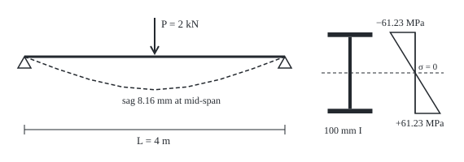
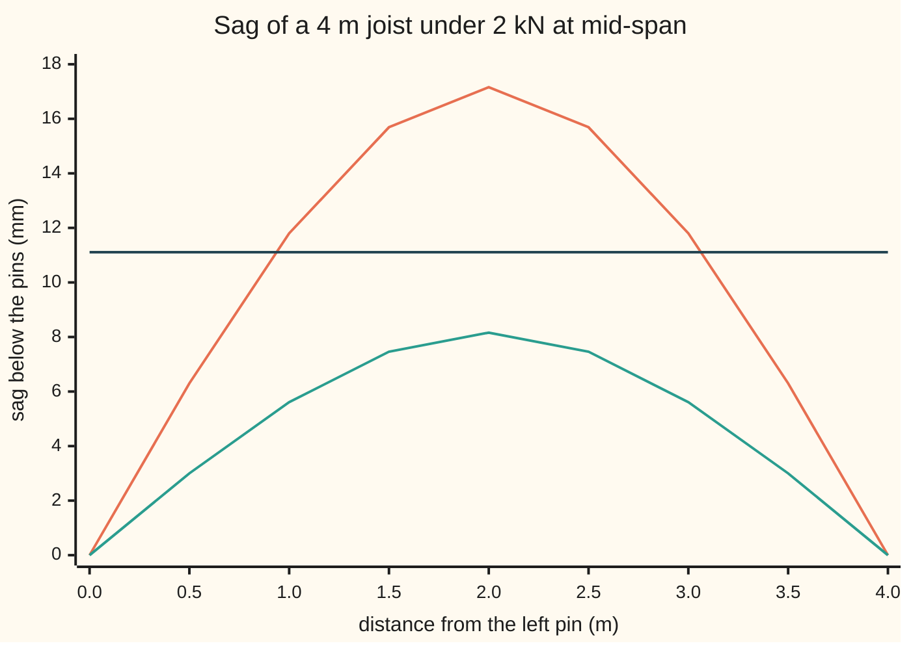

# Stress, strain and bending: how a beam carries load and how far it sags

[Syllabus](../../../SYLLABUS.md) → [Engineering mathematics](../README.md) → [Mechanics and Structures](../README.md#s07) → Stress, strain and bending

---

## General Overview

A steel footbridge has a deck carried on joists: horizontal beams that span from one cross-girder to the next. One joist spans 4 m, resting on a pin at each end. Three people stop together at its middle: about 2 kN (2,000 newtons, the weight of 203.9 kg).

The engineer has two questions. Will the steel be pushed past what it can safely carry? And how far will the joist sag? Strength is the first worry most people have. On a footbridge the second usually decides the design. A deck that dips more than about 1/360 of its span, 11.11 mm here, feels soft underfoot and cracks surfacing, even though the steel is nowhere near failing. The design here takes both limits, as a working rule chosen for this card rather than the rule of any one design code: sag at most 11.11 mm, and stress at most 165 MPa (megapascals, millions of newtons per square metre), which is 60% of the 275 MPa at which grade S275 steel starts to bend for good (its yield stress as listed in the European steel code EN 1993-1-1, in Sources).

Two candidate I-sections show the point. An 80 mm deep I carries the load at 102.96 MPa, comfortably strong, but sags 17.16 mm. A 100 mm deep I sags 8.16 mm at 61.23 MPa and passes both. It weighs 7.77 kg per metre.

**A bent beam stretches its lower face and squeezes its upper face in proportion to distance from the middle; the steel's stiffness turns that into stress, and the stresses add up to the bending moment, so sag and stress both follow from one number, EI, the beam's bending stiffness.**

**What kind of fact this is:** a model, not a law. Two assumptions (the steel is linearly elastic, and flat cross-sections stay flat as the beam bends) give the bending relation, derived on this card in Why it works. Inside the model, the sag formula is a theorem.

### The picture: the joist and its cross-section

<p align="center"></p>

To scale. Left, the span at 80 px per m; the sag is drawn at 5 px per mm, so it is greatly exaggerated. Right, the section at 1 px per mm; the stress triangle at 0.5 px per MPa. The dashed line across the section is the neutral axis, where stress is zero.

---

## The formula

Two notations first, in words. **Stress**, written σ (sigma), is force per area: how hard each square metre of steel is being pulled or pushed, in pascals. **Strain**, written ε (epsilon), is stretch per length: a bar 1 m long that grows 0.306 mm has strain 0.000306. Strain has no units. (Shelf 01 used ε for a small parameter; on this shelf ε is strain.)

**Hooke's law**, for steel below its yield stress:

$$\sigma = E\,\varepsilon$$

**Read it aloud:** stress is stiffness times strain. E, Young's modulus, is the stress per unit of strain: the steel's stiffness, 200 GPa (gigapascals, billions of pascals).

The **bending relation**, derived below:

$$\kappa = \frac{M}{EI}, \qquad \sigma = -\frac{M\,y}{I}, \qquad \sigma_{\max} = \frac{M}{W}, \quad W = \frac{I}{c}$$

**Read it aloud:** the beam curves in proportion to the bending moment over its bending stiffness; the stress grows straight-line with distance from the middle, a squeeze above it and a stretch below it when the beam sags, and is largest at the outer faces.

The **sag equation**, a two-point boundary value problem:

$$EI\,v''(x) = -M(x), \qquad v(0) = v(L) = 0, \qquad \delta = v\!\left(\tfrac{L}{2}\right) = \frac{P L^3}{48\,E I}$$

**Read it aloud:** the beam's curvature at each point is the moment there over EI; pin both ends at zero and the mid-span sag is load times span cubed over 48 EI.

| Symbol | Plain meaning | In our example | Push it up and the answer… |
| --- | --- | --- | --- |
| $P$ | load at mid-span, N | 2000 N | sag and stress rise in proportion |
| $L$ | span between the pins, m | 4 m | sag rises as $L^3$, stress as $L$ |
| $x$ | distance along the span from the left pin, m | 0 to 4 m | — |
| $v(x)$, $\delta$ | sag below the pins at $x$, positive down; $\delta$ is the sag at mid-span | $\delta$ = 8.16 mm | — |
| $M(x)$ | bending moment: the turning effect the load puts on the beam at $x$, N m | $Px/2$, peak $PL/4$ = 2000 N m | sag and stress rise |
| $E$ | Young's modulus: the steel's stiffness, Pa | 200 GPa | sag falls; stress unchanged |
| $I$, $dA$ | second moment of area: the sum of (each small area $dA$ × its distance from the middle squared) over the section, m⁴ | 163.32 cm⁴ | sag falls; stress falls |
| $y$, $c$ | distance from the neutral axis, up positive; $c$ is the distance to the outer face | $c$ = 50 mm | the size of the stress grows with $\lvert y\rvert$ |
| $W$ | section modulus $I/c$, m³ | 32.66 cm³ | stress falls |
| $\sigma$, $F$, $A$ | stress, force $F$ over area $A$, Pa; $\sigma_{\max}$ is its largest value, at the faces; $\sigma_y$ is the yield stress | 61.23 MPa at the faces; $\sigma_y$ = 275 MPa | — |
| $\varepsilon$ | strain: stretch per length, no units | 0.000306 at the bottom face | — |
| $\kappa$, $R$ | curvature: one over the radius $R$ the beam bends to, 1/m | $M/EI$, largest at mid-span | — |

### When it holds

- **Linear elastic steel, stress below yield.** Past 275 MPa the steel flows and Hooke's law stops. The 100 mm joist reaches yield at a mid-span load of 8983 N. At 12,000 N the formula reports 367 MPa, a stress the steel cannot carry at all. Past 10,343 N the middle of the joist has yielded right through its depth: it turns there like a hinge, and the joist folds.
- **Small slopes.** Curvature equals $v''$ only while the beam's slope is small. Here the end slope is 0.00612 rad (0.351°), so the error is far below a part in a thousand.
- **Slender beam, flat sections stay flat.** The derivation ignores the beam shearing like a deck of cards. That is fair for a 4 m span on a 100 mm deep section; for a short deep beam, shear adds sag the formula leaves out (Timoshenko's correction, in Sources).
- **Load in the plane of the web, beam held sideways.** An I-section loaded across its strong axis can twist and fall sideways if its top flange is not held by the deck. That is **lateral-torsional buckling**: a stability failure, not a stress or sag failure. It is a relative of the column bowing under end load that [Buckling](08-buckling-and-stability.md) works through.
- **Pins at both ends.** Ends that are bolted rigidly sag less; the model above assumes they can rotate freely, which is the safe choice when in doubt.

---

## Why it works

### Step 0: a bent beam has a layer that neither stretches nor shrinks

Bend a ruler into a smile. Its bottom face gets longer and its top face gets shorter. Somewhere between them is a layer that keeps its length: the **neutral axis**. Every fibre's strain depends only on how far it sits above or below that layer. Stress follows strain through Hooke's law. The stresses push and pull across the section, and their total turning effect must equal the bending moment the load applies. Those three facts give the whole card.

### Step 1: flat sections stay flat, so strain is a straight line in y

Assume each cross-section, flat before bending, stays flat and turns to face the centre of the curve. That is the model's central assumption, and it is checked in practice by strain gauges. A fibre at height $y$ above the neutral axis then follows an arc of radius $R - y$ instead of $R$. Its length changes by the fraction $-y/R$:

$$\varepsilon = -\kappa\,y, \qquad \kappa = 1/R.$$

On a sagging beam, fibres above the axis ($y > 0$) shorten, and those below lengthen.

### Step 2: Hooke's law makes stress a straight line too

$\sigma = E\varepsilon = -E\kappa y$. Stress is zero at the neutral axis and largest at the faces. That is the triangle in the picture.

### Step 3: no net push puts the neutral axis through the centroid

The beam is bent, not stretched, so the stresses must add up to zero force: $\int \sigma\,dA = -E\kappa \int y\,dA = 0$. So $\int y\,dA = 0$: the neutral axis passes through the section's centroid. For a symmetric I, that is mid-depth, 50 mm from each face.

### Step 4: the stresses' turning effect is the moment

Each slice of area $dA$ carries force $\sigma\,dA$ at lever arm $y$. Adding the turning effects:

$$M = -\int \sigma\,y\,dA = E\kappa \int y^2\,dA = E I \kappa.$$

The integral $I = \int y^2 dA$ is the second moment of area. It counts each bit of steel by the square of its distance from the axis. That is why an I-section puts most of its steel in the flanges: for the 100 mm I, the two thin flanges give 139.56 of the 163.32 cm⁴, the web only 23.76. Substituting $\kappa = M/(EI)$ into Step 2 gives $\sigma = -My/I$, and at the faces $|\sigma| = Mc/I = M/W$.

### Step 5: curvature is the second derivative, and two pins fix the shape

For a gently curved line, curvature is the second derivative of height ([Second derivatives](../../06-Calculus%20and%20analysis/02-Derivatives/08-higher-derivatives-and-concavity.md)). With sag $v$ measured downward and a sagging moment taken positive, $EI\,v'' = -M(x)$. The pins say $v(0) = 0$ and $v(L) = 0$: one condition at each end, a boundary value problem ([Boundary value problems](../../08-Differential%20equations%20and%20dynamics/07-Series%20Solutions%20and%20Boundary%20Problems/05-two-point-boundary-value-problems.md)).

The load is shared equally between the pins, so each pushes up with $P/2$ and the moment at $x$ on the left half is $M = Px/2$ ([Newton's laws](01-newtons-laws-work-and-energy.md): the piece of beam to the left of the cut must not turn). Integrating twice and fitting the pins gives

$$v(x) = \frac{P\,x\,(3L^2 - 4x^2)}{48\,EI}, \quad 0 \le x \le L/2,$$

mirrored on the right half. At $x = L/2$ this is $PL^3/(48EI)$.

<details>
<summary>The two integrations</summary>

On $0 \le x \le L/2$: $EI\,v'' = -Px/2$. Integrate: $EI\,v' = -Px^2/4 + C_1$, with $C_1$ and later $C_2$ the constants of integration. By symmetry the beam is level at mid-span, $v'(L/2) = 0$, so $C_1 = PL^2/16$. Integrate again: $EI\,v = -Px^3/12 + PL^2x/16 + C_2$, and $v(0) = 0$ gives $C_2 = 0$. So $EI\,v = Px(3L^2 - 4x^2)/48$. At $x = L/2$: $P(L/2)(3L^2 - L^2)/48 = PL^3/48$. The end slope is $v'(0) = PL^2/(16EI)$.

</details>

### Step 6: a second road, through energy

The load does work $P\delta/2$ as it sinks (the force grows from zero as the beam takes it up). The bent steel stores energy $\int M^2/(2EI)\,dx$. The two must be equal, so $\delta = \frac{1}{P}\int_0^L M^2/(EI)\,dx$. With $M = Px/2$ on each half, the integral is $P^2L^3/48$, and $\delta = PL^3/(48EI)$ again. The code takes this road numerically, as a check that owes nothing to the shape formula.

**Why depth wins.** Stress goes as $1/W$, which grows roughly as depth squared. Sag goes as $1/I$, roughly depth cubed. Going from 80 mm to 100 mm deep raises $W$ from 19.43 to 32.66 cm³, but $I$ from 77.70 to 163.32 cm⁴. On a long span with a light load, sag is the binding limit, and depth is the cheapest cure.

---

## Worked numbers, by hand

The 100 mm I: flanges 55 mm by 5.7 mm, web 4.1 mm thick, rounded corners left out (which makes $I$ a little low, on the safe side).

| Step | Arithmetic | Value |
| --- | --- | --- |
| largest bending moment | $PL/4$ = 2000 × 4 / 4 | 2000 N m |
| sag limit | $L/360$ = 4000 mm / 360 | 11.11 mm |
| stress limit | 0.6 × 275 MPa | 165 MPa |
| $I$ the sag limit needs | $PL^3/(48E \times 11.11\text{ mm})$ | 120.00 cm⁴ |
| $W$ the stress limit needs | 2000 N m / 165 MPa | 12.12 cm³ |
| $I$ of the 100 mm I | flanges 139.56 + web 23.76 | 163.32 cm⁴ |
| $W$ | 163.32 cm⁴ / 5 cm | 32.66 cm³ |
| bending stiffness $EI$ | 200 GPa × 163.32 cm⁴ | 326645 N m² |
| mid-span sag | 2000 × 4³ / (48 × 326645) | **8.16 mm** |
| face stress | 2000 N m / 32.66 cm³ | **61.23 MPa** |
| face strain | 61.23 MPa / 200 GPa | 0.000306 |
| own weight, 7.77 kg/m | adds 5 × (weight per m) × $L^4$ / (384 $EI$) | 0.78 mm, total 8.94 mm |

The 100 mm I sags 8.94 mm with its own weight included, under the 11.11 mm limit, and its outer faces carry 61.23 MPa, well under 165 MPa: the joist is sized by sag, with stress to spare.

### The sag along the span



Top curve: the 80 mm I, which crosses the limit over the middle 2 m or so. Middle curve: the 100 mm I. Flat line: the 11.11 mm limit.

### What breaks if you drop a piece

| Mistake | Comes out at | What went wrong |
| --- | --- | --- |
| Size by stress only | 80 mm I, sags 17.16 mm | 102.96 MPa passes, but the sag limit, 11.11 mm, is the one that binds |
| Fit the I-section on its side | $I$ = 15.86 cm⁴, sag 84.09 mm | $I$ counts distance squared; turned over, the flanges sit on the axis |
| Treat the pinned ends as clamped | 2.04 mm | $PL^3/(192EI)$: a quarter of the true sag, from the wrong boundary conditions |
| Spread the 2 kN along the span | 5.10 mm, 30.61 MPa | People standing together are a point load; spreading it halves the moment |
| Use the formula past yield | 367 MPa at 12,000 N | Yield comes at 8983 N; beyond it Hooke's law, and every formula here, stops. Past 10,343 N the joist folds |

The code prints all five.

---

## Code, from first principles, and it actually runs

The code sizes the joist from three candidate sections and then checks its own answer by independent roads. $I$ is found twice: from the three-rectangle formula, and by slicing the section into 0.05 mm strips and adding area × distance squared. The mid-span sag is found three ways: the closed form $PL^3/(48EI)$; a finite-difference solution of the boundary value problem $EI\,v'' = -M$ on 400 steps, solved by the Thomas algorithm (the tridiagonal sweep, written out); and the energy balance, integrated by Simpson's rule. The finite-difference sag differs from the formula by 0.0001 mm, the size of its grid error. The face stress is checked by slicing too: the strips' stresses must add up to no net push and turn with exactly the 2000 N m moment. The same solver, given the joist's own weight spread along the span, checks the 0.78 mm self-weight sag. The folding load, 10,343 N, assumes every strip has yielded and carries 275 MPa; it needs the sum of area × distance (not squared) over the section, 37.61 cm³, found both by the strips and by the rectangle formula. Every number on the card, including the chart points and the figure's coordinates, is printed.

### Python

```python
# Stress, strain and bending -- the check behind the card.  Standard library only.
# A 4 m steel joist, pinned at both ends, 2 kN at mid-span.  Sizes it against a
# sag limit and a stress limit, then reaches the sag three independent ways.
L, P, E, G = 4.0, 2000.0, 200e9, 9.80665       # m, N, Pa (steel), m/s^2
SIGMA_Y, RHO = 275e6, 7850.0                   # S275 yield stress Pa, steel kg/m^3
SAG_LIM, STRESS_LIM = L / 360, 0.6 * SIGMA_Y   # m, Pa
SECTIONS = {"80 mm I": (80, 46, 5.2, 3.8), "100 mm I": (100, 55, 5.7, 4.1),
            "120 mm I": (120, 64, 6.3, 4.4)}   # depth h, flange b x tf, web tw, in mm

def i_formula(h, b, tf, tw):                   # road 1 for I: three rectangles
    hw, d = h - 2 * tf, (h - tf) / 2           # web height; flange centre to axis
    return 2 * (b * tf**3 / 12 + b * tf * d * d) + tw * hw**3 / 12   # mm^4

def i_strips(h, b, tf, tw, dy=0.05):           # road 2 for I: add up y^2 dA, strip by strip
    total = 0.0
    for k in range(round(h / dy)):
        y = -h / 2 + (k + 0.5) * dy            # strip centre, mm from the neutral axis
        width = b if abs(y) > h / 2 - tf else tw
        total += width * dy * y * y
    return total

def strip_sums(h, b, tf, tw, s_face, dy=0.05): # stress -s_face y / c on each strip: net push (N),
    force = turn = z = 0.0                     # turning effect (N m), and the sum of |y| dA (mm^3)
    for k in range(round(h / dy)):
        y = -h / 2 + (k + 0.5) * dy            # strip centre, mm from the neutral axis
        dA = (b if abs(y) > h / 2 - tf else tw) * dy
        sig = -s_face * y / (h / 2)            # Pa
        force, turn, z = force + sig * dA * 1e-6, turn - sig * y * dA * 1e-9, z + abs(y) * dA
    return force, turn, z

def area(h, b, tf, tw): return 2 * b * tf + (h - 2 * tf) * tw          # mm^2
def moment(x): return P * min(x, L - x) / 2                            # N m, at x m
def sag_formula(EI): return P * L**3 / (48 * EI)                      # m

def sag_fd(EI, n=400, mom=moment):             # road 2: EI v'' = -M(x), v(0) = v(L) = 0
    h = L / n                                  # finite differences, Thomas algorithm
    rhs = [-h * h * mom(i * h) / EI for i in range(1, n)]
    c, d = [0.0] * (n - 1), [0.0] * (n - 1)    # sweep the tridiagonal (1, -2, 1) system
    for i in range(n - 1):
        m = -2.0 - (c[i - 1] if i else 0.0)
        c[i] = 1.0 / m
        d[i] = (rhs[i] - (d[i - 1] if i else 0.0)) / m
    v = [0.0] * (n - 1)
    for i in range(n - 2, -1, -1):
        v[i] = d[i] - c[i] * (v[i + 1] if i < n - 2 else 0.0)
    return [0.0] + v + [0.0]

def sag_energy(EI, n=400):                     # road 3: work P sag / 2 = stored energy,
    h, s = L / n, 0.0                          # the integral of M^2 / (2 EI), by Simpson
    for i in range(n + 1):
        s += (1 if i in (0, n) else (4 if i % 2 else 2)) * moment(i * h) ** 2
    return 2 * (s * h / 3) / (2 * EI) / P

def shape(EI, x):                              # closed-form sag curve, m
    x = min(x, L - x)
    return P * x * (3 * L * L - 4 * x * x) / (48 * EI)

M = P * L / 4
print(f"joist: span {L:.1f} m, pinned ends, {P:.0f} N at mid-span = {P / G:.1f} kg, E = {E / 1e9:.0f} GPa")
print(f"limits: sag L/360 = {SAG_LIM * 1e3:.2f} mm, stress 0.6 x {SIGMA_Y / 1e6:.0f} = {STRESS_LIM / 1e6:.0f} MPa")
print(f"largest bending moment PL/4 = {M:.0f} N m")
print(f"needed: I >= {P * L**3 / (48 * E * SAG_LIM) * 1e8:.2f} cm^4 (sag), W >= {M / STRESS_LIM * 1e6:.2f} cm^3 (stress)")
print(f"{'section':<10}{'I cm^4':>9}{'strips':>9}{'W cm^3':>8}{'sag mm':>8}{'MPa':>8}{'kg/m':>7}  verdict")
rows = {}
for name, dims in SECTIONS.items():
    I1, I2 = i_formula(*dims), i_strips(*dims)
    assert abs(I1 - I2) / I1 < 1e-6            # two roads to I agree
    I, W = I1 * 1e-12, I1 / (dims[0] / 2) * 1e-9                  # m^4, m^3
    sag, stress, kg = sag_formula(E * I), M / W, area(*dims) * 1e-6 * RHO
    ok_sag, ok_str = sag <= SAG_LIM, stress <= STRESS_LIM
    verdict = "passes both" if ok_sag and ok_str else ("fails sag" if ok_str else "fails stress")
    rows[name] = (I, W, sag, stress, kg, verdict)
    print(f"{name:<10}{I1 / 1e4:9.2f}{I2 / 1e4:9.2f}{W * 1e6:8.2f}{sag * 1e3:8.2f}{stress / 1e6:8.2f}{kg:7.2f}  {verdict}")
chosen = min((r[4], n) for n, r in rows.items() if r[5] == "passes both")[1]
I, W, sag, stress, kg, _ = rows[chosen]
EI, v, h, b, tf, tw = E * I, sag_fd(E * I), *SECTIONS[chosen]
print(f"lightest section passing both: {chosen}, EI = {EI:.0f} N m^2")
I_web = tw * (h - 2 * tf)**3 / 12
print(f"its I, cm^4: flanges {(I * 1e12 - I_web) / 1e4:.2f} + web {I_web / 1e4:.2f}")
print(f"sag, road 1 formula PL^3/48EI:  {sag * 1e3:.4f} mm")
print(f"sag, road 2 finite differences: {v[200] * 1e3:.4f} mm")
print(f"sag, road 3 energy integral:    {sag_energy(EI) * 1e3:.4f} mm")
assert abs(v[200] - sag) / sag < 1e-4 and abs(sag_energy(EI) - sag) / sag < 1e-9
assert rows["80 mm I"][5] == "fails sag" and chosen == "100 mm I"
assert max(abs(v[50 * k] - shape(EI, 0.5 * k)) for k in range(9)) < 1e-6
strain, slope = stress / E, P * L * L / (16 * EI)
print(f"outer-face stress {stress / 1e6:.2f} MPa, strain {strain:.6f} = {strain * 1e3:.3f} mm per m")
force, turn, z_strips = strip_sums(h, b, tf, tw, stress)
print(f"strips at that stress: net push {abs(force):.3f} N, turning effect {turn:.2f} N m")
assert abs(force) < 1e-6 * P and abs(turn - M) / M < 1e-6       # the stresses add up to the moment
print(f"end slope PL^2/16EI = {slope:.5f} rad = {slope * 180 / 3.141592653589793:.3f} deg")
w_self = kg * G                                # N per m along the span
extra = 5 * w_self * L**4 / (384 * EI)
extra_fd = sag_fd(EI, mom=lambda x: w_self * x * (L - x) / 2)[200]   # same solver, spread load
print(f"self-weight {w_self:.2f} N/m adds {extra * 1e3:.2f} mm (finite differences"
      f" {extra_fd * 1e3:.2f}): total {(sag + extra) * 1e3:.2f} mm")
assert abs(extra_fd - extra) / extra < 1e-4
print("chart, x m       " + "".join(f"{0.5 * k:7.1f}" for k in range(9)))
for name in ("80 mm I", "100 mm I"):
    print(f"chart, {name:<10}" + "".join(f"{shape(E * rows[name][0], 0.5 * k) * 1e3:7.2f}" for k in range(9)))
I_weak = (2 * tf * b**3 / 12 + (h - 2 * tf) * tw**3 / 12) * 1e-12    # turned on its side
sag_weak, sag_clamp = sag_formula(E * I_weak), P * L**3 / (192 * EI)
print(f"wrong: sized by stress only, 80 mm I sags {rows['80 mm I'][2] * 1e3:.2f} mm, limit {SAG_LIM * 1e3:.2f} mm")
print(f"wrong: section on its side, I = {I_weak * 1e8:.2f} cm^4, sag {sag_weak * 1e3:.2f} mm")
print(f"wrong: ends taken as clamped, PL^3/192EI = {sag_clamp * 1e3:.2f} mm")
print(f"wrong: 2 kN spread evenly, sag 5PL^3/384EI = {5 * P * L**3 / (384 * EI) * 1e3:.2f} mm,"
      f" stress {P * L / 8 / W / 1e6:.2f} MPa")
assert sag_weak > 5 * SAG_LIM > sag
P_yield = 4 * W * SIGMA_Y / L
print(f"outside the model: yield at P = {P_yield:.0f} N; at 12000 N the formula says {12000 * L / 4 / W / 1e6:.0f} MPa")
z_formula = b * tf * (h - tf) + tw * (h - 2 * tf)**2 / 4                # mm^3, whole section yielded
P_fold = 4 * z_formula * 1e-9 * SIGMA_Y / L
print(f"outside the model: section yielded through, Z = {z_formula / 1e3:.2f} cm^3"
      f" (strips {z_strips / 1e3:.2f}), folds at P = {P_fold:.0f} N")
assert abs(z_strips - z_formula) / z_formula < 1e-6 and P_yield < P_fold < 12000
print(f"try: P = 3000 N sags {sag * 1.5 * 1e3:.2f} mm; L = 5 m sags {P * 5**3 / (48 * EI) * 1e3:.2f} mm"
      f" against {5 / 360 * 1e3:.2f} mm; aluminium, E = 70 GPa, sags {sag_formula(70e9 * I) * 1e3:.2f} mm")
print("figure, elevation 80 px/m, sag 5 px/mm, y px below beam at x = 0.5 m steps:",
      " ".join(f"{shape(EI, 0.5 * k) * 5e3:.1f}" for k in range(9)))
print(f"figure, section 1 px/mm, {h} x {b} mm, flange {tf} mm, web {tw} mm;"
      f" stress 0.5 px/MPa: {stress / 1e6 * 0.5:.1f} px")
print("ALL CHECKS PASS")
```

**Ran 2026-11-11 on macOS, Python 3.14.10, standard library only. All checks passed. Output, pasted from the run:**

```
joist: span 4.0 m, pinned ends, 2000 N at mid-span = 203.9 kg, E = 200 GPa
limits: sag L/360 = 11.11 mm, stress 0.6 x 275 = 165 MPa
largest bending moment PL/4 = 2000 N m
needed: I >= 120.00 cm^4 (sag), W >= 12.12 cm^3 (stress)
section      I cm^4   strips  W cm^3  sag mm     MPa   kg/m  verdict
80 mm I       77.70    77.70   19.43   17.16  102.96   5.83  fails sag
100 mm I     163.32   163.32   32.66    8.16   61.23   7.77  passes both
120 mm I     306.31   306.31   51.05    4.35   39.18  10.04  passes both
lightest section passing both: 100 mm I, EI = 326645 N m^2
its I, cm^4: flanges 139.56 + web 23.76
sag, road 1 formula PL^3/48EI:  8.1638 mm
sag, road 2 finite differences: 8.1639 mm
sag, road 3 energy integral:    8.1638 mm
outer-face stress 61.23 MPa, strain 0.000306 = 0.306 mm per m
strips at that stress: net push 0.000 N, turning effect 2000.00 N m
end slope PL^2/16EI = 0.00612 rad = 0.351 deg
self-weight 76.23 N/m adds 0.78 mm (finite differences 0.78): total 8.94 mm
chart, x m           0.0    0.5    1.0    1.5    2.0    2.5    3.0    3.5    4.0
chart, 80 mm I      0.00   6.30  11.80  15.69  17.16  15.69  11.80   6.30   0.00
chart, 100 mm I     0.00   3.00   5.61   7.46   8.16   7.46   5.61   3.00   0.00
wrong: sized by stress only, 80 mm I sags 17.16 mm, limit 11.11 mm
wrong: section on its side, I = 15.86 cm^4, sag 84.09 mm
wrong: ends taken as clamped, PL^3/192EI = 2.04 mm
wrong: 2 kN spread evenly, sag 5PL^3/384EI = 5.10 mm, stress 30.61 MPa
outside the model: yield at P = 8983 N; at 12000 N the formula says 367 MPa
outside the model: section yielded through, Z = 37.61 cm^3 (strips 37.61), folds at P = 10343 N
try: P = 3000 N sags 12.25 mm; L = 5 m sags 15.94 mm against 13.89 mm; aluminium, E = 70 GPa, sags 23.33 mm
figure, elevation 80 px/m, sag 5 px/mm, y px below beam at x = 0.5 m steps: 0.0 15.0 28.1 37.3 40.8 37.3 28.1 15.0 0.0
figure, section 1 px/mm, 100 x 55 mm, flange 5.7 mm, web 4.1 mm; stress 0.5 px/MPa: 30.6 px
ALL CHECKS PASS
```

### Rust

Same numbers, same labels, built with `rustc --edition 2021 -O`.

```rust
// Stress, strain and bending -- the same check as the Python, in Rust.  No crates.
// A 4 m steel joist, pinned at both ends, 2 kN at mid-span.  Sizes it against a
// sag limit and a stress limit, then reaches the sag three independent ways.
const L: f64 = 4.0; const P: f64 = 2000.0; const E: f64 = 200e9; const G: f64 = 9.80665;
const SIGMA_Y: f64 = 275e6; const RHO: f64 = 7850.0;   // S275 yield stress Pa, steel kg/m^3
const SAG_LIM: f64 = L / 360.0; const STRESS_LIM: f64 = 0.6 * SIGMA_Y;
// depth h, flange b x tf, web tw, in mm
const SECTIONS: [(&str, [f64; 4]); 3] = [("80 mm I", [80.0, 46.0, 5.2, 3.8]),
    ("100 mm I", [100.0, 55.0, 5.7, 4.1]), ("120 mm I", [120.0, 64.0, 6.3, 4.4])];

fn i_formula(s: [f64; 4]) -> f64 {            // road 1 for I: three rectangles
    let (h, b, tf, tw) = (s[0], s[1], s[2], s[3]);
    let (hw, d) = (h - 2.0 * tf, (h - tf) / 2.0);
    2.0 * (b * tf.powi(3) / 12.0 + b * tf * d * d) + tw * hw.powi(3) / 12.0
}
fn i_strips(s: [f64; 4]) -> f64 {             // road 2 for I: add up y^2 dA, strip by strip
    let (h, b, tf, tw, dy) = (s[0], s[1], s[2], s[3], 0.05);
    let mut total = 0.0;
    for k in 0..(h / dy).round() as usize {
        let y = -h / 2.0 + (k as f64 + 0.5) * dy;
        let width = if y.abs() > h / 2.0 - tf { b } else { tw };
        total += width * dy * y * y;
    }
    total
}
fn strip_sums(s: [f64; 4], s_face: f64) -> (f64, f64, f64) { // net push, turning effect, sum |y| dA
    let (h, b, tf, tw, dy) = (s[0], s[1], s[2], s[3], 0.05);
    let (mut force, mut turn, mut z) = (0.0, 0.0, 0.0);
    for k in 0..(h / dy).round() as usize {
        let y = -h / 2.0 + (k as f64 + 0.5) * dy;
        let da = (if y.abs() > h / 2.0 - tf { b } else { tw }) * dy;
        let sig = -s_face * y / (h / 2.0);
        force += sig * da * 1e-6; turn -= sig * y * da * 1e-9; z += y.abs() * da;
    }
    (force, turn, z)
}
fn area(s: [f64; 4]) -> f64 { 2.0 * s[1] * s[2] + (s[0] - 2.0 * s[2]) * s[3] }
fn moment(x: f64) -> f64 { P * x.min(L - x) / 2.0 }
fn sag_formula(ei: f64) -> f64 { P * L.powi(3) / (48.0 * ei) }
fn sag_fd(ei: f64, n: usize, mom: &dyn Fn(f64) -> f64) -> Vec<f64> { // road 2: EI v'' = -M(x)
    let h = L / n as f64;                      // finite differences, Thomas algorithm
    let rhs: Vec<f64> = (1..n).map(|i| -h * h * mom(i as f64 * h) / ei).collect();
    let (mut c, mut d) = (vec![0.0; n - 1], vec![0.0; n - 1]);
    for i in 0..n - 1 {
        let m = -2.0 - if i > 0 { c[i - 1] } else { 0.0 };
        c[i] = 1.0 / m;
        d[i] = (rhs[i] - if i > 0 { d[i - 1] } else { 0.0 }) / m;
    }
    let mut v = vec![0.0; n + 1];
    for i in (0..n - 1).rev() { v[i + 1] = d[i] - c[i] * v[i + 2]; }
    v
}
fn sag_energy(ei: f64, n: usize) -> f64 {     // road 3: work P sag / 2 = stored energy
    let (h, mut s) = (L / n as f64, 0.0);      // the integral of M^2 / (2 EI), by Simpson
    for i in 0..=n {
        let w = if i == 0 || i == n { 1.0 } else if i % 2 == 1 { 4.0 } else { 2.0 };
        s += w * moment(i as f64 * h).powi(2);
    }
    2.0 * (s * h / 3.0) / (2.0 * ei) / P
}
fn shape(ei: f64, x: f64) -> f64 { let x = x.min(L - x); P * x * (3.0 * L * L - 4.0 * x * x) / (48.0 * ei) }

fn main() {
    let m = P * L / 4.0;
    println!("joist: span {:.1} m, pinned ends, {:.0} N at mid-span = {:.1} kg, E = {:.0} GPa", L, P, P / G, E / 1e9);
    println!("limits: sag L/360 = {:.2} mm, stress 0.6 x {:.0} = {:.0} MPa", SAG_LIM * 1e3, SIGMA_Y / 1e6, STRESS_LIM / 1e6);
    println!("largest bending moment PL/4 = {:.0} N m", m);
    println!("needed: I >= {:.2} cm^4 (sag), W >= {:.2} cm^3 (stress)",
             P * L.powi(3) / (48.0 * E * SAG_LIM) * 1e8, m / STRESS_LIM * 1e6);
    println!("{:<10}{:>9}{:>9}{:>8}{:>8}{:>8}{:>7}  verdict", "section", "I cm^4", "strips", "W cm^3", "sag mm", "MPa", "kg/m");
    let mut rows: Vec<(&str, f64, f64, f64, f64, f64, &str)> = vec![];
    for (name, dims) in SECTIONS {
        let (i1, i2) = (i_formula(dims), i_strips(dims));
        assert!((i1 - i2).abs() / i1 < 1e-6);   // two roads to I agree
        let (i, w) = (i1 * 1e-12, i1 / (dims[0] / 2.0) * 1e-9);
        let (sag, stress, kg) = (sag_formula(E * i), m / w, area(dims) * 1e-6 * RHO);
        let (ok_sag, ok_str) = (sag <= SAG_LIM, stress <= STRESS_LIM);
        let verdict = if ok_sag && ok_str { "passes both" } else if ok_str { "fails sag" } else { "fails stress" };
        rows.push((name, i, w, sag, stress, kg, verdict));
        println!("{:<10}{:9.2}{:9.2}{:8.2}{:8.2}{:8.2}{:7.2}  {}", name, i1 / 1e4, i2 / 1e4, w * 1e6, sag * 1e3, stress / 1e6, kg, verdict);
    }
    let r = *rows.iter().filter(|r| r.6 == "passes both").min_by(|a, b| a.5.partial_cmp(&b.5).unwrap()).unwrap();
    let (chosen, i, w, sag, stress, kg) = (r.0, r.1, r.2, r.3, r.4, r.5);
    let dims = SECTIONS.iter().find(|s| s.0 == chosen).unwrap().1;
    let (h, b, tf, tw) = (dims[0], dims[1], dims[2], dims[3]);
    let ei = E * i;
    let v = sag_fd(ei, 400, &moment);
    println!("lightest section passing both: {}, EI = {:.0} N m^2", chosen, ei);
    let i_web = tw * (h - 2.0 * tf).powi(3) / 12.0;
    println!("its I, cm^4: flanges {:.2} + web {:.2}", (i * 1e12 - i_web) / 1e4, i_web / 1e4);
    println!("sag, road 1 formula PL^3/48EI:  {:.4} mm", sag * 1e3);
    println!("sag, road 2 finite differences: {:.4} mm", v[200] * 1e3);
    println!("sag, road 3 energy integral:    {:.4} mm", sag_energy(ei, 400) * 1e3);
    assert!((v[200] - sag).abs() / sag < 1e-4 && (sag_energy(ei, 400) - sag).abs() / sag < 1e-9);
    assert!(rows[0].6 == "fails sag" && chosen == "100 mm I");
    assert!((0..9).map(|k| (v[50 * k] - shape(ei, 0.5 * k as f64)).abs()).fold(0.0, f64::max) < 1e-6);
    let (strain, slope) = (stress / E, P * L * L / (16.0 * ei));
    println!("outer-face stress {:.2} MPa, strain {:.6} = {:.3} mm per m", stress / 1e6, strain, strain * 1e3);
    let (force, turn, z_strips) = strip_sums(dims, stress);
    println!("strips at that stress: net push {:.3} N, turning effect {:.2} N m", force.abs(), turn);
    assert!(force.abs() < 1e-6 * P && (turn - m).abs() / m < 1e-6); // the stresses add up to the moment
    println!("end slope PL^2/16EI = {:.5} rad = {:.3} deg", slope, slope * 180.0 / 3.141592653589793);
    let w_self = kg * G;
    let extra = 5.0 * w_self * L.powi(4) / (384.0 * ei);
    let extra_fd = sag_fd(ei, 400, &|x: f64| w_self * x * (L - x) / 2.0)[200]; // same solver, spread load
    println!("self-weight {:.2} N/m adds {:.2} mm (finite differences {:.2}): total {:.2} mm",
             w_self, extra * 1e3, extra_fd * 1e3, (sag + extra) * 1e3);
    assert!((extra_fd - extra).abs() / extra < 1e-4);
    let xs: String = (0..9).map(|k| format!("{:7.1}", 0.5 * k as f64)).collect();
    println!("chart, x m       {}", xs);
    for row in &rows[..2] {
        let pts: String = (0..9).map(|k| format!("{:7.2}", shape(E * row.1, 0.5 * k as f64) * 1e3)).collect();
        println!("chart, {:<10}{}", row.0, pts);
    }
    let i_weak = (2.0 * tf * b.powi(3) / 12.0 + (h - 2.0 * tf) * tw.powi(3) / 12.0) * 1e-12;
    let (sag_weak, sag_clamp) = (sag_formula(E * i_weak), P * L.powi(3) / (192.0 * ei));
    println!("wrong: sized by stress only, 80 mm I sags {:.2} mm, limit {:.2} mm", rows[0].3 * 1e3, SAG_LIM * 1e3);
    println!("wrong: section on its side, I = {:.2} cm^4, sag {:.2} mm", i_weak * 1e8, sag_weak * 1e3);
    println!("wrong: ends taken as clamped, PL^3/192EI = {:.2} mm", sag_clamp * 1e3);
    println!("wrong: 2 kN spread evenly, sag 5PL^3/384EI = {:.2} mm, stress {:.2} MPa",
             5.0 * P * L.powi(3) / (384.0 * ei) * 1e3, P * L / 8.0 / w / 1e6);
    assert!(sag_weak > 5.0 * SAG_LIM && 5.0 * SAG_LIM > sag);
    let p_yield = 4.0 * w * SIGMA_Y / L;
    println!("outside the model: yield at P = {:.0} N; at 12000 N the formula says {:.0} MPa", p_yield, 12000.0 * L / 4.0 / w / 1e6);
    let z_formula = b * tf * (h - tf) + tw * (h - 2.0 * tf).powi(2) / 4.0; // mm^3, whole section yielded
    let p_fold = 4.0 * z_formula * 1e-9 * SIGMA_Y / L;
    println!("outside the model: section yielded through, Z = {:.2} cm^3 (strips {:.2}), folds at P = {:.0} N",
             z_formula / 1e3, z_strips / 1e3, p_fold);
    assert!((z_strips - z_formula).abs() / z_formula < 1e-6 && p_yield < p_fold && p_fold < 12000.0);
    println!("try: P = 3000 N sags {:.2} mm; L = 5 m sags {:.2} mm against {:.2} mm; aluminium, E = 70 GPa, sags {:.2} mm",
             sag * 1.5 * 1e3, P * 5f64.powi(3) / (48.0 * ei) * 1e3, 5.0 / 360.0 * 1e3, sag_formula(70e9 * i) * 1e3);
    let fig: Vec<String> = (0..9).map(|k| format!("{:.1}", shape(ei, 0.5 * k as f64) * 5e3)).collect();
    println!("figure, elevation 80 px/m, sag 5 px/mm, y px below beam at x = 0.5 m steps: {}", fig.join(" "));
    println!("figure, section 1 px/mm, {} x {} mm, flange {} mm, web {} mm; stress 0.5 px/MPa: {:.1} px",
             h, b, tf, tw, stress / 1e6 * 0.5);
    println!("ALL CHECKS PASS");
}
```

**Ran 2026-11-11 on macOS, rustc 1.98.1, no crates. All checks passed. Output, pasted from the run:**

```
joist: span 4.0 m, pinned ends, 2000 N at mid-span = 203.9 kg, E = 200 GPa
limits: sag L/360 = 11.11 mm, stress 0.6 x 275 = 165 MPa
largest bending moment PL/4 = 2000 N m
needed: I >= 120.00 cm^4 (sag), W >= 12.12 cm^3 (stress)
section      I cm^4   strips  W cm^3  sag mm     MPa   kg/m  verdict
80 mm I       77.70    77.70   19.43   17.16  102.96   5.83  fails sag
100 mm I     163.32   163.32   32.66    8.16   61.23   7.77  passes both
120 mm I     306.31   306.31   51.05    4.35   39.18  10.04  passes both
lightest section passing both: 100 mm I, EI = 326645 N m^2
its I, cm^4: flanges 139.56 + web 23.76
sag, road 1 formula PL^3/48EI:  8.1638 mm
sag, road 2 finite differences: 8.1639 mm
sag, road 3 energy integral:    8.1638 mm
outer-face stress 61.23 MPa, strain 0.000306 = 0.306 mm per m
strips at that stress: net push 0.000 N, turning effect 2000.00 N m
end slope PL^2/16EI = 0.00612 rad = 0.351 deg
self-weight 76.23 N/m adds 0.78 mm (finite differences 0.78): total 8.94 mm
chart, x m           0.0    0.5    1.0    1.5    2.0    2.5    3.0    3.5    4.0
chart, 80 mm I      0.00   6.30  11.80  15.69  17.16  15.69  11.80   6.30   0.00
chart, 100 mm I     0.00   3.00   5.61   7.46   8.16   7.46   5.61   3.00   0.00
wrong: sized by stress only, 80 mm I sags 17.16 mm, limit 11.11 mm
wrong: section on its side, I = 15.86 cm^4, sag 84.09 mm
wrong: ends taken as clamped, PL^3/192EI = 2.04 mm
wrong: 2 kN spread evenly, sag 5PL^3/384EI = 5.10 mm, stress 30.61 MPa
outside the model: yield at P = 8983 N; at 12000 N the formula says 367 MPa
outside the model: section yielded through, Z = 37.61 cm^3 (strips 37.61), folds at P = 10343 N
try: P = 3000 N sags 12.25 mm; L = 5 m sags 15.94 mm against 13.89 mm; aluminium, E = 70 GPa, sags 23.33 mm
figure, elevation 80 px/m, sag 5 px/mm, y px below beam at x = 0.5 m steps: 0.0 15.0 28.1 37.3 40.8 37.3 28.1 15.0 0.0
figure, section 1 px/mm, 100 x 55 mm, flange 5.7 mm, web 4.1 mm; stress 0.5 px/MPa: 30.6 px
ALL CHECKS PASS
```

The two outputs match line for line.

> [!TIP]
> **Try changing**
> An assert is a line that stops the program if a number comes out wrong. Guess first, then run it.
> - **Guess first:** what does a fourth person do? Set `P = 3000.0`. The sag is proportional to the load: 12.25 mm, over the 11.11 mm limit. The 100 mm I now fails sag, the 120 mm I is chosen, and the assert that expects the 100 mm I stops the program.
> - **Guess first:** what does a 5 m span need? Set `L = 5.0`. The limit grows to 13.89 mm, but the sag grows as the cube, to 15.94 mm. The 100 mm I fails again.
> - **Guess first:** what does aluminium do? Set `E = 70e9`. Same section, same 61.23 MPa stress, but the sag is 23.33 mm. Stress does not depend on the material; sag does. No section in the list passes now, so the line that picks the lightest passing section stops the program with an error.

---

## The usual mistake

> [!warning]
> **Checking strength and calling the beam safe.** The 80 mm I carries the three people at 102.96 MPa, well inside 165 MPa, and sags 17.16 mm, more than half as much again as the 11.11 mm limit. Strength depends on $W$, roughly depth squared; sag depends on $I$, roughly depth cubed, and on span cubed. On a long, lightly loaded member, check the sag first.
>
> - **Fitting an I-section on its side.** The same steel gives $I$ = 15.86 cm⁴ instead of 163.32 cm⁴, and the joist sags 84.09 mm.
> - **Wrong end conditions.** Treating pins as clamps gives 2.04 mm, a quarter of the true 8.16 mm.
> - **A crowd at one spot spread over the span.** 5.10 mm and 30.61 MPa, both too low.

---

## Where you meet it in real life

- **Floors and footbridges.** Joists in houses and decks are usually sized by sag, not strength: a floor that bounces is a complaint long before it is a hazard.
- **Steel tables.** Section tables list $I$ and $W$ for every rolled shape, so the sizing on this card is a lookup: needed $I$ = 120.00 cm⁴, needed $W$ = 12.12 cm³, pick the lightest section above both.
- **Strain gauges.** A strain gauge glued to the bottom flange reads strain; Hooke's law turns 0.000306 into 61.23 MPa. Bridge load tests work this way.
- **Ringing and buckling.** The same $EI$ sets how fast the deck vibrates ([Vibration modes](06-vibration-modes-and-resonance.md)) and the load at which a column bows sideways ([Buckling](08-buckling-and-stability.md)).

> **Say it back**
> Stress is force per area and strain is stretch per length; below yield, steel keeps them in proportion, stress equals E times strain. A bent beam has a neutral layer through its centroid, and strain grows straight-line with distance from it. Adding up the stresses' turning effect gives M = EIκ, so stress is −My/I (a squeeze above the axis of a sagging beam) and the curvature is M/EI. Treat curvature as v'', pin both ends, and the 4 m joist under 2 kN sags PL³/48EI: 8.16 mm for the 100 mm I, at 61.23 MPa. The 80 mm I is strong enough but sags 17.16 mm, so on this span sag, not strength, sizes the joist.

---

## What this builds on

- [Newton's laws](01-newtons-laws-work-and-energy.md): balance of forces and turning effects, which gives the pin reactions and the bending moment, and work turning into stored energy for the second road.
- [Second derivatives](../../06-Calculus%20and%20analysis/02-Derivatives/08-higher-derivatives-and-concavity.md): curvature as the second derivative, and concave down as a sagging shape.
- [Boundary value problems](../../08-Differential%20equations%20and%20dynamics/07-Series%20Solutions%20and%20Boundary%20Problems/05-two-point-boundary-value-problems.md): one condition at each end, and why the pins fix exactly one shape.

## Where this goes next

- [Buckling](08-buckling-and-stability.md): the same $EI$ under end compression, where a slender member bends away long before it is crushed.
- [Finite elements](../08-Fluids%20and%20Heat/09-finite-element-method-in-outline.md): beams, plates and shells of any shape, solved by splitting them into small pieces, each obeying the relations on this card.

This card treats one beam on two pins; how a whole frame of joists, girders and columns shares a crowd's weight, with joints that are neither pins nor clamps, is the question it leaves open.

---

## Sources

Verified 2026-11-11: every link below resolves to the publisher's page.

- Goodno, Barry J., and James M. Gere. *Mechanics of Materials*, 9th ed. Cengage, 2018. [Publisher's page](https://www.cengage.com/c/mechanics-of-materials-9e-goodno-gere/9781337093347). Hooke's law, the flexure formula, the deflection equation and its standard cases. Its property tables are the source for structural steel at E = 200 GPa and 7850 kg/m³.
- Öchsner, Andreas. "Euler–Bernoulli Beam Theory." In *Classical Beam Theories of Structural Mechanics*. Springer, 2021. [doi:10.1007/978-3-030-76035-9_2](https://doi.org/10.1007/978-3-030-76035-9_2). The plane-sections assumption and the derivation of $EI\,v'' = -M$ set out step by step.
- Timoshenko, S. P. "On the Correction for Shear of the Differential Equation for Transverse Vibrations of Prismatic Bars." *Philosophical Magazine* 41 (1921): 744–746. [doi:10.1080/14786442108636264](https://doi.org/10.1080/14786442108636264). The shear correction that matters for short, deep beams and is left out here.
- NIST. "Standard acceleration of gravity." CODATA recommended values. [NIST page](https://physics.nist.gov/cgi-bin/cuu/Value?gn). The 9.80665 m/s² used to turn 2000 N into 203.9 kg.
- CEN. *EN 1993-1-1:2005, Eurocode 3: Design of steel structures, Part 1-1: General rules and rules for buildings*. Brussels: CEN, 2005. [European Commission Eurocode 3 page](https://eurocodes.jrc.ec.europa.eu/EN-Eurocodes/eurocode-3-design-steel-structures). Its Table 3.1 lists the 275 MPa yield stress of grade S275.
