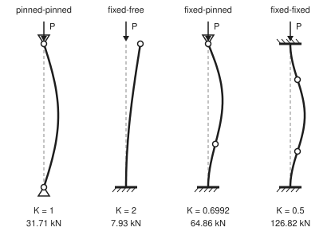
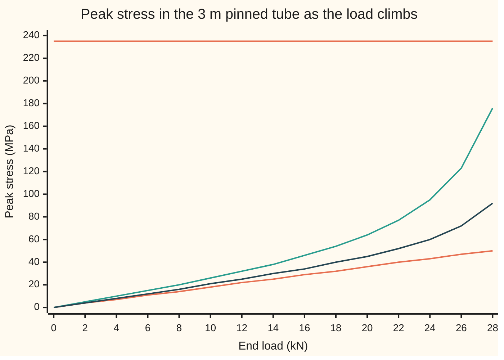

# Buckling: a slender column bends away long before it is crushed

[Syllabus](../../../SYLLABUS.md) → [Engineering mathematics](../README.md) → [Mechanics and Structures](../README.md#s07) → Buckling

---

## General Overview

A steel scaffold tube is 48.3 mm across with a 4.0 mm wall. Cut 3 m long and stood upright as a prop, it carries load along its length. Squeezed hard enough, the steel itself gives way: it yields (flows like stiff putty) at 235 MPa (megapascals, millions of newtons per square metre). Spread over the tube's 556.7 mm² of steel, that is 130.8 kN. Engineers call it the **squash load**.

The tube never gets near it. Stand it with free-turning (pinned) ends and put 40 kN on it, only 30.6 % of the squash load. It will not hold: it bows out sideways and folds once the load passes 31.71 kN. The steel at that moment carries only 57.0 MPa, a quarter of what it can bear. Nothing broke. The tube found that bending sideways was easier than staying straight.

That sideways escape is **buckling**. The steel's strength does not decide when it happens. The tube's stiffness and length do, and so do its ends. Clamp both ends rigidly and the same tube holds out to 126.82 kN on paper; leave the top free, like a flagpole, and it goes at 7.93 kN.

**A straight column under end load stays straight only while its bending stiffness beats the load's leverage on a sideways bow; the load where they tie is Euler's critical load, π²EI/(KL)², and for a slender tube it sits far below the load that would crush the steel.**

**What kind of fact this is:** a theorem about an ideal column (perfectly straight, elastic, loaded exactly along its axis), proved on this card in Why it works; real columns start slightly bent and give out a little below it, as shown in "The bow grows as the load climbs".

### The picture: four ways to hold the ends

<p align="center"></p>

Each tube is 3 m tall, drawn at 60 px per metre. The dashed line is the straight tube; the solid curve is the shape it buckles into. A triangle is a pin (free to turn), a hatched bar a clamp (held square). The sideways bow is exaggerated, because the theory fixes the shape but not its size.

Open circles mark **inflection points**, where the bend changes direction: at heights 0 and 3 m on the pinned tube, 3 m on the flagpole, 0.903 and 3 m on the fixed-pinned tube, 0.75 and 2.25 m on the fixed-fixed tube. The stretch between two of them buckles like a pinned tube of that length.

---

## The formula

$$P_{cr} = \frac{\pi^2 E I}{(K L)^2}$$

**Read it aloud:** the critical load is pi squared, times the material's stiffness, times the section's resistance to bending, divided by the square of the effective length.

| Symbol | Plain meaning | In our example | Push it up and the answer… |
| --- | --- | --- | --- |
| $P$, $P_{cr}$, $P_{sq}$ | end load along the tube, in N; $P_{cr}$ the critical (buckling) load; $P_{sq} = \sigma_y A$ the squash load | 40 kN applied; 31.71 kN critical, pinned; 130.8 kN squash | — |
| $E$ | Young's modulus: the steel's stiffness, stress per unit strain, in Pa | 210 GPa, the design value for structural steel in EN 1993-1-1 (Sources); [Stress, strain and bending](07-stress-strain-and-beam-bending.md) uses a handbook value a little lower | rises in proportion |
| $I$ | second moment of area: how far the steel sits from the bending axis, in m⁴ | 137676 mm⁴ | rises in proportion |
| $D$, $t$, $A$ | outside diameter and wall thickness of the tube; $A$ its steel area | 48.3 mm, 4.0 mm, 556.7 mm² | $P_{cr}$ rises with $D$ and $t$; the squash load rises with $A$ |
| $L$, $x$ | length of the tube; $x$ the height along it, from the base | 3 m | falls as $1/L^2$ |
| $K$, $L_e$ | end factor; effective length $L_e = KL$, the length of the equivalent pinned tube | 1, 2, 0.6992, 0.5 | falls as $1/K^2$ |
| $\sigma$, $\sigma_y$ | stress, force per area, in Pa; $\sigma_y$ the yield stress, where steel starts to flow | 57.0 MPa at buckling; 235 MPa, grade S235 in EN 1993-1-1 | — |
| $r$ | radius of gyration, $\sqrt{I/A}$: the typical distance of the steel from the axis | 15.73 mm | rises, because the slenderness $L/r$ falls |
| $y$, $M$ | sideways bow at height $x$, with $y'$, $y''$ its slope and curvature; $M$ the bending moment, force times lever arm, in N m | — | — |
| $k$, $n$, $\pi$ | $\sqrt{P/EI}$, in 1/m: how tightly a bowed shape can curl under load $P$; $n$ the mode number, the count of half-waves; $\pi$ the circle constant | $kL = \pi$ at the pinned critical load, $n = 1$ | shorter waves fit |
| $a$, $b$, $c$, $d$, $\Delta U$ | free constants of a solution ($a$ is also the bow size in Step 4); $\Delta U$ the change in stored energy when the tube bows | — | — |
| $e_0$, $\delta$, $W$ | starting bow at mid-height; bow under load; section modulus $I/(D/2)$, which turns moment into peak stress | 3 mm; 25.67 mm at 28 kN; 5701 mm³ | — |

The tube's **slenderness** is $L_e/r$: 190.8 for the 3 m pinned tube. Dividing $P_{cr}$ by $A$ gives the buckling stress $\pi^2 E / (L_e/r)^2$. It equals the yield stress at $L_e/r = \pi\sqrt{E/\sigma_y}$ = 93.9. Above that, the tube buckles while the steel is still elastic. Below it, the steel yields first.

### When it holds

- **The tube is straight and the load is centred.** A real tube with a 3 mm bow (one thousandth of its length) starts to yield at 29.05 kN, not 31.71 kN. The bow multiplies as the load nears $P_{cr}$ (see below).
- **The steel stays elastic: slenderness above 93.9.** A 0.5 m pinned tube gets 1141 kN from the formula but crushes at 130.8 kN. The fixed-fixed 3 m tube (effective length 1.5 m) sits right at the edge: 126.82 kN from the formula, 96.9 % of squash. With a 1.5 mm bow it starts to yield at 88.3 kN. In this range design codes use measured column curves, not Euler.
- **The ends behave as idealised.** Scaffold couplers are neither perfect pins nor perfect clamps. Choosing the wrong $K$ moves the answer by a factor of four (see What breaks).
- **Small slopes.** The theory finds the load where a bent shape becomes possible. It does not say how far the tube then bends; that needs the full large-bend equation.
- **The load stays vertical.** A load that tilts with the tube's top, such as a hose thrust, follows different rules.

---

## Why it works

### Step 0: two moments, and the load where they tie

Suppose the tube has bowed sideways by a small amount. Two things happen at each height.

The load at the top now pushes on a lever. At a height where the tube sits $y$ to the side of the line between the ends, the end load acts with a lever arm $y$, so it bends the tube there with moment $P y$. More bow means more lever, which means more bending. The load feeds the bow.

The tube's bending stiffness pushes back. [Stress, strain and bending](07-stress-strain-and-beam-bending.md) shows that a beam bent to curvature $y''$ resists with a moment $EI$ times that curvature.

Both grow in proportion to the size of the bow. So the size cancels, and only the load decides who wins. Below one particular load the stiffness wins for every shape, and the tube springs back straight. At that load some shape exactly balances: a bent tube can rest with no side force at all. That load is $P_{cr}$.

### Step 1: the pinned tube is the guitar string's eigenvalue problem

For the pinned tube the two moments balance when

$$EI\,y'' + P\,y = 0, \qquad y(0) = 0,\; y(L) = 0.$$

Divide by $EI$: $-y'' = (P/EI)\,y$. This is the eigenvalue problem of the string pinned at both ends ([Eigenvalue problems](../../08-Differential%20equations%20and%20dynamics/07-Series%20Solutions%20and%20Boundary%20Problems/08-eigenvalues-and-eigenfunctions.md)). Only special values of $P/EI$ let a nonzero shape fit between the pins: $(n\pi/L)^2$ for $n = 1, 2, 3, \dots$, with shape $\sin(n\pi x/L)$. The smallest, $n = 1$, is one smooth arch:

$$P_{cr} = \frac{\pi^2 EI}{L^2}.$$

Below it, only $y = 0$ satisfies the equation: the straight tube is the only resting shape. The higher loads ($n = 2$, an S-shape, at four times as much) are only reached if something braces the tube at mid-height.

### Step 2: other ends, through the fourth-order equation

A clamped end carries a moment of its own, which the pinned equation ignores. Differentiate the balance twice to remove it:

$$EI\,y'''' + P\,y'' = 0.$$

With $k = \sqrt{P/EI}$ every solution is $a + bx + c\cos kx + d\sin kx$, four free constants. Each end supplies two conditions:

- **pinned:** no bow, no moment, so $y = 0$ and $y'' = 0$;
- **clamped:** no bow, no slope, so $y = 0$ and $y' = 0$;
- **free:** no moment and no side force, so $y'' = 0$ and $EI\,y''' + P\,y' = 0$.

Four conditions on four constants have a nonzero answer only when their determinant is zero. The determinant is one number made from the conditions' coefficients, and it is zero exactly when a nonzero answer exists ([Determinants](../../03-Algebra/05-Solving%20Systems/04-determinants.md)). That happens at $kL = \pi$ (pinned-pinned), $\pi/2$ (flagpole), $2\pi$ (fixed-fixed), and at the first root of $\tan kL = kL$, which is $kL$ = 4.4934 (fixed-pinned). Writing $kL = \pi/K$ gives every case in one formula, with $K$ = 1, 2, 0.5 and 0.6992.

<details>
<summary>Detailed working: the fixed-pinned tube</summary>

Clamp the base: $y(0) = 0$ and $y'(0) = 0$ give $a = -c$ and $b = -kd$, so

$$y = c(\cos kx - 1) + d(\sin kx - kx).$$

Pin the top: $y''(L) = 0$ gives $c\cos kL + d\sin kL = 0$, so $c = -d\tan kL$. Put that into $y(L) = 0$:

$$-d\tan kL\,(\cos kL - 1) + d(\sin kL - kL) = d(\tan kL - kL) = 0.$$

A nonzero $d$ needs $\tan kL = kL$. Its first root past zero is 4.4934, so $K = \pi/4.4934$ = 0.6992. The curvature $y''$ vanishes where $\tan kx = \tan kL$, at $x = L(1 - \pi/kL)$ = 0.903 m: the inflection point in the picture.

</details>

### Step 3: why K is a length, read off the shape

Between two inflection points the curvature, and so the moment, is zero at both ends. That stretch is a pinned tube. So the buckled shape of any column contains a pinned tube of length $KL$, and $P_{cr}$ is that tube's load. Clamped at both ends, the middle half (0.75 m to 2.25 m) is a pinned 1.5 m tube: four times as strong. The flagpole is half of a pinned tube of length 6 m, mirrored below its base: a quarter as strong.

### Step 4: stability is an energy question

The words "stable" and "critical" come from energy. Bow the pinned tube into $y = a\sin(\pi x/L)$. Bending stores energy $\tfrac12\int EI\,(y'')^2\,dx$. The ends draw together by $\tfrac12\int (y')^2\,dx$, so the load lowers through that distance and releases $P$ times it. For this shape both are $a^2$ times a constant, and the change in total energy is

$$\Delta U = \frac{\pi^2 a^2}{4L}\left(\frac{\pi^2 EI}{L^2} - P\right).$$

Below $P_{cr}$ any bow costs energy, so the straight tube is a valley: stable. Above it, bowing releases energy, so the straight tube is a hilltop: unstable, and the smallest nudge sends it left or right. This is the **pitchfork** of [Bifurcations](../../08-Differential%20equations%20and%20dynamics/06-Nonlinear%20Dynamics%20in%20the%20Plane/10-bifurcations-of-equilibria.md): one resting state splits into two, bowed left and bowed right, as the load passes $P_{cr}$. The code's third road uses exactly this test.

---

## Worked numbers, by hand

The 3 m tube, pinned at both ends.

| Step | Arithmetic | Value |
| --- | --- | --- |
| inside diameter | 48.3 − 2 × 4.0 | 40.3 mm |
| steel area $A$ | $\tfrac{\pi}{4}(48.3^2 - 40.3^2)$ | 556.7 mm² |
| second moment $I$ | $\tfrac{\pi}{64}(48.3^4 - 40.3^4)$ | 137676 mm⁴ |
| stiffness $EI$ | 210 × 10⁹ Pa × 137676 × 10⁻¹² m⁴ | 28912 N m² |
| critical load, $K = 1$ | 9.8696 × 28912 / 3² | 31.71 kN |
| squash load | 235 MPa × 556.7 mm² | 130.8 kN |
| buckling stress | 31.71 kN / 556.7 mm² | 57.0 MPa |
| slenderness | 3000 mm / 15.73 mm | 190.8, above 93.9 |
| **buckling against crushing** | 31.71 / 130.8 | **24.2 %** |

The tube folds at under a quarter of the load its steel could carry, so any check of this prop against crushing alone would pass it four times over. A 40 kN load is 1.26 times its critical load.

The same tube with the four sets of ends, $P_{cr} = 31.71\text{ kN} / K^2$:

| Ends | $K$ | Effective length | $P_{cr}$ | Share of squash |
| --- | --- | --- | --- | --- |
| pinned-pinned | 1.0000 | 3.000 m | 31.71 kN | 24.2 % |
| fixed-free (flagpole) | 2.0000 | 6.000 m | 7.93 kN | 6.1 % |
| fixed-pinned | 0.6992 | 2.097 m | 64.86 kN | 49.6 % |
| fixed-fixed | 0.5000 | 1.500 m | 126.82 kN | 96.9 % |

### What breaks if you drop a piece

| Mistake | Comes out at | What went wrong |
| --- | --- | --- |
| Treat the tube as a solid bar | 61.52 kN, not 31.71 | the solid bar's $I$ counts steel that is not there; nearly double, on the unsafe side |
| Forget to square $K$, flagpole | 15.85 kN, not 7.93 | $K$ stretches the length, and length enters squared |
| Take coupler ends as clamps when they act as pins | 126.82 kN, not 31.71 | the end factor is a modelling choice; four times too optimistic |
| Use Euler on a 0.5 m tube | 1141 kN, but it crushes at 130.8 | far too stocky: slenderness below 93.9, so the steel yields first |

---

## The bow grows as the load climbs

### The puzzle

Euler's tube stays perfectly straight right up to 31.71 kN, then bends. Real tubes never do that. They start slightly bent, and the bow grows smoothly from the first kilonewton. Which number should an engineer trust?

### One tube, loaded step by step

Give the pinned tube a starting bow $e_0$ = 3 mm at mid-height, one thousandth of its length. Under load $P$ the bow becomes

$$\delta = \frac{e_0}{1 - P/P_{cr}}.$$

(The load's moment $P\delta$ feeds the bow, which feeds the moment; summing that chain gives the factor $1/(1 - P/P_{cr})$.) The peak stress is the squeeze $P/A$ plus the bending $P\delta/W$.

| Load | Bow | Squeeze | Bending | Peak stress |
| --- | --- | --- | --- | --- |
| 0 kN | 3.00 mm | 0.0 MPa | 0.0 MPa | 0.0 MPa |
| 10 kN | 4.38 mm | 18.0 MPa | 7.7 MPa | 25.7 MPa |
| 20 kN | 8.13 mm | 35.9 MPa | 28.5 MPa | 64.4 MPa |
| 25 kN | 14.18 mm | 44.9 MPa | 62.2 MPa | 107.1 MPa |
| 28 kN | 25.67 mm | 50.3 MPa | 126.1 MPa | 176.4 MPa |

### One force at a time

The squeeze grows in step with the load:

```
load    squeeze P/A, MPa
10 kN   ███████                                  18.0
20 kN   ██████████████                           35.9
25 kN   ██████████████████                       44.9
28 kN   ████████████████████                     50.3
```

The bending from the bow runs away as the load nears 31.71 kN:

```
load    bending P delta / W, MPa
10 kN   ███                                      7.7
20 kN   ███████████                              28.5
25 kN   █████████████████████████                62.2
28 kN   ██████████████████████████████████████████████████  126.1
```

### Both together



Loads in even 2 kN steps. Orange, rising: squeeze only, the straight tube. Teal: squeeze plus bending with a 3 mm bow. Dark: with a 1 mm bow. Orange, flat along the top: the yield stress, 235 MPa.

The 3 mm tube reaches it at 29.05 kN, just past the right edge; the 1 mm tube at 30.75 kN. Both arrive just short of 31.71 kN, because near $P_{cr}$ the bow, and with it the stress, shoots up whatever it started at. For a slender tube Euler's number is the ceiling the real tube creeps up to.

---

## Code, from first principles, and it actually runs

The code reaches the critical load three independent ways.

- **Road one** is Euler's formula, with the fixed-pinned $kL$ found by bisection on $\tan kL = kL$. Bisection halves an interval that contains the root until the interval is tiny ([Bisection](../../16-Numerical%20analysis/02-Root%20Finding%20and%20Fixed%20Points/01-bisection-and-bracketing.md)).
- **Road two** never uses the formula: it shoots the fourth-order equation from the base with Runge-Kutta 4 for each pair of ends, forms the two-by-two determinant of the top conditions, scans the load in 1 kN steps until the determinant changes sign, and bisects. Runge-Kutta 4 steps a differential equation forward, using four slope samples per step ([Runge-Kutta four](../../08-Differential%20equations%20and%20dynamics/05-Numerical%20Evolution/04-runge-kutta-four.md)).
- **Road three** models the pinned tube as a chain of stiff links joined by springs, writes its energy as a matrix, and finds the first load at which elimination meets a negative pivot (a sign that some bow releases energy); with 10, 20 and 40 links it closes in on 31.71 kN from below.

Other numbers are found twice as well:

- The bowed tube is checked twice too: the amplification formula against a Runge-Kutta solution of the bent-tube equation.
- The tube's area and $I$, and with them the squash load, are found twice: by the ring formulas and by adding up 4000 thin rings.
- Each first-yield load is found twice: by bisection on the peak stress, and as the smaller root of the quadratic $(\sigma_y - P/A)(1 - P/P_{cr}) = P e_0/W$.

### Python

```python
# Buckling -- the check behind the card.  Standard library only.  A 3 m steel scaffold tube,
# 48.3 mm across with a 4.0 mm wall, loaded end-on.  Road 1: Euler's formula with the end
# factor K.  Road 2: RK4 shooting on EI y'''' + P y'' = 0 for each pair of ends.  Road 3: the
# tube as a chain of stiff links and springs, stable while its energy matrix has no negative pivot.
import math
PI = math.pi
E, FY, L, D, T = 210e9, 235e6, 3.0, 0.0483, 0.0040    # Pa, Pa, m, m, m
DI = D - 2 * T                                        # inside diameter, m
A, I = PI / 4 * (D ** 2 - DI ** 2), PI / 64 * (D ** 4 - DI ** 4)
R, W, PSQ = math.sqrt(I / A), I / (D / 2), FY * A     # radius of gyration, section modulus, squash load
def euler(K, L=L, I=I, E=E): return PI ** 2 * E * I / (K * L) ** 2
def bisect(g, lo, hi, n=60):
    glo = g(lo)
    for _ in range(n):
        m = (lo + hi) / 2; gm = g(m)
        if glo * gm <= 0: hi = m
        else: lo, glo = m, gm
    return (lo + hi) / 2
def rk4(f, v, n=200, h=L / 200):                      # integrate v' = f(x, v) from 0 to L
    x = 0.0
    for _ in range(n):
        a = f(x, v); b = f(x + h / 2, [p + h / 2 * q for p, q in zip(v, a)])
        c = f(x + h / 2, [p + h / 2 * q for p, q in zip(v, b)]); d = f(x + h, [p + h * q for p, q in zip(v, c)])
        v = [p + h / 6 * (q1 + 2 * q2 + 2 * q3 + q4) for p, q1, q2, q3, q4 in zip(v, a, b, c, d)]; x += h
    return v
# Road 1: kL = pi, pi/2, 2 pi, and the root of tan(kL) = kL for fixed-pinned (written sin z - z cos z)
KL_FP = bisect(lambda z: math.sin(z) - z * math.cos(z), 4.0, 4.6)
ENDS = [("pinned-pinned", 1.0, "pin", "pin"), ("fixed-free", 2.0, "fix", "free"),
        ("fixed-pinned", PI / KL_FP, "fix", "pin"), ("fixed-fixed", 0.5, "fix", "fix")]
# Road 2: state (y, y', y'', y'''); each end condition zeroes two combinations of it
def top_bc(kind, v, k2):
    return {"pin": (v[0], v[2]), "fix": (v[0], v[1]), "free": (v[2], v[3] + k2 * v[1])}[kind]
def det(P, base, top):
    k2 = P / (E * I)
    f = lambda x, v: [v[1], v[2], v[3], -k2 * v[2]]   # EI y'''' + P y'' = 0
    starts = ([0, 1, 0, 0], [0, 0, 0, 1]) if base == "pin" else ([0, 0, 1, 0], [0, 0, 0, 1])
    (a, b), (c, d) = (top_bc(top, rk4(f, s), k2) for s in starts)
    return a * d - b * c
def shoot(base, top):                                 # first load, scanning in 1 kN steps, where det = 0
    P = 1e3
    while det(P, base, top) * det(P + 1e3, base, top) > 0 and P < 1e6: P += 1e3
    return bisect(lambda Q: det(Q, base, top), P, P + 1e3, 40)
# Road 3: N stiff links, a spring EI/h at each inner joint; energy matrix (EI/h^3) T^2 - (P/h) T
def negative_pivots(P, N):
    h, n = L / N, N - 1
    Tm = [[2.0 if i == j else -1.0 if abs(i - j) == 1 else 0.0 for j in range(n)] for i in range(n)]
    M = [[E * I / h ** 3 * sum(Tm[i][k] * Tm[k][j] for k in range(max(0, i - 1), min(n, i + 2)))
          - P / h * Tm[i][j] for j in range(n)] for i in range(n)]
    neg = 0
    for i in range(n):                                # elimination without row swaps keeps the pivot signs
        neg += M[i][i] < 0
        for r in range(i + 1, min(n, i + 3)):
            f = M[r][i] / M[i][i]
            for c in range(i, min(n, i + 3)): M[r][c] -= f * M[i][c]
    return neg
def chain(N):
    lo, hi = 0.0, 2 * euler(1.0)
    for _ in range(50):
        m = (lo + hi) / 2; lo, hi = (lo, m) if negative_pivots(m, N) else (m, hi)
    return (lo + hi) / 2
# Bent tube: initial bow e0 sin(pi x/L); EI (y - y0)'' = -P y.  Road A: closed form e0/(1 - P/Pcr).
PE = euler(1.0)
def bow_formula(P, e0): return e0 / (1 - P / PE)
def bow_rk4(P, e0):                                   # Road B: linear, so two shots fix the start slope
    f = lambda x, v: [v[1], -e0 * (PI / L) ** 2 * math.sin(PI * x / L) - P / (E * I) * v[0], 0]
    end = lambda s: rk4(f, [0.0, s, 0.0])[0]
    s = -end(0.0) / (end(1.0) - end(0.0))
    return rk4(f, [0.0, s, 0.0], 100, L / 200)[0]   # 100 steps of L/200 lands at mid-height
def peak(P, e0, pe=PE): return P / A + P * e0 / (1 - P / pe) / W
def first_yield(e0, pe=PE): return bisect(lambda P: peak(P, e0, pe) - FY, 1.0, pe * (1 - 1e-12))
def first_yield_quad(e0, pe=PE):                      # the same load as the smaller root of
    qa, qb = 1 / (A * pe), FY / pe + 1 / A + e0 / W   # (fy - P/A)(1 - P/Pcr) = P e0 / W
    return (qb - math.sqrt(qb * qb - 4 * qa * FY)) / (2 * qa)
def rings(n=4000):                                    # A and I again from thin rings: dA = 2 pi r dr,
    dr, a, i = (D - DI) / 2 / n, 0.0, 0.0             # and a ring's I about a diameter is pi r^3 dr
    for k in range(n):
        r = DI / 2 + (k + 0.5) * dr
        a, i = a + 2 * PI * r * dr, i + PI * r ** 3 * dr
    return a, i
kn, mm, mpa = 1e-3, 1e3, 1e-6
print(f"inputs: D = {D * mm:.1f} mm, wall {T * mm:.1f} mm, inside {DI * mm:.1f} mm, L = {L:.0f} m, "
      f"E = {E * 1e-9:.0f} GPa, fy = {FY * mpa:.0f} MPa, pi^2 = {PI ** 2:.4f}")
print(f"tube: A = {A * 1e6:.1f} mm^2, I = {I * 1e12:.0f} mm^4, r = {R * mm:.2f} mm, W = {W * 1e9:.0f} mm^3, EI = {E * I:.0f} N m^2")
A2, I2 = rings()
assert abs(A2 - A) < 1e-9 * A and abs(I2 - I) < 1e-6 * I
print(f"tube again, from 4000 thin rings: A = {A2 * 1e6:.1f} mm^2, I = {I2 * 1e12:.0f} mm^4")
print(f"slenderness L/r = {L / R:.1f}; crossover pi sqrt(E/fy) = {PI * math.sqrt(E / FY):.1f}")
print(f"squash load fy A = {PSQ * kn:.1f} kN; Euler stress = {PE / A * mpa:.1f} MPa")
print(f"fixed-pinned root kL = {KL_FP:.4f}, so K = {PI / KL_FP:.4f}")
print("ends           K       road 1 kN  road 2 kN  share of squash  Le m")
for name, K, base, top in ENDS:
    p1, p2 = euler(K), shoot(base, top)
    assert abs(p1 - p2) < 1e-3 * p1, name
    print(f"{name:14} {K:.4f}  {p1 * kn:8.2f}  {p2 * kn:9.2f}  {p1 / PSQ * 100:13.1f} %  {K * L:.3f}")
for N in (10, 20, 40):
    print(f"road 3, {N} links, pinned-pinned: {chain(N) * kn:.2f} kN")
assert abs(chain(40) - PE) < 0.002 * PE and chain(10) < chain(20) < chain(40) < PE
print(f"40 kN on the pinned tube is {40e3 / PE:.2f} x Euler and {40e3 / PSQ * 100:.1f} % of squash")
print("load kN  bow mm (formula, rk4)  squeeze MPa  bending MPa  peak MPa, e0 = 3 mm")
for P in (0, 10e3, 20e3, 25e3, 28e3):
    b1, b2 = bow_formula(P, 3e-3), bow_rk4(P, 3e-3)
    assert abs(b1 - b2) < 1e-4 * b1
    print(f"{P * kn:5.0f}  {b1 * mm:8.2f} {b2 * mm:8.2f}  {P / A * mpa:15.1f}  {P * b1 / W * mpa:11.1f}  {peak(P, 3e-3) * mpa:8.1f}")
PY3, PY1 = first_yield(3e-3), first_yield(1e-3)
assert all(abs(first_yield(e) - first_yield_quad(e)) < 1e-6 * PY3 for e in (3e-3, 1e-3))
assert PY1 > PY3 and PY3 < PE
print(f"first yield, bow 3 mm: {PY3 * kn:.2f} kN; bow 1 mm: {PY1 * kn:.2f} kN")
loads = list(range(0, 29, 2))
print("chart load kN", " ".join(str(p) for p in loads))
print("chart squeeze only MPa", " ".join(f"{p * 1e3 / A * mpa:.0f}" for p in loads))
print("chart peak, bow 3 mm MPa", " ".join(f"{peak(p * 1e3, 3e-3) * mpa:.0f}" for p in loads))
print("chart peak, bow 1 mm MPa", " ".join(f"{peak(p * 1e3, 1e-3) * mpa:.0f}" for p in loads))
print("chart yield MPa", " ".join(f"{FY * mpa:.0f}" for p in loads))
FF = euler(0.5)
PYF = first_yield(1.5e-3, FF)
assert abs(PYF - first_yield_quad(1.5e-3, FF)) < 1e-6 * PYF
print(f"outside the range: fixed-fixed Euler {FF * kn:.1f} kN vs squash {PSQ * kn:.1f} kN; "
      f"with a 1.5 mm bow first yield at {PYF * kn:.1f} kN")
print(f"outside the range: 0.5 m pinned tube, Euler {euler(1.0, 0.5) * kn:.0f} kN, crushes at {PSQ * kn:.1f} kN")
solid = euler(1.0, L, PI / 64 * D ** 4)
assert solid > 1.9 * PE
print(f"wrong: solid-bar I gives {solid * kn:.2f} kN; K not squared, flagpole {PI ** 2 * E * I / (2 * L ** 2) * kn:.2f} kN")
print(f"wrong: fixed-fixed assumed for pinned couplers {FF * kn:.2f} kN")
print(f"try: 3.2 mm wall {euler(1.0, L, PI / 64 * (D ** 4 - (D - 0.0064) ** 4)) * kn:.2f} kN; 2 m tube "
      f"{euler(1.0, 2.0) * kn:.2f} kN; aluminium E = 70 GPa {euler(1.0, L, I, 70e9) * kn:.2f} kN")
print(f"try: 40 kN on a fixed-pinned tube is {40e3 / euler(PI / KL_FP) * 100:.0f} % of its Euler load")
print(f"figure, 60 px per m, inflection heights m: pinned 0, 3; fixed-free 3; fixed-pinned "
      f"{L * (1 - PI / KL_FP):.3f}, 3; fixed-fixed {L / 4:.2f}, {3 * L / 4:.2f}")
print("ALL CHECKS PASS")
```

**Ran 2026-11-11 on macOS, Python 3.14.10, standard library only. All checks passed. Output, pasted from the run:**

```
inputs: D = 48.3 mm, wall 4.0 mm, inside 40.3 mm, L = 3 m, E = 210 GPa, fy = 235 MPa, pi^2 = 9.8696
tube: A = 556.7 mm^2, I = 137676 mm^4, r = 15.73 mm, W = 5701 mm^3, EI = 28912 N m^2
tube again, from 4000 thin rings: A = 556.7 mm^2, I = 137676 mm^4
slenderness L/r = 190.8; crossover pi sqrt(E/fy) = 93.9
squash load fy A = 130.8 kN; Euler stress = 57.0 MPa
fixed-pinned root kL = 4.4934, so K = 0.6992
ends           K       road 1 kN  road 2 kN  share of squash  Le m
pinned-pinned  1.0000     31.71      31.71           24.2 %  3.000
fixed-free     2.0000      7.93       7.93            6.1 %  6.000
fixed-pinned   0.6992     64.86      64.86           49.6 %  2.097
fixed-fixed    0.5000    126.82     126.82           96.9 %  1.500
road 3, 10 links, pinned-pinned: 31.45 kN
road 3, 20 links, pinned-pinned: 31.64 kN
road 3, 40 links, pinned-pinned: 31.69 kN
40 kN on the pinned tube is 1.26 x Euler and 30.6 % of squash
load kN  bow mm (formula, rk4)  squeeze MPa  bending MPa  peak MPa, e0 = 3 mm
    0      3.00     3.00              0.0          0.0       0.0
   10      4.38     4.38             18.0          7.7      25.7
   20      8.13     8.13             35.9         28.5      64.4
   25     14.18    14.18             44.9         62.2     107.1
   28     25.67    25.67             50.3        126.1     176.4
first yield, bow 3 mm: 29.05 kN; bow 1 mm: 30.75 kN
chart load kN 0 2 4 6 8 10 12 14 16 18 20 22 24 26 28
chart squeeze only MPa 0 4 7 11 14 18 22 25 29 32 36 40 43 47 50
chart peak, bow 3 mm MPa 0 5 10 15 20 26 32 38 46 54 64 77 95 123 176
chart peak, bow 1 mm MPa 0 4 8 12 16 21 25 30 34 40 45 52 60 72 92
chart yield MPa 235 235 235 235 235 235 235 235 235 235 235 235 235 235 235
outside the range: fixed-fixed Euler 126.8 kN vs squash 130.8 kN; with a 1.5 mm bow first yield at 88.3 kN
outside the range: 0.5 m pinned tube, Euler 1141 kN, crushes at 130.8 kN
wrong: solid-bar I gives 61.52 kN; K not squared, flagpole 15.85 kN
wrong: fixed-fixed assumed for pinned couplers 126.82 kN
try: 3.2 mm wall 26.68 kN; 2 m tube 71.34 kN; aluminium E = 70 GPa 10.57 kN
try: 40 kN on a fixed-pinned tube is 62 % of its Euler load
figure, 60 px per m, inflection heights m: pinned 0, 3; fixed-free 3; fixed-pinned 0.903, 3; fixed-fixed 0.75, 2.25
ALL CHECKS PASS
```

### Rust

```rust
// Buckling -- the check behind the card.  std only.  A 3 m steel scaffold tube, 48.3 mm across
// with a 4.0 mm wall, loaded end-on.  Road 1: Euler's formula with the end factor K.  Road 2: RK4
// shooting on EI y'''' + P y'' = 0 for each pair of ends.  Road 3: the tube as a chain of stiff
// links and springs, stable while its energy matrix has no negative pivot.
use std::f64::consts::PI;
const E: f64 = 210e9; const FY: f64 = 235e6; const L: f64 = 3.0; const D: f64 = 0.0483; const T: f64 = 0.0040;

fn euler(k: f64, l: f64, i: f64, e: f64) -> f64 { PI * PI * e * i / (k * l).powi(2) }
fn bisect<F: Fn(f64) -> f64>(g: F, mut lo: f64, mut hi: f64, n: usize) -> f64 {
    let mut glo = g(lo);
    for _ in 0..n {
        let m = (lo + hi) / 2.0; let gm = g(m);
        if glo * gm <= 0.0 { hi = m } else { lo = m; glo = gm }
    }
    (lo + hi) / 2.0
}
fn rk4<F: Fn(f64, &[f64]) -> Vec<f64>>(f: &F, v0: &[f64], n: usize, h: f64) -> Vec<f64> {
    let mut v = v0.to_vec(); let mut x = 0.0;
    let step = |v: &[f64], d: &[f64], s: f64| -> Vec<f64> { v.iter().zip(d).map(|(p, q)| p + s * q).collect() };
    for _ in 0..n {
        let a = f(x, &v); let b = f(x + h / 2.0, &step(&v, &a, h / 2.0));
        let c = f(x + h / 2.0, &step(&v, &b, h / 2.0)); let d = f(x + h, &step(&v, &c, h));
        for j in 0..v.len() { v[j] += h / 6.0 * (a[j] + 2.0 * b[j] + 2.0 * c[j] + d[j]); }
        x += h;
    }
    v
}
fn top_bc(kind: &str, v: &[f64], k2: f64) -> (f64, f64) {
    match kind { "pin" => (v[0], v[2]), "fix" => (v[0], v[1]), _ => (v[2], v[3] + k2 * v[1]) }
}
fn det(p: f64, i: f64, base: &str, top: &str) -> f64 {
    let k2 = p / (E * i);
    let f = move |_x: f64, v: &[f64]| vec![v[1], v[2], v[3], -k2 * v[2]];
    let starts: [[f64; 4]; 2] = if base == "pin" { [[0., 1., 0., 0.], [0., 0., 0., 1.]] } else { [[0., 0., 1., 0.], [0., 0., 0., 1.]] };
    let (a, b) = top_bc(top, &rk4(&f, &starts[0], 200, L / 200.0), k2);
    let (c, d) = top_bc(top, &rk4(&f, &starts[1], 200, L / 200.0), k2);
    a * d - b * c
}
fn shoot(i: f64, base: &str, top: &str) -> f64 {
    let mut p = 1e3;
    while det(p, i, base, top) * det(p + 1e3, i, base, top) > 0.0 && p < 1e6 { p += 1e3; }
    bisect(|q| det(q, i, base, top), p, p + 1e3, 40)
}
fn negative_pivots(p: f64, n_links: usize, i: f64) -> usize {
    let h = L / n_links as f64; let n = n_links - 1;
    let tm = |a: usize, b: usize| -> f64 { if a == b { 2.0 } else if a.abs_diff(b) == 1 { -1.0 } else { 0.0 } };
    let mut m = vec![vec![0.0; n]; n];
    for r in 0..n { for c in 0..n {
        let mut s = 0.0;
        for k in r.saturating_sub(1)..(r + 2).min(n) { s += tm(r, k) * tm(k, c); }
        m[r][c] = E * i / h.powi(3) * s - p / h * tm(r, c);
    } }
    let mut neg = 0;
    for a in 0..n {
        if m[a][a] < 0.0 { neg += 1; }
        for r in a + 1..(a + 3).min(n) {
            let f = m[r][a] / m[a][a];
            for c in a..(a + 3).min(n) { m[r][c] -= f * m[a][c]; }
        }
    }
    neg
}
fn chain(n: usize, i: f64) -> f64 {
    let (mut lo, mut hi) = (0.0, 2.0 * euler(1.0, L, i, E));
    for _ in 0..50 { let m = (lo + hi) / 2.0; if negative_pivots(m, n, i) > 0 { hi = m } else { lo = m } }
    (lo + hi) / 2.0
}
fn main() {
    let di = D - 2.0 * T;
    let a = PI / 4.0 * (D * D - di * di); let i = PI / 64.0 * (D.powi(4) - di.powi(4));
    let r = (i / a).sqrt(); let w = i / (D / 2.0); let psq = FY * a;
    let kl_fp = bisect(|x: f64| x.sin() - x * x.cos(), 4.0, 4.6, 60);
    let ends = [("pinned-pinned", 1.0, "pin", "pin"), ("fixed-free", 2.0, "fix", "free"),
                ("fixed-pinned", PI / kl_fp, "fix", "pin"), ("fixed-fixed", 0.5, "fix", "fix")];
    let pe = euler(1.0, L, i, E);
    let bow_formula = |p: f64, e0: f64| e0 / (1.0 - p / pe);
    let bow_rk4 = |p: f64, e0: f64| -> f64 {
        let f = move |x: f64, v: &[f64]| vec![v[1], -e0 * (PI / L).powi(2) * (PI * x / L).sin() - p / (E * i) * v[0], 0.0];
        let end = |s: f64| rk4(&f, &[0.0, s, 0.0], 200, L / 200.0)[0];
        let s = -end(0.0) / (end(1.0) - end(0.0));
        rk4(&f, &[0.0, s, 0.0], 100, L / 200.0)[0]
    };
    let peak = |p: f64, e0: f64, pcr: f64| p / a + p * e0 / (1.0 - p / pcr) / w;
    let first_yield = |e0: f64, pcr: f64| bisect(|p| peak(p, e0, pcr) - FY, 1.0, pcr * (1.0 - 1e-12), 60);
    let first_yield_quad = |e0: f64, pcr: f64| -> f64 { // smaller root of (fy - P/A)(1 - P/Pcr) = P e0 / W
        let (qa, qb) = (1.0 / (a * pcr), FY / pcr + 1.0 / a + e0 / w);
        (qb - (qb * qb - 4.0 * qa * FY).sqrt()) / (2.0 * qa)
    };
    let (kn, mm, mpa) = (1e-3, 1e3, 1e-6);
    println!("inputs: D = {:.1} mm, wall {:.1} mm, inside {:.1} mm, L = {:.0} m, E = {:.0} GPa, fy = {:.0} MPa, pi^2 = {:.4}",
             D * mm, T * mm, di * mm, L, E * 1e-9, FY * mpa, PI * PI);
    println!("tube: A = {:.1} mm^2, I = {:.0} mm^4, r = {:.2} mm, W = {:.0} mm^3, EI = {:.0} N m^2", a * 1e6, i * 1e12, r * mm, w * 1e9, E * i);
    let (mut a2, mut i2, dr) = (0.0, 0.0, (D - di) / 2.0 / 4000.0); // A and I again from thin rings
    for k in 0..4000 {
        let rr = di / 2.0 + (k as f64 + 0.5) * dr;
        a2 += 2.0 * PI * rr * dr; i2 += PI * rr.powi(3) * dr;
    }
    assert!((a2 - a).abs() < 1e-9 * a && (i2 - i).abs() < 1e-6 * i);
    println!("tube again, from 4000 thin rings: A = {:.1} mm^2, I = {:.0} mm^4", a2 * 1e6, i2 * 1e12);
    println!("slenderness L/r = {:.1}; crossover pi sqrt(E/fy) = {:.1}", L / r, PI * (E / FY).sqrt());
    println!("squash load fy A = {:.1} kN; Euler stress = {:.1} MPa", psq * kn, pe / a * mpa);
    println!("fixed-pinned root kL = {:.4}, so K = {:.4}", kl_fp, PI / kl_fp);
    println!("ends           K       road 1 kN  road 2 kN  share of squash  Le m");
    for (name, k, base, top) in ends.iter() {
        let p1 = euler(*k, L, i, E); let p2 = shoot(i, base, top);
        assert!((p1 - p2).abs() < 1e-3 * p1, "{}", name);
        println!("{:14} {:.4}  {:8.2}  {:9.2}  {:13.1} %  {:.3}", name, k, p1 * kn, p2 * kn, p1 / psq * 100.0, k * L);
    }
    for n in [10, 20, 40] { println!("road 3, {} links, pinned-pinned: {:.2} kN", n, chain(n, i) * kn); }
    let (c10, c20, c40) = (chain(10, i), chain(20, i), chain(40, i));
    assert!((c40 - pe).abs() < 0.002 * pe && c10 < c20 && c20 < c40 && c40 < pe);
    println!("40 kN on the pinned tube is {:.2} x Euler and {:.1} % of squash", 40e3 / pe, 40e3 / psq * 100.0);
    println!("load kN  bow mm (formula, rk4)  squeeze MPa  bending MPa  peak MPa, e0 = 3 mm");
    for p in [0.0, 10e3, 20e3, 25e3, 28e3] {
        let (b1, b2) = (bow_formula(p, 3e-3), bow_rk4(p, 3e-3));
        assert!((b1 - b2).abs() < 1e-4 * b1);
        println!("{:5.0}  {:8.2} {:8.2}  {:15.1}  {:11.1}  {:8.1}", p * kn, b1 * mm, b2 * mm, p / a * mpa, p * b1 / w * mpa, peak(p, 3e-3, pe) * mpa);
    }
    let (py3, py1) = (first_yield(3e-3, pe), first_yield(1e-3, pe));
    for e in [3e-3, 1e-3] { assert!((first_yield(e, pe) - first_yield_quad(e, pe)).abs() < 1e-6 * py3); }
    assert!(py1 > py3 && py3 < pe);
    println!("first yield, bow 3 mm: {:.2} kN; bow 1 mm: {:.2} kN", py3 * kn, py1 * kn);
    let loads: Vec<f64> = (0..15).map(|k| 2.0 * k as f64).collect();
    let row = |f: &dyn Fn(f64) -> f64| loads.iter().map(|&p| format!("{:.0}", f(p * 1e3) * mpa)).collect::<Vec<_>>().join(" ");
    println!("chart load kN {}", loads.iter().map(|p| format!("{:.0}", p)).collect::<Vec<_>>().join(" "));
    println!("chart squeeze only MPa {}", row(&|p| p / a));
    println!("chart peak, bow 3 mm MPa {}", row(&|p| peak(p, 3e-3, pe)));
    println!("chart peak, bow 1 mm MPa {}", row(&|p| peak(p, 1e-3, pe)));
    println!("chart yield MPa {}", row(&|_| FY));
    let ff = euler(0.5, L, i, E);
    let pyf = first_yield(1.5e-3, ff);
    assert!((pyf - first_yield_quad(1.5e-3, ff)).abs() < 1e-6 * pyf);
    println!("outside the range: fixed-fixed Euler {:.1} kN vs squash {:.1} kN; with a 1.5 mm bow first yield at {:.1} kN",
             ff * kn, psq * kn, pyf * kn);
    println!("outside the range: 0.5 m pinned tube, Euler {:.0} kN, crushes at {:.1} kN", euler(1.0, 0.5, i, E) * kn, psq * kn);
    let solid = euler(1.0, L, PI / 64.0 * D.powi(4), E);
    assert!(solid > 1.9 * pe);
    println!("wrong: solid-bar I gives {:.2} kN; K not squared, flagpole {:.2} kN", solid * kn, PI * PI * E * i / (2.0 * L * L) * kn);
    println!("wrong: fixed-fixed assumed for pinned couplers {:.2} kN", ff * kn);
    println!("try: 3.2 mm wall {:.2} kN; 2 m tube {:.2} kN; aluminium E = 70 GPa {:.2} kN",
             euler(1.0, L, PI / 64.0 * (D.powi(4) - (D - 0.0064).powi(4)), E) * kn, euler(1.0, 2.0, i, E) * kn, euler(1.0, L, i, 70e9) * kn);
    println!("try: 40 kN on a fixed-pinned tube is {:.0} % of its Euler load", 40e3 / euler(PI / kl_fp, L, i, E) * 100.0);
    println!("figure, 60 px per m, inflection heights m: pinned 0, 3; fixed-free 3; fixed-pinned {:.3}, 3; fixed-fixed {:.2}, {:.2}",
             L * (1.0 - PI / kl_fp), L / 4.0, 3.0 * L / 4.0);
    println!("ALL CHECKS PASS");
}
```

**Ran 2026-11-11 on macOS, rustc 1.98.1, no crates. All checks passed. Output, pasted from the run:**

```
inputs: D = 48.3 mm, wall 4.0 mm, inside 40.3 mm, L = 3 m, E = 210 GPa, fy = 235 MPa, pi^2 = 9.8696
tube: A = 556.7 mm^2, I = 137676 mm^4, r = 15.73 mm, W = 5701 mm^3, EI = 28912 N m^2
tube again, from 4000 thin rings: A = 556.7 mm^2, I = 137676 mm^4
slenderness L/r = 190.8; crossover pi sqrt(E/fy) = 93.9
squash load fy A = 130.8 kN; Euler stress = 57.0 MPa
fixed-pinned root kL = 4.4934, so K = 0.6992
ends           K       road 1 kN  road 2 kN  share of squash  Le m
pinned-pinned  1.0000     31.71      31.71           24.2 %  3.000
fixed-free     2.0000      7.93       7.93            6.1 %  6.000
fixed-pinned   0.6992     64.86      64.86           49.6 %  2.097
fixed-fixed    0.5000    126.82     126.82           96.9 %  1.500
road 3, 10 links, pinned-pinned: 31.45 kN
road 3, 20 links, pinned-pinned: 31.64 kN
road 3, 40 links, pinned-pinned: 31.69 kN
40 kN on the pinned tube is 1.26 x Euler and 30.6 % of squash
load kN  bow mm (formula, rk4)  squeeze MPa  bending MPa  peak MPa, e0 = 3 mm
    0      3.00     3.00              0.0          0.0       0.0
   10      4.38     4.38             18.0          7.7      25.7
   20      8.13     8.13             35.9         28.5      64.4
   25     14.18    14.18             44.9         62.2     107.1
   28     25.67    25.67             50.3        126.1     176.4
first yield, bow 3 mm: 29.05 kN; bow 1 mm: 30.75 kN
chart load kN 0 2 4 6 8 10 12 14 16 18 20 22 24 26 28
chart squeeze only MPa 0 4 7 11 14 18 22 25 29 32 36 40 43 47 50
chart peak, bow 3 mm MPa 0 5 10 15 20 26 32 38 46 54 64 77 95 123 176
chart peak, bow 1 mm MPa 0 4 8 12 16 21 25 30 34 40 45 52 60 72 92
chart yield MPa 235 235 235 235 235 235 235 235 235 235 235 235 235 235 235
outside the range: fixed-fixed Euler 126.8 kN vs squash 130.8 kN; with a 1.5 mm bow first yield at 88.3 kN
outside the range: 0.5 m pinned tube, Euler 1141 kN, crushes at 130.8 kN
wrong: solid-bar I gives 61.52 kN; K not squared, flagpole 15.85 kN
wrong: fixed-fixed assumed for pinned couplers 126.82 kN
try: 3.2 mm wall 26.68 kN; 2 m tube 71.34 kN; aluminium E = 70 GPa 10.57 kN
try: 40 kN on a fixed-pinned tube is 62 % of its Euler load
figure, 60 px per m, inflection heights m: pinned 0, 3; fixed-free 3; fixed-pinned 0.903, 3; fixed-fixed 0.75, 2.25
ALL CHECKS PASS
```

### Lean

Lean proves Steps 1 and 4 for the ideal pinned tube, for all values meeting each bullet's conditions.

- Take $E > 0$, $I > 0$ and $L > 0$. Then $\pi^2 EI/L^2$ is the smallest load at which a bent pinned tube can rest. Below it, the only bow fitting $EI\,y'' + P\,y = 0$ with $y(0) = y(L) = 0$ is $y = 0$.
- Take a length $L > 0$ and a mode number $n \ge 1$. Then $\sin(n\pi x/L)$ is a resting shape at load $n^2$ times $P_{cr}$. For $n = 2$, the S-shape, that is four times as much.
- Take $L > 0$ and bow the pinned tube into $y = a\sin(\pi x/L)$. Then $\Delta U = \frac{\pi^2 a^2}{4L}\left(\frac{\pi^2 EI}{L^2} - P\right)$, the formula in Step 4. Here $\Delta U$ is the bending energy minus the work the load releases.
- The card's exact ratios also check: the flagpole gets a quarter of the pinned load, and fixed-fixed four times.

The other ends in Step 2, the starting-bow formula and every decimal on the card are left to the Python and Rust checks.

```lean
-- Buckling: a pinned column under end load P can rest in a bent shape only once P reaches Euler's load pi^2 E I / L^2, the n-th bent shape sin(n pi x / L) needs n^2 times that load, and bowing into the first shape changes the stored energy by (pi^2 a^2 / 4L)(pi^2 E I / L^2 - P).
import Mathlib.Analysis.SpecialFunctions.Trigonometric.Deriv
import Mathlib.Analysis.SpecialFunctions.Integrals.Basic
import Mathlib.Analysis.Calculus.ContDiff.Basic
import Mathlib.Analysis.Calculus.Deriv.MeanValue
import Mathlib.Order.Bounds.Basic

open Real Set

lemma sin_mode_deriv (a c : ℝ) :
    deriv (fun x => a * Real.sin (c * x)) = fun x => a * c * Real.cos (c * x) := by
  funext x
  have h := (((hasDerivAt_id x).const_mul c).sin).const_mul a
  simp only [id] at h; rw [h.deriv]; ring

lemma sin_mode_deriv2 (a c : ℝ) :
    deriv (deriv (fun x => a * Real.sin (c * x))) = fun x => -(a * c ^ 2) * Real.sin (c * x) := by
  rw [sin_mode_deriv]
  funext x
  have h := (((hasDerivAt_id x).const_mul c).cos).const_mul (a * c)
  simp only [id] at h; rw [h.deriv]; ring

lemma integral_sin_mode_sq (L : ℝ) (hL : 0 < L) :
    ∫ x in (0 : ℝ)..L, Real.sin (π / L * x) ^ 2 = L / 2 := by
  have hc : π / L ≠ 0 := div_ne_zero pi_ne_zero hL.ne'
  rw [intervalIntegral.integral_comp_mul_left (fun x => Real.sin x ^ 2) hc, integral_sin_sq]
  have : π / L * L = π := by field_simp
  rw [this]; simp; field_simp

lemma integral_cos_mode_sq (L : ℝ) (hL : 0 < L) :
    ∫ x in (0 : ℝ)..L, Real.cos (π / L * x) ^ 2 = L / 2 := by
  have hc : π / L ≠ 0 := div_ne_zero pi_ne_zero hL.ne'
  rw [intervalIntegral.integral_comp_mul_left (fun x => Real.cos x ^ 2) hc, integral_cos_sq]
  have : π / L * L = π := by field_simp
  rw [this]; simp; field_simp

lemma picone_hasDerivAt (y : ℝ → ℝ) (hy : ContDiff ℝ 2 y) (w L x : ℝ)
    (hc : Real.cos (w * (x - L / 2)) ≠ 0) :
    HasDerivAt (fun x => deriv y x * y x
        + w * y x ^ 2 * Real.sin (w * (x - L / 2)) / Real.cos (w * (x - L / 2)))
      (deriv (deriv y) x * y x + deriv y x ^ 2
        + 2 * w * y x * deriv y x * Real.sin (w * (x - L / 2)) / Real.cos (w * (x - L / 2))
        + w ^ 2 * y x ^ 2 / Real.cos (w * (x - L / 2)) ^ 2) x := by
  have hy1 : Differentiable ℝ y := hy.differentiable (by norm_num)
  have hy2 : Differentiable ℝ (deriv y) :=
    ((contDiff_succ_iff_deriv (n := 1)).1 hy).2.2.differentiable (by norm_num)
  have ha : HasDerivAt (fun x => w * (x - L / 2)) w x := by
    simpa using ((hasDerivAt_id x).sub_const (L / 2)).const_mul w
  have h := (((hy2 x).hasDerivAt.mul (hy1 x).hasDerivAt).add
    ((((hy1 x).hasDerivAt.pow 2).const_mul w).mul ha.sin |>.div ha.cos hc))
  convert h using 1
  have hsc := Real.sin_sq_add_cos_sq (w * (x - L / 2))
  simp only [Pi.mul_apply, Pi.pow_apply]
  generalize Real.sin (w * (x - L / 2)) = s at hsc ⊢
  generalize Real.cos (w * (x - L / 2)) = c at hc hsc ⊢
  field_simp
  norm_num
  linear_combination (-(w ^ 2 * y x ^ 2)) * hsc

#print axioms sin_mode_deriv
#print axioms sin_mode_deriv2
#print axioms integral_sin_mode_sq
#print axioms integral_cos_mode_sq
#print axioms picone_hasDerivAt

/-- The pinned column of length `L`, stiffness `E I`, under end load `P` can rest bent:
some twice continuously differentiable sideways bow `y` satisfies the balance
`E I y'' + P y = 0` along the column, is zero at both pins (`y 0 = 0`, `y L = 0`),
and is not zero somewhere between them. -/
def PinnedColumnCanRestBent (E I L P : ℝ) : Prop :=
  ∃ y : ℝ → ℝ, ContDiff ℝ 2 y ∧
    (∀ x ∈ Icc 0 L, E * I * deriv (deriv y) x + P * y x = 0) ∧
    y 0 = 0 ∧ y L = 0 ∧ ∃ x ∈ Icc 0 L, y x ≠ 0

/-- **Euler's critical load (Steps 0 and 1).** For an ideal pinned column (straight, elastic,
small slopes, the load along its axis) with stiffness `E I > 0` and length `L > 0`, the
smallest end load at which a bent resting shape exists is `P_cr = π² E I / L²`. Below it the
straight column is the only resting shape; at it, a bent shape becomes possible. -/
theorem euler_critical_load_is_least_bending_load (E I L : ℝ)
    (hE : 0 < E) (hI : 0 < I) (hL : 0 < L) :
    IsLeast {P : ℝ | PinnedColumnCanRestBent E I L P} (π ^ 2 * E * I / L ^ 2) := by
  have hEI : 0 < E * I := mul_pos hE hI
  constructor
  · -- the first mode sin(πx/L) rests bent at Euler's load
    refine ⟨fun x => 1 * Real.sin (π / L * x), by fun_prop, ?_, by simp, ?_,
      ⟨L / 2, ⟨by positivity, by linarith⟩, ?_⟩⟩
    · intro x _
      rw [sin_mode_deriv2]
      field_simp
      ring
    · have : π / L * L = π := by field_simp
      simp [this]
    · have : π / L * (L / 2) = π / 2 := by field_simp
      simp [this]
  · -- below Euler's load only the straight column rests (Picone's identity)
    rintro P ⟨y, hy, hbal, h0, hL0, x0, hx0, hne⟩
    by_contra hlt
    push Not at hlt
    set k := P / (E * I) with hk_def
    have hy2 : ∀ x ∈ Icc 0 L, deriv (deriv y) x = -k * y x := by
      intro x hx
      have := hbal x hx
      rw [hk_def]; field_simp; linarith
    have hk : k < (π / L) ^ 2 := by
      rw [hk_def, div_lt_iff₀ hEI]
      calc P < π ^ 2 * E * I / L ^ 2 := hlt
        _ = (π / L) ^ 2 * (E * I) := by field_simp
    set t := (max k 0 + (π / L) ^ 2) / 2 with ht_def
    have hmax : max k 0 < (π / L) ^ 2 := max_lt hk (by positivity)
    have ht0 : 0 ≤ t := by have := le_max_right k 0; rw [ht_def]; positivity
    have hkt : k < t := by have := le_max_left k 0; rw [ht_def]; linarith
    have htlt : t < (π / L) ^ 2 := by rw [ht_def]; linarith
    set w := Real.sqrt t with hw_def
    have hw0 : 0 ≤ w := Real.sqrt_nonneg t
    have hw2 : w ^ 2 = t := Real.sq_sqrt ht0
    have hwlt : w < π / L := by
      rw [hw_def]
      calc Real.sqrt t < Real.sqrt ((π / L) ^ 2) := Real.sqrt_lt_sqrt ht0 htlt
        _ = π / L := Real.sqrt_sq (by positivity)
    have hwL : w * L < π := by rwa [lt_div_iff₀ hL] at hwlt
    have hcpos : ∀ x ∈ Icc 0 L, 0 < Real.cos (w * (x - L / 2)) := by
      intro x hx
      apply Real.cos_pos_of_mem_Ioo
      constructor
      · nlinarith [hx.1, hx.2]
      · nlinarith [hx.1, hx.2]
    set F : ℝ → ℝ := fun x => deriv y x * y x
        + w * y x ^ 2 * Real.sin (w * (x - L / 2)) / Real.cos (w * (x - L / 2)) with hF
    have hFd : ∀ x ∈ Icc 0 L, HasDerivAt F
        (deriv (deriv y) x * y x + deriv y x ^ 2
        + 2 * w * y x * deriv y x * Real.sin (w * (x - L / 2)) / Real.cos (w * (x - L / 2))
        + w ^ 2 * y x ^ 2 / Real.cos (w * (x - L / 2)) ^ 2) x :=
      fun x hx => picone_hasDerivAt y hy w L x (hcpos x hx).ne'
    have hFd' : ∀ x ∈ Icc 0 L, deriv (deriv y) x * y x + deriv y x ^ 2
        + 2 * w * y x * deriv y x * Real.sin (w * (x - L / 2)) / Real.cos (w * (x - L / 2))
        + w ^ 2 * y x ^ 2 / Real.cos (w * (x - L / 2)) ^ 2
        = (deriv y x + w * y x * Real.sin (w * (x - L / 2)) / Real.cos (w * (x - L / 2))) ^ 2
          + (w ^ 2 - k) * y x ^ 2 := by
      intro x hx
      have hc := (hcpos x hx).ne'
      have hsc := Real.sin_sq_add_cos_sq (w * (x - L / 2))
      rw [hy2 x hx]
      generalize Real.sin (w * (x - L / 2)) = s at hsc ⊢
      generalize Real.cos (w * (x - L / 2)) = c at hc hsc ⊢
      field_simp
      linear_combination (-(w ^ 2 * y x ^ 2)) * hsc
    have hmono : MonotoneOn F (Icc 0 L) := by
      apply monotoneOn_of_deriv_nonneg (convex_Icc 0 L)
      · exact fun x hx => (hFd x hx).continuousAt.continuousWithinAt
      · rw [interior_Icc]
        exact fun x hx => (hFd x (Ioo_subset_Icc_self hx)).differentiableAt.differentiableWithinAt
      · rw [interior_Icc]
        intro x hx
        have hx' := Ioo_subset_Icc_self hx
        rw [(hFd x hx').deriv, hFd' x hx']
        have : 0 ≤ w ^ 2 - k := by rw [hw2]; linarith
        positivity
    have hF0 : F 0 = 0 := by simp [hF, h0]
    have hFL : F L = 0 := by simp [hF, hL0]
    have hFz : ∀ x ∈ Icc 0 L, F x = 0 := by
      intro x hx
      have h1 := hmono ⟨le_refl 0, hL.le⟩ hx hx.1
      have h2 := hmono hx ⟨hL.le, le_refl L⟩ hx.2
      linarith
    have hyz : ∀ x ∈ Ioo 0 L, y x = 0 := by
      intro x hx
      have hx' := Ioo_subset_Icc_self hx
      have hev : F =ᶠ[nhds x] fun _ => (0 : ℝ) := by
        filter_upwards [Ioo_mem_nhds hx.1 hx.2] with z hz
        exact hFz z (Ioo_subset_Icc_self hz)
      have hd0 : HasDerivAt F 0 x := (hasDerivAt_const x (0 : ℝ)).congr_of_eventuallyEq hev
      have heq := (hFd x hx').unique hd0
      rw [hFd' x hx'] at heq
      have hpos : 0 < w ^ 2 - k := by rw [hw2]; linarith
      have hsq := sq_nonneg (deriv y x + w * y x * Real.sin (w * (x - L / 2)) / Real.cos (w * (x - L / 2)))
      have : (w ^ 2 - k) * y x ^ 2 = 0 := by nlinarith [sq_nonneg (y x), mul_nonneg hpos.le (sq_nonneg (y x))]
      rcases mul_eq_zero.1 this with h | h
      · linarith
      · exact pow_eq_zero_iff (n := 2) (by norm_num) |>.1 h
    apply hne
    rcases eq_or_lt_of_le hx0.1 with h | h
    · rw [← h]; exact h0
    rcases eq_or_lt_of_le hx0.2 with h' | h'
    · rw [h']; exact hL0
    exact hyz x0 ⟨h, h'⟩

/-- **The higher modes (Step 1).** For every mode number `n ≥ 1`, the shape
`y = sin(nπx/L)` with `n` half-waves solves the pinned-column balance `E I y'' + P y = 0`
at the load `P = n² π² E I / L²`, which is `n²` times Euler's load: the S-shape (`n = 2`)
needs four times as much. -/
theorem pinned_column_mode_n_load (E I L : ℝ) (hL : 0 < L) (n : ℕ) (hn : 1 ≤ n) :
    let y : ℝ → ℝ := fun x => Real.sin (n * π * x / L)
    let P : ℝ := (n : ℝ) ^ 2 * (π ^ 2 * E * I / L ^ 2)
    (∀ x, E * I * deriv (deriv y) x + P * y x = 0) ∧ y 0 = 0 ∧ y L = 0 ∧
      ∃ x ∈ Icc 0 L, y x ≠ 0 := by
  intro y P
  have hn' : (0 : ℝ) < n := by exact_mod_cast hn
  have hy : y = fun x => 1 * Real.sin (n * π / L * x) := by
    funext x; simp only [y, one_mul]; congr 1; ring
  refine ⟨?_, ?_, ?_, ⟨L / (2 * n), ⟨by positivity, ?_⟩, ?_⟩⟩
  · intro x
    rw [hy, sin_mode_deriv2]
    simp only [P]
    field_simp
    ring
  · simp [y]
  · simp only [y]
    have : (n : ℝ) * π * L / L = (n : ℕ) * π := by field_simp
    rw [this, Real.sin_nat_mul_pi]
  · rw [div_le_iff₀ (by positivity)]
    have h1n : (1 : ℝ) ≤ n := by exact_mod_cast hn
    nlinarith
  · simp only [y]
    have : (n : ℝ) * π * (L / (2 * n)) / L = π / 2 := by field_simp
    rw [this, Real.sin_pi_div_two]; norm_num

/-- **Stability is an energy question (Step 4).** Bow the pinned column into
`y = a sin(πx/L)`. The bending energy `½ ∫₀ᴸ E I (y'')² dx` minus the work `P · ½ ∫₀ᴸ (y')² dx`
released as the load moves down equals `(π² a² / 4L)(π² E I / L² − P)`: positive below
Euler's load (the straight column is stable), negative above it (unstable). -/
theorem bowing_energy_change (E I L P a : ℝ) (hL : 0 < L) :
    let y : ℝ → ℝ := fun x => a * Real.sin (π * x / L)
    (1 / 2) * (∫ x in (0 : ℝ)..L, E * I * (deriv (deriv y) x) ^ 2)
      - P * ((1 / 2) * ∫ x in (0 : ℝ)..L, (deriv y x) ^ 2)
      = π ^ 2 * a ^ 2 / (4 * L) * (π ^ 2 * E * I / L ^ 2 - P) := by
  intro y
  have hy : y = fun x => a * Real.sin (π / L * x) := by
    funext x; simp only [y]; congr 1; ring
  rw [hy, sin_mode_deriv2, sin_mode_deriv]
  have h1 : (fun x => E * I * (-(a * (π / L) ^ 2) * Real.sin (π / L * x)) ^ 2)
      = fun x => (E * I * a ^ 2 * (π / L) ^ 4) * Real.sin (π / L * x) ^ 2 := by
    funext x; ring
  have h2 : (fun x => (a * (π / L) * Real.cos (π / L * x)) ^ 2)
      = fun x => (a ^ 2 * (π / L) ^ 2) * Real.cos (π / L * x) ^ 2 := by
    funext x; ring
  simp only [h1, h2, intervalIntegral.integral_const_mul, integral_sin_mode_sq L hL,
    integral_cos_mode_sq L hL]
  field_simp
  ring

-- The card's exact ratios. Lengths in tenths of a millimetre where the card has decimals.
-- Inside diameter: 48.3 - 2 x 4.0 = 40.3 mm.
example : (483 : ℕ) - 2 * 40 = 403 := by norm_num
-- Flagpole, K = 2: the load is 1/K^2 = 1/4 of the pinned load.
example : (1 : ℚ) / 2 ^ 2 = 1 / 4 := by norm_num
-- Fixed-fixed, K = 1/2: the load is 1/K^2 = 4 times the pinned load.
example : (1 : ℚ) / (1 / 2) ^ 2 = 4 := by norm_num
-- Effective lengths K L for the 3 m tube: 6 m (flagpole) and 3/2 m (fixed-fixed).
example : (2 : ℚ) * 3 = 6 ∧ (1 / 2 : ℚ) * 3 = 3 / 2 := by norm_num
-- Fixed-fixed, L = 3 m: inflection points at L/4 = 3/4 m and 3L/4 = 9/4 m; the stretch between is the pinned 3/2 m tube.
example : (3 : ℚ) * 3 / 4 - 3 / 4 = 3 / 2 := by norm_num
-- Cutting the tube from 3 m to 2 m raises the load by (3/2)^2 = 9/4.
example : ((3 : ℚ) / 2) ^ 2 = 9 / 4 := by norm_num
-- The S-shape, n = 2, needs 2^2 = 4 times Euler's load.
example : (2 : ℕ) ^ 2 = 4 := by norm_num

#print axioms euler_critical_load_is_least_bending_load
#print axioms pinned_column_mode_n_load
#print axioms bowing_energy_change
```

**Checked 2026-11-14 on macOS, Lean 4.36.0-rc2, Mathlib v4.36.0-rc2. Every proof is complete and uses only Lean's standard axioms. Output, pasted from the run:**

```
'sin_mode_deriv' depends on axioms: [propext, Classical.choice, Quot.sound]
'sin_mode_deriv2' depends on axioms: [propext, Classical.choice, Quot.sound]
'integral_sin_mode_sq' depends on axioms: [propext, Classical.choice, Quot.sound]
'integral_cos_mode_sq' depends on axioms: [propext, Classical.choice, Quot.sound]
'picone_hasDerivAt' depends on axioms: [propext, Classical.choice, Quot.sound]
'euler_critical_load_is_least_bending_load' depends on axioms: [propext, Classical.choice, Quot.sound]
'pinned_column_mode_n_load' depends on axioms: [propext, Classical.choice, Quot.sound]
'bowing_energy_change' depends on axioms: [propext, Classical.choice, Quot.sound]
```

> [!TIP]
> **Try changing**
> - Guess first: the thinner EN 39 tube, 3.2 mm wall instead of 4.0 mm. Change the wall from `0.0040` to `0.0032` in the settings line. The critical load drops to 26.68 kN. The bow table then stops the program at its 28 kN row: that load is now past $P_{cr}$, where $e_0/(1 - P/P_{cr})$ turns negative and no longer describes a bow.
> - Guess first: cut the tube to 2 m. Change `L` from `3.0` to `2.0`. The load rises by (3/2)², to 71.34 kN.
> - Guess first: aluminium, a third as stiff. Change `E` from `210e9` to `70e9`. The load falls to 10.57 kN; the squash load depends on the alloy, not on $E$. The bow table stops the program at its 20 kN row, for the same reason: 20 kN is past the new $P_{cr}$.
> - Guess first: is 40 kN safe on a fixed-pinned tube? It is 62 % of that tube's Euler load, before any allowance for a bow.

---

## The usual mistake

> [!warning]
> **Checking a column for crushing and stopping there.** The squash load $\sigma_y A$ looks like the strength of the tube, and for a short block it is. For the 3 m tube it is 130.8 kN, while the tube folds at 31.71 kN. Buckling is a stiffness failure: a stronger grade of steel raises the squash load and leaves the buckling load exactly where it was, because $E$ is the same for every grade.
>
> Smaller traps:
> - **The solid-bar $I$.** Using $\pi D^4/64$ for a tube gives 61.52 kN, nearly twice the truth.
> - **Optimistic ends.** Calling scaffold couplers clamps gives 126.82 kN; as pins the answer is 31.71 kN.
> - **Euler on a stocky member.** A 0.5 m tube gets 1141 kN from the formula; it crushes at 130.8 kN.
> - **Trusting Euler's number for a bent tube.** With a 3 mm bow the steel starts to yield at 29.05 kN, and with 40 kN on it nothing holds.

---

## Where you meet it in real life

- **Scaffolds and back-props.** Every adjustable prop has a load chart that falls steeply as it is extended. That curve is $1/L^2$ with the starting bows of the stress chart above built in.
- **Steel building columns.** Design codes give a column curve: Euler at high slenderness, the squash load at low slenderness, and a measured blend between them where real columns fail by bending and yielding together.
- **Laboratory testing.** Measuring the bow at a few loads well below failure and plotting it the right way gives $P_{cr}$ without breaking the specimen (Southwell's plot).
- **Drink cans and rockets.** A thin shell under end load buckles too, but far below its own ideal value, because tiny dents matter much more for shells than for columns.
- **The ringing tube.** Load a pinned column and its lowest sideways ringing frequency falls; the square of the frequency drops in proportion to $1 - P/P_{cr}$ and reaches zero at buckling. [Vibration modes](06-vibration-modes-and-resonance.md) sets up the same eigenvalue picture of modes and frequencies for a footbridge.

> **Say it back**
> A column under end load has two moments fighting: the load's leverage on any sideways bow, and the column's bending stiffness. Both grow with the bow, so only the load decides the winner, and the tie is Euler's critical load π²EI/(KL)². The ends set $K$, the length of the pinned stretch between inflection points. The 3 m scaffold tube buckles at 31.71 kN pinned, under a quarter of the 130.8 kN that would crush its steel. Real tubes start bent, so their bow grows as the load climbs and they give out just below Euler's number.

---

## What this builds on

- [Stress, strain and bending](07-stress-strain-and-beam-bending.md): stress and strain, and the beam law that a bent member resists with moment $EI$ times its curvature. Step 0 uses it directly.
- [Eigenvalue problems](../../08-Differential%20equations%20and%20dynamics/07-Series%20Solutions%20and%20Boundary%20Problems/08-eigenvalues-and-eigenfunctions.md): only special values of a parameter let a nonzero shape fit between pins. Here the parameter is $P/EI$, and the lowest value is the buckling load.
- [Bifurcations](../../08-Differential%20equations%20and%20dynamics/06-Nonlinear%20Dynamics%20in%20the%20Plane/10-bifurcations-of-equilibria.md): the pitchfork, where one resting state splits into two. A buckling column is the standard example.

## Where this goes next

- [Vibration modes](06-vibration-modes-and-resonance.md): the same eigenvalue picture, worked for a footbridge's sway; under end load a column's lowest frequency falls, reaching zero at $P_{cr}$.
- [Sturm-Liouville](../../08-Differential%20equations%20and%20dynamics/07-Series%20Solutions%20and%20Boundary%20Problems/09-sturm-liouville-and-orthogonality.md): columns whose stiffness changes along their length, such as a tapered mast, still have a rising list of buckling loads, by the same theory.
- [Lagrangian and Hamiltonian mechanics](04-lagrangian-and-hamiltonian-mechanics-for-engineers.md): Step 4's energy test, done for any system described by a few coordinates.

The question left open: once a column has buckled, how far does it bend, and can it still carry load? That is the large-bend theory, which this card's small-slope equations cannot reach.

---

## Sources

Verified 2026-11-11: every link below resolves to the publisher's page.

- Southwell, R. V. "On the analysis of experimental observations in problems of elastic stability." *Proceedings of the Royal Society of London A* 135, no. 828 (1932): 601–616. [doi:10.1098/rspa.1932.0055](https://doi.org/10.1098/rspa.1932.0055). The bow amplification $e_0/(1 - P/P_{cr})$ and how to read $P_{cr}$ from a test without breaking the column.
- Shanley, F. R. "Inelastic Column Theory." *Journal of the Aeronautical Sciences* 14, no. 5 (1947): 261–268. [doi:10.2514/8.1346](https://doi.org/10.2514/8.1346). What happens below slenderness 93.9, where the steel yields before Euler's load is reached.
- Bažant, Zdeněk P., and Luigi Cedolin. *Stability of Structures: Elastic, Inelastic, Fracture and Damage Theories*. World Scientific, 2010. [doi:10.1142/7828](https://doi.org/10.1142/7828). Euler columns with every end condition, the energy test for stability, imperfections and post-buckling.
- CEN. *EN 1993-1-1:2005, Eurocode 3: Design of steel structures, Part 1-1: General rules and rules for buildings*. Brussels: CEN, 2005. [European Commission Eurocode 3 page](https://eurocodes.jrc.ec.europa.eu/EN-Eurocodes/eurocode-3-design-steel-structures). Clause 3.2.6 sets the design value E = 210 GPa for structural steel; Table 3.1 gives grade S235 its 235 MPa yield stress.
