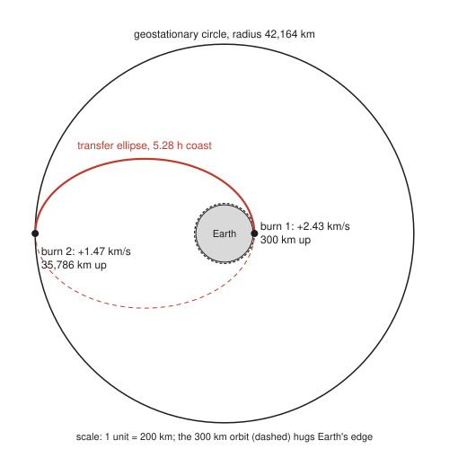
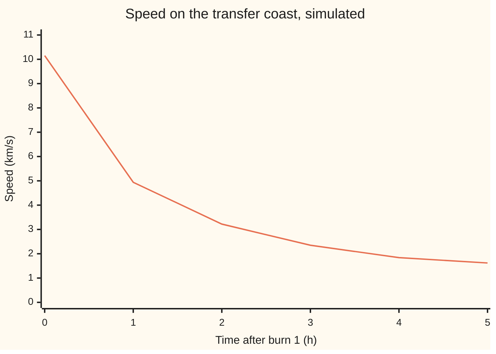

# Orbits: inverse-square gravity gives conic sections and Kepler's three laws

[Syllabus](../../../SYLLABUS.md) → [Engineering mathematics](../README.md) → [Mechanics and Structures](../README.md#s07) → Orbits

---

## General Overview

A weather satellite rides its rocket to a circular orbit 300 km up. It circles the Earth every 90.52 minutes at 7,725.76 m/s. Its job is 35,786 km up, in **geostationary orbit**: the one circle where a satellite goes round exactly once while the Earth turns once, so it hangs over one spot on the equator. Up there it moves at only 3,074.66 m/s.

The engineer wants two numbers: how much speed the satellite's motor must add, and when. The answer is two short burns, both *speeding it up*, 5.28 hours apart. Burn 1 adds 2,425.73 m/s and throws the satellite onto a long ellipse that coasts upward, slowing as it climbs. At the top, burn 2 adds 1,466.82 m/s and rounds the ellipse into the high circle. Total: **3,892.56 m/s**. That one number sizes the fuel tank.

The plan rests on one fact: gravity pulls toward the Earth's centre and weakens as one over the distance squared. So every free path is a **conic section** (circle, ellipse, parabola or hyperbola) with the Earth's centre at a focus. A focus is a fixed point inside the curve: for an ellipse, one of the two points whose distances to the curve always add to the same total. Kepler found three laws in planet data; Newton showed the inverse-square pull forces all three.

**Under an inverse-square pull toward one point, a body moves on a conic with that point at a focus, sweeps equal areas in equal times, and takes a time to go round that grows as the long half-axis to the power 1.5; so an orbit change is planned as a jump from one conic to another.**

**What kind of fact this is:** Kepler's three laws and the burn sizes are theorems, proved on this card in Why it works, *given* a model: two point masses, gravity only, burns that take no time. "When it holds" sizes what the model leaves out.

### The picture: the transfer, to scale

<p align="center"></p>

Drawn to scale, 1 unit = 200 km. The 300 km orbit is the dashed ring on Earth's edge: at this scale it sits 1.5 units out. The solid red half of the ellipse is the 5.28-hour coast; the dashed half is the path the satellite would follow if burn 2 never came.

---

## The formula

Notation first. Put the Earth's centre at the origin and describe the satellite in polar coordinates ([Polar coordinates](../../05-Geometry%20and%20trig/04-Coordinates%20and%20Curves/03-polar-coordinates.md)): distance $r$ from the centre and angle $\theta$ ("theta") measured from the orbit's lowest point. A dot over a letter means its rate of change in time $t$: $\dot\theta$ is how fast the angle turns, in radians per second. Gravity's strength is one constant, $\mu = GM$ ("mu"), the gravitational constant times the Earth's mass.

$$r = \frac{p}{1 + e\cos\theta}, \qquad r^2\dot\theta = h, \qquad T = 2\pi\sqrt{\frac{a^3}{\mu}}, \qquad v^2 = \mu\left(\frac{2}{r} - \frac{1}{a}\right)$$

**Read it aloud:** the orbit is a conic with the Earth at its focus; the distance squared times the turning rate never changes; the time round grows as the long half-axis to the power one and a half; and the speed at any point follows from the distance there and the orbit's size.

The two burns between circles of radius $r_1$ and $r_2$ use the last formula with the transfer ellipse's $a = (r_1 + r_2)/2$:

$$\Delta v_1 = \sqrt{\mu\left(\tfrac{2}{r_1} - \tfrac{1}{a}\right)} - \sqrt{\tfrac{\mu}{r_1}}, \qquad \Delta v_2 = \sqrt{\tfrac{\mu}{r_2}} - \sqrt{\mu\left(\tfrac{2}{r_2} - \tfrac{1}{a}\right)}$$

**Read it aloud:** each burn is the speed you need on the new orbit minus the speed you have on the old one, at the point where they touch.

| Symbol | Plain meaning | In our example | Push it up and the answer… |
| --- | --- | --- | --- |
| $\mu = GM$ | Earth's gravity strength: constant $G$ times Earth's mass $M$ (strictly $G(M + m)$, $m$ the satellite's mass) | 3.986004418 × 10¹⁴ m³/s² | every orbit speeds up; same orbit, shorter period |
| $r$, $\mathbf r$, $r_1$, $r_2$, $r_p$, $r_a$ | distance from Earth's centre, not height; $\mathbf r$ the arrow from Earth to satellite; the low and high circles; an ellipse's lowest and highest distances | 6,678.14 km; 42,164.17 km | circular speed falls |
| $\theta$, $t$ | angle from the lowest point; time | 0 at burn 1, 180° at burn 2 | — |
| $h$ | angular momentum per kilogram, $r^2\dot\theta$: the "turning amount" gravity cannot change | 67.7931 × 10⁹ m²/s on the transfer | wider orbit, more area per hour |
| $p$, $u$, $c$, $C$, $\theta_0$ | the conic's width parameter $h^2/\mu$; $u = 1/r$, used in the proof; $c = 1/p$, $C$ and $\theta_0$ the constants of the proof's general solution | 11,530.09 km | larger orbit |
| $e$ | eccentricity: how stretched the conic is (0 circle, below 1 ellipse, 1 parabola, above 1 hyperbola) | 0.7265 on the transfer | lowest point drops, highest rises |
| $a$, $b$ | long and short half-axes of the ellipse | 24,421.15 km; $b = \sqrt{r_1 r_2}$ on the transfer | longer period, less negative energy |
| $v$, $v_p$, $v_a$ | speed; speed at the lowest point (**perigee**) and highest (**apogee**) | 10,151.49 and 1,607.84 m/s | — |
| $T$ | period: time for one lap | 90.52 min low, 10.55 h transfer, 86,164.10 s high | — |
| $E$ | orbital energy per kilogram, $\tfrac12 v^2 - \mu/r$ | $-\mu/(2a)$ | orbit grows; at 0 it escapes |
| $\Delta v$ | "delta-v": speed added by a burn | 2,425.73 + 1,466.82 = 3,892.56 m/s | more fuel |
| $\omega_E$, $J_2$ | Earth's spin rate; its flattening term (how much the equator bulges) | 7.292115 × 10⁻⁵ rad/s; 1.0826359 × 10⁻³ | faster spin: lower geostationary circle; bigger bulge: orbit planes turn faster |

### When it holds

- **Point masses, gravity only.** The Earth is not a sphere: its equator bulges. That bulge, $J_2$, turns the plane of a 300 km orbit tilted 28.5° to the equator by **7.46° per day**, by the standard formula for this drift (Curtis, in Sources; not derived on this card).
- **Burns that take no time.** A chemical motor burns for minutes against a 5.28-hour coast, so the kick model fits. A gentle steady push of 0.02 m/s², chosen so the simulation runs in seconds, takes 2.68 days and spirals out; it needs **4,629.00 m/s**, not 3,892.56. Real electric thrusters push far more gently. Eutelsat 172B's all-electric climb to geostationary orbit took four months, which the European Space Agency (ESA) reported as the fastest of its kind. It started from a transfer ellipse, not from 300 km (ESA, in Sources). At such gentle pushes the cost tends to the spiral rule, $v_1 - v_2$ = 4,651.10 m/s. See What breaks.
- **One plane.** A launch from off the equator leaves the orbit tilted, and turning the plane costs extra speed not counted here.
- **Two bodies, no air.** At 300 km thin air slowly drags the orbit down; at geostationary height the Moon and Sun tug the orbit's tilt. Both are small over one transfer, large over years.

---

## Why it works

### Step 0: the pull points at one place, so two quantities never change

A force aimed at the centre cannot twist the satellite round it, so the turning amount $h$ stays fixed. Gravity depends only on distance, so energy stays fixed too. The inverse square then makes the path close on itself, as a conic.

### Step 1: two bodies become one

The Earth is pulled by the satellite as hard as the satellite by the Earth ([Newton's laws](01-newtons-laws-work-and-energy.md)). Subtract the two accelerations, and the satellite's position *relative to* Earth obeys

$$\ddot{\mathbf r} = -\frac{\mu}{r^3}\,\mathbf r, \qquad \mu = G(M + m) \approx GM.$$

Two dots mean acceleration. The arrow $\mathbf r$ points from Earth to satellite, length $r$; the minus sign aims the pull back at Earth, with size $\mu/r^2$.

### Step 2: equal areas in equal times (Kepler's second law)

In polar coordinates, acceleration has two parts: outward, $\ddot r - r\dot\theta^2$, and sideways, $\tfrac{1}{r}\tfrac{d}{dt}(r^2\dot\theta)$. Gravity has no sideways part, so $r^2\dot\theta$ does not change. Call it $h$.

In a short time $dt$ the line from Earth to satellite sweeps a thin triangle of area $\tfrac12 r \cdot r\,d\theta$. So area grows at $\tfrac12 r^2\dot\theta = h/2$, a constant. On the transfer, that is 122.03 × 10¹² m² every hour, low or high.

<details>
<summary>Detailed derivation: acceleration in polar coordinates</summary>

Write the position as $r(\cos\theta, \sin\theta)$. Call the outward unit arrow $\hat{\mathbf r} = (\cos\theta, \sin\theta)$ and the sideways one $\hat{\boldsymbol\theta} = (-\sin\theta, \cos\theta)$; turning the angle moves each into the other, $\dot{\hat{\mathbf r}} = \dot\theta\,\hat{\boldsymbol\theta}$ and $\dot{\hat{\boldsymbol\theta}} = -\dot\theta\,\hat{\mathbf r}$. (Here a hat means a unit arrow.) Differentiate $r\hat{\mathbf r}$ once: velocity $\dot r\,\hat{\mathbf r} + r\dot\theta\,\hat{\boldsymbol\theta}$. Again:

$$\ddot{\mathbf r} = (\ddot r - r\dot\theta^2)\,\hat{\mathbf r} + (2\dot r\dot\theta + r\ddot\theta)\,\hat{\boldsymbol\theta}.$$

The sideways bracket equals $\tfrac{1}{r}\tfrac{d}{dt}(r^2\dot\theta)$: expand the derivative and divide by $r$.

</details>

### Step 3: the path is a conic (Kepler's first law)

The outward part of Step 1 reads $\ddot r - r\dot\theta^2 = -\mu/r^2$. The trick is to stop timing the satellite by $t$ and time it by $\theta$ instead, and to work with $u = 1/r$. Because $\dot\theta = hu^2$, every time derivative turns into $hu^2$ times a $\theta$ derivative, and the equation becomes

$$\frac{d^2u}{d\theta^2} + u = \frac{\mu}{h^2}.$$

That is the equation of a spring pushed by a steady force. Its solutions are the steady part plus a cosine: $u = \tfrac{\mu}{h^2}(1 + e\cos\theta)$, where $e$ is set by the start and $\theta$ is counted from the lowest point. Flip back to $r$:

$$r = \frac{p}{1 + e\cos\theta}, \qquad p = \frac{h^2}{\mu}.$$

This is the polar equation of a conic with its focus at the origin. For $e$ below 1 the bottom line never reaches zero, so $r$ stays finite: the orbit is an ellipse. Its lowest and highest distances are $p/(1+e)$ and $p/(1-e)$, so its long half-axis is $a = p/(1 - e^2)$ and its focus sits $ae$ from the centre, as on [Ellipses and hyperbolas](../../05-Geometry%20and%20trig/04-Coordinates%20and%20Curves/05-ellipses-and-hyperbolas.md).

For the transfer, $p$ = 11,530.09 km and $e$ = 0.7265 give 6,678.14 km at the bottom and 42,164.17 km at the top.

<details>
<summary>Detailed derivation: the orbit equation in u and θ</summary>

By the chain rule, $\dot r = \frac{d}{dt}\frac1u = -\frac{1}{u^2}\frac{du}{d\theta}\dot\theta = -h\frac{du}{d\theta}$, using $\dot\theta = hu^2$. Again: $\ddot r = -h\frac{d^2u}{d\theta^2}\dot\theta = -h^2u^2\frac{d^2u}{d\theta^2}$. And $r\dot\theta^2 = \frac1u h^2u^4 = h^2u^3$. Substitute in $\ddot r - r\dot\theta^2 = -\mu u^2$ and divide by $-h^2u^2$. The general solution of $u'' + u = c$ (each prime is one derivative in $\theta$) is $c + C\cos(\theta - \theta_0)$; measuring $\theta$ from the lowest point sets $\theta_0 = 0$, and $e = Ch^2/\mu$.

</details>

### Step 4: energy fixes the size, and gives the speed anywhere

Energy per kilogram is $E = \tfrac12 v^2 - \mu/r$: motion minus the depth of the gravity well. At the lowest and highest points the satellite moves square to the radius, so $v = h/r$ there and

$$E = \frac{h^2}{2r^2} - \frac{\mu}{r} \quad\Longleftrightarrow\quad E r^2 + \mu r - \tfrac12 h^2 = 0.$$

Both turning distances solve this one quadratic. The two roots of a quadratic add to minus the middle number over the first, so $r_p + r_a = -\mu/E$. That sum is $2a$, so

$$E = -\frac{\mu}{2a}.$$

Energy depends only on the long half-axis. Put that in $E = \tfrac12 v^2 - \mu/r$ and solve for speed: $v^2 = \mu(2/r - 1/a)$. Engineers call it the **vis-viva** equation, Latin for "living force", the old name for kinetic energy.

### Step 5: the period (Kepler's third law)

The ellipse has area $\pi ab$, with short half-axis $b = a\sqrt{1 - e^2}$. Area grows at $h/2$, and from Step 3 $h = \sqrt{\mu p} = \sqrt{\mu a(1 - e^2)}$. Divide:

$$T = \frac{\pi ab}{h/2} = \frac{2\pi a^2\sqrt{1-e^2}}{\sqrt{\mu a(1-e^2)}} = 2\pi\sqrt{\frac{a^3}{\mu}}.$$

The stretch $e$ cancels. Only the long half-axis sets the period. Run it backwards for the geostationary circle: set $T$ to one turn of the Earth, $2\pi/\omega_E$ = 86,164.10 s, and solve for $a$. Out comes 42,164.17 km.

### Step 6: the two-burn plan

Pick the ellipse that touches the low circle at its bottom and the high circle at its top. At both points old and new paths run the same way, so a burn along the direction of travel wastes nothing on turning.

Its long axis is $r_1 + r_2$, so $a$ = 24,421.15 km. Vis-viva gives its speeds at the two ends, 10,151.49 and 1,607.84 m/s; the circles' speeds are $\sqrt{\mu/r}$. The burns are the differences. The coast is half the ellipse's period, 5.275 hours.

Among all two-burn routes between two circles, whatever their sizes, this ellipse, the **Hohmann transfer**, is the cheapest; this card states that without proof (Curtis, in Sources, treats it). A three-burn route first climbs far above the high circle, then drops back to it. It beats two burns only when the high circle's radius is more than 11.94 times the low one's. Here it is 6.31 times, so two burns win.

---

## Worked numbers, by hand

| Step | Arithmetic | Value |
| --- | --- | --- |
| low radius $r_1$ | 6,378.14 + 300 | 6,678.14 km |
| high radius $r_2$, from Kepler III | $(\mu T^2/4\pi^2)^{1/3}$ with $T$ = 86,164.10 s | 42,164.17 km |
| low circle speed | $\sqrt{3.986 \times 10^{14} / 6.678 \times 10^6}$ | 7,725.76 m/s |
| high circle speed | $\sqrt{3.986 \times 10^{14} / 4.216 \times 10^7}$ | 3,074.66 m/s |
| transfer $a$ | (6,678.14 + 42,164.17) ÷ 2 | 24,421.15 km |
| speed at perigee, vis-viva | $\sqrt{\mu(2/r_1 - 1/a)}$ | 10,151.49 m/s |
| speed at apogee | $10{,}151.49 \times 6{,}678.14 / 42{,}164.17$ (same $h$) | 1,607.84 m/s |
| burn 1 | 10,151.49 − 7,725.76 | 2,425.73 m/s |
| burn 2 | 3,074.66 − 1,607.84 | 1,466.82 m/s |
| **total** | 2,425.73 + 1,466.82 | **3,892.56 m/s** |
| coast | half of $2\pi\sqrt{a^3/\mu}$ | 5.275 h |

The motors must supply 3,892.56 m/s of speed change, in two burns 5.28 hours apart.

### What breaks if you drop a piece

| Mistake | Comes out at | What went wrong |
| --- | --- | --- |
| Height 300 km used as $r$ in $\sqrt{\mu/r}$ | 36,450.90 m/s | $r$ is from Earth's centre. That speed would leave Earth for good. |
| A 24-hour (86,400 s) day in Kepler III | radius 42,241.10 km; drifts west 0.986° a day | Earth turns once in 86,164.10 s against the stars: the sidereal day. The 24-hour day adds a little extra turn to face the Sun again. |
| Braking by 7,725.76 − 3,074.66 because the high orbit is slower | lowest point 574.34 km from Earth's centre | That is deep inside the Earth. Speed buys height; slowing drops the satellite. |
| Skipping burn 2 | swings between 300 and 35,786 km every 10.55 h | Without the second kick the satellite stays on the ellipse and falls back. |
| A slow steady push treated as two kicks (model failure) | needs 4,629.00 m/s, not 3,892.56 | Pushing for days, the satellite spirals and keeps nearly circular. It loses the benefit of burning at the bottom and top. The rule for a slow spiral is $v_1 - v_2$ = 4,651.10 m/s. |

---

## The coast, hour by hour

The puzzle: the satellite slows from 10.15 km/s to 1.61 km/s on the way up, with no motor running. Gravity is the brake, trading speed for height as for a ball thrown upward. What it cannot change is $h$, so as $r$ grows the sideways speed must shrink.

| Time after burn 1 | Height | Speed | Area swept in that hour | Distance flown in that hour |
| --- | --- | --- | --- | --- |
| 0 h | 300 km | 10.15 km/s | — | — |
| 1 h | 13,204 km | 4.94 km/s | 122.03 × 10¹² m² | 25,937 km |
| 2 h | 23,486 km | 3.22 km/s | 122.03 × 10¹² m² | 14,252 km |
| 3 h | 30,115 km | 2.35 km/s | 122.03 × 10¹² m² | 9,886 km |
| 4 h | 34,051 km | 1.84 km/s | 122.03 × 10¹² m² | 7,460 km |
| 5 h | 35,706 km | 1.62 km/s | 122.03 × 10¹² m² | 6,147 km |
| 5.28 h, apogee | 35,786 km | 1.61 km/s | — | — |

The same hours, side by side. Distance flown falls by a factor of four; area swept does not move.

```
area swept each hour (10^12 m^2)            distance flown each hour (km)
hour 1  ████████████████████  122.03        ████████████████████  25937
hour 2  ████████████████████  122.03        ███████████           14252
hour 3  ████████████████████  122.03        ████████               9886
hour 4  ████████████████████  122.03        ██████                 7460
hour 5  ████████████████████  122.03        █████                  6147
```



Orange: the satellite's speed from the simulation in the code, at whole hours. Most of the speed is gone in the first hour, where gravity is strongest; the final stretch from 5 h to apogee, in the table above, shaves off almost nothing.

---

## Code, from first principles, and it actually runs

The script sizes the transfer by **three roads**.

- Road 1 is the formulas above. It also finds, by bisection (halving the search range again and again), the size ratio of the two circles above which a three-burn route would beat the two burns.
- Road 2 never uses them: it starts the satellite at the low circle with burn 1 added and steps Newton's law $\ddot{\mathbf r} = -\mu\mathbf r/r^3$ forward one second at a time by fourth-order Runge–Kutta ([Runge-Kutta four](../../08-Differential%20equations%20and%20dynamics/05-Numerical%20Evolution/04-runge-kutta-four.md)). It stops where the satellite stops climbing and reads off the radius, the speed and the time. On the way it checks every point against the conic. It also adds up the area swept and the distance flown each hour; the distance uses the trapezoid rule, averaging the speeds at the two ends of each second. Then it adds burn 2 and times one lap.
- Road 3 pushes gently from the low circle until the energy reaches the high circle's.

Constants are from the IERS Conventions (2010), the reference values published by the International Earth Rotation and Reference Systems Service (IERS).

### Python

```python
# Orbits and the Kepler problem -- the check behind the card.  Standard library only.
# A satellite in a 300 km circular orbit is raised to geostationary by two burns.
# Road 1: the conic-orbit formulas (Kepler's three laws, vis-viva).
# Road 2: Newton's inverse-square law stepped forward in time by RK4, burn by burn.
# Road 3 (the slow spiral): the same integrator with a small steady push.
from math import sqrt, pi, atan2, cos, radians, degrees

MU = 3.986004418e14      # GM of Earth, m^3/s^2      (IERS Conventions 2010, Table 1.1)
RE = 6378136.6           # equatorial radius, m      (Table 1.1)
J2 = 1.0826359e-3        # Earth's flattening term   (Table 1.1)
OMEGA = 7.292115e-5      # Earth's spin, rad/s       (Table 1.2)

def vis_viva(r, a): return sqrt(MU * (2 / r - 1 / a))
def kepler_r(T): return (MU * T * T / (4 * pi * pi)) ** (1 / 3)    # Kepler III, solved for a
def period(a): return 2 * pi * sqrt(a ** 3 / MU)
def hohmann(r1, r2):
    at = (r1 + r2) / 2
    return vis_viva(r1, at) - sqrt(MU / r1), sqrt(MU / r2) - vis_viva(r2, at)

# ---- road 1: the formulas ----
Tday = 2 * pi / OMEGA
r1, r2 = RE + 300e3, kepler_r(Tday)
v1, v2 = sqrt(MU / r1), sqrt(MU / r2)
at, et = (r1 + r2) / 2, (r2 - r1) / (r2 + r1)
vp, va = vis_viva(r1, at), vis_viva(r2, at)
dv1, dv2 = hohmann(r1, r2)
h = r1 * vp                      # angular momentum per kg, m^2/s
p = h * h / MU                   # the conic's width parameter, m
def three_burn_best(r1, r2):     # three burns via an endless ellipse: (sqrt 2 - 1)(v1 + v2)
    return (sqrt(2) - 1) * (sqrt(MU / r1) + sqrt(MU / r2))
lo, hi = 2.0, 50.0               # the size ratio r2/r1 where three burns start to beat two
for _ in range(60):
    mid = (lo + hi) / 2
    lo, hi = (mid, hi) if sum(hohmann(r1, mid * r1)) < three_burn_best(r1, mid * r1) else (lo, mid)

# ---- road 2: integrate Newton's law, x'' = -MU x / r^3 (+ a push along the velocity) ----
def deriv(s, push):
    x, y, vx, vy = s
    r3, v = (x * x + y * y) ** 1.5, sqrt(vx * vx + vy * vy)
    return (vx, vy, -MU * x / r3 + push * vx / v, -MU * y / r3 + push * vy / v)
def rk4(s, dt, push=0.0):
    k1 = deriv(s, push)
    k2 = deriv([a + dt / 2 * b for a, b in zip(s, k1)], push)
    k3 = deriv([a + dt / 2 * b for a, b in zip(s, k2)], push)
    k4 = deriv([a + dt * b for a, b in zip(s, k3)], push)
    return [a + dt / 6 * (b + 2 * c + 2 * d + e) for a, b, c, d, e in zip(s, k1, k2, k3, k4)]
def rad(s): return sqrt(s[0] ** 2 + s[1] ** 2)
def spd(s): return sqrt(s[2] ** 2 + s[3] ** 2)

s, t, dt, conic_err, area, dist, hours = [r1, 0.0, 0.0, vp], 0.0, 1.0, 0.0, 0.0, 0.0, []
while True:                                          # coast from burn 1 until r stops growing
    n = rk4(s, dt)
    if n[0] * n[2] + n[1] * n[3] < 0:                # radial speed turned negative: apogee passed
        a0, b0 = s[0] * s[2] + s[1] * s[3], n[0] * n[2] + n[1] * n[3]
        frac = a0 / (a0 - b0)
        s, t = rk4(s, frac * dt), t + frac * dt
        break
    area += 0.5 * (s[0] * s[3] - s[1] * s[2]) * dt; dist += (spd(s) + spd(n)) / 2 * dt
    s, t = n, t + dt
    conic_err = max(conic_err, abs(rad(s) - p / (1 + et * cos(atan2(s[1], s[0])))))
    if round(t) % 3600 == 0:
        hours.append((t, rad(s), spd(s), area, dist)); area, dist = 0.0, 0.0
ap_r, ap_v, t_coast = rad(s), spd(s), t

s = [s[0], s[1], s[2] * (ap_v + dv2) / ap_v, s[3] * (ap_v + dv2) / ap_v]   # burn 2
ang, last, rmin, rmax, t, dt = 0.0, atan2(s[1], s[0]), 1e99, 0.0, 0.0, 10.0
while ang < 2 * pi:                                  # one lap of the new orbit
    s, t = rk4(s, dt), t + dt
    a = atan2(s[1], s[0]); d = a - last
    ang += d + 2 * pi if d < -pi else d; last = a
    rmin, rmax = min(rmin, rad(s)), max(rmax, rad(s))
geo_T = t - (ang - 2 * pi) / (sqrt(MU / rad(s)) / rad(s))

def spiral(push, dt=10.0):                           # road 3: gentle push, start in the low circle
    s, t = [r1, 0.0, 0.0, v1], 0.0
    while spd(s) ** 2 / 2 - MU / rad(s) < -MU / (2 * r2):
        s, t = rk4(s, dt, push), t + dt
    return push * t, t
sp_dv, sp_t = spiral(0.02)
sp2_dv, _ = spiral(0.2, 1.0)

def out(label, val, unit, d=2): print(f"{label:<44}{val:>12.{d}f} {unit}")
out("sidereal day, 2 pi / omega", Tday, "s")
out("r1, 300 km orbit", r1 / 1e3, "km"); out("r2, geostationary (Kepler III)", r2 / 1e3, "km")
out("r2 altitude", (r2 - RE) / 1e3, "km")
out("v1, circular speed low", v1, "m/s"); out("v2, circular speed high", v2, "m/s")
out("low orbit period", period(r1) / 60, "min")
out("transfer a", at / 1e3, "km"); out("transfer e", et, "-", 4)
out("h = r1 vp", h / 1e9, "1e9 m^2/s", 4); out("p = h^2/MU", p / 1e3, "km")
out("1 formula  vp, perigee speed (vis-viva)", vp, "m/s")
out("1 formula  va, apogee speed (vis-viva)", va, "m/s")
out("1 formula  burn 1", dv1, "m/s"); out("1 formula  burn 2", dv2, "m/s")
out("1 formula  total", dv1 + dv2, "m/s"); out("1 formula  coast, half a period", period(at) / 2 / 3600, "h", 3)
out("r2 / r1, size ratio of the two circles", r2 / r1, "-")
out("  three burns can win only above ratio", lo, "-")
out("2 simulate apogee radius", ap_r / 1e3, "km"); out("2 simulate apogee speed", ap_v, "m/s")
out("2 simulate coast time", t_coast / 3600, "h", 3)
out("2 simulate worst gap from the conic", conic_err, "m", 4)
out("2 simulate after burn 2, r wanders by", rmax - rmin, "m")
out("2 simulate lap time after burn 2", geo_T, "s")
for t, r, v, A, D in hours:
    print(f"coast,{t / 3600:.0f} h,alt {(r - RE) / 1e3:.0f} km,speed {v / 1e3:.2f} km/s,"
          f"area {A / 1e12:.2f} 1e12 m^2,distance {D / 1e3:.0f} km")
print(f"coast,{t_coast / 3600:.2f} h,alt {(ap_r - RE) / 1e3:.0f} km,speed {ap_v / 1e3:.2f} km/s")
out("area per hour, h x 3600 / 2", h * 1800 / 1e12, "1e12 m^2")
out("3 spiral, push 0.02 m/s^2: speed gained", sp_dv, "m/s"); out("3 spiral time", sp_t / 86400, "days")
out("  spiral rule v1 - v2", v1 - v2, "m/s"); out("  spiral, push 0.2 m/s^2", sp2_dv, "m/s")
out("J2 drift of the orbit plane, 28.5 deg", degrees(1.5 * 2 * pi / period(r1) * J2 * (RE / r1) ** 2 * cos(radians(28.5))) * 86400, "deg/day")
out("wrong: altitude as r in sqrt(MU/r)", sqrt(MU / 300e3), "m/s")
rw = kepler_r(86400.0)
out("wrong: 86400 s day, radius", rw / 1e3, "km"); out("  drift west", 360 * (86400 / Tday - 1), "deg/day", 3)
ab = -MU / (2 * ((v1 - (v1 - v2)) ** 2 / 2 - MU / r1))
out("wrong: brake by v1 - v2, lowest r", (2 * ab - r1) / 1e3, "km")
out("wrong: skip burn 2, period", period(at) / 3600, "h")
d5, g = hohmann(RE + 500e3, r2), hohmann(r1, kepler_r(Tday / 2))
out("try: 500 km start, total", d5[0] + d5[1], "m/s"); out("try: to GPS height, radius", kepler_r(Tday / 2) / 1e3, "km")
out("try: to GPS height, total", g[0] + g[1], "m/s")
print(f"figure,scale 200 km/unit,earth {RE / 2e5:.2f},low {r1 / 2e5:.2f},geo {r2 / 2e5:.2f},"
      f"ellipse centre {(r1 - r2) / 4e5:.2f},a {at / 2e5:.2f},b {sqrt(r1 * r2) / 2e5:.2f}")

assert abs(ap_r - r2) < 50                     # simulated apogee lands on the GEO radius
assert abs(ap_v - va) < 0.01                   # simulated apogee speed = vis-viva
assert abs(t_coast - period(at) / 2) < 0.5     # coast time = Kepler III half period
assert conic_err < 1.0                         # the path is r = p / (1 + e cos theta)
assert abs(geo_T - Tday) < 30                  # after burn 2, one lap per sidereal day
assert rmax - rmin < 200                       # ... and the orbit is a circle
assert all(abs(A - h * 1800) / (h * 1800) < 1e-6 for _, _, _, A, _ in hours)  # equal areas
assert abs(sp_dv - (v1 - v2)) / (v1 - v2) < 0.01                             # spiral rule
assert r2 / r1 < lo and sum(hohmann(r1, r2)) < three_burn_best(r1, r2)       # two burns win here
print("ALL CHECKS PASS")
```

**Ran 2026-11-11 on macOS, Python 3.14.10, standard library only. All checks passed. Output, pasted from the run:**

```
sidereal day, 2 pi / omega                      86164.10 s
r1, 300 km orbit                                 6678.14 km
r2, geostationary (Kepler III)                  42164.17 km
r2 altitude                                     35786.04 km
v1, circular speed low                           7725.76 m/s
v2, circular speed high                          3074.66 m/s
low orbit period                                   90.52 min
transfer a                                      24421.15 km
transfer e                                        0.7265 -
h = r1 vp                                        67.7931 1e9 m^2/s
p = h^2/MU                                      11530.09 km
1 formula  vp, perigee speed (vis-viva)         10151.49 m/s
1 formula  va, apogee speed (vis-viva)           1607.84 m/s
1 formula  burn 1                                2425.73 m/s
1 formula  burn 2                                1466.82 m/s
1 formula  total                                 3892.56 m/s
1 formula  coast, half a period                    5.275 h
r2 / r1, size ratio of the two circles              6.31 -
  three burns can win only above ratio             11.94 -
2 simulate apogee radius                        42164.17 km
2 simulate apogee speed                          1607.84 m/s
2 simulate coast time                              5.275 h
2 simulate worst gap from the conic               0.0000 m
2 simulate after burn 2, r wanders by               0.00 m
2 simulate lap time after burn 2                86164.10 s
coast,1 h,alt 13204 km,speed 4.94 km/s,area 122.03 1e12 m^2,distance 25937 km
coast,2 h,alt 23486 km,speed 3.22 km/s,area 122.03 1e12 m^2,distance 14252 km
coast,3 h,alt 30115 km,speed 2.35 km/s,area 122.03 1e12 m^2,distance 9886 km
coast,4 h,alt 34051 km,speed 1.84 km/s,area 122.03 1e12 m^2,distance 7460 km
coast,5 h,alt 35706 km,speed 1.62 km/s,area 122.03 1e12 m^2,distance 6147 km
coast,5.28 h,alt 35786 km,speed 1.61 km/s
area per hour, h x 3600 / 2                       122.03 1e12 m^2
3 spiral, push 0.02 m/s^2: speed gained          4629.00 m/s
3 spiral time                                       2.68 days
  spiral rule v1 - v2                            4651.10 m/s
  spiral, push 0.2 m/s^2                         4258.00 m/s
J2 drift of the orbit plane, 28.5 deg               7.46 deg/day
wrong: altitude as r in sqrt(MU/r)              36450.90 m/s
wrong: 86400 s day, radius                      42241.10 km
  drift west                                       0.986 deg/day
wrong: brake by v1 - v2, lowest r                 574.34 km
wrong: skip burn 2, period                         10.55 h
try: 500 km start, total                         3816.04 m/s
try: to GPS height, radius                      26561.76 km
try: to GPS height, total                        3459.35 m/s
figure,scale 200 km/unit,earth 31.89,low 33.39,geo 210.82,ellipse centre -88.72,a 122.11,b 83.90
ALL CHECKS PASS
```

### Rust

```rust
// Orbits and the Kepler problem -- the check behind the card.  std only, no crates.
// A satellite in a 300 km circular orbit is raised to geostationary by two burns.
// Road 1: the conic-orbit formulas (Kepler's three laws, vis-viva).
// Road 2: Newton's inverse-square law stepped forward in time by RK4, burn by burn.
// Road 3 (the slow spiral): the same integrator with a small steady push.
use std::f64::consts::PI;

const MU: f64 = 3.986004418e14; // GM of Earth, m^3/s^2      (IERS Conventions 2010, Table 1.1)
const RE: f64 = 6378136.6; //      equatorial radius, m      (Table 1.1)
const J2: f64 = 1.0826359e-3; //   Earth's flattening term   (Table 1.1)
const OMEGA: f64 = 7.292115e-5; // Earth's spin, rad/s       (Table 1.2)
type S = [f64; 4];

fn vis_viva(r: f64, a: f64) -> f64 { (MU * (2.0 / r - 1.0 / a)).sqrt() }
fn kepler_r(t: f64) -> f64 { (MU * t * t / (4.0 * PI * PI)).powf(1.0 / 3.0) } // Kepler III
fn period(a: f64) -> f64 { 2.0 * PI * (a.powf(3.0) / MU).sqrt() }
fn hohmann(r1: f64, r2: f64) -> (f64, f64) {
    let at = (r1 + r2) / 2.0;
    (vis_viva(r1, at) - (MU / r1).sqrt(), (MU / r2).sqrt() - vis_viva(r2, at))
}
fn deriv(s: &S, push: f64) -> S {
    let (x, y, vx, vy) = (s[0], s[1], s[2], s[3]);
    let r3 = (x * x + y * y).powf(1.5);
    let v = (vx * vx + vy * vy).sqrt();
    [vx, vy, -MU * x / r3 + push * vx / v, -MU * y / r3 + push * vy / v]
}
fn step(s: &S, k: &S, f: f64) -> S { [s[0] + f * k[0], s[1] + f * k[1], s[2] + f * k[2], s[3] + f * k[3]] }
fn rk4(s: &S, dt: f64, push: f64) -> S {
    let k1 = deriv(s, push);
    let k2 = deriv(&step(s, &k1, dt / 2.0), push);
    let k3 = deriv(&step(s, &k2, dt / 2.0), push);
    let k4 = deriv(&step(s, &k3, dt), push);
    let mut o = [0.0; 4];
    for i in 0..4 { o[i] = s[i] + dt / 6.0 * (k1[i] + 2.0 * k2[i] + 2.0 * k3[i] + k4[i]); }
    o
}
fn rad(s: &S) -> f64 { (s[0].powf(2.0) + s[1].powf(2.0)).sqrt() }
fn spd(s: &S) -> f64 { (s[2].powf(2.0) + s[3].powf(2.0)).sqrt() }
fn out(label: &str, val: f64, unit: &str, d: usize) { println!("{:<44}{:>12.*} {}", label, d, val, unit); }

fn main() {
    // ---- road 1: the formulas ----
    let tday = 2.0 * PI / OMEGA;
    let (r1, r2) = (RE + 300e3, kepler_r(tday));
    let (v1, v2) = ((MU / r1).sqrt(), (MU / r2).sqrt());
    let (at, et) = ((r1 + r2) / 2.0, (r2 - r1) / (r2 + r1));
    let (vp, va) = (vis_viva(r1, at), vis_viva(r2, at));
    let (dv1, dv2) = hohmann(r1, r2);
    let h = r1 * vp;
    let p = h * h / MU;
    let three_burn_best = |a: f64, b: f64| (2f64.sqrt() - 1.0) * ((MU / a).sqrt() + (MU / b).sqrt());
    let (mut lo, mut hi) = (2.0f64, 50.0f64); // the size ratio r2/r1 where three burns start to beat two
    for _ in 0..60 {
        let (mid, d) = ((lo + hi) / 2.0, hohmann(r1, (lo + hi) / 2.0 * r1));
        if d.0 + d.1 < three_burn_best(r1, mid * r1) { lo = mid } else { hi = mid }
    }

    // ---- road 2: integrate Newton's law from burn 1 until r stops growing ----
    let mut s: S = [r1, 0.0, 0.0, vp];
    let (mut t, dt, mut conic_err, mut area, mut dist) = (0.0f64, 1.0f64, 0.0f64, 0.0f64, 0.0f64);
    let mut hours: Vec<(f64, f64, f64, f64, f64)> = Vec::new();
    loop {
        let n = rk4(&s, dt, 0.0);
        if n[0] * n[2] + n[1] * n[3] < 0.0 {
            let (a0, b0) = (s[0] * s[2] + s[1] * s[3], n[0] * n[2] + n[1] * n[3]);
            let frac = a0 / (a0 - b0);
            s = rk4(&s, frac * dt, 0.0);
            t += frac * dt;
            break;
        }
        area += 0.5 * (s[0] * s[3] - s[1] * s[2]) * dt;
        dist += (spd(&s) + spd(&n)) / 2.0 * dt;
        s = n;
        t += dt;
        conic_err = conic_err.max((rad(&s) - p / (1.0 + et * s[1].atan2(s[0]).cos())).abs());
        if (t.round() as i64) % 3600 == 0 {
            hours.push((t, rad(&s), spd(&s), area, dist));
            area = 0.0;
            dist = 0.0;
        }
    }
    let (ap_r, ap_v, t_coast) = (rad(&s), spd(&s), t);

    let k = (ap_v + dv2) / ap_v; // burn 2
    s = [s[0], s[1], s[2] * k, s[3] * k];
    let (mut ang, mut last, mut rmin, mut rmax) = (0.0f64, s[1].atan2(s[0]), 1e99f64, 0.0f64);
    let (mut t, dt) = (0.0f64, 10.0f64);
    while ang < 2.0 * PI {
        s = rk4(&s, dt, 0.0);
        t += dt;
        let a = s[1].atan2(s[0]);
        let d = a - last;
        ang += if d < -PI { d + 2.0 * PI } else { d };
        last = a;
        rmin = rmin.min(rad(&s));
        rmax = rmax.max(rad(&s));
    }
    let geo_t = t - (ang - 2.0 * PI) / ((MU / rad(&s)).sqrt() / rad(&s));

    let spiral = |push: f64, dt: f64| -> (f64, f64) {
        let (mut s, mut t): (S, f64) = ([r1, 0.0, 0.0, v1], 0.0);
        while spd(&s).powf(2.0) / 2.0 - MU / rad(&s) < -MU / (2.0 * r2) {
            s = rk4(&s, dt, push);
            t += dt;
        }
        (push * t, t)
    };
    let (sp_dv, sp_t) = spiral(0.02, 10.0);
    let (sp2_dv, _) = spiral(0.2, 1.0);

    out("sidereal day, 2 pi / omega", tday, "s", 2);
    out("r1, 300 km orbit", r1 / 1e3, "km", 2); out("r2, geostationary (Kepler III)", r2 / 1e3, "km", 2);
    out("r2 altitude", (r2 - RE) / 1e3, "km", 2);
    out("v1, circular speed low", v1, "m/s", 2); out("v2, circular speed high", v2, "m/s", 2);
    out("low orbit period", period(r1) / 60.0, "min", 2);
    out("transfer a", at / 1e3, "km", 2); out("transfer e", et, "-", 4);
    out("h = r1 vp", h / 1e9, "1e9 m^2/s", 4); out("p = h^2/MU", p / 1e3, "km", 2);
    out("1 formula  vp, perigee speed (vis-viva)", vp, "m/s", 2);
    out("1 formula  va, apogee speed (vis-viva)", va, "m/s", 2);
    out("1 formula  burn 1", dv1, "m/s", 2); out("1 formula  burn 2", dv2, "m/s", 2);
    out("1 formula  total", dv1 + dv2, "m/s", 2); out("1 formula  coast, half a period", period(at) / 2.0 / 3600.0, "h", 3);
    out("r2 / r1, size ratio of the two circles", r2 / r1, "-", 2);
    out("  three burns can win only above ratio", lo, "-", 2);
    out("2 simulate apogee radius", ap_r / 1e3, "km", 2); out("2 simulate apogee speed", ap_v, "m/s", 2);
    out("2 simulate coast time", t_coast / 3600.0, "h", 3);
    out("2 simulate worst gap from the conic", conic_err, "m", 4);
    out("2 simulate after burn 2, r wanders by", rmax - rmin, "m", 2);
    out("2 simulate lap time after burn 2", geo_t, "s", 2);
    for &(t, r, v, a, d) in &hours {
        println!("coast,{:.0} h,alt {:.0} km,speed {:.2} km/s,area {:.2} 1e12 m^2,distance {:.0} km",
                 t / 3600.0, (r - RE) / 1e3, v / 1e3, a / 1e12, d / 1e3);
    }
    println!("coast,{:.2} h,alt {:.0} km,speed {:.2} km/s", t_coast / 3600.0, (ap_r - RE) / 1e3, ap_v / 1e3);
    out("area per hour, h x 3600 / 2", h * 1800.0 / 1e12, "1e12 m^2", 2);
    out("3 spiral, push 0.02 m/s^2: speed gained", sp_dv, "m/s", 2); out("3 spiral time", sp_t / 86400.0, "days", 2);
    out("  spiral rule v1 - v2", v1 - v2, "m/s", 2); out("  spiral, push 0.2 m/s^2", sp2_dv, "m/s", 2);
    let node = (1.5 * 2.0 * PI / period(r1) * J2 * (RE / r1).powf(2.0) * 28.5f64.to_radians().cos()).to_degrees() * 86400.0;
    out("J2 drift of the orbit plane, 28.5 deg", node, "deg/day", 2);
    out("wrong: altitude as r in sqrt(MU/r)", (MU / 300e3).sqrt(), "m/s", 2);
    let rw = kepler_r(86400.0);
    out("wrong: 86400 s day, radius", rw / 1e3, "km", 2); out("  drift west", 360.0 * (86400.0 / tday - 1.0), "deg/day", 3);
    let ab = -MU / (2.0 * ((v1 - (v1 - v2)).powf(2.0) / 2.0 - MU / r1));
    out("wrong: brake by v1 - v2, lowest r", (2.0 * ab - r1) / 1e3, "km", 2);
    out("wrong: skip burn 2, period", period(at) / 3600.0, "h", 2);
    let (d5, g) = (hohmann(RE + 500e3, r2), hohmann(r1, kepler_r(tday / 2.0)));
    out("try: 500 km start, total", d5.0 + d5.1, "m/s", 2); out("try: to GPS height, radius", kepler_r(tday / 2.0) / 1e3, "km", 2);
    out("try: to GPS height, total", g.0 + g.1, "m/s", 2);
    println!("figure,scale 200 km/unit,earth {:.2},low {:.2},geo {:.2},ellipse centre {:.2},a {:.2},b {:.2}",
             RE / 2e5, r1 / 2e5, r2 / 2e5, (r1 - r2) / 4e5, at / 2e5, (r1 * r2).sqrt() / 2e5);

    assert!((ap_r - r2).abs() < 50.0); //                simulated apogee lands on the GEO radius
    assert!((ap_v - va).abs() < 0.01); //                simulated apogee speed = vis-viva
    assert!((t_coast - period(at) / 2.0).abs() < 0.5); // coast time = Kepler III half period
    assert!(conic_err < 1.0); //                         the path is r = p / (1 + e cos theta)
    assert!((geo_t - tday).abs() < 30.0); //             after burn 2, one lap per sidereal day
    assert!(rmax - rmin < 200.0); //                     ... and the orbit is a circle
    assert!(hours.iter().all(|x| (x.3 - h * 1800.0).abs() / (h * 1800.0) < 1e-6)); // equal areas
    assert!((sp_dv - (v1 - v2)).abs() / (v1 - v2) < 0.01); //                        spiral rule
    assert!(r2 / r1 < lo && dv1 + dv2 < three_burn_best(r1, r2)); //                   two burns win here
    println!("ALL CHECKS PASS");
}
```

**Ran 2026-11-11 on macOS, rustc 1.98.1, no crates. All checks passed. Output, pasted from the run:**

```
sidereal day, 2 pi / omega                      86164.10 s
r1, 300 km orbit                                 6678.14 km
r2, geostationary (Kepler III)                  42164.17 km
r2 altitude                                     35786.04 km
v1, circular speed low                           7725.76 m/s
v2, circular speed high                          3074.66 m/s
low orbit period                                   90.52 min
transfer a                                      24421.15 km
transfer e                                        0.7265 -
h = r1 vp                                        67.7931 1e9 m^2/s
p = h^2/MU                                      11530.09 km
1 formula  vp, perigee speed (vis-viva)         10151.49 m/s
1 formula  va, apogee speed (vis-viva)           1607.84 m/s
1 formula  burn 1                                2425.73 m/s
1 formula  burn 2                                1466.82 m/s
1 formula  total                                 3892.56 m/s
1 formula  coast, half a period                    5.275 h
r2 / r1, size ratio of the two circles              6.31 -
  three burns can win only above ratio             11.94 -
2 simulate apogee radius                        42164.17 km
2 simulate apogee speed                          1607.84 m/s
2 simulate coast time                              5.275 h
2 simulate worst gap from the conic               0.0000 m
2 simulate after burn 2, r wanders by               0.00 m
2 simulate lap time after burn 2                86164.10 s
coast,1 h,alt 13204 km,speed 4.94 km/s,area 122.03 1e12 m^2,distance 25937 km
coast,2 h,alt 23486 km,speed 3.22 km/s,area 122.03 1e12 m^2,distance 14252 km
coast,3 h,alt 30115 km,speed 2.35 km/s,area 122.03 1e12 m^2,distance 9886 km
coast,4 h,alt 34051 km,speed 1.84 km/s,area 122.03 1e12 m^2,distance 7460 km
coast,5 h,alt 35706 km,speed 1.62 km/s,area 122.03 1e12 m^2,distance 6147 km
coast,5.28 h,alt 35786 km,speed 1.61 km/s
area per hour, h x 3600 / 2                       122.03 1e12 m^2
3 spiral, push 0.02 m/s^2: speed gained          4629.00 m/s
3 spiral time                                       2.68 days
  spiral rule v1 - v2                            4651.10 m/s
  spiral, push 0.2 m/s^2                         4258.00 m/s
J2 drift of the orbit plane, 28.5 deg               7.46 deg/day
wrong: altitude as r in sqrt(MU/r)              36450.90 m/s
wrong: 86400 s day, radius                      42241.10 km
  drift west                                       0.986 deg/day
wrong: brake by v1 - v2, lowest r                 574.34 km
wrong: skip burn 2, period                         10.55 h
try: 500 km start, total                         3816.04 m/s
try: to GPS height, radius                      26561.76 km
try: to GPS height, total                        3459.35 m/s
figure,scale 200 km/unit,earth 31.89,low 33.39,geo 210.82,ellipse centre -88.72,a 122.11,b 83.90
ALL CHECKS PASS
```

The simulation lands on the high circle to the last printed digit and stays within a tenth of a millimetre of the conic: Newton's law and the formulas agree, by a road that never wrote a conic down.

### Lean

Lean proves Kepler's first two laws and vis-viva for Step 1's pull in one plane, and the algebra of Step 5's period.

- Take a body moving in one plane under Step 1's pull, never at the Earth's centre. Then $h$ never changes, so equal areas are swept in equal times.
- Take the same body. Then $r(1 + e\cos\theta) = p$ at every moment, with $p = h^2/\mu$ and $e$ fixed. Here $\theta$ is measured from one fixed direction, so the path is a conic with the Earth's centre at a focus.
- Take the same body at two moments when it moves square to the radius, at two different distances. Then $v^2 = \mu(2/r - 1/a)$ at every moment, with $a$ half the sum of those two distances.
- Take $\mu > 0$, $a > 0$, and $e$ at least 0 and below 1, with $b$ and $h$ as in Step 5. Then Step 5's division, $\pi ab$ over $h/2$, comes to $2\pi\sqrt{a^3/\mu}$, so $e$ cancels.

The burn sizes, the coast time, the simulation and the spiral are left to the Python and Rust checks.

```lean
-- Orbits: under an inverse-square pull toward the origin, a body keeps a fixed turning amount h and moves on a conic with the origin at a focus, its speed obeys the vis-viva equation, and the period of an ellipse is 2π√(a³/μ).
import Mathlib.Analysis.SpecialFunctions.Sqrt
import Mathlib.Analysis.SpecialFunctions.Trigonometric.Basic
import Mathlib.Analysis.Calculus.MeanValue
import Mathlib.Analysis.Calculus.Deriv.Inv
import Mathlib.Analysis.Calculus.Deriv.Pow

lemma kepler_const_of_hasDerivAt_zero {f : ℝ → ℝ} (hf : ∀ t, HasDerivAt f 0 t) :
    ∀ t, f t = f 0 := fun t =>
  is_const_of_deriv_eq_zero (fun s => (hf s).differentiableAt) (fun s => (hf s).deriv) t 0

lemma kepler_normSq_pos {x y : ℝ} (h : (x, y) ≠ (0, 0)) : 0 < x ^ 2 + y ^ 2 := by
  have : x ≠ 0 ∨ y ≠ 0 := by
    by_contra hc
    push Not at hc
    exact h (by simp [hc.1, hc.2])
  rcases this with hx | hy
  · have := sq_pos_of_ne_zero hx; nlinarith [sq_nonneg y]
  · have := sq_pos_of_ne_zero hy; nlinarith [sq_nonneg x]

lemma kepler_radius_hasDerivAt (x y vx vy : ℝ → ℝ) (t : ℝ)
    (hne : (x t, y t) ≠ (0, 0))
    (hx : HasDerivAt x (vx t) t) (hy : HasDerivAt y (vy t) t) :
    HasDerivAt (fun s => Real.sqrt (x s ^ 2 + y s ^ 2))
      ((x t * vx t + y t * vy t) / Real.sqrt (x t ^ 2 + y t ^ 2)) t := by
  have hpos := kepler_normSq_pos hne
  have h1 : HasDerivAt (fun s => x s ^ 2 + y s ^ 2)
      (2 * x t * vx t + 2 * y t * vy t) t := by
    have := (hx.pow 2).add (hy.pow 2)
    convert this using 1
    simp
  convert h1.sqrt hpos.ne' using 1
  have hs : 0 < Real.sqrt (x t ^ 2 + y t ^ 2) := Real.sqrt_pos.mpr hpos
  field_simp

lemma kepler_vis_viva_algebra (μ E H r r1 r2 v v1 v2 : ℝ) (hr : 0 < r) (hr1 : 0 < r1)
    (hr2 : 0 < r2) (hne : r1 ≠ r2) (h1 : v1 * r1 ^ 2 = H ^ 2) (h2 : v2 * r2 ^ 2 = H ^ 2)
    (e1 : v1 / 2 - μ / r1 = E) (e2 : v2 / 2 - μ / r2 = E) (e : v / 2 - μ / r = E) :
    v = μ * (2 / r - 1 / ((r1 + r2) / 2)) := by
  have k1 : 2 * E * r1 ^ 2 = H ^ 2 - 2 * μ * r1 := by
    rw [← e1, ← h1]; field_simp
  have k2 : 2 * E * r2 ^ 2 = H ^ 2 - 2 * μ * r2 := by
    rw [← e2, ← h2]; field_simp
  have key : (r1 - r2) * (E * (r1 + r2) + μ) = 0 := by linear_combination (k1 - k2) / 2
  have hE : E * (r1 + r2) + μ = 0 :=
    (mul_eq_zero.mp key).resolve_left (sub_ne_zero.mpr hne)
  have hv : v = 2 * E + 2 * μ / r := by rw [← e]; ring
  rw [hv]
  have hsum : 0 < r1 + r2 := by linarith
  field_simp
  linear_combination r * hE

/-- Kepler's first and second laws. A body at position `(x t, y t)` with velocity
`(vx t, vy t)` moves under the inverse-square pull `r'' = -μ r / |r|³` toward the origin,
with `μ > 0`, in one plane, and never sits at the origin. Then the turning amount
`h = x vy - y vx` (which equals `r² θ'`, twice the rate of sweeping area) never changes,
and the path is a conic with the origin at a focus: there is a fixed eccentricity
vector `(ex, ey)` with `r + ex x + ey y = h² / μ` at every moment. With `e = |(ex, ey)|`
and `θ` the angle from the direction of `(ex, ey)`, this is `r (1 + e cos θ) = p`,
that is `r = p / (1 + e cos θ)` with `p = h² / μ`. -/
theorem inverse_square_orbit_is_conic_with_constant_h
    (μ : ℝ) (hμ : 0 < μ) (x y vx vy : ℝ → ℝ)
    (hne : ∀ t, (x t, y t) ≠ (0, 0))
    (hx : ∀ t, HasDerivAt x (vx t) t) (hy : ∀ t, HasDerivAt y (vy t) t)
    (hvx : ∀ t, HasDerivAt vx (-μ * x t / Real.sqrt (x t ^ 2 + y t ^ 2) ^ 3) t)
    (hvy : ∀ t, HasDerivAt vy (-μ * y t / Real.sqrt (x t ^ 2 + y t ^ 2) ^ 3) t) :
    ∃ h ex ey : ℝ, ∀ t,
      x t * vy t - y t * vx t = h ∧
      Real.sqrt (x t ^ 2 + y t ^ 2) + (ex * x t + ey * y t) = h ^ 2 / μ := by
  -- the turning amount is constant
  have hH : ∀ t, x t * vy t - y t * vx t = x 0 * vy 0 - y 0 * vx 0 := by
    refine kepler_const_of_hasDerivAt_zero (f := fun t => x t * vy t - y t * vx t) ?_
    intro t
    have := ((hx t).mul (hvy t)).sub ((hy t).mul (hvx t))
    convert this using 1
    ring
  obtain ⟨H, hHdef⟩ : ∃ H, H = x 0 * vy 0 - y 0 * vx 0 := ⟨_, rfl⟩
  rw [← hHdef] at hH
  -- the eccentricity vector is constant
  have hE1 : ∀ t, vy t * H / μ - x t / Real.sqrt (x t ^ 2 + y t ^ 2) =
      vy 0 * H / μ - x 0 / Real.sqrt (x 0 ^ 2 + y 0 ^ 2) := by
    refine kepler_const_of_hasDerivAt_zero
      (f := fun t => vy t * H / μ - x t / Real.sqrt (x t ^ 2 + y t ^ 2)) ?_
    intro t
    have hpos := kepler_normSq_pos (hne t)
    have hs : 0 < Real.sqrt (x t ^ 2 + y t ^ 2) := Real.sqrt_pos.mpr hpos
    have hs2 : Real.sqrt (x t ^ 2 + y t ^ 2) ^ 2 = x t ^ 2 + y t ^ 2 :=
      Real.sq_sqrt hpos.le
    have := (((hvy t).mul_const H).div_const μ).sub
      ((hx t).div (kepler_radius_hasDerivAt x y vx vy t (hne t) (hx t) (hy t)) hs.ne')
    convert this using 1
    rw [← hH t]
    field_simp
    linear_combination (vx t) * hs2
  have hE2 : ∀ t, -vx t * H / μ - y t / Real.sqrt (x t ^ 2 + y t ^ 2) =
      -vx 0 * H / μ - y 0 / Real.sqrt (x 0 ^ 2 + y 0 ^ 2) := by
    refine kepler_const_of_hasDerivAt_zero
      (f := fun t => -vx t * H / μ - y t / Real.sqrt (x t ^ 2 + y t ^ 2)) ?_
    intro t
    have hpos := kepler_normSq_pos (hne t)
    have hs : 0 < Real.sqrt (x t ^ 2 + y t ^ 2) := Real.sqrt_pos.mpr hpos
    have hs2 : Real.sqrt (x t ^ 2 + y t ^ 2) ^ 2 = x t ^ 2 + y t ^ 2 :=
      Real.sq_sqrt hpos.le
    have := ((((hvx t).neg).mul_const H).div_const μ).sub
      ((hy t).div (kepler_radius_hasDerivAt x y vx vy t (hne t) (hx t) (hy t)) hs.ne')
    convert this using 1
    rw [← hH t]
    field_simp
    linear_combination (vy t) * hs2
  refine ⟨H, vy 0 * H / μ - x 0 / Real.sqrt (x 0 ^ 2 + y 0 ^ 2),
    -vx 0 * H / μ - y 0 / Real.sqrt (x 0 ^ 2 + y 0 ^ 2), fun t => ⟨hH t, ?_⟩⟩
  rw [← hE1 t, ← hE2 t]
  have hpos := kepler_normSq_pos (hne t)
  have hs : 0 < Real.sqrt (x t ^ 2 + y t ^ 2) := Real.sqrt_pos.mpr hpos
  have hs2 : Real.sqrt (x t ^ 2 + y t ^ 2) ^ 2 = x t ^ 2 + y t ^ 2 :=
    Real.sq_sqrt hpos.le
  have hh := hH t
  field_simp
  linear_combination μ * hs2 + (Real.sqrt (x t ^ 2 + y t ^ 2) * H) * hh

/-- The vis-viva equation. For the same inverse-square motion, if at two moments `t₁`, `t₂`
the body is at two different distances `r_p ≠ r_a` and moving square to the radius there
(its lowest and highest points), then at every moment its speed obeys
`v² = μ (2 / r - 1 / a)` with long half-axis `a = (r_p + r_a) / 2`. Equivalently the
energy `v² / 2 - μ / r` is the constant `-μ / (2a)`. -/
theorem vis_viva
    (μ : ℝ) (hμ : 0 < μ) (x y vx vy : ℝ → ℝ)
    (hne : ∀ t, (x t, y t) ≠ (0, 0))
    (hx : ∀ t, HasDerivAt x (vx t) t) (hy : ∀ t, HasDerivAt y (vy t) t)
    (hvx : ∀ t, HasDerivAt vx (-μ * x t / Real.sqrt (x t ^ 2 + y t ^ 2) ^ 3) t)
    (hvy : ∀ t, HasDerivAt vy (-μ * y t / Real.sqrt (x t ^ 2 + y t ^ 2) ^ 3) t)
    (t₁ t₂ : ℝ)
    (hdist : Real.sqrt (x t₁ ^ 2 + y t₁ ^ 2) ≠ Real.sqrt (x t₂ ^ 2 + y t₂ ^ 2))
    (hturn₁ : x t₁ * vx t₁ + y t₁ * vy t₁ = 0)
    (hturn₂ : x t₂ * vx t₂ + y t₂ * vy t₂ = 0) :
    ∀ t, vx t ^ 2 + vy t ^ 2 =
      μ * (2 / Real.sqrt (x t ^ 2 + y t ^ 2) -
        1 / ((Real.sqrt (x t₁ ^ 2 + y t₁ ^ 2) + Real.sqrt (x t₂ ^ 2 + y t₂ ^ 2)) / 2)) := by
  intro t
  have hH : ∀ t, x t * vy t - y t * vx t = x 0 * vy 0 - y 0 * vx 0 := by
    refine kepler_const_of_hasDerivAt_zero (f := fun t => x t * vy t - y t * vx t) ?_
    intro t
    have := ((hx t).mul (hvy t)).sub ((hy t).mul (hvx t))
    convert this using 1
    ring
  have hEn : ∀ t, (vx t ^ 2 + vy t ^ 2) / 2 - μ / Real.sqrt (x t ^ 2 + y t ^ 2) =
      (vx 0 ^ 2 + vy 0 ^ 2) / 2 - μ / Real.sqrt (x 0 ^ 2 + y 0 ^ 2) := by
    refine kepler_const_of_hasDerivAt_zero
      (f := fun t => (vx t ^ 2 + vy t ^ 2) / 2 - μ / Real.sqrt (x t ^ 2 + y t ^ 2)) ?_
    intro t
    have hpos := kepler_normSq_pos (hne t)
    have hs : 0 < Real.sqrt (x t ^ 2 + y t ^ 2) := Real.sqrt_pos.mpr hpos
    have hs2 : Real.sqrt (x t ^ 2 + y t ^ 2) ^ 2 = x t ^ 2 + y t ^ 2 :=
      Real.sq_sqrt hpos.le
    have := ((((hvx t).pow 2).add ((hvy t).pow 2)).div_const 2).sub
      ((hasDerivAt_const t μ).div
        (kepler_radius_hasDerivAt x y vx vy t (hne t) (hx t) (hy t)) hs.ne')
    convert this using 1
    field_simp
    linear_combination 0 * hs2
  have hsq : ∀ s, Real.sqrt (x s ^ 2 + y s ^ 2) ^ 2 = x s ^ 2 + y s ^ 2 := fun s =>
    Real.sq_sqrt (kepler_normSq_pos (hne s)).le
  have hrpos : ∀ s, 0 < Real.sqrt (x s ^ 2 + y s ^ 2) := fun s =>
    Real.sqrt_pos.mpr (kepler_normSq_pos (hne s))
  refine kepler_vis_viva_algebra μ _ (x 0 * vy 0 - y 0 * vx 0) _ _ _ _ _ _ (hrpos t)
    (hrpos t₁) (hrpos t₂) hdist ?_ ?_ (hEn t₁) (hEn t₂) (hEn t)
  · rw [hsq, ← hH t₁]
    linear_combination (x t₁ * vx t₁ + y t₁ * vy t₁) * hturn₁
  · rw [hsq, ← hH t₂]
    linear_combination (x t₂ * vx t₂ + y t₂ * vy t₂) * hturn₂

/-- Kepler's third law, Step 5 of the card. An ellipse with long half-axis `a > 0` and
eccentricity `0 ≤ e < 1` has area `π a b` with short half-axis `b = a √(1 - e²)`; the body
sweeps area at the rate `h / 2` with `h = √(μ a (1 - e²))`. So the time for one lap,
area divided by rate, is `2π √(a³ / μ)`: the stretch `e` cancels. -/
theorem kepler_third_law_period (μ a e : ℝ) (hμ : 0 < μ) (ha : 0 < a)
    (he0 : 0 ≤ e) (he1 : e < 1) :
    Real.pi * a * (a * Real.sqrt (1 - e ^ 2)) / (Real.sqrt (μ * a * (1 - e ^ 2)) / 2) =
      2 * Real.pi * Real.sqrt (a ^ 3 / μ) := by
  have h1 : 0 < 1 - e ^ 2 := by nlinarith
  rw [Real.sqrt_mul (by positivity), Real.sqrt_mul hμ.le, Real.sqrt_div (by positivity),
    show a ^ 3 = a ^ 2 * a by ring, Real.sqrt_mul (by positivity), Real.sqrt_sq ha.le]
  have hs1 : 0 < Real.sqrt (1 - e ^ 2) := Real.sqrt_pos.mpr h1
  have hsμ : 0 < Real.sqrt μ := Real.sqrt_pos.mpr hμ
  have hsa : 0 < Real.sqrt a := Real.sqrt_pos.mpr ha
  have hsa2 : Real.sqrt a ^ 2 = a := Real.sq_sqrt ha.le
  field_simp
  linear_combination (-1:ℝ) * hsa2

#print axioms kepler_const_of_hasDerivAt_zero
#print axioms kepler_normSq_pos
#print axioms kepler_radius_hasDerivAt
#print axioms kepler_vis_viva_algebra
#print axioms inverse_square_orbit_is_conic_with_constant_h
#print axioms vis_viva
#print axioms kepler_third_law_period
```

**Checked 2026-11-14 on macOS, Lean 4.36.0-rc2, Mathlib v4.36.0-rc2. Every proof is complete and uses only Lean's standard axioms. Output, pasted from the run:**

```
'kepler_const_of_hasDerivAt_zero' depends on axioms: [propext, Classical.choice, Quot.sound]
'kepler_normSq_pos' depends on axioms: [propext, Classical.choice, Quot.sound]
'kepler_radius_hasDerivAt' depends on axioms: [propext, Classical.choice, Quot.sound]
'kepler_vis_viva_algebra' depends on axioms: [propext, Classical.choice, Quot.sound]
'inverse_square_orbit_is_conic_with_constant_h' depends on axioms: [propext, Classical.choice, Quot.sound]
'vis_viva' depends on axioms: [propext, Classical.choice, Quot.sound]
'kepler_third_law_period' depends on axioms: [propext, Classical.choice, Quot.sound]
```

> [!TIP]
> **Try changing**
> - Guess first: does a higher parking orbit make the trip cheaper or dearer? Start from 500 km, as the line `hohmann(RE + 500e3, r2)` does. Total **3,816.04 m/s**, cheaper: the rocket already paid for the first 200 km.
> - Guess first: is a GPS orbit, half a sidereal day per lap, about half the cost? Use `kepler_r(Tday / 2)`: radius **26,561.76 km**, total **3,459.35 m/s**. Most of the cost is leaving the low orbit, so it is far more than half.
> - Guess first: a ten-times-stronger push, `spiral(0.2, 1.0)`. It needs **4,258.00 m/s**: the climb is shorter, the path less of a spiral, and the cost moves toward the two-kick 3,892.56 m/s.

---

## The usual mistake

> [!warning]
> **Thinking a slower orbit needs braking.** The high circle's speed, 3,074.66 m/s, is well below the low circle's 7,725.76 m/s. Yet both burns *add* speed. Speed at the bottom becomes height on the coast; the second burn only stops the satellite falling back. Braking by the difference drops the lowest point to 574.34 km from Earth's centre, inside the planet.
>
> Smaller traps, each with the wrong number it gives:
> - **Height for radius.** $\sqrt{\mu/300\ \text{km}}$ gives 36,450.90 m/s. Every $r$ on this card is measured from Earth's centre.
> - **The solar day.** Kepler III with 86,400 s puts the satellite at 42,241.10 km, and it drifts west 0.986° a day. Use the sidereal day, 86,164.10 s.
> - **Apogee radius in Kepler III.** Using 42,164.17 km as $a$ for the transfer gives a full sidereal day per lap. The transfer's $a$ is the average of its low and high points, so its lap is 10.55 h.

---

## Where you meet it in real life

- **Geostationary launches.** Most communications and weather satellites go up this way. The rocket leaves them on a transfer ellipse; the satellite's own motor fires burn 2 at apogee.
- **Satellite navigation.** GPS satellites circle at 26,561.76 km from Earth's centre, two laps per sidereal day, which Kepler III sets.
- **Electric propulsion.** Many newer satellites climb by spiral instead, over months. They pay more speed change, close to the spiral rule's 4,651.10 m/s against 3,892.56 in this example, but their thrusters use far less propellant per metre per second.
- **Trips to other planets.** A Hohmann ellipse round the Sun, touching Earth's orbit and Mars's, is the baseline for a Mars mission. Launch windows open when the planets line up for its coast.

> **Say it back**
> Gravity pulls toward the Earth's centre and weakens as one over distance squared. Because it pulls toward one point, the turning amount $h$ stays fixed, so the satellite sweeps equal areas in equal times. Because it is inverse-square, the path is a conic with the Earth at a focus, and the period depends only on the long half-axis, as its power 1.5. Energy depends only on that half-axis too, which gives the speed anywhere: $v^2 = \mu(2/r - 1/a)$. From 300 km up to geostationary that means two forward burns, 2,425.73 and 1,466.82 m/s, 5.28 hours apart.

---

## What this builds on

- [Newton's laws](01-newtons-laws-work-and-energy.md): force sets acceleration, and work becomes energy. Step 1's equation of motion and Step 4's energy are both from there.
- [Lagrangian and Hamiltonian mechanics](04-lagrangian-and-hamiltonian-mechanics-for-engineers.md): writing the energies and reading off the equations. An angle that the energy does not depend on gives a conserved quantity; here that is $h$.
- [Ellipses and hyperbolas](../../05-Geometry%20and%20trig/04-Coordinates%20and%20Curves/05-ellipses-and-hyperbolas.md): the shapes, the foci, eccentricity and the half-axes. Step 3 shows gravity draws exactly these curves.
- [Polar coordinates](../../05-Geometry%20and%20trig/04-Coordinates%20and%20Curves/03-polar-coordinates.md): a point as distance and angle, the natural way to describe a pull toward one centre.

## Where this goes next

- [Precession](03-gyroscopes-and-precession.md): a steady sideways torque turns a spin axis. The bulge-driven 7.46° a day turning of an orbit's plane is the same kind of motion, with the orbit as the spinning wheel.
- [Equations of motion of a vehicle](05-vehicle-equations-of-motion.md): six freedoms and the small-disturbance split, worked there for an aircraft. They are the equations an attitude controller uses to turn a vehicle, as a spacecraft must turn to point its motor along the direction of travel before each burn.

The question this card leaves open: once a third body pulls as well, as the Moon does at geostationary height, there is no conic and no closed formula, so how far can a two-body plan be trusted before it must be corrected?

---

## Sources

Verified 2026-11-11: every link below resolves to the publisher's page.

- Petit, Gérard, and Brian Luzum, eds. *IERS Conventions (2010)*. IERS Technical Note 36. Frankfurt am Main: Verlag des Bundesamts für Kartographie und Geodäsie, 2010. [Full text](https://iers-conventions.obspm.fr/content/tn36.pdf). Table 1.1 gives $GM$ of the Earth, its equatorial radius and $J_2$; Table 1.2 gives the Earth's spin rate.
- Curtis, Howard D. *Orbital Mechanics for Engineering Students*, 4th ed. Elsevier, 2020. [Publisher page](https://shop.elsevier.com/books/orbital-mechanics-for-engineering-students/curtis/978-0-12-824025-0). The two-body problem, the orbit equation, vis-viva and the Hohmann transfer, by the engineering route used here. Chapter 4 gives the formula for the bulge's turning of the orbit plane used for the 7.46° per day; chapter 6 compares the Hohmann transfer with three-burn (bi-elliptic) routes.
- Edelbaum, Theodore N. "Propulsion Requirements for Controllable Satellites." *ARS Journal* 31, no. 8 (1961): 1079–1089. [doi:10.2514/8.5723](https://doi.org/10.2514/8.5723). The slow-thrust result: a gentle spiral between circles costs the difference of their speeds.
- European Space Agency. "Robotic arms for Electric Orbit Raising fly off the shelf." 25 October 2019. [ESA page](https://resilience.esa.int/archives/news/robotic-arms-electric-orbit-raising-fly-shelf). Eutelsat 172B's all-electric climb to geostationary orbit in four months, reported as the fastest of its kind.
