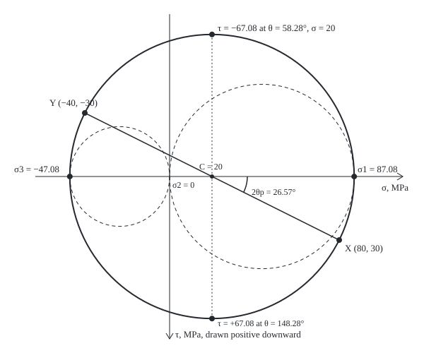
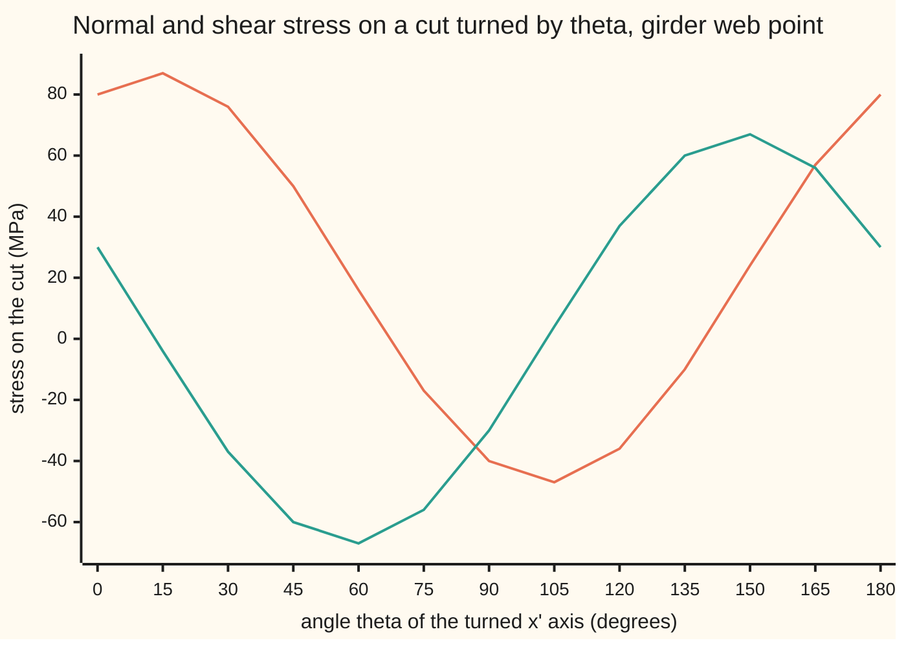

# Stress in 3D: a symmetric matrix, its principal axes, and Mohr's circle

[Syllabus](../../../SYLLABUS.md) → [Engineering mathematics](../README.md) → [Mechanics and Structures](../README.md#s07) → Stress in 3D

---

## General Overview

A steel footbridge crosses a river in two spans, with a pier in the middle. Over the pier, the main girder's web (the thin upright plate between its top and bottom flanges) is worked three ways at once. Bending stretches it along the bridge. The pier's bearing pushes up into it. The load passing down to the pier shears it.

Strain gauges at one point of the web, their readings turned into stresses in the girder's own directions, give three numbers. Along the bridge: 80 MPa of tension (megapascals, millions of newtons per square metre). Upright: 40 MPa of compression. Shear: 30 MPa, sliding the upright faces past each other.

None of those three is the largest stress at the point. Cut the steel so that the cut's normal (the direction square to the cut) is turned 13.28° from the girder's axis, and the pull across that cut is 87.08 MPa, with no shear at all. Turn the normal to 58.28°, and the shear reaches 67.08 MPa: more than twice the 30 MPa the gauges read. Fatigue cracks grow square to the largest pull, and yield is driven by shear, as [Torsion and yield](11-torsion-and-yield-criteria.md) shows, so these are the numbers an engineer needs.

This card finds them. The stress at a point is a symmetric 3 × 3 matrix. Turning the axes changes its entries but not the stress. Its eigenvalues are the largest and smallest pulls, and Mohr's circle draws every possible cut on one picture.

**The stress at a point is a symmetric matrix that turns a cut's direction into the force per area across that cut; its eigenvectors are the cuts with no shear, its eigenvalues are the extreme pulls, and half the gap between the largest and smallest is the largest shear.**

**What kind of fact this is:** the matrix form, the rotation rule, the principal stresses and Mohr's circle are theorems that follow from force and moment balance, proved on this card in Why it works. Hooke's law in 3D is a model of the material: it fits steel well below yield, and it is not a law.

### The picture: Mohr's circle for the web point

<p align="center"></p>

To scale, 3 px per MPa. Normal stress σ runs to the right; shear τ is drawn positive downward. Point X is the face whose normal is the girder's x axis; point Y is the upright face. Every other cut through the point lands on the same solid circle. The two dashed circles complete the 3D picture: they pass through σ₂ = 0, the principal stress across the web's thickness.

---

## The formula

Two notations from [Stress, strain and bending](07-stress-strain-and-beam-bending.md): **stress** σ is force per area, in pascals, and **strain** ε is stretch per length, with no units. Here σ with one letter (σ_x) is a **normal stress**, a pull or push straight across a face, positive in tension. τ (tau) with two letters (τ_xy) is a **shear stress**, a slide along a face.

The **stress tensor** (a matrix that describes a physical state and changes by a fixed rule when the axes turn) collects all of them:

```math
\boldsymbol{\sigma} = \begin{pmatrix} \sigma_x & \tau_{xy} & \tau_{xz} \\ \tau_{xy} & \sigma_y & \tau_{yz} \\ \tau_{xz} & \tau_{yz} & \sigma_z \end{pmatrix}, \qquad \mathbf{t} = \boldsymbol{\sigma}\,\mathbf{n}, \qquad \boldsymbol{\sigma}' = Q\,\boldsymbol{\sigma}\,Q^{\mathsf T}
```

**Read it aloud:** the stress at a point is a symmetric matrix; feed it the unit direction square to a cut and it returns the force per area across that cut; turn the axes by the rotation Q and the matrix becomes Q σ Q-transpose.

Its eigenvalues are the **principal stresses**, σ₁ ≥ σ₂ ≥ σ₃, and the **largest shear** is half the gap between the outer two:

```math
\boldsymbol{\sigma}\,\mathbf{n} = \sigma_i\,\mathbf{n}, \qquad \tau_{\max} = \frac{\sigma_1 - \sigma_3}{2}
```

For **plane stress** (σ_z, τ_xz and τ_yz all zero, as on the faces of a thin plate), turning the axes by an angle θ about z gives

```math
\sigma_{x'} = C + \frac{\sigma_x - \sigma_y}{2}\cos 2\theta + \tau_{xy}\sin 2\theta, \qquad \tau_{x'y'} = -\frac{\sigma_x - \sigma_y}{2}\sin 2\theta + \tau_{xy}\cos 2\theta
```

and every such pair lies on **Mohr's circle**:

```math
(\sigma_{x'} - C)^2 + \tau_{x'y'}^2 = R^2, \qquad C = \frac{\sigma_x + \sigma_y}{2}, \quad R = \sqrt{\left(\frac{\sigma_x - \sigma_y}{2}\right)^2 + \tau_{xy}^2}, \quad \tan 2\theta_p = \frac{2\tau_{xy}}{\sigma_x - \sigma_y}
```

**Read it aloud:** however the cut is turned, its normal and shear stress sit on one circle, centred at the average normal stress, with radius set by the half-difference and the shear; the principal stresses are where the circle crosses the axis, C plus and minus R.

**Generalised Hooke's law**, for steel below yield:

```math
\varepsilon_x = \frac{\sigma_x - \nu(\sigma_y + \sigma_z)}{E}, \quad \varepsilon_y = \frac{\sigma_y - \nu(\sigma_z + \sigma_x)}{E}, \quad \varepsilon_z = \frac{\sigma_z - \nu(\sigma_x + \sigma_y)}{E}, \quad \gamma_{xy} = \frac{\tau_{xy}}{G}, \quad \gamma_{yz} = \frac{\tau_{yz}}{G}, \quad \gamma_{xz} = \frac{\tau_{xz}}{G}, \quad G = \frac{E}{2(1 + \nu)}
```

**Read it aloud:** each direction stretches by its own stress over the stiffness, minus a Poisson share of the other two stresses; each shear stress makes a shear angle in its own plane, the shear stress over the shear modulus.

| Symbol | Plain meaning | In our example | Push it up and the answer… |
| --- | --- | --- | --- |
| $`\boldsymbol{\sigma}`$ | the stress tensor at the point, MPa | `[[80, 30, 0], [30, -40, 0], [0, 0, 0]]` | — |
| $`\sigma_x`$, $`\sigma_y`$, $`\sigma_z`$ | normal stresses on the faces square to x (along the girder), y (upright) and z (through the web), tension positive | 80, −40, 0 MPa | σ₁ rises with σ_x |
| $`\tau_{xy}`$, $`\tau_{xz}`$, $`\tau_{yz}`$ | shear stresses; τ_xy is the slide on the x face in the y direction, and equals the slide on the y face in the x direction | 30, 0, 0 MPa | the circle grows; σ₁ and τ_max rise |
| $`\mathbf{n}`$, $`\mathbf{t}`$, $`w_i`$ | the unit vector square to a cut (components n_x, n_y), and the traction: the force per area across that cut, a vector (components t_x, t_y); w_i = n_i², the squared parts of n along the principal axes, which add to 1 (Step 6) | n = (0.9732, 0.2298, 0) gives t = 87.08 n | — |
| $`\theta`$, $`Q`$ | angle the axes turn about z, counterclockwise; the rotation matrix whose rows are the new axes | — | — |
| $`\sigma_{x'}`$, $`\tau_{x'y'}`$, $`\sigma_n`$ | normal and shear stress on the face square to the turned x′ axis; σ_n is the normal stress on any cut with unit normal n | 80 and 30 MPa at θ = 0 | — |
| $`C`$, $`R`$ | centre and radius of Mohr's circle | 20 MPa, 67.08 MPa | — |
| $`\sigma_1`$, $`\sigma_2`$, $`\sigma_3`$, $`\theta_p`$ | principal stresses, largest first, and the angle of σ₁'s axis from x | 87.08, 0, −47.08 MPa; 13.28° | — |
| $`\tau_{\max}`$ | largest shear on any plane through the point | 67.08 MPa | — |
| $`I_1`$, $`I_2`$, $`I_3`$, $`\lambda`$ | invariants, unchanged by turning: the trace, the sum of the three principal minors (the 2 × 2 determinants on the diagonal), and the determinant; λ is an unknown eigenvalue | 40, −4100, 0 | — |
| $`E`$, $`\nu`$, $`G`$ | Young's modulus (stiffness in a pull), Poisson's ratio (sideways shrink per unit stretch), shear modulus | 200 GPa, 0.30, 76.92 GPa | strains fall as E rises |
| $`\varepsilon_x`$, $`\varepsilon_y`$, $`\varepsilon_z`$, $`\gamma_{xy}`$, $`\gamma_{yz}`$, $`\gamma_{xz}`$ | strains, in microstrain (millionths); the γ are the shear angles in the three planes, in radians × 10⁶ | 460, −320, −60, 390, 0, 0 | — |

The principal stresses are numbered in 3D order, largest first: σ₁ = 87.08, σ₂ = 0 (across the thickness) and σ₃ = −47.08 MPa, in the table, the figure and the printed output alike. Many books call the two in-plane ones σ₁ and σ₂; with that naming, τ_max = (σ₁ − σ₃)/2 would pick the wrong pair. One more clash of names: here σ_y is the normal stress on the upright face, while [Stress, strain and bending](07-stress-strain-and-beam-bending.md) and [Torsion and yield](11-torsion-and-yield-criteria.md) write σ_y for the yield stress, which this card gives in words, as the 275 MPa yield stress.

### When it holds

- **Force and moment balance on a small piece.** The matrix form, its symmetry, the rotation rule and the circle need nothing else, so they hold for any material, elastic or not. Feed the circle stresses four times larger, 320, −160 and 120 MPa, and it still gives σ₁ = 348.33 MPa, because the algebra does not depend on the material. Whether the steel can carry those stresses is another matter (two bullets down).
- **Plane stress.** The web is 10 to 15 mm thick with free faces, so σ_z ≈ 0. In a thick bearing block, σ_z and out-of-plane shear build up and the 2D circle misses them: with τ_xz = 20 MPa added, the 3 × 3 matrix gives a largest shear of 69.40 MPa, which the circle cannot see.
- **Linear elastic steel, below yield.** Hooke's law, and stresses that grow in step with the load, both stop once the steel yields. At four times the load the point would need 320, −160 and 120 MPa. Grade S275 cannot carry that: the state's von Mises equivalent stress, the single number that [Torsion and yield](11-torsion-and-yield-criteria.md) compares with the yield stress, is 471.59 MPa, against 275 MPa. This point first yields at 2.33 times the load, or at 2.05 times by the stricter Tresca rule. Past that, neither the scaled stresses nor Hooke's ε_x = 1840.00 microstrain are real.
- **Isotropic material** (the same stiffness in every direction). Steel qualifies. Timber and fibre composites do not: their strain axes no longer line up with the stress axes, and E, ν, G become a larger table.
- **Small strains.** Strains of a few hundred microstrain leave lengths and angles almost unchanged, so the stresses can be computed on the undeformed shape.

---

## Why it works

### Step 0: stress is a machine that takes a direction and returns a force

Cut the steel through the point along some plane. The steel on one side pulls on the other with a force per area, the traction. Its size and direction depend on how the cut is tilted. Force balance on a tiny wedge shows the traction depends linearly on the cut's unit normal, so it is a matrix times that normal. Moment balance makes the matrix symmetric. Then [The spectral theorem](../../03-Algebra/07-Eigenvalues%20and%20Symmetric%20Matrices/04-spectral-theorem.md) gives three perpendicular axes on which the matrix only stretches. Cuts square to those axes carry pure pull or push, with no shear. Everything else on the card follows.

### Step 1: force balance on a wedge gives t = σ n

Take a tiny wedge at the point, in 2D: an x face, a y face and a slanted face with unit normal n = (n_x, n_y). If the slanted face has unit area, the x face has area n_x and the y face n_y. The forces on the three faces must add to zero, because the wedge's weight and acceleration shrink with its volume, faster than its face areas. So the traction on the slanted face is

```math
t_x = \sigma_x n_x + \tau_{xy} n_y, \qquad t_y = \tau_{xy} n_x + \sigma_y n_y.
```

That is $`\mathbf{t} = \boldsymbol{\sigma}\,\mathbf{n}`$. In 3D a tetrahedron gives the same with three rows (Cauchy's argument).

### Step 2: moment balance makes the matrix symmetric

Take a tiny square. The shear on its x faces makes a turning effect one way; the shear on its y faces turns it the other way. The square does not spin up, so the two must cancel: the slide on the x face in the y direction equals the slide on the y face in the x direction. So τ_xy appears twice in the matrix, and the matrix equals its transpose.

### Step 3: turning the axes is a change of basis

The stress does not change when the engineer turns the axes. Only its description does. With the new axes as the rows of Q, a vector's new coordinates are Q times its old ones, and Q⁻¹ = Qᵀ because the axes are perpendicular unit vectors. The [Change of basis](../../03-Algebra/07-Eigenvalues%20and%20Symmetric%20Matrices/01-change-of-basis.md) rule then gives σ′ = Q σ Qᵀ.

In 2D, Q has rows (cos θ, sin θ) and (−sin θ, cos θ). Multiplying out and using cos²θ = (1 + cos 2θ)/2, sin²θ = (1 − cos 2θ)/2 and 2 sin θ cos θ = sin 2θ gives the two turning formulas in The formula. Every term carries 2θ, never θ. That is why the circle shows angles doubled.

### Step 4: the turning formulas trace a circle

Move C to the left of the first turning formula. Then square both formulas and add. The cross terms cancel, and cos² + sin² = 1 leaves ((σ_x − σ_y)/2)² + τ_xy², which is R². So every turned face is a point at distance R from (C, 0).

With τ drawn positive downward, turning the axes counterclockwise by θ moves the face's point counterclockwise round the circle by 2θ. Faces at right angles, such as X and Y, sit at opposite ends of a diameter.

### Step 5: the principal stresses are the eigenvalues

The normal stress on a cut is the traction's part along n: $`\sigma_n = \mathbf{n}^{\mathsf T}\boldsymbol{\sigma}\,\mathbf{n}`$, a [Quadratic forms](../../03-Algebra/07-Eigenvalues%20and%20Symmetric%20Matrices/05-quadratic-forms-and-positive-definite.md) value. Over all unit n, a quadratic form is largest along the eigenvector with the largest eigenvalue and smallest along the one with the smallest. On an eigenvector, t = σ_i n points straight along n, so the shear on that cut is zero.

In 2D the eigenvalues are where the circle meets the axis, C ± R, at the angle where τ_x′y′ = 0, which is tan 2θ_p = 2τ_xy/(σ_x − σ_y). In 3D the eigenvalues solve the characteristic cubic

```math
\lambda^3 - I_1\lambda^2 + I_2\lambda - I_3 = 0.
```

Its coefficients I₁, I₂ and I₃ are fixed by the eigenvalues alone, so no turn of the axes can change them. For the web, I₃ = 0, so one root is 0 and the other two solve λ² − 40λ − 4100 = 0: 87.08 and −47.08 MPa.

### Step 6: the largest shear lies at 45° between the outer principal axes

On the principal axes the matrix is diagonal. A cut whose normal is turned by θ from principal axis i toward axis k carries shear (σ_i − σ_k) sin 2θ / 2, which peaks at θ = 45°. No tilted cut does better. On the principal axes, write w_i = n_i², weights that add to 1. Then σ_n = Σ w_i σ_i is a weighted average of the three principal stresses, |t|² = Σ w_i σ_i², and the shear squared, |t|² − σ_n², is their weighted spread (variance). Values confined between σ₃ and σ₁ have a spread of at most ((σ₁ − σ₃)/2)², reached with half the weight at each end: the 45° cut. So the largest shear anywhere is (σ₁ − σ₃)/2, the radius of the biggest of the three circles in the picture. The normal stress on that plane is the circle's centre.

In plane stress, σ_z = 0 is always one principal stress. When the in-plane pair have opposite signs, as here, zero sits between them and the solid circle is the biggest. When they share a sign, zero is outside, and the largest shear is on a plane tilted out of the web.

### Step 7: Hooke's law in 3D is three pulls added together

A pull σ_x alone stretches the steel by σ_x/E along x and shrinks it by ν σ_x/E in each sideways direction. That sideways shrink is the Poisson effect. Linear elasticity lets the three pulls be added. That gives the three ε lines. Shear changes angles but not lengths, so each shear angle stands apart: γ_xy = τ_xy/G, and likewise γ_yz and γ_xz. G is not a fourth constant: Mohr's circle ties it to E and ν (fold below).

<details>
<summary>Why G = E / 2(1 + ν): pure shear seen at 45°</summary>

Take pure shear τ: σ_x = σ_y = 0, τ_xy = τ. Its Mohr's circle has centre 0 and radius τ, so on axes turned 45° it is a pull τ and a push −τ, with no shear.

On those 45° axes Hooke's law for the two pulls gives a stretch along the pull of

$`\displaystyle \varepsilon_1 = \frac{\tau - \nu(-\tau)}{E} = \frac{(1 + \nu)\,\tau}{E}.`$

Strain turns with the axes by the same rule as stress, with γ_xy/2 in the shear place. So in the original axes the strain circle has centre 0 and radius γ_xy/2, and the stretch on the 45° axis is ε₁ = γ_xy/2. Setting the two equal:

$`\displaystyle \frac{\gamma_{xy}}{2} = \frac{(1 + \nu)\,\tau}{E}, \qquad \text{so} \qquad G = \frac{\tau}{\gamma_{xy}} = \frac{E}{2(1 + \nu)}.`$

For steel, 200 GPa / 2.6 = 76.92 GPa.

</details>

The same strain circle gives one more fact. For an isotropic material the principal strain axes are the principal stress axes. In the web, tan 2θ for strain is 390 / (460 + 320) = 0.50, the same as for stress, so both point along 13.28°.

---

## Worked numbers, by hand

The web point: σ_x = 80 MPa, σ_y = −40 MPa, τ_xy = 30 MPa, plane stress. Steel: E = 200 GPa, ν = 0.30.

| Step | Arithmetic | Value |
| --- | --- | --- |
| centre | $`C = (80 + (-40))/2`$ | 20.00 MPa |
| half-difference | $`(80 - (-40))/2`$ | 60.00 MPa |
| radius | $`R = \sqrt{60^2 + 30^2}`$ | 67.08 MPa |
| largest principal stress | $`\sigma_1 = 20 + 67.08`$ | **87.08 MPa** |
| smallest principal stress | $`\sigma_3 = 20 - 67.08`$ | **−47.08 MPa** |
| angle | $`\tan 2\theta_p = 2 \times 30 / 120 = 0.50`$, so $`2\theta_p`$ = 26.57° | $`\theta_p`$ = 13.28° = 0.2318 rad |
| middle principal stress, across the thickness | plane stress: $`\sigma_2 = \sigma_z`$ | 0 MPa |
| largest shear | $`(87.08 - (-47.08))/2`$, on planes at 58.28° and 148.28° | **67.08 MPa**, normal stress 20.00 MPa there |
| invariants | $`I_1 = 80 - 40`$, $`I_2 = 80 \times (-40) - 30^2`$ | 40, −4100 |
| ε_x | $`(80 + 0.3 \times 40)/200\,000`$ | 460 microstrain |
| ε_y | $`(-40 - 0.3 \times 80)/200\,000`$ | −320 microstrain |
| ε_z | $`-0.3 \times (80 - 40)/200\,000`$ | −60 microstrain |
| shear modulus and shear angle | $`G = 200/2.6`$ GPa; $`\gamma_{xy} = 30/76\,920`$ | 76.92 GPa; 390 microstrain |
| principal strains | centre $`(460 - 320)/2 = 70`$; half-difference $`(460 + 320)/2 = 390`$; radius $`\sqrt{390^2 + (\gamma_{xy}/2)^2} = \sqrt{390^2 + 195^2} = 436.03`$ | 506.03 and −366.03 microstrain, at 13.28° |

The steel at this point is pulled hardest, 87.08 MPa, across a cut tilted 13.28° from the girder's axis. It is sheared hardest, 67.08 MPa, on cuts 45° from that. Both are well under the 275 MPa yield stress. Through the thickness the web thins by 60 microstrain, although no stress acts in that direction: that is the Poisson effect.

### The stresses as the cut turns



First line: normal stress σ_x′. It peaks near 15° (exactly 87.08 MPa at 13.28°). Second line: shear τ_x′y′. It crosses zero exactly where the normal stress peaks. Both repeat every 180°, because a cut turned half a turn is the same cut.

### What breaks if you drop a piece

| Mistake | Comes out at | What went wrong |
| --- | --- | --- |
| Read the largest entry as the largest stress | σ₁ = 80.00 MPa, τ_max = 30.00 MPa | the true values are 87.08 and 67.08 MPa; the matrix entries describe two particular cuts, not the worst ones |
| Turn the axes by 2θ_p instead of θ_p | at 26.57°: σ_x′ = 80.00 MPa, τ = −30.00 MPa | the circle doubles angles; the steel does not |
| Use only the in-plane circle when σ_x and σ_y share a sign | with σ_y = +40 MPa: 36.06 MPa | principal stresses 96.06, 23.94 and 0 give 48.03 MPa on a plane tilted out of the web |
| Use one-way Hooke's law | ε_x = 80/200 000 = 400.00 microstrain | the upright compression adds a Poisson stretch: the true value is 460.00 |
| Use Hooke's law past yield | four times the load: σ₁ = 348.33 MPa, ε_x = 1840.00 microstrain | the point yields at 2.33 times the load (von Mises 471.59 MPa at four times, against 275 MPa); past that neither the scaled stresses nor the strain are real |

The code prints every row.

---

## Code, from first principles, and it actually runs

The code builds the 3 × 3 stress tensor and reaches the principal stresses by three independent roads.

- **Road 1, the circle:** C ± R and θ_p from the closed-form formulas.
- **Road 2, brute force:** turn the axes from 0° to 180° in 18,000 steps of 0.01°, multiply out Q σ Qᵀ each time, and keep the largest and smallest normal stress and shear. It also measures how far each turned point sits from the circle.
- **Road 3, eigenvalues:** the Jacobi method on the full 3 × 3 matrix. It applies one plane rotation at a time, each chosen to clear one off-diagonal entry, until the matrix is diagonal. It knows nothing about circles or plane stress.

Further checks: the invariants are the same before and after a turn, and the eigenvalues solve the characteristic cubic. Hooke's law turns the stresses into strains, the strain circle finds the same 13.28° axis, and the inverse of Hooke's law turns the strains back into the starting stresses. Every number on the card, including the chart points and the figure's coordinates, is printed.

### Python

```python
# Stress in 3D -- the check behind the card.  Standard library only.
# One point in the web of a steel footbridge girder, in plane stress:
# sigma_x = 80 MPa, sigma_y = -40 MPa, tau_xy = 30 MPa.  The principal stresses
# and the largest shear, reached three independent ways, then Hooke's law in 3D.
import math
SX, SY, TXY = 80.0, -40.0, 30.0                # MPa
E, NU, SIGMA_Y = 200e3, 0.3, 275.0             # MPa, no unit, MPa (grade S275 yield)
G = E / (2 * (1 + NU))                         # shear modulus, MPa
DEG = 180 / math.pi

def tensor(sx, sy, txy, sz=0.0, txz=0.0, tyz=0.0):
    return [[sx, txy, txz], [txy, sy, tyz], [txz, tyz, sz]]

def matmul(A, B):
    C = [[0.0] * 3 for _ in range(3)]
    for i in range(3):
        for j in range(3):
            for k in range(3):
                C[i][j] += A[i][k] * B[k][j]
    return C

def transpose(A): return [[A[j][i] for j in range(3)] for i in range(3)]

def rotate(T, th):                             # the same stress, read on axes turned by th about z
    c, s = math.cos(th), math.sin(th)
    Q = [[c, s, 0.0], [-s, c, 0.0], [0.0, 0.0, 1.0]]   # rows: the new x', y', z axes
    return matmul(matmul(Q, T), transpose(Q))

def invariants(T):                             # trace, sum of 2x2 minors, determinant
    i1 = T[0][0] + T[1][1] + T[2][2]
    i2 = (T[0][0] * T[1][1] + T[1][1] * T[2][2] + T[2][2] * T[0][0]
          - T[0][1] ** 2 - T[1][2] ** 2 - T[0][2] ** 2)
    i3 = (T[0][0] * (T[1][1] * T[2][2] - T[1][2] ** 2) - T[0][1] * (T[0][1] * T[2][2] - T[1][2] * T[0][2])
          + T[0][2] * (T[0][1] * T[1][2] - T[1][1] * T[0][2]))
    return i1, i2, i3

def jacobi(T, sweeps=30):                      # road 3: eigenvalues of a symmetric 3x3,
    A = [row[:] for row in T]                  # by plane rotations that clear one off-diagonal each
    V = [[1.0 if i == j else 0.0 for j in range(3)] for i in range(3)]
    for _ in range(sweeps):
        for p, q in ((0, 1), (0, 2), (1, 2)):
            if abs(A[p][q]) < 1e-15:
                continue
            phi = 0.5 * math.atan2(2 * A[p][q], A[q][q] - A[p][p])
            J = [[1.0 if i == j else 0.0 for j in range(3)] for i in range(3)]
            J[p][p], J[q][q], J[p][q], J[q][p] = math.cos(phi), math.cos(phi), math.sin(phi), -math.sin(phi)
            A, V = matmul(matmul(transpose(J), A), J), matmul(V, J)
    order = sorted(range(3), key=lambda k: -A[k][k])
    return [A[k][k] for k in order], [[V[i][k] for i in range(3)] for k in order]

def mohr(sx, sy, txy):                         # road 1: centre, radius, principal stresses, angle
    C, R = (sx + sy) / 2, math.hypot((sx - sy) / 2, txy)
    return C, R, C + R, C - R, 0.5 * math.atan2(2 * txy, sx - sy)

def hooke(T):                                  # generalised Hooke's law, strains (gamma = engineering shear)
    sx, sy, sz = T[0][0], T[1][1], T[2][2]
    return ((sx - NU * (sy + sz)) / E, (sy - NU * (sz + sx)) / E, (sz - NU * (sx + sy)) / E, T[0][1] / G, T[1][2] / G, T[0][2] / G)

S = tensor(SX, SY, TXY)
C, R, s1, s2, thp = mohr(SX, SY, TXY)
z = lambda v: 0.0 if abs(v) < 1e-9 else v     # print a rounding speck as 0.00, not -0.00
fmt = lambda T: "[" + ", ".join("[" + ", ".join(f"{z(v):.2f}" for v in r) + "]" for r in T) + "]"
print(f"web point: sigma_x = {SX:.2f} MPa, sigma_y = {SY:.2f} MPa, tau_xy = {TXY:.2f} MPa, sigma_z = 0 (plane stress)")
print(f"stress tensor, MPa: {fmt(S)}")
print(f"road 1, Mohr's circle: centre {C:.2f} MPa, radius sqrt({(SX - SY) / 2:.2f}^2 + {TXY:.2f}^2) = {R:.4f} MPa")
print(f"road 1: C + R = {s1:.2f} MPa, C - R = {s2:.2f} MPa, theta_p = {thp * DEG:.2f} deg = {thp:.4f} rad,"
      f" tan 2theta_p = {math.tan(2 * thp):.2f}")
best_hi, best_lo, t_hi, t_lo, worst = (-1e9, 0), (1e9, 0), (-1e9, 0), (1e9, 0), 0.0
for k in range(18000):                         # road 2: turn the axes in 0.01 deg steps, 0 to 180 deg
    th = k * 0.01 / DEG
    T = rotate(S, th)
    best_hi, best_lo = max(best_hi, (T[0][0], k)), min(best_lo, (T[0][0], k))
    t_hi, t_lo = max(t_hi, (T[0][1], k)), min(t_lo, (T[0][1], k))
    worst = max(worst, abs(math.hypot(T[0][0] - C, T[0][1]) - R))   # Mohr: every turn lands on the circle
print(f"road 2, axes turned in 0.01 deg steps: largest normal {best_hi[0]:.2f} MPa at {best_hi[1] / 100:.2f} deg,"
      f" smallest {best_lo[0]:.2f} MPa at {best_lo[1] / 100:.2f} deg")
print(f"road 2: shear peaks {t_lo[0]:.2f} MPa at {t_lo[1] / 100:.2f} deg and {t_hi[0]:.2f} MPa at {t_hi[1] / 100:.2f} deg;"
      f" normal there {rotate(S, thp + math.pi / 4)[0][0]:.2f} MPa")
print(f"road 2: every turned point on the circle, worst miss under 1e-9 MPa: {'yes' if worst < 1e-9 else 'no'}")
lam, vec = jacobi(S)
print(f"road 3, Jacobi on the 3x3 tensor: eigenvalues {lam[0]:.2f}, {lam[1]:.2f}, {lam[2]:.2f} MPa;"
      f" sigma_1 axis ({vec[0][0]:.4f}, {vec[0][1]:.4f}, {vec[0][2]:.4f}) at {math.atan2(vec[0][1], vec[0][0]) * DEG:.2f} deg")
assert abs(best_hi[0] - s1) < 1e-6 and abs(best_lo[0] - s2) < 1e-6 and best_hi[1] == round(thp * DEG * 100)
assert abs(lam[0] - s1) < 1e-9 and abs(lam[2] - s2) < 1e-9 and abs(lam[1]) < 1e-9
assert abs(t_hi[0] - R) < 1e-6 and worst < 1e-9
tau_max = (lam[0] - lam[2]) / 2
print(f"largest shear in 3D, (sigma_max - sigma_min) / 2 = {tau_max:.2f} MPa, on planes 45 deg from the principal axes")
Tp = rotate(S, thp)
print(f"tensor on the principal axes, MPa: {fmt(Tp)}")
inv0, inv1 = invariants(S), invariants(rotate(S, 0.7))
print("invariants I1, I2, I3 before turning: " + ", ".join(f"{z(v):.2f}" for v in inv0)
      + "; after turning 0.7 rad: " + ", ".join(f"{z(v):.2f}" for v in inv1))
assert max(abs(a - b) for a, b in zip(inv0, inv1)) < 1e-9 and abs(Tp[0][1]) < 1e-9
cubic = [x ** 3 - inv0[0] * x ** 2 + inv0[1] * x - inv0[2] for x in lam]
print(f"eigenvalues solve lambda^3 - I1 lambda^2 + I2 lambda - I3 = 0 to 1e-6: {'yes' if max(map(abs, cubic)) < 1e-6 else 'no'}")
assert max(map(abs, cubic)) < 1e-6
ex, ey, ez, gxy, gyz, gxz = hooke(S)
print(f"Hooke: E = {E / 1e3:.0f} GPa, nu = {NU:.2f}, G = E / (2(1 + nu)) = {G / 1e3:.2f} GPa")
print(f"strains, microstrain: eps_x = {ex * 1e6:.2f}, eps_y = {ey * 1e6:.2f}, eps_z = {ez * 1e6:.2f}, gamma_xy = {gxy * 1e6:.2f},"
      f" gamma_yz = {gyz * 1e6:.2f}, gamma_xz = {gxz * 1e6:.2f}")
Ce, Re, e1, e2, the = mohr(ex * 1e6, ey * 1e6, gxy * 1e6 / 2)
print(f"strain circle, microstrain: centre {Ce:.2f}, half-difference {(ex - ey) * 1e6 / 2:.2f}, gamma_xy/2 {gxy * 1e6 / 2:.2f}, radius {Re:.2f}")
print(f"principal strains {e1:.2f} and {e2:.2f} microstrain at {the * DEG:.2f} deg: the same axes as the stresses")
lame = E * NU / ((1 + NU) * (1 - 2 * NU))
back = [lame * (ex + ey + ez) + 2 * G * e for e in (ex, ey, ez)] + [G * gxy]
print("back from strain to stress, inverse Hooke: " + ", ".join(f"{z(v):.2f}" for v in back) + " MPa")
assert abs(the - thp) < 1e-12 and max(abs(a - b) for a, b in zip(back, (SX, SY, 0.0, TXY))) < 1e-9
print("chart, theta deg  " + " ".join(f"{15 * k:7d}" for k in range(13)))
print("chart, sigma_x'   " + " ".join(f"{rotate(S, 15 * k / DEG)[0][0]:7.2f}" for k in range(13)))
print("chart, tau_x'y'   " + " ".join(f"{rotate(S, 15 * k / DEG)[0][1]:7.2f}" for k in range(13)))
W = rotate(S, 2 * thp)
print(f"wrong: biggest entry read as sigma_1 = {max(SX, SY):.2f} MPa (true {s1:.2f}), tau_xy as largest shear"
      f" {TXY:.2f} MPa (true {tau_max:.2f})")
print(f"wrong: axes turned by 2theta_p = {2 * thp * DEG:.2f} deg: sigma_x' = {W[0][0]:.2f} MPa, tau = {W[0][1]:.2f} MPa")
_, Rs, a1, a2, _ = mohr(80.0, 40.0, 30.0)
print(f"wrong: sigma_y = +40 MPa, in-plane shear {Rs:.2f} MPa, but principal {a1:.2f}, {a2:.2f}, 0.00 give"
      f" {a1 / 2:.2f} MPa out of plane")
print(f"wrong: one-way Hooke, eps_x = sigma_x / E = {SX / E * 1e6:.2f} microstrain (true {ex * 1e6:.2f}, {100 * (1 - SX / E / ex):.0f}% low),"
      f" eps_y {SY / E * 1e6:.2f} (true {ey * 1e6:.2f}), eps_z {S[2][2] / E * 1e6:.2f} (true {ez * 1e6:.2f})")
assert abs(W[0][0] - SX) < 1e-9 and a1 / 2 > Rs and SX / E < ex
s4 = mohr(4 * SX, 4 * SY, 4 * TXY)[2]
vm1 = math.sqrt(((lam[0] - lam[1]) ** 2 + (lam[1] - lam[2]) ** 2 + (lam[2] - lam[0]) ** 2) / 2)   # von Mises, card 11
assert abs(vm1 - math.sqrt(SX ** 2 - SX * SY + SY ** 2 + 3 * TXY ** 2)) < 1e-9
print(f"outside the model: load x4, stresses {4 * SX:.2f}, {4 * SY:.2f}, {4 * TXY:.2f} MPa: sigma_1 = {s4:.2f} MPa, but von Mises"
      f" {4 * vm1:.2f} MPa > {SIGMA_Y:.0f} MPa yield")
print(f"outside the model: first yield at x{SIGMA_Y / vm1:.2f} the load (Tresca x{SIGMA_Y / (2 * tau_max):.2f}); past that neither"
      f" the scaled stresses nor Hooke's eps_x = {4 * ex * 1e6:.2f} microstrain are real")
_, _, b1, b2, bth = mohr(SX, SX, TXY)
l3, _ = jacobi(tensor(SX, SY, TXY, txz=20.0))
print(f"try: tau_xy = 0 gives {SX:.2f}, {SY:.2f} MPa, largest shear {(SX - SY) / 2:.2f} MPa; sigma_y = 80 gives"
      f" {b1:.2f}, {b2:.2f} MPa at {bth * DEG:.2f} deg, largest shear {b1 / 2:.2f} MPa")
print(f"try: tau_xz = 20 MPa gives " + ", ".join(f"{v:.2f}" for v in l3) + f" MPa, largest shear {(l3[0] - l3[2]) / 2:.2f} MPa;"
      f" nu = 0 gives eps_x = {SX / E * 1e6:.2f} microstrain")
px = lambda s: 240 + 3 * s                     # figure: 3 px per MPa, tau drawn positive downward
py = lambda t: 250 + 3 * t
print(f"figure, 3 px/MPa: centre ({px(C):.1f}, {py(0):.1f}), radius {3 * R:.1f}, X ({px(SX):.1f}, {py(TXY):.1f}),"
      f" Y ({px(SY):.1f}, {py(-TXY):.1f})")
print(f"figure: sigma_1 ({px(s1):.1f}, 250.0), sigma_3 ({px(s2):.1f}, 250.0), origin = sigma_2 ({px(0):.1f}, 250.0), top ({px(C):.1f},"
      f" {py(-R):.1f}), bottom ({px(C):.1f}, {py(R):.1f}), small circles radius {3 * s1 / 2:.1f} and {-3 * s2 / 2:.1f}")
print("ALL CHECKS PASS")
```

**Ran 2026-11-23 on macOS, Python 3.14.10, standard library only. All checks passed. Output, pasted from the run:**

```
web point: sigma_x = 80.00 MPa, sigma_y = -40.00 MPa, tau_xy = 30.00 MPa, sigma_z = 0 (plane stress)
stress tensor, MPa: [[80.00, 30.00, 0.00], [30.00, -40.00, 0.00], [0.00, 0.00, 0.00]]
road 1, Mohr's circle: centre 20.00 MPa, radius sqrt(60.00^2 + 30.00^2) = 67.0820 MPa
road 1: C + R = 87.08 MPa, C - R = -47.08 MPa, theta_p = 13.28 deg = 0.2318 rad, tan 2theta_p = 0.50
road 2, axes turned in 0.01 deg steps: largest normal 87.08 MPa at 13.28 deg, smallest -47.08 MPa at 103.28 deg
road 2: shear peaks -67.08 MPa at 58.28 deg and 67.08 MPa at 148.28 deg; normal there 20.00 MPa
road 2: every turned point on the circle, worst miss under 1e-9 MPa: yes
road 3, Jacobi on the 3x3 tensor: eigenvalues 87.08, 0.00, -47.08 MPa; sigma_1 axis (0.9732, 0.2298, 0.0000) at 13.28 deg
largest shear in 3D, (sigma_max - sigma_min) / 2 = 67.08 MPa, on planes 45 deg from the principal axes
tensor on the principal axes, MPa: [[87.08, 0.00, 0.00], [0.00, -47.08, 0.00], [0.00, 0.00, 0.00]]
invariants I1, I2, I3 before turning: 40.00, -4100.00, 0.00; after turning 0.7 rad: 40.00, -4100.00, 0.00
eigenvalues solve lambda^3 - I1 lambda^2 + I2 lambda - I3 = 0 to 1e-6: yes
Hooke: E = 200 GPa, nu = 0.30, G = E / (2(1 + nu)) = 76.92 GPa
strains, microstrain: eps_x = 460.00, eps_y = -320.00, eps_z = -60.00, gamma_xy = 390.00, gamma_yz = 0.00, gamma_xz = 0.00
strain circle, microstrain: centre 70.00, half-difference 390.00, gamma_xy/2 195.00, radius 436.03
principal strains 506.03 and -366.03 microstrain at 13.28 deg: the same axes as the stresses
back from strain to stress, inverse Hooke: 80.00, -40.00, 0.00, 30.00 MPa
chart, theta deg        0      15      30      45      60      75      90     105     120     135     150     165     180
chart, sigma_x'     80.00   86.96   75.98   50.00   15.98  -16.96  -40.00  -46.96  -35.98  -10.00   24.02   56.96   80.00
chart, tau_x'y'     30.00   -4.02  -36.96  -60.00  -66.96  -55.98  -30.00    4.02   36.96   60.00   66.96   55.98   30.00
wrong: biggest entry read as sigma_1 = 80.00 MPa (true 87.08), tau_xy as largest shear 30.00 MPa (true 67.08)
wrong: axes turned by 2theta_p = 26.57 deg: sigma_x' = 80.00 MPa, tau = -30.00 MPa
wrong: sigma_y = +40 MPa, in-plane shear 36.06 MPa, but principal 96.06, 23.94, 0.00 give 48.03 MPa out of plane
wrong: one-way Hooke, eps_x = sigma_x / E = 400.00 microstrain (true 460.00, 13% low), eps_y -200.00 (true -320.00), eps_z 0.00 (true -60.00)
outside the model: load x4, stresses 320.00, -160.00, 120.00 MPa: sigma_1 = 348.33 MPa, but von Mises 471.59 MPa > 275 MPa yield
outside the model: first yield at x2.33 the load (Tresca x2.05); past that neither the scaled stresses nor Hooke's eps_x = 1840.00 microstrain are real
try: tau_xy = 0 gives 80.00, -40.00 MPa, largest shear 60.00 MPa; sigma_y = 80 gives 110.00, 50.00 MPa at 45.00 deg, largest shear 55.00 MPa
try: tau_xz = 20 MPa gives 91.24, -3.69, -47.55 MPa, largest shear 69.40 MPa; nu = 0 gives eps_x = 400.00 microstrain
figure, 3 px/MPa: centre (300.0, 250.0), radius 201.2, X (480.0, 340.0), Y (120.0, 160.0)
figure: sigma_1 (501.2, 250.0), sigma_3 (98.8, 250.0), origin = sigma_2 (240.0, 250.0), top (300.0, 48.8), bottom (300.0, 451.2), small circles radius 130.6 and 70.6
ALL CHECKS PASS
```

### Rust

Same numbers, same labels, built with `rustc --edition 2021 -O`.

```rust
// Stress in 3D -- the same check as the Python, in Rust.  No crates.
// One point in the web of a steel footbridge girder, in plane stress:
// sigma_x = 80 MPa, sigma_y = -40 MPa, tau_xy = 30 MPa.  The principal stresses
// and the largest shear, reached three independent ways, then Hooke's law in 3D.
use std::f64::consts::PI;
const SX: f64 = 80.0; const SY: f64 = -40.0; const TXY: f64 = 30.0;   // MPa
const E: f64 = 200e3; const NU: f64 = 0.3; const SIGMA_Y: f64 = 275.0; // MPa, no unit, MPa (S275 yield)
const DEG: f64 = 180.0 / PI;
type M3 = [[f64; 3]; 3];

fn g() -> f64 { E / (2.0 * (1.0 + NU)) }       // shear modulus, MPa
fn tensor(sx: f64, sy: f64, txy: f64, sz: f64, txz: f64, tyz: f64) -> M3 {
    [[sx, txy, txz], [txy, sy, tyz], [txz, tyz, sz]]
}
fn matmul(a: &M3, b: &M3) -> M3 {
    let mut c = [[0.0; 3]; 3];
    for i in 0..3 { for j in 0..3 { for k in 0..3 { c[i][j] += a[i][k] * b[k][j]; } } }
    c
}
fn transpose(a: &M3) -> M3 {
    let mut t = [[0.0; 3]; 3];
    for i in 0..3 { for j in 0..3 { t[i][j] = a[j][i]; } }
    t
}
fn ident() -> M3 { [[1.0, 0.0, 0.0], [0.0, 1.0, 0.0], [0.0, 0.0, 1.0]] }
fn rotate(t: &M3, th: f64) -> M3 {             // the same stress, read on axes turned by th about z
    let (c, s) = (th.cos(), th.sin());
    let q = [[c, s, 0.0], [-s, c, 0.0], [0.0, 0.0, 1.0]];   // rows: the new x', y', z axes
    matmul(&matmul(&q, t), &transpose(&q))
}
fn invariants(t: &M3) -> [f64; 3] {            // trace, sum of 2x2 minors, determinant
    let i1 = t[0][0] + t[1][1] + t[2][2];
    let i2 = t[0][0] * t[1][1] + t[1][1] * t[2][2] + t[2][2] * t[0][0]
        - t[0][1].powi(2) - t[1][2].powi(2) - t[0][2].powi(2);
    let i3 = t[0][0] * (t[1][1] * t[2][2] - t[1][2].powi(2)) - t[0][1] * (t[0][1] * t[2][2] - t[1][2] * t[0][2])
        + t[0][2] * (t[0][1] * t[1][2] - t[1][1] * t[0][2]);
    [i1, i2, i3]
}
fn jacobi(t: &M3) -> ([f64; 3], [[f64; 3]; 3]) { // road 3: eigenvalues of a symmetric 3x3 by plane rotations
    let (mut a, mut v) = (*t, ident());
    for _ in 0..30 {
        for &(p, q) in &[(0usize, 1usize), (0, 2), (1, 2)] {
            if a[p][q].abs() < 1e-15 { continue; }
            let phi = 0.5 * (2.0 * a[p][q]).atan2(a[q][q] - a[p][p]);
            let mut j = ident();
            j[p][p] = phi.cos(); j[q][q] = phi.cos(); j[p][q] = phi.sin(); j[q][p] = -phi.sin();
            a = matmul(&matmul(&transpose(&j), &a), &j);
            v = matmul(&v, &j);
        }
    }
    let mut order = [0usize, 1, 2];
    order.sort_by(|&x, &y| a[y][y].partial_cmp(&a[x][x]).unwrap());
    let lam = [a[order[0]][order[0]], a[order[1]][order[1]], a[order[2]][order[2]]];
    let mut vec = [[0.0; 3]; 3];
    for (n, &k) in order.iter().enumerate() { for i in 0..3 { vec[n][i] = v[i][k]; } }
    (lam, vec)
}
fn mohr(sx: f64, sy: f64, txy: f64) -> (f64, f64, f64, f64, f64) { // road 1: centre, radius, principals, angle
    let (c, r) = ((sx + sy) / 2.0, ((sx - sy) / 2.0).hypot(txy));
    (c, r, c + r, c - r, 0.5 * (2.0 * txy).atan2(sx - sy))
}
fn hooke(t: &M3) -> [f64; 6] {                 // generalised Hooke's law, gamma = engineering shear
    let (sx, sy, sz) = (t[0][0], t[1][1], t[2][2]);
    [(sx - NU * (sy + sz)) / E, (sy - NU * (sz + sx)) / E, (sz - NU * (sx + sy)) / E, t[0][1] / g(), t[1][2] / g(), t[0][2] / g()]
}
fn z(v: f64) -> f64 { if v.abs() < 1e-9 { 0.0 } else { v } } // a rounding speck prints as 0.00
fn fmt(t: &M3) -> String {
    let rows: Vec<String> = t.iter().map(|r| format!("[{:.2}, {:.2}, {:.2}]", z(r[0]), z(r[1]), z(r[2]))).collect();
    format!("[{}]", rows.join(", "))
}
fn join(v: &[f64]) -> String { v.iter().map(|x| format!("{:.2}", z(*x))).collect::<Vec<_>>().join(", ") }
fn yn(b: bool) -> &'static str { if b { "yes" } else { "no" } }

fn main() {
    let s = tensor(SX, SY, TXY, 0.0, 0.0, 0.0);
    let (c, r, s1, s2, thp) = mohr(SX, SY, TXY);
    println!("web point: sigma_x = {:.2} MPa, sigma_y = {:.2} MPa, tau_xy = {:.2} MPa, sigma_z = 0 (plane stress)", SX, SY, TXY);
    println!("stress tensor, MPa: {}", fmt(&s));
    println!("road 1, Mohr's circle: centre {:.2} MPa, radius sqrt({:.2}^2 + {:.2}^2) = {:.4} MPa", c, (SX - SY) / 2.0, TXY, r);
    println!("road 1: C + R = {:.2} MPa, C - R = {:.2} MPa, theta_p = {:.2} deg = {:.4} rad, tan 2theta_p = {:.2}",
        s1, s2, thp * DEG, thp, (2.0 * thp).tan());
    let (mut hi, mut lo, mut thi, mut tlo, mut worst) = ((-1e9, 0), (1e9, 0), (-1e9, 0), (1e9, 0), 0.0f64);
    for k in 0..18000 {                        // road 2: turn the axes in 0.01 deg steps, 0 to 180 deg
        let t = rotate(&s, k as f64 * 0.01 / DEG);
        if t[0][0] > hi.0 { hi = (t[0][0], k); }
        if t[0][0] < lo.0 { lo = (t[0][0], k); }
        if t[0][1] > thi.0 { thi = (t[0][1], k); }
        if t[0][1] < tlo.0 { tlo = (t[0][1], k); }
        worst = worst.max(((t[0][0] - c).hypot(t[0][1]) - r).abs()); // Mohr: every turn lands on the circle
    }
    println!("road 2, axes turned in 0.01 deg steps: largest normal {:.2} MPa at {:.2} deg, smallest {:.2} MPa at {:.2} deg",
        hi.0, hi.1 as f64 / 100.0, lo.0, lo.1 as f64 / 100.0);
    println!("road 2: shear peaks {:.2} MPa at {:.2} deg and {:.2} MPa at {:.2} deg; normal there {:.2} MPa",
        tlo.0, tlo.1 as f64 / 100.0, thi.0, thi.1 as f64 / 100.0, rotate(&s, thp + PI / 4.0)[0][0]);
    println!("road 2: every turned point on the circle, worst miss under 1e-9 MPa: {}", yn(worst < 1e-9));
    let (lam, vec) = jacobi(&s);
    println!("road 3, Jacobi on the 3x3 tensor: eigenvalues {:.2}, {:.2}, {:.2} MPa; sigma_1 axis ({:.4}, {:.4}, {:.4}) at {:.2} deg",
        lam[0], lam[1], lam[2], vec[0][0], vec[0][1], vec[0][2], vec[0][1].atan2(vec[0][0]) * DEG);
    assert!((hi.0 - s1).abs() < 1e-6 && (lo.0 - s2).abs() < 1e-6 && hi.1 == (thp * DEG * 100.0).round() as i32);
    assert!((lam[0] - s1).abs() < 1e-9 && (lam[2] - s2).abs() < 1e-9 && lam[1].abs() < 1e-9);
    assert!((thi.0 - r).abs() < 1e-6 && worst < 1e-9);
    let tau_max = (lam[0] - lam[2]) / 2.0;
    println!("largest shear in 3D, (sigma_max - sigma_min) / 2 = {:.2} MPa, on planes 45 deg from the principal axes", tau_max);
    let tp = rotate(&s, thp);
    println!("tensor on the principal axes, MPa: {}", fmt(&tp));
    let (inv0, inv1) = (invariants(&s), invariants(&rotate(&s, 0.7)));
    println!("invariants I1, I2, I3 before turning: {}; after turning 0.7 rad: {}", join(&inv0), join(&inv1));
    assert!((0..3).map(|i| (inv0[i] - inv1[i]).abs()).fold(0.0, f64::max) < 1e-9 && tp[0][1].abs() < 1e-9);
    let cubic = lam.iter().map(|x| (x.powi(3) - inv0[0] * x * x + inv0[1] * x - inv0[2]).abs()).fold(0.0, f64::max);
    println!("eigenvalues solve lambda^3 - I1 lambda^2 + I2 lambda - I3 = 0 to 1e-6: {}", yn(cubic < 1e-6));
    assert!(cubic < 1e-6);
    let [ex, ey, ez, gxy, gyz, gxz] = hooke(&s);
    println!("Hooke: E = {:.0} GPa, nu = {:.2}, G = E / (2(1 + nu)) = {:.2} GPa", E / 1e3, NU, g() / 1e3);
    println!("strains, microstrain: eps_x = {:.2}, eps_y = {:.2}, eps_z = {:.2}, gamma_xy = {:.2}, gamma_yz = {:.2}, gamma_xz = {:.2}",
        ex * 1e6, ey * 1e6, ez * 1e6, gxy * 1e6, gyz * 1e6, gxz * 1e6);
    let (ce, re, e1, e2, the) = mohr(ex * 1e6, ey * 1e6, gxy * 1e6 / 2.0);
    println!("strain circle, microstrain: centre {:.2}, half-difference {:.2}, gamma_xy/2 {:.2}, radius {:.2}",
        ce, (ex - ey) * 1e6 / 2.0, gxy * 1e6 / 2.0, re);
    println!("principal strains {:.2} and {:.2} microstrain at {:.2} deg: the same axes as the stresses", e1, e2, the * DEG);
    let lame = E * NU / ((1.0 + NU) * (1.0 - 2.0 * NU));
    let back = [lame * (ex + ey + ez) + 2.0 * g() * ex, lame * (ex + ey + ez) + 2.0 * g() * ey,
        lame * (ex + ey + ez) + 2.0 * g() * ez, g() * gxy];
    println!("back from strain to stress, inverse Hooke: {} MPa", join(&back));
    let want = [SX, SY, 0.0, TXY];
    assert!((the - thp).abs() < 1e-12 && (0..4).map(|i| (back[i] - want[i]).abs()).fold(0.0, f64::max) < 1e-9);
    println!("chart, theta deg  {}", (0..13).map(|k| format!("{:7}", 15 * k)).collect::<Vec<_>>().join(" "));
    println!("chart, sigma_x'   {}", (0..13).map(|k| format!("{:7.2}", rotate(&s, 15.0 * k as f64 / DEG)[0][0])).collect::<Vec<_>>().join(" "));
    println!("chart, tau_x'y'   {}", (0..13).map(|k| format!("{:7.2}", rotate(&s, 15.0 * k as f64 / DEG)[0][1])).collect::<Vec<_>>().join(" "));
    let w = rotate(&s, 2.0 * thp);
    println!("wrong: biggest entry read as sigma_1 = {:.2} MPa (true {:.2}), tau_xy as largest shear {:.2} MPa (true {:.2})",
        SX.max(SY), s1, TXY, tau_max);
    println!("wrong: axes turned by 2theta_p = {:.2} deg: sigma_x' = {:.2} MPa, tau = {:.2} MPa", 2.0 * thp * DEG, w[0][0], w[0][1]);
    let (_, rs, a1, a2, _) = mohr(80.0, 40.0, 30.0);
    println!("wrong: sigma_y = +40 MPa, in-plane shear {:.2} MPa, but principal {:.2}, {:.2}, 0.00 give {:.2} MPa out of plane",
        rs, a1, a2, a1 / 2.0);
    println!("wrong: one-way Hooke, eps_x = sigma_x / E = {:.2} microstrain (true {:.2}, {:.0}% low), eps_y {:.2} (true {:.2}), eps_z {:.2} (true {:.2})",
        SX / E * 1e6, ex * 1e6, 100.0 * (1.0 - SX / E / ex), SY / E * 1e6, ey * 1e6, s[2][2] / E * 1e6, ez * 1e6);
    assert!((w[0][0] - SX).abs() < 1e-9 && a1 / 2.0 > rs && SX / E < ex);
    let s4 = mohr(4.0 * SX, 4.0 * SY, 4.0 * TXY).2;
    let vm1 = (((lam[0] - lam[1]).powi(2) + (lam[1] - lam[2]).powi(2) + (lam[2] - lam[0]).powi(2)) / 2.0).sqrt(); // von Mises, card 11
    assert!((vm1 - (SX * SX - SX * SY + SY * SY + 3.0 * TXY * TXY).sqrt()).abs() < 1e-9);
    println!("outside the model: load x4, stresses {:.2}, {:.2}, {:.2} MPa: sigma_1 = {:.2} MPa, but von Mises {:.2} MPa > {:.0} MPa yield",
        4.0 * SX, 4.0 * SY, 4.0 * TXY, s4, 4.0 * vm1, SIGMA_Y);
    println!("outside the model: first yield at x{:.2} the load (Tresca x{:.2}); past that neither the scaled stresses nor Hooke's eps_x = {:.2} microstrain are real",
        SIGMA_Y / vm1, SIGMA_Y / (2.0 * tau_max), 4.0 * ex * 1e6);
    let (_, _, b1, b2, bth) = mohr(SX, SX, TXY);
    let (l3, _) = jacobi(&tensor(SX, SY, TXY, 0.0, 20.0, 0.0));
    println!("try: tau_xy = 0 gives {:.2}, {:.2} MPa, largest shear {:.2} MPa; sigma_y = 80 gives {:.2}, {:.2} MPa at {:.2} deg, largest shear {:.2} MPa",
        SX, SY, (SX - SY) / 2.0, b1, b2, bth * DEG, b1 / 2.0);
    println!("try: tau_xz = 20 MPa gives {} MPa, largest shear {:.2} MPa; nu = 0 gives eps_x = {:.2} microstrain",
        join(&l3), (l3[0] - l3[2]) / 2.0, SX / E * 1e6);
    let px = |v: f64| 240.0 + 3.0 * v;         // figure: 3 px per MPa, tau drawn positive downward
    let py = |t: f64| 250.0 + 3.0 * t;
    println!("figure, 3 px/MPa: centre ({:.1}, {:.1}), radius {:.1}, X ({:.1}, {:.1}), Y ({:.1}, {:.1})",
        px(c), py(0.0), 3.0 * r, px(SX), py(TXY), px(SY), py(-TXY));
    println!("figure: sigma_1 ({:.1}, 250.0), sigma_3 ({:.1}, 250.0), origin = sigma_2 ({:.1}, 250.0), top ({:.1}, {:.1}), bottom ({:.1}, {:.1}), small circles radius {:.1} and {:.1}",
        px(s1), px(s2), px(0.0), px(c), py(-r), px(c), py(r), 3.0 * s1 / 2.0, -3.0 * s2 / 2.0);
    println!("ALL CHECKS PASS");
}
```

**Ran 2026-11-23 on macOS, rustc 1.98.1, no crates. All checks passed. Output, pasted from the run:**

```
web point: sigma_x = 80.00 MPa, sigma_y = -40.00 MPa, tau_xy = 30.00 MPa, sigma_z = 0 (plane stress)
stress tensor, MPa: [[80.00, 30.00, 0.00], [30.00, -40.00, 0.00], [0.00, 0.00, 0.00]]
road 1, Mohr's circle: centre 20.00 MPa, radius sqrt(60.00^2 + 30.00^2) = 67.0820 MPa
road 1: C + R = 87.08 MPa, C - R = -47.08 MPa, theta_p = 13.28 deg = 0.2318 rad, tan 2theta_p = 0.50
road 2, axes turned in 0.01 deg steps: largest normal 87.08 MPa at 13.28 deg, smallest -47.08 MPa at 103.28 deg
road 2: shear peaks -67.08 MPa at 58.28 deg and 67.08 MPa at 148.28 deg; normal there 20.00 MPa
road 2: every turned point on the circle, worst miss under 1e-9 MPa: yes
road 3, Jacobi on the 3x3 tensor: eigenvalues 87.08, 0.00, -47.08 MPa; sigma_1 axis (0.9732, 0.2298, 0.0000) at 13.28 deg
largest shear in 3D, (sigma_max - sigma_min) / 2 = 67.08 MPa, on planes 45 deg from the principal axes
tensor on the principal axes, MPa: [[87.08, 0.00, 0.00], [0.00, -47.08, 0.00], [0.00, 0.00, 0.00]]
invariants I1, I2, I3 before turning: 40.00, -4100.00, 0.00; after turning 0.7 rad: 40.00, -4100.00, 0.00
eigenvalues solve lambda^3 - I1 lambda^2 + I2 lambda - I3 = 0 to 1e-6: yes
Hooke: E = 200 GPa, nu = 0.30, G = E / (2(1 + nu)) = 76.92 GPa
strains, microstrain: eps_x = 460.00, eps_y = -320.00, eps_z = -60.00, gamma_xy = 390.00, gamma_yz = 0.00, gamma_xz = 0.00
strain circle, microstrain: centre 70.00, half-difference 390.00, gamma_xy/2 195.00, radius 436.03
principal strains 506.03 and -366.03 microstrain at 13.28 deg: the same axes as the stresses
back from strain to stress, inverse Hooke: 80.00, -40.00, 0.00, 30.00 MPa
chart, theta deg        0      15      30      45      60      75      90     105     120     135     150     165     180
chart, sigma_x'     80.00   86.96   75.98   50.00   15.98  -16.96  -40.00  -46.96  -35.98  -10.00   24.02   56.96   80.00
chart, tau_x'y'     30.00   -4.02  -36.96  -60.00  -66.96  -55.98  -30.00    4.02   36.96   60.00   66.96   55.98   30.00
wrong: biggest entry read as sigma_1 = 80.00 MPa (true 87.08), tau_xy as largest shear 30.00 MPa (true 67.08)
wrong: axes turned by 2theta_p = 26.57 deg: sigma_x' = 80.00 MPa, tau = -30.00 MPa
wrong: sigma_y = +40 MPa, in-plane shear 36.06 MPa, but principal 96.06, 23.94, 0.00 give 48.03 MPa out of plane
wrong: one-way Hooke, eps_x = sigma_x / E = 400.00 microstrain (true 460.00, 13% low), eps_y -200.00 (true -320.00), eps_z 0.00 (true -60.00)
outside the model: load x4, stresses 320.00, -160.00, 120.00 MPa: sigma_1 = 348.33 MPa, but von Mises 471.59 MPa > 275 MPa yield
outside the model: first yield at x2.33 the load (Tresca x2.05); past that neither the scaled stresses nor Hooke's eps_x = 1840.00 microstrain are real
try: tau_xy = 0 gives 80.00, -40.00 MPa, largest shear 60.00 MPa; sigma_y = 80 gives 110.00, 50.00 MPa at 45.00 deg, largest shear 55.00 MPa
try: tau_xz = 20 MPa gives 91.24, -3.69, -47.55 MPa, largest shear 69.40 MPa; nu = 0 gives eps_x = 400.00 microstrain
figure, 3 px/MPa: centre (300.0, 250.0), radius 201.2, X (480.0, 340.0), Y (120.0, 160.0)
figure: sigma_1 (501.2, 250.0), sigma_3 (98.8, 250.0), origin = sigma_2 (240.0, 250.0), top (300.0, 48.8), bottom (300.0, 451.2), small circles radius 130.6 and 70.6
ALL CHECKS PASS
```

### Lean

Lean proves the principal-stress facts for any symmetric stress matrix and the circle facts for any plane stress, then checks the web's numbers.

- Take a symmetric 3 × 3 stress matrix, with largest eigenvalue σ₁ and smallest σ₃. Then every cut has σ₃ ≤ σ_n ≤ σ₁, and shear at most (σ₁ − σ₃)/2.
- Take a cut whose unit normal n is an eigenvector for σ₁. Then t = σ₁ n, so the cut carries pull σ₁ and no shear. The same holds for σ₃.
- Take the same matrix. Then some cut carries shear of exactly (σ₁ − σ₃)/2, so that is the largest shear.
- Take plane stress, with the axes turned by any angle θ. Then σ_x′ and τ_x′y′ follow the two turning formulas, and the pair lies on Mohr's circle.
- Take the 2 × 2 plane-stress matrix. Then its eigenvalues are exactly C + R and C − R, where the circle meets the axis.
- Take the web point, 80, −40 and 30 MPa. Then C = 20 MPa, R² = 4500, and tan 2θ_p = 1/2.
- Take the same point. Then its invariants are I₁ = 40 and I₂ = −4100.
- Take E = 200 GPa and ν = 0.30. Then Hooke's strains are 460, −320, −60 and 390 microstrain. The strain circle has centre 70 and half-difference 390.

The characteristic cubic, Hooke's law beyond the web's numbers, and decimals such as 87.08 MPa are left to the Python and Rust checks.

```lean
-- Stress in 3D: for a symmetric stress matrix the normal stress on every cut lies between the smallest and largest eigenvalues, the largest shear is half their gap, plane-stress turning puts every face on Mohr's circle, and the in-plane principal stresses are C ± R.
import Mathlib.Analysis.Matrix.Spectrum
import Mathlib.LinearAlgebra.Matrix.Determinant.Basic
import Mathlib.Analysis.SpecialFunctions.Trigonometric.Basic
import Mathlib.Analysis.SpecialFunctions.Pow.Real

open Matrix

lemma orth_dot (U : Matrix (Fin 3) (Fin 3) ℝ) (hU : Uᵀ * U = 1) (a b : Fin 3 → ℝ) :
    (U *ᵥ a) ⬝ᵥ (U *ᵥ b) = a ⬝ᵥ b := by
  rw [dotProduct_mulVec, ← vecMul_transpose, vecMul_vecMul, hU, vecMul_one]

#print axioms orth_dot

lemma orth_conj_mulVec (U : Matrix (Fin 3) (Fin 3) ℝ) (hU : Uᵀ * U = 1) (d y : Fin 3 → ℝ) :
    (U * diagonal d * Uᵀ) *ᵥ (U *ᵥ y) = U *ᵥ (diagonal d *ᵥ y) := by
  rw [mulVec_mulVec, Matrix.mul_assoc, Matrix.mul_assoc, hU, Matrix.mul_one, ← mulVec_mulVec]

#print axioms orth_conj_mulVec

lemma pair_vec (d : Fin 3 → ℝ) (i j : Fin 3) (h : i ≠ j) (a : ℝ) :
    (Pi.single i a + Pi.single j a : Fin 3 → ℝ) ⬝ᵥ (Pi.single i a + Pi.single j a) = 2 * a ^ 2 ∧
    (Pi.single i a + Pi.single j a : Fin 3 → ℝ) ⬝ᵥ
        (diagonal d *ᵥ (Pi.single i a + Pi.single j a)) = a ^ 2 * (d i + d j) ∧
    (diagonal d *ᵥ (Pi.single i a + Pi.single j a : Fin 3 → ℝ)) ⬝ᵥ
        (diagonal d *ᵥ (Pi.single i a + Pi.single j a)) = a ^ 2 * (d i ^ 2 + d j ^ 2) := by
  fin_cases i <;> fin_cases j <;>
    simp_all [dotProduct, Fin.sum_univ_three, Pi.single_apply, mulVec_diagonal] <;> ring_nf <;>
    simp

#print axioms pair_vec

lemma diag_core (U : Matrix (Fin 3) (Fin 3) ℝ) (d : Fin 3 → ℝ)
    (hU1 : Uᵀ * U = 1) (hU2 : U * Uᵀ = 1) :
    let S := U * diagonal d * Uᵀ
    let σ₁ := Finset.univ.sup' Finset.univ_nonempty d
    let σ₃ := Finset.univ.inf' Finset.univ_nonempty d
    (∀ n : Fin 3 → ℝ, n ⬝ᵥ n = 1 →
        σ₃ ≤ n ⬝ᵥ (S *ᵥ n) ∧ n ⬝ᵥ (S *ᵥ n) ≤ σ₁ ∧
        (S *ᵥ n) ⬝ᵥ (S *ᵥ n) - (n ⬝ᵥ (S *ᵥ n)) ^ 2 ≤ ((σ₁ - σ₃) / 2) ^ 2) ∧
    (∃ n : Fin 3 → ℝ, n ⬝ᵥ n = 1 ∧ S *ᵥ n = σ₁ • n) ∧
    (∃ n : Fin 3 → ℝ, n ⬝ᵥ n = 1 ∧ S *ᵥ n = σ₃ • n) ∧
    (∃ n : Fin 3 → ℝ, n ⬝ᵥ n = 1 ∧
        (S *ᵥ n) ⬝ᵥ (S *ᵥ n) - (n ⬝ᵥ (S *ᵥ n)) ^ 2 = ((σ₁ - σ₃) / 2) ^ 2) := by
  intro S σ₁ σ₃
  have hb : ∀ i, σ₃ ≤ d i ∧ d i ≤ σ₁ := fun i =>
    ⟨Finset.inf'_le _ (Finset.mem_univ i), Finset.le_sup' _ (Finset.mem_univ i)⟩
  obtain ⟨i1, -, h1⟩ := Finset.exists_mem_eq_sup' Finset.univ_nonempty d
  obtain ⟨i3, -, h3⟩ := Finset.exists_mem_eq_inf' Finset.univ_nonempty d
  change σ₁ = d i1 at h1
  change σ₃ = d i3 at h3
  have hn : ∀ n : Fin 3 → ℝ, n = U *ᵥ (Uᵀ *ᵥ n) := fun n => by
    rw [mulVec_mulVec, hU2, one_mulVec]
  have key : ∀ y : Fin 3 → ℝ, (U *ᵥ y) ⬝ᵥ (U *ᵥ y) = y ⬝ᵥ y ∧
      (U *ᵥ y) ⬝ᵥ (S *ᵥ (U *ᵥ y)) = y ⬝ᵥ (diagonal d *ᵥ y) ∧
      (S *ᵥ (U *ᵥ y)) ⬝ᵥ (S *ᵥ (U *ᵥ y)) = (diagonal d *ᵥ y) ⬝ᵥ (diagonal d *ᵥ y) := fun y => by
    refine ⟨orth_dot U hU1 y y, ?_, ?_⟩
    · rw [orth_conj_mulVec U hU1, orth_dot U hU1]
    · rw [orth_conj_mulVec U hU1, orth_dot U hU1]
  have eig : ∀ i, S *ᵥ (U *ᵥ Pi.single i 1) = d i • (U *ᵥ Pi.single i 1) := fun i => by
    rw [orth_conj_mulVec U hU1, ← mulVec_smul]
    congr 1
    ext j
    simp only [mulVec_diagonal, Pi.single_apply, Pi.smul_apply, smul_eq_mul]
    split_ifs with h <;> simp [h]
  have unit : ∀ i, (U *ᵥ Pi.single i 1) ⬝ᵥ (U *ᵥ Pi.single i 1) = 1 := fun i => by
    rw [orth_dot U hU1]; simp
  refine ⟨?_, ⟨_, unit i1, h1 ▸ eig i1⟩, ⟨_, unit i3, h3 ▸ eig i3⟩, ?_⟩
  · intro n hnn
    rw [hn n] at hnn ⊢
    obtain ⟨k1, k2, k3⟩ := key (Uᵀ *ᵥ n)
    rw [k1] at hnn
    rw [k2, k3]
    generalize Uᵀ *ᵥ n = y at hnn ⊢
    simp only [dotProduct, Fin.sum_univ_three, mulVec_diagonal] at hnn ⊢
    obtain ⟨a0, b0⟩ := hb 0
    obtain ⟨a1, b1⟩ := hb 1
    obtain ⟨a2, b2⟩ := hb 2
    have p0 := mul_nonneg (mul_nonneg (sub_nonneg.2 a0) (sub_nonneg.2 b0)) (mul_self_nonneg (y 0))
    have p1 := mul_nonneg (mul_nonneg (sub_nonneg.2 a1) (sub_nonneg.2 b1)) (mul_self_nonneg (y 1))
    have p2 := mul_nonneg (mul_nonneg (sub_nonneg.2 a2) (sub_nonneg.2 b2)) (mul_self_nonneg (y 2))
    have f1 : σ₁ = σ₁ * (y 0 * y 0 + y 1 * y 1 + y 2 * y 2) := by rw [hnn, mul_one]
    have f3 : σ₃ = σ₃ * (y 0 * y 0 + y 1 * y 1 + y 2 * y 2) := by rw [hnn, mul_one]
    refine ⟨?_, ?_, ?_⟩
    · nlinarith [mul_nonneg (sub_nonneg.2 a0) (mul_self_nonneg (y 0)),
        mul_nonneg (sub_nonneg.2 a1) (mul_self_nonneg (y 1)),
        mul_nonneg (sub_nonneg.2 a2) (mul_self_nonneg (y 2))]
    · nlinarith [mul_nonneg (sub_nonneg.2 b0) (mul_self_nonneg (y 0)),
        mul_nonneg (sub_nonneg.2 b1) (mul_self_nonneg (y 1)),
        mul_nonneg (sub_nonneg.2 b2) (mul_self_nonneg (y 2))]
    · have hsq := sq_nonneg (y 0 * (d 0 * y 0) + y 1 * (d 1 * y 1) + y 2 * (d 2 * y 2)
          - (σ₁ + σ₃) / 2)
      have e : ((σ₁ - σ₃) / 2) ^ 2 = ((σ₁ - σ₃) / 2) ^ 2 * (y 0 * y 0 + y 1 * y 1 + y 2 * y 2) := by
        rw [hnn, mul_one]
      have e2 : ((σ₁ + σ₃) / 2) ^ 2 = ((σ₁ + σ₃) / 2) ^ 2 * (y 0 * y 0 + y 1 * y 1 + y 2 * y 2) := by
        rw [hnn, mul_one]
      have e3 : σ₁ * σ₃ = σ₁ * σ₃ * (y 0 * y 0 + y 1 * y 1 + y 2 * y 2) := by
        rw [hnn, mul_one]
      nlinarith
  · by_cases hd : σ₁ = σ₃
    · refine ⟨_, unit i1, ?_⟩
      rw [eig i1, smul_dotProduct, dotProduct_smul, unit, ← h1, hd]
      simp only [smul_eq_mul]
      ring
    · have hne : i1 ≠ i3 := fun h => hd (by rw [h1, h3, h])
      set a : ℝ := Real.sqrt (1 / 2) with ha_def
      have ha : a ^ 2 = 1 / 2 := Real.sq_sqrt (by norm_num)
      obtain ⟨c1, c2, c3⟩ := pair_vec d i1 i3 hne a
      set y : Fin 3 → ℝ := Pi.single i1 a + Pi.single i3 a with hy
      obtain ⟨k1, k2, k3⟩ := key y
      refine ⟨U *ᵥ y, by rw [k1, c1, ha]; norm_num, ?_⟩
      rw [k2, k3, c2, c3, h1, h3]
      linear_combination ((d i1 ^ 2 + d i3 ^ 2) - (d i1 + d i3) ^ 2 * (a ^ 2 + 1 / 2)) * ha

#print axioms diag_core

lemma spectral_real (S : Matrix (Fin 3) (Fin 3) ℝ) (hS : S.IsHermitian) :
    let U : Matrix (Fin 3) (Fin 3) ℝ := hS.eigenvectorUnitary
    Uᵀ * U = 1 ∧ U * Uᵀ = 1 ∧ S = U * diagonal hS.eigenvalues * Uᵀ := by
  intro U
  have h1 : star U * U = 1 := Unitary.coe_star_mul_self _
  have h2 : U * star U = 1 := Unitary.coe_mul_star_self _
  have hst : star U = Uᵀ := by
    rw [star_eq_conjTranspose, conjTranspose_eq_transpose_of_trivial]
  refine ⟨hst ▸ h1, hst ▸ h2, ?_⟩
  conv_lhs => rw [hS.spectral_theorem]
  rw [Unitary.conjStarAlgAut_apply]
  simp only [RCLike.ofReal_real_eq_id, Function.id_comp]
  rw [← hst]

#print axioms spectral_real

/-- Principal stresses and the largest shear. Let the stress at a point be a symmetric 3 × 3
real matrix S (symmetry comes from moment balance; for real matrices Mathlib's `IsHermitian`
means Sᵀ = S). Let σ₁ be its largest eigenvalue and σ₃ its smallest. For a cut with unit
normal n, the traction is t = S n, the normal stress is σ_n = n · S n, and the shear squared
is |t|² − σ_n². Then on every cut σ₃ ≤ σ_n ≤ σ₁ and the shear is at most (σ₁ − σ₃)/2; the
extreme pulls σ₁ and σ₃ are reached on cuts whose normal is an eigenvector (so the traction
points straight along n and the shear is zero); and some cut carries shear exactly
(σ₁ − σ₃)/2. -/
theorem largest_shear_is_half_principal_gap (S : Matrix (Fin 3) (Fin 3) ℝ)
    (hS : S.IsHermitian) :
    let σ₁ := Finset.univ.sup' Finset.univ_nonempty hS.eigenvalues
    let σ₃ := Finset.univ.inf' Finset.univ_nonempty hS.eigenvalues
    (∀ n : Fin 3 → ℝ, n ⬝ᵥ n = 1 →
        σ₃ ≤ n ⬝ᵥ (S *ᵥ n) ∧ n ⬝ᵥ (S *ᵥ n) ≤ σ₁ ∧
        (S *ᵥ n) ⬝ᵥ (S *ᵥ n) - (n ⬝ᵥ (S *ᵥ n)) ^ 2 ≤ ((σ₁ - σ₃) / 2) ^ 2) ∧
    (∃ n : Fin 3 → ℝ, n ⬝ᵥ n = 1 ∧ S *ᵥ n = σ₁ • n) ∧
    (∃ n : Fin 3 → ℝ, n ⬝ᵥ n = 1 ∧ S *ᵥ n = σ₃ • n) ∧
    (∃ n : Fin 3 → ℝ, n ⬝ᵥ n = 1 ∧
        (S *ᵥ n) ⬝ᵥ (S *ᵥ n) - (n ⬝ᵥ (S *ᵥ n)) ^ 2 = ((σ₁ - σ₃) / 2) ^ 2) := by
  obtain ⟨hU1, hU2, hSd⟩ := spectral_real S hS
  have h := diag_core _ hS.eigenvalues hU1 hU2
  simp only [← hSd] at h
  exact h

/-- Mohr's circle. In plane stress, with stress matrix [[σ_x, τ_xy], [τ_xy, σ_y]], turn the axes
by θ with Q = [[cos θ, sin θ], [−sin θ, cos θ]] and σ' = Q σ Qᵀ. Then the turned normal and
shear stresses are σ_x' = C + (σ_x − σ_y)/2 · cos 2θ + τ_xy sin 2θ and
τ_x'y' = −(σ_x − σ_y)/2 · sin 2θ + τ_xy cos 2θ, with C = (σ_x + σ_y)/2, and the pair lies on
the circle (σ_x' − C)² + τ_x'y'² = R², R² = ((σ_x − σ_y)/2)² + τ_xy². -/
theorem mohrs_circle (σx σy τxy θ : ℝ) :
    let Q : Matrix (Fin 2) (Fin 2) ℝ := !![Real.cos θ, Real.sin θ; -Real.sin θ, Real.cos θ]
    let σ' := Q * !![σx, τxy; τxy, σy] * Qᵀ
    let C := (σx + σy) / 2
    σ' 0 0 = C + (σx - σy) / 2 * Real.cos (2 * θ) + τxy * Real.sin (2 * θ) ∧
    σ' 0 1 = -((σx - σy) / 2) * Real.sin (2 * θ) + τxy * Real.cos (2 * θ) ∧
    (σ' 0 0 - C) ^ 2 + (σ' 0 1) ^ 2 = ((σx - σy) / 2) ^ 2 + τxy ^ 2 := by
  intro Q σ' C
  have hs := Real.sin_sq_add_cos_sq θ
  have e00 : σ' 0 0 = C + (σx - σy) / 2 * Real.cos (2 * θ) + τxy * Real.sin (2 * θ) := by
    simp only [σ', Q, C, Matrix.mul_apply, Fin.sum_univ_two, Matrix.transpose_apply,
      Matrix.of_apply, Matrix.cons_val', Matrix.cons_val_zero, Matrix.cons_val_one,
      Matrix.empty_val', Matrix.cons_val_fin_one, Real.cos_two_mul, Real.sin_two_mul]
    linear_combination σy * hs
  have e01 : σ' 0 1 = -((σx - σy) / 2) * Real.sin (2 * θ) + τxy * Real.cos (2 * θ) := by
    simp only [σ', Q, Matrix.mul_apply, Fin.sum_univ_two, Matrix.transpose_apply,
      Matrix.of_apply, Matrix.cons_val', Matrix.cons_val_zero, Matrix.cons_val_one,
      Matrix.empty_val', Matrix.cons_val_fin_one, Real.cos_two_mul, Real.sin_two_mul]
    linear_combination (-τxy) * hs
  refine ⟨e00, e01, ?_⟩
  rw [e00, e01]
  have h2 := Real.sin_sq_add_cos_sq (2 * θ)
  linear_combination (((σx - σy) / 2) ^ 2 + τxy ^ 2) * h2

/-- In-plane principal stresses. The eigenvalues of the plane-stress matrix
[[σ_x, τ_xy], [τ_xy, σ_y]], the roots l of det(σ − l I) = 0, are exactly C + R and C − R, where
C = (σ_x + σ_y)/2 and R = √(((σ_x − σ_y)/2)² + τ_xy²): where Mohr's circle meets the axis. -/
theorem plane_principal_stresses_eq_centre_pm_radius (σx σy τxy l : ℝ) :
    let C := (σx + σy) / 2
    let R := Real.sqrt (((σx - σy) / 2) ^ 2 + τxy ^ 2)
    (!![σx, τxy; τxy, σy] - l • (1 : Matrix (Fin 2) (Fin 2) ℝ)).det = 0 ↔
      l = C + R ∨ l = C - R := by
  intro C R
  have hR : R ^ 2 = ((σx - σy) / 2) ^ 2 + τxy ^ 2 := Real.sq_sqrt (by positivity)
  have hdet : (!![σx, τxy; τxy, σy] - l • (1 : Matrix (Fin 2) (Fin 2) ℝ)).det
      = (l - C) ^ 2 - R ^ 2 := by
    rw [Matrix.det_fin_two, hR]
    simp [C]
    ring
  rw [hdet, sub_eq_zero, sq_eq_sq_iff_eq_or_eq_neg]
  constructor
  · rintro (h | h)
    · left; linarith
    · right; linarith
  · rintro (h | h)
    · left; linarith
    · right; linarith

-- The web point: σ_x = 80 MPa, σ_y = −40 MPa, τ_xy = 30 MPa.
-- Centre C = 20 MPa, half-difference 60 MPa, R² = 60² + 30² = 4500 (R = 67.08 MPa).
example : ((80 : ℚ) + (-40)) / 2 = 20 ∧ ((80 : ℚ) - (-40)) / 2 = 60 ∧
    (60 : ℚ) ^ 2 + 30 ^ 2 = 4500 := by norm_num
-- tan 2θ_p = 2 × 30 / 120 = 1/2.
example : (2 * 30 : ℚ) / (80 - (-40)) = 1 / 2 := by norm_num
-- Invariants of the in-plane block: I₁ = 40, I₂ = 80 × (−40) − 30² = −4100,
-- so λ² − 40 λ − 4100 = 0.
example : Matrix.trace !![(80 : ℤ), 30; 30, -40] = 40 := by
  norm_num [Matrix.trace, Fin.sum_univ_two]
example : Matrix.det !![(80 : ℤ), 30; 30, -40] = -4100 := by
  norm_num [Matrix.det_fin_two]
-- Hooke, E = 200 000 MPa, ν = 3/10, in microstrain: ε_x = 460, ε_y = −320, ε_z = −60.
example : ((80 : ℚ) - 3 / 10 * (-40 + 0)) / 200000 * 10 ^ 6 = 460 ∧
    ((-40 : ℚ) - 3 / 10 * (0 + 80)) / 200000 * 10 ^ 6 = -320 ∧
    ((0 : ℚ) - 3 / 10 * (80 + -40)) / 200000 * 10 ^ 6 = -60 := by norm_num
-- G = E / 2(1 + ν), and γ_xy = τ_xy / G = 390 microstrain.
example : (30 : ℚ) / (200000 / (2 * (1 + 3 / 10))) * 10 ^ 6 = 390 := by norm_num
-- Strain circle: centre (460 − 320)/2 = 70, half-difference (460 + 320)/2 = 390,
-- tan 2θ = 390 / 780 = 1/2, the same axis as the stresses.
example : ((460 : ℚ) + -320) / 2 = 70 ∧ ((460 : ℚ) - -320) / 2 = 390 ∧
    (390 : ℚ) / (460 + 320) = 1 / 2 := by norm_num

#print axioms largest_shear_is_half_principal_gap
#print axioms mohrs_circle
#print axioms plane_principal_stresses_eq_centre_pm_radius
```

**Checked 2026-11-23 on macOS, Lean 4.36.0-rc2, Mathlib v4.36.0-rc2. Every proof is complete and uses only Lean's standard axioms. Output, pasted from the run:**

```
'orth_dot' depends on axioms: [propext, Classical.choice, Quot.sound]
'orth_conj_mulVec' depends on axioms: [propext, Classical.choice, Quot.sound]
'pair_vec' depends on axioms: [propext, Classical.choice, Quot.sound]
'diag_core' depends on axioms: [propext, Classical.choice, Quot.sound]
'spectral_real' depends on axioms: [propext, Classical.choice, Quot.sound]
'largest_shear_is_half_principal_gap' depends on axioms: [propext, Classical.choice, Quot.sound]
'mohrs_circle' depends on axioms: [propext, Classical.choice, Quot.sound]
'plane_principal_stresses_eq_centre_pm_radius' depends on axioms: [propext, Classical.choice, Quot.sound]
```

> [!TIP]
> **Try changing**
> An assert is a line that stops the program if a number comes out wrong. Guess first, then run it.
> - **Guess first:** what happens with no shear? Set `TXY = 0.0`. The principal stresses are the gauge readings, 80.00 and −40.00 MPa, at 0°, and the largest shear is 60.00 MPa.
> - **Guess first:** what if both directions are pulled equally? Set `SY = 80.0`. The circle's radius is just τ_xy, 30 MPa, so the in-plane principal stresses are 110.00 and 50.00 MPa at 45.00°. The Jacobi road prints 110.00, 50.00 and 0.00 MPa: the smallest is now the through-thickness zero, not C − R, so an assert stops the program. The in-plane shear is 30 MPa, but the largest shear is 110/2 = 55.00 MPa, on a plane tilted out of the web (the unchanged run prints these on its `try:` line).
> - **Guess first:** can the circle see shear through the thickness? Change the tensor line to `S = tensor(SX, SY, TXY, txz=20.0)`. The Jacobi road gives 91.24, −3.69 and −47.55 MPa, largest shear 69.40 MPa. The circle ignores τ_xz, the roads disagree, and an assert stops the program.
> - **Guess first:** what does Poisson's ratio add? Set `NU = 0.0`. Then ε_x = 400.00 microstrain, the one-way value, and the assert that expects the Poisson stretch stops the program.

---

## The usual mistake

> [!warning]
> **Reading the matrix entries as the worst stresses.** The gauges say 80 MPa of tension and 30 MPa of shear. The steel actually carries 87.08 MPa of tension and 67.08 MPa of shear, on cuts the gauges were not aligned with. The entries describe the x and y faces only; the eigenvalues describe the worst faces. Checking 30 MPa of shear against a shear limit misses more than half the real shear.
>
> - **Doubling the angle on the steel.** Mohr's circle shows 2θ. Turning the steel by 26.57° instead of 13.28° lands back on 80.00 MPa, with −30.00 MPa of shear.
> - **Forgetting the third principal stress.** With σ_x = 80 and σ_y = +40 MPa, the in-plane circle gives 36.06 MPa of shear; the real largest shear, through the plate's thickness, is 48.03 MPa.
> - **One-way Hooke's law.** ε_x = σ_x/E gives 400.00 microstrain instead of 460.00, 13% low. The other strains fare worse: ε_y comes out −200.00 instead of −320.00, and ε_z 0.00 instead of −60.00.
> - **Mixing the circle's sign conventions.** Drawing τ positive upward reverses the direction the point moves round the circle. Pick one convention and say which; this card draws τ downward.

---

## Where you meet it in real life

- **Strain-gauge rosettes.** Bridge load tests glue three gauges at 0°, 45° and 90° to a web. Their strains give the strain circle, then the principal strains, here 506.03 and −366.03 microstrain, then Hooke's law gives the principal stresses.
- **Finite element results.** Analysis software reports principal stresses and their directions in every element. That is this card's eigenvalue step, run millions of times ([Finite elements](../08-Fluids%20and%20Heat/09-finite-element-method-in-outline.md)).
- **Fatigue and cracks.** Welds on a footbridge crack across the direction of the largest principal stress, so inspectors look for cracks square to the 13.28° axis, not to the girder.
- **Soils and rock under the pier.** Geotechnical engineers draw Mohr's circles for the soil under a foundation and compare them with a failure line. Failure starts where the circle first touches that line. Sand grows stronger the harder it is squeezed, so for sand that point lies off the circle's top, toward the less squeezed side; only for clay loaded too fast to drain, which acts as if it had no friction, is it the top point.
- **Photoelasticity.** A clear plastic model under polarised light shows coloured bands. The bands count the gap between the two in-plane principal stresses, the circle's diameter.

> **Say it back**
> The stress at a point is a symmetric 3 × 3 matrix: feed it a cut's unit normal and it returns the force per area across that cut. Turning the axes changes the entries by Q σ Qᵀ but not the stress, and in plane stress every turned face lands on Mohr's circle, centre C and radius R. The eigenvalues are the principal stresses, the cuts with no shear; half the gap between the largest and smallest is the largest shear. For the web point, 80, −40 and 30 MPa become 87.08 and −47.08 MPa at 13.28°, with 67.08 MPa of shear at 45° to those axes. Hooke's law in 3D adds a Poisson share of the other stresses, so ε_x is 460 microstrain, not 400.

---

## What this builds on

- [Stress, strain and bending](07-stress-strain-and-beam-bending.md): stress, strain and one-way Hooke's law σ = Eε, along one line; this card lets them point in every direction.
- [Change of basis](../../03-Algebra/07-Eigenvalues%20and%20Symmetric%20Matrices/01-change-of-basis.md): the rule for redescribing a matrix in new axes, which becomes Q σ Qᵀ when the new axes are a pure turn.
- [The spectral theorem](../../03-Algebra/07-Eigenvalues%20and%20Symmetric%20Matrices/04-spectral-theorem.md): a symmetric matrix has perpendicular axes on which it only stretches, which is why principal stresses exist and their axes are at right angles.
- [Quadratic forms](../../03-Algebra/07-Eigenvalues%20and%20Symmetric%20Matrices/05-quadratic-forms-and-positive-definite.md): nᵀσn as a quadratic form, largest and smallest along the eigenvectors.

## Where this goes next

- [Torsion and yield](11-torsion-and-yield-criteria.md): the principal stresses from this card fed into the Tresca and von Mises tests, which decide whether the web yields.
- [Finite elements](../08-Fluids%20and%20Heat/09-finite-element-method-in-outline.md): stress tensors computed over a whole girder, element by element, with this card's eigenvalue step on every one.

This card finds the worst stresses at one point; which combination of the three principal stresses makes steel start to yield is the question it leaves open.

---

## Sources

Verified 2026-11-23: every link below resolves to the publisher's page.

- Goodno, Barry J., and James M. Gere. *Mechanics of Materials*, 9th ed. Cengage, 2018. [Publisher's page](https://www.cengage.com/c/mechanics-of-materials-9e-goodno-gere/9781337093347). Chapter 7, Analysis of Stress and Strain: plane stress, principal stresses, Mohr's circle with τ drawn downward, and Hooke's law in 2D and 3D. Its tables give structural steel at E = 200 GPa and ν = 0.30.
- Means, W. D. "Tensor Components of Stress." In *Stress and Strain*. Springer, 1976. [doi:10.1007/978-1-4613-9371-9_10](https://doi.org/10.1007/978-1-4613-9371-9_10). The stress tensor, its symmetry and its transformation when the axes turn.
- Means, W. D. "Mohr Circle for Stress." In *Stress and Strain*. Springer, 1976. [doi:10.1007/978-1-4613-9371-9_9](https://doi.org/10.1007/978-1-4613-9371-9_9). The construction of the circle from the turning formulas, and the three circles of a 3D state.
- CEN. *EN 1993-1-1:2005, Eurocode 3: Design of steel structures, Part 1-1: General rules and rules for buildings*. Brussels: CEN, 2005. [European Commission Eurocode 3 page](https://eurocodes.jrc.ec.europa.eu/EN-Eurocodes/eurocode-3-design-steel-structures). Its Table 3.1 lists the 275 MPa yield stress of grade S275.
