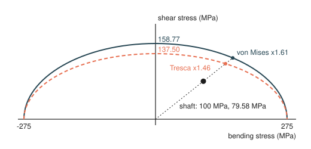

# Torsion and yield: twist a shaft, then ask whether the steel gives way

[Syllabus](../../../SYLLABUS.md) → [Engineering mathematics](../README.md) → [Mechanics and Structures](../README.md#s07) → Torsion and yield

---

## General Overview

Some footbridges open to let boats through. A gear motor turns the deck, and the motor's twist reaches the gears through a steel drive shaft. Ours is a solid round bar of grade S275 steel, 40 mm across. At full power it carries 1 kN m of torque (a twisting push: 1000 N on a 1 m lever).

The shaft also bends. The gear on its end is pushed sideways by the teeth it drives, and that push bends the shaft at the bearing. There, the bending alone puts 100 MPa (megapascals, millions of newtons per square metre) on the shaft's surface.

The engineer wants three numbers. How hard is the steel being sheared by the twist? How far does the shaft wind up? And with twist and bending together, how close is the steel to giving way for good? The answers are 79.58 MPa of shear stress, 0.0504 rad of twist per metre (2.886°), and a safety factor of 1.61 by the von Mises rule or 1.46 by the Tresca rule, against S275's yield stress of 275 MPa (the stress at which the steel starts to stretch for good).

The last answer is the new idea. The steel's strength is measured in a pull test, where only one stress acts. The shaft carries two different stresses at once. A **yield criterion** turns the mix into one **equivalent stress** that can be compared with the pull-test number.

**A twisted round shaft shears in proportion to the distance from its centre, and a yield criterion folds that shear and the bending stress into one equivalent stress, which is then compared with the steel's yield stress from a pull test.**

**What kind of fact this is:** two models and a theorem. The torsion formula is a model: it assumes elastic steel and round cross-sections that turn without warping. The von Mises and Tresca criteria are models fitted to experiment. That Tresca lies between 1 and 1.1547 times von Mises is a theorem. This card proves it in Why it works for a point carrying bending plus twist; it holds for every stress state, but that wider proof is not given here.

### The picture: where the shaft sits against the two yield boundaries

<p align="center"></p>

To scale, 0.8 px per MPa on both axes. Across: the bending stress. Up: the shear stress from the twist. Any point inside a boundary is safe by that rule. The dotted line scales the shaft's two stresses up together; where it crosses a boundary, the steel starts to yield. Solid: von Mises. Dashed: Tresca.

---

## The formula

Notation first, in words. On this card $`T`$ is torque. (The [Rotation](02-rigid-body-rotation-and-moment-of-inertia.md) card wrote torque as τ; here τ, tau, is **shear stress**: force per area acting along a surface, not across it.) **Shear strain**, γ (gamma), is how far a small square of steel is skewed out of square, in radians. $`G`$ is the **shear modulus**, the steel's stiffness against shearing. (In this wing G(s) also names a transfer function; on this card G is only the shear modulus.)

The **torsion formulas** for a round shaft:

```math
J = \frac{\pi d^4}{32}, \qquad \tau = \frac{T\rho}{J}, \qquad \tau_{\max} = \frac{T r}{J}, \qquad \frac{\varphi}{L} = \frac{T}{G J}
```

**Read it aloud:** the shaft's polar second moment is pi times diameter to the fourth over 32; the shear stress at radius rho is torque times rho over J, largest at the surface; and the twist per length is torque over the shaft's twisting stiffness, GJ.

The **yield criteria**, for a surface point carrying a bending stress σ along the shaft and a shear stress τ round it:

```math
\sigma_{vm} = \sqrt{\sigma^2 + 3\tau^2}, \qquad \sigma_{Tr} = \sqrt{\sigma^2 + 4\tau^2}, \qquad n = \frac{\sigma_y}{\sigma_{\mathrm{eq}}}
```

**Read it aloud:** the von Mises equivalent stress is the square root of bending stress squared plus three times shear stress squared; Tresca uses four instead of three; the safety factor is the yield stress over whichever equivalent stress is used.

Worked once: $`\sqrt{100^2 + 3 \times 79.58^2} = 170.29`$ MPa, and $`275 / 170.29 = 1.61`$.

| Symbol | Plain meaning | In our example | Push it up and the answer… |
| --- | --- | --- | --- |
| $`T`$ | torque the shaft carries, N m | 1000 N m | shear stress and twist rise in proportion |
| $`d`$, $`r`$, $`\rho`$ | diameter; outer radius $`r = d/2`$; $`\rho`$ (rho) is any radius inside, from 0 to $`r`$ | 40 mm, 20 mm | a bigger $`d`$ cuts stress as $`1/d^3`$, twist as $`1/d^4`$ |
| $`J`$ | polar second moment of area: the sum of each small area times its distance from the centre squared, m⁴ | 2.5133e-07 m⁴ | stress and twist fall |
| $`\tau`$, $`\tau_{\max}`$ | shear stress at radius $`\rho`$, and its largest value, at the surface, Pa | 79.58 MPa at the surface | equivalent stress rises |
| $`\gamma`$, $`\varepsilon`$ | shear strain: the skew of a small square, rad; $`\varepsilon`$ is ordinary strain, stretch per length (Step 2 only) | $`\tau/G`$ = 0.00101 at the surface | — |
| $`G`$, $`E`$ | shear modulus: stiffness against shearing, Pa; $`E`$ is Young's modulus, stiffness against stretching (Step 2 only) | 79 GPa | twist falls; stress unchanged |
| $`\varphi`$, $`L`$ | twist angle (phi) between two sections a length $`L`$ apart, rad and m | 0.0504 rad over 1 m | — |
| $`\sigma`$, $`M`$, $`W`$ | bending stress on the surface, $`M/W`$, from the bending moment $`M`$ and section modulus $`W = \pi d^3/32`$ ([Stress, strain and bending](07-stress-strain-and-beam-bending.md)) | 100 MPa, from 628.3 N m | equivalent stress rises |
| $`\sigma_1`$, $`\sigma_2`$, $`\sigma_3`$ | principal stresses: the pure pulls and pushes on the three planes that carry no shear | 143.98, 0, −43.98 MPa | — |
| $`\sigma_{vm}`$, $`u_d`$, $`m`$, $`s_i`$ | von Mises equivalent stress; $`u_d`$ is the distortion energy it measures, J/m³; $`m`$ is the average of the three principal stresses, and $`s_i = \sigma_i - m`$ is what is left of each (Step 6 fold) | 170.29 MPa; 61.18 kJ/m³ | safety factor falls |
| $`\sigma_{Tr}`$, $`\sigma_{\mathrm{eq}}`$, $`k`$ | Tresca equivalent stress; $`\sigma_{\mathrm{eq}}`$ stands for either one; $`k = \tau/\sigma`$, shear over bending (Step 7) | 187.96 MPa; $`k`$ = 0.7958 | safety factor falls |
| $`\sigma_y`$, $`\tau_y`$, $`n`$ | yield stress in a pull test; shear stress that yields in pure twist; safety factor | 275 MPa; 158.77 or 137.50 MPa; 1.61 and 1.46 | — |

Gere's property tables (in Sources) give steel's G as 75 to 80 GPa. [Stress in 3D](10-stress-tensor-and-mohrs-circle.md) gets 76.92 GPa from E = 200 GPa and Poisson's ratio 0.30; the 79 GPa used here matches E = 205.4 GPa. Only the twist depends on G: at 76.92 GPa it would be 0.0517 rad/m.

### When it holds

- **Elastic steel, below yield.** The formulas assume shear stress stays in proportion to shear strain. Push the same shaft to 2.5 kN m of pure twist and the formula reports 198.94 MPa, more shear than the steel can carry (158.77 MPa). In truth the outer ring, from 12.45 mm out to the surface, has yielded. At 2660.2 N m the whole section has yielded and the shaft winds up freely.
- **A round section, solid or hollow.** A round section turns like a coin and stays flat. A square or I-shaped bar warps out of its plane when twisted, and $`\tau = T\rho/J`$ is wrong for it.
- **Away from changes of shape.** At a keyway (the slot that locks a gear to the shaft) or a shoulder, the stress jumps above the formula's value. Design codes multiply by a stress-concentration factor there.
- **A steady load.** This card checks the first yield under one steady load. A turning shaft carries its bending stress first on one side, then on the other, every turn. Over millions of turns that reversal causes fatigue cracks well below yield, and fatigue usually sizes a real drive shaft.
- **A ductile metal.** Von Mises and Tresca describe metals that yield by slip, such as steel, aluminium and copper. Cast iron, concrete and stone crack first, and are checked by other rules.

---

## Why it works

### Step 0: a twisted round shaft is a stack of coins that slide past each other

Twist a round bar and each cross-section turns as a rigid disc: a radius drawn on the end stays straight. Neighbouring discs turn by slightly different angles, so the steel between them is sheared, more so further from the centre. Hooke's law turns skew into shear stress. Adding up the stresses' turning effect must give the torque. Those three facts give the torsion formulas.

### Step 1: shear strain grows straight-line with radius

Take two sections a short length $`dx`$ apart, turned by $`d\varphi`$ relative to each other. A point at radius $`\rho`$ moves round by $`\rho\, d\varphi`$. Spread over the length $`dx`$, that is the skew of a small square there:

```math
\gamma = \rho\, \frac{d\varphi}{dx}
```

At the centre nothing skews; at the surface the skew is largest. The twist rate $`d\varphi/dx`$ is the same at every radius.

### Step 2: Hooke's law in shear makes stress straight-line too

For steel below yield, shear stress is stiffness times skew, $`\tau = G\gamma = G\rho\, d\varphi/dx`$. This is the shear version of $`\sigma = E\varepsilon`$ (stress equals Young's modulus $`E`$, the stiffness against stretching, times strain $`\varepsilon`$, the stretch per length) from [Stress, strain and bending](07-stress-strain-and-beam-bending.md).

### Step 3: the stresses' turning effect is the torque

A thin ring at radius $`\rho`$ and width $`d\rho`$ has area $`2\pi\rho\, d\rho`$. Its shear stress pushes round the ring at lever arm $`\rho`$. Adding up every ring:

```math
T = \int_0^r \tau\, \rho\, 2\pi\rho\, d\rho = G\frac{d\varphi}{dx} \int_0^r \rho^2\, 2\pi\rho\, d\rho = G J \frac{d\varphi}{dx}
```

The last integral is $`J = 2\pi r^4/4 = \pi d^4/32`$. It counts each bit of area by the square of its distance from the centre. That is the area version of the moment of inertia on the [Rotation](02-rigid-body-rotation-and-moment-of-inertia.md) card, which counts mass the same way. So $`d\varphi/dx = T/(GJ)`$, and putting that back into Step 2 gives $`\tau = T\rho/J`$.

For our shaft: $`J`$ = 2.5133e-07 m⁴, $`\tau_{\max}`$ = 1000 × 0.02 / 2.5133e-07 = 79.58 MPa, and the twist rate is 1000 / (79e9 × 2.5133e-07) = 0.0504 rad/m.

A second road to the twist uses energy. The twisted steel stores $`\tau^2/(2G)`$ joules in each cubic metre. Over one metre of shaft that is 25.18 J/m. The torque does work $`T\varphi/2`$ as it winds the shaft up from nothing, so $`\varphi/L = 2 \times 25.18 / 1000`$ = 0.0504 rad/m again.

### Step 4: at the surface, two stresses act on one small cube

Take a small cube of steel at the surface, on the side where bending stretches the shaft. Along the shaft it is pulled by σ = 100 MPa. On the same faces, and on the faces at right angles, the twist shears it by τ = 79.58 MPa. Nothing pushes on the outer face.

Turn the cube and the stresses on its faces change. [Stress in 3D](10-stress-tensor-and-mohrs-circle.md) shows that one orientation carries no shear at all, only pure pulls and pushes: the principal stresses. For this cube they are

```math
\sigma_{1,3} = \frac{\sigma}{2} \pm \sqrt{\left(\frac{\sigma}{2}\right)^2 + \tau^2} = 50 \pm 93.98 \text{ MPa}, \qquad \sigma_2 = 0
```

So the cube is pulled by 143.98 MPa one way, pushed by 43.98 MPa at right angles, and free on its outer face. The names follow the 3D order of [Stress in 3D](10-stress-tensor-and-mohrs-circle.md), largest first: the free face's zero lies between the other two, so it is σ₂, and the push is σ₃ = −43.98 MPa.

### Step 5: Tresca, steel yields when the largest shear reaches a limit

Metals yield by slip: layers of atoms slide over each other, and shear drives that slide. Henri Tresca proposed in 1864 that yield starts when the largest shear stress on any plane reaches a fixed value. The largest shear in a cube is half the gap between its largest and smallest principal stress. In a pull test that gap is $`\sigma_y`$, so the limit is $`\sigma_y/2`$. Yield starts when

```math
\sigma_{Tr} = \sigma_{\max} - \sigma_{\min} = \sigma_y
```

Here $`\sigma_1 - \sigma_3 = 2\sqrt{(\sigma/2)^2 + \tau^2} = \sqrt{\sigma^2 + 4\tau^2}`$ = 187.96 MPa. The free outer face, $`\sigma_2 = 0`$, lies between the other two, so it does not change the gap.

### Step 6: von Mises, steel yields when its distortion energy reaches a limit

Strained steel stores energy by changing volume and by changing shape. An equal squeeze from every side changes only volume, and steel does not yield under it. So only the shape-changing part, the **distortion energy** $`u_d`$, should count. Richard von Mises proposed this criterion in 1913, and Heinrich Hencky gave it the energy reading in 1924.

To isolate it, subtract the average of the three principal stresses from each of them. What is left changes shape only. Its energy, compared with the energy at yield in a pull test, gives

```math
\sigma_{vm} = \sqrt{\tfrac12\left[(\sigma_1 - \sigma_2)^2 + (\sigma_2 - \sigma_3)^2 + (\sigma_3 - \sigma_1)^2\right]} = \sqrt{\sigma^2 + 3\tau^2}
```

For our cube that is 170.29 MPa. In energy terms: the cube holds 61.18 kJ/m³ of distortion energy, and a pull-test bar holds 159.55 kJ/m³ at the moment it yields.

<details>
<summary>The algebra: from distortion energy to the square root</summary>

Write $`m = (\sigma_1 + \sigma_2 + \sigma_3)/3`$ for the average stress and $`s_i = \sigma_i - m`$ for what is left. The leftover changes shape only. It strains the steel by $`s_i/(2G)`$ along each principal axis, and stored energy is half of stress times strain, so its energy per cubic metre is

$`\displaystyle u_d = \frac{s_1^2 + s_2^2 + s_3^2}{4G} = \frac{(\sigma_1 - \sigma_2)^2 + (\sigma_2 - \sigma_3)^2 + (\sigma_3 - \sigma_1)^2}{12G}.`$

The second form uses $`s_1^2 + s_2^2 + s_3^2 = \tfrac13[(\sigma_1-\sigma_2)^2 + (\sigma_2-\sigma_3)^2 + (\sigma_3-\sigma_1)^2]`$, which holds because the $`s_i`$ add to zero. In a pull test the principal stresses are $`\sigma_y, 0, 0`$, so $`u_d = \sigma_y^2/(6G)`$. Setting the two equal gives the bracket form of $`\sigma_{vm}`$.

For the surface cube, $`\sigma_1 - \sigma_3 = 2R`$ with $`R = \sqrt{\sigma^2/4 + \tau^2}`$, and $`\sigma_1\sigma_3 = \sigma^2/4 - R^2 = -\tau^2`$. With $`\sigma_2 = 0`$ the bracket is $`(\sigma_1 - \sigma_3)^2 + \sigma_1^2 + \sigma_3^2 = 2(\sigma_1 - \sigma_3)^2 + 2\sigma_1\sigma_3 = 8R^2 - 2\tau^2 = 2\sigma^2 + 6\tau^2`$. Half of it is $`\sigma^2 + 3\tau^2`$.

</details>

### Step 7: under bending plus twist, Tresca is the stricter rule, by at most 15.5%

Divide one criterion by the other, writing $`k = \tau/\sigma`$:

```math
1 \le \frac{\sigma_{Tr}}{\sigma_{vm}} = \sqrt{\frac{1 + 4k^2}{1 + 3k^2}} \le \frac{2}{\sqrt 3} = 1.1547
```

The middle fraction is 1 when there is no shear. It grows as $`k`$ grows, because the top gains $`4k^2`$ while the bottom gains only $`3k^2`$. It never reaches 4/3, since $`(1 + 4k^2)/(1 + 3k^2) = 4/3 - (1/3)/(1 + 3k^2)`$. Its square root therefore stays below $`2/\sqrt 3`$. Our shaft, with $`k`$ = 0.7958, sits at 1.1038. This covers any point with one normal stress plus shear, such as the shaft's surface. The same bound holds for every stress state, but the general proof is not given here.

The gap is widest in pure twist. Setting σ = 0, von Mises yields at $`\tau_y = \sigma_y/\sqrt 3`$ = 158.77 MPa and Tresca at $`\sigma_y/2`$ = 137.50 MPa. In the picture, that is where the two ellipses meet the shear axis.

**Which is right?** Tension-and-twist tests on thin metal tubes (Taylor and Quinney, in Sources) fall close to von Mises. Tresca is simpler to apply by hand and errs on the safe side, so many codes allow either. Eurocode 3, the European design code for steel structures, checks steel with von Mises.

---

## Worked numbers, by hand

| Step | Arithmetic | Value |
| --- | --- | --- |
| polar second moment | $`\pi \times 0.04^4 / 32`$ | 2.5133e-07 m⁴ |
| surface shear stress | 1000 N m × 0.02 m / 2.5133e-07 m⁴ | 79.58 MPa |
| twist rate | 1000 / (79e9 × 2.5133e-07) | 0.0504 rad/m = 2.886°/m |
| bending moment behind 100 MPa | 100 MPa × $`\pi \times 0.04^3/32`$ = 100 MPa × 6.2832e-06 m³ | 628.3 N m |
| principal stresses | $`50 \pm \sqrt{50^2 + 79.58^2}`$ | 143.98 and −43.98 MPa |
| von Mises | $`\sqrt{100^2 + 3 \times 79.58^2}`$ | 170.29 MPa |
| Tresca | 143.98 − (−43.98) | 187.96 MPa |
| safety factors | 275 / 170.29 and 275 / 187.96 | **1.61 and 1.46** |
| torque that starts yield, bending held at 100 MPa | $`\sqrt{(275^2 - 100^2)/3}`$ MPa × J / r, and the same with 4 | 1858.6 N m and 1609.6 N m |
| torque that starts yield, bending growing with the torque | 1000 N m × 275 / 170.29, and × 275 / 187.96 | 1614.9 N m and 1463.0 N m |

Both loads could be multiplied together by 1.61 before the surface yields by von Mises, or by 1.46 by Tresca. In this drive they do grow together: the gear's push, which bends the shaft, is the motor torque divided by the gear's radius. So the motor can deliver up to 1463.0 N m before the stricter rule says the steel starts to give way. The 1609.6 N m with the bending held applies only to bending from a separate load that stays at 100 MPa while the torque rises.

The same comparison as bars, 1 mark per 10 MPa:

```
bending alone |##########                  | 100.0 MPa
von Mises     |#################           | 170.3 MPa
Tresca        |###################         | 188.0 MPa
yield S275    |############################| 275.0 MPa
```

### What breaks if you drop a piece

| Mistake | Comes out at | What went wrong |
| --- | --- | --- |
| Shear stress judged against the 275 MPa pull-test yield | safety factor 3.46 | Steel yields in shear at 158.77 MPa (von Mises), not 275 MPa |
| Bending and twist checked one at a time | 2.75 and 2.00, both comfortable | The two stresses act on the same cube; together the factor is 1.61 |
| Bending $`I = \pi d^4/64`$ used for $`J`$ | 159.15 MPa, 0.1007 rad/m | $`I`$ counts distance from a line across the section, $`J`$ from the centre point; $`J = 2I`$ |
| Diameter used for the radius | 159.15 MPa | The surface is at $`r = d/2`$ |
| Formula used past yield, 2.5 kN m pure twist | 198.94 MPa | Above 158.77 MPa the outer ring has yielded; the elastic core ends at 12.45 mm |

The code prints all five.

---

## Code, from first principles, and it actually runs

The code computes the shaft's stresses and its two safety factors. Each number is reached by at least two independent roads:

- **The torsion formulas** against thin rings: $`J`$ and the torque carried by the stresses are added up over 20,000 rings. The twist rate is checked by the energy balance of Step 3.
- **The principal stresses** against a plane scan: a cutting plane is turned through 180° in steps of 0.001°, and the largest pull, push and shear on it are recorded.
- **Von Mises** three ways: the short formula; the principal-stress formula; and the distortion energy, found from the stress tensor (the 3×3 table of the cube's face stresses) minus its average.
- **Tresca** three ways: the short formula, the gap between principal stresses, and twice the largest shear from the scan.
- **The torque that starts yield**, with the bending held and with the bending growing in step, by the closed form and by bisection (halving an interval that holds the answer until it is tiny).
- **The Step 7 bound** over 100,001 values of $`\tau/\sigma`$ from 0 to 1000.
- **The 2.5 kN m case** outside the model: the elastic core radius by the closed form and by bisection on the ring sum.

### Python

```python
# Torsion and yield -- the check behind the card.  Standard library only.
# A 40 mm solid steel shaft carries 1 kN m of torque and 100 MPa of bending
# stress.  Shear stress, twist, then the von Mises and Tresca yield checks.
from math import pi, sqrt, cos, sin, radians, degrees

d, T, G = 0.040, 1000.0, 79e9          # diameter m, torque N m, shear modulus Pa
sb, sy = 100e6, 275e6                   # bending stress Pa, yield stress Pa (S275)
r = d / 2
N = 20000                               # thin rings for the numerical roads
MPa = 1e-6

def rings(f):                           # sum f(radius) * ring area, midpoint rule
    dr = r / N
    return sum(f((k + 0.5) * dr) * 2 * pi * (k + 0.5) * dr * dr for k in range(N))
def ratio(a, b): return a / b if b else float("inf")   # as Rust's float division gives

# Road 1: closed forms.  Road 2: add up thin rings.
J = pi * d**4 / 32
J_rings = rings(lambda q: q * q)
tau = T * r / J
rate = T / (G * J)                      # twist per metre, rad/m
T_back = rings(lambda q: (tau * q / r) * q)       # turning effect of the stresses
U = rings(lambda q: (tau * q / r)**2 / (2 * G))  # stored energy per metre, J/m
rate_energy = 2 * U / T                 # work T*phi/2 equals stored energy
assert abs(J_rings - J) / J < 1e-8 and abs(T_back - T) < 1e-4
assert abs(rate_energy - rate) / rate < 1e-8
W = pi * d**3 / 32
print(f"J = pi d^4/32: {J:.4e} m^4; by {N} rings {J_rings:.4e} m^4")
print(f"surface shear stress T r / J: {tau*MPa:.2f} MPa")
print(f"torque carried by the ring stresses: {T_back:.2f} N m")
print(f"twist rate T/(G J): {rate:.4f} rad/m = {degrees(rate):.3f} deg/m")
print(f"twist rate from stored energy {U:.2f} J/m: {rate_energy:.4f} rad/m")
print(f"bending: W = pi d^3/32 = {W:.4e} m^3, moment for 100 MPa {sb*W:.1f} N m")
print(f"G from E = 200 GPa, nu = 0.30: {200e9/2.6/1e9:.2f} GPa; 79 GPa matches E = {G*2.6/1e9:.1f} GPa; twist at 76.92 GPa: {T/(200e9/2.6*J):.4f} rad/m")

# The surface point: sigma along the axis, tau round it, nothing else.
def vm(s, t): return sqrt(s * s + 3 * t * t)
def tr(s, t): return sqrt(s * s + 4 * t * t)
c, R = sb / 2, sqrt((sb / 2)**2 + tau**2)
s1, s2, s3 = c + R, 0.0, c - R          # 3D order, largest first
print(f"surface shear strain tau/G: {tau/G:.5f} rad; Mohr centre {c*MPa:.2f} MPa, radius {R*MPa:.2f} MPa")
print(f"principal stresses: {s1*MPa:.2f}, {s2*MPa:.2f}, {s3*MPa:.2f} MPa")
# Road 3: turn a cutting plane through 180 degrees in 0.001 degree steps.
smax = smin = shmax = 0.0
for k in range(180000):
    a = radians(k / 1000)
    sn = sb * cos(a)**2 + tau * sin(2 * a)
    sh = -sb * sin(a) * cos(a) + tau * cos(2 * a)
    smax, smin, shmax = max(smax, sn), min(smin, sn), max(shmax, abs(sh))
print(f"plane scan: largest {smax*MPa:.2f}, smallest {smin*MPa:.2f}, largest shear {shmax*MPa:.2f} MPa")
assert abs(smax - s1) < 1e3 and abs(smin - s3) < 1e3
vm_f, tr_f = vm(sb, tau), tr(sb, tau)
vm_p = sqrt(((s1 - s2)**2 + (s2 - s3)**2 + (s3 - s1)**2) / 2)
tr_p = max(s1, s2, s3) - min(s1, s2, s3)
# Road 4 for von Mises: distortion energy, from the stress tensor minus its mean.
S = [[sb, tau, 0.0], [tau, 0.0, 0.0], [0.0, 0.0, 0.0]]
m = sum(S[i][i] for i in range(3)) / 3
ud = sum((S[i][j] - (m if i == j else 0))**2 for i in range(3) for j in range(3)) / (4 * G)
ud_y = sy * sy / (6 * G)                # the same energy at yield in a tension test
vm_e = sy * sqrt(ud / ud_y)
assert abs(vm_p - vm_f) < 1e-3 and abs(vm_e - vm_f) < 1e-3
assert abs(tr_p - tr_f) < 1e-3 and abs(2 * shmax - tr_f) < 1e3
print(f"von Mises: formula {vm_f*MPa:.2f}, principals {vm_p*MPa:.2f}, energy {vm_e*MPa:.2f} MPa")
print(f"distortion energy {ud/1e3:.2f} kJ/m^3 against {ud_y/1e3:.2f} kJ/m^3 at yield")
print(f"Tresca: formula {tr_f*MPa:.2f}, principals {tr_p*MPa:.2f}, 2 x scan {2*shmax*MPa:.2f} MPa")
print(f"safety factors: von Mises {sy/vm_f:.2f}, Tresca {sy/tr_f:.2f}")

# Shear yield and the torque the shaft can take with the bending held.
ty_vm, ty_tr = sy / sqrt(3), sy / 2
print(f"pure twist yields at {ty_vm*MPa:.2f} MPa (von Mises), {ty_tr*MPa:.2f} MPa (Tresca)")
print(f"yield torque, no bending: {ty_vm*J/r:.1f} N m (von Mises), {ty_tr*J/r:.1f} N m (Tresca)")
def bisect(f, lo, hi):
    for _ in range(100):
        mid = (lo + hi) / 2
        lo, hi = (mid, hi) if f(mid) < 0 else (lo, mid)
    return (lo + hi) / 2
for name, f, k in (("von Mises", vm, 3), ("Tresca", tr, 4)):
    Tb = bisect(lambda x: f(sb, x * r / J) - sy, 0, 1e6)
    Tc = sqrt((sy * sy - sb * sb) / k) * J / r
    Tg = bisect(lambda x: f(sb * x / T, x * r / J) - sy, 0, 1e6)   # bending grows with the torque
    assert abs(Tb - Tc) < 1e-6 and abs(Tg - T * sy / f(sb, tau)) < 1e-6
    print(f"torque to yield, {name}: bending held at 100 MPa {Tc:.1f} N m (bisection {Tb:.1f}); bending growing with it {Tg:.1f} N m")
lo_hi = [tr(1.0, q / 100) / vm(1.0, q / 100) for q in range(0, 100001)]
assert 1.0 <= min(lo_hi) and max(lo_hi) <= 2 / sqrt(3) + 1e-12
print(f"Tresca/von Mises: here (k = tau/sigma = {ratio(tau, sb):.4f}) {tr_f/vm_f:.4f}; over tau/sigma 0 to 1000 from {min(lo_hi):.4f} to {max(lo_hi):.4f}, gap at most {100*(2/sqrt(3)-1):.1f}%")

# Outside the model: 2.5 kN m of pure twist.
T2 = 2500.0
t_el = T2 * r / J
def core_torque(re):                    # elastic core radius re, yielded ring outside
    return rings(lambda q: ty_vm * min(q / re, 1.0) * q)
Tp = 2 * pi * r**3 * ty_vm / 3
if t_el > ty_vm:                        # an elastic core exists only once the surface has yielded
    re_b = bisect(lambda x: T2 - core_torque(x), 1e-6, r)
    re_c = (4 * (r**3 - 3 * T2 / (2 * pi * ty_vm)))**(1 / 3)
    assert abs(re_b - re_c) < 2e-6
    print(f"2.5 kN m: formula says {t_el*MPa:.2f} MPa > {ty_vm*MPa:.2f}; elastic core {re_c*1e3:.2f} mm (bisection {re_b*1e3:.2f}); fully plastic at {Tp:.1f} N m")
else:
    print(f"2.5 kN m: {t_el*MPa:.2f} MPa, below {ty_vm*MPa:.2f}: still elastic; fully plastic at {Tp:.1f} N m")

# What breaks.
I_bend = pi * d**4 / 64
print(f"break: shear judged against 275 MPa: safety factor {sy/tau:.2f}")
print(f"break: checks one at a time: bending {ratio(sy, sb):.2f}, twist {ty_vm/tau:.2f}")
print(f"break: bending I = pi d^4/64 used for J: {T*r/I_bend*MPa:.2f} MPa, {T/(G*I_bend):.4f} rad/m")
print(f"break: d used for r: {T*d/J*MPa:.2f} MPa")

# Try changing.
Jh = pi * (0.040**4 - 0.030**4) / 32
print(f"try: tube 40/30 mm: J {Jh:.4e} m^4, shear {T*r/Jh*MPa:.1f} MPa, area down {100*0.75**2:.0f}%"
      f"; d 80 mm: {T*0.04/(pi*0.08**4/32)*MPa:.2f} MPa, {T/(G*pi*0.08**4/32):.4f} rad/m")
print(f"try: G 26 GPa: {T/(26e9*J):.4f} rad/m; no bending: safety factors {sy/vm(0, tau):.2f} and {sy/tr(0, tau):.2f}")

# Figure: the sigma-tau plane at 0.8 px per MPa, origin at (260, 200).
def px(s, t): return f"({260 + 0.8*s*MPa:.2f}, {200 - 0.8*t*MPa:.2f})"
nv, nt = sy / vm_f, sy / tr_f
print(f"figure, origin {px(0, 0)}, point {px(sb, tau)}, von Mises hit {px(nv*sb, nv*tau)}, Tresca hit {px(nt*sb, nt*tau)}")
print(f"figure, axis ends {px(-sy, 0)} {px(sy, 0)}, tau tops {px(0, ty_vm)} {px(0, ty_tr)}")
for lab, v in (("bending alone", sb), ("von Mises", vm_f), ("Tresca", tr_f), ("yield S275", sy)):
    print(f"bar {lab:<14}|{'#' * round(v * MPa / 10):<28}| {v*MPa:.1f} MPa")
print("ALL CHECKS PASS")
```

**Ran 2026-11-23 on macOS, Python 3.14.10, standard library only. All checks passed. Output, pasted from the run:**

```
J = pi d^4/32: 2.5133e-07 m^4; by 20000 rings 2.5133e-07 m^4
surface shear stress T r / J: 79.58 MPa
torque carried by the ring stresses: 1000.00 N m
twist rate T/(G J): 0.0504 rad/m = 2.886 deg/m
twist rate from stored energy 25.18 J/m: 0.0504 rad/m
bending: W = pi d^3/32 = 6.2832e-06 m^3, moment for 100 MPa 628.3 N m
G from E = 200 GPa, nu = 0.30: 76.92 GPa; 79 GPa matches E = 205.4 GPa; twist at 76.92 GPa: 0.0517 rad/m
surface shear strain tau/G: 0.00101 rad; Mohr centre 50.00 MPa, radius 93.98 MPa
principal stresses: 143.98, 0.00, -43.98 MPa
plane scan: largest 143.98, smallest -43.98, largest shear 93.98 MPa
von Mises: formula 170.29, principals 170.29, energy 170.29 MPa
distortion energy 61.18 kJ/m^3 against 159.55 kJ/m^3 at yield
Tresca: formula 187.96, principals 187.96, 2 x scan 187.96 MPa
safety factors: von Mises 1.61, Tresca 1.46
pure twist yields at 158.77 MPa (von Mises), 137.50 MPa (Tresca)
yield torque, no bending: 1995.2 N m (von Mises), 1727.9 N m (Tresca)
torque to yield, von Mises: bending held at 100 MPa 1858.6 N m (bisection 1858.6); bending growing with it 1614.9 N m
torque to yield, Tresca: bending held at 100 MPa 1609.6 N m (bisection 1609.6); bending growing with it 1463.0 N m
Tresca/von Mises: here (k = tau/sigma = 0.7958) 1.1038; over tau/sigma 0 to 1000 from 1.0000 to 1.1547, gap at most 15.5%
2.5 kN m: formula says 198.94 MPa > 158.77; elastic core 12.45 mm (bisection 12.45); fully plastic at 2660.2 N m
break: shear judged against 275 MPa: safety factor 3.46
break: checks one at a time: bending 2.75, twist 2.00
break: bending I = pi d^4/64 used for J: 159.15 MPa, 0.1007 rad/m
break: d used for r: 159.15 MPa
try: tube 40/30 mm: J 1.7181e-07 m^4, shear 116.4 MPa, area down 56%; d 80 mm: 9.95 MPa, 0.0031 rad/m
try: G 26 GPa: 0.1530 rad/m; no bending: safety factors 2.00 and 1.73
figure, origin (260.00, 200.00), point (340.00, 136.34), von Mises hit (389.19, 97.19), Tresca hit (377.04, 106.86)
figure, axis ends (40.00, 200.00) (480.00, 200.00), tau tops (260.00, 72.98) (260.00, 90.00)
bar bending alone |##########                  | 100.0 MPa
bar von Mises     |#################           | 170.3 MPa
bar Tresca        |###################         | 188.0 MPa
bar yield S275    |############################| 275.0 MPa
ALL CHECKS PASS
```

### Rust

```rust
// Torsion and yield -- the check behind the card.  Rust std only.
// A 40 mm solid steel shaft carries 1 kN m of torque and 100 MPa of bending
// stress.  Shear stress, twist, then the von Mises and Tresca yield checks.
use std::f64::consts::PI;

const D: f64 = 0.040; // diameter m
const R: f64 = D / 2.0;
const N: usize = 20000; // thin rings for the numerical roads
const MPA: f64 = 1e-6;

fn rings(f: &dyn Fn(f64) -> f64) -> f64 {
    // sum f(radius) * ring area, midpoint rule
    let dr = R / N as f64;
    (0..N).map(|k| { let q = (k as f64 + 0.5) * dr; f(q) * 2.0 * PI * q * dr }).sum()
}
fn sci(x: f64) -> String {
    // the same text as Python's {:.4e}
    let e = x.abs().log10().floor() as i32;
    let m = x / 10f64.powi(e);
    format!("{:.4}e{}{:02}", m, if e < 0 { "-" } else { "+" }, e.abs())
}
fn vm(s: f64, t: f64) -> f64 { (s * s + 3.0 * t * t).sqrt() }
fn tr(s: f64, t: f64) -> f64 { (s * s + 4.0 * t * t).sqrt() }
fn bisect(f: &dyn Fn(f64) -> f64, mut lo: f64, mut hi: f64) -> f64 {
    for _ in 0..100 {
        let mid = (lo + hi) / 2.0;
        if f(mid) < 0.0 { lo = mid } else { hi = mid }
    }
    (lo + hi) / 2.0
}
fn px(s: f64, t: f64) -> String { format!("({:.2}, {:.2})", 260.0 + 0.8 * s * MPA, 200.0 - 0.8 * t * MPA) }

fn main() {
    let (t, g, sb, sy) = (1000.0_f64, 79e9_f64, 100e6_f64, 275e6_f64);
    // Road 1: closed forms.  Road 2: add up thin rings.
    let j = PI * D.powi(4) / 32.0;
    let j_rings = rings(&|q| q * q);
    let tau = t * R / j;
    let rate = t / (g * j); // twist per metre, rad/m
    let t_back = rings(&|q| (tau * q / R) * q);
    let u = rings(&|q| (tau * q / R).powi(2) / (2.0 * g));
    let rate_energy = 2.0 * u / t; // work T*phi/2 equals stored energy
    assert!((j_rings - j).abs() / j < 1e-8 && (t_back - t).abs() < 1e-4);
    assert!((rate_energy - rate).abs() / rate < 1e-8);
    let w = PI * D.powi(3) / 32.0;
    println!("J = pi d^4/32: {} m^4; by {} rings {} m^4", sci(j), N, sci(j_rings));
    println!("surface shear stress T r / J: {:.2} MPa", tau * MPA);
    println!("torque carried by the ring stresses: {:.2} N m", t_back);
    println!("twist rate T/(G J): {:.4} rad/m = {:.3} deg/m", rate, rate.to_degrees());
    println!("twist rate from stored energy {:.2} J/m: {:.4} rad/m", u, rate_energy);
    println!("bending: W = pi d^3/32 = {} m^3, moment for 100 MPa {:.1} N m", sci(w), sb * w);
    println!("G from E = 200 GPa, nu = 0.30: {:.2} GPa; 79 GPa matches E = {:.1} GPa; twist at 76.92 GPa: {:.4} rad/m",
        200e9 / 2.6 / 1e9, g * 2.6 / 1e9, t / (200e9 / 2.6 * j));

    // The surface point: sigma along the axis, tau round it, nothing else.
    let (c, rr) = (sb / 2.0, ((sb / 2.0).powi(2) + tau * tau).sqrt());
    let (s1, s2, s3) = (c + rr, 0.0_f64, c - rr); // 3D order, largest first
    println!("surface shear strain tau/G: {:.5} rad; Mohr centre {:.2} MPa, radius {:.2} MPa", tau / g, c * MPA, rr * MPA);
    println!("principal stresses: {:.2}, {:.2}, {:.2} MPa", s1 * MPA, s2 * MPA, s3 * MPA);
    // Road 3: turn a cutting plane through 180 degrees in 0.001 degree steps.
    let (mut smax, mut smin, mut shmax) = (0.0_f64, 0.0_f64, 0.0_f64);
    for k in 0..180000 {
        let a = (k as f64 / 1000.0).to_radians();
        let sn = sb * a.cos().powi(2) + tau * (2.0 * a).sin();
        let sh = -sb * a.sin() * a.cos() + tau * (2.0 * a).cos();
        smax = smax.max(sn); smin = smin.min(sn); shmax = shmax.max(sh.abs());
    }
    println!("plane scan: largest {:.2}, smallest {:.2}, largest shear {:.2} MPa", smax * MPA, smin * MPA, shmax * MPA);
    assert!((smax - s1).abs() < 1e3 && (smin - s3).abs() < 1e3);
    let (vm_f, tr_f) = (vm(sb, tau), tr(sb, tau));
    let vm_p = (((s1 - s2).powi(2) + (s2 - s3).powi(2) + (s3 - s1).powi(2)) / 2.0).sqrt();
    let tr_p = s1.max(s2).max(s3) - s1.min(s2).min(s3);
    // Road 4 for von Mises: distortion energy, from the stress tensor minus its mean.
    let st = [[sb, tau, 0.0], [tau, 0.0, 0.0], [0.0, 0.0, 0.0]];
    let m = (st[0][0] + st[1][1] + st[2][2]) / 3.0;
    let mut ud = 0.0;
    for i in 0..3 { for k in 0..3 { ud += (st[i][k] - if i == k { m } else { 0.0 }).powi(2); } }
    ud /= 4.0 * g;
    let ud_y = sy * sy / (6.0 * g); // the same energy at yield in a tension test
    let vm_e = sy * (ud / ud_y).sqrt();
    assert!((vm_p - vm_f).abs() < 1e-3 && (vm_e - vm_f).abs() < 1e-3);
    assert!((tr_p - tr_f).abs() < 1e-3 && (2.0 * shmax - tr_f).abs() < 1e3);
    println!("von Mises: formula {:.2}, principals {:.2}, energy {:.2} MPa", vm_f * MPA, vm_p * MPA, vm_e * MPA);
    println!("distortion energy {:.2} kJ/m^3 against {:.2} kJ/m^3 at yield", ud / 1e3, ud_y / 1e3);
    println!("Tresca: formula {:.2}, principals {:.2}, 2 x scan {:.2} MPa", tr_f * MPA, tr_p * MPA, 2.0 * shmax * MPA);
    println!("safety factors: von Mises {:.2}, Tresca {:.2}", sy / vm_f, sy / tr_f);

    // Shear yield and the torque the shaft can take with the bending held.
    let (ty_vm, ty_tr) = (sy / 3f64.sqrt(), sy / 2.0);
    println!("pure twist yields at {:.2} MPa (von Mises), {:.2} MPa (Tresca)", ty_vm * MPA, ty_tr * MPA);
    println!("yield torque, no bending: {:.1} N m (von Mises), {:.1} N m (Tresca)", ty_vm * j / R, ty_tr * j / R);
    let crit: [(&str, fn(f64, f64) -> f64, f64); 2] = [("von Mises", vm, 3.0), ("Tresca", tr, 4.0)];
    for (name, f, k) in crit {
        let tb = bisect(&|x| f(sb, x * R / j) - sy, 0.0, 1e6);
        let tc = ((sy * sy - sb * sb) / k).sqrt() * j / R;
        let tg = bisect(&|x| f(sb * x / t, x * R / j) - sy, 0.0, 1e6); // bending grows with the torque
        assert!((tb - tc).abs() < 1e-6 && (tg - t * sy / f(sb, tau)).abs() < 1e-6);
        println!("torque to yield, {}: bending held at 100 MPa {:.1} N m (bisection {:.1}); bending growing with it {:.1} N m", name, tc, tb, tg);
    }
    let ratios: Vec<f64> = (0..=100000).map(|q| tr(1.0, q as f64 / 100.0) / vm(1.0, q as f64 / 100.0)).collect();
    let (lo, hi) = ratios.iter().fold((f64::MAX, f64::MIN), |(a, b), &x| (a.min(x), b.max(x)));
    assert!(1.0 <= lo && hi <= 2.0 / 3f64.sqrt() + 1e-12);
    println!("Tresca/von Mises: here (k = tau/sigma = {:.4}) {:.4}; over tau/sigma 0 to 1000 from {:.4} to {:.4}, gap at most {:.1}%", tau / sb, tr_f / vm_f, lo, hi, 100.0 * (2.0 / 3f64.sqrt() - 1.0));

    // Outside the model: 2.5 kN m of pure twist.
    let t2 = 2500.0;
    let t_el = t2 * R / j;
    let core_torque = |re: f64| rings(&|q| ty_vm * (q / re).min(1.0) * q);
    let tp = 2.0 * PI * R.powi(3) * ty_vm / 3.0;
    if t_el > ty_vm { // an elastic core exists only once the surface has yielded
        let re_b = bisect(&|x| t2 - core_torque(x), 1e-6, R);
        let re_c = (4.0 * (R.powi(3) - 3.0 * t2 / (2.0 * PI * ty_vm))).cbrt();
        assert!((re_b - re_c).abs() < 2e-6);
        println!("2.5 kN m: formula says {:.2} MPa > {:.2}; elastic core {:.2} mm (bisection {:.2}); fully plastic at {:.1} N m",
            t_el * MPA, ty_vm * MPA, re_c * 1e3, re_b * 1e3, tp);
    } else {
        println!("2.5 kN m: {:.2} MPa, below {:.2}: still elastic; fully plastic at {:.1} N m", t_el * MPA, ty_vm * MPA, tp);
    }

    // What breaks.
    let i_bend = PI * D.powi(4) / 64.0;
    println!("break: shear judged against 275 MPa: safety factor {:.2}", sy / tau);
    println!("break: checks one at a time: bending {:.2}, twist {:.2}", sy / sb, ty_vm / tau);
    println!("break: bending I = pi d^4/64 used for J: {:.2} MPa, {:.4} rad/m", t * R / i_bend * MPA, t / (g * i_bend));
    println!("break: d used for r: {:.2} MPa", t * D / j * MPA);

    // Try changing.
    let jh = PI * (0.040f64.powi(4) - 0.030f64.powi(4)) / 32.0;
    let j8 = PI * 0.08f64.powi(4) / 32.0;
    println!("try: tube 40/30 mm: J {} m^4, shear {:.1} MPa, area down {:.0}%; d 80 mm: {:.2} MPa, {:.4} rad/m",
        sci(jh), t * R / jh * MPA, 100.0 * 0.75f64.powi(2), t * 0.04 / j8 * MPA, t / (g * j8));
    println!("try: G 26 GPa: {:.4} rad/m; no bending: safety factors {:.2} and {:.2}", t / (26e9 * j), sy / vm(0.0, tau), sy / tr(0.0, tau));

    // Figure: the sigma-tau plane at 0.8 px per MPa, origin at (260, 200).
    let (nv, nt) = (sy / vm_f, sy / tr_f);
    println!("figure, origin {}, point {}, von Mises hit {}, Tresca hit {}", px(0.0, 0.0), px(sb, tau), px(nv * sb, nv * tau), px(nt * sb, nt * tau));
    println!("figure, axis ends {} {}, tau tops {} {}", px(-sy, 0.0), px(sy, 0.0), px(0.0, ty_vm), px(0.0, ty_tr));
    for (lab, v) in [("bending alone", sb), ("von Mises", vm_f), ("Tresca", tr_f), ("yield S275", sy)] {
        let bar = "#".repeat((v * MPA / 10.0).round() as usize);
        println!("bar {:<14}|{:<28}| {:.1} MPa", lab, bar, v * MPA);
    }
    println!("ALL CHECKS PASS");
}
```

**Ran 2026-11-23 on macOS, rustc 1.98.1, no crates. All checks passed. Output, pasted from the run:**

```
J = pi d^4/32: 2.5133e-07 m^4; by 20000 rings 2.5133e-07 m^4
surface shear stress T r / J: 79.58 MPa
torque carried by the ring stresses: 1000.00 N m
twist rate T/(G J): 0.0504 rad/m = 2.886 deg/m
twist rate from stored energy 25.18 J/m: 0.0504 rad/m
bending: W = pi d^3/32 = 6.2832e-06 m^3, moment for 100 MPa 628.3 N m
G from E = 200 GPa, nu = 0.30: 76.92 GPa; 79 GPa matches E = 205.4 GPa; twist at 76.92 GPa: 0.0517 rad/m
surface shear strain tau/G: 0.00101 rad; Mohr centre 50.00 MPa, radius 93.98 MPa
principal stresses: 143.98, 0.00, -43.98 MPa
plane scan: largest 143.98, smallest -43.98, largest shear 93.98 MPa
von Mises: formula 170.29, principals 170.29, energy 170.29 MPa
distortion energy 61.18 kJ/m^3 against 159.55 kJ/m^3 at yield
Tresca: formula 187.96, principals 187.96, 2 x scan 187.96 MPa
safety factors: von Mises 1.61, Tresca 1.46
pure twist yields at 158.77 MPa (von Mises), 137.50 MPa (Tresca)
yield torque, no bending: 1995.2 N m (von Mises), 1727.9 N m (Tresca)
torque to yield, von Mises: bending held at 100 MPa 1858.6 N m (bisection 1858.6); bending growing with it 1614.9 N m
torque to yield, Tresca: bending held at 100 MPa 1609.6 N m (bisection 1609.6); bending growing with it 1463.0 N m
Tresca/von Mises: here (k = tau/sigma = 0.7958) 1.1038; over tau/sigma 0 to 1000 from 1.0000 to 1.1547, gap at most 15.5%
2.5 kN m: formula says 198.94 MPa > 158.77; elastic core 12.45 mm (bisection 12.45); fully plastic at 2660.2 N m
break: shear judged against 275 MPa: safety factor 3.46
break: checks one at a time: bending 2.75, twist 2.00
break: bending I = pi d^4/64 used for J: 159.15 MPa, 0.1007 rad/m
break: d used for r: 159.15 MPa
try: tube 40/30 mm: J 1.7181e-07 m^4, shear 116.4 MPa, area down 56%; d 80 mm: 9.95 MPa, 0.0031 rad/m
try: G 26 GPa: 0.1530 rad/m; no bending: safety factors 2.00 and 1.73
figure, origin (260.00, 200.00), point (340.00, 136.34), von Mises hit (389.19, 97.19), Tresca hit (377.04, 106.86)
figure, axis ends (40.00, 200.00) (480.00, 200.00), tau tops (260.00, 72.98) (260.00, 90.00)
bar bending alone |##########                  | 100.0 MPa
bar von Mises     |#################           | 170.3 MPa
bar Tresca        |###################         | 188.0 MPa
bar yield S275    |############################| 275.0 MPa
ALL CHECKS PASS
```

### Lean

Lean proves the Step 7 bound and the algebra of Steps 4 to 6, for every bending stress σ and shear stress τ.

- Take any σ and τ. Then $`\sigma_{vm} \le \sigma_{Tr} \le (2/\sqrt 3)\,\sigma_{vm}`$.
- Suppose σ is not zero, and write $`k = \tau/\sigma`$. Then $`\sigma_{Tr}/\sigma_{vm} = \sqrt{(1 + 4k^2)/(1 + 3k^2)}`$.
- That ratio is at least 1 and stays strictly below $`2/\sqrt 3`$. It grows strictly as $`k`$ grows from 0.
- Take $`\sigma_{1,3} = \sigma/2 \pm \sqrt{(\sigma/2)^2 + \tau^2}`$ and $`\sigma_2 = 0`$. Then $`\sigma_3 \le \sigma_2 \le \sigma_1`$ and $`\sigma_1 - \sigma_3 = \sigma_{Tr}`$.
- Keep the same three principal stresses. Then the bracket form of von Mises in Step 6 equals $`\sqrt{\sigma^2 + 3\tau^2}`$.

The torsion formulas, the plane scan, the distortion energy and every decimal number are left to the Python and Rust checks.

```lean
-- Torsion and yield: for a point carrying a bending stress σ and a shear stress τ, the Tresca equivalent stress √(σ² + 4τ²) lies between 1 and 2/√3 times the von Mises equivalent stress √(σ² + 3τ²), and both come from the principal stresses.
import Mathlib.Analysis.Real.Sqrt
import Mathlib.Order.Monotone.Basic

/-- The von Mises equivalent stress of a point with bending stress `σ` and shear stress `τ`. -/
noncomputable def vonMises (σ τ : ℝ) : ℝ := Real.sqrt (σ ^ 2 + 3 * τ ^ 2)

/-- The Tresca equivalent stress of a point with bending stress `σ` and shear stress `τ`. -/
noncomputable def tresca (σ τ : ℝ) : ℝ := Real.sqrt (σ ^ 2 + 4 * τ ^ 2)

/-- Under bending plus twist, the Tresca equivalent stress is at least the von Mises equivalent
stress and at most 2/√3 (about 1.1547) times it, for every bending stress σ and shear stress τ. -/
theorem tresca_between_one_and_two_div_sqrt_three_vonMises (σ τ : ℝ) :
    vonMises σ τ ≤ tresca σ τ ∧ tresca σ τ ≤ 2 / Real.sqrt 3 * vonMises σ τ := by
  have h3 : (0:ℝ) < Real.sqrt 3 := Real.sqrt_pos.mpr (by norm_num)
  have h3sq : Real.sqrt 3 ^ 2 = 3 := Real.sq_sqrt (by norm_num)
  have hb : 0 ≤ σ ^ 2 + 3 * τ ^ 2 := by positivity
  refine ⟨Real.sqrt_le_sqrt (by nlinarith [sq_nonneg τ]), ?_⟩
  unfold tresca vonMises
  rw [Real.sqrt_le_left (by positivity), mul_pow, div_pow, Real.sq_sqrt hb, h3sq]
  rw [div_mul_eq_mul_div, le_div_iff₀ (by norm_num)]
  nlinarith [sq_nonneg σ]

/-- Step 7 in the card's terms: when the bending stress σ is not zero, writing k = τ/σ, the ratio of
Tresca to von Mises is √((1 + 4k²)/(1 + 3k²)); it is at least 1 and never reaches 2/√3; and as a
function of k it grows as k grows from 0. -/
theorem tresca_div_vonMises_eq_and_bounds (σ τ : ℝ) (hσ : σ ≠ 0) :
    tresca σ τ / vonMises σ τ
        = Real.sqrt ((1 + 4 * (τ / σ) ^ 2) / (1 + 3 * (τ / σ) ^ 2)) ∧
      1 ≤ tresca σ τ / vonMises σ τ ∧
      tresca σ τ / vonMises σ τ < 2 / Real.sqrt 3 ∧
      StrictMonoOn (fun k : ℝ => Real.sqrt ((1 + 4 * k ^ 2) / (1 + 3 * k ^ 2))) (Set.Ici 0) := by
  have hσ2 : 0 < σ ^ 2 := by positivity
  have hb : 0 < σ ^ 2 + 3 * τ ^ 2 := by positivity
  have ha : 0 < σ ^ 2 + 4 * τ ^ 2 := by positivity
  have hv : 0 < vonMises σ τ := Real.sqrt_pos.mpr hb
  have h3 : (0:ℝ) < Real.sqrt 3 := Real.sqrt_pos.mpr (by norm_num)
  have hboth := tresca_between_one_and_two_div_sqrt_three_vonMises σ τ
  refine ⟨?_, ?_, ?_, ?_⟩
  · unfold tresca vonMises
    rw [← Real.sqrt_div' _ hb.le]
    congr 1
    field_simp
  · rw [le_div_iff₀ hv, one_mul]
    exact hboth.1
  · rw [div_lt_iff₀ hv]
    have h3sq : Real.sqrt 3 ^ 2 = 3 := Real.sq_sqrt (by norm_num)
    have hlt : tresca σ τ * Real.sqrt 3 < 2 * vonMises σ τ := by
      unfold tresca vonMises
      rw [← Real.sqrt_mul ha.le, show (2:ℝ) = Real.sqrt 4 by
        rw [show (4:ℝ) = 2 ^ 2 by norm_num, Real.sqrt_sq (by norm_num)],
        ← Real.sqrt_mul (by norm_num)]
      apply Real.sqrt_lt_sqrt (by positivity)
      nlinarith
    rw [div_mul_eq_mul_div, lt_div_iff₀ h3]
    linarith
  · intro a ha b hb hab
    simp only [Set.mem_Ici] at ha hb
    apply Real.sqrt_lt_sqrt (by positivity)
    rw [div_lt_div_iff₀ (by positivity) (by positivity)]
    have : a ^ 2 < b ^ 2 := by nlinarith
    nlinarith

/-- Steps 4 to 6: the surface cube's principal stresses are σ₁,₃ = σ/2 ± √((σ/2)² + τ²) and σ₂ = 0.
The free face's zero lies between the other two; the gap σ₁ − σ₃ is the Tresca stress
√(σ² + 4τ²); and the principal-stress form of von Mises,
√(½[(σ₁ − σ₂)² + (σ₂ − σ₃)² + (σ₃ − σ₁)²]), equals √(σ² + 3τ²). -/
theorem principal_stresses_give_tresca_and_vonMises (σ τ : ℝ) :
    let σ₁ := σ / 2 + Real.sqrt ((σ / 2) ^ 2 + τ ^ 2)
    let σ₂ : ℝ := 0
    let σ₃ := σ / 2 - Real.sqrt ((σ / 2) ^ 2 + τ ^ 2)
    σ₃ ≤ σ₂ ∧ σ₂ ≤ σ₁ ∧
      σ₁ - σ₃ = tresca σ τ ∧
      Real.sqrt ((1 / 2) * ((σ₁ - σ₂) ^ 2 + (σ₂ - σ₃) ^ 2 + (σ₃ - σ₁) ^ 2)) = vonMises σ τ := by
  intro σ₁ σ₂ σ₃
  set s := Real.sqrt ((σ / 2) ^ 2 + τ ^ 2) with hsdef
  have hs0 : 0 ≤ s := Real.sqrt_nonneg _
  have hs2 : s ^ 2 = (σ / 2) ^ 2 + τ ^ 2 := Real.sq_sqrt (by positivity)
  have h1 : σ₁ = σ / 2 + s := rfl
  have h2 : σ₂ = 0 := rfl
  have h3 : σ₃ = σ / 2 - s := rfl
  refine ⟨?_, ?_, ?_, ?_⟩
  · rw [h3, h2]; nlinarith [sq_nonneg τ]
  · rw [h1, h2]; nlinarith [sq_nonneg τ]
  · rw [h1, h3]
    unfold tresca
    rw [show σ ^ 2 + 4 * τ ^ 2 = (2 * s) ^ 2 by nlinarith, Real.sqrt_sq (by positivity)]
    ring
  · rw [h1, h2, h3]
    unfold vonMises
    congr 1
    nlinarith

#print axioms tresca_between_one_and_two_div_sqrt_three_vonMises
#print axioms tresca_div_vonMises_eq_and_bounds
#print axioms principal_stresses_give_tresca_and_vonMises
```

**Checked 2026-11-23 on macOS, Lean 4.36.0-rc2, Mathlib v4.36.0-rc2. Every proof is complete and uses only Lean's standard axioms. Output, pasted from the run:**

```
'tresca_between_one_and_two_div_sqrt_three_vonMises' depends on axioms: [propext, Classical.choice, Quot.sound]
'tresca_div_vonMises_eq_and_bounds' depends on axioms: [propext, Classical.choice, Quot.sound]
'principal_stresses_give_tresca_and_vonMises' depends on axioms: [propext, Classical.choice, Quot.sound]
```

> [!TIP]
> **Try changing**
> - **Guess first:** what does a hollow shaft save? Steel near the centre carries little shear. A tube 40 mm outside and 30 mm inside has $`J = \pi(0.04^4 - 0.03^4)/32`$ = 1.7181e-07 m⁴, so the surface shear rises from 79.58 to 116.4 MPa, while the steel's area, and its weight, fall by 56%.
> - **Guess first:** what does doubling the diameter do? Set `d = 0.080`. Shear stress falls eightfold, to 9.95 MPa; twist falls sixteenfold, to 0.0031 rad/m.
> - **Guess first:** does the material's stiffness change the safety factor? Set `G = 26e9`, roughly aluminium. The twist triples to 0.1530 rad/m, but every stress, and so every safety factor, stays the same. Only the yield stress `sy` would move them.
> - **Guess first:** what if the bending stress is 0? Set `sb = 0`. The safety factors become 2.00 and 1.73: in pure twist the two rules differ by the full 15.5%.

---

## The usual mistake

> [!warning]
> **Comparing the shear stress with the pull-test yield stress.** 79.58 MPa against 275 MPa looks like a safety factor of 3.46. But steel gives way in shear at about 158.77 MPa (von Mises), and with the bending added the real factor is 1.61. Shear and pull are different stresses; only an equivalent stress can be compared with 275 MPa.
>
> - **Checking each load alone.** Bending alone gives 2.75, twist alone 2.00. Both look safe, and neither is the answer, 1.61.
> - **Using the bending $`I`$ for $`J`$.** $`\pi d^4/64`$ in place of $`\pi d^4/32`$ doubles the stress to 159.15 MPa and the twist to 0.1007 rad/m.
> - **Diameter for radius.** $`Td/J`$ gives 159.15 MPa, twice the true value.
> - **Trusting the formula past yield.** At 2.5 kN m it reports 198.94 MPa; the steel cannot carry that, and its outer ring has already yielded.

---

## Where you meet it in real life

- **Drive shafts.** Car propeller shafts, ship propeller shafts and bridge-opening drives carry torque and bending at once. Their first check is the one on this card, and the second is fatigue.
- **Bolts.** Tightening a bolt stretches it and twists it at the same time. Bolt-tightening rules combine the two with von Mises to set how far a bolt may be tightened.
- **Steel design codes.** Eurocode 3 checks a point that carries both normal and shear stress with the von Mises formula, against the yield stress of the grade, such as 275 MPa for S275.
- **Finite-element software.** Stress plots of a computer model are usually coloured by von Mises stress: one number per point that can be read against the yield stress.

> **Say it back**
> A twisted round shaft turns section by section like a stack of coins, so its shear strain and shear stress grow straight-line from the centre. Adding up the stresses' turning effect gives $`T = GJ\,\varphi/L`$, so the 40 mm shaft under 1 kN m shears at 79.58 MPa on its surface and twists 0.0504 rad per metre. Bending adds 100 MPa on the same small cube, so the steel carries two stresses at once. Tresca compares the largest shear with half the yield stress; von Mises compares the shape-changing energy with its value at yield in a pull test. They give equivalent stresses of 187.96 and 170.29 MPa, and safety factors of 1.46 and 1.61 against 275 MPa.

---

## What this builds on

- [Stress in 3D](10-stress-tensor-and-mohrs-circle.md): the stress tensor and the principal stresses, which both yield criteria are written in.
- [Stress, strain and bending](07-stress-strain-and-beam-bending.md): Hooke's law, the bending stress $`M/W`$, and S275's 275 MPa yield stress.
- [Rotation](02-rigid-body-rotation-and-moment-of-inertia.md): torque as a twisting push, and the second-moment sum that becomes $`J`$ here.

## Where this goes next

- [Finite elements](../08-Fluids%20and%20Heat/09-finite-element-method-in-outline.md): stresses in shapes with no formula, such as a shaft with a keyway, which are then read against yield through von Mises.

This card checks one steady load against first yield; how many turns a shaft survives when its bending stress reverses every revolution, well below yield, is the question it leaves open.

---

## Sources

Verified 2026-11-23: every link below resolves to the publisher's page.

- Goodno, Barry J., and James M. Gere. *Mechanics of Materials*, 9th ed. Cengage, 2018. [Publisher's page](https://www.cengage.com/c/mechanics-of-materials-9e-goodno-gere/9781337093347). Chapter 3, torsion of circular bars: the torsion formula, the twist rate and power transmission by shafts. Its property tables list steel's shear modulus as 75–80 GPa; this card uses 79 GPa.
- Beer, Ferdinand P., E. Russell Johnston, John T. DeWolf, and David F. Mazurek. *Mechanics of Materials*, 8th ed. McGraw Hill, 2020. [Publisher's page](https://www.mheducation.com/highered/product/mechanics-of-materials-beer.html?edition=8). Chapter 3 on torsion, and chapter 7 on transforming stress, with yield criteria for ductile materials under combined stress.
- Taylor, G. I., and H. Quinney. "The Plastic Distortion of Metals." *Philosophical Transactions of the Royal Society A* 230 (1931): 323–362. [doi:10.1098/rsta.1932.0009](https://doi.org/10.1098/rsta.1932.0009). Tension-and-twist tests on metal tubes that compare the two criteria.
- Yu, Mao-hong. "Advances in Strength Theories for Materials under Complex Stress State in the 20th Century." *Applied Mechanics Reviews* 55, no. 3 (2002): 169–218. [doi:10.1115/1.1472455](https://doi.org/10.1115/1.1472455). A survey of yield criteria, including Tresca's and von Mises', and their history.
- CEN. *EN 1993-1-1:2005, Eurocode 3: Design of steel structures, Part 1-1: General rules and rules for buildings*. Brussels: CEN, 2005. [European Commission Eurocode 3 page](https://eurocodes.jrc.ec.europa.eu/EN-Eurocodes/eurocode-3-design-steel-structures). The 275 MPa yield stress of S275 (Table 3.1) and the von Mises check for combined stress (clause 6.2.1).
