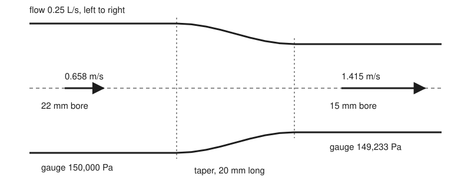
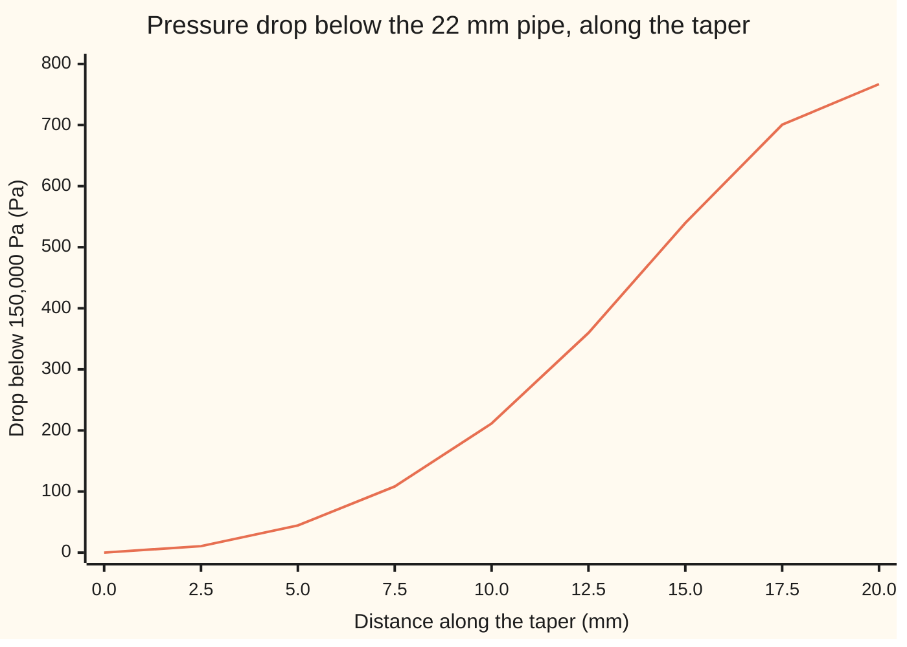

# Continuity and Bernoulli: what goes in comes out, and pressure trades against speed

[Syllabus](../../../SYLLABUS.md) → [Engineering mathematics](../README.md) → [Fluids and Heat](../README.md#s08) → Continuity and Bernoulli

---

## General Overview

A domestic central-heating loop: a boiler, a pump, copper pipes and radiators. The pump drives hot water at 70 °C round the loop at 0.25 litres per second. The main flow pipe has a 22 mm bore. Where it reduces to 15 mm, a reducing fitting narrows the bore over 20 mm of length. A gauge on the 22 mm pipe reads 1.5 bar above the air outside: 150,000 Pa. The card takes 22 and 15 mm as the bores, for round numbers. Real copper pipe is sized by its outside, so its bores are 20.2 and 13.6 mm; with those the speeds are 0.780 and 1.721 m/s and the drop is 1,150.4 Pa, 1.50 times the 767.0 Pa worked here. The method is the same.

An engineer wants two numbers for the 15 mm pipe. How fast does the water run there? And what does the pressure do as it squeezes through?

Two rules answer both. First, water does not pile up or vanish, so every second 0.25 litres leaves the narrow end because 0.25 litres entered the wide end. A smaller hole means faster water: 0.658 m/s becomes 1.415 m/s. Second, speeding water up takes a push, and inside a pipe the only push along the flow is a pressure difference. So the pressure must be lower ahead of the water than behind it. It falls by 767 Pa, to 149,233 Pa. That is the weight of an 8.0 cm column of water: small, but it is the same effect that runs a venturi flow meter or an aircraft's airspeed gauge.

<p align="center"></p>

To scale: 10 units per millimetre of pipe; speed arrows 100 units per m/s. The wall curve is the taper shape used in the code.

**In steady flow the volume passing each cross-section per second is the same, so a narrower pipe carries faster water, and along a streamline of frictionless flow pressure plus kinetic energy per cubic metre plus height energy per cubic metre stays constant, so faster water sits at lower pressure.**

**What kind of fact this is:** two theorems of a model. Continuity follows from conservation of mass; Bernoulli's equation follows from Newton's second law for a fluid with no friction. Both are proved on this card in Why it works. The model (water that does not compress and has no friction) is an assumption that fits this fitting well, and the card shows where it stops fitting.

---

## The formula

Notation first, in words. Subscript 1 marks the wide pipe and subscript 2 the narrow one. $A$ is a cross-section's area, $v$ the water's mean speed through it, $p$ its pressure, $z$ its height, $\rho$ (say "rho") the water's density and $g$ the acceleration of gravity.

$$A_1 v_1 = A_2 v_2 = Q \qquad\qquad p_1 + \tfrac12\rho v_1^2 + \rho g z_1 \;=\; p_2 + \tfrac12\rho v_2^2 + \rho g z_2$$

**Read it aloud:** the same volume crosses every section each second; and along a streamline, pressure plus kinetic energy per cubic metre plus height energy per cubic metre is the same at both ends.

Each Bernoulli term is in pascals, and a pascal is also a joule per cubic metre. So the second equation is an energy budget for each cubic metre of water.

| Symbol | Plain meaning | In our example | Push it up and the answer… |
| --- | --- | --- | --- |
| $Q$, $\dot m$ | volume flow, m^3/s; mass flow $\rho Q$, kg/s | 0.25 L/s; 0.2444 kg/s | both speeds rise in proportion, the drop with the square |
| $D_1$, $D_2$; $A_1$, $A_2$ | bores, m; areas $\pi D^2/4$, m^2 | 22 and 15 mm; 380.13 and 176.71 mm^2 | bigger $A_2$: slower throat, smaller drop |
| $v_1$, $v_2$; $v$ | mean speeds, m/s; the local velocity, a vector | 0.658 and 1.415 m/s | — |
| $p_1$, $p_2$; $p_3$ | pressure, Pa (here gauge: above the outside air); $p_3$, the pressure after a sudden widening back to 22 mm | 150,000 and 149,233 Pa; $p_3 = p_2 + 486.8$ Pa | raising $p_1$ lifts $p_2$ by the same amount |
| $\rho$ | density, kg/m^3 | 977.764 (water, 70 °C) | a denser fluid loses more pressure for the same speeds |
| $g$, $z$, $\hat z$; $h$ | gravity, 9.80665 m/s^2; height, m; $\hat z$, the unit vector pointing up; $h$, depth below a free surface, m | pipe level: $z_1 = z_2$ | a rise in $z_2$ costs $\rho g$ per metre of pressure |
| $s$, $x$ | distance along a streamline; along the taper, m | taper 0 to 20 mm | — |
| $\operatorname{div} v$ | outflow per unit volume from a point, per second | 0 for water | — |
| $t$, $a$ | time, s; a water parcel's acceleration, m/s^2 | 21.89 ms through; up to 75.32 m/s^2 | — |
| $\mu$, $\mathrm{Re}$ | viscosity, Pa·s; Reynolds number $\rho v D/\mu$ | 0.000403548; 51,416 in 15 mm | higher Re: a flatter speed profile, so one mean speed per section fits better |

### When it holds

- **The fluid does not compress.** Water's density barely changes with pressure. A gas moving faster than about 0.3 of its speed of sound changes density noticeably, and $A v$ is no longer constant: $\rho A v$ is.
- **No friction between the two points.** Over a 20 mm smooth taper friction is small. Over metres of pipe it is not, and the pressure falls even where the bore is constant: [Viscosity](02-viscosity-and-pipe-flow.md).
- **The flow does not separate.** Water speeding up into a narrowing follows the wall. Water slowing down through a sudden widening breaks into eddies. Bernoulli promises the 767 Pa back when the 15 mm pipe opens into 22 mm again; a momentum balance gives only 486.8 Pa, because 280.2 Pa is lost to the eddies.
- **Steady flow, no machine in between.** A pump adds energy and a valve slamming shut changes the flow in time. Neither is in this equation.
- **One mean speed per section.** Real speeds vary across the bore, fastest on the axis. Using the mean is a one-dimensional model; it is close for turbulent flow like this one, at a Reynolds number of 51,416.

---

## Why it works

### Step 0: nothing piles up, and speeding up needs a push

Two physical facts carry the whole card. Water is not created or destroyed, and it does not squash, so whatever enters a stretch of pipe each second leaves it. And a parcel of water obeys Newton's second law: to go faster it needs a net force along its path. In a level pipe with no friction, the only such force is the pressure behind it beating the pressure in front of it. Continuity turns the first fact into speeds. Bernoulli turns the second into pressures.

### Step 1: continuity from the divergence

The divergence of the velocity, $\operatorname{div} v$, is the volume flowing out of a tiny box around a point, per unit volume, per second ([Divergence and curl](../../06-Calculus%20and%20analysis/09-Vector%20Calculus/03-divergence-and-curl.md)). Water that does not compress cannot leave a box faster than it enters, so

$$\operatorname{div} v = 0 \quad\text{everywhere in the water.}$$

Add this up over the water between the two cross-sections. The [Divergence theorem](../../06-Calculus%20and%20analysis/09-Vector%20Calculus/07-divergence-theorem.md) says the total equals the net outflow through the boundary. The copper wall carries no flow across it. What remains is the outflow through section 2 minus the inflow through section 1, and it is zero:

$$A_2 v_2 - A_1 v_1 = 0.$$

Here $v_1$ and $v_2$ are mean speeds, since the integral over a section is its area times its mean speed. With 0.25 L/s, $v_1 = 0.25\times10^{-3}/(380.13\times10^{-6}) = 0.658$ m/s and $v_2 = 1.415$ m/s. The area ratio, 2.151, is the speed ratio. For a gas the same argument applied to mass gives $\rho_1 A_1 v_1 = \rho_2 A_2 v_2$.

### Step 2: Newton's law for a fluid, along one streamline

A **streamline** is the path a parcel of water follows in steady flow. Per cubic metre, Newton's law reads mass times acceleration equals the forces. The mass is $\rho$. The forces are the pressure pushing from high to low, $-\nabla p$, and gravity, $-\rho g$ in the upward direction. This is **Euler's equation**, Newton's law for a fluid without friction.

Take the part of it along the streamline, with $s$ the distance travelled. A parcel at speed $v$ that gains $dv$ over a distance $ds$ has acceleration $v\,dv/ds$, because it covers $ds$ in time $ds/v$. So

$$\rho\, v \frac{dv}{ds} \;=\; -\frac{dp}{ds} \;-\; \rho g \frac{dz}{ds}.$$

At the taper, a parcel's acceleration peaks at 75.32 m/s^2, and it crosses in 21.89 ms. That acceleration is what the pressure difference pays for.

<details>
<summary>Detailed step: the along-streamline part of Euler's equation</summary>

For steady flow the acceleration of a parcel is $(v\cdot\nabla)v$. A vector identity rewrites it as $\nabla(\tfrac12|v|^2) - v\times\operatorname{curl} v$. The second term is at right angles to $v$, so it has no part along the streamline; it only bends the path. The part of $\nabla(\tfrac12|v|^2)$ along the streamline is $d(\tfrac12 v^2)/ds = v\,dv/ds$. The same projection of $-\nabla p - \rho g\,\hat z$ gives $-dp/ds - \rho g\,dz/ds$. If the curl is zero everywhere, the cross term vanishes in every direction and the Bernoulli constant is the same on every streamline, not only along one.

</details>

### Step 3: add up along the streamline

The left side is $d(\tfrac12\rho v^2)/ds$, since $\rho$ is fixed. Every term is now a rate of change along $s$. Integrate from section 1 to section 2. The integral of a rate of change along a path is the change between its ends, whatever the path's shape; for $\nabla p$ this is the line integral of a gradient ([Line integrals of a field](../../06-Calculus%20and%20analysis/09-Vector%20Calculus/02-line-integrals.md)). So

$$\tfrac12\rho v_2^2 - \tfrac12\rho v_1^2 = -(p_2 - p_1) - \rho g (z_2 - z_1),$$

which rearranges to Bernoulli's equation. Notice what dropped out: the taper's shape and length. Only the end speeds matter. The code confirms this with two different taper shapes and two different lengths.

### Step 4: read it as energy

Pushing one cubic metre of water into a pipe against pressure $p$ takes $p$ joules. That cubic metre carries $\tfrac12\rho v^2$ joules of motion and $\rho g z$ joules of height. Bernoulli's equation says the total is kept along a streamline. In the taper, 767 J of every cubic metre's pressure work becomes motion. Where the pipe widens smoothly again, the motion turns back into pressure. Where it widens suddenly, part of it becomes eddies and then heat.

<details>
<summary>Detailed step: the loss at a sudden widening (Borda–Carnot)</summary>

Where the 15 mm pipe opens straight into 22 mm, the jet keeps its pressure $p_2$ as it enters, and the water in the corners sits at the same pressure. A little downstream the flow fills the 22 mm bore again at speed $v_1$ and pressure $p_3$. Momentum per second in minus out equals the net pressure force: $(p_2 - p_3)A_1 = \rho Q (v_1 - v_2)$, so $p_3 - p_2 = \rho v_1 (v_2 - v_1)$ = 486.8 Pa. Bernoulli would give $\tfrac12\rho(v_2^2 - v_1^2)$ = 767.0 Pa. The difference is exactly $\tfrac12\rho (v_2 - v_1)^2$ = 280.2 Pa, the Borda–Carnot loss. Energy is not destroyed: it leaves the pressure budget as eddies, then as heat.

</details>

---

## Worked numbers, by hand

Water at 70 °C, $\rho$ = 977.764 kg/m^3, $Q$ = 0.25 L/s, $p_1$ = 150,000 Pa, pipe level.

| Step | Arithmetic | Value |
| --- | --- | --- |
| area, 22 mm bore | $\pi \times 0.022^2 / 4$ | 380.13 mm^2 |
| area, 15 mm bore | $\pi \times 0.015^2 / 4$ | 176.71 mm^2 |
| speed in 22 mm | $0.25\times10^{-3} / 380.13\times10^{-6}$ | 0.658 m/s |
| speed in 15 mm | $0.658 \times 2.151$, the area ratio | 1.415 m/s |
| mass flow, both ends | $977.764 \times 0.25\times10^{-3}$ | 0.2444 kg/s |
| kinetic term, wide | $\tfrac12 \times 977.764 \times 0.658^2$ | 211.45 Pa |
| kinetic term, narrow | $\tfrac12 \times 977.764 \times 1.415^2$ | 978.45 Pa |
| pressure drop | $978.45 - 211.45$ | 767.0 Pa |
| **pressure in 15 mm** | $150{,}000 - 767.0$ | **149,233 Pa** |

The water leaves the fitting at 1.415 m/s, a little over twice its speed in the main, and its pressure is 767 Pa lower: 8.0 cm of water, small beside the 150,000 Pa on the gauge.

### What breaks if you drop a piece

| Mistake | Comes out at | What went wrong |
| --- | --- | --- |
| Speed scaled by the diameter ratio | 0.965 m/s and 243.4 Pa, not 1.415 m/s and 767.0 Pa | Flow goes through an area; area goes with diameter squared |
| The ½ dropped | 1,534.0 Pa | Kinetic energy is half mass times speed squared |
| The inlet's own speed ignored | 978.5 Pa | The water was already moving; only the change in kinetic energy costs pressure |
| Bernoulli used through a sudden widening | 767.0 Pa recovered, truly 486.8 Pa | The flow separates; 280.2 Pa goes to eddies |

The code prints all four.

### Along the taper



One line: the pressure drop below $p_1$ at each point of the smooth taper, from Bernoulli with the local speed. The bore runs 22.00, 21.73, 20.97, 19.84, 18.50, 17.16, 16.03, 15.27, 15.00 mm and the speed 0.658, 0.674, 0.724, 0.809, 0.930, 1.081, 1.240, 1.366, 1.415 m/s at those points. Most of the drop comes in the narrow half, because the drop goes with speed squared and speed goes with one over the bore squared.

---

## Code, from first principles, and it actually runs

The scripts reach the 767.0 Pa drop by three roads and run it backwards on a fourth. Road 1 is continuity plus Bernoulli in closed form. Road 2 never uses Bernoulli: it applies Newton's law to thin slices of the taper, $dp/dx = -\rho v\,dv/dx$, with $dv/dx$ taken from the slope of the wall, and adds the slices by Simpson's rule, for two different taper shapes. Road 3 follows one parcel of water through the taper in time, stepping its position with the fourth-order Runge–Kutta method (RK4), and adds up mass times its own acceleration times each step moved. Road 4 runs the venturi-meter formula backwards and recovers the 0.25 L/s from the drop. Continuity gets a check of its own: the parcel's transit time, 21.89 ms, matches the taper's volume divided by the flow, 21.889 ms; the gap is less than one time step. A separate momentum balance gives the sudden-widening number and checks the Borda–Carnot loss.

### Python

```python
# Continuity and Bernoulli -- the check behind the card.  Standard library only.
# A heating pipe narrows from 22 mm to 15 mm bore through a 20 mm taper; hot water
# flows at 0.25 L/s.  Roads to the throat pressure: (1) continuity + Bernoulli in
# closed form; (2) Newton's law on thin slices, rho v dv/dx integrated along the
# taper by Simpson's rule; (3) one parcel followed in time by RK4, force = mass x
# its own acceleration; (4) the venturi formula run backwards to recover the flow.
from math import pi, cos, sin, sqrt

RHO = 977.764        # kg/m^3, water at 70 C and 1 bar, NIST Chemistry WebBook
MU = 0.000403548     # Pa s, same source
G = 9.80665          # m/s^2, standard gravity, NIST
Q = 0.25e-3          # m^3/s, 0.25 L/s
D1, D2, L = 0.022, 0.015, 0.020      # bores and taper length, m
P1 = 150000.0        # Pa, gauge, in the 22 mm pipe

def area(d): return pi * d * d / 4.0
def smooth(x, L):    # taper bore at x and its slope dD/dx: a cosine blend from D1 to D2
    xi = min(max(x / L, 0.0), 1.0)
    return D1 + (D2 - D1) * (0.5 - 0.5 * cos(pi * xi)), (D2 - D1) * 0.5 * pi / L * sin(pi * xi)
def cone(x, L):
    xi = min(max(x / L, 0.0), 1.0)
    return D1 + (D2 - D1) * xi, (D2 - D1) / L
def speed(x, shape, L): return Q / area(shape(x, L)[0])

# road 1: closed form
A1, A2 = area(D1), area(D2)
v1, v2 = Q / A1, Q / A2
dp = 0.5 * RHO * (v2 * v2 - v1 * v1)
p2 = P1 - dp

# road 2: dp/dx = -rho v dv/dx, with dv/dx = -Q A'(x)/A^2 from the bore's slope
def euler_drop(shape, L, n=2000):
    def f(x):
        d, dd = shape(x, L)
        a, da = area(d), pi * d * dd / 2.0
        v = Q / a
        return RHO * v * (-Q * da / (a * a))
    h = L / n
    s = f(0.0) + f(L) + sum((4 if i % 2 else 2) * f(i * h) for i in range(1, n))
    return s * h / 3.0

# road 3: follow one parcel through the taper in time, adding up rho * a * dx
def parcel(shape, L, dt=1e-5):
    x, t, drop, amax = 0.0, 0.0, 0.0, 0.0
    while x < L:
        k1 = speed(x, shape, L); k2 = speed(x + dt * k1 / 2, shape, L)
        k3 = speed(x + dt * k2 / 2, shape, L); k4 = speed(x + dt * k3, shape, L)
        xn = x + dt * (k1 + 2 * k2 + 2 * k3 + k4) / 6.0
        a = (speed(xn, shape, L) - speed(x, shape, L)) / dt
        drop += RHO * a * (xn - x); amax = max(amax, a)
        x, t = xn, t + dt
    return drop, t, amax

dp_smooth, dp_cone = euler_drop(smooth, L), euler_drop(cone, L)
dp_parcel, t_pass, a_max = parcel(smooth, L)
Dm, dD = (D1 + D2) / 2.0, D2 - D1      # continuity alone: transit time = taper volume / flow
t_vol = pi / 4.0 * (Dm * Dm + dD * dD / 8.0) * L / Q
# road 4: a venturi meter reading dp recovers the flow
Q_back = A2 * sqrt(2.0 * dp / (RHO * (1.0 - (A2 / A1) ** 2)))
re2 = RHO * v2 * D2 / MU

# what breaks
v2_diam = v1 * D1 / D2
dp_diam = 0.5 * RHO * (v2_diam ** 2 - v1 ** 2)
dp_no_half = RHO * (v2 * v2 - v1 * v1)
dp_no_inlet = 0.5 * RHO * v2 * v2
rise_ideal = dp                                   # Bernoulli through a sudden widening back to 22 mm
rise_momentum = RHO * v1 * (v2 - v1)              # momentum balance on the widening
loss_bc = 0.5 * RHO * (v2 - v1) ** 2              # Borda-Carnot loss
dp_rho1000 = 0.5 * 1000.0 * (v2 * v2 - v1 * v1)

# try changing
dp_double = 0.5 * RHO * ((2 * v2) ** 2 - (2 * v1) ** 2)
climb = RHO * G * 2.5
dp_short, t_short, a_short = parcel(smooth, 0.005, dt=2.5e-6)
v10 = Q / area(0.010)
dp_10 = 0.5 * RHO * (v10 * v10 - v1 * v1)
# real copper is sized by its outside: walls 0.9 and 0.7 mm leave bores of 20.2 and 13.6 mm
D1r, D2r = D1 - 2 * 0.0009, D2 - 2 * 0.0007
v1r, v2r = Q / area(D1r), Q / area(D2r)
dp_real = 0.5 * RHO * (v2r * v2r - v1r * v1r)

rows = [
    ("area 22 mm bore (mm^2)", A1 * 1e6), ("area 15 mm bore (mm^2)", A2 * 1e6),
    ("area ratio A1/A2", A1 / A2), ("v1 in 22 mm (m/s)", v1), ("v2 in 15 mm (m/s)", v2),
    ("mass flow in (kg/s)", RHO * A1 * v1), ("mass flow out (kg/s)", RHO * A2 * v2),
    ("kinetic term 1/2 rho v1^2 (Pa)", 0.5 * RHO * v1 * v1),
    ("kinetic term 1/2 rho v2^2 (Pa)", 0.5 * RHO * v2 * v2),
    ("1 closed form drop (Pa)", dp), ("  throat pressure p2 (Pa)", p2),
    ("2 slices, smooth taper (Pa)", dp_smooth), ("2 slices, straight cone (Pa)", dp_cone),
    ("3 parcel in time (Pa)", dp_parcel), ("  parcel transit time (ms)", t_pass * 1e3),
    ("  taper volume / flow (ms)", t_vol * 1e3),
    ("  parcel peak acceleration (m/s^2)", a_max),
    ("4 flow recovered from drop (L/s)", Q_back * 1e3),
    ("Reynolds number in 15 mm", re2), ("drop in metres of water (m)", dp / (RHO * G)),
    ("wrong: diameter ratio, v2 (m/s)", v2_diam), ("wrong: diameter ratio, drop (Pa)", dp_diam),
    ("wrong: no 1/2 (Pa)", dp_no_half), ("wrong: inlet speed ignored (Pa)", dp_no_inlet),
    ("wrong: rho = 1000 (Pa)", dp_rho1000),
    ("widening: Bernoulli rise (Pa)", rise_ideal), ("widening: momentum rise (Pa)", rise_momentum),
    ("widening: Borda-Carnot loss (Pa)", loss_bc),
    ("try: flow 0.5 L/s, drop (Pa)", dp_double), ("try: climb 2.5 m (Pa)", climb),
    ("try: 5 mm taper, drop (Pa)", dp_short), ("try: 5 mm taper, transit (ms)", t_short * 1e3),
    ("try: 5 mm taper, peak accel (m/s^2)", a_short),
    ("try: 10 mm bore, v (m/s)", v10), ("try: 10 mm bore, drop (Pa)", dp_10),
]
print(f"inputs: water 70 C, rho {RHO:.3f} kg/m^3, mu {MU:.9f} Pa s, g {G:.5f} m/s^2, p1 {P1:.0f} Pa = {P1 / 1e5:.1f} bar")
for name, v in rows:
    print(f"{name:<38} {v:>14.4f}")
print(f"real bores {D1r * 1e3:.1f} and {D2r * 1e3:.1f} mm: v1 {v1r:.3f} m/s, v2 {v2r:.3f} m/s, drop {dp_real:.1f} Pa, {dp_real / dp:.2f} x")

print()
xs = [0.0025 * i for i in range(9)]
print("chart, x along taper (mm)    " + " ".join(f"{x * 1e3:6.1f}" for x in xs))
print("chart, bore (mm)             " + " ".join(f"{smooth(x, L)[0] * 1e3:6.2f}" for x in xs))
print("chart, speed (m/s)           " + " ".join(f"{speed(x, smooth, L):6.3f}" for x in xs))
print("chart, drop below p1 (Pa)    " + " ".join(f"{0.5 * RHO * (speed(x, smooth, L) ** 2 - v1 * v1):6.1f}" for x in xs))
print(f"figure, half-bores {D1 * 500:.1f} and {D2 * 500:.1f} mm, taper {L * 1e3:.1f} mm, arrows {v1:.3f} and {v2:.3f} m/s")

assert abs(t_pass - t_vol) < 2e-5,                 "continuity: transit time = volume / flow"
assert abs(dp_smooth - dp) < 1e-6,                 "slice road vs closed form"
assert abs(dp_cone - dp) < 1e-6,                   "a different taper shape, same drop"
assert abs(dp_parcel - dp) < 0.5,                  "parcel road within 0.5 Pa"
assert abs(Q_back - Q) < 1e-12,                    "venturi run backwards gives the flow"
assert abs((rise_ideal - loss_bc) - rise_momentum) < 1e-9, "momentum rise = Bernoulli rise - loss"
assert abs(dp_short - dp) < 0.5,                   "taper length does not change the drop"
print("ALL CHECKS PASS")
```

**Ran 2026-11-11 on macOS, Python 3.14.10, standard library only. All checks passed. Output, pasted from the run:**

```
inputs: water 70 C, rho 977.764 kg/m^3, mu 0.000403548 Pa s, g 9.80665 m/s^2, p1 150000 Pa = 1.5 bar
area 22 mm bore (mm^2)                       380.1327
area 15 mm bore (mm^2)                       176.7146
area ratio A1/A2                               2.1511
v1 in 22 mm (m/s)                              0.6577
v2 in 15 mm (m/s)                              1.4147
mass flow in (kg/s)                            0.2444
mass flow out (kg/s)                           0.2444
kinetic term 1/2 rho v1^2 (Pa)               211.4529
kinetic term 1/2 rho v2^2 (Pa)               978.4514
1 closed form drop (Pa)                      766.9985
  throat pressure p2 (Pa)                 149233.0015
2 slices, smooth taper (Pa)                  766.9985
2 slices, straight cone (Pa)                 766.9985
3 parcel in time (Pa)                        766.9985
  parcel transit time (ms)                    21.8900
  taper volume / flow (ms)                    21.8890
  parcel peak acceleration (m/s^2)            75.3168
4 flow recovered from drop (L/s)               0.2500
Reynolds number in 15 mm                   51415.9319
drop in metres of water (m)                    0.0800
wrong: diameter ratio, v2 (m/s)                0.9646
wrong: diameter ratio, drop (Pa)             243.4057
wrong: no 1/2 (Pa)                          1533.9971
wrong: inlet speed ignored (Pa)              978.4514
wrong: rho = 1000 (Pa)                       784.4414
widening: Bernoulli rise (Pa)                766.9985
widening: momentum rise (Pa)                 486.8115
widening: Borda-Carnot loss (Pa)             280.1871
try: flow 0.5 L/s, drop (Pa)                3067.9942
try: climb 2.5 m (Pa)                      23971.4733
try: 5 mm taper, drop (Pa)                   766.9985
try: 5 mm taper, transit (ms)                  5.4725
try: 5 mm taper, peak accel (m/s^2)          301.2670
try: 10 mm bore, v (m/s)                       3.1831
try: 10 mm bore, drop (Pa)                  4741.9574
real bores 20.2 and 13.6 mm: v1 0.780 m/s, v2 1.721 m/s, drop 1150.4 Pa, 1.50 x

chart, x along taper (mm)       0.0    2.5    5.0    7.5   10.0   12.5   15.0   17.5   20.0
chart, bore (mm)              22.00  21.73  20.97  19.84  18.50  17.16  16.03  15.27  15.00
chart, speed (m/s)            0.658  0.674  0.724  0.809  0.930  1.081  1.240  1.366  1.415
chart, drop below p1 (Pa)       0.0   10.6   44.5  108.3  211.4  359.7  539.6  700.5  767.0
figure, half-bores 11.0 and 7.5 mm, taper 20.0 mm, arrows 0.658 and 1.415 m/s
ALL CHECKS PASS
```

Three roads, one drop. The slice sums agree with the closed form to the last printed digit for both taper shapes, and so does the parcel followed in time. The flow comes back out of the drop exactly.

### Rust

Same inputs, same roads, same labels. No crates.

```rust
// Continuity and Bernoulli -- the same check as continuity_and_bernoulli_check.py, in Rust.
// Standard library only, no crates.  Same four roads: closed form; Newton's law on thin
// slices integrated by Simpson's rule; one parcel followed in time by RK4; the venturi
// formula run backwards.
// Compile: rustc --edition 2021 -O continuity_and_bernoulli_check.rs -o /tmp/cb_check
use std::f64::consts::PI;

const RHO: f64 = 977.764; // kg/m^3, water at 70 C and 1 bar, NIST Chemistry WebBook
const MU: f64 = 0.000403548; // Pa s, same source
const G: f64 = 9.80665; // m/s^2, standard gravity, NIST
const Q: f64 = 0.25e-3; // m^3/s
const D1: f64 = 0.022;
const D2: f64 = 0.015;
const L: f64 = 0.020;
const P1: f64 = 150000.0; // Pa, gauge

type Shape = fn(f64, f64) -> (f64, f64);

fn area(d: f64) -> f64 { PI * d * d / 4.0 }
fn smooth(x: f64, l: f64) -> (f64, f64) {
    let xi = (x / l).max(0.0).min(1.0);
    (D1 + (D2 - D1) * (0.5 - 0.5 * (PI * xi).cos()), (D2 - D1) * 0.5 * PI / l * (PI * xi).sin())
}
fn cone(x: f64, l: f64) -> (f64, f64) {
    let xi = (x / l).max(0.0).min(1.0);
    (D1 + (D2 - D1) * xi, (D2 - D1) / l)
}
fn speed(x: f64, shape: Shape, l: f64) -> f64 { Q / area(shape(x, l).0) }

fn euler_drop(shape: Shape, l: f64, n: usize) -> f64 {
    let f = |x: f64| {
        let (d, dd) = shape(x, l);
        let (a, da) = (area(d), PI * d * dd / 2.0);
        let v = Q / a;
        RHO * v * (-Q * da / (a * a))
    };
    let h = l / n as f64;
    let mut s = f(0.0) + f(l);
    for i in 1..n { s += if i % 2 == 1 { 4.0 } else { 2.0 } * f(i as f64 * h); }
    s * h / 3.0
}

fn parcel(shape: Shape, l: f64, dt: f64) -> (f64, f64, f64) {
    let (mut x, mut t, mut drop, mut amax) = (0.0_f64, 0.0_f64, 0.0_f64, 0.0_f64);
    while x < l {
        let k1 = speed(x, shape, l);
        let k2 = speed(x + dt * k1 / 2.0, shape, l);
        let k3 = speed(x + dt * k2 / 2.0, shape, l);
        let k4 = speed(x + dt * k3, shape, l);
        let xn = x + dt * (k1 + 2.0 * k2 + 2.0 * k3 + k4) / 6.0;
        let a = (speed(xn, shape, l) - speed(x, shape, l)) / dt;
        drop += RHO * a * (xn - x);
        amax = amax.max(a);
        x = xn;
        t += dt;
    }
    (drop, t, amax)
}

fn line(label: &str, vals: Vec<String>) { println!("{:<29}{}", label, vals.join(" ")); }

fn main() {
    let (a1, a2) = (area(D1), area(D2));
    let (v1, v2) = (Q / a1, Q / a2);
    let dp = 0.5 * RHO * (v2 * v2 - v1 * v1);
    let p2 = P1 - dp;
    let (dp_smooth, dp_cone) = (euler_drop(smooth, L, 2000), euler_drop(cone, L, 2000));
    let (dp_parcel, t_pass, a_max) = parcel(smooth, L, 1e-5);
    let (dm, dd) = ((D1 + D2) / 2.0, D2 - D1); // continuity alone: transit time = taper volume / flow
    let t_vol = PI / 4.0 * (dm * dm + dd * dd / 8.0) * L / Q;
    let q_back = a2 * (2.0 * dp / (RHO * (1.0 - (a2 / a1).powi(2)))).sqrt();
    let re2 = RHO * v2 * D2 / MU;

    let v2_diam = v1 * D1 / D2;
    let dp_diam = 0.5 * RHO * (v2_diam.powi(2) - v1.powi(2));
    let rise_ideal = dp;
    let rise_momentum = RHO * v1 * (v2 - v1);
    let loss_bc = 0.5 * RHO * (v2 - v1).powi(2);
    let (dp_short, t_short, a_short) = parcel(smooth, 0.005, 2.5e-6);
    let v10 = Q / area(0.010);
    let (d1r, d2r) = (D1 - 2.0 * 0.0009, D2 - 2.0 * 0.0007); // real copper: walls 0.9 and 0.7 mm
    let (v1r, v2r) = (Q / area(d1r), Q / area(d2r));
    let dp_real = 0.5 * RHO * (v2r * v2r - v1r * v1r);

    let rows: Vec<(&str, f64)> = vec![
        ("area 22 mm bore (mm^2)", a1 * 1e6), ("area 15 mm bore (mm^2)", a2 * 1e6),
        ("area ratio A1/A2", a1 / a2), ("v1 in 22 mm (m/s)", v1), ("v2 in 15 mm (m/s)", v2),
        ("mass flow in (kg/s)", RHO * a1 * v1), ("mass flow out (kg/s)", RHO * a2 * v2),
        ("kinetic term 1/2 rho v1^2 (Pa)", 0.5 * RHO * v1 * v1),
        ("kinetic term 1/2 rho v2^2 (Pa)", 0.5 * RHO * v2 * v2),
        ("1 closed form drop (Pa)", dp), ("  throat pressure p2 (Pa)", p2),
        ("2 slices, smooth taper (Pa)", dp_smooth), ("2 slices, straight cone (Pa)", dp_cone),
        ("3 parcel in time (Pa)", dp_parcel), ("  parcel transit time (ms)", t_pass * 1e3),
        ("  taper volume / flow (ms)", t_vol * 1e3),
        ("  parcel peak acceleration (m/s^2)", a_max),
        ("4 flow recovered from drop (L/s)", q_back * 1e3),
        ("Reynolds number in 15 mm", re2), ("drop in metres of water (m)", dp / (RHO * G)),
        ("wrong: diameter ratio, v2 (m/s)", v2_diam), ("wrong: diameter ratio, drop (Pa)", dp_diam),
        ("wrong: no 1/2 (Pa)", RHO * (v2 * v2 - v1 * v1)), ("wrong: inlet speed ignored (Pa)", 0.5 * RHO * v2 * v2),
        ("wrong: rho = 1000 (Pa)", 0.5 * 1000.0 * (v2 * v2 - v1 * v1)),
        ("widening: Bernoulli rise (Pa)", rise_ideal), ("widening: momentum rise (Pa)", rise_momentum),
        ("widening: Borda-Carnot loss (Pa)", loss_bc),
        ("try: flow 0.5 L/s, drop (Pa)", 0.5 * RHO * ((2.0 * v2).powi(2) - (2.0 * v1).powi(2))),
        ("try: climb 2.5 m (Pa)", RHO * G * 2.5),
        ("try: 5 mm taper, drop (Pa)", dp_short), ("try: 5 mm taper, transit (ms)", t_short * 1e3),
        ("try: 5 mm taper, peak accel (m/s^2)", a_short),
        ("try: 10 mm bore, v (m/s)", v10), ("try: 10 mm bore, drop (Pa)", 0.5 * RHO * (v10 * v10 - v1 * v1)),
    ];
    println!("inputs: water 70 C, rho {:.3} kg/m^3, mu {:.9} Pa s, g {:.5} m/s^2, p1 {:.0} Pa = {:.1} bar", RHO, MU, G, P1, P1 / 1e5);
    for (name, v) in &rows { println!("{:<38} {:>14.4}", name, v); }
    println!("real bores {:.1} and {:.1} mm: v1 {:.3} m/s, v2 {:.3} m/s, drop {:.1} Pa, {:.2} x",
        d1r * 1e3, d2r * 1e3, v1r, v2r, dp_real, dp_real / dp);

    println!();
    let xs: Vec<f64> = (0..9).map(|i| 0.0025 * i as f64).collect();
    line("chart, x along taper (mm)", xs.iter().map(|x| format!("{:6.1}", x * 1e3)).collect());
    line("chart, bore (mm)", xs.iter().map(|x| format!("{:6.2}", smooth(*x, L).0 * 1e3)).collect());
    line("chart, speed (m/s)", xs.iter().map(|x| format!("{:6.3}", speed(*x, smooth, L))).collect());
    line("chart, drop below p1 (Pa)",
        xs.iter().map(|x| format!("{:6.1}", 0.5 * RHO * (speed(*x, smooth, L).powi(2) - v1 * v1))).collect());
    println!("figure, half-bores {:.1} and {:.1} mm, taper {:.1} mm, arrows {:.3} and {:.3} m/s",
        D1 * 500.0, D2 * 500.0, L * 1e3, v1, v2);

    assert!((t_pass - t_vol).abs() < 2e-5, "continuity: transit time = volume / flow");
    assert!((dp_smooth - dp).abs() < 1e-6, "slice road vs closed form");
    assert!((dp_cone - dp).abs() < 1e-6, "a different taper shape, same drop");
    assert!((dp_parcel - dp).abs() < 0.5, "parcel road within 0.5 Pa");
    assert!((q_back - Q).abs() < 1e-12, "venturi run backwards gives the flow");
    assert!(((rise_ideal - loss_bc) - rise_momentum).abs() < 1e-9, "momentum rise = Bernoulli rise - loss");
    assert!((dp_short - dp).abs() < 0.5, "taper length does not change the drop");
    println!("ALL CHECKS PASS");
}
```

**Ran 2026-11-11 on macOS, rustc 1.98.1, no crates. All checks passed. Output, pasted from the run:**

```
inputs: water 70 C, rho 977.764 kg/m^3, mu 0.000403548 Pa s, g 9.80665 m/s^2, p1 150000 Pa = 1.5 bar
area 22 mm bore (mm^2)                       380.1327
area 15 mm bore (mm^2)                       176.7146
area ratio A1/A2                               2.1511
v1 in 22 mm (m/s)                              0.6577
v2 in 15 mm (m/s)                              1.4147
mass flow in (kg/s)                            0.2444
mass flow out (kg/s)                           0.2444
kinetic term 1/2 rho v1^2 (Pa)               211.4529
kinetic term 1/2 rho v2^2 (Pa)               978.4514
1 closed form drop (Pa)                      766.9985
  throat pressure p2 (Pa)                 149233.0015
2 slices, smooth taper (Pa)                  766.9985
2 slices, straight cone (Pa)                 766.9985
3 parcel in time (Pa)                        766.9985
  parcel transit time (ms)                    21.8900
  taper volume / flow (ms)                    21.8890
  parcel peak acceleration (m/s^2)            75.3168
4 flow recovered from drop (L/s)               0.2500
Reynolds number in 15 mm                   51415.9319
drop in metres of water (m)                    0.0800
wrong: diameter ratio, v2 (m/s)                0.9646
wrong: diameter ratio, drop (Pa)             243.4057
wrong: no 1/2 (Pa)                          1533.9971
wrong: inlet speed ignored (Pa)              978.4514
wrong: rho = 1000 (Pa)                       784.4414
widening: Bernoulli rise (Pa)                766.9985
widening: momentum rise (Pa)                 486.8115
widening: Borda-Carnot loss (Pa)             280.1871
try: flow 0.5 L/s, drop (Pa)                3067.9942
try: climb 2.5 m (Pa)                      23971.4733
try: 5 mm taper, drop (Pa)                   766.9985
try: 5 mm taper, transit (ms)                  5.4725
try: 5 mm taper, peak accel (m/s^2)          301.2670
try: 10 mm bore, v (m/s)                       3.1831
try: 10 mm bore, drop (Pa)                  4741.9574
real bores 20.2 and 13.6 mm: v1 0.780 m/s, v2 1.721 m/s, drop 1150.4 Pa, 1.50 x

chart, x along taper (mm)       0.0    2.5    5.0    7.5   10.0   12.5   15.0   17.5   20.0
chart, bore (mm)              22.00  21.73  20.97  19.84  18.50  17.16  16.03  15.27  15.00
chart, speed (m/s)            0.658  0.674  0.724  0.809  0.930  1.081  1.240  1.366  1.415
chart, drop below p1 (Pa)       0.0   10.6   44.5  108.3  211.4  359.7  539.6  700.5  767.0
figure, half-bores 11.0 and 7.5 mm, taper 20.0 mm, arrows 0.658 and 1.415 m/s
ALL CHECKS PASS
```

The two outputs agree line for line.

> [!TIP]
> **Try changing**
> - Guess first: double the flow to `Q = 0.5e-3`. What happens to the drop? It becomes 3,068.0 Pa, four times 767.0 Pa, because both speeds double and the drop goes with their squares.
> - Guess first: the 15 mm pipe climbs 2.5 m to an upstairs radiator. The height term costs $\rho g \times 2.5$ = 23,971.5 Pa, against 767.0 Pa for the speed change. In a heating system, height dominates the pressure readings and speed is a correction.
> - Guess first: shorten the taper from `L = 0.020` to 5 mm. The drop stays at 767.0 Pa: only the end speeds matter. The parcel now crosses in 5.47 ms instead of 21.89 ms, and its peak acceleration rises from 75.32 to 301.27 m/s^2.
> - Guess first: narrow to a 10 mm bore instead of 15 mm. The speed reaches 3.183 m/s and the drop 4,742.0 Pa, against 767.0 Pa, from a bore only a third smaller.

---

## The usual mistake

> [!warning]
> **Thinking a narrowing raises the pressure.** It feels right: squeeze a hose and the water seems to push harder. But with a fixed flow, the narrow part has *lower* pressure, 767 Pa lower here. The water speeds up there, and the only thing that can speed it up is higher pressure behind it. A thumb over a hose end changes something else: it restricts the flow, so the pressure *upstream* of the thumb rises toward the mains pressure.
>
> Smaller traps, each with the wrong number it gives:
> - **Scaling speed by diameter, not area.** 0.965 m/s and 243.4 Pa, instead of 1.415 m/s and 767.0 Pa.
> - **Using the speed in the narrow pipe alone.** $\tfrac12\rho v_2^2$ = 978.5 Pa. The drop is the *change* in kinetic energy per cubic metre, 767.0 Pa.
> - **Cold-water density for hot water.** 1,000 kg/m^3 gives 784.4 Pa instead of 767.0 Pa. At 70 °C water is 977.764 kg/m^3.
> - **Expecting the pressure back after a sudden widening.** Only 486.8 Pa of the 767.0 Pa returns. Smooth tapers recover most of it, which is why a venturi meter widens gently.

---

## Where you meet it in real life

- **Venturi flow meters.** A pipe narrows, and a gauge measures the pressure difference between the wide part and the throat. Road 4 in the code turns 767.0 Pa back into 0.25 L/s. Water utilities and process plants meter flow this way.
- **Aircraft airspeed.** A pitot tube brings air to rest in a small forward-facing hole and compares that pressure with the static pressure (the sideways pressure of the moving air), read at a port on the side of the fuselage. The difference is $\tfrac12\rho v^2$, and the instrument turns it into a speed.
- **A draining tank.** Water leaving a hole a height $h$ below the surface comes out at $\sqrt{2gh}$: Bernoulli between the still surface and the jet, both at outside air pressure.
- **Heating and plumbing design.** Continuity sets pipe speeds from a required flow, and Bernoulli's height term explains why the pressure gauge reads lower at an upstairs radiator than at the boiler.
- **Wings.** Faster air over the top of a wing goes with lower pressure there. Why the air is faster is the subject of [Lift and drag](04-lift-drag-and-boundary-layers.md).

> **Say it back**
> In steady flow of water, every cross-section passes the same volume each second, so speed goes up as area goes down: 0.658 m/s in the 22 mm pipe becomes 1.415 m/s in the 15 mm pipe. Speeding water up takes a push, and along the flow only a pressure difference provides it. Adding Newton's law up along a streamline gives Bernoulli: pressure plus kinetic energy per cubic metre plus height energy per cubic metre stays fixed. Here the pressure falls 767 Pa. The rule needs no friction and no separation, which is why a sudden widening gives back only 486.8 Pa of it.

---

## What this builds on

- [Divergence and curl](../../06-Calculus%20and%20analysis/09-Vector%20Calculus/03-divergence-and-curl.md): divergence as outflow per unit volume, which is zero for water and gives continuity; curl, whose vanishing makes the Bernoulli constant the same on every streamline.
- [Line integrals of a field](../../06-Calculus%20and%20analysis/09-Vector%20Calculus/02-line-integrals.md): adding a field along a path; for a gradient the answer depends only on the ends, which is why Bernoulli ignores the taper's shape.

## Where this goes next

- [Viscosity](02-viscosity-and-pipe-flow.md): friction added. The pressure falls along a straight pipe too, and that loss, not the taper, sets the pump size for a heating loop.
- [Navier-Stokes](03-navier-stokes-and-the-reynolds-number.md): Euler's equation with viscosity, and the Reynolds number that decides when the friction-free picture on this card is good enough.

Bernoulli tells the engineer what a fitting does to pressure, but not what a whole loop of pipe costs the pump; that needs friction.

---

## Sources

Verified 2026-11-11: every link below resolves to the publisher's page, and the DOI was checked against Crossref.

- White, Frank M., and Henry Xue. *Fluid Mechanics*, 9th ed. McGraw-Hill. [Publisher page](https://www.mheducation.com/highered/product/fluid-mechanics-white.html). Continuity, Bernoulli along a streamline with its restrictions, venturi and pitot meters, and the sudden-expansion loss.
- Batchelor, G. K. *An Introduction to Fluid Dynamics*. Cambridge University Press. [doi:10.1017/CBO9780511800955](https://doi.org/10.1017/CBO9780511800955). The mass-conservation equation and Euler's equation, and Bernoulli's theorem along a streamline and for flow without curl.
- National Institute of Standards and Technology. *NIST Chemistry WebBook, Thermophysical Properties of Fluid Systems*. [webbook.nist.gov/chemistry/fluid](https://webbook.nist.gov/chemistry/fluid/). Water at 70 °C and 1 bar: density 977.764 kg/m^3, viscosity 0.000403548 Pa·s.
- National Institute of Standards and Technology. *CODATA values: standard acceleration of gravity*. [physics.nist.gov](https://physics.nist.gov/cgi-bin/cuu/Value?gn). The conventional value 9.80665 m/s^2 used for $g$.
