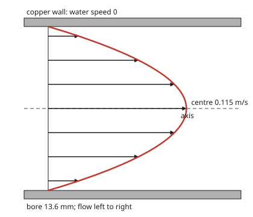
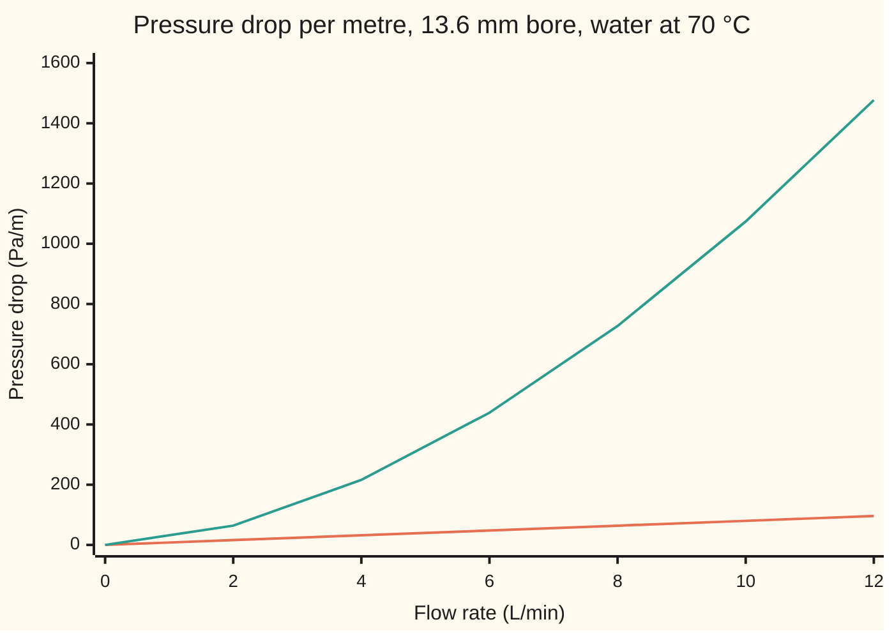

# Viscosity: friction inside the fluid, and the pressure a pipe costs

[Syllabus](../../../SYLLABUS.md) → [Engineering mathematics](../README.md) → [Fluids and Heat](../README.md#s08) → Viscosity

---

## General Overview

A central-heating pump has to push water round a loop: out of the boiler, along the flow pipe, through the radiators, back along the return. The engineer wants 12 litres a minute of 70 °C water through 15 mm copper pipe. How hard must the pump push?

Bernoulli's law ([Continuity and Bernoulli](01-continuity-and-bernoulli.md)) says a level pipe of constant bore costs no pressure at all. Yet a pump that stops leaves the water still within seconds. Something inside the water eats the push. That something is **viscosity**: friction between neighbouring layers of fluid sliding past each other. The water touching the copper does not move. The next layer slides over it and is held back; that layer holds back the next, and so on to the middle. The pump's pressure is what pays for all that rubbing.

When the flow is slow and smooth (**laminar**: layers sliding without mixing), the friction can be worked out exactly. The speed across the pipe is a parabola, fastest on the axis and zero at the wall, and the pressure per metre is proportional to the flow. For our pipe that law gives 96.13 Pa per metre. But the same water at 12 L/min is not smooth: its Reynolds number (a ratio of the water's momentum to its stickiness, with no units) is 45,367, far above the switch at about 2,300, so the flow is **turbulent** (churning and mixing), and the real cost is about 1,477 Pa per metre, 15 times more. The laminar law holds in this pipe only below 0.608 L/min.

**Viscosity makes each layer of fluid drag on its neighbours; in smooth flow through a round pipe this gives a parabolic speed profile and a pressure drop proportional to the stickiness, the length and the flow, divided by the fourth power of the bore's radius, which is exact while the flow stays laminar and a floor once it does not.**

**What kind of fact this is:** a model, then a theorem inside it. Newton's law of viscosity and the rule that fluid sticks to a wall are models that fit water very well. Given them, the parabola and the pressure law are proved on this card in Why it works. The turbulent figure comes from a measured fit, not a derivation.

### The picture: the speed across the pipe

<p align="center"></p>

To scale: 20 px per mm across the pipe, 2000 px per m/s along it. This is the same pipe on a trickle of 0.5 L/min, where the flow really is laminar. Each arrow is the water's speed at one distance from the axis: 0.1147 m/s at the centre, 0.1048 m/s at 2 mm out, 0.0750 m/s at 4 mm, 0.0254 m/s at 6 mm, and zero at the wall, 6.8 mm out. The curve through the tips is a parabola.

---

## The formula

Notation first, in words. Measure distance out from the pipe's axis as r. Call the water's speed at that distance u(r). Call the pressure drop per metre of pipe G.

$$u(r) = \frac{G}{4\mu}\left(R^2 - r^2\right), \qquad \Delta p = G\,L = \frac{8\,\mu\,L\,Q}{\pi R^4} = \frac{128\,\mu\,L\,Q}{\pi D^4}$$

**Read it aloud:** the speed falls off as a parabola from the axis to the wall, and the pressure the pump must supply grows with the stickiness, the length and the flow, and falls with the fourth power of the bore.

| Symbol | Plain meaning | In our example | Push it up and the answer… |
| --- | --- | --- | --- |
| $\mu$ | dynamic viscosity: how hard the fluid resists layers sliding, in pascal-seconds (Pa s) | 70 °C water, 0.000403561 Pa s | pressure rises in proportion, while laminar |
| $\rho$ | density, in kg/m³ | 977.786 kg/m³ | Re rises; no effect on the laminar law |
| $r$ | distance out from the axis, in m | 0 to 6.8 mm | speed falls, to zero at the wall |
| $R$, $D$ | the bore's radius and diameter (inside, not outside) | 6.8 mm and 13.6 mm | pressure falls as $1/R^4$: the biggest lever |
| $u(r)$, $u_\text{max}$ | the speed at distance r; the speed on the axis | 2.7535 m/s on the axis if laminar | — |
| $\tau$, $\tau_w$ | shear stress: the drag force per square metre between layers; its value at the wall | 0.3268 Pa at the wall if laminar | — |
| $G$ | pressure drop per metre of pipe, Δp/L, in Pa/m | 96.13 Pa/m laminar, 1,477.24 Pa/m real | everything scales with it |
| $L$, $\Delta p$ | pipe length; the pressure the pump must make up over it | 20 m; 29.54 kPa real | Δp grows with L |
| $Q$ | volume flow rate, in m³/s | 12 L/min = 200 cm³/s | pressure rises: in proportion while laminar, faster after |
| $V$ | mean speed, Q divided by the bore's area | 1.3768 m/s | — |
| $\mathrm{Re}$ | Reynolds number, $\rho V D/\mu$: momentum over stickiness, no units | 45,367 | above about 2,300 the laminar law fails |
| $f$ | Darcy friction factor: pressure per metre in units of $\rho V^2/(2D)$ | 64/Re laminar; 0.3164 Re^(−1/4) turbulent | — |

The Reynolds number was built from these quantities in [Buckingham Pi](../01-Units%20and%20Modelling/02-dimensional-analysis-and-buckingham-pi.md); here it is used only as the switch between the two regimes.

### When it holds

- **Laminar flow, Re below about 2,300.** Above it, small disturbances grow into eddies that carry fast water to the wall. At our 12 L/min, Re is 45,367 and the law gives 1.92 kPa for the loop against a real 29.54 kPa.
- **A Newtonian fluid:** stress proportional to the rate of sliding, with μ fixed. Water and oil qualify. Ketchup, paint and blood at low shear do not, and the profile comes out blunter or sharper than a parabola.
- **Fluid sticks to the wall (no-slip).** True for liquids in ordinary pipes. In a gas at very low pressure, or in channels a few molecules wide, the fluid slips and flows more than the law says.
- **Fully developed flow, far from the entrance.** Water entering a pipe has a flat profile and needs a run of about 0.05 Re D to become a parabola: 1.29 m at 0.5 L/min. A short pipe costs more than the law gives.
- **A straight, round, rigid pipe of constant bore, at one temperature.** Bends, valves and radiators add their own losses, and μ at 20 °C is 2.482 times μ at 70 °C.

---

## Why it works

### Step 0: in steady flow, the push balances the drag

The water touching the copper does not move. Each layer drags on the next, and the drag grows with how fast speed changes across the layers. In steady flow nothing speeds up, so on any plug of water the pressure pushing it forward exactly equals the drag on its skin. That one balance, plus the wall holding still, fixes the whole profile.

### Step 1: Newton's law of viscosity

Two layers sliding past each other drag on each other with a force per square metre proportional to how fast the speed changes as you cross from one layer to the next. In the pipe, the layers are thin rings and the speed falls going outward, so

$$\tau = -\mu\,\frac{du}{dr}.$$

This is a model: double the rate of sliding and the drag doubles. μ is a property of the fluid and its temperature. Water at 70 °C has μ = 0.000403561 Pa s; at 20 °C, 0.00100158 Pa s (NIST, 0.15 MPa). [Continuity and Bernoulli](01-continuity-and-bernoulli.md) and [Navier-Stokes](03-navier-stokes-and-the-reynolds-number.md) take water at a slightly lower pressure, so their values differ from these in the fifth significant figure.

### Step 2: the force on a plug of water

Take a plug of water of radius r and length L, on the axis. The pressure on its upstream end is higher than on its downstream end by Δp, so the net forward push is Δp π r². The slower water outside drags on its curved skin, area 2π r L, with stress τ(r). Balance them:

$$\Delta p\,\pi r^2 = \tau(r)\,2\pi r L \quad\Longrightarrow\quad \tau(r) = \frac{G\,r}{2}.$$

The drag between layers grows in a straight line from zero on the axis to $\tau_w = G R/2$ at the wall. No viscosity entered yet: this holds for any fluid in steady flow.

### Step 3: the parabola, as a boundary value problem

Step 1 and Step 2 together give $du/dr = -G r/(2\mu)$. Written as one equation for u, it is

$$\frac{1}{r}\frac{d}{dr}\left(r\,\frac{du}{dr}\right) = -\frac{G}{\mu}, \qquad u'(0) = 0, \qquad u(R) = 0.$$

The two conditions sit at opposite ends: the profile is flat on the axis (by symmetry), and it is zero at the wall (no-slip). This is a two-point boundary value problem, with a slope condition at one end and a value condition at the other ([Boundary value problems](../../08-Differential%20equations%20and%20dynamics/07-Series%20Solutions%20and%20Boundary%20Problems/05-two-point-boundary-value-problems.md)). Every solution of the equation is $-G r^2/(4\mu)$ plus a constant plus a multiple of $\ln r$. Flatness on the axis rules out the logarithm, whose slope blows up there. The wall fixes the constant at G R²/(4μ). One answer:

$$u(r) = \frac{G}{4\mu}\left(R^2 - r^2\right), \qquad u_\text{max} = \frac{G R^2}{4\mu}.$$

### Step 4: add up the flow

Cut the bore into thin rings. The ring at radius r, width dr, has area 2π r dr and carries u(r) times that each second. Summing the rings:

$$Q = \int_0^R u(r)\,2\pi r\,dr = \frac{\pi G R^4}{8\mu}.$$

Turn it round for the pump: $G = 8\mu Q/(\pi R^4)$, and over length L, $\Delta p = 8\mu L Q/(\pi R^4)$.

<details>
<summary>The integral, written out</summary>

$$Q = \frac{2\pi G}{4\mu}\int_0^R (R^2 r - r^3)\,dr = \frac{\pi G}{2\mu}\left(\frac{R^4}{2} - \frac{R^4}{4}\right) = \frac{\pi G R^4}{8\mu}.$$

Dividing by the area π R² gives the mean speed V = G R²/(8μ), exactly half of $u_\text{max}$. Putting V into $f = G \cdot 2D/(\rho V^2)$ gives $f = 64\mu/(\rho V D) = 64/\mathrm{Re}$: the laminar law in the friction-factor form engineers tabulate.

</details>

Why $R^4$? Two powers come from the parabola: a wider pipe lets the middle run faster for the same pressure per metre. Two more come from area: a wider pipe has more of that fast water.

### Step 5: a check by energy

The pump puts in power Δp Q. In steady flow none of it becomes speed, so all of it must be turned to heat by the layers rubbing, at μ (du/dr)² watts per cubic metre. Integrating that heating over the bore gives exactly G Q per metre. The code uses this as its third road.

### Step 6: where the parabola stops being real

The profile is a solution at every flow. It stops being the flow the pipe chooses when Re passes a critical value. Osborne Reynolds found the switch in 1883 by injecting dye into water in glass tubes; the working threshold engineers use is about 2,300. Above it, eddies carry fast water from the core to the wall, the profile flattens, the slope at the wall steepens, and the wall drag jumps. No formula of this kind exists for turbulent flow. Engineers use measured fits; for smooth pipes with Re between about 4,000 and 100,000, the Blasius fit $f = 0.3164\,\mathrm{Re}^{-1/4}$. Between 2,300 and 4,000 the flow flickers between the two, and no single number is honest. Why turbulence starts is the question of [Navier-Stokes](03-navier-stokes-and-the-reynolds-number.md).

---

## Worked numbers, by hand

The loop: 20 m of 15 mm copper pipe (flow plus return), 0.7 mm wall, so a 13.6 mm bore. Water at 70 °C, 12 L/min.

| Step | Arithmetic | Value |
| --- | --- | --- |
| bore | 15 − 2 × 0.7 | 13.60 mm |
| flow | 12 L ÷ 60 s | 200.00 cm³/s |
| mean speed V | 0.0002 ÷ (π × 0.0068²) | 1.3768 m/s |
| laminar G | 128 × 0.000403561 × 0.0002 ÷ (π × 0.0136⁴) | 96.13 Pa/m |
| laminar centre speed | 2 × V | 2.7535 m/s |
| Reynolds number | 977.786 × 1.3768 × 0.0136 ÷ 0.000403561 | 45,367 |
| verdict | 45,367 is far above 2,300 | turbulent |
| Blasius f | 0.3164 × 45,367^(−1/4) | 0.02168 |
| turbulent G | f × 977.786 × 1.3768² ÷ (2 × 0.0136) | 1,477.24 Pa/m |
| loop pressure | 1,477.24 × 20 m | **29.54 kPa** |
| as head of water | 29,540 ÷ (977.786 × 9.80665) | 3.08 m |
| hydraulic power | 29.54 kPa × 0.0002 m³/s | 5.91 W |

The circulator must deliver 29.54 kPa, a 3.08 m head, at 12 L/min for the straight pipe alone, before the boiler, radiators and fittings take their share. The laminar law would have said 1.92 kPa and 0.38 W.

For the laminar law where it does hold: at 0.5 L/min the same pipe has Re = 1,890, G = 4.005 Pa/m and a centre speed of 0.1147 m/s, the profile in the picture.

### What breaks if you drop a piece

| Mistake | Comes out at | What went wrong |
| --- | --- | --- |
| Poiseuille's law at Re 45,367 | 1.92 kPa, not 29.54 | The flow is turbulent; the laminar law is only a floor |
| 15 mm, the outside diameter, used as the bore | 18.55 kPa, not 29.54 | Copper pipe is sized by its outside; 1.4 mm of extra bore cuts the drop by more than a third |
| 20 °C water properties for a 70 °C loop | 37.66 kPa, not 29.54 | Hot water is less than half as sticky; even turbulent loss feels it |

### Pressure against flow: why the laminar law misleads here

The laminar law says the pressure per metre is a straight line in the flow. The real pipe follows that line only up to 0.608 L/min, then breaks away upward, growing roughly as the flow to the power 1.75.



Lower line: the laminar law, 128 μ Q / (π D⁴). Upper line: the real pipe, laminar below Re 2,300 and the Blasius fit above. At 2 L/min the real pipe already costs 64 Pa/m against 16; at 12 L/min, 1,477 against 96.

---

## Code, from first principles, and it actually runs

The code reaches the laminar pressure by three independent roads. Road one is the closed form. Road two never uses it: it solves the boundary value problem of Step 3 by finite differences (the equation written at 40 points across the radius and solved as one tridiagonal system), adds up the flow ring by ring, and scales the gradient to give 12 L/min. Road three uses energy: pump power per metre equals the heating by viscosity, integrated from the numerical profile. All three agree to 0.1%. The same numerical profile also gives the centre speed (twice its own mean speed) and the wall shear stress, checked against Steps 2 and 3, and halving the grid spacing cuts road two's flow error four times, from 0.0625% to 0.0156%. Then the Reynolds number is computed, the Blasius figure is built, and every number on the card is printed.

### Python

```python
# Viscosity and pipe flow -- the check behind the card.  Standard library only.
# A heating loop pushes 12 L/min of 70 C water through 15 mm copper pipe.
# Road 1: the closed form, Poiseuille's law.  Road 2: the boundary value
# problem (1/r)(r u')' = -G/mu, u(R) = 0, solved by finite differences.
# Road 3: energy -- pump power per metre equals the heat made by viscosity.
# Then the Reynolds number says whether the laminar answer applies at all.
from math import pi, log

MU, RHO = 4.03561e-4, 977.786       # water at 70 C, 0.15 MPa: Pa s, kg/m^3 (NIST)
MU20, RHO20 = 1.00158e-3, 998.229   # water at 20 C, 0.15 MPa (NIST)
D = 0.015 - 2 * 0.0007              # bore: 15 mm outside, 0.7 mm wall, in m
R = D / 2
LOOP = 20.0                          # metres of pipe, flow plus return
LPM = 1.0 / 60000.0                  # one litre a minute, in m^3/s
Q = 12 * LPM

def g_lam(q, d=D, mu=MU):            # Poiseuille: pressure drop per metre, Pa/m
    return 128 * mu * q / (pi * d ** 4)

def reynolds(q, d=D, mu=MU, rho=RHO):
    return rho * (q / (pi * d * d / 4)) * d / mu

def g_blasius(q, d=D, mu=MU, rho=RHO):   # smooth pipe, turbulent, Re 4e3 to 1e5
    v = q / (pi * d * d / 4)
    return 0.3164 * reynolds(q, d, mu, rho) ** -0.25 * rho * v * v / (2 * d)

def g_real(q):                       # laminar below Re 2300, Blasius above
    return g_lam(q) if reynolds(q) < 2300 else g_blasius(q)

def fd_profile(g, n):                # road 2: u at r_i = i h, for gradient g
    h = R / n
    a, b, c, f = [0.0] * n, [0.0] * n, [0.0] * n, [-g / MU] * n
    b[0], c[0] = -4 / h ** 2, 4 / h ** 2          # centre: u' = 0, so 2u'' = -g/mu
    for i in range(1, n):
        r = i * h
        a[i] = (r - h / 2) / (r * h * h)
        c[i] = (r + h / 2) / (r * h * h)
        b[i] = -(a[i] + c[i])                      # wall value u_n = 0 drops out
    for i in range(1, n):                          # Thomas algorithm, forward sweep
        w = a[i] / b[i - 1]
        b[i] -= w * c[i - 1]
        f[i] -= w * f[i - 1]
    u = [0.0] * (n + 1)
    for i in range(n - 1, -1, -1):
        u[i] = (f[i] - c[i] * u[i + 1]) / b[i]
    return u, h

def fd_flow_and_heat(g, n):
    u, h = fd_profile(g, n)
    q = sum(pi * h * (i * h * u[i] + (i + 1) * h * u[i + 1]) for i in range(n))
    heat = sum(MU * ((u[i + 1] - u[i]) / h) ** 2 * 2 * pi * (i + 0.5) * h * h for i in range(n))
    return u, q, heat

# ---- road 1: the closed form ----
G1 = g_lam(Q)
V = Q / (pi * R * R)
UMAX = G1 * R * R / (4 * MU)
TAU_W = G1 * R / 2
# ---- road 2: finite differences, solved for 1 Pa/m then scaled (the law is linear) ----
u40, q40, heat40 = fd_flow_and_heat(1.0, 40)
_, q80, _ = fd_flow_and_heat(1.0, 80)
G2 = Q / q40
# ---- road 3: energy.  Pump power per metre G*Q equals viscous heating per metre ----
G3 = Q / heat40                      # G * Q = G^2 * heat40, so G = Q / heat40
RE = reynolds(Q)
GT = g_blasius(Q)
print(f"inputs: 70 C, 0.15 MPa: rho {RHO:.3f} kg/m^3, mu {MU:.9f} Pa s; 20 C: rho {RHO20:.3f}, mu {MU20:.8f}")
print("inputs: walls 0.7 mm (15 mm pipe) and 0.9 mm (22 mm pipe); g 9.80665 m/s^2")
print(f"bore D                         {D * 1000:9.2f} mm")
print(f"flow Q                         {Q * 1e6:9.2f} cm^3/s")
print(f"mean speed V                   {V:9.4f} m/s")
print(f"1 laminar G, Poiseuille        {G1:9.2f} Pa/m")
print(f"2 laminar G, finite diff n=40  {G2:9.2f} Pa/m")
print(f"3 laminar G, energy balance    {G3:9.2f} Pa/m")
print(f"  flow error n=40, n=80        {abs(q40 * G1 - Q) / Q * 100:9.4f} {abs(q80 * G1 - Q) / Q * 100:9.4f} %")
print(f"  centre speed, fd and formula {u40[0] * G1:9.4f} {UMAX:9.4f} m/s")
print(f"  centre speed / mean speed    {UMAX / V:9.4f}")
print(f"  wall shear stress            {TAU_W:9.4f} Pa")
print(f"  laminar f = 64/Re, its G     {64 / RE * RHO * V * V / (2 * D):9.2f} Pa/m")
print(f"Reynolds number Re             {RE:9.0f}")
print(f"turbulent f, Blasius           {0.3164 * RE ** -0.25:9.5f}")
print(f"turbulent G, Blasius           {GT:9.2f} Pa/m")
print(f"turbulent G / laminar G        {GT / G1:9.2f}")
print(f"loop, laminar (wrong here)     {G1 * LOOP / 1000:9.2f} kPa {G1 * LOOP * Q:6.2f} W")
print(f"loop, turbulent                {GT * LOOP / 1000:9.2f} kPa {GT * LOOP * Q:6.2f} W")
print(f"  as head of water             {GT * LOOP / (RHO * 9.80665):9.2f} m")
q_crit = 2300 * MU * pi * D / (4 * RHO)
qs = 0.5 * LPM
print(f"laminar up to Re 2300          {q_crit / LPM:9.3f} L/min")
print(f"0.5 L/min: Re, G               {reynolds(qs):9.0f} {g_lam(qs):9.3f} Pa/m")
print(f"0.5 L/min: centre speed        {g_lam(qs) * R * R / (4 * MU):9.4f} m/s")
print(f"0.5 L/min: entry length 0.05ReD{0.05 * reynolds(qs) * D:9.2f} m")
# ---- what breaks ----
wrong_od = g_blasius(Q, 0.015) * LOOP / 1000
wrong_20 = g_blasius(Q, mu=MU20, rho=RHO20) * LOOP / 1000
print(f"wrong: laminar law at Re {RE:.0f}  {G1 * LOOP / 1000:9.2f} kPa")
print(f"wrong: 15 mm taken as the bore {wrong_od:9.2f} kPa")
print(f"wrong: 20 C water properties   {wrong_20:9.2f} kPa")
# ---- try changing ----
print(f"try: 0.5 L/min at 20 C, G      {g_lam(qs, mu=MU20):9.3f} Pa/m")
print(f"try: 20 C, laminar x, turb x   {MU20 / MU:9.3f} {wrong_20 / (GT * LOOP / 1000):9.3f}")
print(f"try: 22 mm pipe, loop          {g_blasius(Q, 0.022 - 2 * 0.0009) * LOOP / 1000:9.2f} kPa")
print(f"try: 6 L/min, loop             {g_blasius(6 * LPM) * LOOP / 1000:9.2f} kPa")
print(f"  power of flow, ln(G12/G6)/ln 2 {log(GT / g_blasius(6 * LPM)) / log(2):7.2f}")
# ---- chart: pressure per metre against flow ----
xs = [0, 2, 4, 6, 8, 10, 12]
print("chart, flow L/min     " + " ".join(f"{x:6d}" for x in xs))
print("chart, laminar Pa/m   " + " ".join(f"{g_lam(x * LPM):6.0f}" for x in xs))
print("chart, real Pa/m      " + " ".join(f"{g_real(x * LPM):6.0f}" for x in xs))
# ---- figure: 0.5 L/min profile, 20 px per mm across, 2000 px per m/s along ----
um = g_lam(qs) * R * R / (4 * MU)
pts = [(rr, um * (1 - (rr / (R * 1000)) ** 2)) for rr in (0.0, 2.0, 4.0, 6.0, 6.8)]
print("figure, r mm : u m/s  " + " ".join(f"{rr:.1f}:{v:.4f}" for rr, v in pts))
# ---- asserts against independent values ----
assert abs(G2 - G1) / G1 < 2e-3 and abs(G3 - G1) / G1 < 2e-3, "three roads agree"
assert 3.5 < (abs(q40 * G1 - Q)) / abs(q80 * G1 - Q) < 4.5, "error falls 4x: second order"
assert abs(u40[0] * G1 - UMAX) < 1e-9 and abs(u40[0] * pi * R * R / q40 - 2) < 2e-3, "fd centre = 2 x fd mean"
tau_fd = MU * G1 * (4 * u40[39] - u40[38]) / (2 * R / 40)          # fd wall slope (u_40 = 0)
assert abs(tau_fd - TAU_W) / TAU_W < 1e-9, "wall shear: fd against G R / 2"
assert 2300 < RE and 10 < GT / G1 < 20 and reynolds(qs) < 2300, "turbulent at 12 L/min, laminar at 0.5"
assert abs(64 / RE * RHO * V * V / (2 * D) - G1) / G1 < 1e-12, "f = 64/Re gives Poiseuille's G"
print("ALL CHECKS PASS")
```

**Ran 2026-11-11 on macOS, Python 3.14.10, standard library only. All checks passed. Output, pasted from the run:**

```
inputs: 70 C, 0.15 MPa: rho 977.786 kg/m^3, mu 0.000403561 Pa s; 20 C: rho 998.229, mu 0.00100158
inputs: walls 0.7 mm (15 mm pipe) and 0.9 mm (22 mm pipe); g 9.80665 m/s^2
bore D                             13.60 mm
flow Q                            200.00 cm^3/s
mean speed V                      1.3768 m/s
1 laminar G, Poiseuille            96.13 Pa/m
2 laminar G, finite diff n=40      96.19 Pa/m
3 laminar G, energy balance        96.16 Pa/m
  flow error n=40, n=80           0.0625    0.0156 %
  centre speed, fd and formula    2.7535    2.7535 m/s
  centre speed / mean speed       2.0000
  wall shear stress               0.3268 Pa
  laminar f = 64/Re, its G         96.13 Pa/m
Reynolds number Re                 45367
turbulent f, Blasius             0.02168
turbulent G, Blasius             1477.24 Pa/m
turbulent G / laminar G            15.37
loop, laminar (wrong here)          1.92 kPa   0.38 W
loop, turbulent                    29.54 kPa   5.91 W
  as head of water                  3.08 m
laminar up to Re 2300              0.608 L/min
0.5 L/min: Re, G                    1890     4.005 Pa/m
0.5 L/min: centre speed           0.1147 m/s
0.5 L/min: entry length 0.05ReD     1.29 m
wrong: laminar law at Re 45367       1.92 kPa
wrong: 15 mm taken as the bore     18.55 kPa
wrong: 20 C water properties       37.66 kPa
try: 0.5 L/min at 20 C, G          9.941 Pa/m
try: 20 C, laminar x, turb x       2.482     1.275
try: 22 mm pipe, loop               4.51 kPa
try: 6 L/min, loop                  8.78 kPa
  power of flow, ln(G12/G6)/ln 2    1.75
chart, flow L/min          0      2      4      6      8     10     12
chart, laminar Pa/m        0     16     32     48     64     80     96
chart, real Pa/m           0     64    216    439    727   1074   1477
figure, r mm : u m/s  0.0:0.1147 2.0:0.1048 4.0:0.0750 6.0:0.0254 6.8:0.0000
ALL CHECKS PASS
```

### Rust

```rust
// Viscosity and pipe flow -- the check behind the card.  std only, no crates.
// A heating loop pushes 12 L/min of 70 C water through 15 mm copper pipe.
// Road 1: the closed form, Poiseuille's law.  Road 2: the boundary value
// problem (1/r)(r u')' = -G/mu, u(R) = 0, solved by finite differences.
// Road 3: energy -- pump power per metre equals the heat made by viscosity.
// Then the Reynolds number says whether the laminar answer applies at all.
use std::f64::consts::PI;

const MU: f64 = 4.03561e-4;   // water at 70 C, 0.15 MPa: Pa s (NIST)
const RHO: f64 = 977.786;     // kg/m^3
const MU20: f64 = 1.00158e-3; // water at 20 C, 0.15 MPa (NIST)
const RHO20: f64 = 998.229;
const D: f64 = 0.015 - 2.0 * 0.0007; // bore: 15 mm outside, 0.7 mm wall, in m
const R: f64 = D / 2.0;
const LOOP: f64 = 20.0;              // metres of pipe, flow plus return
const LPM: f64 = 1.0 / 60000.0;      // one litre a minute, in m^3/s

fn g_lam(q: f64, d: f64, mu: f64) -> f64 { 128.0 * mu * q / (PI * d.powi(4)) }
fn reynolds(q: f64, d: f64, mu: f64, rho: f64) -> f64 { rho * (q / (PI * d * d / 4.0)) * d / mu }
fn g_blasius(q: f64, d: f64, mu: f64, rho: f64) -> f64 {
    let v = q / (PI * d * d / 4.0);
    0.3164 * reynolds(q, d, mu, rho).powf(-0.25) * rho * v * v / (2.0 * d)
}
fn g_real(q: f64) -> f64 {
    if reynolds(q, D, MU, RHO) < 2300.0 { g_lam(q, D, MU) } else { g_blasius(q, D, MU, RHO) }
}

fn fd_profile(g: f64, n: usize) -> (Vec<f64>, f64) {
    let h = R / n as f64;
    let (mut a, mut b, mut c, mut f) = (vec![0.0; n], vec![0.0; n], vec![0.0; n], vec![-g / MU; n]);
    b[0] = -4.0 / (h * h); // centre: u' = 0, so 2u'' = -g/mu
    c[0] = 4.0 / (h * h);
    for i in 1..n {
        let r = i as f64 * h;
        a[i] = (r - h / 2.0) / (r * h * h);
        c[i] = (r + h / 2.0) / (r * h * h);
        b[i] = -(a[i] + c[i]); // wall value u_n = 0 drops out
    }
    for i in 1..n { // Thomas algorithm, forward sweep
        let w = a[i] / b[i - 1];
        b[i] -= w * c[i - 1];
        f[i] -= w * f[i - 1];
    }
    let mut u = vec![0.0; n + 1];
    for i in (0..n).rev() { u[i] = (f[i] - c[i] * u[i + 1]) / b[i]; }
    (u, h)
}

fn fd_flow_and_heat(g: f64, n: usize) -> (Vec<f64>, f64, f64) {
    let (u, h) = fd_profile(g, n);
    let (mut q, mut heat) = (0.0, 0.0);
    for i in 0..n {
        let (r0, r1) = (i as f64 * h, (i + 1) as f64 * h);
        q += PI * h * (r0 * u[i] + r1 * u[i + 1]);
        let s = (u[i + 1] - u[i]) / h;
        heat += MU * s * s * 2.0 * PI * (i as f64 + 0.5) * h * h;
    }
    (u, q, heat)
}

fn main() {
    let q = 12.0 * LPM;
    // ---- road 1: the closed form ----
    let g1 = g_lam(q, D, MU);
    let v = q / (PI * R * R);
    let umax = g1 * R * R / (4.0 * MU);
    let tau_w = g1 * R / 2.0;
    // ---- road 2: finite differences, solved for 1 Pa/m then scaled (the law is linear) ----
    let (u40, q40, heat40) = fd_flow_and_heat(1.0, 40);
    let (_, q80, _) = fd_flow_and_heat(1.0, 80);
    let g2 = q / q40;
    // ---- road 3: energy.  Pump power per metre G*Q equals viscous heating per metre ----
    let g3 = q / heat40; // G * Q = G^2 * heat40, so G = Q / heat40
    let re = reynolds(q, D, MU, RHO);
    let gt = g_blasius(q, D, MU, RHO);
    let f64_lam = 64.0 / re * RHO * v * v / (2.0 * D);
    println!("inputs: 70 C, 0.15 MPa: rho {:.3} kg/m^3, mu {:.9} Pa s; 20 C: rho {:.3}, mu {:.8}", RHO, MU, RHO20, MU20);
    println!("inputs: walls 0.7 mm (15 mm pipe) and 0.9 mm (22 mm pipe); g 9.80665 m/s^2");
    println!("bore D                         {:9.2} mm", D * 1000.0);
    println!("flow Q                         {:9.2} cm^3/s", q * 1e6);
    println!("mean speed V                   {:9.4} m/s", v);
    println!("1 laminar G, Poiseuille        {:9.2} Pa/m", g1);
    println!("2 laminar G, finite diff n=40  {:9.2} Pa/m", g2);
    println!("3 laminar G, energy balance    {:9.2} Pa/m", g3);
    println!("  flow error n=40, n=80        {:9.4} {:9.4} %",
             (q40 * g1 - q).abs() / q * 100.0, (q80 * g1 - q).abs() / q * 100.0);
    println!("  centre speed, fd and formula {:9.4} {:9.4} m/s", u40[0] * g1, umax);
    println!("  centre speed / mean speed    {:9.4}", umax / v);
    println!("  wall shear stress            {:9.4} Pa", tau_w);
    println!("  laminar f = 64/Re, its G     {:9.2} Pa/m", f64_lam);
    println!("Reynolds number Re             {:9.0}", re);
    println!("turbulent f, Blasius           {:9.5}", 0.3164 * re.powf(-0.25));
    println!("turbulent G, Blasius           {:9.2} Pa/m", gt);
    println!("turbulent G / laminar G        {:9.2}", gt / g1);
    println!("loop, laminar (wrong here)     {:9.2} kPa {:6.2} W", g1 * LOOP / 1000.0, g1 * LOOP * q);
    println!("loop, turbulent                {:9.2} kPa {:6.2} W", gt * LOOP / 1000.0, gt * LOOP * q);
    println!("  as head of water             {:9.2} m", gt * LOOP / (RHO * 9.80665));
    let q_crit = 2300.0 * MU * PI * D / (4.0 * RHO);
    let qs = 0.5 * LPM;
    println!("laminar up to Re 2300          {:9.3} L/min", q_crit / LPM);
    println!("0.5 L/min: Re, G               {:9.0} {:9.3} Pa/m", reynolds(qs, D, MU, RHO), g_lam(qs, D, MU));
    println!("0.5 L/min: centre speed        {:9.4} m/s", g_lam(qs, D, MU) * R * R / (4.0 * MU));
    println!("0.5 L/min: entry length 0.05ReD{:9.2} m", 0.05 * reynolds(qs, D, MU, RHO) * D);
    // ---- what breaks ----
    let wrong_od = g_blasius(q, 0.015, MU, RHO) * LOOP / 1000.0;
    let wrong_20 = g_blasius(q, D, MU20, RHO20) * LOOP / 1000.0;
    println!("wrong: laminar law at Re {:.0}  {:9.2} kPa", re, g1 * LOOP / 1000.0);
    println!("wrong: 15 mm taken as the bore {:9.2} kPa", wrong_od);
    println!("wrong: 20 C water properties   {:9.2} kPa", wrong_20);
    // ---- try changing ----
    println!("try: 0.5 L/min at 20 C, G      {:9.3} Pa/m", g_lam(qs, D, MU20));
    println!("try: 20 C, laminar x, turb x   {:9.3} {:9.3}", MU20 / MU, wrong_20 / (gt * LOOP / 1000.0));
    println!("try: 22 mm pipe, loop          {:9.2} kPa", g_blasius(q, 0.022 - 2.0 * 0.0009, MU, RHO) * LOOP / 1000.0);
    println!("try: 6 L/min, loop             {:9.2} kPa", g_blasius(6.0 * LPM, D, MU, RHO) * LOOP / 1000.0);
    println!("  power of flow, ln(G12/G6)/ln 2 {:7.2}", (gt / g_blasius(6.0 * LPM, D, MU, RHO)).ln() / 2f64.ln());
    // ---- chart: pressure per metre against flow ----
    let xs = [0, 2, 4, 6, 8, 10, 12];
    let row = |f: &dyn Fn(f64) -> String| xs.iter().map(|&x| f(x as f64)).collect::<Vec<_>>().join(" ");
    println!("chart, flow L/min     {}", row(&|x| format!("{:6}", x as i64)));
    println!("chart, laminar Pa/m   {}", row(&|x| format!("{:6.0}", g_lam(x * LPM, D, MU))));
    println!("chart, real Pa/m      {}", row(&|x| format!("{:6.0}", g_real(x * LPM))));
    // ---- figure: 0.5 L/min profile, 20 px per mm across, 2000 px per m/s along ----
    let um = g_lam(qs, D, MU) * R * R / (4.0 * MU);
    let pts: Vec<String> = [0.0, 2.0, 4.0, 6.0, 6.8_f64].iter()
        .map(|&rr| format!("{:.1}:{:.4}", rr, um * (1.0 - (rr / (R * 1000.0)).powi(2)))).collect();
    println!("figure, r mm : u m/s  {}", pts.join(" "));
    // ---- asserts against independent values ----
    assert!((g2 - g1).abs() / g1 < 2e-3 && (g3 - g1).abs() / g1 < 2e-3, "three roads agree");
    let ratio = (q40 * g1 - q).abs() / (q80 * g1 - q).abs();
    assert!(3.5 < ratio && ratio < 4.5, "error falls 4x: second order");
    assert!((u40[0] * g1 - umax).abs() < 1e-9 && (u40[0] * PI * R * R / q40 - 2.0).abs() < 2e-3, "fd centre = 2 x fd mean");
    let tau_fd = MU * g1 * (4.0 * u40[39] - u40[38]) / (2.0 * R / 40.0); // fd wall slope (u_40 = 0)
    assert!((tau_fd - tau_w).abs() / tau_w < 1e-9, "wall shear: fd against G R / 2");
    assert!(2300.0 < re && 10.0 < gt / g1 && gt / g1 < 20.0 && reynolds(qs, D, MU, RHO) < 2300.0,
            "turbulent at 12 L/min, laminar at 0.5");
    assert!((f64_lam - g1).abs() / g1 < 1e-12, "f = 64/Re gives Poiseuille's G");
    println!("ALL CHECKS PASS");
}
```

**Ran 2026-11-11 on macOS, rustc 1.98.1, no crates. All checks passed. Output, pasted from the run:**

```
inputs: 70 C, 0.15 MPa: rho 977.786 kg/m^3, mu 0.000403561 Pa s; 20 C: rho 998.229, mu 0.00100158
inputs: walls 0.7 mm (15 mm pipe) and 0.9 mm (22 mm pipe); g 9.80665 m/s^2
bore D                             13.60 mm
flow Q                            200.00 cm^3/s
mean speed V                      1.3768 m/s
1 laminar G, Poiseuille            96.13 Pa/m
2 laminar G, finite diff n=40      96.19 Pa/m
3 laminar G, energy balance        96.16 Pa/m
  flow error n=40, n=80           0.0625    0.0156 %
  centre speed, fd and formula    2.7535    2.7535 m/s
  centre speed / mean speed       2.0000
  wall shear stress               0.3268 Pa
  laminar f = 64/Re, its G         96.13 Pa/m
Reynolds number Re                 45367
turbulent f, Blasius             0.02168
turbulent G, Blasius             1477.24 Pa/m
turbulent G / laminar G            15.37
loop, laminar (wrong here)          1.92 kPa   0.38 W
loop, turbulent                    29.54 kPa   5.91 W
  as head of water                  3.08 m
laminar up to Re 2300              0.608 L/min
0.5 L/min: Re, G                    1890     4.005 Pa/m
0.5 L/min: centre speed           0.1147 m/s
0.5 L/min: entry length 0.05ReD     1.29 m
wrong: laminar law at Re 45367       1.92 kPa
wrong: 15 mm taken as the bore     18.55 kPa
wrong: 20 C water properties       37.66 kPa
try: 0.5 L/min at 20 C, G          9.941 Pa/m
try: 20 C, laminar x, turb x       2.482     1.275
try: 22 mm pipe, loop               4.51 kPa
try: 6 L/min, loop                  8.78 kPa
  power of flow, ln(G12/G6)/ln 2    1.75
chart, flow L/min          0      2      4      6      8     10     12
chart, laminar Pa/m        0     16     32     48     64     80     96
chart, real Pa/m           0     64    216    439    727   1074   1477
figure, r mm : u m/s  0.0:0.1147 2.0:0.1048 4.0:0.0750 6.0:0.0254 6.8:0.0000
ALL CHECKS PASS
```

The two outputs match line for line.

> [!TIP]
> **Try changing**
> - Guess first: halve the flow to 6 L/min. Does the loop pressure halve? Set the flow to `6 * LPM`. It falls from 29.54 kPa to 8.78 kPa, under a third, because turbulent loss grows as about the 1.75 power of flow.
> - Guess first: move up to 22 mm pipe, 0.9 mm wall. Set the bore to `0.022 - 2 * 0.0009`. The loop needs 4.51 kPa instead of 29.54: the bore's high power at work.
> - Guess first: cool the water to 20 °C. Use `MU20` and `RHO20`. The laminar drop rises 2.482 times, the turbulent drop only 1.275 times; at the 0.5 L/min trickle the laminar G goes from 4.005 to 9.941 Pa/m.
> - Guess first: change 128 to 64 in `g_lam`. The finite-difference and energy roads still give 96.19 and 96.16 Pa/m, so the first assert stops the program.

---

## The usual mistake

> [!warning]
> **Using Poiseuille's law without checking the Reynolds number.** The law is exact, so it feels safe, but it only describes laminar flow. Domestic heating, mains water and most industrial pipes run at Re in the tens of thousands. Here it gives 1.92 kPa for a loop that needs 29.54 kPa: a pump sized on it would barely move the water. Compute Re first; above about 2,300 the laminar answer is only the least the pipe could cost.
>
> - **Outside diameter as the bore.** Pipe is sold by its outside. Using 15 mm instead of 13.6 mm gives 18.55 kPa, not 29.54.
> - **Viscosity from the wrong temperature.** Water's μ falls by a factor of 2.482 from 20 °C to 70 °C. Cold-water tables give 37.66 kPa for the hot loop.
> - **Mean speed taken as the centre speed.** In laminar flow the centre runs at twice the mean: 2.7535 m/s against 1.3768 m/s.
> - **Radius and diameter swapped.** The law is 8 μ L Q/(π R⁴) or 128 μ L Q/(π D⁴). Put D into the first and the answer is 16 times too small.

---

## Where you meet it in real life

- **Heating and plumbing design.** Pipe sizing tables in pascals per metre are this card's upper curve, read off at a chosen flow and temperature, with the pump chosen to beat the sum.
- **Medicine.** Blood flow through narrowed arteries and through a hypodermic needle is close to laminar; the fourth power of the radius is why a small narrowing matters so much.
- **Lubrication.** Oil films in engine bearings are thin enough that the flow is laminar, and the same balance of pressure against shear sets how much load the film carries.
- **Measuring viscosity.** A capillary viscometer times a known volume through a fine tube and turns the time into μ with Poiseuille's law; Poiseuille's own experiments used fine glass tubes the same way.
- **Oil and gas pipelines.** Heavy crude in large pipes can be laminar; light products are turbulent; the operator checks Re before choosing which friction law to trust.

> **Say it back**
> Viscosity is friction between neighbouring layers of fluid, and fluid touching a wall does not move. In steady flow the pressure push on any plug of fluid equals the drag on its skin, and with Newton's law of viscosity that gives a parabolic profile and a pressure drop 8 μ L Q/(π R⁴). For a 15 mm heating pipe at 12 L/min the law says 1.92 kPa over 20 m, but the Reynolds number is 45,367, the flow is turbulent and the real cost is 29.54 kPa. The laminar law is exact below Re about 2,300 and only a floor above it.

---

## What this builds on

- [Continuity and Bernoulli](01-continuity-and-bernoulli.md): the flow equals mean speed times area, and the frictionless balance of pressure and speed that viscosity breaks.
- [Boundary value problems](../../08-Differential%20equations%20and%20dynamics/07-Series%20Solutions%20and%20Boundary%20Problems/05-two-point-boundary-value-problems.md): the profile is fixed by conditions at the axis and at the wall, and the theory says when such a fit has exactly one answer.

## Where this goes next

- [Navier-Stokes](03-navier-stokes-and-the-reynolds-number.md): the full equation of motion for a viscous fluid, which contains this card's balance as one exact solution, and the Reynolds number as the ratio of its two big terms.

This card leaves open why smooth pipe flow turns turbulent near Re 2,300 at all, when its laminar solution exists at every speed.

---

## Sources

Verified 2026-11-11: every link below resolves to the publisher's page, and each DOI was checked against Crossref for title and first author.

- Sutera, S. P., and R. Skalak. "The History of Poiseuille's Law." *Annual Review of Fluid Mechanics* 25, 1993, pp. 1–20. [doi:10.1146/annurev.fl.25.010193.000245](https://doi.org/10.1146/annurev.fl.25.010193.000245). How Hagen and Poiseuille found the fourth-power law by experiment, and how the derivation came later.
- Reynolds, O. "An experimental investigation of the circumstances which determine whether the motion of water shall be direct or sinuous, and of the law of resistance in parallel channels." *Philosophical Transactions of the Royal Society of London* 174, 1883, pp. 935–982. [doi:10.1098/rstl.1883.0029](https://doi.org/10.1098/rstl.1883.0029). The dye experiments that found the switch from laminar to turbulent flow and the number that controls it.
- Blasius, H. "Das Aehnlichkeitsgesetz bei Reibungsvorgängen in Flüssigkeiten." *Mitteilungen über Forschungsarbeiten auf dem Gebiete des Ingenieurwesens* 131, 1913. [doi:10.1007/978-3-662-02239-9_1](https://doi.org/10.1007/978-3-662-02239-9_1). The friction-factor fit for smooth turbulent pipes used for the real loop figure.
- Huber, M. L., R. A. Perkins, A. Laesecke and others. "New International Formulation for the Viscosity of H2O." *Journal of Physical and Chemical Reference Data* 38(2), 2009, p. 101. [doi:10.1063/1.3088050](https://doi.org/10.1063/1.3088050). The international standard behind the water viscosities used here.
- "Thermophysical Properties of Fluid Systems." *NIST Chemistry WebBook*, NIST Standard Reference Database 69, National Institute of Standards and Technology. [Database page](https://webbook.nist.gov/chemistry/fluid/). The density and viscosity of water at 20 °C and 70 °C, 0.15 MPa, quoted on this card.
