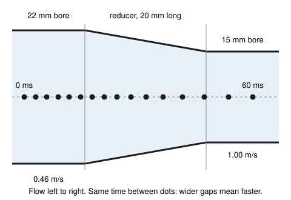

# Navier-Stokes: Newton's law for a fluid parcel, and the number that says which term wins

[Syllabus](../../../SYLLABUS.md) → [Engineering mathematics](../README.md) → [Fluids and Heat](../README.md#s08) → Navier-Stokes

---

## General Overview

A central-heating loop: boiler, pump, copper pipes, radiators. On a cold start the water is at 20 °C, and the pump pushes it at 1 metre per second through a pipe with a 15 mm bore: 10.60 litres a minute. Before choosing a pump, the engineer asks: does this water slide along in smooth layers, or churn in eddies? The answer sets how hard the pump must push and how well the radiators take up heat.

(Real 15 mm copper is 15 mm outside, with a 13.6 mm bore; there Re, the Reynolds number defined below, is 13,553.9 and every verdict below is the same. This card uses a 15 mm bore for round numbers.)

Every small blob of that water, a **parcel** carried along with the flow, obeys Newton's second law: mass times acceleration equals the total force. Three forces act on it: pressure from the water around it, friction with faster or slower neighbours, and gravity. Written for every parcel at once, that law is the **Navier-Stokes equation**.

Measure each term in the units this pipe sets: speed in units of 1 m/s, length in pipe diameters. One number survives, in front of the friction term: the **Reynolds number**, written Re. Here it is 14,949.2, about 15,000. At the scale of the pipe, inertia (the parcel's mass resisting changes in its motion) outweighs friction by that factor. Above about 2,300 in a pipe, smooth flow breaks down into turbulence. This water is turbulent.

**Navier-Stokes is Newton's second law for every parcel of fluid; rescale it by the flow's own speed and size, and the single number left in front of friction, Re, says whether inertia or friction runs the flow.**

**What kind of fact this is:** a model. Newton's law is exact; the friction law inside it (stress proportional to the rate of shearing) is an assumption that fits water, air and oil very well. The appearance of Re is exact algebra, proved in Why it works. The threshold of 2,300 is an experimental fact for pipes, not a theorem. Whether smooth solutions of the 3D equation always exist is unproved as of 2026-11-11.

### The picture: a parcel speeds up with nothing changing in time

The flow is steady: at each fixed point the speed never changes. Yet a parcel passing from a 22 mm pipe into the 15 mm pipe speeds up from 0.4649 m/s to 1.0000 m/s, and Newton's law has to pay for that. The figure is to scale; the dots are one parcel's positions every 4 ms, from the code.

<p align="center"></p>

Left of the reducer the dots fall at −10.0, −8.1 and −6.3 mm. Leaving the reducer, which ends at 20 mm, they fall at 19.7, 23.7 and 27.7 mm. Wider gaps in the same time: the parcel has more than doubled its speed. Step 1 turns that into a number: 16.35 m/s² mid-reducer and 46.67 m/s² at the exit, 4.76 times gravity, with nothing changing in time.

---

## The formula

$$\rho\left(\frac{\partial \mathbf u}{\partial t} + (\mathbf u\cdot\nabla)\,\mathbf u\right) \;=\; -\nabla p \;+\; \mu\,\nabla^2\mathbf u \;+\; \rho\,\mathbf g, \qquad \nabla\cdot\mathbf u = 0$$

Measured in the flow's own units (starred letters), it becomes

$$\frac{\partial \mathbf u^*}{\partial t^*} + (\mathbf u^*\cdot\nabla^*)\,\mathbf u^* \;=\; -\nabla^* p^* \;+\; \frac{1}{\mathrm{Re}}\,\nabla^{*2}\mathbf u^*, \qquad \mathrm{Re} = \frac{\rho\,U L}{\mu} = \frac{U L}{\nu}.$$

**Read it aloud:** "density times the parcel's acceleration equals the pressure push plus the viscous drag plus its weight, and the water does not compress; in the flow's own units, the drag carries a factor of one over the Reynolds number."

| Symbol | Plain meaning | In our example | Push it up and the answer… |
| --- | --- | --- | --- |
| $\mathbf u = (u, v, w)$; $u_\text{in}$, $u_\text{out}$ | the water's velocity at a point: its three components along $x$, $y$, $z$ (so $v$ here is the $y$ part; [Continuity and Bernoulli](01-continuity-and-bernoulli.md) used $v$ for the mean speed); the speeds before and after the reducer | mean 1.00 m/s along the pipe; 0.4649 and 1.0000 m/s | Re rises |
| $\mathbf x = (x, y, z)$, $t$ | position, in metres; time, in seconds | — | — |
| $\rho$ | density: mass per cubic metre | 998.207 kg/m³ (20 °C) | Re rises |
| $p$ | pressure, in pascals (Pa = N/m²) | 391.2 Pa spent in the reducer | — |
| $\mu$, $\nu$ | viscosity, the water's internal friction, in Pa·s; and $\nu = \mu/\rho$, viscosity per unit density, in m²/s | 1.00160 mPa·s; 1.0034 × 10⁻⁶ m²/s | Re falls |
| $\mathbf g$ | gravity's pull per kilogram, pointing down | the exit acceleration is 4.76 times it | — |
| $\frac{\partial \mathbf u}{\partial t} + (\mathbf u\cdot\nabla)\mathbf u$ | the parcel's acceleration: change in time at a fixed point, plus change from moving to where the water flows differently | 16.35 m/s² mid-reducer, from the second part alone | — |
| $\nabla p$, $\nabla^2\mathbf u$, $\nabla\cdot\mathbf u$ | the pressure gradient (how fast pressure changes with position); the Laplacian of velocity (how much a parcel's speed differs from the average of its neighbours'); the divergence of velocity (how much more water flows out of a point than in; zero means the water does not compress) | — | — |
| $\tau$ ($\tau_{xx}, \tau_{xy}, \tau_{xz}$); $\delta V$, $A$, $\delta x$, $\delta y$, $\delta t$ | shear stress, friction force per square metre between sliding layers (and its parts on one face); a parcel's small volume, a face's area, its small sides, and a short time | — | — |
| $U$, $L$ | the flow's speed scale and length scale; in a pipe, mean speed and bore $D$ | 1 m/s; $D$ = 0.015 m | Re rises |
| $\mathrm{Re}$ | the Reynolds number: inertia's size over friction's size, a pure number | 14,949.2 | turbulence |
| $\mathbf u^*, \mathbf x^*, t^*, p^*, \nabla^*$; $k$, $f$ | the starred letters are the same quantities in the flow's units: $\mathbf u/U$, $\mathbf x/D$, $tU/D$, $p/(\rho U^2)$, and the gradient in those units. $k$ is the check flow's wavenumber, $\pi$ divided by the eddy's size; $f$ is the pipe friction factor in What breaks | $D/U$ = 15.0 ms; $\rho U^2$ = 998.2 Pa; $k = \pi/D$; $f$ = 0.02861 | — |

### When it holds

- **The water is a continuum.** A parcel must hold enough molecules for density and speed to be smooth. In a gas so thin that molecules cross the pipe between collisions, the equation fails.
- **The fluid is Newtonian.** Friction stress is proportional to the rate of shearing, with one fixed $\mu$. Water, air and oil obey this. Paint, ketchup and the black sludge in an old heating system do not.
- **The water does not compress.** That is $\nabla\cdot\mathbf u = 0$, from [Continuity and Bernoulli](01-continuity-and-bernoulli.md). It holds when speeds are far below the speed of sound: excellent for 1 m/s water, wrong for a jet engine.
- **Temperature is fixed, so $\mu$ is fixed.** In the loop it isn't: as the water warms to 70 °C, $\nu$ falls to less than half and Re climbs from 14,949.2 to 36,343.8. Use the viscosity at the water's actual temperature.
- **2,300 belongs to pipes, with $L = D$.** The threshold depends on the shape and on which length was chosen. A wing, a river and a stirred tank each have their own.

---

## Why it works

### Step 0: Newton's law, for a blob that moves with the water

Pick out one parcel: a tiny volume $\delta V$ of water, mass $\rho\,\delta V$, followed as the flow carries it. Its mass times its acceleration equals the total force on it.

Two things make this harder than for a ball. The parcel doesn't stay put, so its acceleration is not just the change of velocity at one spot. And most forces arrive through its surface: pressure squeezes it and friction drags its faces. Only gravity acts on the whole volume. Steps 1 to 3 handle the pieces; Step 4 adds them up.

### Step 1: the parcel's acceleration

Write the parcel's speed along the pipe as $u$. In a short time $\delta t$ the speed changes for two reasons. Time passes, so the field itself may change: $\frac{\partial u}{\partial t}\,\delta t$. And the parcel moves a distance $u\,\delta t$ to a place where the speed is different: $\frac{\partial u}{\partial x}\,u\,\delta t$. Do the same along $y$ and $z$, divide by $\delta t$, and the chain rule gives the parcel's acceleration:

$$\frac{\partial u}{\partial t} + u\frac{\partial u}{\partial x} + v\frac{\partial u}{\partial y} + w\frac{\partial u}{\partial z} \;=\; \frac{\partial u}{\partial t} + (\mathbf u\cdot\nabla)\,u.$$

The second part is the **convective acceleration**. It is velocity multiplied by its own rate of change, so it is nonlinear: double every speed and it quadruples. This is the term that makes eddies feed on each other.

In the reducer the flow is steady, so $\frac{\partial u}{\partial t} = 0$. Halfway along, the product $u\,\frac{\partial u}{\partial x}$ alone is 16.3533 m/s². The code also follows one parcel through the reducer step by step and measures how fast its speed changes: 16.3533 m/s² again. Field formula and parcel tracking agree, which is the chain rule, measured.

### Step 2: the pressure force

Take the parcel as a small box with faces of area $A$ across the flow and length $\delta x$ along it. Pressure $p$ pushes on the back face; pressure $p + \frac{\partial p}{\partial x}\delta x$ pushes back on the front face. The net push along $x$ is $-\frac{\partial p}{\partial x}\,A\,\delta x = -\frac{\partial p}{\partial x}\,\delta V$. Do it in all three directions and the force is $-\nabla p\,\delta V$. Water is pushed from high pressure towards low.

For a parcel of any shape, the [Divergence theorem](../../06-Calculus%20and%20analysis/09-Vector%20Calculus/07-divergence-theorem.md) does the same job: the pressure summed over the closed surface equals $-\nabla p$ summed through the inside.

In the reducer, with friction negligible over 20 mm, pressure alone pays for the speed-up: $\rho\,(u_\text{out}^2 - u_\text{in}^2)/2$ = 391.2 Pa. That is Bernoulli's trade of pressure for speed: Navier-Stokes with the viscous term dropped.

### Step 3: the viscous force

Layers sliding over each other rub. [Viscosity](02-viscosity-and-pipe-flow.md) measures the rub: shear stress $\tau = \mu\,\frac{\partial u}{\partial y}$, proportional to how fast the speed changes across the layers.

Take a thin slab of thickness $\delta y$. Faster water above drags its top face forward; slower water below holds its bottom face back. Only the *difference* between the two stresses moves the slab: $\frac{\partial \tau}{\partial y}\,\delta y\,A = \mu\,\frac{\partial^2 u}{\partial y^2}\,\delta V$. A uniform shear pulls equally on both faces and nets to nothing. Only a *bend* in the speed profile pushes a parcel. Adding the three directions gives $\mu\,\nabla^2 u$: the parcel is pulled toward the average speed of its neighbours.

<details>
<summary>Detailed derivation: why the full stress collapses to $\mu\nabla^2\mathbf u$</summary>

A Newtonian fluid's friction stresses on a face normal to $x$ are $\tau_{xx} = 2\mu\,\frac{\partial u}{\partial x}$, $\tau_{xy} = \mu\left(\frac{\partial u}{\partial y} + \frac{\partial v}{\partial x}\right)$ and $\tau_{xz} = \mu\left(\frac{\partial u}{\partial z} + \frac{\partial w}{\partial x}\right)$. The net friction force along $x$ per unit volume is the rate these change across the parcel:

$$\frac{\partial \tau_{xx}}{\partial x} + \frac{\partial \tau_{xy}}{\partial y} + \frac{\partial \tau_{xz}}{\partial z} = \mu\left(\frac{\partial^2 u}{\partial x^2} + \frac{\partial^2 u}{\partial y^2} + \frac{\partial^2 u}{\partial z^2}\right) + \mu\,\frac{\partial}{\partial x}\left(\frac{\partial u}{\partial x} + \frac{\partial v}{\partial y} + \frac{\partial w}{\partial z}\right).$$

The bracket in the last term is $\nabla\cdot\mathbf u$, which is zero for water that does not compress. What is left is $\mu\nabla^2 u$. The $y$ and $z$ components go the same way. For a gas that compresses, the stress itself gains a term: $\tau_{xx} = 2\mu\,\frac{\partial u}{\partial x} - \tfrac23\mu\,\nabla\cdot\mathbf u$, under Stokes's usual assumption that squeezing alone causes no friction. The equation then keeps a smaller piece, $\tfrac{\mu}{3}\,\nabla(\nabla\cdot\mathbf u)$.

</details>

### Step 4: add them up

Mass times acceleration equals pressure force plus viscous force plus weight:

$$\rho\,\delta V\left(\frac{\partial \mathbf u}{\partial t} + (\mathbf u\cdot\nabla)\mathbf u\right) = -\nabla p\,\delta V + \mu\nabla^2\mathbf u\,\delta V + \rho\,\mathbf g\,\delta V.$$

Divide by $\delta V$ and that is the Navier-Stokes equation. Every term is a force per cubic metre, N/m³. With $\nabla\cdot\mathbf u = 0$ it makes four equations for four unknowns: three velocity components and the pressure. The unknowns depend on place and time at once, so it is a partial differential equation ([A partial differential equation](../../08-Differential%20equations%20and%20dynamics/10-The%20Classical%20PDEs/01-what-a-pde-says.md)).

In a closed loop with no free surface, gravity only adds the still-water pressure $\rho g$ times depth. It is absorbed into $p$ and drops out of the flow. From here on it is left out.

### Step 5: measure every term in the flow's own units

Follow the recipe from [Nondimensionalisation](../01-Units%20and%20Modelling/03-scaling-and-nondimensionalisation.md): replace each variable by its natural size times a starred number near one. Here $\mathbf u = U\mathbf u^*$, $\mathbf x = D\mathbf x^*$, $t = (D/U)\,t^*$ and $p = \rho U^2 p^*$. The natural time $D/U$ is 15.0 ms, the time to travel one bore. The pressure scale $\rho U^2$ is 998.2 Pa.

Each derivative brings its scale out in front: $\rho U^2/D$ for the acceleration and pressure terms, $\mu U/D^2$ for the viscous term:

$$\frac{\rho U^2}{D}\left(\frac{\partial \mathbf u^*}{\partial t^*} + (\mathbf u^*\cdot\nabla^*)\mathbf u^*\right) = -\frac{\rho U^2}{D}\nabla^* p^* + \frac{\mu U}{D^2}\nabla^{*2}\mathbf u^*.$$

Divide through by $\rho U^2/D$. The viscous coefficient becomes $\frac{\mu U/D^2}{\rho U^2/D} = \frac{\mu}{\rho U D} = \frac{1}{\mathrm{Re}}$. That is the dimensionless form in The formula.

So two flows of the same shape and the same Re obey the same starred equation and have the same starred solution: one flow, rescaled.

### Step 6: read the Reynolds number

Re is the ratio of the two scales in Step 5. For the heating pipe, inertia's scale is $\rho U^2/D$ = 66,547.1 N/m³ and friction's is $\mu U/D^2$ = 4.4516 N/m³. Their ratio is 14,949.2, the same as $UD/\nu$.

Read it as a contest. At the scale of the pipe, inertia is about 15,000 times stronger, so a small wobble carries itself along before friction can smooth it, and wobbles feed each other through the nonlinear term.

The 1883 dye experiment in Sources showed it: at low $UD/\nu$ a dye streak in a glass pipe stays a thread; at high $UD/\nu$ the thread breaks into swirls. Reynolds found that the switch point depends on how calm the inlet is; the working threshold engineers use for pipes is about 2,300. The heating pipe sits 6.50 times above it.

Re gives an *order* of size, not an exact ratio. In Step 7's test flow, with one eddy filling the bore, the measured ratio of the two terms is 1,189.6: Re divided by $4\pi$. Re sets the order; the shape sets the factor.

### Step 7: test the assembled equation on an exact flow

The **Taylor-Green vortex**, a checkerboard of eddies decaying under friction, is one of the few exact solutions of the full equation. Make each eddy fill the 15 mm bore and spin at 1 m/s. The code evaluates every term by finite differences (nearby values subtracted and divided by the gap) on a grid across one eddy, with no formula for any term:

| Term | Largest size on the grid |
| --- | ---: |
| $\rho\,\partial u/\partial t$ | 87.870 N/m³ |
| $\rho\,(\mathbf u\cdot\nabla)u$ | 104,531.992 N/m³ |
| $-\partial p/\partial x$ | 104,531.992 N/m³ |
| $\mu\nabla^2 u$ | 87.870 N/m³ |
| left side minus right side | 0.001 N/m³ |

It balances to a thousandth of a newton per cubic metre, against terms of a hundred thousand. Pressure pays for the convective acceleration; friction pays for the slow decay.

Drop the viscous term and the imbalance jumps to 87.8702 N/m³, the whole missing term. Small, but not optional: it is the only term that removes energy. It drains the eddy to about a third of its speed in 11.36 s; without it the eddy would spin forever.

---

## Worked numbers, by hand

Water at 20 °C (values from NIST, the US National Institute of Standards and Technology) at a mean 1 m/s in a 15 mm bore.

| Step | Arithmetic | Value |
| --- | --- | --- |
| $\nu = \mu/\rho$ | $1.0016 \times 10^{-3} / 998.207$ | $1.0034 \times 10^{-6}$ m²/s |
| inertia scale, $\rho U^2/D$ | $998.207 \times 1^2 / 0.015$ | 66,547.1 N/m³ |
| viscous scale, $\mu U/D^2$ | $1.0016 \times 10^{-3} \times 1 / 0.015^2$ | 4.4516 N/m³ |
| their ratio | $66{,}547.1 / 4.4516$ | 14,949.2 |
| $\mathrm{Re} = UD/\nu$, the same number | $1 \times 0.015 / (1.0034 \times 10^{-6})$ | 14,949.2 |
| speed where Re would be 2,300 | $2300 \times 1.0034 \times 10^{-6} / 0.015$ | 0.1539 m/s |
| how far over the pipe limit | $14{,}949.2 / 2300$ | **6.50 times: Re about 15,000, turbulent** |

At 1 m/s, the heating pipe runs at Re 15,000, so its flow is turbulent: below 0.1539 m/s it would be smooth, and the pump would see a very different pipe.

### What breaks if you drop a piece

Same pipe, correct answer Re 14,949.2 and a turbulent pressure drop of 952.1 Pa per metre (from Blasius' smooth-pipe friction factor $f$ = 0.02861, valid in this range).

| Mistake | Comes out at | What went wrong |
| --- | --- | --- |
| Use $\mu$ for $\nu$: Re $= UD/\mu$ | 14.98 | Density was left out. The answer has units, and it calls a turbulent pipe syrupy. |
| Use the radius for $L$ | 7,474.6; at 0.2 m/s, 1,494.9 against the true 2,989.8 | The 2,300 limit was measured with the diameter. At 0.2 m/s the radius version calls a pipe that is over the limit smooth. |
| Use the cold-start Re for the loop running at 70 °C | 14,949.2; true 36,343.8 | Hot water is less than half as viscous. Re more than doubles. |
| Drop viscosity because 1/Re is tiny | 0.0 Pa/m for a straight pipe; it needs 952.1 Pa/m | Without friction, nothing resists steady flow, so the pump would need no pressure at all. |
| Use the laminar law $32\mu U/D^2$ at Re 14,949.2 | 142.4 Pa/m; needs 952.1 Pa/m | A formula for smooth flow, used 6.50 times above its limit: 6.68 times too low. |

---

## Code, from first principles, and it actually runs

The scripts take two independent roads. First, marked road 1 in the code, they compute Re and restate it as the ratio of the inertia and friction scales; that is the same algebra, so the two agree by construction and are not a check. Road 2 checks the convective acceleration: the field formula $u\,\partial u/\partial x$ against a parcel followed through the reducer by RK4 (a standard four-stage step for ordinary differential equations), and the tracked transit time against its integral. Road 3 builds every term of Navier-Stokes by finite differences on the Taylor-Green vortex, checks that they balance, and measures the term ratio against Re/(4π): the real check on Re. The script then prints every "what breaks" number and the figure's dot positions.

### Python

```python
# Navier-Stokes and the Reynolds number -- the check behind the card.
# Standard library only. Water at 20 C, 1 m/s, in a 15 mm heating-loop pipe.
from math import pi, sin, cos, exp

RHO, MU = 998.207, 1.00160e-3        # water at 20 C, 1 atm: kg/m^3, Pa s (NIST WebBook)
RHO70, MU70 = 977.765, 0.403548e-3   # water at 70 C, 1 atm
D, U = 0.015, 1.0                    # pipe bore (m), mean speed (m/s)
NU = MU / RHO                        # kinematic viscosity, m^2/s

# ---- road 1: the Reynolds number from its formula, and as the ratio of two term sizes
re = U * D / NU
print(f"water 20 C: rho {RHO:.3f} kg/m^3, mu {MU * 1000:.5f} mPa s; 70 C: rho {RHO70:.3f}, mu {MU70 * 1000:.6f}")
print(f"pipe bore D {D * 1000:.1f} mm, mean speed U {U:.2f} m/s")
inertia = RHO * U * U / D            # size of rho (u.grad)u, N/m^3
viscous = MU * U / D ** 2            # size of mu lap(u), N/m^3
print(f"nu = mu/rho                 {NU * 1e6:.4f} x 1e-6 m^2/s")
print(f"Re = U D / nu               {re:.1f}")
print(f"inertia scale rho U^2/D     {inertia:.1f} N/m^3")
print(f"viscous scale mu U/D^2      {viscous:.4f} N/m^3")
print(f"ratio of the two scales     {inertia / viscous:.1f}")
print(f"pressure scale rho U^2      {RHO * U * U:.1f} Pa")
print(f"time scale D/U              {D / U * 1000:.1f} ms")
print(f"speed at Re 2300            {2300 * NU / D:.4f} m/s")
print(f"Re over the 2300 limit      {re / 2300:.2f} times")
print(f"real 15 mm copper, 13.6 mm bore: Re {U * 0.0136 / NU:.1f}")

# ---- road 2: a parcel through a 22 mm to 15 mm reducer, 20 mm long, steady flow
D_IN, LR = 0.022, 0.020
Q = U * pi * D * D / 4               # flow rate, m^3/s
def diam(x): return D_IN if x < 0 else (D if x > LR else D_IN + (D - D_IN) * x / LR)
def speed(x): return Q / (pi * diam(x) ** 2 / 4)
def rk4(x, dt):                      # follow the parcel: dx/dt = speed(x)
    k1 = speed(x); k2 = speed(x + dt * k1 / 2); k3 = speed(x + dt * k2 / 2); k4 = speed(x + dt * k3)
    return x + dt * (k1 + 2 * k2 + 2 * k3 + k4) / 6
xm = LR / 2
field_acc = speed(xm) * (-2 * speed(xm) / diam(xm)) * (D - D_IN) / LR   # Eulerian u du/dx
h = 1e-6
parcel_acc = (speed(rk4(xm, h)) - speed(rk4(xm, -h))) / (2 * h)          # Lagrangian du/dt
transit_formula = pi / (4 * Q) * LR * (D_IN ** 2 + D_IN * D + D * D) / 3
x, t, dt, dots, t_in, t_out = -0.010, 0.0, 1e-6, [], None, None
while x < 0.030:
    if round(t / dt) % 4000 == 0: dots.append(x)
    xn = rk4(x, dt)
    if x < 0 <= xn: t_in = t + dt * (0 - x) / (xn - x)
    if x < LR <= xn: t_out = t + dt * (LR - x) / (xn - x)
    x, t = xn, t + dt
u_in, u_out = speed(-1.0), speed(1.0)
print(f"reducer {D_IN * 1000:.0f} -> {D * 1000:.0f} mm over {LR * 1000:.0f} mm: in {u_in:.4f} m/s, out {u_out:.4f} m/s, flow {Q * 60000:.2f} L/min")
print(f"mid-reducer accel, field u du/dx    {field_acc:.4f} m/s^2")
print(f"mid-reducer accel, following parcel {parcel_acc:.4f} m/s^2")
print(f"exit accel {u_out * 2 * u_out / D * (D_IN - D) / LR:.2f} m/s^2 = {u_out * 2 * u_out / D * (D_IN - D) / LR / 9.80665:.2f} g")
print(f"transit time: formula {transit_formula * 1000:.4f} ms, tracked {(t_out - t_in) * 1000:.4f} ms")
print(f"mean accel in reducer {(u_out - u_in) / transit_formula:.2f} m/s^2")
print(f"pressure spent, rho (u_out^2 - u_in^2)/2   {RHO * (u_out ** 2 - u_in ** 2) / 2:.1f} Pa")

# ---- road 3: every term of Navier-Stokes, by finite differences, on an exact solution
def terms(k, keep_viscous=True, n=12):
    def f(x, y, t):                  # Taylor-Green vortex: velocity u, v and pressure p
        e = exp(-2 * NU * k * k * t)
        return (U * sin(k * x) * cos(k * y) * e, -U * cos(k * x) * sin(k * y) * e,
                RHO * U * U / 4 * (cos(2 * k * x) + cos(2 * k * y)) * e * e)
    hx, ht = 1e-4 / k, 1e-3
    big = [0.0] * 5                  # max |time|, |convective|, |pressure|, |viscous|, |residual|
    for i in range(n):
        for j in range(n):
            x, y = i * pi / k / n, j * pi / k / n
            u, v, _ = f(x, y, 0)
            dudt = (f(x, y, ht)[0] - f(x, y, -ht)[0]) / (2 * ht)
            dudx = (f(x + hx, y, 0)[0] - f(x - hx, y, 0)[0]) / (2 * hx)
            dudy = (f(x, y + hx, 0)[0] - f(x, y - hx, 0)[0]) / (2 * hx)
            dpdx = (f(x + hx, y, 0)[2] - f(x - hx, y, 0)[2]) / (2 * hx)
            lap = (f(x + hx, y, 0)[0] + f(x - hx, y, 0)[0] + f(x, y + hx, 0)[0]
                   + f(x, y - hx, 0)[0] - 4 * u) / hx ** 2
            parts = [RHO * dudt, RHO * (u * dudx + v * dudy), -dpdx, MU * lap]
            res = parts[0] + parts[1] - parts[2] - (parts[3] if keep_viscous else 0.0)
            big = [max(b, abs(p)) for b, p in zip(big, parts + [res])]
    return big
K = pi / D                           # one eddy fills the 15 mm bore
tg = terms(K)
tg_drop = terms(K, keep_viscous=False)
names = ["rho du/dt", "rho (u.grad)u", "-dp/dx", "mu lap u", "residual"]
for nm, val in zip(names, tg):
    print(f"eddy term {nm:<15} {val:12.3f} N/m^3")
print(f"residual with viscous term dropped  {tg_drop[4]:.4f} N/m^3")
print(f"convective / viscous, measured {tg[1] / tg[3]:.1f}; Re/(4 pi) {re / (4 * pi):.1f}")
print(f"eddy decay time 1/(2 nu k^2)   {1 / (2 * NU * K * K):.2f} s")

# ---- what breaks
blasius_f = 0.3164 / re ** 0.25
g_turb = blasius_f * RHO * U * U / (2 * D)
g_lam = 32 * MU * U / D ** 2
re_70 = U * D * RHO70 / MU70
g_euler = RHO * speed(0.025) * (speed(0.026) - speed(0.025)) / 0.001   # no viscosity: -dp/dx = rho u du/dx
print(f"wrong: mu for nu, Re = U D / mu    {U * D / MU:.2f}")
print(f"wrong: radius for diameter         {U * D / 2 / NU:.1f}")
print(f"  at 0.2 m/s: radius {0.2 * D / 2 / NU:.1f}, diameter {0.2 * D / NU:.1f}")
print(f"wrong: cold nu in the 70 C loop    {re:.1f}; right {re_70:.1f}")
print(f"wrong: drop viscosity, straight pipe needs {g_euler:.1f} Pa/m; Blasius {g_turb:.1f} Pa/m")
print(f"wrong: laminar 32 mu U/D^2         {g_lam:.1f} Pa/m ({g_turb / g_lam:.2f} times too low)")
print(f"Blasius friction factor f          {blasius_f:.5f}")
print(f"20 m of pipe: turbulent {20 * g_turb / 1000:.2f} kPa, laminar formula {20 * g_lam / 1000:.2f} kPa")
print(f"try: U = 0.15 m/s, Re {0.15 * D / NU:.1f}")
print(f"try: 22 mm pipe, same flow, U {Q / (pi * D_IN ** 2 / 4):.4f} m/s, Re {4 * Q / (pi * D_IN * NU):.1f}")
small = terms(10 * K)
print(f"try: 1.5 mm eddy, convective / viscous {small[1] / small[3]:.1f}")
print("figure, parcel x (mm) every 4 ms: " + " ".join(f"{d * 1000:.1f}" for d in dots))

assert 14900 < re < 15000, "the spec's example: Reynolds about 15000"
assert abs(parcel_acc / field_acc - 1) < 1e-6, "following the parcel must equal u du/dx"
assert abs((t_out - t_in) / transit_formula - 1) < 1e-6, "tracked transit time vs the integral"
assert tg[4] < 1e-4 * tg[3], "the assembled equation must balance on the exact flow"
assert tg_drop[4] > 0.99 * tg[3], "dropping viscosity must leave the viscous term unbalanced"
assert abs(tg[1] / tg[3] / (re / (4 * pi)) - 1) < 1e-4, "measured term ratio vs Re/(4 pi)"
assert re > 2300 and g_turb > 5 * g_lam, "turbulent pipe must cost far more than laminar"
print("ALL CHECKS PASS")
```

**Ran 2026-11-11 on macOS, Python 3.14.10, standard library only. All checks passed. Output, pasted from the run:**

```
water 20 C: rho 998.207 kg/m^3, mu 1.00160 mPa s; 70 C: rho 977.765, mu 0.403548
pipe bore D 15.0 mm, mean speed U 1.00 m/s
nu = mu/rho                 1.0034 x 1e-6 m^2/s
Re = U D / nu               14949.2
inertia scale rho U^2/D     66547.1 N/m^3
viscous scale mu U/D^2      4.4516 N/m^3
ratio of the two scales     14949.2
pressure scale rho U^2      998.2 Pa
time scale D/U              15.0 ms
speed at Re 2300            0.1539 m/s
Re over the 2300 limit      6.50 times
real 15 mm copper, 13.6 mm bore: Re 13553.9
reducer 22 -> 15 mm over 20 mm: in 0.4649 m/s, out 1.0000 m/s, flow 10.60 L/min
mid-reducer accel, field u du/dx    16.3533 m/s^2
mid-reducer accel, following parcel 16.3533 m/s^2
exit accel 46.67 m/s^2 = 4.76 g
transit time: formula 30.7852 ms, tracked 30.7852 ms
mean accel in reducer 17.38 m/s^2
pressure spent, rho (u_out^2 - u_in^2)/2   391.2 Pa
eddy term rho du/dt             87.870 N/m^3
eddy term rho (u.grad)u     104531.992 N/m^3
eddy term -dp/dx            104531.992 N/m^3
eddy term mu lap u              87.870 N/m^3
eddy term residual               0.001 N/m^3
residual with viscous term dropped  87.8702 N/m^3
convective / viscous, measured 1189.6; Re/(4 pi) 1189.6
eddy decay time 1/(2 nu k^2)   11.36 s
wrong: mu for nu, Re = U D / mu    14.98
wrong: radius for diameter         7474.6
  at 0.2 m/s: radius 1494.9, diameter 2989.8
wrong: cold nu in the 70 C loop    14949.2; right 36343.8
wrong: drop viscosity, straight pipe needs 0.0 Pa/m; Blasius 952.1 Pa/m
wrong: laminar 32 mu U/D^2         142.4 Pa/m (6.68 times too low)
Blasius friction factor f          0.02861
20 m of pipe: turbulent 19.04 kPa, laminar formula 2.85 kPa
try: U = 0.15 m/s, Re 2242.4
try: 22 mm pipe, same flow, U 0.4649 m/s, Re 10192.6
try: 1.5 mm eddy, convective / viscous 119.0
figure, parcel x (mm) every 4 ms: -10.0 -8.1 -6.3 -4.4 -2.6 -0.7 1.2 3.2 5.3 7.6 10.1 12.9 16.1 19.7 23.7 27.7
ALL CHECKS PASS
```

### Rust

```rust
// Navier-Stokes and the Reynolds number -- the same check as the Python file, in Rust.
// Standard library only, no crates. Water at 20 C, 1 m/s, in a 15 mm heating-loop pipe.
// Compile: rustc --edition 2021 -O navier_stokes_and_the_reynolds_number_check.rs
use std::f64::consts::PI;

const RHO: f64 = 998.207; // water at 20 C, 1 atm: kg/m^3 (NIST WebBook)
const MU: f64 = 1.00160e-3; // Pa s
const RHO70: f64 = 977.765; // water at 70 C, 1 atm
const MU70: f64 = 0.403548e-3;
const D: f64 = 0.015; // pipe bore, m
const U: f64 = 1.0; // mean speed, m/s
const D_IN: f64 = 0.022; // reducer inlet bore, m
const LR: f64 = 0.020; // reducer length, m

fn nu() -> f64 { MU / RHO }
fn q() -> f64 { U * PI * D * D / 4.0 }
fn diam(x: f64) -> f64 { if x < 0.0 { D_IN } else if x > LR { D } else { D_IN + (D - D_IN) * x / LR } }
fn speed(x: f64) -> f64 { q() / (PI * diam(x).powi(2) / 4.0) }
fn rk4(x: f64, dt: f64) -> f64 { // follow the parcel: dx/dt = speed(x)
    let k1 = speed(x);
    let k2 = speed(x + dt * k1 / 2.0);
    let k3 = speed(x + dt * k2 / 2.0);
    let k4 = speed(x + dt * k3);
    x + dt * (k1 + 2.0 * k2 + 2.0 * k3 + k4) / 6.0
}

// Taylor-Green vortex: velocity u, v and pressure p, an exact solution of Navier-Stokes
fn tgf(k: f64, x: f64, y: f64, t: f64) -> (f64, f64, f64) {
    let e = (-2.0 * nu() * k * k * t).exp();
    ((k * x).sin() * (k * y).cos() * U * e, -U * (k * x).cos() * (k * y).sin() * e,
     RHO * U * U / 4.0 * ((2.0 * k * x).cos() + (2.0 * k * y).cos()) * e * e)
}

// max |time|, |convective|, |pressure|, |viscous|, |residual| over a grid on one eddy
fn terms(k: f64, keep_viscous: bool) -> [f64; 5] {
    let n = 12;
    let (hx, ht) = (1e-4 / k, 1e-3);
    let mut big = [0.0f64; 5];
    for i in 0..n {
        for j in 0..n {
            let (x, y) = (i as f64 * PI / k / n as f64, j as f64 * PI / k / n as f64);
            let (u, v, _) = tgf(k, x, y, 0.0);
            let dudt = (tgf(k, x, y, ht).0 - tgf(k, x, y, -ht).0) / (2.0 * ht);
            let dudx = (tgf(k, x + hx, y, 0.0).0 - tgf(k, x - hx, y, 0.0).0) / (2.0 * hx);
            let dudy = (tgf(k, x, y + hx, 0.0).0 - tgf(k, x, y - hx, 0.0).0) / (2.0 * hx);
            let dpdx = (tgf(k, x + hx, y, 0.0).2 - tgf(k, x - hx, y, 0.0).2) / (2.0 * hx);
            let lap = (tgf(k, x + hx, y, 0.0).0 + tgf(k, x - hx, y, 0.0).0 + tgf(k, x, y + hx, 0.0).0
                + tgf(k, x, y - hx, 0.0).0 - 4.0 * u) / (hx * hx);
            let parts = [RHO * dudt, RHO * (u * dudx + v * dudy), -dpdx, MU * lap];
            let res = parts[0] + parts[1] - parts[2] - if keep_viscous { parts[3] } else { 0.0 };
            for (b, p) in big.iter_mut().zip(parts.iter().chain([res].iter())) { *b = b.max(p.abs()); }
        }
    }
    big
}

fn main() {
    let nu = nu();
    // ---- road 1: the Reynolds number from its formula, and as the ratio of two term sizes
    let re = U * D / nu;
    let inertia = RHO * U * U / D;
    let viscous = MU * U / (D * D);
    println!("water 20 C: rho {:.3} kg/m^3, mu {:.5} mPa s; 70 C: rho {:.3}, mu {:.6}", RHO, MU * 1000.0, RHO70, MU70 * 1000.0);
    println!("pipe bore D {:.1} mm, mean speed U {:.2} m/s", D * 1000.0, U);
    println!("nu = mu/rho                 {:.4} x 1e-6 m^2/s", nu * 1e6);
    println!("Re = U D / nu               {:.1}", re);
    println!("inertia scale rho U^2/D     {:.1} N/m^3", inertia);
    println!("viscous scale mu U/D^2      {:.4} N/m^3", viscous);
    println!("ratio of the two scales     {:.1}", inertia / viscous);
    println!("pressure scale rho U^2      {:.1} Pa", RHO * U * U);
    println!("time scale D/U              {:.1} ms", D / U * 1000.0);
    println!("speed at Re 2300            {:.4} m/s", 2300.0 * nu / D);
    println!("Re over the 2300 limit      {:.2} times", re / 2300.0);
    println!("real 15 mm copper, 13.6 mm bore: Re {:.1}", U * 0.0136 / nu);

    // ---- road 2: a parcel through a 22 mm to 15 mm reducer, 20 mm long, steady flow
    let q = q();
    let xm = LR / 2.0;
    let field_acc = speed(xm) * (-2.0 * speed(xm) / diam(xm)) * (D - D_IN) / LR;
    let h = 1e-6;
    let parcel_acc = (speed(rk4(xm, h)) - speed(rk4(xm, -h))) / (2.0 * h);
    let transit_formula = PI / (4.0 * q) * LR * (D_IN * D_IN + D_IN * D + D * D) / 3.0;
    let (mut x, mut t, dt) = (-0.010f64, 0.0f64, 1e-6f64);
    let (mut dots, mut t_in, mut t_out) = (Vec::new(), 0.0f64, 0.0f64);
    while x < 0.030 {
        if (t / dt).round() as i64 % 4000 == 0 { dots.push(x); }
        let xn = rk4(x, dt);
        if x < 0.0 && 0.0 <= xn { t_in = t + dt * (0.0 - x) / (xn - x); }
        if x < LR && LR <= xn { t_out = t + dt * (LR - x) / (xn - x); }
        x = xn;
        t += dt;
    }
    let (u_in, u_out) = (speed(-1.0), speed(1.0));
    let exit_acc = u_out * 2.0 * u_out / D * (D_IN - D) / LR;
    println!("reducer {:.0} -> {:.0} mm over {:.0} mm: in {:.4} m/s, out {:.4} m/s, flow {:.2} L/min",
             D_IN * 1000.0, D * 1000.0, LR * 1000.0, u_in, u_out, q * 60000.0);
    println!("mid-reducer accel, field u du/dx    {:.4} m/s^2", field_acc);
    println!("mid-reducer accel, following parcel {:.4} m/s^2", parcel_acc);
    println!("exit accel {:.2} m/s^2 = {:.2} g", exit_acc, exit_acc / 9.80665);
    println!("transit time: formula {:.4} ms, tracked {:.4} ms", transit_formula * 1000.0, (t_out - t_in) * 1000.0);
    println!("mean accel in reducer {:.2} m/s^2", (u_out - u_in) / transit_formula);
    println!("pressure spent, rho (u_out^2 - u_in^2)/2   {:.1} Pa", RHO * (u_out * u_out - u_in * u_in) / 2.0);

    // ---- road 3: every term of Navier-Stokes, by finite differences, on an exact solution
    let k = PI / D; // one eddy fills the 15 mm bore
    let tg = terms(k, true);
    let tg_drop = terms(k, false);
    let names = ["rho du/dt", "rho (u.grad)u", "-dp/dx", "mu lap u", "residual"];
    for (nm, val) in names.iter().zip(tg.iter()) { println!("eddy term {:<15} {:12.3} N/m^3", nm, val); }
    println!("residual with viscous term dropped  {:.4} N/m^3", tg_drop[4]);
    println!("convective / viscous, measured {:.1}; Re/(4 pi) {:.1}", tg[1] / tg[3], re / (4.0 * PI));
    println!("eddy decay time 1/(2 nu k^2)   {:.2} s", 1.0 / (2.0 * nu * k * k));

    // ---- what breaks
    let blasius_f = 0.3164 / re.powf(0.25);
    let g_turb = blasius_f * RHO * U * U / (2.0 * D);
    let g_lam = 32.0 * MU * U / (D * D);
    let re_70 = U * D * RHO70 / MU70;
    let g_euler = RHO * speed(0.025) * (speed(0.026) - speed(0.025)) / 0.001; // no viscosity: -dp/dx = rho u du/dx
    println!("wrong: mu for nu, Re = U D / mu    {:.2}", U * D / MU);
    println!("wrong: radius for diameter         {:.1}", U * D / 2.0 / nu);
    println!("  at 0.2 m/s: radius {:.1}, diameter {:.1}", 0.2 * D / 2.0 / nu, 0.2 * D / nu);
    println!("wrong: cold nu in the 70 C loop    {:.1}; right {:.1}", re, re_70);
    println!("wrong: drop viscosity, straight pipe needs {:.1} Pa/m; Blasius {:.1} Pa/m", g_euler, g_turb);
    println!("wrong: laminar 32 mu U/D^2         {:.1} Pa/m ({:.2} times too low)", g_lam, g_turb / g_lam);
    println!("Blasius friction factor f          {:.5}", blasius_f);
    println!("20 m of pipe: turbulent {:.2} kPa, laminar formula {:.2} kPa", 20.0 * g_turb / 1000.0, 20.0 * g_lam / 1000.0);
    println!("try: U = 0.15 m/s, Re {:.1}", 0.15 * D / nu);
    println!("try: 22 mm pipe, same flow, U {:.4} m/s, Re {:.1}", q / (PI * D_IN * D_IN / 4.0), 4.0 * q / (PI * D_IN * nu));
    let small = terms(10.0 * k, true);
    println!("try: 1.5 mm eddy, convective / viscous {:.1}", small[1] / small[3]);
    let ds: Vec<String> = dots.iter().map(|d| format!("{:.1}", d * 1000.0)).collect();
    println!("figure, parcel x (mm) every 4 ms: {}", ds.join(" "));

    assert!(14900.0 < re && re < 15000.0, "the spec's example: Reynolds about 15000");
    assert!((parcel_acc / field_acc - 1.0).abs() < 1e-6, "following the parcel must equal u du/dx");
    assert!(((t_out - t_in) / transit_formula - 1.0).abs() < 1e-6, "tracked transit time vs the integral");
    assert!(tg[4] < 1e-4 * tg[3], "the assembled equation must balance on the exact flow");
    assert!(tg_drop[4] > 0.99 * tg[3], "dropping viscosity must leave the viscous term unbalanced");
    assert!((tg[1] / tg[3] / (re / (4.0 * PI)) - 1.0).abs() < 1e-4, "measured term ratio vs Re/(4 pi)");
    assert!(re > 2300.0 && g_turb > 5.0 * g_lam, "turbulent pipe must cost far more than laminar");
    println!("ALL CHECKS PASS");
}
```

**Ran 2026-11-11 on macOS, rustc 1.98.1, no crates. All checks passed. Output, pasted from the run:**

```
water 20 C: rho 998.207 kg/m^3, mu 1.00160 mPa s; 70 C: rho 977.765, mu 0.403548
pipe bore D 15.0 mm, mean speed U 1.00 m/s
nu = mu/rho                 1.0034 x 1e-6 m^2/s
Re = U D / nu               14949.2
inertia scale rho U^2/D     66547.1 N/m^3
viscous scale mu U/D^2      4.4516 N/m^3
ratio of the two scales     14949.2
pressure scale rho U^2      998.2 Pa
time scale D/U              15.0 ms
speed at Re 2300            0.1539 m/s
Re over the 2300 limit      6.50 times
real 15 mm copper, 13.6 mm bore: Re 13553.9
reducer 22 -> 15 mm over 20 mm: in 0.4649 m/s, out 1.0000 m/s, flow 10.60 L/min
mid-reducer accel, field u du/dx    16.3533 m/s^2
mid-reducer accel, following parcel 16.3533 m/s^2
exit accel 46.67 m/s^2 = 4.76 g
transit time: formula 30.7852 ms, tracked 30.7852 ms
mean accel in reducer 17.38 m/s^2
pressure spent, rho (u_out^2 - u_in^2)/2   391.2 Pa
eddy term rho du/dt             87.870 N/m^3
eddy term rho (u.grad)u     104531.992 N/m^3
eddy term -dp/dx            104531.992 N/m^3
eddy term mu lap u              87.870 N/m^3
eddy term residual               0.001 N/m^3
residual with viscous term dropped  87.8702 N/m^3
convective / viscous, measured 1189.6; Re/(4 pi) 1189.6
eddy decay time 1/(2 nu k^2)   11.36 s
wrong: mu for nu, Re = U D / mu    14.98
wrong: radius for diameter         7474.6
  at 0.2 m/s: radius 1494.9, diameter 2989.8
wrong: cold nu in the 70 C loop    14949.2; right 36343.8
wrong: drop viscosity, straight pipe needs 0.0 Pa/m; Blasius 952.1 Pa/m
wrong: laminar 32 mu U/D^2         142.4 Pa/m (6.68 times too low)
Blasius friction factor f          0.02861
20 m of pipe: turbulent 19.04 kPa, laminar formula 2.85 kPa
try: U = 0.15 m/s, Re 2242.4
try: 22 mm pipe, same flow, U 0.4649 m/s, Re 10192.6
try: 1.5 mm eddy, convective / viscous 119.0
figure, parcel x (mm) every 4 ms: -10.0 -8.1 -6.3 -4.4 -2.6 -0.7 1.2 3.2 5.3 7.6 10.1 12.9 16.1 19.7 23.7 27.7
ALL CHECKS PASS
```

The two outputs are identical, line for line.

### Lean

Lean proves the algebra of Steps 3, 5 and 6 exactly, for every flow that meets the conditions, with no numbers plugged in.

- Take a velocity field whose second derivatives are continuous and that does not compress, with the Newtonian friction stresses of Step 3. Then the net friction force per unit volume along $x$, $y$ or $z$ is exactly $\mu\nabla^2\mathbf u$ in that direction.
- Take a flow that obeys Navier-Stokes with gravity absorbed into $p$, and does not compress, with $\rho$, $\mu$, $U$, $D$ positive. Then the starred flow obeys the starred equation, with friction carrying $1/\mathrm{Re}$ and $\mathrm{Re} = \rho U D/\mu$. The starred flow still does not compress.
- Take $\rho$, $\mu$, $U$ and $D$ positive. Then $(\rho U^2/D)/(\mu U/D^2) = \rho U D/\mu = UD/\nu$, where $\nu = \mu/\rho$.

Every number on the card, the parcel in the reducer and the Taylor-Green test are left to the Python and Rust checks.

```lean
-- Navier-Stokes: rescaling the incompressible Navier-Stokes equations by a speed U and a length D leaves exactly one number, 1/Re with Re = ρUD/μ, in front of the friction term.
import Mathlib.Analysis.InnerProductSpace.Laplacian
import Mathlib.Analysis.Calculus.Gradient.Basic
import Mathlib.Analysis.InnerProductSpace.PiL2
import Mathlib.Analysis.Calculus.Deriv.Mul
import Mathlib.Analysis.Calculus.Deriv.CompMul
import Mathlib.Analysis.Calculus.FDeriv.Symmetric

open InnerProductSpace Laplacian

/-- Points and velocities live in ordinary 3D space. -/
local notation "ℝ³" => EuclideanSpace ℝ (Fin 3)

theorem lap_comp_smul_aux (f : ℝ³ → ℝ³) (D : ℝ) (hD : D ≠ 0) (x : ℝ³) :
    Δ (fun y => f (D • y)) x = (D ^ 2) • Δ f (D • x) := by
  set g : ℝ³ ≃L[ℝ] ℝ³ := ContinuousLinearEquiv.smulLeft (Units.mk0 D hD) with hgdef
  have hg : ∀ y, g y = D • y := fun y => by simp [g, Units.smul_def]
  have hfg : (fun y => f (D • y)) = f ∘ g := by funext y; simp [hg]
  have key := g.iteratedFDerivWithin_comp_right f uniqueDiffOn_univ (Set.mem_univ (g x)) 2
  simp only [Set.preimage_univ, iteratedFDerivWithin_univ] at key
  rw [hfg, laplacian_eq_iteratedFDeriv_stdOrthonormalBasis,
    laplacian_eq_iteratedFDeriv_stdOrthonormalBasis]
  simp only [key, Finset.smul_sum, hg]
  refine Finset.sum_congr rfl fun i _ => ?_
  rw [ContinuousMultilinearMap.compContinuousLinearMap_apply]
  have : (fun j => (g : ℝ³ →L[ℝ] ℝ³) (![(stdOrthonormalBasis ℝ ℝ³) i, (stdOrthonormalBasis ℝ ℝ³) i] j))
      = fun j => D • ![(stdOrthonormalBasis ℝ ℝ³) i, (stdOrthonormalBasis ℝ ℝ³) i] j := by
    funext j; simp [hg]
  rw [this, ContinuousMultilinearMap.map_smul_univ]
  simp [sq]

theorem lap_const_smul_aux (f : ℝ³ → ℝ³) (c : ℝ) (hc : c ≠ 0) (x : ℝ³) :
    Δ (fun y => c • f y) x = c • Δ f x := by
  set g : ℝ³ ≃L[ℝ] ℝ³ := ContinuousLinearEquiv.smulLeft (Units.mk0 c hc) with hgdef
  have hg : ∀ y, g y = c • y := fun y => by simp [g, Units.smul_def]
  have hfg : (fun y => c • f y) = g ∘ f := by funext y; simp [hg]
  rw [hfg, laplacian_CLE_comp_left]
  simp [hg]

theorem hasFDerivAt_partial_component_aux (u : ℝ³ → ℝ³) (hu : ContDiff ℝ 2 u) (v : ℝ³)
    (k : Fin 3) (x : ℝ³) :
    HasFDerivAt (fun y => fderiv ℝ u y v k)
      ((EuclideanSpace.proj k : ℝ³ →L[ℝ] ℝ).comp ((fderiv ℝ (fderiv ℝ u) x).flip v)) x := by
  have hdu : Differentiable ℝ (fderiv ℝ u) :=
    (hu.fderiv_right (m := 1) (by norm_num)).differentiable (by norm_num)
  have h1 : HasFDerivAt (fun y => fderiv ℝ u y v) ((fderiv ℝ (fderiv ℝ u) x).flip v) x := by
    have := (hdu x).hasFDerivAt.clm_apply (hasFDerivAt_const v x)
    simpa using this
  exact (EuclideanSpace.proj k : ℝ³ →L[ℝ] ℝ).hasFDerivAt.comp x h1

#print axioms lap_comp_smul_aux
#print axioms lap_const_smul_aux
#print axioms hasFDerivAt_partial_component_aux

/-- Rescaling Navier-Stokes gives the Reynolds form. Let a fluid of density `ρ` and viscosity
`μ` have velocity `u t x` and pressure `p t x`, obey Newton's law for every parcel,
`ρ (∂u/∂t + (u·∇)u) = -∇p + μ ∇²u` (gravity absorbed into `p`), and not compress (`∇·u = 0`).
Measure speed in units of `U`, length in units of `D`, time in units of `D/U` and pressure in
units of `ρU²`. Then the starred fields obey the same equations with every coefficient equal to
one except the friction term, which carries `1/Re` with `Re = ρUD/μ`; and they still do not
compress. -/
theorem navier_stokes_rescales_to_reynolds_form
    (ρ μ U D : ℝ) (hρ : 0 < ρ) (hμ : 0 < μ) (hU : 0 < U) (hD : 0 < D)
    (u : ℝ → ℝ³ → ℝ³) (p : ℝ → ℝ³ → ℝ)
    (hmom : ∀ t x, ρ • (deriv (fun s => u s x) t + fderiv ℝ (u t) x (u t x))
        = -gradient (p t) x + μ • Δ (u t) x)
    (hdiv : ∀ t x, ∑ k : Fin 3, fderiv ℝ (u t) x (EuclideanSpace.single k 1) k = 0) :
    let Re := ρ * U * D / μ
    let uS : ℝ → ℝ³ → ℝ³ := fun tS xS => U⁻¹ • u (D / U * tS) (D • xS)
    let pS : ℝ → ℝ³ → ℝ := fun tS xS => p (D / U * tS) (D • xS) / (ρ * U ^ 2)
    (∀ tS xS, deriv (fun s => uS s xS) tS + fderiv ℝ (uS tS) xS (uS tS xS)
        = -gradient (pS tS) xS + Re⁻¹ • Δ (uS tS) xS) ∧
    (∀ tS xS, ∑ k : Fin 3, fderiv ℝ (uS tS) xS (EuclideanSpace.single k 1) k = 0) := by
  intro Re uS pS
  have hU0 : U ≠ 0 := hU.ne'
  have hD0 : D ≠ 0 := hD.ne'
  have hρ0 : ρ ≠ 0 := hρ.ne'
  have hμ0 : μ ≠ 0 := hμ.ne'
  have h2 : ∀ tS xS, fderiv ℝ (uS tS) xS = (U⁻¹ * D) • fderiv ℝ (u (D / U * tS)) (D • xS) := by
    intro tS xS
    have : uS tS = U⁻¹ • (fun y => u (D / U * tS) (D • y)) := rfl
    rw [this, fderiv_const_smul_field]
    simp only [Pi.smul_apply]
    rw [fderiv_comp_smul (f := u (D / U * tS)), smul_smul]
  refine ⟨fun tS xS => ?_, fun tS xS => ?_⟩
  · set t := D / U * tS with ht
    set x := D • xS with hx
    have h1 : deriv (fun s => uS s xS) tS = (U⁻¹ * (D / U)) • deriv (fun s => u s x) t := by
      show deriv (U⁻¹ • fun s => u (D / U * s) (D • xS)) tS = _
      rw [deriv_const_smul_field,
        show deriv (fun s => u (D / U * s) (D • xS)) tS = (D / U) • deriv (fun s => u s x) t from
          deriv_comp_mul_left (D / U) (fun s => u s (D • xS)) tS, smul_smul]
    have h3 : gradient (pS tS) xS = (D / (ρ * U ^ 2)) • gradient (p t) x := by
      have : pS tS = (ρ * U ^ 2)⁻¹ • (fun y => p t (D • y)) := by
        funext y; simp [pS, t, div_eq_inv_mul]
      simp only [gradient]
      rw [this, fderiv_const_smul_field]
      simp only [Pi.smul_apply]
      rw [fderiv_comp_smul (f := p t), smul_smul, ← hx]
      simp [div_eq_inv_mul, mul_comm]
    have h4 : Δ (uS tS) xS = (U⁻¹ * D ^ 2) • Δ (u t) x := by
      have : uS tS = fun y => U⁻¹ • (fun z => u t (D • z)) y := rfl
      rw [this, lap_const_smul_aux _ _ (inv_ne_zero hU0), lap_comp_smul_aux _ _ hD0, smul_smul]
    have hv : uS tS xS = U⁻¹ • u t x := rfl
    have key : deriv (fun s => u s x) t + fderiv ℝ (u t) x (u t x)
        = ρ⁻¹ • (-gradient (p t) x + μ • Δ (u t) x) := by
      rw [← hmom t x, smul_smul, inv_mul_cancel₀ hρ0, one_smul]
    rw [h1, h2, h3, h4, hv, ContinuousLinearMap.smul_apply, map_smul, smul_smul]
    have : (U⁻¹ * (D / U)) • deriv (fun s => u s x) t + (U⁻¹ * D * U⁻¹) • fderiv ℝ (u t) x (u t x)
        = (D / U ^ 2) • (deriv (fun s => u s x) t + fderiv ℝ (u t) x (u t x)) := by
      rw [smul_add]; congr 1 <;> congr 1 <;> field_simp
    rw [this, key]
    simp only [Re]
    match_scalars <;> field_simp
  · rw [h2]
    simp only [ContinuousLinearMap.smul_apply, PiLp.smul_apply, smul_eq_mul, ← Finset.mul_sum,
      hdiv, mul_zero]

/-- Re is the ratio of the two term sizes. The inertia scale `ρU²/D` divided by the friction
scale `μU/D²` is `ρUD/μ`, and that equals `UD/ν` with `ν = μ/ρ`. -/
theorem reynolds_number_is_ratio_of_scales
    (ρ μ U D : ℝ) (hρ : 0 < ρ) (hμ : 0 < μ) (hU : 0 < U) (hD : 0 < D) :
    (ρ * U ^ 2 / D) / (μ * U / D ^ 2) = ρ * U * D / μ ∧
      ρ * U * D / μ = U * D / (μ / ρ) := by
  constructor <;> field_simp

/-- The full Newtonian friction stress collapses to `μ ∇²u`. With stresses
`τᵢⱼ = μ (∂ⱼuᵢ + ∂ᵢuⱼ)` (so `τₓₓ = 2μ ∂u/∂x`), the net friction force per unit volume along
direction `i`, `∑ⱼ ∂ⱼτᵢⱼ`, equals `μ (∇²u)ᵢ` when the fluid does not compress. -/
theorem newtonian_stress_divergence_eq_mu_laplacian
    (μ : ℝ) (u : ℝ³ → ℝ³) (hu : ContDiff ℝ 2 u)
    (hdiv : ∀ y, ∑ k : Fin 3, fderiv ℝ u y (EuclideanSpace.single k 1) k = 0)
    (x : ℝ³) (i : Fin 3) :
    ∑ j : Fin 3, fderiv ℝ (fun y => μ * (fderiv ℝ u y (EuclideanSpace.single j 1) i
        + fderiv ℝ u y (EuclideanSpace.single i 1) j)) x (EuclideanSpace.single j 1)
      = μ * Δ u x i := by
  set e : Fin 3 → ℝ³ := fun j => EuclideanSpace.single j 1 with he
  have hsymm : IsSymmSndFDerivAt ℝ u x :=
    hu.contDiffAt.isSymmSndFDerivAt (by simp)
  have hterm : ∀ j, fderiv ℝ (fun y => μ * (fderiv ℝ u y (e j) i + fderiv ℝ u y (e i) j)) x (e j)
      = μ * (fderiv ℝ (fderiv ℝ u) x (e j) (e j) i + fderiv ℝ (fderiv ℝ u) x (e i) (e j) j) := by
    intro j
    have h := ((hasFDerivAt_partial_component_aux u hu (e j) i x).fun_add
      (hasFDerivAt_partial_component_aux u hu (e i) j x)).const_mul μ
    rw [h.fderiv]
    simp [hsymm (e j) (e i), mul_add]
  have hzero : ∑ j, fderiv ℝ (fderiv ℝ u) x (e i) (e j) j = 0 := by
    have hs := HasFDerivAt.fun_sum (u := Finset.univ)
      (fun j _ => hasFDerivAt_partial_component_aux u hu (e j) j x)
    have hconst : (fun y => ∑ j ∈ Finset.univ, fderiv ℝ u y (e j) j) = fun _ => (0 : ℝ) := by
      funext y; exact hdiv y
    rw [hconst] at hs
    have := congrArg (fun L => L (e i)) (hs.unique (hasFDerivAt_const (0 : ℝ) x))
    simpa using this
  rw [laplacian_eq_iteratedFDeriv_orthonormalBasis u (EuclideanSpace.basisFun (Fin 3) ℝ)]
  simp only [EuclideanSpace.basisFun_apply, iteratedFDeriv_two_apply]
  change ∑ j, fderiv ℝ (fun y => μ * (fderiv ℝ u y (e j) i + fderiv ℝ u y (e i) j)) x (e j) = _
  simp only [hterm, ← Finset.mul_sum, Finset.sum_add_distrib, hzero, add_zero]
  simp [e]

#print axioms navier_stokes_rescales_to_reynolds_form
#print axioms reynolds_number_is_ratio_of_scales
#print axioms newtonian_stress_divergence_eq_mu_laplacian
```

**Checked 2026-11-14 on macOS, Lean 4.36.0-rc2, Mathlib v4.36.0-rc2. Every proof is complete and uses only Lean's standard axioms. Output, pasted from the run:**

```
'lap_comp_smul_aux' depends on axioms: [propext, Classical.choice, Quot.sound]
'lap_const_smul_aux' depends on axioms: [propext, Classical.choice, Quot.sound]
'hasFDerivAt_partial_component_aux' depends on axioms: [propext, Classical.choice, Quot.sound]
'navier_stokes_rescales_to_reynolds_form' depends on axioms: [propext, Classical.choice, Quot.sound]
'reynolds_number_is_ratio_of_scales' depends on axioms: [propext, Classical.choice, Quot.sound]
'newtonian_stress_divergence_eq_mu_laplacian' depends on axioms: [propext, Classical.choice, Quot.sound]
```

> [!TIP]
> **Try changing**
> - Guess first: how slow must the pump run for smooth flow? Set `U = 0.15` at the top (a `try:` line prints the answer without the edit). Re is **2,242.4**, just under 2,300: the flow is probably laminar. With the edit, the first assert stops the script after the printout, because it guards the 15,000 example.
> - Guess first: the loop warms to 70 °C. Same pipe, same speed. Re is **36,343.8**, because hot water's $\nu$ is less than half the cold value.
> - Guess first: move the same 10.60 L/min into a 22 mm pipe. Speed drops to **0.4649 m/s** and Re to **10,192.6**. At a fixed flow, speed falls with the bore squared and Re with the bore, so a wider pipe *lowers* Re.
> - Guess first: shrink the test eddy tenfold, to 1.5 mm. Inertia's lead over friction falls from 1,189.6 to **119.0**. Small eddies are where friction catches up, which is where turbulence finally turns motion into heat.

---

## The usual mistake

> [!warning]
> **"Re is 15,000, so 1/Re is tiny, so drop the viscous term."** It is the biggest trap on the card. The viscous term has the highest derivative, and it alone makes water stick to the wall. Drop it and a straight pipe needs 0.0 Pa/m to push water along; the real pipe needs 952.1 Pa/m. Near the wall, speeds change over a thin layer much smaller than $D$, so the viscous term grows until it matches inertia there. That thin layer is where drag comes from. A small 1/Re means friction is negligible *at the chosen scale*, not everywhere.
>
> Smaller traps:
> - **Viscosity without density.** $UD/\mu$ instead of $UD/\nu$ gives 14.98, and calls the heating pipe syrupy. An Re that carries units is wrong.
> - **The wrong length.** The pipe limit of 2,300 assumes the diameter. The radius halves Re: 1,494.9 instead of 2,989.8 at 0.2 m/s, which flips the verdict.
> - **Re as an exact ratio.** It is an order of size. In the test eddy the real ratio is 1,189.6, Re divided by $4\pi$.
> - **The wrong temperature.** The cold-start Re used for the loop once it runs at 70 °C: 14,949.2 instead of 36,343.8.

---

## Where you meet it in real life

- **Sizing a heating pump.** Twenty metres of this 15 mm pipe at 1 m/s, with the water still cold, costs 19.04 kPa of pump pressure when turbulent. The laminar formula would say 2.85 kPa, and a pump bought on it would leave the far radiators cold. [Viscosity](02-viscosity-and-pipe-flow.md) carries the pipe-friction story.
- **Radiators and boiler heat exchangers.** How fast heat crosses a wall into moving water depends on Re. Turbulent water scrubs the wall and carries heat away far faster than slow water does. In a home radiator the room side is the slow step instead: still air and radiation set the output, as [Convection and radiation](06-convection-and-radiation.md) works out.
- **Wind tunnels and towing tanks.** A scale model car in a wind tunnel tells you about the full-size car only if Re matches, because only then is the starred equation the same. A ship has a free surface, which brings gravity back in through a second number, the Froude number (the ship's speed against the speed of the waves it makes). Towing tanks match the Froude number and correct the hull friction separately, for the Re they cannot match at the same time.
- **Wings and drag.** Air past a wing runs at a far higher Re than the heating pipe. Friction matters only in a thin layer on the surface, and that layer sets drag and stall: [Lift and drag](04-lift-drag-and-boundary-layers.md).
- **Simulation software.** Fluid-flow programs chop the domain into cells and solve exactly this equation, cell by cell. [Finite elements](09-finite-element-method-in-outline.md) shows the idea on a simpler equation.

> **Say it back**
> Navier-Stokes is Newton's second law for a parcel of fluid: density times acceleration equals pressure push plus viscous drag plus weight. The acceleration has a part from moving to where the water flows faster, which is nonlinear and is why eddies feed each other. Measure every term in the flow's own speed and size and one number is left, the Reynolds number $UD/\nu$, in front of the friction term. Cold water at 1 m/s in a 15 mm pipe has Re about 15,000, far above the pipe limit of 2,300, so it is turbulent. A small 1/Re does not mean friction can be dropped: near the walls it is as big as everything else.

---

## What this builds on

- [Continuity and Bernoulli](01-continuity-and-bernoulli.md): the companion equation $\nabla\cdot\mathbf u = 0$, and Bernoulli's trade of pressure for speed, which is Navier-Stokes without friction along a streamline.
- [Viscosity](02-viscosity-and-pipe-flow.md): the friction law $\tau = \mu\,\partial u/\partial y$ that becomes the $\mu\nabla^2\mathbf u$ term, and the pipe pressure drops quoted here.
- [Nondimensionalisation](../01-Units%20and%20Modelling/03-scaling-and-nondimensionalisation.md): the recipe of Step 5, choosing natural scales so that the small parameter appears.
- [Divergence theorem](../../06-Calculus%20and%20analysis/09-Vector%20Calculus/07-divergence-theorem.md): turns the pressure on a parcel's surface into $-\nabla p$ through its inside.
- [A partial differential equation](../../08-Differential%20equations%20and%20dynamics/10-The%20Classical%20PDEs/01-what-a-pde-says.md): what an equation in several variables at once says, and why it needs boundary conditions such as no slip at the wall.

## Where this goes next

- [Lift and drag](04-lift-drag-and-boundary-layers.md): what happens at high Re near a surface, where the viscous term this card warned against dropping comes back in a thin layer.
- Navier-Stokes (planned): the mathematics of the equation itself, in the partial-differential-equations wing: weak solutions, and what is and isn't proved.

The question this card leaves open: at high Re the equation makes eddies within eddies, so does it always keep a smooth solution in three dimensions, or can the speed blow up in finite time?

---

## Sources

Verified 2026-11-11: every link below resolves to the publisher's page.

- NIST Chemistry WebBook, SRD 69, *Thermophysical Properties of Fluid Systems*. [Publisher page](https://webbook.nist.gov/chemistry/fluid/). The density and viscosity of water at 20 °C and 70 °C used throughout.
- Reynolds, Osborne. "An experimental investigation of the circumstances which determine whether the motion of water shall be direct or sinuous, and of the law of resistance in parallel channels." *Philosophical Transactions of the Royal Society of London* (1883): 935–982. [doi:10.1098/rstl.1883.0029](https://doi.org/10.1098/rstl.1883.0029). The dye experiment and the number now named after him.
- Taylor, G. I., and A. E. Green. "Mechanism of the production of small eddies from large ones." *Proceedings of the Royal Society of London A* 158 (1937): 499–521. [doi:10.1098/rspa.1937.0036](https://doi.org/10.1098/rspa.1937.0036). The decaying vortex used as the exact test flow in Step 7.
- Batchelor, G. K. *An Introduction to Fluid Dynamics*. Cambridge University Press. [Publisher page](https://www.cambridge.org/core/books/an-introduction-to-fluid-dynamics/18AA1576B9C579CE25621E80F9266993). The careful derivation of the stress in a Newtonian fluid behind Step 3's fold.
- White, Frank M., and Henry Xue. *Fluid Mechanics*. McGraw Hill. [Publisher page](https://www.mheducation.com/highered/product/fluid-mechanics-white-xue/M9781260258318.html). The pipe transition near Re 2,300 and the Blasius friction factor used in What breaks.
