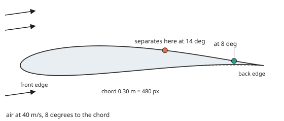
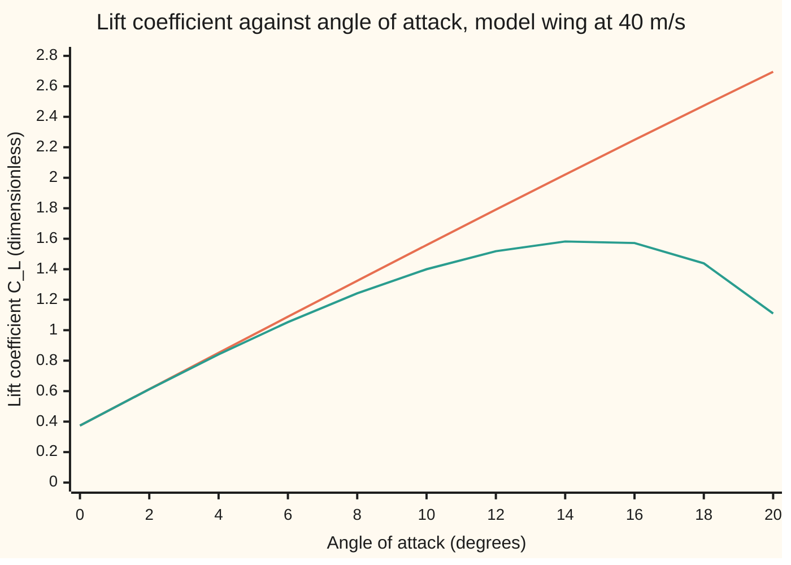
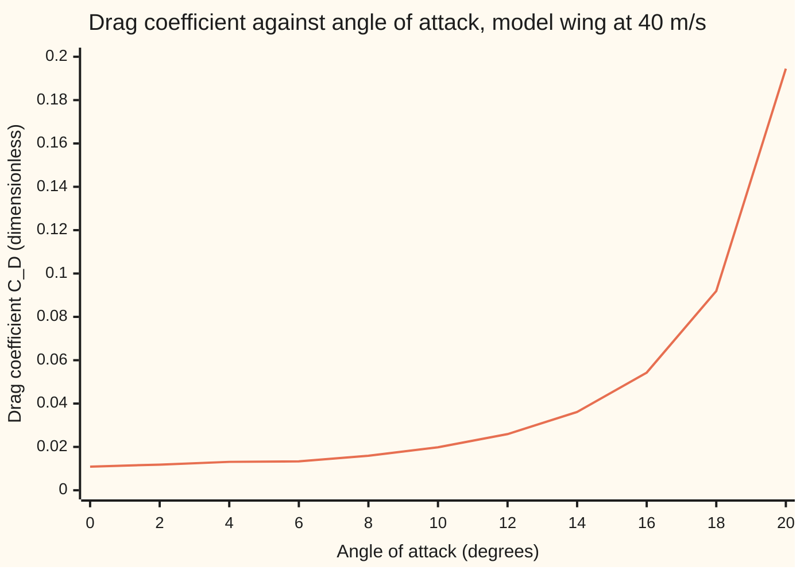

# Lift and drag: circulation lifts, the thin wall layer drags, and stall ends both

[Syllabus](../../../SYLLABUS.md) → [Engineering mathematics](../README.md) → [Fluids and Heat](../README.md#s08) → Lift and drag

---

## General Overview

A model wing sits in a wind tunnel. Its **chord**, the distance from front edge to back edge, is 0.30 m. It spans the tunnel wall to wall, 0.80 m, so the air can only go over it or under it. The air is at 20 °C and sea-level pressure, moving at 40 m/s. The wing is mounted on a **balance**, a frame that measures the force on it in two directions: straight up (**lift**) and straight downstream (**drag**).

The engineer tilts the wing to 8 degrees. The angle between the oncoming air and the chord line is the **angle of attack**. The model on this card says the balance should read 287.16 N of lift and 3.682 N of drag. Lift is 77.99 times drag. Tilt it further and lift keeps growing, but less each degree. At 14.84 degrees it peaks. Past that, lift falls while drag climbs fast. That is **stall**, and 8 degrees leaves a margin of 6.84 degrees.

Lift comes from the air going round the wing: faster over the top, slower underneath. Drag comes from a sheet of slow air on the skin, growing to about a centimetre thick by the back edge (11.8 mm on the upper surface at 8 degrees), called the **boundary layer**. Stall comes from that layer letting go of the upper surface, called **separation**.

**A sharp back edge forces the air to circulate round the wing, and the circulation gives lift; the thin wall layer of slow air gives drag; and when the slowing air behind the wing's crest pushes that layer off the upper surface, lift stops growing and the wing stalls.**

**What kind of fact this is:** lift equals density times speed times circulation is a theorem for steady flow without viscosity, proved on this card in Why it works. Everything about the layer is a model, not a law: Thwaites's and Head's methods and the Squire–Young formula are approximations tuned to measurements, and Kirchhoff's rule is an idealised model of separated flow, used semi-empirically. They track tunnel data well while the layer is attached; the stall angle they give is good to a degree or two.

### The picture: the model wing, and where its layer lets go

<p align="center"></p>

To scale: 480 px for the 0.30 m chord, the same scale up and down. The section's thickness is 0.1183 of the chord and its arch 0.0273 of the chord. At 8 degrees the layer stays on the upper surface until 0.8781 of the way back (green dot, at 461.5 px). At 14 degrees it leaves at 0.594 (orange dot, at 325.2 px). Behind each dot the air no longer follows the skin.



Orange: lift from circulation alone, with no boundary layer; it never stops rising. Green: lift once the layer may separate. They agree up to about 4 degrees, then part, and the green line turns over at 14.84 degrees.

---

## The formula

Notation already met: **viscosity**, friction inside the fluid, from [Viscosity](02-viscosity-and-pipe-flow.md); the Reynolds number Re, inertia over viscous force, from [Navier-Stokes](03-navier-stokes-and-the-reynolds-number.md); the boundary layer and its momentum loss from [Boundary layers](../01-Units%20and%20Modelling/06-boundary-layers-and-singular-perturbation.md). A layer is **laminar** when its air slides in smooth sheets, and **turbulent** when it churns and mixes. Forces are made dimensionless by dividing by the **dynamic pressure** $q = \tfrac12\rho U^2$, the pressure rise from bringing the oncoming air to rest, times the area.

Lift per metre of span, and the lift coefficient with no layer:

$$L' = \rho\,U\,\Gamma, \qquad F = \frac{L'}{q\,c} = k\,\sin(\alpha - \alpha_0)$$

Lift with the layer, where the upper surface is attached only for the front fraction $f$ of the chord:

$$C_L = F\left[\,g\cos^2(\alpha-\alpha_0) + \sqrt{f}\,\sin^2(\alpha-\alpha_0)\right], \qquad g = \left(\frac{1+\sqrt f}{2}\right)^2$$

Drag, from the momentum the layer has lost by the back edge on each surface, plus the pressure lost behind separation:

$$C_D = \frac{2}{c}\sum_{\text{upper, lower}} \theta_{\mathrm{TE}}\left(\frac{U_{\mathrm{TE}}}{U}\right)^{(H_{\mathrm{TE}}+5)/2} \;+\; F\sin(\alpha-\alpha_0)\cos(\alpha-\alpha_0)\,(g - \sqrt f)$$

The forces on the balance are $L = C_L\,q\,c\,b$ and $D = C_D\,q\,c\,b$.

**Read it aloud:** lift is the air's density times its speed times how hard it circulates round the wing; the separated part of the upper surface gives up some of that lift; and drag is the momentum the thin wall layer has lost, carried off in the wake.

| Symbol | Plain meaning | In our example | Push it up and the answer… |
| --- | --- | --- | --- |
| $L'$; $L$, $D$ | lift per metre of span, N/m; lift and drag on the balance, N | 382.654 N/m with no layer; 287.16 N and 3.682 N, at 8° | — |
| $\rho$ | air density | 1.2041 kg/m³ | lift and drag rise in proportion |
| $U$, $U_e$, $U_{\mathrm{TE}}$; $u$ | tunnel speed; air speed just outside the layer at distance $s$ along the surface; the same at the back edge; in Step 1, the small extra speed over the top | 40 m/s | forces rise as $U^2$; stall comes a little later |
| $\Gamma$ | **circulation**: the air's speed along a loop round the wing, added up all the way round, m²/s | 7.9449 m²/s at 8° | lift rises in proportion |
| $c$, $b$; $f_c$ | chord and span; camber, the arch's height as a fraction of chord | 0.30 m and 0.80 m, area 0.240 m²; 0.0273 | forces rise in proportion to $c$ and $b$; more camber, more lift at the same angle |
| $q$ | dynamic pressure $\tfrac12\rho U^2$ | 963.27 Pa | forces rise in proportion |
| $F$, $C_L$, $C_D$ | lift coefficient with no layer, lift and drag coefficients with it | 1.3242, 1.2421 and 0.01593 at 8° | — |
| $\alpha$, $\alpha_0$ | angle of attack; **zero-lift angle**, where the cambered wing gives no lift | 8°; −3.1221° | lift rises until stall |
| $k$; $a$, $\beta$, $\zeta$, $z$ | lift slope, $F$ gained per radian; circle radius, $\beta = -\alpha_0$, and the circle and wing planes of the map | 6.8644 per rad; a very thin plate gives 2π | lift rises in proportion |
| $f$, $g$ | **separation point** as a fraction of chord, upper surface; Kirchhoff's lift factor | 0.8781 and 0.9381 at 8° | f = 1 means fully attached, f near 0 means stalled |
| $\theta$, $H$, $C_f$ | **momentum thickness**: the height of full-speed air carrying the momentum the layer has lost ($\theta_{\mathrm{TE}}$ at the back edge, $\theta_\infty$ far downstream); **shape factor**, how hollow the layer's speed profile is; skin friction, wall shear over $q$ | H about 1.4 healthy; separation taken where H passes 2.0 | — |
| $\mathrm{Re}$ | Reynolds number $Uc/\nu$, with $\nu$ the kinematic viscosity 15.1152 mm²/s | 793,902 | thinner layer, less friction, later stall |

Formulas take angles in radians; the prose says degrees. The air properties are the same as on [Boundary layers](../01-Units%20and%20Modelling/06-boundary-layers-and-singular-perturbation.md): ideal-gas density at 101,325 Pa and 293.15 K, and viscosity 1.82 × 10⁻⁵ Pa s from Lemmon and Jacobsen.

### When it holds

- **Two-dimensional flow.** The wing spans the tunnel, so no air leaks round the tips. A wing with free tips pays extra **induced drag** and these numbers flatter it.
- **Low Mach number.** The Mach number, speed over the speed of sound, is 0.1165. Above about 0.3 the air squeezes and these formulas no longer apply.
- **The separation rule is a judgement.** Users of Head's method put turbulent separation where H reaches somewhere between 1.8 and 2.4. This card takes 2.0 and stalls at 14.84°, with maximum lift 1.5893. With 1.8 it stalls at 12.75° (maximum lift 1.3771); with 2.4 at 16.52° (1.7652). Treat the stall angle as good to about two degrees. The march's step size shows only in the last digits: on four times as many steps the separation point at 8° is 0.8773 instead of 0.8781, the lift 287.03 N instead of 287.16 N, and the stall 14.79° instead of 14.84°. So read the lift as 287 N and stall angles to a tenth of a degree.
- **Transition at the suction peak.** The layer is taken as laminar up to the point of highest speed and turbulent after. A rough nose or a lower Reynolds number moves the stall: at 20 m/s it comes at 13.37°.
- **Kirchhoff's rule is a fit.** It works up to and just past the peak. Deep in stall, at 20° and beyond, the wake sheds unsteady vortices and the numbers are only indications.

---

## Why it works

### Step 0: viscosity, which makes drag, is also what makes lift possible

Take viscosity away completely and a wing gets no lift. The flow wraps round the sharp back edge at infinite speed, and the stream behind the wing is not turned at all. Real air cannot turn that corner, so it leaves the back edge smoothly. That rule is the **Kutta condition**. To obey it, the flow must circulate round the wing: a little faster over the top, a little slower underneath. Circulation is what gives lift.

So the thin layer does three jobs. It fixes the circulation, and so the lift. Its lost momentum is the drag. And when it cannot climb the pressure rise towards the back edge, it lets go, and lift stops growing.

### Step 1: lift is density times speed times circulation

**Circulation** Γ is the speed along a closed loop round the wing, added up all the way round. Without viscosity it is the same for every loop that encloses the wing.

The **Kutta–Joukowski theorem** says lift per metre of span is $L' = \rho U \Gamma$. A short version of why: over the top the air moves at about $U + u$, underneath at about $U - u$. Bernoulli ([Continuity and Bernoulli](01-continuity-and-bernoulli.md)) says pressure drops by $\rho U u$ on top and rises by about $\rho U u$ underneath, to first order in $u$. Over a chord $c$ that is a net push $2\rho U u c$. The circulation round the wing is about $(U + u)c - (U - u)c = 2uc$. So the push is $\rho U \Gamma$.

<details>
<summary>Detailed proof: the exact theorem from a large circle</summary>

Far away, the flow is the uniform stream plus a vortex of strength Γ plus terms that fade faster than 1/r. Balance momentum on the air inside a circle of radius r round the wing: the wing's force equals the pressure on the circle plus the momentum flowing out across it. With Bernoulli for the pressure, only the cross term between U and the vortex speed Γ/(2πr) survives as r grows. The pressure gives ½ρUΓ and the momentum flow another ½ρUΓ, at right angles to the stream. The drag part is exactly zero: d'Alembert's paradox, which the boundary layer breaks.

</details>

The code checks the theorem by a second road. It adds up the pressure on 20,000 small pieces of the wing's surface and takes the part at right angles to the stream. That gives F = 1.3242 at 8°, the same as the circulation formula, to four decimals.

### Step 2: the circulation of this wing, from a circle

The model's section is a **Joukowski aerofoil**. The flow round a circle is known exactly. The map $z = \zeta + 1/\zeta$ turns a circle through ζ = 1 into a wing shape with a sharp back edge at z = 2, and carries the streamlines with it. Here the circle's centre sits at (−0.10, 0.06): the 0.10 gives thickness, the 0.06 gives camber, the arch of the section.

Round a circle of radius $a$, any amount of circulation is allowed. The Kutta condition picks one: the speed must be zero at the circle point that becomes the sharp edge. That gives $\Gamma = 4\pi U a_{\text{phys}} \sin(\alpha - \alpha_0)$, where $a_{\text{phys}}$ is the circle radius in metres and $-\alpha_0 = \beta = \arcsin(0.06/a)$. With lift $\rho U \Gamma$, the coefficient is $F = k \sin(\alpha - \alpha_0)$ with $k = 8\pi a/(\text{chord})$, both in the circle's own units.

For our wing $k = 6.8644$ per radian and $\alpha_0 = -3.1221°$. At 8°, Γ = 7.9449 m²/s and $L'$ = 382.654 N/m.

**Thin aerofoil theory**, which flattens the wing to its camber line, gives $F = 2\pi(\alpha - \alpha_0)$ and $\alpha_0 = -2f_c$ for an arched camber line of height $f_c$ chords. It knows nothing about the circle. Yet with the camber read off the shape, 0.0273 chords, it predicts $\alpha_0$ = −3.1254°, against the exact −3.1221°. Its slope of 2π, used with the exact zero-lift angle, gives 1.2197 at 8°, low against 1.3242: thickness speeds up the air round the nose and adds lift slope, from 2π to 6.8644.

<details>
<summary>Detailed proof: the zero-lift angle of an arched camber line</summary>

Thin aerofoil theory gives the zero-lift angle as $\alpha_0 = -\frac{1}{\pi}\int_0^\pi \frac{dz_c}{dx}(\cos\vartheta - 1)\,d\vartheta$, where $x$ is the distance back from the front edge, $z_c(x)$ is the camber line's height above the chord there, and $\vartheta$ is a stand-in angle running from 0 at the front edge to π at the back, with $x = \tfrac{c}{2}(1 - \cos\vartheta)$. For a parabolic arch of height $f_c c$, $z_c = 4f_c\,x(c - x)/c$, the slope is $dz_c/dx = 4f_c(1 - 2x/c) = 4f_c\cos\vartheta$. Then $\alpha_0 = -\frac{4f_c}{\pi}\int_0^\pi(\cos^2\vartheta - \cos\vartheta)\,d\vartheta = -\frac{4f_c}{\pi}\cdot\frac{\pi}{2} = -2f_c$ radians. A Joukowski camber line is a circular arc, which for small camber is the same parabola.

</details>

### Step 3: the layer loses momentum, and slowing air makes it worse

Two numbers carry the layer's state. The **momentum thickness** θ is the height of full-speed air whose momentum the layer has lost. The **shape factor** H is the **displacement thickness** (how far the slow layer pushes the outside flow away from the wall) divided by θ: about 1.4 in a healthy turbulent layer, larger when the air near the wall is nearly stopped. Momentum balance across the layer, the same step that gave drag on [Boundary layers](../01-Units%20and%20Modelling/06-boundary-layers-and-singular-perturbation.md), gives

$$\frac{d\theta}{ds} = \frac{C_f}{2} - (H + 2)\,\frac{\theta}{U_e}\,\frac{dU_e}{ds}$$

where s is distance along the surface, $U_e$ the air speed just outside the layer, and $C_f$ the local skin friction, wall shear over $q$. The first term is friction eating momentum. The second is pressure: outside air speeding up helps the layer, outside air slowing down thickens it, faster the bigger H already is.

On the upper surface the air speeds up round the nose to a **suction peak**, then slows all the way to the back edge. Up to the peak the layer is laminar, and **Thwaites's method** gives θ in one integral: $\theta^2 = 0.45\,\nu\,U_e^{-6}\int_0^s U_e^5\,ds$. After it the layer is turbulent, and **Head's method** marches θ and H together, with a second equation for how fast the layer swallows outside air and the Ludwieg–Tillmann fit for $C_f$.

### Step 4: separation is the layer failing to climb the pressure hill

Slowing outside air means rising pressure. The air at the bottom of the layer has already lost most of its speed to friction. Rising pressure pushes it back until it stops and turns round. The layer lifts off the skin, leaving a slow, churning region at roughly constant pressure. In Head's method the warning sign is H climbing; this card calls the layer separated when H passes 2.0, inside the published range of 1.8 to 2.4.

More angle means a sharper suction peak and a steeper climb behind it. So the separation point creeps forward as the angle rises: 0.977 of the chord at 4°, 0.8781 at 8°, 0.594 at 14°, 0.097 at 20°. How it moves, below, traces it.

### Step 5: drag is the momentum missing from the wake

By the back edge, each surface's layer has lost momentum θ_TE. Behind the wing the two layers merge into a **wake**, and in it the outside speed recovers from $U_{\mathrm{TE}}$ to $U$. The **Squire–Young formula** follows the wake's momentum thickness through that recovery, giving $\theta_\infty = \theta_{\mathrm{TE}}(U_{\mathrm{TE}}/U)^{(H_{\mathrm{TE}}+5)/2}$. Drag per metre is $\rho U^2 \theta_\infty$, so the drag coefficient is $2\theta_\infty/c$, summed over both surfaces. It counts skin friction and the pressure drag from the layer's thickness together.

Behind a separation point the code holds the outside speed constant, as the churning region does. Kirchhoff's rule (Step 6) adds a pressure drag $F\sin(\alpha-\alpha_0)\cos(\alpha-\alpha_0)(g - \sqrt f)$: zero when attached, 0.00025 at 8°, and large deep in stall.

A fourth road checks the march. On a flat plate the outside speed never changes, and Head's method gives a one-side friction coefficient of 0.00432 at Re 793,902. The standard turbulent flat-plate fit, $0.074\,\mathrm{Re}^{-0.2}$, gives 0.00489. Published fits differ from each other by about this much. The wing at 0° has drag 0.01091, more than twice 0.00432: a thick wing speeds the air up over its middle, and faster air rubs harder.

### Step 6: stall is lift that separation takes away faster than angle adds it

The air above the separated part no longer follows the skin, so it no longer gives the low pressure that made lift there. **Kirchhoff's rule**, used in the Leishman–Beddoes stall model, says how much lift survives. Split the no-layer force into a part at right angles to the zero-lift line, $F\cos(\alpha-\alpha_0)$, and the **leading-edge suction**, $F\sin(\alpha-\alpha_0)$, which pulls forward along it.

A separation point at $f$ multiplies the first by $g = ((1+\sqrt f)/2)^2$ and the second by $\sqrt f$. Resolving back gives the formula for $C_L$. With $f = 1$ both factors are 1 and nothing changes. With $f = 0$ the lift falls to about a quarter.

Raising the angle raises $F$, and also pulls $f$ forward, which lowers $g$. At first $F$ wins. Then separation races forward and lift falls. The code finds the top by scanning whole degrees, then narrowing in by **golden-section search**, which shrinks the interval round the peak by a fixed fraction each time: 14.84°, with $C_L$ = 1.5893.

---

## Worked numbers, by hand

The model wing at 8°, 40 m/s, chord 0.30 m, span 0.80 m.

| Step | Arithmetic | Value |
| --- | --- | --- |
| air density | 101,325 × 0.0289644 / (8.314462618 × 293.15) | 1.2041 kg/m³ |
| kinematic viscosity | 1.82 × 10⁻⁵ / 1.2041 | 15.1152 mm²/s |
| Reynolds number | 40 × 0.30 / 15.1152 × 10⁻⁶ | 793,902 |
| dynamic pressure | ½ × 1.2041 × 40² | 963.27 Pa |
| angle from zero lift | 8 + 3.1221 | 11.1221° |
| lift coefficient, no layer | 6.8644 × sin 11.1221° = 6.8644 × 0.1929 | 1.3242 |
| separation point | Head's march, H passes 2.0 | 0.8781 of chord |
| Kirchhoff factors | √0.8781 = 0.9371; ((1 + 0.9371)/2)² | g = 0.9381 |
| lift coefficient | 1.3242 × (0.9381 cos²11.1221° + 0.9371 sin²11.1221°) | 1.2421 |
| lift on the balance | 1.2421 × 963.27 × 0.240 | **287.16 N** |
| drag coefficient | Squire–Young, both surfaces, plus 0.00025 | 0.01593 |
| drag on the balance | 0.01593 × 963.27 × 0.240 | **3.682 N** |
| lift / drag | 287.16 / 3.682 | 77.99 |
| stall margin | 14.84 − 8 | **6.84°** |

At 8° the balance reads 287.16 N up and 3.682 N back, and the wing has 6.84 degrees in hand before it stalls.

### What breaks if you drop a piece

| Mistake | Comes out at | What went wrong |
| --- | --- | --- |
| Degrees put into 2π(α − α₀) | C_L 69.88 | the formula takes radians, not 11.1221 degrees |
| Camber left out, $k \sin\alpha$ | C_L 0.9553, against 1.3242 | the arch gives lift at zero angle; α₀ = −3.1221° matters |
| The straight lift line read at 20° | C_L 2.6956, against 1.1094 | the layer is attached over only 0.097 of the upper surface |
| Laminar friction for drag at 0° | C_D 0.00298, against 0.01091 | at Re 793,902 the layer is turbulent behind the suction peak |
| The ½ left out of the dynamic pressure | lift 574.31 N, against 287.16 N | $q = \tfrac12\rho U^2$, not $\rho U^2$ |

Every number in this table is printed by the code.

---

## How lift and drag move with angle

The puzzle: lift grows steadily with angle, and the layer's trouble grows too. Which wins, and where? The code steps the angle by 2 degrees; its table prints every value below.

### The separation point, one angle at a time

Each bar is how much of the upper surface still has its layer attached.

```
angle   attached fraction of the upper surface
   0°   ██████████████████████████████████████████████████  1.000
   2°   ██████████████████████████████████████████████████  0.999
   4°   █████████████████████████████████████████████████   0.977
   6°   ███████████████████████████████████████████████     0.936
   8°   ████████████████████████████████████████████        0.878
  10°   ████████████████████████████████████████            0.802
  12°   ███████████████████████████████████                 0.709
  14°   ██████████████████████████████                      0.594
  16°   ███████████████████████                             0.456
  18°   ██████████████                                      0.286
  20°   █████                                               0.097
```

The first few degrees cost almost nothing. Then each 2 degrees costs more chord than the last. That speeding-up is the stall.

### Drag against angle



The line: the drag coefficient, wake plus separation pressure. Up to about 8° drag rises slowly, from 0.01091 to 0.01593; the wall layer's friction is most of it. Past stall it climbs steeply, from 0.03611 at 14° to 0.19449 at 20°, as the churning region behind the separation point grows. A stalled wing has less lift and much more drag at once.

---

## Code, from first principles, and it actually runs

The script builds the wing from its circle and gets the lift two independent ways: from the circulation the Kutta condition fixes, and by adding up surface pressure. A third road, thin aerofoil theory, predicts the zero-lift angle from the camber read off the shape. It marches the layer along each surface, finds separation, and gets drag from the wake. Three more roads check the march: a fourth runs it on a flat plate against the standard turbulent friction fit; a fifth sets Thwaites's laminar integral against Blasius's exact laminar flat plate, θ = 0.664 c/√Re, 0.2259 mm against 0.2236 mm; a sixth reruns the wing on four times as many steps, and separation, drag and stall barely move. Nothing imported knows any answer; Rust's complex numbers are a small struct written out.

### Python

```python
# Lift, drag and boundary layers -- the check behind the card.  Standard library only.
# A model wing (a Joukowski aerofoil, chord 0.30 m) in a wind tunnel at 40 m/s.
# Lift two ways: circulation (Kutta-Joukowski) and summed surface pressure.  Drag and
# separation from the boundary layer: Thwaites (laminar) to the suction peak, then Head's
# turbulent method.  Stall from Kirchhoff's rule: lift shrinks as the layer lets go.
from math import pi, sin, cos, asin, sqrt, degrees, radians
import cmath

R, M_AIR, P0, T0, MU = 8.314462618, 0.0289644, 101325.0, 293.15, 1.82e-5
RHO = P0 * M_AIR / (R * T0); NU = MU / RHO          # air at 20 C, 1 atm
U, C, SPAN, N = 40.0, 0.30, 0.80, 3000              # tunnel speed, chord, span, steps

def wing(ex, ey):                                   # circle centre (-ex, ey) through z = 1
    m = complex(-ex, ey); a = abs(1 - m); beta = asin(ey / a)
    pts = [m + a * cmath.exp(2j * pi * k / 4000) for k in range(4000)]
    zs = [p + 1 / p for p in pts]; xle = min(z.real for z in zs); ch = 2.0 - xle
    up, lo = [-9.0] * 200, [9.0] * 200              # thickness and camber by x-bins
    for z in zs:
        i = min(199, int((z.real - xle) / ch * 200)); up[i] = max(up[i], z.imag); lo[i] = min(lo[i], z.imag)
    t = max(u - l for u, l in zip(up, lo)) / ch; f = max((u + l) / 2 for u, l in zip(up, lo)) / ch
    return dict(m=m, a=a, beta=beta, ch=ch, t=t, f=f, k=8 * pi * a / ch)

def pos(w, th): p = w['m'] + w['a'] * cmath.exp(1j * th); return p + 1 / p
def speed(w, th, al):                               # speed / U on the aerofoil at circle angle th
    p = w['m'] + w['a'] * cmath.exp(1j * th)
    return abs(-2 * sin(th - al) - 2 * sin(al + w['beta'])) / abs(1 - 1 / p ** 2)

def cl_by_pressure(w, al, n=20000):                 # road 2: add up -Cp n ds round the surface
    fl = 0.0; z0 = complex(2, 0)
    for k in range(1, n + 1):
        th = -w['beta'] + 2 * pi * k / n; z1 = pos(w, th) if k < n else complex(2, 0)
        q = speed(w, th - pi / n, al); dz = z1 - z0; cp = 1 - q * q
        fl += -cp * (dz.imag * -sin(al) + -dz.real * cos(al)); z0 = z1
    return fl / w['ch']

def h_of(h1): return 1.1 + 0.86 * (h1 - 3.3) ** -0.777 if h1 >= 5.3 else 0.6778 + 1.1536 * (h1 - 3.3) ** -0.326
def h1_of(h): return 3.3 + 0.8234 * (h - 1.1) ** -1.287 if h <= 1.6 else 3.3 + 1.5501 * (h - 0.6778) ** -3.064

def thwaites(s, ue, k0):                            # laminar momentum thickness at s[k0]
    I = sum(0.5 * (ue[k] ** 5 + ue[k - 1] ** 5) * (s[k] - s[k - 1]) for k in range(1, k0 + 1))
    return sqrt(0.45 * NU * I / ue[k0] ** 6)

def march(s, ue, hsep):                             # Thwaites to the suction peak, then Head
    k0 = max(range(len(ue)), key=lambda k: ue[k])
    th = thwaites(s, ue, k0); h = 1.4; y = ue[k0] * th * h1_of(h); ksep = None
    for k in range(k0, len(s) - 1):
        ds = s[k + 1] - s[k]; due = 0.0 if ksep else (ue[k + 1] - ue[k]) / ds
        cf = 0.246 * 10 ** (-0.678 * h) * (ue[k] * th / NU) ** -0.268
        h1 = y / (ue[k] * th)
        th += ds * (cf / 2 - (h + 2) * th / ue[k] * due); y += ds * ue[k] * 0.0306 * (h1 - 3) ** -0.6169
        if ksep: ue[k + 1] = ue[k]                  # past separation: pressure stays constant
        h1 = y / (ue[k + 1] * th); h = h_of(h1) if h1 > 3.3 + 1e-9 else 3.5
        if ksep is None and h > hsep: ksep = k + 1
        h = min(h, hsep)
    return ksep, 2 * th / C * (ue[-1] / U) ** ((h + 5) / 2), y / ue[-1] + h * th   # last: thickness at the back edge

def section(w, adeg, hsep=2.0, n=N):                # one angle: lift, separation point, drag
    al = radians(adeg); ths = pi + 2 * al + w['beta']; sc = C / w['ch']; out = []
    for tte in (-w['beta'], 2 * pi - w['beta']):    # upper surface, then lower
        thv = [ths + (tte - ths) * k / n for k in range(n + 1)]
        ue = [0.0] + [U * speed(w, t, al) for t in thv[1:n]]; ue.append(ue[-1])
        zz = [pos(w, t) for t in thv[:n]] + [complex(2, 0)]
        s = [0.0]
        for k in range(1, n + 1): s.append(s[-1] + abs(zz[k] - zz[k - 1]) * sc)
        ks, cd, dl = march(s, ue, hsep)
        out.append(((zz[ks].real - (2 - w['ch'])) / w['ch'] if ks else 1.0, cd, zz[ks].imag / w['ch'] if ks else 0.0, dl))
    fs, ae = out[0][0], al + w['beta']; F = w['k'] * sin(ae); g = ((1 + sqrt(fs)) / 2) ** 2
    cl = F * (g * cos(ae) ** 2 + sqrt(fs) * sin(ae) ** 2)        # Kirchhoff: normal x g, suction x sqrt f
    cdp = F * sin(ae) * cos(ae) * (g - sqrt(fs))
    return F, fs, cl, out[0][1] + out[1][1] + cdp, cdp, out[0]   # last: upper x/c, C_D, y/c, thickness

def stall(w, hsep=2.0, n=N):                        # scan, then golden-section on the peak
    best = max(range(0, 26), key=lambda d: section(w, d, hsep, n)[2]); lo, hi = best - 1.0, best + 1.0
    g = (sqrt(5) - 1) / 2
    for _ in range(25):
        x1, x2 = hi - g * (hi - lo), lo + g * (hi - lo)
        if section(w, x1, hsep, n)[2] > section(w, x2, hsep, n)[2]: hi = x2
        else: lo = x1
    a = (lo + hi) / 2; return a, section(w, a, hsep, n)[2]

def p(label, v, fmt): print(f"{label:<46}{v:{fmt}}")
w = wing(0.10, 0.06); qd = 0.5 * RHO * U ** 2; re = U * C / NU; al = radians(8.0)
p("air density, kg/m^3", RHO, ".4f"); p("kinematic viscosity, mm^2/s", NU * 1e6, ".4f")
p("Reynolds number U c / nu", re, ",.0f"); p("Mach number U / sqrt(1.4 R T / M)", U / sqrt(1.4 * R * T0 / M_AIR), ".4f")
p("dynamic pressure 1/2 rho U^2, Pa", qd, ".2f"); p("wing area c x span, m^2", C * SPAN, ".3f")
p("thickness, fraction of chord", w['t'], ".4f"); p("camber, fraction of chord", w['f'], ".4f")
p("zero-lift angle, deg", -degrees(w['beta']), ".4f"); p("zero-lift angle, thin aerofoil -2 f/c, deg", -degrees(2 * w['f']), ".4f")
p("lift slope k, per rad (thin aerofoil 2 pi)", w['k'], ".4f")
F8, f8, cl8, cd8, cdp8, up8 = section(w, 8.0); clp = cl_by_pressure(w, al)
gam = 4 * pi * U * w['a'] * C / w['ch'] * sin(al + w['beta'])
p("8 deg: circulation Gamma, m^2/s", gam, ".4f"); p("8 deg: lift per metre rho U Gamma, N/m", RHO * U * gam, ".3f")
p("8 deg: C_L by circulation, no layer", F8, ".4f"); p("8 deg: C_L by summed pressure, no layer", clp, ".4f")
p("8 deg: C_L slope 2 pi, exact a0", 2 * pi * (al + w['beta']), ".4f")
ae = al + w['beta']; print(f"{'8 deg: a - a0 deg, sin, g, sqrt f':<46}{degrees(ae):.4f}  {sin(ae):.4f}  {((1 + sqrt(f8)) / 2) ** 2:.4f}  {sqrt(f8):.4f}")
p("8 deg: separation point x/c, upper", f8, ".4f"); p("8 deg: C_L with the layer", cl8, ".4f")
p("8 deg: C_D, wake plus separation", cd8, ".5f"); p("8 deg: of which separation pressure", cdp8, ".5f")
p("8 deg: upper layer thickness, back edge, mm", 1000 * up8[3], ".1f")
L8, D8 = cl8 * qd * C * SPAN, cd8 * qd * C * SPAN
print(f"{'8 deg: lift N, drag N, lift / drag':<46}{L8:.2f}  {D8:.3f}  {L8 / D8:.2f}")
sa, clm = stall(w); s18, c18 = stall(w, 1.8); s24, c24 = stall(w, 2.4)
print(f"{'stall deg, margin deg, maximum C_L (H = 2.0)':<46}{sa:.2f}  {sa - 8.0:.2f}  {clm:.4f}")
print(f"{'H = 1.8: stall angle deg, maximum C_L':<46}{s18:.2f}  {c18:.4f}")
print(f"{'H = 2.4: stall angle deg, maximum C_L':<46}{s24:.2f}  {c24:.4f}")
print("angle  C_L no layer  sep x/c   C_L      C_D"); rows = []
for d in range(0, 21, 2):
    rows.append(section(w, d)); F, fs, cl, cd = rows[-1][:4]; print(f"{d:>5} {F:>10.4f} {fs:>10.3f} {cl:>8.4f} {cd:>8.5f}")
plate = [C * k / N for k in range(N + 1)]           # road 4: a flat plate, turbulent from the front edge
fp = march(plate, [0.0] + [U] * N, 2.0)[1]
print(f"{'plate C_f one side: march, 0.074 Re^-0.2':<46}{fp:.5f}  {0.074 * re ** -0.2:.5f}")
th_lam = thwaites(plate, [U] * (N + 1), N)          # road 5: Thwaites on a laminar plate, against Blasius
print(f"{'laminar plate theta mm: Thwaites, Blasius':<46}{1000 * th_lam:.4f}  {664 * C / sqrt(re):.4f}")
F8f, f8f, cl8f, cd8f = section(w, 8.0, 2.0, 4 * N)[:4]; saf = stall(w, 2.0, 4 * N)[0]   # road 6: 4 x the steps
print(f"{'4 x steps: 8 deg x/c, C_D, lift N; stall deg':<46}{f8f:.4f}  {cd8f:.5f}  {cl8f * qd * C * SPAN:.2f}  {saf:.2f}")
p("wrong: degrees in 2 pi (a - a0)", 2 * pi * (8.0 + degrees(w['beta'])), ".2f")
p("wrong: camber left out, k sin a", w['k'] * sin(al), ".4f")
p("wrong: straight line at 20 deg", rows[-1][0], ".4f")
p("wrong: laminar friction, both sides", 2 * 1.328 / sqrt(re), ".5f")
p("wrong: no 1/2 in dynamic pressure, lift N", 2 * L8, ".2f")
sx = lambda f: 40 + 480 * f                          # figure: 480 px of chord
sy = lambda y: 130 - 480 * y                         # chord line at y = 130 px, up is smaller y
print(f"figure, leading edge x {sx(0):.1f}, trailing edge x {sx(1):.1f}, separation at 8 deg ({sx(f8):.1f}, {sy(up8[2]):.1f}),"
      f" at 14 deg ({sx(rows[7][1]):.1f}, {sy(rows[7][5][2]):.1f})")
U = 20.0; p("try: tunnel at 20 m/s, stall angle deg", stall(w)[0], ".2f"); U = 40.0
wt = wing(0.06, 0.06); print(f"{'try: thinner wing, thickness, stall angle deg':<46}{wt['t']:.4f}  {stall(wt)[0]:.2f}")
p("try: no camber, stall angle deg", stall(wing(0.10, 0.0))[0], ".2f")
assert abs(F8 - clp) < 1e-3                         # circulation and pressure agree
assert abs(fp - 0.074 * re ** -0.2) < 0.15 * 0.074 * re ** -0.2   # the march lands within the flat-plate fits' spread
assert abs(w['beta'] - 2 * w['f']) < 0.01 * w['beta']   # camber read off the shape predicts the zero-lift angle
assert 13.0 < sa < 17.0 and s18 < sa < s24         # stall near fifteen degrees, later if separation is judged later
assert all(abs(h_of(h1_of(h)) - h) < 0.005 for h in (1.3, 1.5, 2.0, 2.4))   # Head's two fits invert each other
assert all(a[1] >= b[1] for a, b in zip(rows, rows[1:]))   # separation creeps forward as angle grows
assert 2 * fp < rows[0][3] < 1.3 * 2 * fp           # profile drag sits a little above flat-plate friction
assert abs(th_lam / (0.664 * C / sqrt(re)) - 1) < 0.02   # Thwaites within 2% of the exact Blasius plate
assert abs(f8f - f8) < 0.002 and abs(cd8f / cd8 - 1) < 0.01 and abs(saf - sa) < 0.2   # step size settled
print("ALL CHECKS PASS")
```

**Ran 2026-11-11 on macOS, Python 3.14.10, standard library only. All checks passed. Output, pasted from the run:**

```
air density, kg/m^3                           1.2041
kinematic viscosity, mm^2/s                   15.1152
Reynolds number U c / nu                      793,902
Mach number U / sqrt(1.4 R T / M)             0.1165
dynamic pressure 1/2 rho U^2, Pa              963.27
wing area c x span, m^2                       0.240
thickness, fraction of chord                  0.1183
camber, fraction of chord                     0.0273
zero-lift angle, deg                          -3.1221
zero-lift angle, thin aerofoil -2 f/c, deg    -3.1254
lift slope k, per rad (thin aerofoil 2 pi)    6.8644
8 deg: circulation Gamma, m^2/s               7.9449
8 deg: lift per metre rho U Gamma, N/m        382.654
8 deg: C_L by circulation, no layer           1.3242
8 deg: C_L by summed pressure, no layer       1.3242
8 deg: C_L slope 2 pi, exact a0               1.2197
8 deg: a - a0 deg, sin, g, sqrt f             11.1221  0.1929  0.9381  0.9371
8 deg: separation point x/c, upper            0.8781
8 deg: C_L with the layer                     1.2421
8 deg: C_D, wake plus separation              0.01593
8 deg: of which separation pressure           0.00025
8 deg: upper layer thickness, back edge, mm   11.8
8 deg: lift N, drag N, lift / drag            287.16  3.682  77.99
stall deg, margin deg, maximum C_L (H = 2.0)  14.84  6.84  1.5893
H = 1.8: stall angle deg, maximum C_L         12.75  1.3771
H = 2.4: stall angle deg, maximum C_L         16.52  1.7652
angle  C_L no layer  sep x/c   C_L      C_D
    0     0.3739      1.000   0.3739  0.01091
    2     0.6128      0.999   0.6125  0.01183
    4     0.8511      0.977   0.8412  0.01311
    6     1.0883      0.936   1.0530  0.01332
    8     1.3242      0.878   1.2421  0.01593
   10     1.5584      0.802   1.3999  0.01981
   12     1.7908      0.709   1.5180  0.02591
   14     2.0209      0.594   1.5821  0.03611
   16     2.2487      0.456   1.5719  0.05429
   18     2.4736      0.286   1.4386  0.09193
   20     2.6956      0.097   1.1094  0.19449
plate C_f one side: march, 0.074 Re^-0.2      0.00432  0.00489
laminar plate theta mm: Thwaites, Blasius     0.2259  0.2236
4 x steps: 8 deg x/c, C_D, lift N; stall deg  0.8773  0.01594  287.03  14.79
wrong: degrees in 2 pi (a - a0)               69.88
wrong: camber left out, k sin a               0.9553
wrong: straight line at 20 deg                2.6956
wrong: laminar friction, both sides           0.00298
wrong: no 1/2 in dynamic pressure, lift N     574.31
figure, leading edge x 40.0, trailing edge x 520.0, separation at 8 deg (461.5, 120.8), at 14 deg (325.2, 99.8)
try: tunnel at 20 m/s, stall angle deg        13.37
try: thinner wing, thickness, stall angle deg 0.0739  10.79
try: no camber, stall angle deg               12.62
ALL CHECKS PASS
```

### Rust

```rust
// Lift, drag and boundary layers -- the check behind the card.  Rust std only.
// A model wing (a Joukowski aerofoil, chord 0.30 m) in a wind tunnel at 40 m/s.
// Lift two ways: circulation (Kutta-Joukowski) and summed surface pressure.  Drag and
// separation from the boundary layer: Thwaites (laminar) to the suction peak, then Head's
// turbulent method.  Stall from Kirchhoff's rule: lift shrinks as the layer lets go.
use std::f64::consts::PI;

#[derive(Clone, Copy)]
struct Cx { re: f64, im: f64 }
fn cx(re: f64, im: f64) -> Cx { Cx { re, im } }
fn add(a: Cx, b: Cx) -> Cx { cx(a.re + b.re, a.im + b.im) }
fn sub(a: Cx, b: Cx) -> Cx { cx(a.re - b.re, a.im - b.im) }
fn mul(a: Cx, b: Cx) -> Cx { cx(a.re * b.re - a.im * b.im, a.re * b.im + a.im * b.re) }
fn inv(b: Cx) -> Cx { // 1 / b, the same steps as Python's complex division
    if b.re.abs() >= b.im.abs() { let r = b.im / b.re; let d = b.re + b.im * r; cx(1.0 / d, -r / d) }
    else { let r = b.re / b.im; let d = b.re * r + b.im; cx(r / d, -1.0 / d) }
}
fn abs(a: Cx) -> f64 { a.re.hypot(a.im) }

const R: f64 = 8.314462618; const M_AIR: f64 = 0.0289644; const P0: f64 = 101325.0;
const T0: f64 = 293.15; const MU: f64 = 1.82e-5;
const C: f64 = 0.30; const SPAN: f64 = 0.80; const N: usize = 3000;
fn rho() -> f64 { P0 * M_AIR / (R * T0) }
fn nu() -> f64 { MU / rho() } // air at 20 C, 1 atm

struct Wing { m: Cx, a: f64, beta: f64, ch: f64, t: f64, f: f64, k: f64 }
fn wing(ex: f64, ey: f64) -> Wing { // circle centre (-ex, ey) through z = 1
    let m = cx(-ex, ey); let a = abs(sub(cx(1.0, 0.0), m)); let beta = (ey / a).asin();
    let zs: Vec<Cx> = (0..4000).map(|k| { let t = 2.0 * PI * k as f64 / 4000.0;
        let p = add(m, cx(a * t.cos(), a * t.sin())); add(p, inv(p)) }).collect();
    let xle = zs.iter().map(|z| z.re).fold(f64::INFINITY, f64::min); let ch = 2.0 - xle;
    let (mut up, mut lo) = (vec![-9.0f64; 200], vec![9.0f64; 200]); // thickness and camber by x-bins
    for z in &zs { let i = 199.min(((z.re - xle) / ch * 200.0) as usize); up[i] = up[i].max(z.im); lo[i] = lo[i].min(z.im); }
    let t = (0..200).map(|i| up[i] - lo[i]).fold(f64::NEG_INFINITY, f64::max) / ch;
    let f = (0..200).map(|i| (up[i] + lo[i]) / 2.0).fold(f64::NEG_INFINITY, f64::max) / ch;
    Wing { m, a, beta, ch, t, f, k: 8.0 * PI * a / ch }
}
fn circ(w: &Wing, th: f64) -> Cx { add(w.m, cx(w.a * th.cos(), w.a * th.sin())) }
fn pos(w: &Wing, th: f64) -> Cx { let p = circ(w, th); add(p, inv(p)) }
fn speed(w: &Wing, th: f64, al: f64) -> f64 { // speed / U on the aerofoil at circle angle th
    let p = circ(w, th);
    (-2.0 * (th - al).sin() - 2.0 * (al + w.beta).sin()).abs() / abs(sub(cx(1.0, 0.0), inv(mul(p, p))))
}
fn cl_by_pressure(w: &Wing, al: f64, n: usize) -> f64 { // road 2: add up -Cp n ds round the surface
    let (mut fl, mut z0) = (0.0, cx(2.0, 0.0));
    for k in 1..=n {
        let th = -w.beta + 2.0 * PI * k as f64 / n as f64; let z1 = if k < n { pos(w, th) } else { cx(2.0, 0.0) };
        let q = speed(w, th - PI / n as f64, al); let dz = sub(z1, z0); let cp = 1.0 - q * q;
        fl += -cp * (dz.im * -al.sin() + -dz.re * al.cos()); z0 = z1;
    }
    fl / w.ch
}
fn h_of(h1: f64) -> f64 { if h1 >= 5.3 { 1.1 + 0.86 * (h1 - 3.3).powf(-0.777) } else { 0.6778 + 1.1536 * (h1 - 3.3).powf(-0.326) } }
fn h1_of(h: f64) -> f64 { if h <= 1.6 { 3.3 + 0.8234 * (h - 1.1).powf(-1.287) } else { 3.3 + 1.5501 * (h - 0.6778).powf(-3.064) } }

fn thwaites(s: &[f64], ue: &[f64], k0: usize) -> f64 { // laminar momentum thickness at s[k0]
    let mut i = 0.0; for k in 1..=k0 { i += 0.5 * (ue[k].powf(5.0) + ue[k - 1].powf(5.0)) * (s[k] - s[k - 1]); }
    (0.45 * nu() * i / ue[k0].powf(6.0)).sqrt()
}
fn march(s: &[f64], ue: &mut Vec<f64>, hsep: f64, u: f64) -> (Option<usize>, f64, f64) { // Thwaites, then Head
    let mut k0 = 0; for k in 0..ue.len() { if ue[k] > ue[k0] { k0 = k; } }
    let mut th = thwaites(s, ue, k0); let mut h = 1.4;
    let mut y = ue[k0] * th * h1_of(h); let mut ksep: Option<usize> = None;
    for k in k0..s.len() - 1 {
        let ds = s[k + 1] - s[k]; let due = if ksep.is_some() { 0.0 } else { (ue[k + 1] - ue[k]) / ds };
        let cf = 0.246 * 10f64.powf(-0.678 * h) * (ue[k] * th / nu()).powf(-0.268);
        let h1 = y / (ue[k] * th);
        th += ds * (cf / 2.0 - (h + 2.0) * th / ue[k] * due); y += ds * ue[k] * 0.0306 * (h1 - 3.0).powf(-0.6169);
        if ksep.is_some() { ue[k + 1] = ue[k]; } // past separation: pressure stays constant
        let h1 = y / (ue[k + 1] * th); h = if h1 > 3.3 + 1e-9 { h_of(h1) } else { 3.5 };
        if ksep.is_none() && h > hsep { ksep = Some(k + 1); }
        h = h.min(hsep);
    }
    let ul = ue[ue.len() - 1]; // last: thickness at the back edge
    (ksep, 2.0 * th / C * (ul / u).powf((h + 5.0) / 2.0), y / ul + h * th)
}
type Up = (f64, f64, f64, f64); // upper surface: separation x/c, C_D, y/c, thickness at the back edge
fn section(w: &Wing, adeg: f64, hsep: f64, u: f64, n: usize) -> (f64, f64, f64, f64, f64, Up) { // lift, separation, drag
    let al = adeg.to_radians(); let ths = PI + 2.0 * al + w.beta; let sc = C / w.ch; let mut out: Vec<Up> = vec![];
    for tte in [-w.beta, 2.0 * PI - w.beta] { // upper surface, then lower
        let thv: Vec<f64> = (0..=n).map(|k| ths + (tte - ths) * k as f64 / n as f64).collect();
        let mut ue = vec![0.0]; for t in &thv[1..n] { ue.push(u * speed(w, *t, al)); } ue.push(ue[ue.len() - 1]);
        let mut zz: Vec<Cx> = thv[..n].iter().map(|t| pos(w, *t)).collect(); zz.push(cx(2.0, 0.0));
        let mut s = vec![0.0]; for k in 1..=n { s.push(s[k - 1] + abs(sub(zz[k], zz[k - 1])) * sc); }
        let (ks, cd, dl) = march(&s, &mut ue, hsep, u);
        let (xs, ys) = match ks { Some(k) => ((zz[k].re - (2.0 - w.ch)) / w.ch, zz[k].im / w.ch), None => (1.0, 0.0) };
        out.push((xs, cd, ys, dl));
    }
    let (fs, ae) = (out[0].0, al + w.beta); let f = w.k * ae.sin(); let g = ((1.0 + fs.sqrt()) / 2.0).powf(2.0);
    let cl = f * (g * ae.cos().powf(2.0) + fs.sqrt() * ae.sin().powf(2.0)); // Kirchhoff: normal x g, suction x sqrt f
    let cdp = f * ae.sin() * ae.cos() * (g - fs.sqrt());
    (f, fs, cl, out[0].1 + out[1].1 + cdp, cdp, out[0])
}
fn stall(w: &Wing, hsep: f64, u: f64, n: usize) -> (f64, f64) { // scan, then golden-section on the peak
    let mut best = 0; let mut bv = f64::NEG_INFINITY;
    for d in 0..26 { let v = section(w, d as f64, hsep, u, n).2; if v > bv { bv = v; best = d; } }
    let (mut lo, mut hi) = (best as f64 - 1.0, best as f64 + 1.0); let g = (5f64.sqrt() - 1.0) / 2.0;
    for _ in 0..25 {
        let (x1, x2) = (hi - g * (hi - lo), lo + g * (hi - lo));
        if section(w, x1, hsep, u, n).2 > section(w, x2, hsep, u, n).2 { hi = x2 } else { lo = x1 }
    }
    let a = (lo + hi) / 2.0; (a, section(w, a, hsep, u, n).2)
}
fn p(label: &str, v: String) { println!("{:<46}{}", label, v); }
fn commas(v: f64) -> String { let s = format!("{:.0}", v); let b = s.as_bytes(); let mut o = String::new();
    for (i, c) in b.iter().enumerate() { if i > 0 && (b.len() - i) % 3 == 0 { o.push(','); } o.push(*c as char); } o }

fn main() {
    let u: f64 = 40.0; let w = wing(0.10, 0.06); let qd = 0.5 * rho() * u.powf(2.0); let re = u * C / nu(); let al = 8f64.to_radians();
    p("air density, kg/m^3", format!("{:.4}", rho())); p("kinematic viscosity, mm^2/s", format!("{:.4}", nu() * 1e6));
    p("Reynolds number U c / nu", commas(re)); p("Mach number U / sqrt(1.4 R T / M)", format!("{:.4}", u / (1.4 * R * T0 / M_AIR).sqrt()));
    p("dynamic pressure 1/2 rho U^2, Pa", format!("{:.2}", qd)); p("wing area c x span, m^2", format!("{:.3}", C * SPAN));
    p("thickness, fraction of chord", format!("{:.4}", w.t)); p("camber, fraction of chord", format!("{:.4}", w.f));
    p("zero-lift angle, deg", format!("{:.4}", -w.beta.to_degrees()));
    p("zero-lift angle, thin aerofoil -2 f/c, deg", format!("{:.4}", -(2.0 * w.f).to_degrees()));
    p("lift slope k, per rad (thin aerofoil 2 pi)", format!("{:.4}", w.k));
    let (f8, s8, cl8, cd8, cdp8, up8) = section(&w, 8.0, 2.0, u, N); let clp = cl_by_pressure(&w, al, 20000);
    let gam = 4.0 * PI * u * w.a * C / w.ch * (al + w.beta).sin();
    p("8 deg: circulation Gamma, m^2/s", format!("{:.4}", gam)); p("8 deg: lift per metre rho U Gamma, N/m", format!("{:.3}", rho() * u * gam));
    p("8 deg: C_L by circulation, no layer", format!("{:.4}", f8)); p("8 deg: C_L by summed pressure, no layer", format!("{:.4}", clp));
    p("8 deg: C_L slope 2 pi, exact a0", format!("{:.4}", 2.0 * PI * (al + w.beta)));
    let ae = al + w.beta; println!("{:<46}{:.4}  {:.4}  {:.4}  {:.4}", "8 deg: a - a0 deg, sin, g, sqrt f", ae.to_degrees(), ae.sin(), ((1.0 + s8.sqrt()) / 2.0).powf(2.0), s8.sqrt());
    p("8 deg: separation point x/c, upper", format!("{:.4}", s8)); p("8 deg: C_L with the layer", format!("{:.4}", cl8));
    p("8 deg: C_D, wake plus separation", format!("{:.5}", cd8)); p("8 deg: of which separation pressure", format!("{:.5}", cdp8));
    p("8 deg: upper layer thickness, back edge, mm", format!("{:.1}", 1000.0 * up8.3));
    let (l8, d8) = (cl8 * qd * C * SPAN, cd8 * qd * C * SPAN);
    p("8 deg: lift N, drag N, lift / drag", format!("{:.2}  {:.3}  {:.2}", l8, d8, l8 / d8));
    let (sa, clm) = stall(&w, 2.0, u, N); let (s18, c18) = stall(&w, 1.8, u, N); let (s24, c24) = stall(&w, 2.4, u, N);
    p("stall deg, margin deg, maximum C_L (H = 2.0)", format!("{:.2}  {:.2}  {:.4}", sa, sa - 8.0, clm));
    p("H = 1.8: stall angle deg, maximum C_L", format!("{:.2}  {:.4}", s18, c18));
    p("H = 2.4: stall angle deg, maximum C_L", format!("{:.2}  {:.4}", s24, c24));
    println!("angle  C_L no layer  sep x/c   C_L      C_D"); let mut rows = vec![];
    for d in (0..21).step_by(2) {
        let r = section(&w, d as f64, 2.0, u, N); rows.push(r);
        println!("{:>5} {:>10.4} {:>10.3} {:>8.4} {:>8.5}", d, r.0, r.1, r.2, r.3);
    }
    let s: Vec<f64> = (0..=N).map(|k| C * k as f64 / N as f64).collect(); // road 4: a flat plate, turbulent from the front edge
    let mut ue = vec![u; N + 1]; ue[0] = 0.0; let fp = march(&s, &mut ue, 2.0, u).1;
    p("plate C_f one side: march, 0.074 Re^-0.2", format!("{:.5}  {:.5}", fp, 0.074 * re.powf(-0.2)));
    let th_lam = thwaites(&s, &vec![u; N + 1], N); // road 5: Thwaites on a laminar plate, against Blasius
    p("laminar plate theta mm: Thwaites, Blasius", format!("{:.4}  {:.4}", 1000.0 * th_lam, 664.0 * C / re.sqrt()));
    let (_, f8f, cl8f, cd8f, _, _) = section(&w, 8.0, 2.0, u, 4 * N); let saf = stall(&w, 2.0, u, 4 * N).0; // road 6: 4 x the steps
    p("4 x steps: 8 deg x/c, C_D, lift N; stall deg", format!("{:.4}  {:.5}  {:.2}  {:.2}", f8f, cd8f, cl8f * qd * C * SPAN, saf));
    p("wrong: degrees in 2 pi (a - a0)", format!("{:.2}", 2.0 * PI * (8.0 + w.beta.to_degrees())));
    p("wrong: camber left out, k sin a", format!("{:.4}", w.k * al.sin()));
    p("wrong: straight line at 20 deg", format!("{:.4}", rows[10].0));
    p("wrong: laminar friction, both sides", format!("{:.5}", 2.0 * 1.328 / re.sqrt()));
    p("wrong: no 1/2 in dynamic pressure, lift N", format!("{:.2}", 2.0 * l8));
    let sx = |f: f64| 40.0 + 480.0 * f; // figure: 480 px of chord
    let sy = |y: f64| 130.0 - 480.0 * y; // chord line at y = 130 px, up is smaller y
    println!("figure, leading edge x {:.1}, trailing edge x {:.1}, separation at 8 deg ({:.1}, {:.1}), at 14 deg ({:.1}, {:.1})",
        sx(0.0), sx(1.0), sx(s8), sy(up8.2), sx(rows[7].1), sy(rows[7].5 .2));
    p("try: tunnel at 20 m/s, stall angle deg", format!("{:.2}", stall(&w, 2.0, 20.0, N).0));
    let wt = wing(0.06, 0.06);
    p("try: thinner wing, thickness, stall angle deg", format!("{:.4}  {:.2}", wt.t, stall(&wt, 2.0, u, N).0));
    p("try: no camber, stall angle deg", format!("{:.2}", stall(&wing(0.10, 0.0), 2.0, u, N).0));
    assert!((f8 - clp).abs() < 1e-3); // circulation and pressure agree
    assert!((fp - 0.074 * re.powf(-0.2)).abs() < 0.15 * 0.074 * re.powf(-0.2)); // within the flat-plate fits' spread
    assert!((w.beta - 2.0 * w.f).abs() < 0.01 * w.beta); // camber read off the shape predicts the zero-lift angle
    assert!(13.0 < sa && sa < 17.0 && s18 < sa && sa < s24); // stall near fifteen degrees, later if separation is judged later
    assert!([1.3, 1.5, 2.0, 2.4].iter().all(|h| (h_of(h1_of(*h)) - h).abs() < 0.005)); // Head's two fits invert each other
    assert!(rows.windows(2).all(|r| r[0].1 >= r[1].1)); // separation creeps forward as angle grows
    assert!(2.0 * fp < rows[0].3 && rows[0].3 < 1.3 * 2.0 * fp); // profile drag a little above flat-plate friction
    assert!((th_lam / (0.664 * C / re.sqrt()) - 1.0).abs() < 0.02); // Thwaites within 2% of the exact Blasius plate
    assert!((f8f - s8).abs() < 0.002 && (cd8f / cd8 - 1.0).abs() < 0.01 && (saf - sa).abs() < 0.2); // step size settled
    println!("ALL CHECKS PASS");
}
```

**Ran 2026-11-11 on macOS, rustc 1.98.1, no crates. All checks passed. Output, pasted from the run:**

```
air density, kg/m^3                           1.2041
kinematic viscosity, mm^2/s                   15.1152
Reynolds number U c / nu                      793,902
Mach number U / sqrt(1.4 R T / M)             0.1165
dynamic pressure 1/2 rho U^2, Pa              963.27
wing area c x span, m^2                       0.240
thickness, fraction of chord                  0.1183
camber, fraction of chord                     0.0273
zero-lift angle, deg                          -3.1221
zero-lift angle, thin aerofoil -2 f/c, deg    -3.1254
lift slope k, per rad (thin aerofoil 2 pi)    6.8644
8 deg: circulation Gamma, m^2/s               7.9449
8 deg: lift per metre rho U Gamma, N/m        382.654
8 deg: C_L by circulation, no layer           1.3242
8 deg: C_L by summed pressure, no layer       1.3242
8 deg: C_L slope 2 pi, exact a0               1.2197
8 deg: a - a0 deg, sin, g, sqrt f             11.1221  0.1929  0.9381  0.9371
8 deg: separation point x/c, upper            0.8781
8 deg: C_L with the layer                     1.2421
8 deg: C_D, wake plus separation              0.01593
8 deg: of which separation pressure           0.00025
8 deg: upper layer thickness, back edge, mm   11.8
8 deg: lift N, drag N, lift / drag            287.16  3.682  77.99
stall deg, margin deg, maximum C_L (H = 2.0)  14.84  6.84  1.5893
H = 1.8: stall angle deg, maximum C_L         12.75  1.3771
H = 2.4: stall angle deg, maximum C_L         16.52  1.7652
angle  C_L no layer  sep x/c   C_L      C_D
    0     0.3739      1.000   0.3739  0.01091
    2     0.6128      0.999   0.6125  0.01183
    4     0.8511      0.977   0.8412  0.01311
    6     1.0883      0.936   1.0530  0.01332
    8     1.3242      0.878   1.2421  0.01593
   10     1.5584      0.802   1.3999  0.01981
   12     1.7908      0.709   1.5180  0.02591
   14     2.0209      0.594   1.5821  0.03611
   16     2.2487      0.456   1.5719  0.05429
   18     2.4736      0.286   1.4386  0.09193
   20     2.6956      0.097   1.1094  0.19449
plate C_f one side: march, 0.074 Re^-0.2      0.00432  0.00489
laminar plate theta mm: Thwaites, Blasius     0.2259  0.2236
4 x steps: 8 deg x/c, C_D, lift N; stall deg  0.8773  0.01594  287.03  14.79
wrong: degrees in 2 pi (a - a0)               69.88
wrong: camber left out, k sin a               0.9553
wrong: straight line at 20 deg                2.6956
wrong: laminar friction, both sides           0.00298
wrong: no 1/2 in dynamic pressure, lift N     574.31
figure, leading edge x 40.0, trailing edge x 520.0, separation at 8 deg (461.5, 120.8), at 14 deg (325.2, 99.8)
try: tunnel at 20 m/s, stall angle deg        13.37
try: thinner wing, thickness, stall angle deg 0.0739  10.79
try: no camber, stall angle deg               12.62
ALL CHECKS PASS
```

### Lean

Lean proves the lift theorem round a circle, the limits of Kirchhoff's rule, and the zero-lift angle of an arched camber line.

- Suppose air of density $\rho$ passes a circle at speed $U$, with circulation $\Gamma$ and no viscosity. Then the Bernoulli pressure, added round the circle, gives lift exactly $\rho U \Gamma$ and drag exactly zero.
- Suppose $k > 0$, $0 \le f \le 1$ and $0 \le \alpha - \alpha_0 \le \pi/2$. Then $C_L \le F$, and the pressure drag from separation is never negative.
- Take $f = 1$, fully attached. Then $C_L = F$ and the pressure drag is zero.
- Take $f = 0$, fully separated. Then $C_L = F\cos^2(\alpha - \alpha_0)/4$.
- Take the arch $z_c = 4 f_c x (c - x)/c$ with $c \ne 0$. Then its slope is $4 f_c \cos\vartheta$, and the zero-lift angle is exactly $-2 f_c$ radians.

The Joukowski wing, the layer march, the drag numbers and the stall angle are left to the Python and Rust checks.

```lean
-- Lift and drag: steady flow without viscosity round a circle with circulation Γ pushes it up by exactly ρ U Γ and not at all downstream, Kirchhoff's rule only takes lift away and only adds drag, and an arched camber line of height f_c has zero-lift angle -2 f_c.
import Mathlib.Analysis.SpecialFunctions.Integrals.Basic
import Mathlib.Analysis.SpecialFunctions.Pow.Real
import Mathlib.Analysis.SpecialFunctions.Sqrt
import Mathlib.Analysis.Calculus.Deriv.Polynomial

open Real

/-- The Kutta–Joukowski theorem, on the circle the card's wing is mapped from. Air of density
`ρ` streams at speed `U` past a circle of radius `a > 0`, steadily and without viscosity, with
clockwise circulation `Γ` round it. At angle `θ` round the circle the air slides along the skin
at speed `v θ = 2 U sin θ + Γ / (2 π a)`, and Bernoulli gives the pressure
`p θ = p∞ + ½ ρ (U² - v θ²)`. Adding up the pressure over the skin (outward normal
`(cos θ, sin θ)`, length `a dθ`), the force at right angles to the stream is exactly
`ρ U Γ` (lift = density × speed × circulation), and the force along the stream is exactly
zero (d'Alembert's paradox: without the boundary layer there is no drag). -/
theorem lift_eq_density_mul_speed_mul_circulation
    (ρ U Γ a pinf : ℝ) (ha : 0 < a) :
    let v : ℝ → ℝ := fun θ => 2 * U * sin θ + Γ / (2 * π * a)
    let p : ℝ → ℝ := fun θ => pinf + ρ / 2 * (U ^ 2 - v θ ^ 2)
    (-∫ θ in (0 : ℝ)..(2 * π), p θ * sin θ * a) = ρ * U * Γ ∧
      (-∫ θ in (0 : ℝ)..(2 * π), p θ * cos θ * a) = 0 := by
  intro v p
  set c : ℝ := Γ / (2 * π * a) with hc
  set A : ℝ := pinf + ρ / 2 * (U ^ 2 - c ^ 2) with hA
  have e1 : (fun θ => p θ * sin θ * a) =
      fun θ => ((A * a) * sin θ + (-2 * ρ * U ^ 2 * a) * sin θ ^ 3) + (-2 * ρ * U * c * a) * sin θ ^ 2 := by
    funext θ; simp only [p, v, hA]; ring
  have e2 : (fun θ => p θ * cos θ * a) =
      fun θ => ((A * a) * cos θ + (-2 * ρ * U ^ 2 * a) * (sin θ ^ 2 * cos θ)) + (-2 * ρ * U * c * a) * (sin θ * cos θ) := by
    funext θ; simp only [p, v, hA]; ring
  have hpi : π ≠ 0 := Real.pi_ne_zero
  constructor
  · rw [e1, intervalIntegral.integral_add (by apply Continuous.intervalIntegrable; fun_prop)
      (by apply Continuous.intervalIntegrable; fun_prop),
      intervalIntegral.integral_add (by apply Continuous.intervalIntegrable; fun_prop)
      (by apply Continuous.intervalIntegrable; fun_prop),
      intervalIntegral.integral_const_mul, intervalIntegral.integral_const_mul,
      intervalIntegral.integral_const_mul, integral_sin, integral_sin_pow_three, integral_sin_sq]
    simp only [cos_two_pi, sin_two_pi, cos_zero, sin_zero, hc]
    field_simp
    ring
  · rw [e2, intervalIntegral.integral_add (by apply Continuous.intervalIntegrable; fun_prop)
      (by apply Continuous.intervalIntegrable; fun_prop),
      intervalIntegral.integral_add (by apply Continuous.intervalIntegrable; fun_prop)
      (by apply Continuous.intervalIntegrable; fun_prop),
      intervalIntegral.integral_const_mul, intervalIntegral.integral_const_mul,
      intervalIntegral.integral_const_mul, integral_cos, integral_sin_sq_mul_cos, integral_sin_mul_cos₁]
    simp

/-- Kirchhoff's rule only takes lift away and only adds drag. With lift slope `k > 0`, angle
from zero lift `α - α₀` between `0` and `π/2`, no-layer lift coefficient
`F = k sin(α - α₀)`, and upper surface attached for the front fraction `f` of the chord
(`0 ≤ f ≤ 1`), set `g = ((1 + √f)/2)²`. Then the lift with the layer,
`C_L = F (g cos²(α - α₀) + √f sin²(α - α₀))`, is at most `F`, and the separation pressure
drag `F sin(α - α₀) cos(α - α₀) (g - √f)` is never negative. Fully attached (`f = 1`),
nothing changes: `C_L = F` and the pressure drag is zero. Fully separated (`f = 0`), the
lift falls to a quarter of the part at right angles to the zero-lift line:
`C_L = F cos²(α - α₀) / 4`. -/
theorem kirchhoff_separation_lowers_lift_and_adds_drag
    (k ae f : ℝ) (hk : 0 < k) (ha0 : 0 ≤ ae) (ha1 : ae ≤ π / 2) (hf0 : 0 ≤ f) (hf1 : f ≤ 1) :
    let F := k * sin ae
    let g := ((1 + √f) / 2) ^ 2
    let CL := F * (g * cos ae ^ 2 + √f * sin ae ^ 2)
    let CDp := F * sin ae * cos ae * (g - √f)
    CL ≤ F ∧ 0 ≤ CDp ∧ (f = 1 → CL = F ∧ CDp = 0) ∧ (f = 0 → CL = F * cos ae ^ 2 / 4) := by
  intro F g CL CDp
  have hs0 : 0 ≤ √f := Real.sqrt_nonneg f
  have hs1 : √f ≤ 1 := by rw [Real.sqrt_le_one]; exact hf1
  have hsin : 0 ≤ sin ae := Real.sin_nonneg_of_nonneg_of_le_pi ha0 (by linarith [Real.pi_pos])
  have hcos : 0 ≤ cos ae := Real.cos_nonneg_of_mem_Icc ⟨by linarith [Real.pi_pos], ha1⟩
  have hF : 0 ≤ F := mul_nonneg hk.le hsin
  have hsc : sin ae ^ 2 + cos ae ^ 2 = 1 := sin_sq_add_cos_sq ae
  have hgs : 0 ≤ g - √f := by
    have : g - √f = ((1 - √f) / 2) ^ 2 := by simp only [g]; ring
    rw [this]; positivity
  have hg1 : g ≤ 1 := by
    simp only [g]; nlinarith
  refine ⟨?_, ?_, ?_, ?_⟩
  · have hin : g * cos ae ^ 2 + √f * sin ae ^ 2 ≤ 1 := by
      nlinarith [sq_nonneg (sin ae), sq_nonneg (cos ae)]
    calc CL = F * (g * cos ae ^ 2 + √f * sin ae ^ 2) := rfl
      _ ≤ F * 1 := mul_le_mul_of_nonneg_left hin hF
      _ = F := mul_one F
  · exact mul_nonneg (mul_nonneg (mul_nonneg hF hsin) hcos) hgs
  · intro h1
    subst h1
    simp only [CL, CDp, g, Real.sqrt_one]
    constructor
    · linear_combination F * hsc
    · ring
  · intro h0
    subst h0
    simp only [CL, g, Real.sqrt_zero]
    ring

/-- Thin aerofoil theory: the zero-lift angle of an arched camber line. For the parabolic arch
`z_c(x) = 4 f_c x (c - x) / c` of height `f_c` chords over a chord `c ≠ 0`, at the point
`x = (c/2)(1 - cos ϑ)` the slope is `dz_c/dx = 4 f_c cos ϑ`, and the zero-lift angle
`α₀ = -(1/π) ∫₀^π (dz_c/dx)(cos ϑ - 1) dϑ` comes out to exactly `-2 f_c` radians. -/
theorem zero_lift_angle_of_arched_camber_line (fc c : ℝ) (hc : c ≠ 0) :
    (∀ ϑ : ℝ, deriv (fun x : ℝ => 4 * fc * x * (c - x) / c) (c / 2 * (1 - cos ϑ))
        = 4 * fc * cos ϑ) ∧
      -(1 / π) * ∫ ϑ in (0 : ℝ)..π, (4 * fc * cos ϑ) * (cos ϑ - 1) = -2 * fc := by
  have hpi : π ≠ 0 := Real.pi_ne_zero
  constructor
  · intro ϑ
    have hd : ∀ x : ℝ, HasDerivAt (fun x : ℝ => 4 * fc * x * (c - x) / c)
        (((4 * fc * 1) * (c - x) + 4 * fc * x * (0 - 1)) / c) x := by
      intro x
      exact ((((hasDerivAt_id x).const_mul (4 * fc)).mul
        ((hasDerivAt_const x c).sub (hasDerivAt_id x)))).div_const c
    rw [(hd _).deriv]
    field_simp
    ring
  · have e : (fun ϑ : ℝ => (4 * fc * cos ϑ) * (cos ϑ - 1)) =
        fun ϑ => (4 * fc) * cos ϑ ^ 2 - (4 * fc) * cos ϑ := by
      funext ϑ; ring
    rw [e, intervalIntegral.integral_sub (by apply Continuous.intervalIntegrable; fun_prop)
      (by apply Continuous.intervalIntegrable; fun_prop),
      intervalIntegral.integral_const_mul, intervalIntegral.integral_const_mul,
      integral_cos_sq, integral_cos]
    simp only [cos_pi, sin_pi, cos_zero, sin_zero]
    field_simp
    ring

-- Kirchhoff's factor g = ((1 + √f)/2)² at the two ends: 1 when fully attached (√1 = 1),
-- a quarter when fully separated (√0 = 0).
example : ((1 + 1 : ℚ) / 2) ^ 2 = 1 := by norm_num
example : ((1 + 0 : ℚ) / 2) ^ 2 = 1 / 4 := by norm_num

#print axioms lift_eq_density_mul_speed_mul_circulation
#print axioms kirchhoff_separation_lowers_lift_and_adds_drag
#print axioms zero_lift_angle_of_arched_camber_line
```

**Checked 2026-11-14 on macOS, Lean 4.36.0-rc2, Mathlib v4.36.0-rc2. Every proof is complete and uses only Lean's standard axioms. Output, pasted from the run:**

```
'lift_eq_density_mul_speed_mul_circulation' depends on axioms: [propext, Classical.choice, Quot.sound]
'kirchhoff_separation_lowers_lift_and_adds_drag' depends on axioms: [propext, Classical.choice, Quot.sound]
'zero_lift_angle_of_arched_camber_line' depends on axioms: [propext, Classical.choice, Quot.sound]
```

> [!TIP]
> **Try changing**
> - Guess first: halve the tunnel speed to 20 m/s. Does the wing stall earlier or later? Set `U = 20.0`. The Reynolds number halves, the layer is thicker and weaker, and it stalls at 13.37°, earlier.
> - Guess first: a thinner wing, centre (−0.06, 0.06), 0.0739 of the chord thick. More stall angle or less? Use `wing(0.06, 0.06)`. The nose is sharper, the suction peak steeper, and it stalls at 10.79°.
> - Guess first: take out the camber, centre (−0.10, 0). Use `wing(0.10, 0.0)`. The zero-lift angle goes to 0 and stall comes at 12.62°.
> - Guess first: judge separation at H = 2.4 instead of 2.0. Call `stall(w, 2.4)`. Stall moves to 16.52° and maximum lift to 1.7652; at H = 1.8 it comes at 12.75°. The rule alone moves the stall by about two degrees either way.

---

## The usual mistake

> [!warning]
> **Reading the lift line past where the layer lets go.** Circulation alone says lift keeps rising with angle: C_L 2.6956 at 20°. The wing actually gives 1.1094 there, because the layer is attached over only 0.097 of the upper surface. The straight line is the flow without viscosity, and that flow never stalls. Stall is a boundary-layer event, so a lift prediction is only as good as the separation prediction behind it.
>
> - **Degrees in a radian formula.** 2π(α − α₀) with α in degrees gives C_L 69.88 at 8°. In radians the same formula gives 1.2197, and the exact circle flow 1.3242, both with no layer.
> - **Forgetting the zero-lift angle.** A cambered wing lifts at zero angle. Measuring from zero instead of α₀ = −3.1221° gives C_L 0.9553, not 1.3242.
> - **Laminar friction at a turbulent Reynolds number.** The laminar flat-plate formula gives C_D 0.00298 at Re 793,902, far below the 0.01091 the wing actually has at 0°.
> - **Dropping the ½ in the dynamic pressure.** It doubles every force: 574.31 N of lift instead of 287.16 N.

---

## Where you meet it in real life

- **Wind tunnels.** A model on a balance, at a matched Reynolds number, is how wing sections are chosen.
- **Landing an aircraft.** Approach speed is set by the stall: slower flight needs a higher lift coefficient. Flaps add camber, which raises maximum lift.
- **Wind-turbine and helicopter blades.** The blade's angle changes every turn. Kirchhoff's rule, with a separation point that lags the angle, is the core of the Leishman–Beddoes model for blade loads.
- **Racing cars.** An upside-down wing gives downforce; a following car sits in a slow wake that lowers its own wing's dynamic pressure.
- **Vortex generators.** Small tabs on a wing stir fast outside air into the bottom of the layer, giving it momentum to climb the pressure hill and pushing separation, and stall, back.

> **Say it back**
> The sharp back edge forces the flow to leave smoothly, and that fixes the circulation round the wing. Lift per metre is density times speed times circulation, which gives the model wing 287.16 N at 8°. The thin wall layer loses momentum to the skin, and the momentum missing from the wake is the drag, 3.682 N. Behind the wing's suction peak the outside air slows, the layer thickens and eventually separates, and the separated part of the wing gives up its lift. When separation creeps forward faster than angle adds lift, the wing stalls: here at 14.84°, 6.84° above the working angle.

---

## What this builds on

- [Navier-Stokes](03-navier-stokes-and-the-reynolds-number.md): the viscous flow equations and the Reynolds number, which here sets whether the layer is laminar or turbulent and how thick it is.
- [Boundary layers](../01-Units%20and%20Modelling/06-boundary-layers-and-singular-perturbation.md): why a thin layer forms at the skin, its thickness c/√Re, and drag as momentum lost. This card lets the outside speed vary along the surface, which is what makes separation possible.

## Where this goes next

- [Convection and radiation](06-convection-and-radiation.md): heat crosses the same kind of thin wall layer, and its thickness sets how fast a surface loses heat.
- [Finite elements](09-finite-element-method-in-outline.md): the cut-into-pieces idea, shown there on a beam, is also how the flow round a shape that is not a Joukowski section is computed.

This card takes the separated flow as dead air at constant pressure; what really happens inside it, unsteady and three-dimensional, is the question it leaves open.

---

## Sources

Verified 2026-11-11: every link below resolves to the publisher's page.

- Katz, Joseph, and Allen Plotkin. *Low-Speed Aerodynamics*, 2nd ed. Cambridge University Press, 2001. [DOI](https://doi.org/10.1017/CBO9780511810329). The Kutta condition, the Kutta–Joukowski theorem, Joukowski aerofoils by conformal mapping, and thin aerofoil theory.
- Cebeci, Tuncer, and Jean Cousteix. *Modeling and Computation of Boundary-Layer Flows*, 2nd ed. Springer, 2005. [DOI](https://doi.org/10.1007/3-540-27624-6). Two-dimensional laminar and turbulent boundary layers, the momentum-integral equation, and transition; its turbulent-flow chapter cites Head's entrainment method and the Ludwieg–Tillmann friction law used here.
- Schlichting, Hermann, and Klaus Gersten. *Boundary-Layer Theory*, 9th ed. Springer, 2017. [DOI](https://doi.org/10.1007/978-3-662-52919-5). Separation in rising pressure, and the turbulent flat-plate friction fit 0.074 Re^-0.2.
- Leishman, J. G., and T. S. Beddoes. "A Semi-Empirical Model for Dynamic Stall." *Journal of the American Helicopter Society* 34, no. 3 (1989): 3–17. [DOI](https://doi.org/10.4050/JAHS.34.3.3). Kirchhoff's rule linking the separation point to normal force and leading-edge suction.
- Lemmon, E. W., and R. T. Jacobsen. "Viscosity and Thermal Conductivity Equations for Nitrogen, Oxygen, Argon, and Air." *International Journal of Thermophysics* 25 (2004): 21–69. [DOI](https://doi.org/10.1023/B:IJOT.0000022327.04529.f3). The viscosity of air, 1.82 × 10⁻⁵ Pa s at 20 °C and 1 atm.
