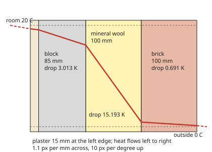
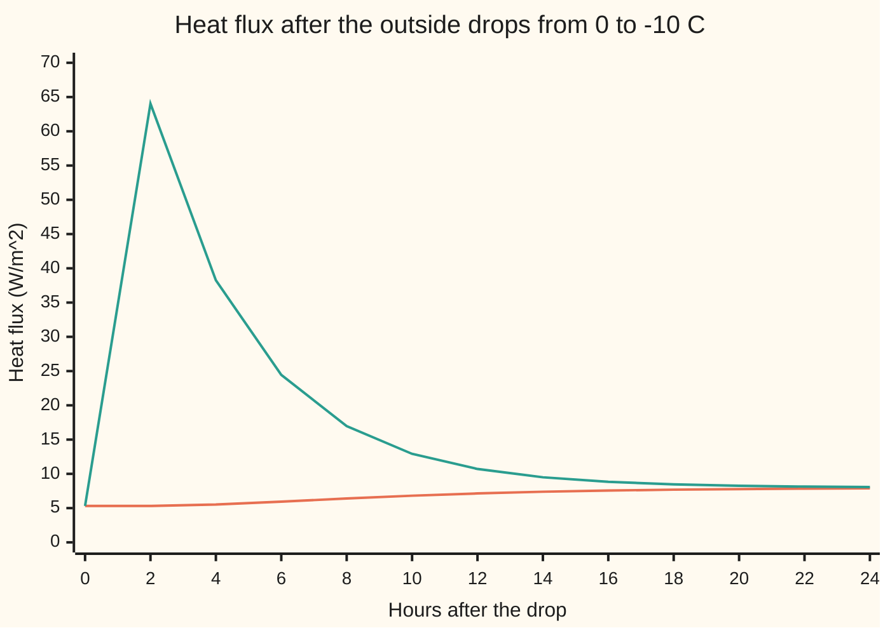

# Fourier's law: heat runs down a temperature gradient, and the heat equation follows

[Syllabus](../../../SYLLABUS.md) → [Engineering mathematics](../README.md) → [Fluids and Heat](../README.md#s08) → Fourier's law

---

## General Overview

A heating engineer is sizing the radiator for a bedroom. One wall faces the street: 10 m² of 300 mm cavity wall. From the inside out it is 15 mm of plaster, 85 mm of lightweight aircrete block (aerated concrete), a 100 mm cavity filled with mineral wool, and 100 mm of brick. The room is held at 20 °C; outside it is 0 °C. How many watts leak through that wall, and so how many must the radiator put back?

Heat leaks through a solid by **conduction**: warmer, faster-jiggling atoms pass energy to cooler neighbours. The rule for how fast is **Fourier's law**. The heat flowing through each square metre is proportional to how steeply the temperature falls across the material. The constant of proportionality is the material's **thermal conductivity**: high for brick, very low for mineral wool.

In a wall that has settled, the same heat crosses every layer, like the same current through resistors in series. Each layer's **thermal resistance** is its thickness divided by its conductivity, and the resistances add. For this wall they add to 3.7612 m² K/W. The 20 K difference drives 5.3175 W through each square metre: **53.17 W** through the whole wall. Leave the cavity empty and the same wall loses 184.50 W.

**Fourier's law says heat flows down the temperature slope at a rate set by the conductivity; through layers in series, the resistances (thickness over conductivity) add, the steady loss is the temperature difference over their sum, and when things change in time the same law plus conservation of heat gives the heat equation.**

**What kind of fact this is:** Fourier's law is a model: a measured law of materials, very accurate for solids at ordinary temperatures, not a theorem. The series rule and the heat equation are derived from it on this card, in Why it works.

### The picture: where the 20 degrees go

<p align="center"></p>

To scale: 1.1 px per mm across, 10 px per degree up; the dashed lines mark 20 °C and 0 °C. The temperature falls in straight lines inside each layer, steepest where the conductivity is lowest. The mineral wool is a third of the thickness but takes 76.0 % of the drop; the brick takes 3.5 %. The short dashed pieces at each face are the thin films of air on the surfaces, which take their own small share.

---

## The formula

Notation first, in words. Measure distance into the wall from the room side as x. T is temperature. The **heat flux** q is the heat crossing one square metre each second, counted positive outward. The **temperature gradient** dT/dx is how fast temperature changes with distance.

$$q = -k\,\frac{dT}{dx}, \qquad R_i = \frac{d_i}{k_i}, \qquad q = \frac{T_\text{in} - T_\text{out}}{R_{si} + \sum_i R_i + R_{se}} = U\,(T_\text{in} - T_\text{out})$$

**Read it aloud:** heat flows down the slope, faster in a better conductor; each layer resists in proportion to its thickness over its conductivity; and through layers in series the loss is the temperature difference over the total resistance.

When temperatures change in time, the same law plus conservation of heat gives the transient problem the wall actually solves:

$$\rho c\,\frac{\partial T}{\partial t} = \frac{\partial}{\partial x}\!\left(k\,\frac{\partial T}{\partial x}\right),\quad q(0,t) = \frac{T_\text{in} - T(0,t)}{R_{si}},\quad q(L,t) = \frac{T(L,t) - T_\text{out}}{R_{se}},\quad T(x,0)\ \text{given}.$$

At each joint between layers, temperature and the flux $-k\,\partial T/\partial x$ are both continuous.

**Read it aloud:** each slice warms at the rate heat flows into it minus out of it, divided by its heat capacity; at the faces, the heat crossing the surface air film is the film's temperature difference over its resistance; and the starting temperature is known.

| Symbol | Plain meaning | In our example | Push it up and the answer… |
| --- | --- | --- | --- |
| $T$, $T_\text{in}$, $T_\text{out}$ | temperature, in °C; room air and outside air | 20 °C and 0 °C | loss grows with the difference |
| $x$, $L$ | distance into the wall from the room side; total thickness, in m | 0 to 0.3 m | — |
| $t$ | time, in s (hours in the cold-snap story) | 0 to 24 h | — |
| $q$ | heat flux: watts crossing each m², outward | 5.3175 W/m² | — |
| $k$ | thermal conductivity, W/(m K): watts per m² for a slope of 1 K per m | 0.035 wool to 0.77 brick | that layer's resistance falls |
| $d_i$, $\Delta x$ | thickness of layer i, in m; $\Delta x$ is a thin slice (a 5 mm cell in the code) | 0.015, 0.085, 0.100, 0.100 | that layer's resistance rises |
| $R_i$, $\Delta T_i$ | thermal resistance of layer i, $d_i/k_i$, in m² K/W; the temperature drop across it, $q R_i$, in K | wool 2.8571 and 15.193 K | loss falls |
| $R_{si}$, $R_{se}$ | resistance of the still air film on the inside and outside face | 0.13 and 0.04 m² K/W | loss falls a little |
| $U$ | thermal transmittance, $1/\sum R$: watts per m² per kelvin | 0.2659 W/(m² K) | loss rises in proportion |
| $\rho$, $c$ | density, kg/m³; specific heat, the joules to warm 1 kg by 1 K | brick 1700 and 800 | the wall responds more slowly |
| $\kappa$ | diffusivity, $k/(\rho c)$, in m²/s: how fast a temperature change spreads | brick 5.662e-7 | changes spread faster |

The heat equation itself, and its solution for a uniform rod by separating variables, are on the differential-equations wing: [The heat equation](../../08-Differential%20equations%20and%20dynamics/10-The%20Classical%20PDEs/03-the-heat-equation.md). This card is the physics that feeds it: conductivity, resistance and walls in series.

### When it holds

- **Heat moves by conduction only, inside each layer.** Gas in a gap also carries heat by convection (the air moving) and radiation (infrared across the gap). Treat a 100 mm empty cavity as still air with k = 0.026 W/(m K) and the law says 4.2104 W/m², better than the wool; the tabulated design value for such a gap, 0.18 m² K/W, gives 18.4496 W/m², far above the filled wall's 5.3175. This is the one number on the card outside the model's range.
- **Heat flows straight through, in one direction.** Wall ties, window reveals and floor junctions carry heat sideways and around the insulation (thermal bridges), adding a few per cent to tens of per cent in real buildings.
- **Steady state, for the series formula.** Temperatures must have stopped changing. After a cold snap the room-side flux takes 9.15 h to cover half its change; until then the transient equation is the one to use.
- **Constant conductivity.** k changes with temperature and, strongly, with moisture: wet brick or wet wool conducts far better than dry.
- **Typical handbook properties.** The conductivities, densities and specific heats here are typical values for these materials; a real product's datasheet can differ noticeably, and the answer moves with it.

---

## Why it works

### Step 0: in a settled wall, the same heat crosses every plane

Heat is conserved. If a slice of wall is not warming or cooling, whatever enters one face must leave the other. So once the wall has settled, one number, the flux q, crosses every plane from the room to the street. Fourier's law then fixes the slope inside each layer, and the slopes add up to the drops.

### Step 1: Fourier's law, the measured rule

Joseph Fourier set out the law in 1822: the flux is the conductivity times the temperature fall per metre, $q = -k\,dT/dx$. The minus sign sends heat from warm to cool. It was already used to close the heat equation on [The heat equation](../../08-Differential%20equations%20and%20dynamics/10-The%20Classical%20PDEs/03-the-heat-equation.md). It is a model: double the slope and the flux doubles. Experiments confirm it in solids over a huge range; the conductivity k is what the experiment measures. The units say what k means: W/(m K) is watts through a square metre when the temperature falls 1 K per metre of thickness.

### Step 2: conservation turns into "flux is constant"

The heat account for a thin slice is the one set up on [The heat equation](../../08-Differential%20equations%20and%20dynamics/10-The%20Classical%20PDEs/03-the-heat-equation.md): a slice warms only by the flux in minus the flux out, so

$$\rho c\,\frac{\partial T}{\partial t} = -\frac{\partial q}{\partial x}.$$

In steady state the left side is zero, so $\partial q / \partial x = 0$: the flux is the same everywhere in the wall.

### Step 3: inside one layer the temperature is a straight line

Inside layer i, k is constant and q is constant, so $dT/dx = -q/k_i$, a constant slope. The temperature falls along a straight line, and across thickness $d_i$ it falls by

$$\Delta T_i = q\,\frac{d_i}{k_i} = q\,R_i.$$

This is Ohm's law for heat: temperature difference plays voltage, flux plays current, $R_i$ plays resistance.

### Step 4: the drops add, so the resistances add

From room air to outside air the drops must add to the whole difference:

$$T_\text{in} - T_\text{out} = q R_{si} + q R_1 + q R_2 + q R_3 + q R_4 + q R_{se} = q \sum R .$$

Divide by the sum and the formula drops out. Two things follow. The layer with the biggest resistance takes the biggest share of the drop: here the wool, 15.193 K of 20. And adding conductivities, or averaging them, is wrong; only resistances add in series.

The surface films $R_{si}$ and $R_{se}$ are not conduction. They lump the convection and radiation that carry heat between the air and the face into one resistance, using standard design values. Where those values come from is the job of [Convection and radiation](06-convection-and-radiation.md).

### Step 5: when nothing has settled, the heat equation with its conditions

Drop the steady assumption in Step 2 and put Fourier's law in for q:

$$\rho c\,\frac{\partial T}{\partial t} = \frac{\partial}{\partial x}\!\left(k\,\frac{\partial T}{\partial x}\right).$$

Inside one uniform layer this is the familiar $T_t = \kappa\,T_{xx}$ (a subscript means a partial derivative in that variable) with $\kappa = k/(\rho c)$. A layered wall needs three more pieces before it has one answer:

- **At each joint between layers**, the temperature is continuous (two touching faces share a temperature) and the flux is continuous (a slice of zero thickness across the joint holds no heat, so what enters equals what leaves). The slope $\partial T/\partial x$ jumps: steep in the wool, shallow in the brick.
- **At the two faces**, the heat arriving through the air film equals the heat conducted in: $-k\,T_x = (T_\text{in} - T)/R_{si}$ on the room side, and $-k\,T_x = (T - T_\text{out})/R_{se}$ outside. A condition that ties the value to the slope like this is called a Robin condition.
- **At the start**, the temperature everywhere in the wall is given.

For one uniform layer with fixed face temperatures, [Separation of variables](../../08-Differential%20equations%20and%20dynamics/10-The%20Classical%20PDEs/04-separation-of-variables-for-the-heat-equation.md) solves this exactly as a sum of decaying sine modes. A layered wall with films has no tidy closed form, so the code steps it forward in time instead, cell by cell, as on [Stepping the heat equation on a grid](../../08-Differential%20equations%20and%20dynamics/10-The%20Classical%20PDEs/09-finite-differences-for-the-heat-equation.md).

<details>
<summary>Why the stepped wall settles on exactly the series answer</summary>

The code cuts the wall into 5 mm cells and keeps a heat account for each. Between the centres of two neighbouring cells the heat crosses half of one cell and half of the other, in series, so the link between them has resistance $\Delta x/(2k_a) + \Delta x/(2k_b)$. That is Step 4 again on a small scale, and it is how flux continuity at the joints is built in. Between the first cell and the room the link is $R_{si} + \Delta x/(2k)$; likewise outside. Every layer is a whole number of cells, so the joints sit on cell faces. When the cells stop changing, each one passes on what it receives, every link carries the same flux, and the resistances along the chain add to exactly $\sum R$. Nothing in the stepping uses the formula, so agreement is a real check.

</details>

---

## Worked numbers, by hand

The wall, inside to outside: plaster 15 mm, k = 0.40; aircrete block 85 mm, k = 0.15; mineral wool 100 mm, k = 0.035; brick 100 mm, k = 0.77 (all W/(m K)). Films 0.13 and 0.04 m² K/W.

| Step | Arithmetic | Value |
| --- | --- | --- |
| plaster | 0.015 ÷ 0.40 | 0.0375 m² K/W |
| block | 0.085 ÷ 0.15 | 0.5667 m² K/W |
| mineral wool | 0.100 ÷ 0.035 | 2.8571 m² K/W |
| brick | 0.100 ÷ 0.77 | 0.1299 m² K/W |
| total, with films | 0.13 + 0.0375 + 0.5667 + 2.8571 + 0.1299 + 0.04 | 3.7612 m² K/W |
| U | 1 ÷ 3.7612 | 0.2659 W/(m² K) |
| flux | 20 ÷ 3.7612 | 5.3175 W/m² |
| inside surface | 20 − 5.3175 × 0.13 | 19.309 °C |
| drop across the wool | 5.3175 × 2.8571 | 15.193 K |
| whole wall | 5.3175 × 10 m² | **53.17 W** |

The radiator must put back 53.17 W for this wall alone at a 20 K difference, before the window, roof, floor and draughts. The inside surface sits at 19.309 °C, warm enough to feel comfortable and to stay free of condensation.

### What breaks if you drop a piece

| Mistake | Comes out at | What went wrong |
| --- | --- | --- |
| Average the conductivities by thickness, then use one 300 mm layer | 18.5735 W/m², not 5.3175 | Conductivities do not add in series; resistances do. The brick's high k swamps the average and hides the wool |
| Leave out the surface films | 5.5692 W/m², not 5.3175 | The thin air layers on each face resist too; small for an insulated wall, large for a thin one |
| Empty cavity treated as still air, k = 0.026 | 4.2104 W/m², not 18.4496 | Outside the model: gas in a gap carries heat by convection and radiation, not just conduction |

---

## How the wall answers a cold snap

The wall has settled at 20 °C inside and 0 °C outside. At midnight the outside air drops to −10 °C and stays there. The new steady loss will be 7.9762 W/m². How soon does the room feel it?

| Time | What happens |
| --- | --- |
| 0 h | Room side and street side both carry 5.32 W/m² |
| 2 h | The brick's outer face dumps heat into the cold: 64.03 W/m² leaves the outside. The room side still reads 5.32 W/m² |
| 6 h | The cold has crossed the wool; the block starts to give up stored heat. Room side 5.94 W/m², street side 24.44 W/m² |
| 9.15 h | The room-side flux has covered half its change |
| 24 h | Room side 7.89, street side 8.07 W/m²; inside surface 18.975 °C, down from 19.309 |

The brick reacts first because it touches the cold and holds a lot of heat, which it now pours out. The wool barely stores heat (density 25 kg/m³), but its high resistance throttles what reaches the block. The block and plaster then drain slowly through the wool. That is why a well-insulated masonry wall smooths out a cold night: the room sees the change hours late and spread out.



Orange: heat leaving the room into the wall. Teal: heat leaving the wall's outside face. Both head for the new steady 7.9762 W/m²; the room side creeps up, the street side crashes down from its spike.

---

## Code, from first principles, and it actually runs

The code takes three independent roads. Road one is the series formula. Road two never uses it: it starts the whole wall at a wrong uniform 10 °C, steps the transient heat equation forward in 5 s steps for 72 simulated hours with the film conditions at both faces, and reads the flux and the block-to-wool joint temperature once it has settled; both agree with the formula to four decimals. Road three tests the time-stepper itself against an exact answer: a 100 mm brick slab at 20 °C has both faces dropped to 0 °C, and its centre after 30 minutes is computed from the separation-of-variables series and by the wall's own stepper, with the films set to zero, on 20 and 40 cells. Halving the cells cuts the error 4.02 times, as a second-order method should. That stepper, now tested in time as well as at rest, then runs the cold snap and prints the chart; the half-way time is read between two 10-minute readings. The mistakes and experiments are computed at the end.

### Python

```python
# Fourier's law and a layered wall -- the check behind the card.  Standard library only.
# A 300 mm filled cavity wall: plaster, aircrete block, mineral wool, brick.
# Road 1: thermal resistances in series, q = (T_in - T_out) / sum of R.
# Road 2: the transient heat equation, stepped in time from a wrong start
#         until it settles; it never uses the series formula.
# Road 3: the same time-stepper on one brick slab, against the exact
#         separation-of-variables series.
from math import exp, pi, sin

T_IN, T_OUT, AREA = 20.0, 0.0, 10.0   # room air, outside air in C; wall area in m^2
RSI, RSE = 0.13, 0.04                 # inside and outside surface films, m^2 K/W (CIBSE Guide A)
# name, thickness m, k W/(m K), density kg/m^3, c J/(kg K); inside face first
WALL = [("plaster", 0.015, 0.40, 1000, 1000), ("aircrete block", 0.085, 0.15, 600, 1000),
        ("mineral wool", 0.100, 0.035, 25, 1030), ("brick", 0.100, 0.77, 1700, 800)]
R_AIR_GAP = 0.18                      # unventilated 100 mm air cavity, m^2 K/W (CIBSE Guide A)

def flux(layers, t_in=T_IN, t_out=T_OUT, films=True):    # road 1, W/m^2
    r = sum(d / k for _, d, k, _, _ in layers) + ((RSI + RSE) if films else 0.0)
    return (t_in - t_out) / r, r

def grid(layers, dx):                 # cells of width dx, with k and heat capacity per m^2
    ks, caps = [], []
    for _, d, k, rho, c in layers:
        for _ in range(round(d / dx)):
            ks.append(k)
            caps.append(rho * c * dx)
    links = [1 / (dx / (2 * a) + dx / (2 * b)) for a, b in zip(ks, ks[1:])]
    return ks, caps, links

def step_wall(temps, ks, caps, links, dx, t_in, t_out, seconds, dt, record=None, films=(RSI, RSE)):
    g_in, g_out = 1 / (films[0] + dx / (2 * ks[0])), 1 / (films[1] + dx / (2 * ks[-1]))
    n, steps = len(temps), round(seconds / dt)
    for s in range(steps):
        q = [g * (temps[i] - temps[i + 1]) for i, g in enumerate(links)]
        q_in, q_out = g_in * (t_in - temps[0]), g_out * (temps[-1] - t_out)
        new = temps[:]
        for i in range(n):            # heat in minus heat out, over the cell's capacity
            left = q_in if i == 0 else q[i - 1]
            right = q_out if i == n - 1 else q[i]
            new[i] += dt * (left - right) / caps[i]
        temps = new
        if record is not None and (s + 1) % record[0] == 0:
            q_in = g_in * (t_in - temps[0])  # the room face sits one film below the room air
            record[1].append((q_in, g_out * (temps[-1] - t_out), t_in - films[0] * q_in))
    return temps, g_in * (t_in - temps[0]), g_out * (temps[-1] - t_out)

q, r_tot = flux(WALL)
print(f"{'total resistance R':<34}{r_tot:10.4f} m^2 K/W")
print(f"{'U = 1/R':<34}{1 / r_tot:10.4f} W/(m^2 K)")
print(f"{'1 series formula, q':<34}{q:10.4f} W/m^2")
print(f"{'  through 10 m^2 of wall':<34}{q * AREA:10.2f} W")
t, faces = T_IN - q * RSI, []
print(f"{'inside surface':<34}{t:10.3f} C")
for name, d, k, rho, c in WALL:
    drop = q * d / k
    print(f"  {name:<16}R {d / k:7.4f}  drop {drop:7.3f} K  share {100 * drop / (T_IN - T_OUT):5.1f} %")
    faces.append(t)
    t -= drop
faces.append(t)
print(f"{'outside surface':<34}{t:10.3f} C")
dx, dt = 0.005, 5.0
ks, caps, links = grid(WALL, dx)
temps, q_in, q_out = step_wall([10.0] * len(ks), ks, caps, links, dx, T_IN, T_OUT, 72 * 3600, dt)
print(f"{'2 time-stepped, 72 h, q in, q out':<34}{q_in:10.4f}{q_out:10.4f} W/m^2")
fd_wool = temps[19] - q_in * dx / (2 * 0.15)   # last block cell, half a cell on to the wool
print(f"{'  block-wool face, stepped, formula':<34}{fd_wool:10.4f}{faces[2]:10.4f} C")
diffus = [k / (rho * c) for _, d, k, rho, c in WALL]
print("diffusivity, 1e-7 m^2/s " + " ".join(f"{1e7 * a:7.3f}" for a in diffus))

def slab_fd(n, seconds, dt):          # road 3: the same stepper on a brick slab, 20 C, faces held at 0 C
    h = WALL[3][1] / n
    ks, caps, links = grid(WALL[3:], h)
    temps = step_wall([20.0] * n, ks, caps, links, h, 0.0, 0.0, seconds, dt, films=(0.0, 0.0))[0]
    return (temps[n // 2 - 1] + temps[n // 2]) / 2

def slab_series(seconds):             # sum over odd n of (80 / n pi) sin(n pi / 2) e^(-kappa n^2 pi^2 t / L^2)
    kap, d = diffus[3], WALL[3][1]
    return sum(80 / (n * pi) * sin(n * pi / 2) * exp(-kap * (n * pi / d) ** 2 * seconds) for n in range(1, 400, 2))

exact = slab_series(1800)
coarse, fine = slab_fd(20, 1800, 2.0), slab_fd(40, 1800, 0.5)
print(f"{'3 brick centre at 30 min, series':<34}{exact:10.4f} C")
print(f"{'  stepped, 20 and 40 cells':<34}{coarse:10.4f}{fine:10.4f} C")
print(f"{'  error ratio, coarse/fine':<34}{(coarse - exact) / (fine - exact):10.2f}")

rec = (120, [(q, q, T_IN - RSI * q)])  # cold snap: outside drops to -10 C; a reading every 10 min
step_wall(temps, ks, caps, links, dx, T_IN, -10.0, 24 * 3600, dt, rec)
q_new = flux(WALL, t_out=-10.0)[0]
mid = (q + q_new) / 2                # halfway flux, crossed between two 10-minute readings
i = next(i for i, r in enumerate(rec[1]) if r[0] > mid)
half = (i - 1 + (mid - rec[1][i - 1][0]) / (rec[1][i][0] - rec[1][i - 1][0])) / 6
two_h = rec[1][::12]
print(f"{'cold snap: new steady q':<34}{q_new:10.4f} W/m^2")
print(f"{'  q in passes halfway after':<34}{half:10.2f} h")
print(f"{'chart, hours':<15}" + "".join(f"{2 * i:6d}" for i in range(13)))
print(f"{'chart, q in':<15}" + "".join(f"{a:6.2f}" for a, _, _ in two_h))
print(f"{'chart, q out':<15}" + "".join(f"{b:6.2f}" for _, b, _ in two_h))
print(f"{'inside surface at 24 h':<34}{two_h[-1][2]:10.3f} C")

avg_k = sum(d * k for _, d, k, _, _ in WALL) / sum(d for _, d, _, _, _ in WALL)
wrong_avg = flux([("mean", 0.3, avg_k, 0, 0)])[0]
wrong_films = flux(WALL, films=False)[0]
empty = WALL[:2] + [("air gap", 0.1, 0.1 / R_AIR_GAP, 1.2, 1005)] + WALL[3:]
q_empty = flux(empty)[0]
q_still = flux(WALL[:2] + [("still air", 0.1, 0.026, 1.2, 1005)] + WALL[3:])[0]
print(f"{'wrong: thickness-averaged k':<34}{wrong_avg:10.4f} W/m^2")
print(f"{'wrong: surface films left out':<34}{wrong_films:10.4f} W/m^2")
print(f"{'empty cavity, real R 0.18':<34}{q_empty:10.4f} W/m^2{q_empty * AREA:9.2f} W")
print(f"{'wrong: empty cavity as still air':<34}{q_still:10.4f} W/m^2")
try_wool = flux(WALL[:2] + [("wool", 0.2, 0.035, 25, 1030)] + WALL[3:])[0]
try_dense = flux(WALL[:1] + [("dense block", 0.085, 1.13, 2000, 1000)] + WALL[2:])[0]
print(f"{'try: 200 mm of wool':<34}{try_wool:10.4f} W/m^2")
print(f"{'try: dense block, k 1.13':<34}{try_dense:10.4f} W/m^2")
xs = [0.0] + [sum(w[1] for w in WALL[:i + 1]) for i in range(4)]
print("figure, x px " + " ".join(f"{60 + 1100 * x:.1f}" for x in xs)
      + " | y px " + " ".join(f"{250 - 10 * f:.1f}" for f in faces))

assert abs(q_in - q) < 1e-4 and abs(q_out - q) < 1e-4, "stepped wall must settle on the series flux"
assert abs(fd_wool - faces[2]) < 1e-3, "interface temperature, stepped against formula"
assert abs(fine - exact) < 0.02, "time-stepper against the separation-of-variables series"
assert 3.0 < (coarse - exact) / (fine - exact) < 5.0, "halving the cells cuts the error about four times"
assert abs(rec[1][-1][0] - q_new) < abs(q - q_new), "after the cold snap the flux heads to the new steady value"
assert q_still < q < q_empty, "still air would beat the wool; the real gap loses far more"
print("ALL CHECKS PASS")
```

**Ran 2026-11-11 on macOS, Python 3.14.10, standard library only. All checks passed. Output, pasted from the run:**

```
total resistance R                    3.7612 m^2 K/W
U = 1/R                               0.2659 W/(m^2 K)
1 series formula, q                   5.3175 W/m^2
  through 10 m^2 of wall               53.17 W
inside surface                        19.309 C
  plaster         R  0.0375  drop   0.199 K  share   1.0 %
  aircrete block  R  0.5667  drop   3.013 K  share  15.1 %
  mineral wool    R  2.8571  drop  15.193 K  share  76.0 %
  brick           R  0.1299  drop   0.691 K  share   3.5 %
outside surface                        0.213 C
2 time-stepped, 72 h, q in, q out     5.3175    5.3175 W/m^2
  block-wool face, stepped, formula   16.0961   16.0961 C
diffusivity, 1e-7 m^2/s   4.000   2.500  13.592   5.662
3 brick centre at 30 min, series      9.3125 C
  stepped, 20 and 40 cells            9.3073    9.3112 C
  error ratio, coarse/fine              4.02
cold snap: new steady q               7.9762 W/m^2
  q in passes halfway after             9.15 h
chart, hours        0     2     4     6     8    10    12    14    16    18    20    22    24
chart, q in      5.32  5.32  5.52  5.94  6.40  6.81  7.14  7.39  7.57  7.69  7.78  7.84  7.89
chart, q out     5.32 64.03 38.25 24.44 16.97 12.92 10.71  9.50  8.84  8.46  8.26  8.14  8.07
inside surface at 24 h                18.975 C
wrong: thickness-averaged k          18.5735 W/m^2
wrong: surface films left out         5.5692 W/m^2
empty cavity, real R 0.18            18.4496 W/m^2   184.50 W
wrong: empty cavity as still air      4.2104 W/m^2
try: 200 mm of wool                   3.0219 W/m^2
try: dense block, k 1.13              6.1167 W/m^2
figure, x px 60.0 76.5 170.0 280.0 390.0 | y px 56.9 58.9 89.0 241.0 247.9
ALL CHECKS PASS
```

### Rust

```rust
// Fourier's law and a layered wall -- the check behind the card.  std only, no crates.
// A 300 mm filled cavity wall: plaster, aircrete block, mineral wool, brick.
// Road 1: thermal resistances in series, q = (T_in - T_out) / sum of R.
// Road 2: the transient heat equation, stepped in time from a wrong start
//         until it settles; it never uses the series formula.
// Road 3: the same time-stepper on one brick slab, against the exact
//         separation-of-variables series.
use std::f64::consts::PI;

const T_IN: f64 = 20.0; // room air, C
const T_OUT: f64 = 0.0; // outside air, C
const AREA: f64 = 10.0; // wall area, m^2
const RSI: f64 = 0.13; // inside surface film, m^2 K/W (CIBSE Guide A)
const RSE: f64 = 0.04; // outside surface film
const R_AIR_GAP: f64 = 0.18; // unventilated 100 mm air cavity, m^2 K/W (CIBSE Guide A)

#[derive(Clone, Copy)]
struct Layer { name: &'static str, d: f64, k: f64, rho: f64, c: f64 }
const fn lay(name: &'static str, d: f64, k: f64, rho: f64, c: f64) -> Layer { Layer { name, d, k, rho, c } }
// thickness m, k W/(m K), density kg/m^3, c J/(kg K); inside face first
const WALL: [Layer; 4] = [lay("plaster", 0.015, 0.40, 1000.0, 1000.0), lay("aircrete block", 0.085, 0.15, 600.0, 1000.0),
    lay("mineral wool", 0.100, 0.035, 25.0, 1030.0), lay("brick", 0.100, 0.77, 1700.0, 800.0)];

fn flux(layers: &[Layer], t_in: f64, t_out: f64, films: bool) -> (f64, f64) { // road 1, W/m^2
    let r = layers.iter().map(|l| l.d / l.k).sum::<f64>() + if films { RSI + RSE } else { 0.0 };
    ((t_in - t_out) / r, r)
}

fn grid(layers: &[Layer], dx: f64) -> (Vec<f64>, Vec<f64>, Vec<f64>) {
    let (mut ks, mut caps) = (vec![], vec![]);
    for l in layers {
        for _ in 0..(l.d / dx).round() as usize { ks.push(l.k); caps.push(l.rho * l.c * dx); }
    }
    let links = ks.windows(2).map(|w| 1.0 / (dx / (2.0 * w[0]) + dx / (2.0 * w[1]))).collect();
    (ks, caps, links)
}

fn step_wall(mut temps: Vec<f64>, ks: &[f64], caps: &[f64], links: &[f64], dx: f64, t_in: f64, t_out: f64,
             seconds: f64, dt: f64, every: usize, rec: &mut Vec<(f64, f64, f64)>, films: (f64, f64)) -> (Vec<f64>, f64, f64) {
    let g_in = 1.0 / (films.0 + dx / (2.0 * ks[0]));
    let g_out = 1.0 / (films.1 + dx / (2.0 * ks[ks.len() - 1]));
    let n = temps.len();
    for s in 0..(seconds / dt).round() as usize {
        let q: Vec<f64> = links.iter().enumerate().map(|(i, g)| g * (temps[i] - temps[i + 1])).collect();
        let (q_in, q_out) = (g_in * (t_in - temps[0]), g_out * (temps[n - 1] - t_out));
        let mut new = temps.clone();
        for i in 0..n { // heat in minus heat out, over the cell's capacity
            let left = if i == 0 { q_in } else { q[i - 1] };
            let right = if i == n - 1 { q_out } else { q[i] };
            new[i] += dt * (left - right) / caps[i];
        }
        temps = new;
        if every > 0 && (s + 1) % every == 0 {
            let q_in = g_in * (t_in - temps[0]); // the room face sits one film below the room air
            rec.push((q_in, g_out * (temps[n - 1] - t_out), t_in - films.0 * q_in));
        }
    }
    let (a, b) = (g_in * (t_in - temps[0]), g_out * (temps[n - 1] - t_out));
    (temps, a, b)
}

fn slab_fd(n: usize, seconds: f64, dt: f64) -> f64 { // road 3: the same stepper on a brick slab, 20 C, faces held at 0 C
    let h = WALL[3].d / n as f64;
    let (ks, caps, links) = grid(&WALL[3..], h);
    let (temps, _, _) = step_wall(vec![20.0; n], &ks, &caps, &links, h, 0.0, 0.0, seconds, dt, 0, &mut vec![], (0.0, 0.0));
    (temps[n / 2 - 1] + temps[n / 2]) / 2.0
}

fn slab_series(seconds: f64, kap: f64) -> f64 { // sum over odd n
    let d = WALL[3].d;
    (1..400).step_by(2).map(|n| { let nf = n as f64;
        80.0 / (nf * PI) * (nf * PI / 2.0).sin() * (-kap * (nf * PI / d).powi(2) * seconds).exp() }).sum()
}

fn main() {
    let (q, r_tot) = flux(&WALL, T_IN, T_OUT, true);
    println!("{:<34}{:10.4} m^2 K/W", "total resistance R", r_tot);
    println!("{:<34}{:10.4} W/(m^2 K)", "U = 1/R", 1.0 / r_tot);
    println!("{:<34}{:10.4} W/m^2", "1 series formula, q", q);
    println!("{:<34}{:10.2} W", "  through 10 m^2 of wall", q * AREA);
    let mut t = T_IN - q * RSI;
    let mut faces = vec![];
    println!("{:<34}{:10.3} C", "inside surface", t);
    for l in WALL.iter() {
        let drop = q * l.d / l.k;
        println!("  {:<16}R {:7.4}  drop {:7.3} K  share {:5.1} %", l.name, l.d / l.k, drop, 100.0 * drop / (T_IN - T_OUT));
        faces.push(t);
        t -= drop;
    }
    faces.push(t);
    println!("{:<34}{:10.3} C", "outside surface", t);
    let (dx, dt) = (0.005, 5.0);
    let (ks, caps, links) = grid(&WALL, dx);
    let mut none = vec![];
    let (temps, q_in, q_out) = step_wall(vec![10.0; ks.len()], &ks, &caps, &links, dx, T_IN, T_OUT, 72.0 * 3600.0, dt, 0, &mut none, (RSI, RSE));
    println!("{:<34}{:10.4}{:10.4} W/m^2", "2 time-stepped, 72 h, q in, q out", q_in, q_out);
    let fd_wool = temps[19] - q_in * dx / (2.0 * 0.15); // last block cell, half a cell on to the wool
    println!("{:<34}{:10.4}{:10.4} C", "  block-wool face, stepped, formula", fd_wool, faces[2]);
    let diffus: Vec<f64> = WALL.iter().map(|l| l.k / (l.rho * l.c)).collect();
    println!("diffusivity, 1e-7 m^2/s {}", diffus.iter().map(|a| format!("{:7.3}", 1e7 * a)).collect::<Vec<_>>().join(" "));

    let exact = slab_series(1800.0, diffus[3]);
    let (coarse, fine) = (slab_fd(20, 1800.0, 2.0), slab_fd(40, 1800.0, 0.5));
    println!("{:<34}{:10.4} C", "3 brick centre at 30 min, series", exact);
    println!("{:<34}{:10.4}{:10.4} C", "  stepped, 20 and 40 cells", coarse, fine);
    println!("{:<34}{:10.2}", "  error ratio, coarse/fine", (coarse - exact) / (fine - exact));

    let mut rec = vec![(q, q, T_IN - RSI * q)]; // cold snap: outside drops to -10 C; a reading every 10 min
    step_wall(temps, &ks, &caps, &links, dx, T_IN, -10.0, 24.0 * 3600.0, dt, 120, &mut rec, (RSI, RSE));
    let q_new = flux(&WALL, T_IN, -10.0, true).0;
    let mid = (q + q_new) / 2.0; // halfway flux, crossed between two 10-minute readings
    let i = rec.iter().position(|r| r.0 > mid).unwrap();
    let half = (i as f64 - 1.0 + (mid - rec[i - 1].0) / (rec[i].0 - rec[i - 1].0)) / 6.0;
    let two_h: Vec<_> = rec.iter().step_by(12).cloned().collect();
    println!("{:<34}{:10.4} W/m^2", "cold snap: new steady q", q_new);
    println!("{:<34}{:10.2} h", "  q in passes halfway after", half);
    println!("{:<15}{}", "chart, hours", (0..13).map(|i| format!("{:6}", 2 * i)).collect::<String>());
    println!("{:<15}{}", "chart, q in", two_h.iter().map(|r| format!("{:6.2}", r.0)).collect::<String>());
    println!("{:<15}{}", "chart, q out", two_h.iter().map(|r| format!("{:6.2}", r.1)).collect::<String>());
    println!("{:<34}{:10.3} C", "inside surface at 24 h", two_h[12].2);

    let avg_k = WALL.iter().map(|l| l.d * l.k).sum::<f64>() / WALL.iter().map(|l| l.d).sum::<f64>();
    let wrong_avg = flux(&[lay("mean", 0.3, avg_k, 0.0, 0.0)], T_IN, T_OUT, true).0;
    let wrong_films = flux(&WALL, T_IN, T_OUT, false).0;
    let empty = [WALL[0], WALL[1], lay("air gap", 0.1, 0.1 / R_AIR_GAP, 1.2, 1005.0), WALL[3]];
    let q_empty = flux(&empty, T_IN, T_OUT, true).0;
    let q_still = flux(&[WALL[0], WALL[1], lay("still air", 0.1, 0.026, 1.2, 1005.0), WALL[3]], T_IN, T_OUT, true).0;
    println!("{:<34}{:10.4} W/m^2", "wrong: thickness-averaged k", wrong_avg);
    println!("{:<34}{:10.4} W/m^2", "wrong: surface films left out", wrong_films);
    println!("{:<34}{:10.4} W/m^2{:9.2} W", "empty cavity, real R 0.18", q_empty, q_empty * AREA);
    println!("{:<34}{:10.4} W/m^2", "wrong: empty cavity as still air", q_still);
    let try_wool = flux(&[WALL[0], WALL[1], lay("wool", 0.2, 0.035, 25.0, 1030.0), WALL[3]], T_IN, T_OUT, true).0;
    let try_dense = flux(&[WALL[0], lay("dense block", 0.085, 1.13, 2000.0, 1000.0), WALL[2], WALL[3]], T_IN, T_OUT, true).0;
    println!("{:<34}{:10.4} W/m^2", "try: 200 mm of wool", try_wool);
    println!("{:<34}{:10.4} W/m^2", "try: dense block, k 1.13", try_dense);
    let mut xs = vec![0.0];
    for i in 0..4 { xs.push(WALL[..i + 1].iter().map(|l| l.d).sum::<f64>()); }
    println!("figure, x px {} | y px {}", xs.iter().map(|x| format!("{:.1}", 60.0 + 1100.0 * x)).collect::<Vec<_>>().join(" "),
        faces.iter().map(|f| format!("{:.1}", 250.0 - 10.0 * f)).collect::<Vec<_>>().join(" "));

    assert!((q_in - q).abs() < 1e-4 && (q_out - q).abs() < 1e-4, "stepped wall must settle on the series flux");
    assert!((fd_wool - faces[2]).abs() < 1e-3, "interface temperature, stepped against formula");
    assert!((fine - exact).abs() < 0.02, "time-stepper against the separation-of-variables series");
    let ratio = (coarse - exact) / (fine - exact);
    assert!(3.0 < ratio && ratio < 5.0, "halving the cells cuts the error about four times");
    assert!((rec[rec.len() - 1].0 - q_new).abs() < (q - q_new).abs(), "after the cold snap the flux heads to the new steady value");
    assert!(q_still < q && q < q_empty, "still air would beat the wool; the real gap loses far more");
    println!("ALL CHECKS PASS");
}
```

**Ran 2026-11-11 on macOS, rustc 1.98.1, no crates. All checks passed. Output, pasted from the run:**

```
total resistance R                    3.7612 m^2 K/W
U = 1/R                               0.2659 W/(m^2 K)
1 series formula, q                   5.3175 W/m^2
  through 10 m^2 of wall               53.17 W
inside surface                        19.309 C
  plaster         R  0.0375  drop   0.199 K  share   1.0 %
  aircrete block  R  0.5667  drop   3.013 K  share  15.1 %
  mineral wool    R  2.8571  drop  15.193 K  share  76.0 %
  brick           R  0.1299  drop   0.691 K  share   3.5 %
outside surface                        0.213 C
2 time-stepped, 72 h, q in, q out     5.3175    5.3175 W/m^2
  block-wool face, stepped, formula   16.0961   16.0961 C
diffusivity, 1e-7 m^2/s   4.000   2.500  13.592   5.662
3 brick centre at 30 min, series      9.3125 C
  stepped, 20 and 40 cells            9.3073    9.3112 C
  error ratio, coarse/fine              4.02
cold snap: new steady q               7.9762 W/m^2
  q in passes halfway after             9.15 h
chart, hours        0     2     4     6     8    10    12    14    16    18    20    22    24
chart, q in      5.32  5.32  5.52  5.94  6.40  6.81  7.14  7.39  7.57  7.69  7.78  7.84  7.89
chart, q out     5.32 64.03 38.25 24.44 16.97 12.92 10.71  9.50  8.84  8.46  8.26  8.14  8.07
inside surface at 24 h                18.975 C
wrong: thickness-averaged k          18.5735 W/m^2
wrong: surface films left out         5.5692 W/m^2
empty cavity, real R 0.18            18.4496 W/m^2   184.50 W
wrong: empty cavity as still air      4.2104 W/m^2
try: 200 mm of wool                   3.0219 W/m^2
try: dense block, k 1.13              6.1167 W/m^2
figure, x px 60.0 76.5 170.0 280.0 390.0 | y px 56.9 58.9 89.0 241.0 247.9
ALL CHECKS PASS
```

> [!TIP]
> **Try changing**
> - Guess first: double the mineral wool to 200 mm. Does the loss halve? Set the wool layer's thickness to 0.2. It falls from 5.3175 to 3.0219 W/m², not to half, because the other layers and films still resist.
> - Guess first: swap the aircrete for dense concrete block, k = 1.13. Change that layer. The loss rises only to 6.1167 W/m²: the wool still carries most of the resistance.
> - Guess first: make it −10 °C outside. Set the outside temperature. The steady loss scales with the difference, to 7.9762 W/m², but the cold-snap run shows it takes most of a day to arrive.
> - Guess first: leave the cavity empty. Replace the wool with the 0.18 m² K/W air gap. The loss jumps to 18.4496 W/m², 184.50 W for the wall.

---

## The usual mistake

> [!warning]
> **Adding or averaging conductivities instead of resistances.** In series, heat must pass through every layer, so each layer's resistance adds, and the worst conductor dominates. Averaging k by thickness lets the brick's high conductivity cover for the wool and gives 18.5735 W/m² instead of 5.3175, and a radiator sized far too big. Turn each layer into d/k first, then add.
>
> - **Treating an air gap as a solid.** Still air conducts poorly, but air in a cavity moves and radiates across. Using k = 0.026 gives 4.2104 W/m² for the empty-cavity wall; the real design figure gives 18.4496.
> - **Forgetting the surface films.** The air layers on the two faces add 0.13 and 0.04 m² K/W. Without them the filled wall reads 5.5692 W/m²; on a single sheet of glass the error would be most of the answer.
> - **Using diffusivity for a steady loss.** The steady loss depends only on k. Density and specific heat set how fast the wall responds, not how much it leaks once settled. Rank the layers by diffusivity and the wool comes first, at 13.592 × 10⁻⁷ m²/s against the brick's 5.662, though it is by far the best insulator.
> - **Losing the minus sign.** $q = -k\,dT/dx$: heat flows toward the cold. Drop the sign and the same slopes send 5.3175 W/m² from the 0 °C street into the 20 °C room, and the transient equation blows up instead of settling.

---

## Where you meet it in real life

- **Building regulations and energy ratings.** Every wall, roof and floor is given a U-value by exactly this sum of resistances; the rules cap it, and the heat-loss calculation for a house is U times area times temperature difference, element by element.
- **Radiator and boiler sizing.** The heating engineer adds up those losses room by room at a design outside temperature, then picks radiators that deliver that many watts at the loop's water temperature. This wall needs 53.17 W at 20 K.
- **Electronics cooling.** A chip's datasheet gives thermal resistances in °C per watt: junction to case, case to heat sink, heat sink to air. They add in series exactly as here.
- **Thermal mass in buildings.** The cold-snap delay is the reason heavy masonry inside the insulation keeps a room steady overnight and a lightweight timber room swings faster.
- **Pipe lagging and ovens.** The same law sets the loss through pipe insulation and kiln linings; around a pipe the layers are rings, and each resistance becomes a logarithm instead of d/k.

> **Say it back**
> Fourier's law says heat flows down the temperature slope, at a rate set by the conductivity k. In a settled wall the same flux crosses every layer, so the temperature falls in a straight line inside each layer, by the flux times d/k. The drops add, so the resistances add, and the loss is the temperature difference over their sum. For the 300 mm filled cavity wall that is 3.7612 m² K/W, 5.3175 W/m², and 53.17 W through 10 m² at a 20 K difference. When temperatures change, the same law plus conservation gives the heat equation, with flux continuity at the joints and film conditions at the faces.

---

## What this builds on

- [The heat equation](../../08-Differential%20equations%20and%20dynamics/10-The%20Classical%20PDEs/03-the-heat-equation.md): conservation plus Fourier's law gives $T_t = \kappa T_{xx}$ (that card writes u for the temperature), and bumps in temperature only flatten; this card adds layers, films and joints.
- [Separation of variables](../../08-Differential%20equations%20and%20dynamics/10-The%20Classical%20PDEs/04-separation-of-variables-for-the-heat-equation.md): the exact sine-mode series for one uniform slab, used here as road three to test the time-stepper.

## Where this goes next

- [Convection and radiation](06-convection-and-radiation.md): where the surface film resistances come from, and why an air gap loses far more than its conductivity suggests.

This card leaves open how big $R_{si}$ and $R_{se}$ really are on a windy night, when the moving air outside strips heat off the brick faster than any fixed design value says.

---

## Sources

Verified 2026-11-11: every link below resolves to the publisher's page, and the DOI was checked against Crossref for title and first author.

- Fourier, J. *The Analytical Theory of Heat*, translated by A. Freeman. Cambridge University Press, 2009 reissue of the 1878 translation. [doi:10.1017/CBO9780511693205](https://doi.org/10.1017/CBO9780511693205). The original statement of the conduction law and the heat equation, from 1822.
- Bergman, T. L., A. S. Lavine, F. P. Incropera and D. P. DeWitt. *Fundamentals of Heat and Mass Transfer*, 8th edition. Wiley. [Publisher page](https://www.wiley.com/en-us/Fundamentals+of+Heat+and+Mass+Transfer%2C+8th+Edition-p-9781119353881). The thermal-circuit treatment of composite walls, contact at joints, and transient conduction.
- CIBSE. *Guide A: Environmental Design*, 2015. Chartered Institution of Building Services Engineers. [Publisher page](https://www.cibse.org/knowledge-research/knowledge-portal/guide-a-environmental-design-2015). Chapter 3, thermal properties of building structures: U-value calculation, surface and air-space resistances, and material properties of the kind used here.
