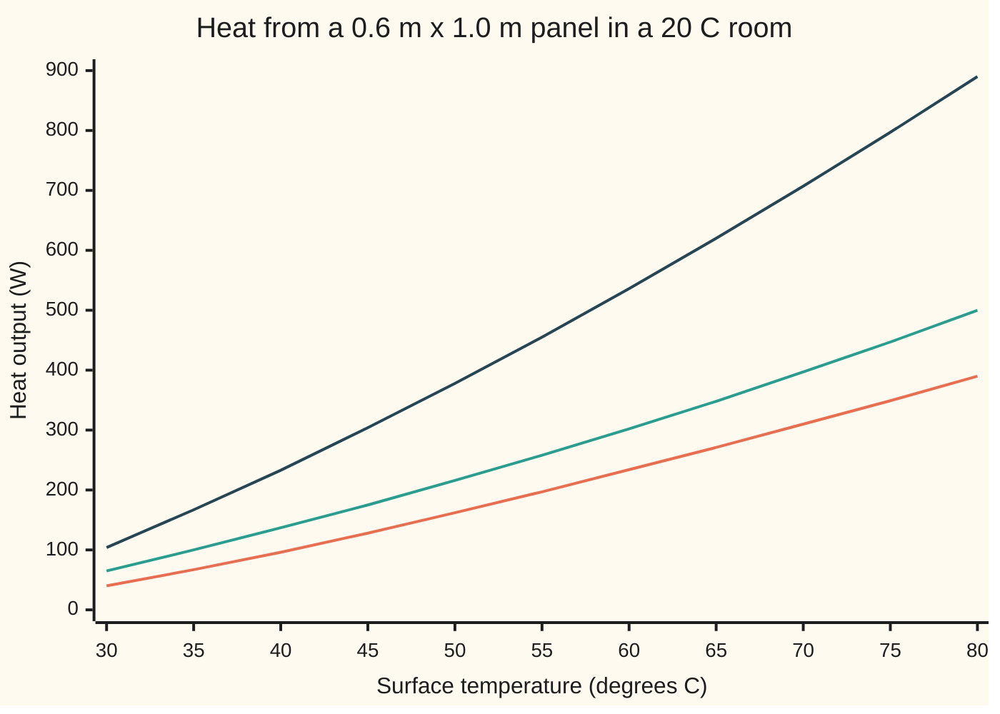

# Convection and radiation: the other two ways heat leaves a surface

[Syllabus](../../../SYLLABUS.md) → [Engineering mathematics](../README.md) → [Fluids and Heat](../README.md#s08) → Convection and radiation

---

## General Overview

A central-heating loop sends hot water through a plain steel panel radiator, 600 mm tall and 1,000 mm long, painted white. Its surface sits at 60 °C. The room's air and walls are at 20 °C. The engineer wants one number: how many watts does this panel put into the room? And a second: by which route?

Heat reaches the painted surface from the water by conduction through the steel, the subject of [Fourier's law](05-heat-conduction-and-fouriers-law.md). That step costs almost nothing here: 1.25 mm of steel needs a temperature drop of only 0.0092 K to pass all the heat. The real resistance is on the room side, where heat leaves the surface two ways at once.

**Convection** (heat carried off by moving fluid): air touching the panel warms, becomes lighter, rises, and is replaced by cool air from below. **Radiation** (heat sent as infrared light): every surface glows, at a wavelength too long to see, and the panel glows harder than the walls that glow back at it. Convection needs air. Radiation needs nothing and crosses a vacuum.

For this panel, convection carries 233.7 W and radiation 302.1 W, a total of 535.9 W. More than half, 56.4%, is radiation, though the two are close enough that neither can be dropped.

```
heat leaving the panel, surface 60 C, room 20 C
convection  ██████████████████████                              233.7 W
radiation   ████████████████████████████                        302.1 W
total       ██████████████████████████████████████████████████  535.9 W
```

**A warm surface loses heat to its surroundings by two routes in parallel: convection, a coefficient times the temperature difference, and radiation, a constant times the difference of the fourth powers of the absolute temperatures; at room temperatures the two are the same size, so both belong in the balance.**

**What kind of fact this is:** two models with one law inside. The radiation law, σT⁴, is a consequence of Planck's law of black-body light, and the code on this card re-derives it by adding up the spectrum. Treating the paint as a fixed fraction ε of a perfect emitter is a model that fits paint well. The convection coefficient comes from a fit to experiments, not from a derivation.

### The picture: output as the surface temperature changes



Orange, lowest: convection. Green, middle: radiation. Dark, top: the total. Radiation stays above convection over the whole range of a heating system. Both curves bend upward: neither grows in proportion to the temperature difference.

---

## The formula

$$Q = A\left[\,h\,(T_s - T_\infty) \;+\; \varepsilon\,\sigma\,(T_s^4 - T_\text{sur}^4)\,\right]$$

**Read it aloud:** the heat leaving the panel is its area times the sum of two fluxes: a convection coefficient times the surface's lead over the air, and the paint's emissivity times the Stefan–Boltzmann constant times the difference of the fourth powers of the surface and wall temperatures, in kelvin.

| Symbol | Plain meaning | In our example | Push it up and the answer… |
| --- | --- | --- | --- |
| $Q$, $q$ | heat output of the panel, in W; the same per square metre of surface (a **flux**), in W/m² | 535.9 W; 194.8 W/m² by convection plus 251.8 W/m² by radiation | — |
| $A$ | surface area that gives off heat: both faces | 2 × 0.6 m × 1.0 m = 1.2 m² | rises in proportion |
| $T_s$ | surface temperature; a bare $T$ is any temperature in kelvin | 60 °C = 333.15 K | rises faster than in proportion |
| $T_\infty$, $T_\text{sur}$ | room air far from the panel; the room's walls, floor and ceiling | both 20 °C = 293.15 K | falls |
| $h$ | **convection coefficient**: watts carried off per m² for each kelvin the surface leads the air; $\delta$, the still-air film it acts like, $k/h$ thick | 4.87 W/(m² K); 5.60 mm | rises in proportion to the convection part |
| $\varepsilon$ | **emissivity**: how much of a perfect emitter's glow the surface gives off, 0 to 1 (here ε is not the small parameter of the modelling shelf) | white paint, 0.90 | rises in proportion to the radiation part |
| $\sigma$ | Stefan–Boltzmann constant (NIST CODATA); in the fold, $E_\lambda$ is a black body's output per metre of wavelength, $x$ a stand-in variable, and $h_P$, $k_B$, $c$ and $\lambda$ are Planck's constant, Boltzmann's constant, the speed of light and the wavelength | 5.670374419 × 10⁻⁸ W/(m² K⁴) | — |
| $h_r$ | **radiation coefficient**: the radiation part written as watts per m² per kelvin of difference | 6.29 W/(m² K) | — |
| $L$ | height of the panel: the distance the warmed air climbs | 0.60 m | $h$ falls slowly: 5.20 W/(m² K) at 0.30 m |
| $\mathrm{Ra}$, $\mathrm{Nu}$ | **Rayleigh number**: buoyancy against the air's stickiness and heat spreading, no units; **Nusselt number**: $hL/k$, how many still-air films fit in the panel's height | 643 million; 107.1 | $h$ rises with Ra |
| $k$, $\nu$, $\alpha$, $\Pr$ | air's thermal conductivity, kinematic viscosity, thermal diffusivity (written κ on Fourier's law), and their ratio $\nu/\alpha$, the Prandtl number | 0.0273 W/(m K); Pr 0.704 | — |
| $g$, $\beta$ | standard gravity; air's expansion per kelvin, 1 over its absolute temperature | 9.80665 m/s²; 1/313.15 K⁻¹ | buoyancy rises |

The convection coefficient comes from Churchill and Chu's all-range fit for a vertical plate:

$$\mathrm{Nu} = \frac{hL}{k} = \left(0.825 + \frac{0.387\,\mathrm{Ra}^{1/6}}{\left[1 + (0.492/\Pr)^{9/16}\right]^{8/27}}\right)^{2}, \qquad \mathrm{Ra} = \frac{g\,\beta\,(T_s - T_\infty)\,L^3}{\nu\,\alpha}.$$

The air properties are taken at the **film temperature**, halfway between surface and air: 313.15 K. Ra and Pr are dimensionless groups of the kind built in [Buckingham Pi](../01-Units%20and%20Modelling/02-dimensional-analysis-and-buckingham-pi.md).

### When it holds

- **Temperatures in kelvin in the radiation term.** The fourth power measures from absolute zero. Put 60 and 20 in and radiation shrinks to 0.8 W, and the panel's output to 234.5 W.
- **A small surface in a big room whose walls are all at one temperature.** Then everything the panel emits is absorbed by the room, and the room's own glow returns in full. A panel close to a wall partly faces that wall, which warms up and sends more back, so the back face gives off less than this.
- **A grey surface: emissivity the same at every wavelength that matters.** White paint is close to 0.9 across the thermal infrared, where a 60 °C surface glows (peak at 8.70 μm). The same paint is a poor emitter of visible light, which is why it looks white; that does not matter here.
- **Still room air, smooth laminar rise (Ra below about 10⁹).** At 643 million the panel is inside that. A draught or a fan replaces this $h$ with a forced-convection one several times larger. Even in still air, $h$ is a fit, and the fits differ: Churchill and Chu's laminar-only fit and the smooth-flow theory give 3.75 and 3.73 W/(m² K), against the all-range fit's 4.87 used here, so the convection half is known only to roughly that spread.
- **The radiation term kept as fourth powers, not straightened.** Near room temperature a straight line does well if it is taken at the mean of the two temperatures: $4\varepsilon\sigma T^3$ at 313.15 K gives 6.27 W/(m² K) against the true 6.29. Taken at the wall temperature it gives 205.7 W/m² against the true 251.8 at 60 °C. Far from room temperature it fails: for a stove top at 300 °C, the straight line at room temperature gives 1,440 W/m² against the true 5,130 W/m².

---

## Why it works

### Step 0: one surface, two exits, no storage

In steady running the paint stores no heat. Every watt the steel brings to the surface must leave it the same second. There are two ways to leave a dry surface in a room: into the air that touches it, and as light to everything it can see. The two act side by side, like two pipes draining one tank, so their flows add. The work is to find each one.

### Step 1: convection is conduction through a thin film of still air

Air sticks to the paint, so right at the surface it does not move. Heat must first cross a thin layer of nearly still air by conduction, exactly as in [Fourier's law](05-heat-conduction-and-fouriers-law.md). If that layer were $\delta$ thick, the flux would be $k(T_s - T_\infty)/\delta$. So the coefficient is just

$$h \approx \frac{k}{\delta}.$$

Here $h$ = 4.87 W/(m² K) and air's conductivity is 0.0273 W/(m K), so the panel behaves as if wrapped in a still-air film 5.60 mm thick. Air is a good insulator, which is why convection from a still surface is weak.

The definition $q = h(T_s - T_\infty)$ is called Newton's law of cooling. On its own it says nothing; all the physics is in what sets $\delta$.

### Step 2: buoyancy sets the film's thickness

The warm film is lighter than the room air, by a fraction $\beta(T_s - T_\infty)$, so it rises. Its own stickiness ($\nu$) holds it back, and heat leaking sideways ($\alpha$) thickens it. Weigh the push against the two brakes over the panel's height $L$ and one number comes out, the Rayleigh number. For perfectly smooth flow up a plate the equations of the film can be solved exactly, and the film thickens as $L/\mathrm{Ra}^{1/4}$, so

$$h \propto \frac{k}{L}\,\mathrm{Ra}^{1/4} \propto \left(\frac{T_s - T_\infty}{L}\right)^{1/4}.$$

Two things follow. A hotter panel drives faster air and a thinner film, so $h$ itself grows with the temperature difference, slowly. And a taller panel has a thicker film near its top, so each square metre does slightly worse.

That exact solution gives Nu = 82.0 here, so $h$ = 3.73 W/(m² K). Real panels are not ideal plates, so engineers use fits to measurements, and Churchill and Chu published two. Their laminar-only fit, for Ra below 10⁹, gives Nu = 82.5 here, so $h$ = 3.75 W/(m² K): the measurements agree with the theory.

Their all-range fit draws one curve through smooth and turbulent (churning, eddying) plates alike; it gives Nu = 107.1, so $h = 107.1 \times 0.0273 / 0.60$ = 4.87 W/(m² K). This card uses the all-range fit, which heat-transfer texts such as Bergman's give as suitable for most engineering calculations.

Just below 10⁹, where this panel sits, it runs 30% above the laminar fit, because its one curve has to bend up to meet the turbulent data. With the laminar fit the panel would give 482.1 W, 62.7% of it radiation. That gap is a fair measure of the uncertainty in the convection half; the radiation half has no such doubt.

The same bend changes the height rule. The all-range curve grows faster than $\mathrm{Ra}^{1/4}$ well inside the smooth range, on its way to the turbulent law $\mathrm{Nu} \propto \mathrm{Ra}^{1/3}$, where height cancels out. So by the fit a 0.30 m panel has $h$ = 5.20 W/(m² K), not the 5.79 that the 1/4 power predicts from 4.87. That is the shape of the fitted curve, not a change in the flow: the smooth rise up a 0.30 m plate follows the 1/4 power.

### Step 3: every surface glows, and the glow grows as the fourth power

Any body above absolute zero gives off light from its thermal jiggling. A perfect emitter (a **black body**) gives off $\sigma T^4$ watts per square metre. Paint gives off a fraction $\varepsilon$ of that.

Why the fourth power? Heat a body and two things happen. Each bit of light (a photon) carries energy in proportion to $T$, because the spectrum slides to shorter wavelengths. And the number of ways light can fit in a region grows as the cube of the highest frequency in play, which itself grows in proportion to $T$, so the count of active ways goes as $T^3$. One power from energy per photon, three from the three directions of space: $T^4$.

The panel emits $\varepsilon\sigma T_s^4$. The walls, at $T_\text{sur}$, glow too, and the panel absorbs the same fraction $\varepsilon$ of what reaches it (a good emitter is an equally good absorber). The net loss is the difference:

$$q_\text{rad} = \varepsilon\sigma\,(T_s^4 - T_\text{sur}^4).$$

<details>
<summary>From Planck's spectrum to σ</summary>

Planck's law gives a black body's output per square metre per metre of wavelength:

$$E_\lambda(T) = \frac{2\pi h_P c^2}{\lambda^5\left(e^{h_P c/(\lambda k_B T)} - 1\right)}.$$

Add it up over all wavelengths. Substitute $x = h_P c/(\lambda k_B T)$: every $\lambda$ becomes $h_P c/(x k_B T)$, and four factors of $T$ come out in front,

$$\int_0^\infty E_\lambda\,d\lambda = \frac{2\pi k_B^4 T^4}{h_P^3 c^2}\int_0^\infty \frac{x^3}{e^x - 1}\,dx = \frac{2\pi k_B^4 T^4}{h_P^3 c^2}\cdot\frac{\pi^4}{15}.$$

So $\sigma = 2\pi^5 k_B^4/(15 h_P^3 c^2)$, built from three constants that the SI now fixes exactly. The code's second road does this sum numerically, wavelength by wavelength, from 0.1 μm to 10 mm, for both temperatures, and never uses $\sigma$ or a fourth power. It lands on 251.7673 W/m², the same as the formula to every printed digit. The same sum shows the spectrum's peak at 8.70 μm, as Wien's displacement law predicts: the peak wavelength is a fixed constant divided by the absolute temperature.

</details>

### Step 4: write radiation as a coefficient, and compare

The difference of fourth powers factors exactly:

$$T_s^4 - T_\text{sur}^4 = (T_s - T_\text{sur})(T_s + T_\text{sur})(T_s^2 + T_\text{sur}^2).$$

So radiation can be written in convection's shape, $q_\text{rad} = h_r(T_s - T_\text{sur})$, with

$$h_r = \varepsilon\sigma\,(T_s + T_\text{sur})(T_s^2 + T_\text{sur}^2) = 6.29\ \text{W/(m}^2\,\text{K)}.$$

Now the two routes stand side by side on one scale: 4.87 for convection, 6.29 for radiation. That is the comparison the engineer needs. At room temperatures $h_r$ is close to $4\varepsilon\sigma T^3$, with T the mean of the two temperatures (6.27 against 6.29 here), and is the same size as still-air convection. Neither route can be dropped.

Unlike $h$, the radiation coefficient is not a property of the air. It grows as the cube of temperature. At 300 °C radiation dwarfs still-air convection; on a cold, shiny surface it fades.

### Step 5: turn the balance round

An engineer sizing a radiator often knows the heat the room needs and wants the surface temperature. The balance is then one equation in $T_s$, with a fourth power and an $h$ that depends on $T_s$. No rearranging solves it, but the output only rises with $T_s$, so halving an interval until it is tight (bisection) always works. For 400 W this panel needs a surface at 51.46 °C. Asked for 535.9 W it returns 60.0000 °C, which checks the solver.

---

## Worked numbers, by hand

The panel: 0.60 m by 1.00 m, both faces, white paint ε = 0.90, surface 60 °C, air and walls 20 °C.

| Step | Arithmetic | Value |
| --- | --- | --- |
| film temperature | (60 + 20) / 2 + 273.15 | 313.15 K |
| Rayleigh number | 9.80665 × 40 × 0.6³ / (313.15 × 17.21 × 10⁻⁶ × 24.45 × 10⁻⁶) | 643 million |
| Nusselt number, Churchill–Chu | fit above, Pr = 0.704 | 107.1 |
| convection coefficient $h$ | 107.1 × 0.0273 / 0.60 | 4.87 W/(m² K) |
| convection flux | 4.87 × 40 | 194.8 W/m² |
| radiation flux | 0.90 × 5.670 × 10⁻⁸ × (333.15⁴ − 293.15⁴) | 251.8 W/m² |
| radiation coefficient $h_r$ | 251.8 / 40 | 6.29 W/(m² K) |
| area | 2 × 0.60 × 1.00 | 1.2 m² |
| convection, whole panel | 1.2 × 194.8 | 233.7 W |
| radiation, whole panel | 1.2 × 251.8 | 302.1 W |
| radiation share | 302.1 / (233.7 + 302.1) | 56.4% |
| **output** | 233.7 + 302.1 | **535.9 W** |

The panel gives the room about 536 W, and a little more than half of it travels as infrared light, warming the walls, furniture and people it shines on before the air.

The air properties (ν, α, $k$) are read from a handbook table at 300 K and 350 K and interpolated to 313.15 K: ν = 17.21 mm²/s, α = 24.45 mm²/s, $k$ = 0.0273 W/(m K).

### What breaks if you drop a piece

| Mistake | Comes out at | What went wrong |
| --- | --- | --- |
| Celsius in the fourth power: 60⁴ − 20⁴ | 234.5 W, not 535.9 | Fourth powers measure from absolute zero. In Celsius the radiation is 0.8 W, and more than half the output vanishes |
| Radiation left out, "a radiator heats the air" | 233.7 W, not 535.9 | The larger route is gone |
| Radiation straightened at room temperature, 4εσT_sur³ × 40 K | 480.6 W, not 535.9 | The straight line is the slope at 20 °C; the true curve is steeper by 60 °C |
| Output scaled with the temperature difference, 60 °C to 45 °C | 334.9 W, not 303.6 | Both $h$ and $h_r$ fall as the panel cools, so output falls faster than the difference |

---

## Code, from first principles, and it actually runs

The code computes the panel's output from the convection fit and the radiation law. Road one is the formula. Road two checks the radiation half on its own: it adds up Planck's spectrum numerically, by Simpson's rule (a parabola through each three neighbouring samples) over 4,000 steps in the logarithm of wavelength, and never uses $\sigma$ or a fourth power.

The convection half is a fitted formula and has no second road of its own. The code sets it beside the same authors' laminar-only fit and the smooth-flow theory, asserts that those two agree within 2%, and that the all-range fit's $h$ lies within 35% of the theory's. The Prandtl number worked out from the table's ν and α is checked against the table's own Prandtl column.

A third calculation turns the balance round, solving by bisection for the surface temperature that sheds 535.9 W, and gets 60 °C back; that checks the solver, not the balance. The spectrum's peak is checked against Wien's constant from NIST. Every number on this card, including the chart and the mistakes, is printed.

### Python

```python
# Convection and radiation from one radiator panel -- the check behind the card.
# Standard library only. Every number quoted on the card is printed here.
from math import exp, log, pi

SIGMA = 5.670374419e-8                     # Stefan-Boltzmann constant, W/(m^2 K^4), NIST CODATA
HP, C, KB = 6.62607015e-34, 299792458.0, 1.380649e-23   # Planck, light, Boltzmann: exact SI
G, K0 = 9.80665, 273.15                    # standard gravity m/s^2; 0 degC in kelvin
AIR = ((300.0, 15.89e-6, 26.3e-3, 22.5e-6), # dry air at 1 atm, Incropera Table A.4:
       (350.0, 20.92e-6, 30.0e-3, 29.9e-6)) # T K, nu m^2/s, k W/(m K), alpha m^2/s

def air(t):                                # straight line between the two table rows
    (t0, *a), (t1, *b) = AIR
    f = (t - t0) / (t1 - t0)
    return [x + f * (y - x) for x, y in zip(a, b)]

def conv(ts, ta, L):                       # natural convection, vertical plate (Churchill-Chu)
    tf = (ts + ta) / 2 + K0                # film temperature, K
    nu, k, al = air(tf)
    ra = G * (ts - ta) * L ** 3 / (tf * nu * al)          # Rayleigh number, beta = 1/tf
    pr = nu / al
    nusselt = (0.825 + 0.387 * ra ** (1 / 6) / (1 + (0.492 / pr) ** (9 / 16)) ** (8 / 27)) ** 2
    return nusselt * k / L, ra, pr, nusselt, k

def rad(ts, tw, eps):                      # net radiation per m^2, small body in a big room
    return eps * SIGMA * ((ts + K0) ** 4 - (tw + K0) ** 4)

def planck(lam, t):                        # black-body power per m^2 per metre of wavelength
    return 2 * pi * HP * C * C / lam ** 5 / (exp(HP * C / (lam * KB * t)) - 1)

def rad_spectrum(ts, tw, eps, n=4000):     # road 2: add up the spectrum, no sigma, no 4th power
    a, b = log(1e-7), log(1e-2)            # 0.1 um to 10 mm, stepped evenly in ln(lambda)
    h = (b - a) / n
    tot = 0.0
    for i in range(n + 1):
        lam = exp(a + i * h)
        w = 1 if i in (0, n) else (4 if i % 2 else 2)
        tot += w * (planck(lam, ts + K0) - planck(lam, tw + K0)) * lam
    return eps * tot * h / 3

TA = TW = 20.0                             # room air and walls, degC
TS, EPS, L, W = 60.0, 0.90, 0.60, 1.00     # surface degC, emissivity (white paint, Incropera), height m, length m
WALL_DT, WALL_H = 0.691, 2.5               # room wall face below the air on Fourier's law, K; wall height, m
A = 2 * L * W                              # both faces, m^2

def total(ts, eps=EPS, height=L, area=A):  # watts: convection plus radiation
    return area * (conv(ts, TA, height)[0] * (ts - TA) + rad(ts, TW, eps))

def solve(q):                              # road 3: surface temperature that sheds q watts
    lo, hi = TA + 1e-9, 150.0
    for _ in range(100):
        mid = (lo + hi) / 2
        lo, hi = (mid, hi) if total(mid) < q else (lo, mid)
    return (lo + hi) / 2

h, ra, pr, nusselt, kair = conv(TS, TA, L)
nu_f, _, al_f = air((TS + TA) / 2 + K0)
g_pr = 0.75 * pr ** 0.5 / (0.609 + 1.221 * pr ** 0.5 + 1.238 * pr) ** 0.25
nu_th = 4 / 3 * (ra / pr / 4) ** 0.25 * g_pr   # smooth-flow similarity solution, no fitted data
nu_lam = 0.68 + 0.670 * ra ** 0.25 / (1 + (0.492 / pr) ** (9 / 16)) ** (4 / 9)   # Churchill-Chu, Ra < 1e9 only
h_lam = nu_lam * kair / L
qc, qr = h * (TS - TA), rad(TS, TW, EPS)
qr2 = rad_spectrum(TS, TW, EPS)
ts_k, tw_k = TS + K0, TW + K0
hr = EPS * SIGMA * (ts_k + tw_k) * (ts_k ** 2 + tw_k ** 2)
q60 = total(TS)
peak = max((planck(l * 1e-8, ts_k), l / 100) for l in range(100, 3001))[1]
steel = (qc + qr) * 0.00125 / 60.5         # drop across 1.25 mm of steel, k = 60.5 W/(m K)
q45 = total(45.0)
n_exp = log(q60 / q45) / log(40 / 25)
cel = A * (qc + EPS * SIGMA * (TS ** 4 - TW ** 4))
lin = A * (qc + 4 * EPS * SIGMA * tw_k ** 3 * (TS - TW))
stove, stove_lin = rad(300.0, TW, EPS), 4 * EPS * SIGMA * tw_k ** 3 * (300.0 - TW)
h_wall = conv(TA + WALL_DT, TA, WALL_H)[0]  # a face colder than the air drives the same flow, downward
tf_k = TA - WALL_DT + K0
hr_wall = EPS * SIGMA * (tf_k + tw_k) * (tf_k ** 2 + tw_k ** 2)

rows = [("film temperature, K", (ts_k + tw_k) / 2), ("air viscosity nu, mm^2/s", 1e6 * nu_f),
        ("air diffusivity alpha, mm^2/s", 1e6 * al_f), ("Rayleigh number Ra, millions", ra / 1e6), ("Prandtl number Pr", pr),
        ("air conductivity k, W/(m K)", kair), ("Nusselt number Nu", nusselt),
        ("convection coefficient h, W/(m^2 K)", h), ("  still-air film k/h, mm", 1000 * kair / h),
        ("smooth-flow theory: Nu", nu_th), ("  its h, W/(m^2 K)", nu_th * kair / L),
        ("Churchill-Chu laminar form: Nu", nu_lam), ("  its h, W/(m^2 K)", h_lam),
        ("  its total, W", A * (h_lam * (TS - TA) + qr)), ("  its radiation share, %", 100 * qr / (h_lam * (TS - TA) + qr)),
        ("radiation coefficient h_r, W/(m^2 K)", hr), ("  straightened at mean temp, W/(m^2 K)", 4 * EPS * SIGMA * (ts_k / 2 + tw_k / 2) ** 3),
        ("convection, W/m^2", qc), ("1 radiation by formula, W/m^2", qr),
        ("2 radiation by spectrum, W/m^2", qr2), ("  h_r x 40 K, W/m^2", hr * 40), ("film resistance 1/(h + h_r), m^2 K/W", 1 / (h + hr)),
        ("spectrum peak at 60 C, um", peak), ("panel area, m^2", A),
        ("convection, W", A * qc), ("radiation, W", A * qr), ("TOTAL, W", q60),
        ("radiation share, %", 100 * qr / (qc + qr)), ("drop across the steel, K", steel),
        ("3 surface temp that sheds TOTAL, C", solve(q60)), ("surface temp for 400 W, C", solve(400.0)),
        ("at 45 C surface, W", q45), ("  scaled by 25/40 instead, W", q60 * 25 / 40),
        ("  output exponent n, Q ~ dT^n", n_exp), ("  panel length for TOTAL at 45 C, m", W * q60 / q45),
        ("wrong: Celsius in the 4th power, W", cel), ("  its radiation part, W", cel - A * qc),
        ("wrong: radiation left out, W", A * qc),
        ("wrong: radiation linear at room temp, W", lin),
        ("  its radiation part, W/m^2", lin / A - qc),
        ("stove at 300 C: radiation, W/m^2", stove), ("  linear at room temp, W/m^2", stove_lin),
        ("try: eps = 0.30, W", total(TS, 0.30)), ("try: 0.30 m tall, same length, W", total(TS, EPS, 0.30, 0.60)),
        ("try: 0.30 m tall: h, W/(m^2 K)", conv(TS, TA, 0.30)[0]), ("  1/4-power law at 0.30 m: h, W/(m^2 K)", h * 2 ** 0.25),
        ("wall face, 0.691 K below air: h, W/(m^2 K)", h_wall), ("  its h_r, W/(m^2 K)", hr_wall),
        ("  its film 1/(h + h_r), m^2 K/W", 1 / (h_wall + hr_wall))]
for name, v in rows:
    print(f"{name:<42} {v:>12.4f}")
chart = [(A * conv(ts, TA, L)[0] * (ts - TA), A * rad(ts, TW, EPS)) for ts in range(30, 85, 5)]
print("chart, surface C  " + "".join(f"{ts:5d}" for ts in range(30, 85, 5)))
for name, j in (("convection W", 0), ("radiation W", 1), ("total W", 2)):
    print(f"chart, {name:<12}" + "".join(f"{(c[0] + c[1] if j == 2 else c[j]):5.0f}" for c in chart))

assert abs(qr2 / qr - 1) < 1e-4            # spectrum sum agrees with sigma T^4
assert abs(solve(q60) - TS) < 1e-6         # balance turned round returns the 60 C surface
assert abs(peak - 2897.771955e-6 / ts_k * 1e6) < 0.01   # Wien's displacement constant, NIST
assert abs(h / (nu_th * kair / L) - 1) < 0.35   # fitted h within 35% of smooth-flow theory
assert abs(pr - 0.705) < 0.005             # Table A.4's own Prandtl column: 0.707 at 300 K, 0.700 at 350 K
assert abs(nu_lam / nu_th - 1) < 0.02     # laminar fit to measurements against smooth-flow theory
assert q45 < q60 * 25 / 40                 # output falls faster than the temperature difference
print("ALL CHECKS PASS")
```

**Ran 2026-11-11 on macOS, Python 3.14.10, standard library only. All checks passed. Output, pasted from the run:**

```
film temperature, K                            313.1500
air viscosity nu, mm^2/s                        17.2129
air diffusivity alpha, mm^2/s                   24.4462
Rayleigh number Ra, millions                   643.0087
Prandtl number Pr                                0.7041
air conductivity k, W/(m K)                      0.0273
Nusselt number Nu                              107.1263
convection coefficient h, W/(m^2 K)              4.8694
  still-air film k/h, mm                         5.6009
smooth-flow theory: Nu                          81.9855
  its h, W/(m^2 K)                               3.7267
Churchill-Chu laminar form: Nu                  82.4922
  its h, W/(m^2 K)                               3.7497
  its total, W                                 482.1063
  its radiation share, %                        62.6668
radiation coefficient h_r, W/(m^2 K)             6.2942
  straightened at mean temp, W/(m^2 K)           6.2686
convection, W/m^2                              194.7777
1 radiation by formula, W/m^2                  251.7673
2 radiation by spectrum, W/m^2                 251.7673
  h_r x 40 K, W/m^2                            251.7673
film resistance 1/(h + h_r), m^2 K/W             0.0896
spectrum peak at 60 C, um                        8.7000
panel area, m^2                                  1.2000
convection, W                                  233.7332
radiation, W                                   302.1208
TOTAL, W                                       535.8540
radiation share, %                              56.3812
drop across the steel, K                         0.0092
3 surface temp that sheds TOTAL, C              60.0000
surface temp for 400 W, C                       51.4645
at 45 C surface, W                             303.5874
  scaled by 25/40 instead, W                   334.9088
  output exponent n, Q ~ dT^n                    1.2089
  panel length for TOTAL at 45 C, m              1.7651
wrong: Celsius in the 4th power, W             234.5171
  its radiation part, W                          0.7839
wrong: radiation left out, W                   233.7332
wrong: radiation linear at room temp, W        480.5787
  its radiation part, W/m^2                    205.7046
stove at 300 C: radiation, W/m^2              5130.2674
  linear at room temp, W/m^2                  1439.9319
try: eps = 0.30, W                             334.4402
try: 0.30 m tall, same length, W               275.7715
try: 0.30 m tall: h, W/(m^2 K)                   5.1963
  1/4-power law at 0.30 m: h, W/(m^2 K)          5.7908
wall face, 0.691 K below air: h, W/(m^2 K)       1.3058
  its h_r, W/(m^2 K)                             5.1245
  its film 1/(h + h_r), m^2 K/W                  0.1555
chart, surface C     30   35   40   45   50   55   60   65   70   75   80
chart, convection W   40   67   96  128  162  197  234  271  310  349  390
chart, radiation W    65  100  137  175  216  258  302  348  397  447  500
chart, total W       104  167  233  304  378  455  536  620  707  797  890
ALL CHECKS PASS
```

### Rust

```rust
// Convection and radiation from one radiator panel -- the check behind the card.
// Rust std only, no crates. Prints exactly what the Python check prints.
use std::f64::consts::PI;

const SIGMA: f64 = 5.670374419e-8;         // Stefan-Boltzmann constant, W/(m^2 K^4), NIST CODATA
const HP: f64 = 6.62607015e-34;            // Planck constant, exact SI
const C: f64 = 299792458.0;                // speed of light, exact SI
const KB: f64 = 1.380649e-23;              // Boltzmann constant, exact SI
const G: f64 = 9.80665;                    // standard gravity, m/s^2
const K0: f64 = 273.15;                    // 0 degC in kelvin
// dry air at 1 atm, Incropera Table A.4: T K, nu m^2/s, k W/(m K), alpha m^2/s
const AIR: [[f64; 4]; 2] = [[300.0, 15.89e-6, 26.3e-3, 22.5e-6], [350.0, 20.92e-6, 30.0e-3, 29.9e-6]];
const TA: f64 = 20.0;                      // room air, degC
const TW: f64 = 20.0;                      // room walls, degC
const TS: f64 = 60.0;                      // radiator surface, degC
const EPS: f64 = 0.90;                     // emissivity of white paint, Incropera
const L: f64 = 0.60;                       // panel height, m
const W: f64 = 1.00;                       // panel length, m
const A: f64 = 2.0 * L * W;                // both faces, m^2
const WALL_DT: f64 = 0.691;                // room wall face below the air on Fourier's law, K
const WALL_H: f64 = 2.5;                   // wall height, m

fn air(t: f64) -> [f64; 3] {               // straight line between the two table rows
    let f = (t - AIR[0][0]) / (AIR[1][0] - AIR[0][0]);
    let mut out = [0.0; 3];
    for i in 0..3 { out[i] = AIR[0][i + 1] + f * (AIR[1][i + 1] - AIR[0][i + 1]); }
    out
}

// natural convection, vertical plate (Churchill-Chu): h, Ra, Pr, Nu, k_air
fn conv(ts: f64, ta: f64, l: f64) -> (f64, f64, f64, f64, f64) {
    let tf = (ts + ta) / 2.0 + K0;         // film temperature, K
    let [nu, k, al] = air(tf);
    let ra = G * (ts - ta) * l.powf(3.0) / (tf * nu * al);
    let pr = nu / al;
    let nusselt = (0.825 + 0.387 * ra.powf(1.0 / 6.0)
        / (1.0 + (0.492 / pr).powf(9.0 / 16.0)).powf(8.0 / 27.0)).powf(2.0);
    (nusselt * k / l, ra, pr, nusselt, k)
}

fn rad(ts: f64, tw: f64, eps: f64) -> f64 { // net radiation per m^2, small body in a big room
    eps * SIGMA * ((ts + K0).powf(4.0) - (tw + K0).powf(4.0))
}

fn planck(lam: f64, t: f64) -> f64 {       // black-body power per m^2 per metre of wavelength
    2.0 * PI * HP * C * C / lam.powf(5.0) / ((HP * C / (lam * KB * t)).exp() - 1.0)
}

fn rad_spectrum(ts: f64, tw: f64, eps: f64, n: usize) -> f64 { // road 2: add up the spectrum
    let (a, b) = ((1e-7f64).ln(), (1e-2f64).ln());
    let h = (b - a) / n as f64;
    let mut tot = 0.0;
    for i in 0..=n {
        let lam = (a + i as f64 * h).exp();
        let w = if i == 0 || i == n { 1.0 } else if i % 2 == 1 { 4.0 } else { 2.0 };
        tot += w * (planck(lam, ts + K0) - planck(lam, tw + K0)) * lam;
    }
    eps * tot * h / 3.0
}

fn total(ts: f64, eps: f64, height: f64, area: f64) -> f64 { // watts: convection plus radiation
    area * (conv(ts, TA, height).0 * (ts - TA) + rad(ts, TW, eps))
}

fn solve(q: f64) -> f64 {                  // road 3: surface temperature that sheds q watts
    let (mut lo, mut hi) = (TA + 1e-9, 150.0);
    for _ in 0..100 {
        let mid = (lo + hi) / 2.0;
        if total(mid, EPS, L, A) < q { lo = mid } else { hi = mid }
    }
    (lo + hi) / 2.0
}

fn main() {
    let (h, ra, pr, nusselt, kair) = conv(TS, TA, L);
    let [nu_f, _, al_f] = air((TS + TA) / 2.0 + K0);
    let g_pr = 0.75 * pr.powf(0.5) / (0.609 + 1.221 * pr.powf(0.5) + 1.238 * pr).powf(0.25);
    let nu_th = 4.0 / 3.0 * (ra / pr / 4.0).powf(0.25) * g_pr; // smooth-flow similarity solution
    let nu_lam = 0.68 + 0.670 * ra.powf(0.25) / (1.0 + (0.492 / pr).powf(9.0 / 16.0)).powf(4.0 / 9.0); // Ra < 1e9 only
    let h_lam = nu_lam * kair / L;
    let (qc, qr) = (h * (TS - TA), rad(TS, TW, EPS));
    let qr2 = rad_spectrum(TS, TW, EPS, 4000);
    let (ts_k, tw_k) = (TS + K0, TW + K0);
    let hr = EPS * SIGMA * (ts_k + tw_k) * (ts_k.powf(2.0) + tw_k.powf(2.0));
    let q60 = total(TS, EPS, L, A);
    let mut best = (f64::MIN, 0.0);
    for l in 100..=3000 {
        let v = planck(l as f64 * 1e-8, ts_k);
        if v > best.0 { best = (v, l as f64 / 100.0); }
    }
    let peak = best.1;
    let steel = (qc + qr) * 0.00125 / 60.5; // drop across 1.25 mm of steel, k = 60.5 W/(m K)
    let q45 = total(45.0, EPS, L, A);
    let n_exp = (q60 / q45).ln() / (40.0f64 / 25.0).ln();
    let cel = A * (qc + EPS * SIGMA * (TS.powf(4.0) - TW.powf(4.0)));
    let lin = A * (qc + 4.0 * EPS * SIGMA * tw_k.powf(3.0) * (TS - TW));
    let (stove, stove_lin) = (rad(300.0, TW, EPS), 4.0 * EPS * SIGMA * tw_k.powf(3.0) * (300.0 - TW));
    let h_wall = conv(TA + WALL_DT, TA, WALL_H).0; // a face colder than the air drives the same flow, downward
    let tf_k = TA - WALL_DT + K0;
    let hr_wall = EPS * SIGMA * (tf_k + tw_k) * (tf_k.powf(2.0) + tw_k.powf(2.0));

    let rows: Vec<(&str, f64)> = vec![
        ("film temperature, K", (ts_k + tw_k) / 2.0), ("air viscosity nu, mm^2/s", 1e6 * nu_f),
        ("air diffusivity alpha, mm^2/s", 1e6 * al_f), ("Rayleigh number Ra, millions", ra / 1e6),
        ("Prandtl number Pr", pr), ("air conductivity k, W/(m K)", kair), ("Nusselt number Nu", nusselt),
        ("convection coefficient h, W/(m^2 K)", h), ("  still-air film k/h, mm", 1000.0 * kair / h),
        ("smooth-flow theory: Nu", nu_th), ("  its h, W/(m^2 K)", nu_th * kair / L),
        ("Churchill-Chu laminar form: Nu", nu_lam), ("  its h, W/(m^2 K)", h_lam),
        ("  its total, W", A * (h_lam * (TS - TA) + qr)),
        ("  its radiation share, %", 100.0 * qr / (h_lam * (TS - TA) + qr)),
        ("radiation coefficient h_r, W/(m^2 K)", hr),
        ("  straightened at mean temp, W/(m^2 K)", 4.0 * EPS * SIGMA * (ts_k / 2.0 + tw_k / 2.0).powf(3.0)),
        ("convection, W/m^2", qc), ("1 radiation by formula, W/m^2", qr),
        ("2 radiation by spectrum, W/m^2", qr2), ("  h_r x 40 K, W/m^2", hr * 40.0),
        ("film resistance 1/(h + h_r), m^2 K/W", 1.0 / (h + hr)),
        ("spectrum peak at 60 C, um", peak), ("panel area, m^2", A),
        ("convection, W", A * qc), ("radiation, W", A * qr), ("TOTAL, W", q60),
        ("radiation share, %", 100.0 * qr / (qc + qr)), ("drop across the steel, K", steel),
        ("3 surface temp that sheds TOTAL, C", solve(q60)), ("surface temp for 400 W, C", solve(400.0)),
        ("at 45 C surface, W", q45), ("  scaled by 25/40 instead, W", q60 * 25.0 / 40.0),
        ("  output exponent n, Q ~ dT^n", n_exp), ("  panel length for TOTAL at 45 C, m", W * q60 / q45),
        ("wrong: Celsius in the 4th power, W", cel), ("  its radiation part, W", cel - A * qc),
        ("wrong: radiation left out, W", A * qc),
        ("wrong: radiation linear at room temp, W", lin), ("  its radiation part, W/m^2", lin / A - qc),
        ("stove at 300 C: radiation, W/m^2", stove), ("  linear at room temp, W/m^2", stove_lin),
        ("try: eps = 0.30, W", total(TS, 0.30, L, A)),
        ("try: 0.30 m tall, same length, W", total(TS, EPS, 0.30, 0.60)),
        ("try: 0.30 m tall: h, W/(m^2 K)", conv(TS, TA, 0.30).0),
        ("  1/4-power law at 0.30 m: h, W/(m^2 K)", h * 2f64.powf(0.25)),
        ("wall face, 0.691 K below air: h, W/(m^2 K)", h_wall), ("  its h_r, W/(m^2 K)", hr_wall),
        ("  its film 1/(h + h_r), m^2 K/W", 1.0 / (h_wall + hr_wall)),
    ];
    for (name, v) in &rows { println!("{:<42} {:>12.4}", name, v); }
    let chart: Vec<(f64, f64)> = (30..85).step_by(5).map(|ts| { let t = ts as f64;
        (A * conv(t, TA, L).0 * (t - TA), A * rad(t, TW, EPS)) }).collect();
    println!("chart, surface C  {}", (30..85).step_by(5).map(|ts| format!("{:5}", ts)).collect::<String>());
    for (name, j) in [("convection W", 0), ("radiation W", 1), ("total W", 2)] {
        println!("chart, {:<12}{}", name, chart.iter().map(|c| format!("{:5.0}",
            if j == 2 { c.0 + c.1 } else if j == 0 { c.0 } else { c.1 })).collect::<String>());
    }

    assert!((qr2 / qr - 1.0).abs() < 1e-4);       // spectrum sum agrees with sigma T^4
    assert!((solve(q60) - TS).abs() < 1e-6);      // balance turned round returns the 60 C surface
    assert!((peak - 2897.771955e-6 / ts_k * 1e6).abs() < 0.01); // Wien's constant, NIST
    assert!((h / (nu_th * kair / L) - 1.0).abs() < 0.35); // fitted h within 35% of smooth-flow theory
    assert!((pr - 0.705).abs() < 0.005);          // Table A.4's own Prandtl column: 0.707 at 300 K, 0.700 at 350 K
    assert!((nu_lam / nu_th - 1.0).abs() < 0.02); // laminar fit to measurements against smooth-flow theory
    assert!(q45 < q60 * 25.0 / 40.0);             // output falls faster than the difference
    println!("ALL CHECKS PASS");
}
```

**Ran 2026-11-11 on macOS, rustc 1.98.1, no crates. All checks passed. Output, pasted from the run:**

```
film temperature, K                            313.1500
air viscosity nu, mm^2/s                        17.2129
air diffusivity alpha, mm^2/s                   24.4462
Rayleigh number Ra, millions                   643.0087
Prandtl number Pr                                0.7041
air conductivity k, W/(m K)                      0.0273
Nusselt number Nu                              107.1263
convection coefficient h, W/(m^2 K)              4.8694
  still-air film k/h, mm                         5.6009
smooth-flow theory: Nu                          81.9855
  its h, W/(m^2 K)                               3.7267
Churchill-Chu laminar form: Nu                  82.4922
  its h, W/(m^2 K)                               3.7497
  its total, W                                 482.1063
  its radiation share, %                        62.6668
radiation coefficient h_r, W/(m^2 K)             6.2942
  straightened at mean temp, W/(m^2 K)           6.2686
convection, W/m^2                              194.7777
1 radiation by formula, W/m^2                  251.7673
2 radiation by spectrum, W/m^2                 251.7673
  h_r x 40 K, W/m^2                            251.7673
film resistance 1/(h + h_r), m^2 K/W             0.0896
spectrum peak at 60 C, um                        8.7000
panel area, m^2                                  1.2000
convection, W                                  233.7332
radiation, W                                   302.1208
TOTAL, W                                       535.8540
radiation share, %                              56.3812
drop across the steel, K                         0.0092
3 surface temp that sheds TOTAL, C              60.0000
surface temp for 400 W, C                       51.4645
at 45 C surface, W                             303.5874
  scaled by 25/40 instead, W                   334.9088
  output exponent n, Q ~ dT^n                    1.2089
  panel length for TOTAL at 45 C, m              1.7651
wrong: Celsius in the 4th power, W             234.5171
  its radiation part, W                          0.7839
wrong: radiation left out, W                   233.7332
wrong: radiation linear at room temp, W        480.5787
  its radiation part, W/m^2                    205.7046
stove at 300 C: radiation, W/m^2              5130.2674
  linear at room temp, W/m^2                  1439.9319
try: eps = 0.30, W                             334.4402
try: 0.30 m tall, same length, W               275.7715
try: 0.30 m tall: h, W/(m^2 K)                   5.1963
  1/4-power law at 0.30 m: h, W/(m^2 K)          5.7908
wall face, 0.691 K below air: h, W/(m^2 K)       1.3058
  its h_r, W/(m^2 K)                             5.1245
  its film 1/(h + h_r), m^2 K/W                  0.1555
chart, surface C     30   35   40   45   50   55   60   65   70   75   80
chart, convection W   40   67   96  128  162  197  234  271  310  349  390
chart, radiation W    65  100  137  175  216  258  302  348  397  447  500
chart, total W       104  167  233  304  378  455  536  620  707  797  890
ALL CHECKS PASS
```

### Lean

Lean proves the facts of Steps 4 and 5 for any positive temperatures in kelvin, and checks the worked numbers.

- Suppose $A$, $\varepsilon$, $\sigma$ and $T_\text{sur}$ are positive, $h \ge 0$, and air and walls are cooler than $T_s$. Then the radiation term equals $h_r(T_s - T_\text{sur})$ exactly, and $h_r$ and $Q$ are positive.
- Suppose $\varepsilon$, $\sigma$ and $T_\text{sur}$ are positive, with $T_\text{sur}$ below $T_s$. Then the straight line at the wall temperature is below the one at the mean, and that is below the true $h_r$.
- Suppose $\varepsilon$ and $\sigma$ are positive. Then the radiation term $\varepsilon\sigma(T_s^4 - T_\text{sur}^4)$ always rises as $T_s$ rises, from absolute zero up.
- The surface leads the room by 40 K, the film temperature is 313.15 K, and the area is 1.2 m².
- Step 4's factoring holds at 333.15 K and 293.15 K. In Celsius, $60^4 - 20^4$ is 12,800,000, far below the kelvin difference.

The convection fit, the total's rise with $T_s$, the spectrum sum and the decimals are left to the Python and Rust checks.

```lean
-- Convection and radiation: the radiation loss εσ(Ts⁴ - Tsur⁴) is exactly a coefficient h_r = εσ(Ts + Tsur)(Ts² + Tsur²) times the temperature lead, so a warm panel's output is area times two coefficient-times-lead fluxes, and straightening the fourth power at the wall or mean temperature always comes out low.
import Mathlib.Data.Real.Basic
import Mathlib.Order.Monotone.Basic
import Mathlib.Tactic.NormNum
import Mathlib.Tactic.Ring
import Mathlib.Tactic.Linarith
import Mathlib.Tactic.Positivity

/-- Two routes in parallel, radiation in convection's shape. A surface of area `A > 0` at
absolute temperature `Ts` leads the room air at `Tinf` and the walls at `Tsur > 0` (all in
kelvin, `Tinf < Ts`, `Tsur < Ts`). It loses heat by convection with coefficient `h ≥ 0` and by
radiation with emissivity `ε > 0` and Stefan–Boltzmann constant `σ > 0`, so its output is
`Q = A [h (Ts - Tinf) + ε σ (Ts⁴ - Tsur⁴)]`. Then the radiation part is exactly a radiation
coefficient `h_r = ε σ (Ts + Tsur)(Ts² + Tsur²)` times the lead over the walls, so
`Q = A [h (Ts - Tinf) + h_r (Ts - Tsur)]`; that coefficient is positive, and the output is
positive. -/
theorem output_eq_area_times_convection_plus_radiation_coefficient
    (A h ε σ Ts Tinf Tsur : ℝ) (hA : 0 < A) (hh : 0 ≤ h) (hε : 0 < ε) (hσ : 0 < σ)
    (hTsur : 0 < Tsur) (hinf : Tinf < Ts) (hsur : Tsur < Ts) :
    let hr := ε * σ * (Ts + Tsur) * (Ts ^ 2 + Tsur ^ 2)
    let Q := A * (h * (Ts - Tinf) + ε * σ * (Ts ^ 4 - Tsur ^ 4))
    Q = A * (h * (Ts - Tinf) + hr * (Ts - Tsur)) ∧ 0 < hr ∧ 0 < Q := by
  intro hr Q
  have hTs : 0 < Ts := lt_trans hTsur hsur
  have heq : Q = A * (h * (Ts - Tinf) + hr * (Ts - Tsur)) := by
    simp only [Q, hr]; ring
  have hhr : 0 < hr := by simp only [hr]; positivity
  refine ⟨heq, hhr, ?_⟩
  rw [heq]
  have h1 : 0 ≤ h * (Ts - Tinf) := mul_nonneg hh (by linarith)
  have h2 : 0 < hr * (Ts - Tsur) := mul_pos hhr (by linarith)
  exact mul_pos hA (by linarith)

/-- Straightening the fourth power comes out low. For wall temperature `Tsur > 0` below the
surface temperature `Ts`, with `ε > 0` and `σ > 0`, the straight line taken at the wall
temperature, `4 ε σ Tsur³`, is below the one taken at the mean temperature
`Tm = (Ts + Tsur)/2`, `4 ε σ Tm³`, and that is below the true radiation coefficient
`h_r = ε σ (Ts + Tsur)(Ts² + Tsur²)`. -/
theorem straightened_radiation_coefficient_lt_true
    (ε σ Ts Tsur : ℝ) (hε : 0 < ε) (hσ : 0 < σ) (hTsur : 0 < Tsur) (hsur : Tsur < Ts) :
    4 * ε * σ * Tsur ^ 3 < 4 * ε * σ * ((Ts + Tsur) / 2) ^ 3 ∧
      4 * ε * σ * ((Ts + Tsur) / 2) ^ 3 < ε * σ * (Ts + Tsur) * (Ts ^ 2 + Tsur ^ 2) := by
  have hTs : 0 < Ts := lt_trans hTsur hsur
  have hes : 0 < ε * σ := mul_pos hε hσ
  have hlt : Tsur < (Ts + Tsur) / 2 := by linarith
  have hcube : Tsur ^ 3 < ((Ts + Tsur) / 2) ^ 3 :=
    pow_lt_pow_left₀ hlt hTsur.le (by norm_num)
  have hsum : 0 < Ts + Tsur := by linarith
  have hsq : 0 < (Ts - Tsur) ^ 2 := by
    have : Ts - Tsur ≠ 0 := by linarith
    positivity
  have key : 4 * ((Ts + Tsur) / 2) ^ 3 < (Ts + Tsur) * (Ts ^ 2 + Tsur ^ 2) := by
    nlinarith [mul_pos hsum hsq]
  constructor
  · have := mul_lt_mul_of_pos_left hcube (mul_pos (by norm_num : (0:ℝ) < 4) hes)
    linarith
  · have := mul_lt_mul_of_pos_left key hes
    linarith

/-- The radiation loss only rises with the surface temperature. With `ε > 0` and `σ > 0`,
the net radiation flux `ε σ (Ts⁴ - Tsur⁴)` is strictly increasing in the absolute surface
temperature `Ts ≥ 0`; this is what lets bisection turn the balance round. -/
theorem radiation_flux_strictMonoOn (ε σ Tsur : ℝ) (hε : 0 < ε) (hσ : 0 < σ) :
    StrictMonoOn (fun Ts : ℝ => ε * σ * (Ts ^ 4 - Tsur ^ 4)) (Set.Ici 0) := by
  intro a ha b hb hab
  have ha' : (0 : ℝ) ≤ a := ha
  have h4 : a ^ 4 < b ^ 4 := pow_lt_pow_left₀ hab ha' (by norm_num)
  show ε * σ * (a ^ 4 - Tsur ^ 4) < ε * σ * (b ^ 4 - Tsur ^ 4)
  exact mul_lt_mul_of_pos_left (by linarith) (mul_pos hε hσ)

-- The card's whole-number steps, temperatures in hundredths of a kelvin.
-- 60 °C = 333.15 K and 20 °C = 293.15 K: the surface leads the room by 40 K.
example : (33315 : ℤ) - 29315 = 4000 := by norm_num
-- Film temperature: (60 + 20)/2 + 273.15 = 313.15 K.
example : ((60 : ℚ) + 20) / 2 + 27315 / 100 = 31315 / 100 := by norm_num
-- Step 4's factoring of the fourth powers, at the card's own temperatures.
example : (33315 : ℤ) ^ 4 - 29315 ^ 4
    = (33315 - 29315) * (33315 + 29315) * (33315 ^ 2 + 29315 ^ 2) := by norm_num
-- The Celsius mistake: 60⁴ - 20⁴ = 12,800,000, while in kelvin the difference is far larger.
example : (60 : ℤ) ^ 4 - 20 ^ 4 = 12800000 := by norm_num
example : (60 : ℤ) ^ 4 - 20 ^ 4 < ((33315 : ℤ) ^ 4 - 29315 ^ 4) / 100 ^ 4 := by norm_num
-- Area of both faces: 2 × 0.60 m × 1.00 m = 1.2 m².
example : (2 : ℚ) * (6 / 10) * 1 = 6 / 5 := by norm_num

#print axioms output_eq_area_times_convection_plus_radiation_coefficient
#print axioms straightened_radiation_coefficient_lt_true
#print axioms radiation_flux_strictMonoOn
```

**Checked 2026-11-14 on macOS, Lean 4.36.0-rc2, Mathlib v4.36.0-rc2. Every proof is complete and uses only Lean's standard axioms. Output, pasted from the run:**

```
'output_eq_area_times_convection_plus_radiation_coefficient' depends on axioms: [propext, Classical.choice, Quot.sound]
'straightened_radiation_coefficient_lt_true' depends on axioms: [propext, Classical.choice, Quot.sound]
'radiation_flux_strictMonoOn' depends on axioms: [propext, Classical.choice, Quot.sound]
```

> [!TIP]
> **Try changing**
> - Guess first: the panel is painted with metallic aluminium paint, emissivity about 0.30. Call `total(TS, 0.30)`. Output falls to 334.4 W: radiation drops by two thirds, convection is untouched.
> - Guess first: a heat pump runs the panel at 45 °C instead of 60 °C. Call `total(45.0)`. Output is 303.6 W, not the 334.9 W that scaling by the temperature difference suggests. Matching 535.9 W at 45 °C takes a panel 1.765 m long.
> - Guess first: half the height, 0.30 m, same 1.0 m length, so 0.3 m² per face. Call `total(TS, EPS, 0.30, 0.60)`. Output 275.8 W, more than half of 535.9 W, because $h$ rises to 5.20 W/(m² K) on the shorter plate.
> - Guess first: the same panel in a vacuum, as on a spacecraft. Keep only the radiation term: 302.1 W. Without air, radiation is the only way out.

---

## The usual mistake

> [!warning]
> **Celsius in the fourth power.** Convection uses a difference, and a difference is the same in °C and K. Radiation uses fourth powers, which are not. The panel's radiation shrinks from 302.1 W to 0.8 W, and its output to 234.5 W. Convert to kelvin before raising to any power.
>
> - **Calling radiation negligible at room temperature.** Here it is 56.4% of the output. Its coefficient, 6.29 W/(m² K), beats still-air convection's 4.87. Dropping it gives 233.7 W.
> - **Straightening the fourth power far from room temperature.** At 60 °C the straight line, 4εσT³, gives 480.6 W against 535.9. At a 300 °C stove top it gives 1,440 W/m² against 5,130.
> - **Treating $h$ as a fixed property of air.** It depends on the temperature difference and the panel's height. Scaling the 60 °C output down to a 45 °C surface by the difference gives 334.9 W; the panel really gives 303.6 W. Over this range the output grows about as the temperature difference to the power 1.21.
> - **Using the air temperature for the walls.** Radiation goes to surfaces, not to the air. A cold outside wall or a large window takes more radiation than the room's air temperature suggests.

---

## Where you meet it in real life

- **Heat-pump retrofits.** A heat pump works best at low water temperatures. This card's balance shows why a radiator then needs to be larger: at a 45 °C surface the panel gives 303.6 W instead of 535.9 W, so it must grow to 1.765 m long to match.
- **Radiator ratings.** A radiator's catalogue output is measured at one temperature difference and scaled to others with an exponent above 1, because both $h$ and $h_r$ grow with the difference. This card's model gives 1.21 over 25 to 40 K.
- **Double glazing with low-emissivity coatings.** In the still gap between two panes, radiation carries much of the heat. A thin metal-oxide coating cuts the glass's emissivity, and with it that route.
- **Spacecraft radiators.** In a vacuum there is no convection. A satellite sheds its electronics' heat only by radiation, so its radiator panels are sized from $\varepsilon\sigma T^4$ alone.
- **Thermal cameras.** A camera reads the infrared glow and converts it to temperature through the fourth-power law. Set the wrong emissivity and a shiny pipe reads far colder than it is.

> **Say it back**
> A warm surface loses heat by convection and radiation at the same time, and the two add.
> Convection is conduction through a thin film of still air whose thickness buoyancy sets, written as $h(T_s - T_\infty)$; for this panel $h$ is 4.87 W/(m² K).
> Radiation is the surface's glow minus the room's glow back, $\varepsilon\sigma(T_s^4 - T_\text{sur}^4)$, with temperatures in kelvin.
> Factoring the fourth powers turns radiation into a coefficient, 6.29 W/(m² K) here, so the two routes can be compared directly; at room temperature they are the same size.
> The 60 °C panel gives 535.9 W, 56.4% of it as radiation.

---

## What this builds on

- [Fourier's law](05-heat-conduction-and-fouriers-law.md): conduction through a solid, which brings the heat from the water to the paint, and conduction through the still-air film, which is what convection really is at the surface.

  That card lumps the convection and radiation at a wall's face into one surface-film resistance. This card supplies it: the two coefficients act side by side, so they add, and for the panel the film resistance is $1/(h + h_r)$ = 0.0896 m² K/W.

  A wall face is a different case: on that card the inside face sits only 0.691 K below the room air. For a 2.5 m wall the same fit gives $h$ = 1.31 and $h_r$ = 5.12 W/(m² K), so $1/(h + h_r)$ = 0.1555 m² K/W, close to the design value of 0.13 used there. The panel's 0.0896 belongs to a hot surface and does not replace it. Radiation across the gap is also why an empty wall cavity leaks far more than still air's conductivity suggests.

## Where this goes next

- [The thermodynamic laws](07-thermodynamic-laws-and-entropy.md): heat flowing from the 60 °C panel to the 20 °C room is the one-way flow that the second law and entropy describe.
- [Heat engines](08-heat-engines-and-carnot-efficiency.md): the boiler at the start of this loop turns fuel into heat, and the same laws set what a heat pump can deliver per watt of electricity.
- [Finite elements](09-finite-element-method-in-outline.md): when a body is too complicated for one surface temperature, the convection and radiation terms of this card become its boundary conditions.

The question this card leaves open: when the panel's surface temperature is not uniform, hot at the inlet and cooler near the outlet, how should the balance be averaged over it?

---

## Sources

Verified 2026-11-11: every link below resolves to the publisher's page.

- [NIST CODATA: Stefan–Boltzmann constant](https://physics.nist.gov/cgi-bin/cuu/Value?sigma): the value of σ used in both checks; the same NIST service gives [Wien's displacement constant](https://physics.nist.gov/cgi-bin/cuu/Value?bwien), used to check the spectrum's peak.
- Churchill, S. W. and Chu, H. H. S., "Correlating equations for laminar and turbulent free convection from a vertical plate", *International Journal of Heat and Mass Transfer* 18 (1975), 1323–1329, [doi:10.1016/0017-9310(75)90243-4](https://doi.org/10.1016/0017-9310(75)90243-4): the fit for the Nusselt number of a vertical plate.
- Planck, M., "Ueber das Gesetz der Energieverteilung im Normalspectrum", *Annalen der Physik* 309 (1901), 553–563, [doi:10.1002/andp.19013090310](https://doi.org/10.1002/andp.19013090310): the black-body spectrum that the second road adds up.
- Bergman, T. L., Lavine, A. S., Incropera, F. P. and DeWitt, D. P., [*Fundamentals of Heat and Mass Transfer*, 8th edition, Wiley](https://www.wiley.com/en-us/Fundamentals+of+Heat+and+Mass+Transfer,+8th+Edition-p-9781119353881): the air property table (Table A.4) at 300 K and 350 K, the steel conductivity, the emissivity of white paint from its table of surface emissivities, the smooth-flow similarity solution for a vertical plate, and the grey-surface model of radiation exchange.
