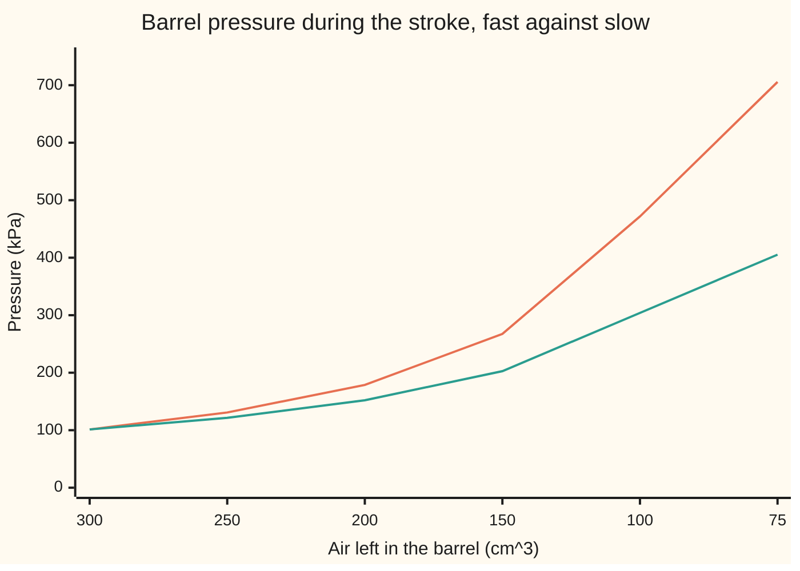

# The thermodynamic laws: energy is conserved and entropy only grows

[Syllabus](../../../SYLLABUS.md) → [Engineering mathematics](../README.md) → [Fluids and Heat](../README.md#s08) → The thermodynamic laws

---

## General Overview

A floor pump for a road bike. Its barrel has a 30 mm bore and holds 300 cm^3 of air at 20 °C and 101.3 kPa (one atmosphere). The tyre is already at 7 bar on its gauge, so its valve stays shut until the barrel passes 801.3 kPa. Push the handle down fast, until 75 cm^3 are left. No air has left yet, so the barrel holds a fixed lump of air: a **closed system** (nothing crosses its boundary except heat and work).

An engineer wants three numbers. How hot does the air get? How hard must the handle be pushed? And is there a cheaper way to do the same squeeze?

The first law answers the first two. Energy is not created or destroyed, so the work done on the air has to show up somewhere. A fast stroke leaves no time for heat to escape, so all of it stays in the air as warmth. The air reaches 510.40 K, or 237.25 °C, and 705.7 kPa. At the end of the stroke the handle needs 427.2 N. This heating is why a pump barrel feels warm after a few strokes.

The second law answers the third. Hold the handle down and the hot air cools back to 20 °C, giving its 56.32 J to the room. A slow stroke that lets heat leak out all the way reaches the same end state for only 42.14 J. The 14.18 J difference is work turned into heat for good. A quantity called **entropy** keeps the count: its total over the air and the room rose by 48.37 mJ/K, and 293.15 K times that rise is the 14.18 J lost. The same count rules out any stroke that makes this squeeze for less than 42.14 J.



Orange: the fast stroke, no heat lost, ending at 705.7 kPa. Green: the slow stroke, held at 20 °C, ending at 405.3 kPa. On a true volume scale the work on the air is the area under each curve (the last step on this axis is only 25 cm^3). Past the start the fast curve is always higher, so its stroke costs more.

**Energy is conserved, so the change in a system's stored energy equals the heat put in plus the work done on it; and the total entropy of everything taking part never falls, so any process that would make it fall cannot happen, and every bit it rises costs the room temperature times that rise in lost work.**

**What kind of fact this is:** two laws of physics, summaries of all experiment so far and not theorems; the ideal-gas formulas for the air are a model that fits well here; the lost-work rule is a theorem, proved from the two laws on this card in Why it works.

---

## The formula

Notation first, in words. $U$ is the energy stored inside the air, in the jiggling and spinning of its molecules. $Q$ is heat put into the air. $W$ is work done on the air, by the handle and by the outside air behind the piston. $S$ is entropy, in joules per kelvin. A $\Delta$ means "change in".

$$\Delta U = Q + W, \qquad W = -\int p\, dV$$

$$\Delta S_{\text{air}} + \Delta S_{\text{room}} = S_{\text{gen}} \;\ge\; 0, \qquad dS = \frac{\delta Q_{\text{rev}}}{T}$$

**Read it aloud:** the air's stored energy changes by the heat that came in plus the work that was done on it; and the entropy of the air plus the entropy of the room can only go up, by an amount called the entropy generated, where entropy changes by each small piece of heat divided by the temperature at which it moves gently.

Here $\delta Q_{\text{rev}}$ is a small piece of heat moved **reversibly**: across no temperature difference, so slowly that a tiny nudge could send it back. For the air, treated as an **ideal gas** (molecules that only collide, so $pV = nRT$), both stored quantities have a formula:

$$U = n c_v T, \qquad S = n c_v \ln T + n R \ln V + \text{const}$$

Some books write $\Delta U = Q - W$ with $W$ the work done *by* the gas. Same physics, opposite sign on $W$. This card counts work done *on* the air as positive.

| Symbol | Plain meaning | In our example | Push it up and the answer… |
| --- | --- | --- | --- |
| $U$, $\Delta U$ | energy stored in the air, J; its change | fast stroke: +56.32 J | — |
| $Q$; $\delta Q$ | heat into the air, J, negative when heat leaves; a small piece of it | 0 on the fast stroke; −56.32 J cooling | more heat in, hotter air |
| $W$ | work done on the air, J: by the handle, plus 22.80 J from the outside air pushing on the back of the piston | 56.32 J fast; 42.14 J slow | more work in, hotter air |
| $p$ | absolute pressure of the air, Pa | 101.3 kPa to 705.7 kPa | more force on the handle |
| $V$; $V_1$, $V_2$; $r$ | air volume, m^3; start and end; ratio $V_1/V_2$ | 300 and 75 cm^3; $r$ = 4 | higher $r$: hotter air, more work |
| $T$; $T_1$, $T_2$; $T_0$; $T_h$, $T_c$ | absolute temperature, K; start, end of fast stroke; room; any hotter and colder body | 293.15 K, 510.40 K; room 293.15 K | — |
| $n$ | amount of air, mol | 12.4714 mmol | every energy scales with it |
| $R$ | gas constant, J/(mol K), CODATA 2018, exact | 8.314462618 | — |
| $c_v$; $\gamma$ | heat to warm one mole by 1 K at fixed volume, $\tfrac52 R$ for air; $\gamma = (c_v + R)/c_v$ | 20.786 J/(mol K); 1.4 | higher $c_v$: same work, less heating |
| $S$, $\Delta S$ | entropy, J/K; its change | air: −143.75 mJ/K on cooling | — |
| $S_{\text{gen}}$ | entropy generated: rise in the total, J/K | 48.37 mJ/K | more lost work, $T_0 S_{\text{gen}}$ |

### When it holds

- **A closed system.** The tyre valve stays shut below 801.3 kPa, so the same air stays in the barrel. Once the valve opens, air carries energy out with it and the balance needs a flow term, as the energy budget in [Continuity and Bernoulli](01-continuity-and-bernoulli.md) has.
- **An ideal gas with fixed $c_v$.** Air at a few bar and up to about 500 K fits well. Hotter, $c_v$ creeps up and the fixed-$\gamma$ formulas run a little hot; at hundreds of bar molecules crowd each other and $pV = nRT$ drifts.
- **A fast stroke loses no heat.** True for a half-second push. A stroke spread over a minute is nearly at room temperature the whole way. The fast-stroke formula would still say 510.40 K, against the true end near 293.15 K: a model used outside its range.
- **The air is uniform.** Pressure and temperature are taken as the same all through the barrel. A violent shove sends pressure waves and eddies through the air, which generate entropy of their own. Then the true end temperature and work are higher than the reversible numbers here.

---

## Why it works

### Step 0: two ledgers, one kept and one that only grows

Energy is a ledger that always balances: what the handle puts in and what heat takes out add up to the change in the air's stored energy. Entropy is a second ledger that is never paid back. Heat moving from hot to cold, friction and sudden shoves all add to it, and nothing removes it from the total. Both $U$ and $S$ are **state quantities**: fixed once you know the air's volume and temperature, however it got there. Heat and work are not. They depend on the path, and the pump shows it.

### Step 1: work is a line integral, so it depends on the path

The air pushes back on the piston with its pressure times the piston's area. Moving the piston in a small distance sweeps out area times distance of volume, so a small step of the stroke takes work $-p\,dV$, positive because $dV$ is negative. Over the stroke, $W = -\int p\,dV$, a line integral along the path the air takes in the $(V, p)$ plane ([Line integrals of a field](../../06-Calculus%20and%20analysis/09-Vector%20Calculus/02-line-integrals.md)). Two routes to the same end, two different answers:

- **Slow, at 20 °C:** $p = nRT_0/V$, so $W = nRT_0 \ln r$ = 42.14 J. The air's energy is unchanged, so all 42.14 J leaves as heat as it goes.
- **Fast, then cooled:** 56.32 J on the stroke, then 56.32 J of heat out while the handle is held.

Both end at 75 cm^3 and 20 °C, and both have $\Delta U = 0$. Only the split between heat and work differs. That is the first law: $Q$ and $W$ depend on the path, their sum does not.

### Step 2: the fast stroke, with no heat

With $Q = 0$, the first law for one small step of the stroke reads $dU = -p\,dV$. With $U = n c_v T$ and $p = nRT/V$:

$$n c_v\, dT = -\frac{nRT}{V}\, dV \quad\Longrightarrow\quad \frac{dT}{T} = -\frac{R}{c_v}\,\frac{dV}{V}.$$

Integrate both sides: $\ln T + (R/c_v)\ln V$ stays fixed, so $T V^{\gamma - 1}$ stays fixed, with $\gamma - 1 = R/c_v = 0.4$ for air. Then $T_2 = T_1 r^{0.4}$ = 510.40 K, and the work is the energy gained, $n c_v (T_2 - T_1)$ = 56.32 J. The code also walks this equation along the stroke in 2,000 small steps and lands on the same numbers.

### Step 3: why heat divided by temperature is a state quantity

The heat taken in by the air on a gentle step is $\delta Q = n c_v\, dT + (nRT/V)\, dV$. Could there be a "heat content", some function of $T$ and $V$, whose small change is this? If so, its two partial derivatives would be $n c_v$ and $nRT/V$, and the mixed partials would agree ([Partial derivatives](../../06-Calculus%20and%20analysis/07-Several%20Variables/01-partial-derivatives.md)). They do not:

$$\frac{\partial (n c_v)}{\partial V} = 0, \qquad \frac{\partial}{\partial T}\!\left(\frac{nRT}{V}\right) = \frac{nR}{V}.$$

So "how much heat is in the air" has no answer. Divide by $T$ first and the two pieces become $n c_v/T$ and $nR/V$. Now both mixed partials are 0, so a function does exist:

$$S(T, V) = n c_v \ln T + n R \ln V + \text{const}.$$

That function is the entropy. Dividing by the temperature is exactly what turns heat, which depends on the path, into a change of something the air has. Squeezing at 20 °C takes the air's entropy down by $nR\ln 4$ = 143.75 mJ/K. Cooling at fixed volume from 510.40 K takes it down by $n c_v \ln(510.40/293.15)$, the same 143.75 mJ/K. The two routes agree because $S$ is a state quantity.

### Step 4: the second law, and what it rules out

The second law says: **the total entropy of everything taking part never falls.** It is not proved from anything simpler. It is the distilled result of every experiment so far, and it has an older, equal form: heat never flows by itself from cold to hot. A small piece of heat $\delta Q$ leaving a body at $T_h$ for one at $T_c$ changes the total by

$$\delta Q\left(\frac{1}{T_c} - \frac{1}{T_h}\right),$$

which is positive exactly when $T_h > T_c$. So the entropy form contains the older one. The reverse also holds, but building entropy out of the older form takes a longer argument.

The cool-down obeys it. The air loses 143.75 mJ/K. The room takes in 56.32 J at 293.15 K and gains 192.12 mJ/K. The total rises by 48.37 mJ/K, so it is allowed. Run it backwards, with the room heating the air back to 510.40 K, and the total would fall by 48.37 mJ/K. That never happens.

Two claims, each ruled out by the same count:

- **"An insulated pump that ends the squeeze at 450 K."** The room's entropy is unchanged. The air's change is $n c_v \ln(450/293.15) - nR\ln 4$ = −32.65 mJ/K, so the total falls: impossible. With no heat out, no stroke can end cooler than 510.40 K.
- **"The squeeze, back at 20 °C, for 35 J."** The 35 J goes to the room as heat, and 35 J ÷ 293.15 K is too little to cover the air's −143.75 mJ/K. The total falls by 24.36 mJ/K: impossible.

### Step 5: the lost-work rule

Add the two ledgers. The room's entropy change is the heat it receives over its temperature, $-Q/T_0$. The second ledger then says $-Q/T_0 = S_{\text{gen}} - \Delta S_{\text{air}}$. Put that $Q$ into the first law:

$$W = \Delta U - T_0\,\Delta S_{\text{air}} + T_0\, S_{\text{gen}}.$$

The first two terms depend only on where the air starts and ends. So the cheapest route is the one that generates no entropy, and every other route pays $T_0 S_{\text{gen}}$ more. For the pump: $\Delta U = 0$ and $\Delta S_{\text{air}}$ = −143.75 mJ/K, so the floor is 42.14 J. The fast stroke and cool-down generate 48.37 mJ/K, so they cost 293.15 K × 48.37 mJ/K = 14.18 J more: 56.32 J. The code computes the 14.18 J both ways, from the works and from the entropy, and they agree to the last digit.

<details>
<summary>Where the 35 J claim went wrong, in one line</summary>

The minimum is $W \ge \Delta U - T_0 \Delta S_{\text{air}} = 0 + 293.15 \times 0.14375$ = 42.14 J. Any claim below that needs $S_{\text{gen}} < 0$. The slow stroke reaches the floor only in the limit: heat has to cross a temperature difference to flow at all, so a real slow stroke generates a little entropy too.

</details>

---

## Worked numbers, by hand

Air: 300 cm^3 at 101,325 Pa and 293.15 K, squeezed to 75 cm^3; room at 293.15 K.

| Step | Arithmetic | Value |
| --- | --- | --- |
| amount of air, $n = pV/(RT)$ | $101{,}325 \times 300\times10^{-6} / (8.314462618 \times 293.15)$ | 12.4714 mmol |
| heat capacity, $n c_v$ | $0.0124714 \times 2.5 \times 8.314462618$ | 259.23 mJ/K |
| $r^{0.4}$ | $4^{0.4}$ | 1.7411 |
| end temperature, fast | $293.15 \times 1.7411$ | 510.40 K |
| end pressure, fast | $101.3 \times 4^{1.4}$ | 705.7 kPa |
| work, fast | $0.25923 \times (510.40 - 293.15)$ | 56.32 J |
| work, slow | $0.0124714 \times 8.314462618 \times 293.15 \times \ln 4$ | 42.14 J |
| air entropy change | $-0.25923 \times \ln(510.40 / 293.15)$ | −143.75 mJ/K |
| room entropy change, cool-down | $56.32 / 293.15$ | +192.12 mJ/K |
| entropy generated | $192.12 - 143.75$ | 48.37 mJ/K |
| **lost work** | $293.15 \times 0.04837$ | **14.18 J** |

The fast stroke costs 14.18 J more than it has to, and that 14.18 J ends up as warmth in the room that no machine can fully turn back into work.

### What breaks if you drop a piece

| Mistake | Comes out at | What went wrong |
| --- | --- | --- |
| Celsius in $T V^{0.4}$ | 34.82 °C, not 237.25 °C | The rule is about absolute temperature; 0 °C is not zero energy |
| Boyle's rule $pV$ = const for the fast stroke | 405.3 kPa and 214.9 N, not 705.7 kPa and 427.2 N | That rule assumes the air stays at 20 °C; a fast stroke heats it |
| Air's entropy change taken as its heat over room temperature | total change 0.00 mJ/K, not 48.37 | $Q/T$ counts only for reversible heat; the air cooled from 510.40 K, not at 293.15 K |
| Sign of $W$ flipped | air "cools" to 75.90 K | Work done on the air adds energy; the convention was mixed |

---

## The cool-down, step by step

The handle is held at 75 cm^3 and the hot air gives heat through the barrel wall to the room. The air's entropy falls the whole time. The room's rises faster, because a joule counts for more at 293.15 K than it did leaving air at 510.40 K.

| Air at | Air's entropy change | Room's entropy change | Total |
| --- | --- | --- | --- |
| 510.40 K | 0.00 mJ/K | 0.00 mJ/K | 0.00 mJ/K |
| 450.00 K | −32.65 mJ/K | +53.41 mJ/K | 20.76 mJ/K |
| 400.00 K | −63.18 mJ/K | +97.63 mJ/K | 34.45 mJ/K |
| 350.00 K | −97.80 mJ/K | +141.84 mJ/K | 44.04 mJ/K |
| 300.00 K | −137.76 mJ/K | +186.06 mJ/K | 48.30 mJ/K |
| 293.15 K | −143.75 mJ/K | +192.12 mJ/K | 48.37 mJ/K |

The total, as bars:

```
air at    total entropy generated so far
510.40 K                                         0.00 mJ/K
450.00 K  ███████████████                       20.76 mJ/K
400.00 K  ██████████████████████████            34.45 mJ/K
350.00 K  █████████████████████████████████     44.04 mJ/K
300.00 K  ████████████████████████████████████  48.30 mJ/K
293.15 K  ████████████████████████████████████  48.37 mJ/K
```

The total only climbs, and it climbs fastest at the start, when the temperature gap is biggest. The last 7 K add almost nothing: heat crossing a small gap generates little entropy. That is the reason the slow stroke can approach the 42.14 J floor. How fast the heat leaves is a question for [Fourier's law](05-heat-conduction-and-fouriers-law.md) and [Convection and radiation](06-convection-and-radiation.md); the entropy count depends only on the temperatures, not the rate.

---

## Code, from first principles, and it actually runs

The script reaches each key number by two independent roads. The end temperature and work come from the closed form $T V^{0.4}$ = const and from a 2,000-step RK4 walk along the stroke (RK4: a standard step-by-step method for differential equations, from wing 08). The slow-stroke work comes from $nRT_0\ln r$ and from Simpson's rule on $\int p\,dV$ (adding the integrand at evenly spaced points with weights 1, 4, 2, 4, …, 1). The air's entropy change comes from the logarithm and from adding $\delta Q/T$ over 100,000 small cooling steps. The lost work comes from the two works and from $T_0 S_{\text{gen}}$. It also prints the ruled-out claims, the "what breaks" numbers, the bar lengths and the chart points.

### Python

```python
# Thermodynamic laws and entropy -- the check behind the card.  Standard library only.
# A bicycle pump: 300 cm^3 of air at 20 C and 1 atm, outlet shut, squeezed to 75 cm^3.
# Roads: closed forms; an RK4 walk along the stroke; Simpson for the slow stroke;
# a step-by-step entropy sum for the cool-down; the lost-work identity W_fast - W_slow = T0 S_gen.
from math import log, pi

R = 8.314462618                      # gas constant, J/(mol K), CODATA 2018 (exact)
CV = 2.5 * R                         # air as a diatomic ideal gas, J/(mol K)
P1, T1, T0 = 101325.0, 293.15, 293.15  # start pressure Pa, start temperature K, room K
V1, V2, BORE = 300e-6, 75e-6, 0.030  # barrel volumes m^3, barrel bore m
AREA = pi * BORE ** 2 / 4

def out(label, v, d, unit):
    print(f"{label:<42}{v:>12.{d}f} {unit}")

def stroke_rk4(cv, n, steps=2000):   # road 2: dT/dV = -R T/(cv V), dW/dV = -n R T/V, walked in V
    h = (V2 - V1) / steps
    f = lambda v, t: (-R * t / (cv * v), -n * R * t / v)
    v, t, w = V1, T1, 0.0
    for _ in range(steps):
        k1 = f(v, t); k2 = f(v + h / 2, t + h / 2 * k1[0])
        k3 = f(v + h / 2, t + h / 2 * k2[0]); k4 = f(v + h, t + h * k3[0])
        t += h / 6 * (k1[0] + 2 * k2[0] + 2 * k3[0] + k4[0])
        w += h / 6 * (k1[1] + 2 * k2[1] + 2 * k3[1] + k4[1])
        v += h
    return t, w

def simpson(f, a, b, m=2000):
    h = (b - a) / m
    return h / 3 * (f(a) + f(b) + sum((4 if i % 2 else 2) * f(a + i * h) for i in range(1, m)))

def fast(cv, ratio):                 # closed form: T V^(gamma-1) stays fixed, W = n cv (T2 - T1)
    n = P1 * V1 / (R * T1)
    t2 = T1 * ratio ** (R / cv)
    return t2, n * cv * (t2 - T1)

n = P1 * V1 / (R * T1)
r = V1 / V2
T2, W_fast = fast(CV, r)
p2 = n * R * T2 / V2
T2_rk, W_rk = stroke_rk4(CV, n)
W_slow = n * R * T0 * log(r)
W_slow_simp = simpson(lambda v: n * R * T0 / v, V2, V1)
Q_cool = n * CV * (T2 - T0)
dS_air = n * CV * log(T0 / T2)
m = 100000                           # road 2 for the entropy: add dQ/T over 100,000 small cooling steps
dS_air_sum = sum(n * CV * (-(T2 - T0) / m) / (T2 - (i + 0.5) * (T2 - T0) / m) for i in range(m))
dS_room = Q_cool / T0
S_gen = dS_air + dS_room
p3 = n * R * T0 / V2

out("air in the barrel", n * 1000, 4, "mmol")
out("barrel length for 300 cm^3, 30 mm bore", V1 / AREA * 100, 2, "cm")
out("barrel area", AREA * 1e6, 2, "mm^2")
out("tyre valve opens above, 7 bar gauge", (P1 + 7e5) / 1000, 1, "kPa")
out("cv, air, per mole", CV, 3, "J/(mol K)")
out("n cv, heat capacity of the air", n * CV * 1000, 2, "mJ/K")
out("4 to the power 0.4", r ** 0.4, 4, "")
out("fast stroke: end temperature", T2, 2, "K")
out("fast stroke: end temperature, RK4", T2_rk, 2, "K")
out("fast stroke: end temperature, Celsius", T2 - 273.15, 2, "C")
out("fast stroke: end pressure", p2 / 1000, 1, "kPa")
out("fast stroke: work on the air", W_fast, 2, "J")
out("fast stroke: work on the air, RK4", W_rk, 2, "J")
out("handle force at the end, fast", (p2 - P1) * AREA, 1, "N")
out("of the work, pushed by the outside air", P1 * (V1 - V2), 2, "J")
out("cool-down at 75 cm^3: heat to the room", Q_cool, 2, "J")
out("cool-down: end pressure", p3 / 1000, 1, "kPa")
out("cool-down: air entropy change", dS_air * 1000, 2, "mJ/K")
out("cool-down: air entropy, summed dQ/T", dS_air_sum * 1000, 2, "mJ/K")
out("cool-down: room entropy change", dS_room * 1000, 2, "mJ/K")
out("cool-down: entropy generated", S_gen * 1000, 2, "mJ/K")
out("slow stroke: work = heat to the room", W_slow, 2, "J")
out("slow stroke: work, Simpson", W_slow_simp, 2, "J")
out("slow stroke: air entropy change", -n * R * log(r) * 1000, 2, "mJ/K")
out("lost work, W_fast - W_slow", W_fast - W_slow, 2, "J")
out("lost work, T0 x S_gen", T0 * S_gen, 2, "J")
print("cool-down, step by step (mJ/K): air, room, total")
bars = []
for t in (T2, 450.0, 400.0, 350.0, 300.0, T0):
    a, b = n * CV * log(t / T2) * 1000, n * CV * (T2 - t) / T0 * 1000
    print(f"  air at {t:6.2f} K {a:>9.2f} {b:>9.2f} {a + b:>9.2f}")
    bars.append(int(36 * (a + b) / (S_gen * 1000) + 0.5))  # bar length, 36 blocks = the total
print("cool-down bars, blocks, 36 for the total:" + "".join(f"{k:4d}" for k in bars))
claim_a = n * CV * log(450.0 / T1) - n * R * log(r)
claim_b = -n * R * log(r) + 35.0 / T0
out("claim: insulated, ends at 450 K, total dS", claim_a * 1000, 2, "mJ/K")
out("claim: 35 J and back to 20 C, total dS", claim_b * 1000, 2, "mJ/K")
out("wrong: Celsius in T V^0.4 rule", (T1 - 273.15) * r ** 0.4, 2, "C")
out("wrong: Boyle for the fast stroke", P1 * r / 1000, 1, "kPa")
out("wrong: Boyle handle force", (P1 * r - P1) * AREA, 1, "N")
out("wrong: air's dS as -Q/T0, total", (-Q_cool / T0 + dS_room) * 1000, 2, "mJ/K")
out("wrong: sign of W flipped, end temperature", T1 - W_fast / (n * CV), 2, "K")
out("two stages of 2:1, cooled between", 2 * fast(CV, 2.0)[1], 2, "J")
out("diesel 18:1 from 20 C", fast(CV, 18.0)[0], 1, "K")
out("try: squeeze to 37.5 cm^3, end temperature", fast(CV, 8.0)[0], 1, "K")
out("try: helium, end temperature", fast(1.5 * R, r)[0], 1, "K")
out("try: helium, end pressure", n * R * fast(1.5 * R, r)[0] / V2 / 1000, 1, "kPa")
out("try: claim of 45 J, total dS", (-n * R * log(r) + 45.0 / T0) * 1000, 2, "mJ/K")
vols = [300, 250, 200, 150, 100, 75]
print("chart, volume cm^3      " + " ".join(f"{v:6d}" for v in vols))
print("chart, fast stroke kPa  " + " ".join(f"{P1 * (V1 / (v * 1e-6)) ** 1.4 / 1000:6.1f}" for v in vols))
print("chart, slow stroke kPa  " + " ".join(f"{P1 * V1 / (v * 1e-6) / 1000:6.1f}" for v in vols))

assert abs(T2_rk - T2) < 1e-6 and abs(W_rk - W_fast) < 1e-6, "RK4 walk must land on the closed form"
assert abs(W_slow_simp - W_slow) < 1e-6, "Simpson must land on n R T ln r"
assert abs(dS_air_sum - dS_air) < 1e-8, "summed dQ/T must land on n cv ln(T0/T2)"
assert abs((W_fast - W_slow) - T0 * S_gen) < 1e-9, "lost work equals T0 times entropy generated"
assert abs(p2 - P1 * r ** 1.4) < 1e-6, "ideal gas law and p V^gamma give the same end pressure"
assert S_gen > 0 and claim_a < 0 and claim_b < 0, "cooling allowed; both claims ruled out"
print("ALL CHECKS PASS")
```

**Ran 2026-11-11 on macOS, Python 3.14.10, standard library only. All checks passed. Output, pasted from the run:**

```
air in the barrel                              12.4714 mmol
barrel length for 300 cm^3, 30 mm bore           42.44 cm
barrel area                                     706.86 mm^2
tyre valve opens above, 7 bar gauge              801.3 kPa
cv, air, per mole                               20.786 J/(mol K)
n cv, heat capacity of the air                  259.23 mJ/K
4 to the power 0.4                              1.7411 
fast stroke: end temperature                    510.40 K
fast stroke: end temperature, RK4               510.40 K
fast stroke: end temperature, Celsius           237.25 C
fast stroke: end pressure                        705.7 kPa
fast stroke: work on the air                     56.32 J
fast stroke: work on the air, RK4                56.32 J
handle force at the end, fast                    427.2 N
of the work, pushed by the outside air           22.80 J
cool-down at 75 cm^3: heat to the room           56.32 J
cool-down: end pressure                          405.3 kPa
cool-down: air entropy change                  -143.75 mJ/K
cool-down: air entropy, summed dQ/T            -143.75 mJ/K
cool-down: room entropy change                  192.12 mJ/K
cool-down: entropy generated                     48.37 mJ/K
slow stroke: work = heat to the room             42.14 J
slow stroke: work, Simpson                       42.14 J
slow stroke: air entropy change                -143.75 mJ/K
lost work, W_fast - W_slow                       14.18 J
lost work, T0 x S_gen                            14.18 J
cool-down, step by step (mJ/K): air, room, total
  air at 510.40 K      0.00      0.00      0.00
  air at 450.00 K    -32.65     53.41     20.76
  air at 400.00 K    -63.18     97.63     34.45
  air at 350.00 K    -97.80    141.84     44.04
  air at 300.00 K   -137.76    186.06     48.30
  air at 293.15 K   -143.75    192.12     48.37
cool-down bars, blocks, 36 for the total:   0  15  26  33  36  36
claim: insulated, ends at 450 K, total dS       -32.65 mJ/K
claim: 35 J and back to 20 C, total dS          -24.36 mJ/K
wrong: Celsius in T V^0.4 rule                   34.82 C
wrong: Boyle for the fast stroke                 405.3 kPa
wrong: Boyle handle force                        214.9 N
wrong: air's dS as -Q/T0, total                   0.00 mJ/K
wrong: sign of W flipped, end temperature        75.90 K
two stages of 2:1, cooled between                48.56 J
diesel 18:1 from 20 C                            931.5 K
try: squeeze to 37.5 cm^3, end temperature       673.5 K
try: helium, end temperature                     738.7 K
try: helium, end pressure                       1021.3 kPa
try: claim of 45 J, total dS                      9.76 mJ/K
chart, volume cm^3         300    250    200    150    100     75
chart, fast stroke kPa   101.3  130.8  178.7  267.4  471.7  705.7
chart, slow stroke kPa   101.3  121.6  152.0  202.7  304.0  405.3
ALL CHECKS PASS
```

### Rust

```rust
// Thermodynamic laws and entropy -- the same check as thermodynamic_laws_and_entropy_check.py.
// Standard library only, no crates.  A bicycle pump: 300 cm^3 of air at 20 C and 1 atm,
// outlet shut, squeezed to 75 cm^3.  Roads: closed forms; an RK4 walk along the stroke;
// Simpson for the slow stroke; a step-by-step entropy sum; the lost-work identity.
use std::f64::consts::PI;

const R: f64 = 8.314462618; // gas constant, J/(mol K), CODATA 2018 (exact)
const CV: f64 = 2.5 * R; // air as a diatomic ideal gas, J/(mol K)
const P1: f64 = 101325.0; // start pressure, Pa
const T1: f64 = 293.15; // start temperature, K
const T0: f64 = 293.15; // room, K
const V1: f64 = 300e-6; // m^3
const V2: f64 = 75e-6; // m^3
const BORE: f64 = 0.030; // m

fn out(label: &str, v: f64, d: usize, unit: &str) {
    println!("{:<42}{:>12.*} {}", label, d, v, unit);
}

fn stroke_rk4(cv: f64, n: f64, steps: usize) -> (f64, f64) {
    // road 2: dT/dV = -R T/(cv V), dW/dV = -n R T/V, walked in V
    let h = (V2 - V1) / steps as f64;
    let f = |v: f64, t: f64| (-R * t / (cv * v), -n * R * t / v);
    let (mut v, mut t, mut w) = (V1, T1, 0.0);
    for _ in 0..steps {
        let k1 = f(v, t);
        let k2 = f(v + h / 2.0, t + h / 2.0 * k1.0);
        let k3 = f(v + h / 2.0, t + h / 2.0 * k2.0);
        let k4 = f(v + h, t + h * k3.0);
        t += h / 6.0 * (k1.0 + 2.0 * k2.0 + 2.0 * k3.0 + k4.0);
        w += h / 6.0 * (k1.1 + 2.0 * k2.1 + 2.0 * k3.1 + k4.1);
        v += h;
    }
    (t, w)
}

fn simpson<F: Fn(f64) -> f64>(f: F, a: f64, b: f64, m: usize) -> f64 {
    let h = (b - a) / m as f64;
    let mut s = 0.0;
    for i in 1..m {
        s += if i % 2 == 1 { 4.0 } else { 2.0 } * f(a + i as f64 * h);
    }
    h / 3.0 * (f(a) + f(b) + s)
}

fn fast(cv: f64, ratio: f64) -> (f64, f64) {
    // closed form: T V^(gamma-1) stays fixed, W = n cv (T2 - T1)
    let n = P1 * V1 / (R * T1);
    let t2 = T1 * ratio.powf(R / cv);
    (t2, n * cv * (t2 - T1))
}

fn main() {
    let area = PI * BORE.powi(2) / 4.0;
    let n = P1 * V1 / (R * T1);
    let r = V1 / V2;
    let (t2, w_fast) = fast(CV, r);
    let p2 = n * R * t2 / V2;
    let (t2_rk, w_rk) = stroke_rk4(CV, n, 2000);
    let w_slow = n * R * T0 * r.ln();
    let w_slow_simp = simpson(|v| n * R * T0 / v, V2, V1, 2000);
    let q_cool = n * CV * (t2 - T0);
    let ds_air = n * CV * (T0 / t2).ln();
    let m = 100000; // road 2 for the entropy: add dQ/T over 100,000 small cooling steps
    let mut ds_air_sum = 0.0;
    for i in 0..m {
        let tm = t2 - (i as f64 + 0.5) * (t2 - T0) / m as f64;
        ds_air_sum += n * CV * (-(t2 - T0) / m as f64) / tm;
    }
    let ds_room = q_cool / T0;
    let s_gen = ds_air + ds_room;
    let p3 = n * R * T0 / V2;

    out("air in the barrel", n * 1000.0, 4, "mmol");
    out("barrel length for 300 cm^3, 30 mm bore", V1 / area * 100.0, 2, "cm");
    out("barrel area", area * 1e6, 2, "mm^2");
    out("tyre valve opens above, 7 bar gauge", (P1 + 7e5) / 1000.0, 1, "kPa");
    out("cv, air, per mole", CV, 3, "J/(mol K)");
    out("n cv, heat capacity of the air", n * CV * 1000.0, 2, "mJ/K");
    out("4 to the power 0.4", r.powf(0.4), 4, "");
    out("fast stroke: end temperature", t2, 2, "K");
    out("fast stroke: end temperature, RK4", t2_rk, 2, "K");
    out("fast stroke: end temperature, Celsius", t2 - 273.15, 2, "C");
    out("fast stroke: end pressure", p2 / 1000.0, 1, "kPa");
    out("fast stroke: work on the air", w_fast, 2, "J");
    out("fast stroke: work on the air, RK4", w_rk, 2, "J");
    out("handle force at the end, fast", (p2 - P1) * area, 1, "N");
    out("of the work, pushed by the outside air", P1 * (V1 - V2), 2, "J");
    out("cool-down at 75 cm^3: heat to the room", q_cool, 2, "J");
    out("cool-down: end pressure", p3 / 1000.0, 1, "kPa");
    out("cool-down: air entropy change", ds_air * 1000.0, 2, "mJ/K");
    out("cool-down: air entropy, summed dQ/T", ds_air_sum * 1000.0, 2, "mJ/K");
    out("cool-down: room entropy change", ds_room * 1000.0, 2, "mJ/K");
    out("cool-down: entropy generated", s_gen * 1000.0, 2, "mJ/K");
    out("slow stroke: work = heat to the room", w_slow, 2, "J");
    out("slow stroke: work, Simpson", w_slow_simp, 2, "J");
    out("slow stroke: air entropy change", -n * R * r.ln() * 1000.0, 2, "mJ/K");
    out("lost work, W_fast - W_slow", w_fast - w_slow, 2, "J");
    out("lost work, T0 x S_gen", T0 * s_gen, 2, "J");
    println!("cool-down, step by step (mJ/K): air, room, total");
    let mut bars = Vec::new();
    for t in [t2, 450.0, 400.0, 350.0, 300.0, T0] {
        let a = n * CV * (t / t2).ln() * 1000.0;
        let b = n * CV * (t2 - t) / T0 * 1000.0;
        println!("  air at {:6.2} K {:>9.2} {:>9.2} {:>9.2}", t, a, b, a + b);
        bars.push((36.0 * (a + b) / (s_gen * 1000.0) + 0.5).floor() as i64); // bar length, 36 blocks = the total
    }
    println!("cool-down bars, blocks, 36 for the total:{}", bars.iter().map(|k| format!("{:4}", k)).collect::<String>());
    let claim_a = n * CV * (450.0 / T1).ln() - n * R * r.ln();
    let claim_b = -n * R * r.ln() + 35.0 / T0;
    out("claim: insulated, ends at 450 K, total dS", claim_a * 1000.0, 2, "mJ/K");
    out("claim: 35 J and back to 20 C, total dS", claim_b * 1000.0, 2, "mJ/K");
    out("wrong: Celsius in T V^0.4 rule", (T1 - 273.15) * r.powf(0.4), 2, "C");
    out("wrong: Boyle for the fast stroke", P1 * r / 1000.0, 1, "kPa");
    out("wrong: Boyle handle force", (P1 * r - P1) * area, 1, "N");
    out("wrong: air's dS as -Q/T0, total", (-q_cool / T0 + ds_room) * 1000.0, 2, "mJ/K");
    out("wrong: sign of W flipped, end temperature", T1 - w_fast / (n * CV), 2, "K");
    out("two stages of 2:1, cooled between", 2.0 * fast(CV, 2.0).1, 2, "J");
    out("diesel 18:1 from 20 C", fast(CV, 18.0).0, 1, "K");
    out("try: squeeze to 37.5 cm^3, end temperature", fast(CV, 8.0).0, 1, "K");
    out("try: helium, end temperature", fast(1.5 * R, r).0, 1, "K");
    out("try: helium, end pressure", n * R * fast(1.5 * R, r).0 / V2 / 1000.0, 1, "kPa");
    out("try: claim of 45 J, total dS", (-n * R * r.ln() + 45.0 / T0) * 1000.0, 2, "mJ/K");
    let vols = [300.0_f64, 250.0, 200.0, 150.0, 100.0, 75.0];
    let row = |g: &dyn Fn(f64) -> String| vols.iter().map(|&v| g(v)).collect::<Vec<_>>().join(" ");
    println!("chart, volume cm^3      {}", row(&|v| format!("{:6}", v as i64)));
    println!("chart, fast stroke kPa  {}", row(&|v| format!("{:6.1}", P1 * (V1 / (v * 1e-6)).powf(1.4) / 1000.0)));
    println!("chart, slow stroke kPa  {}", row(&|v| format!("{:6.1}", P1 * V1 / (v * 1e-6) / 1000.0)));

    assert!((t2_rk - t2).abs() < 1e-6 && (w_rk - w_fast).abs() < 1e-6, "RK4 walk must land on the closed form");
    assert!((w_slow_simp - w_slow).abs() < 1e-6, "Simpson must land on n R T ln r");
    assert!((ds_air_sum - ds_air).abs() < 1e-8, "summed dQ/T must land on n cv ln(T0/T2)");
    assert!(((w_fast - w_slow) - T0 * s_gen).abs() < 1e-9, "lost work equals T0 times entropy generated");
    assert!((p2 - P1 * r.powf(1.4)).abs() < 1e-6, "ideal gas law and p V^gamma give the same end pressure");
    assert!(s_gen > 0.0 && claim_a < 0.0 && claim_b < 0.0, "cooling allowed; both claims ruled out");
    println!("ALL CHECKS PASS");
}
```

**Ran 2026-11-11 on macOS, rustc 1.98.1, no crates. All checks passed. Output, pasted from the run:**

```
air in the barrel                              12.4714 mmol
barrel length for 300 cm^3, 30 mm bore           42.44 cm
barrel area                                     706.86 mm^2
tyre valve opens above, 7 bar gauge              801.3 kPa
cv, air, per mole                               20.786 J/(mol K)
n cv, heat capacity of the air                  259.23 mJ/K
4 to the power 0.4                              1.7411 
fast stroke: end temperature                    510.40 K
fast stroke: end temperature, RK4               510.40 K
fast stroke: end temperature, Celsius           237.25 C
fast stroke: end pressure                        705.7 kPa
fast stroke: work on the air                     56.32 J
fast stroke: work on the air, RK4                56.32 J
handle force at the end, fast                    427.2 N
of the work, pushed by the outside air           22.80 J
cool-down at 75 cm^3: heat to the room           56.32 J
cool-down: end pressure                          405.3 kPa
cool-down: air entropy change                  -143.75 mJ/K
cool-down: air entropy, summed dQ/T            -143.75 mJ/K
cool-down: room entropy change                  192.12 mJ/K
cool-down: entropy generated                     48.37 mJ/K
slow stroke: work = heat to the room             42.14 J
slow stroke: work, Simpson                       42.14 J
slow stroke: air entropy change                -143.75 mJ/K
lost work, W_fast - W_slow                       14.18 J
lost work, T0 x S_gen                            14.18 J
cool-down, step by step (mJ/K): air, room, total
  air at 510.40 K      0.00      0.00      0.00
  air at 450.00 K    -32.65     53.41     20.76
  air at 400.00 K    -63.18     97.63     34.45
  air at 350.00 K    -97.80    141.84     44.04
  air at 300.00 K   -137.76    186.06     48.30
  air at 293.15 K   -143.75    192.12     48.37
cool-down bars, blocks, 36 for the total:   0  15  26  33  36  36
claim: insulated, ends at 450 K, total dS       -32.65 mJ/K
claim: 35 J and back to 20 C, total dS          -24.36 mJ/K
wrong: Celsius in T V^0.4 rule                   34.82 C
wrong: Boyle for the fast stroke                 405.3 kPa
wrong: Boyle handle force                        214.9 N
wrong: air's dS as -Q/T0, total                   0.00 mJ/K
wrong: sign of W flipped, end temperature        75.90 K
two stages of 2:1, cooled between                48.56 J
diesel 18:1 from 20 C                            931.5 K
try: squeeze to 37.5 cm^3, end temperature       673.5 K
try: helium, end temperature                     738.7 K
try: helium, end pressure                       1021.3 kPa
try: claim of 45 J, total dS                      9.76 mJ/K
chart, volume cm^3         300    250    200    150    100     75
chart, fast stroke kPa   101.3  130.8  178.7  267.4  471.7  705.7
chart, slow stroke kPa   101.3  121.6  152.0  202.7  304.0  405.3
ALL CHECKS PASS
```

The two outputs match line for line.

> [!TIP]
> **Try changing**
> - Guess first: squeeze twice as far, to 37.5 cm^3. Does the end temperature double? Set `V2 = 37.5e-6`. It reaches 673.5 K, not double: the rise goes with $r^{0.4}$. On the real pump the tyre valve opens first, at 801.3 kPa, so this is a sealed barrel's answer.
> - Guess first: pump helium, whose molecules cannot spin, so $c_v = \tfrac32 R$. Hotter or cooler than air? Set `CV = 1.5 * R`. The end temperature reads 738.7 K: less heat capacity, so the work heats it more. The end pressure reads 1021.3 kPa, so on the real pump the tyre valve would already be open: this too is a sealed barrel's answer. Then the pressure assert stops the run, because it still has air's 1.4 written in.
> - Guess first: a claim of 45 J for the squeeze back to 20 °C. Allowed? Change the 35.0 in `claim_b` to 45.0. The total becomes +9.76 mJ/K: allowed, because 45 J is above the 42.14 J floor. The last assert stops the run, since the claim is no longer ruled out.

---

## The usual mistake

> [!warning]
> **Reading "entropy only grows" as "nothing's entropy can fall."** The air's entropy fell by 143.75 mJ/K during the cool-down, and nothing was broken. The law is about the total of everything taking part. The room gained 192.12 mJ/K, so the total rose by 48.37 mJ/K. A fridge, a growing crystal and a living cell all lower their own entropy by raising someone else's by more.
>
> - **Celsius in a temperature formula.** $T V^{0.4}$ with 20 °C gives 34.82 °C, not 237.25 °C. Every formula on this card uses kelvin.
> - **Mixing the sign of $W$.** Read $W$ as work done by the air and the first law makes the fast stroke cool the air to 75.90 K.
> - **Boyle's rule for a fast stroke.** It gives 405.3 kPa and a 214.9 N push at the end; the real fast stroke needs 427.2 N.
> - **Dividing the actual heat by a temperature on an irreversible path.** Taking the air's entropy change as −56.32 J ÷ 293.15 K makes the cool-down generate 0.00 mJ/K. Entropy changes are found along a reversible path between the same two states.

---

## Where you meet it in real life

- **A bike pump barrel.** After a few fast strokes the bottom of the barrel is warm: the work heated the air, and the air heats the metal.
- **Diesel engines.** There is no spark. The engine squeezes air about 18 to 1 so fast that it heats, by this card's rule from 20 °C, to 931.5 K, hot enough to light the fuel when it is sprayed in.
- **Workshop compressors.** Two stages of 2 to 1 with the air cooled to 20 °C between them take 48.56 J for this pump's squeeze, against 56.32 J in one fast stage and the 42.14 J floor. The cooler between stages, the intercooler, is there to cut the entropy generated.
- **The central-heating boiler.** A boiler moves heat from a flame far hotter than the water across a huge temperature gap, generating a lot of entropy. A heat pump generates far less, which is why it can give more heat than the electricity it uses: [Heat engines](08-heat-engines-and-carnot-efficiency.md).

> **Say it back**
> The first law is energy bookkeeping: the change in stored energy is the heat put in plus the work done on the system. A fast pump stroke keeps all its work as heat in the air, which reaches 510.40 K. Heat over temperature, on a gentle path, is the change in a state quantity called entropy. The second law says the total entropy never falls, which rules out a pump that squeezes this air for less than 42.14 J. Every joule per kelvin of entropy generated costs the room temperature times that amount in lost work: 14.18 J for the fast stroke.

---

## What this builds on

- [Partial derivatives](../../06-Calculus%20and%20analysis/07-Several%20Variables/01-partial-derivatives.md): the mixed-partials test that shows heat has no state function and heat over temperature does.
- [Line integrals of a field](../../06-Calculus%20and%20analysis/09-Vector%20Calculus/02-line-integrals.md): work as $-\int p\,dV$ along a path, and why two paths between the same ends give two answers.

## Where this goes next

- [Heat engines](08-heat-engines-and-carnot-efficiency.md): the next card. It runs the two ledgers round a cycle and finds the most work any engine can take from heat between two temperatures.

This card measured lost work against one room at one temperature; how much of a hot flame's heat could ever become work is the question it leaves open.

---

## Sources

Verified 2026-11-11: every link below resolves to the publisher's page.

- Clausius, R. "Ueber verschiedene für die Anwendung bequeme Formen der Hauptgleichungen der mechanischen Wärmetheorie." *Annalen der Physik* 201, no. 7 (1865): 353–400. [doi:10.1002/andp.18652010702](https://doi.org/10.1002/andp.18652010702). The paper that names entropy and defines it as reversible heat over temperature.
- Lieb, Elliott H., and Jakob Yngvason. "The Physics and Mathematics of the Second Law of Thermodynamics." *Physics Reports* 310, no. 1 (1999): 1–96. [doi:10.1016/S0370-1573(98)00082-9](https://doi.org/10.1016/S0370-1573(98)00082-9). What the second law assumes, and why entropy exists as a state function.
- Bejan, Adrian. "Entropy Generation Minimization: The New Thermodynamics of Finite-Size Devices and Finite-Time Processes." *Journal of Applied Physics* 79, no. 3 (1996): 1191–1218. [doi:10.1063/1.362674](https://doi.org/10.1063/1.362674). The lost-work rule, $T_0 S_{\text{gen}}$, used as an engineering design tool.
- Tiesinga, E., P. J. Mohr, D. B. Newell, and B. N. Taylor. "CODATA Recommended Values of the Fundamental Physical Constants: 2018." *Reviews of Modern Physics* 93 (2021): 025010. [doi:10.1103/RevModPhys.93.025010](https://doi.org/10.1103/RevModPhys.93.025010). The gas constant $R$ = 8.314462618 J/(mol K), exact.
- *University Physics Volume 2*, sections 3.6 "Adiabatic Processes for an Ideal Gas" and 4.6 "Entropy." OpenStax, Rice University. [Section 3.6](https://openstax.org/books/university-physics-volume-2/pages/3-6-adiabatic-processes-for-an-ideal-gas), [section 4.6](https://openstax.org/books/university-physics-volume-2/pages/4-6-entropy). The $T V^{\gamma-1}$ rule and the entropy of an ideal gas, in standard notation.
