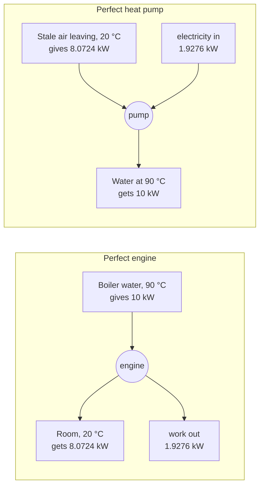
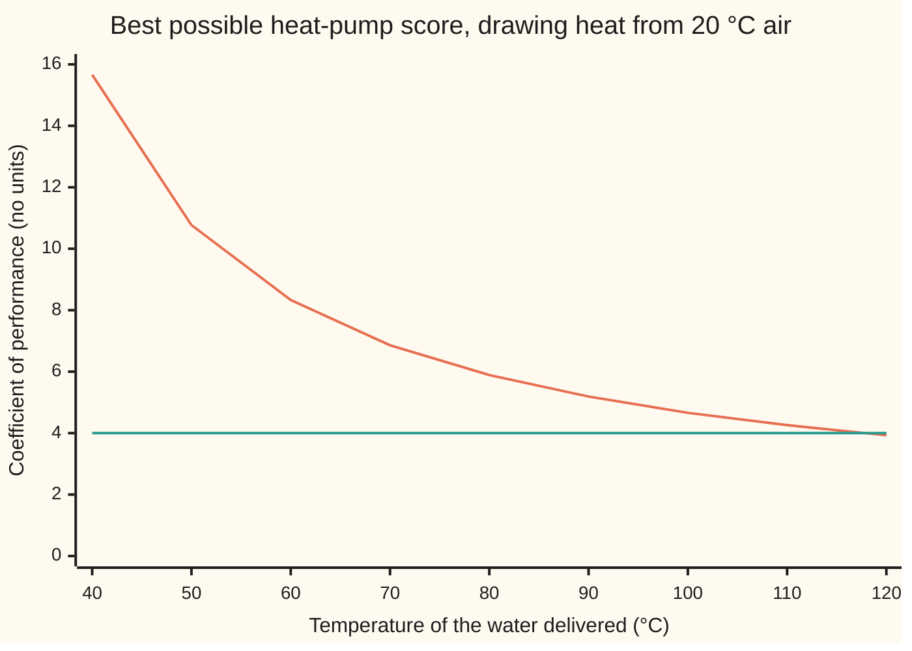

# Heat engines: the best efficiency anything between two temperatures can reach

[Syllabus](../../../SYLLABUS.md) → [Engineering mathematics](../README.md) → [Fluids and Heat](../README.md#s08) → Heat engines

---

## General Overview

A gas boiler heats the water in a central-heating loop to 90 °C. The pump sends it to the radiators, and the radiators give its heat to a room at 20 °C. Every kilowatt of heat drops 70 degrees on the way, and no work is taken from that drop.

Two engineering questions sit on that drop. First: if an engine sat between the hot water and the room, how much of the heat could it turn into electricity?

Second, run the other way. A heat pump (a machine that uses electricity to move heat from a cooler place to a warmer one) is sold as "scoring four", meaning 4 kW of heat for every 1 kW of electricity.

This one is an exhaust-air heat pump: it draws its heat from the house's stale 20 °C air on its way out through the ventilation, heat that would otherwise be lost outdoors. Is four possible between these temperatures, and how close is it to the best possible?

One limit answers both, and it depends on nothing but the two temperatures. Out of every 10 kW of heat leaving the 90 °C water, no engine of any design can deliver more than 1.9276 kW of work; at least 8.0724 kW must go on into the room. Run backwards, no heat pump can deliver more than 5.1879 kW of heat per kW of electricity. The pump scoring four sits at 0.7710 of that ceiling, below it as it must be.

**Heat carries entropy and work carries none, so a machine running in a cycle must hand some heat to the cold side to get rid of the entropy it took in; this caps an engine's efficiency at one minus cold over hot, and a heat pump's score at hot over the gap between them, with both temperatures in kelvin.**

**What kind of fact this is:** a theorem, proved on this card in Why it works from the second law of thermodynamics. The second law itself is a law of nature: no experiment has ever broken it, but it is an observed fact, not a proof.

### The picture: the same 70-degree drop, used both ways



Schematic. The two machines are mirror images: the work the perfect engine makes is exactly the work the perfect pump needs.

---

## The formula

Temperatures on this card are absolute: kelvin (K), which is degrees Celsius plus 273.15. The boiler water is $T_h = 363.15$ K and the room $T_c = 293.15$ K.

$$\eta = \frac{W}{Q_h} \;\le\; 1 - \frac{T_c}{T_h}, \qquad \mathrm{COP} = \frac{Q_h}{W} \;\le\; \frac{T_h}{T_h - T_c}$$

**Read it aloud:** an engine can turn at most the fraction "one minus cold over hot" of its heat into work, and a heat pump can deliver at most "hot over the gap" units of heat per unit of work.

| Symbol | Plain meaning | In our example | Push it up and the answer… |
| --- | --- | --- | --- |
| $T_h$ | hot-side temperature, in K | boiler water, 363.15 K | engine limit rises; pump limit falls |
| $T_c$ | cold-side temperature, in K | room, and the stale air leaving it: 293.15 K | engine limit falls; pump limit rises |
| $Q_h$ | heat at the hot side: per second, in kW; per cycle, in J, for the gas cycle in Step 5 | 10 kW | work scales with it |
| $Q_c$ | heat at the cold side, in the same units | at least 8.0724 kW for the engine | less work left for the engine |
| $W$ | work, in the same units: shaft power or electricity | at most 1.9276 kW out of the engine | — |
| $\eta$ | efficiency: work out over heat in, no units | limit 0.1928, or 19.28% | — |
| $\mathrm{COP}$ | coefficient of performance: heat delivered over work in, the pump's "score" | limit 5.1879; the real pump scores 4 | — |
| $S$, $\Delta S$ | entropy, in J/K, and its change: heat $Q$ moved at temperature $T$ carries $Q/T$ of it (in kW/K, entropy per second, when $Q$ is in kW) | heat leaving the 363.15 K water carries entropy out with it | — |
| $p$, $V$ | pressure (Pa) and volume (m³) of the gas inside the model engine in the code | — | — |
| $n$, $R$ | amount of gas (1 mol) and the molar gas constant, 8.314462618 J/(mol K), exact (NIST CODATA) | — | — |
| $\gamma$ | the gas's heat-capacity ratio: 5/3 for a gas of single atoms, 1.4 for air | 5/3 and 1.4 | no effect on the limit |

### When it holds

- **Two reservoirs that stay at fixed temperatures.** If the hot side is a tank of 90 °C water that cools to 20 °C as the engine draws on it, each later kilowatt is drawn at a lower temperature. The best average efficiency falls from 0.1928 to 0.1032.
- **Temperatures in kelvin.** The formula comes from ratios of $Q/T$, and only an absolute scale makes those ratios mean anything. In Celsius it gives 0.7778, about four times too high.
- **A reversible machine.** The limit is reached only with no friction and with heat moving across a vanishing temperature difference, which takes forever. An engine pushed for its best power instead of its best efficiency gets about 0.1015 in a standard model of finite-rate heat flow, and real machines lose more.
- **A machine that runs in a cycle.** A gas expanding once can turn all its heat into work, but it ends up in a different state and cannot repeat. The limit is for anything that returns to where it started and goes round again.
- **Heating, not cooling.** The pump formula counts heat delivered to the hot side. A fridge counts heat removed from the cold side, and its limit is one less: 4.1879.

---

## Why it works

### Step 0: heat carries entropy, work carries none

Entropy is the quantity the second law says can never decrease in total ([The thermodynamic laws](07-thermodynamic-laws-and-entropy.md)). Heat $Q$ crossing at temperature $T$ carries entropy $Q/T$. Work carries none.

An engine takes heat from the hot water, and that heat brings entropy in. A machine that runs in a cycle must end each lap where it started, holding no extra entropy. Work cannot carry the entropy away, so heat must: some heat has to be dumped on the cold side.

Here is the escape hatch. Each joule dumped at the cold temperature carries more entropy than a joule taken at the hot one, because it is divided by a smaller $T$. So only part of the heat has to be dumped. The rest can leave as work. The ratio of the two temperatures sets how big that part is.

### Step 1: energy balance over one lap

After one full cycle the machine is back in its starting state, so its own energy is unchanged. The first law (energy is conserved) then says what went in came out:

$$W = Q_h - Q_c.$$

### Step 2: entropy balance over one lap

The machine's own entropy is also back where it started. The hot water lost $Q_h/T_h$ and the room gained $Q_c/T_c$. The second law says the total cannot fall:

$$\Delta S = -\frac{Q_h}{T_h} + \frac{Q_c}{T_c} \;\ge\; 0 \quad\Longrightarrow\quad Q_c \;\ge\; Q_h\,\frac{T_c}{T_h}.$$

For our boiler: $Q_c \ge 10 \times 293.15/363.15 = 8.0724$ kW.

### Step 3: the engine limit

Put the smallest allowed $Q_c$ into Step 1:

$$W \;\le\; Q_h - Q_h\frac{T_c}{T_h} = Q_h\left(1 - \frac{T_c}{T_h}\right), \qquad \eta = \frac{W}{Q_h} \le 1 - \frac{T_c}{T_h}.$$

Equality holds exactly when $\Delta S = 0$: a reversible machine, which creates no entropy. Any friction or heat leaking across a temperature gap creates entropy, raises $Q_c$ and lowers $W$.

### Step 4: the heat pump is the engine run backwards

Reverse every arrow. Work $W$ goes in, heat $Q_c$ is pulled from the cold side, heat $Q_h$ is delivered to the hot side. Energy: $Q_h = W + Q_c$. Entropy: now the cold side loses and the hot side gains, so $Q_h/T_h \ge Q_c/T_c$. Combine them:

$$W = Q_h - Q_c \;\ge\; Q_h - Q_h\frac{T_c}{T_h} \quad\Longrightarrow\quad \mathrm{COP} = \frac{Q_h}{W} \;\le\; \frac{T_h}{T_h - T_c}.$$

The pump limit is the reciprocal of the engine limit: $363.15/70 = 5.1879$, and $70/363.15 = 0.1928$. A perfect pump delivering 10 kW at 90 °C needs 1.9276 kW of electricity, exactly what a perfect engine would make from those 10 kW.

### Step 5: the limit is the same for every machine, and a real cycle reaches it

The bound came from two balances that hold for any machine, so it caps every design. It is also sharp: an ideal gas taken round Carnot's cycle (expand at $T_h$, expand further while insulated until it cools to $T_c$, compress at $T_c$, compress while insulated back to $T_h$) creates no entropy and lands exactly on it.

The code runs that cycle with one mole of gas and adds up the work leg by leg: 2092.8866 J in from the hot side, 1689.4663 J out to the cold side, 403.4202 J of work, and $403.4202/2092.8866 = 0.1928$. A gas of a different kind, with $\gamma = 1.4$, gives 0.1928 again.

<details>
<summary>Detailed proof: the gas cycle lands on the limit</summary>

Number the cycle's four corners 1 to 4, in the order the gas visits them; $V_1$ to $V_4$ are the gas volumes there.

On an isotherm (constant temperature) an ideal gas obeys $pV = nRT$, so its energy does not change and the heat it takes in equals the work it does: $\int p\,dV = nRT\ln(V_\text{end}/V_\text{start})$. On the hot leg that is $Q_h = nRT_h\ln(V_2/V_1)$; on the cold leg $Q_c = nRT_c\ln(V_3/V_4)$.

On an insulated leg (an adiabat) no heat crosses, and an ideal gas keeps $TV^{\gamma-1}$ constant. The two adiabats run between the same two temperatures, so $V_3/V_2 = V_4/V_1 = (T_h/T_c)^{1/(\gamma-1)}$. Rearranged, $V_3/V_4 = V_2/V_1$: the two log factors are equal.

Divide: $Q_c/Q_h = T_c/T_h$, so $\eta = 1 - T_c/T_h$ whatever $\gamma$, $n$ or the volumes are.

</details>

<details>
<summary>Detailed proof: no engine beats a reversible one (Carnot's theorem)</summary>

Suppose some engine X took 10 kW from the 90 °C water and made more than 1.9276 kW. Use 1.9276 kW of its output to drive a perfect heat pump, which delivers 10 kW back into the water. The water breaks even. X still has spare work left over, and the only place that energy can have come from is the room. The pair has turned heat from one reservoir entirely into work, in a cycle, which the second law forbids. So X cannot exist, and every reversible engine between the same temperatures has the same efficiency.

</details>

---

## Worked numbers, by hand

Boiler water 90 °C, room 20 °C, 10 kW of heat, a pump scoring 4.

| Step | Arithmetic | Value |
| --- | --- | --- |
| hot side in kelvin | 90 + 273.15 | 363.15 K |
| cold side in kelvin | 20 + 273.15 | 293.15 K |
| the gap | 363.15 − 293.15 | 70 K |
| engine limit | 1 − 293.15/363.15 = 70/363.15 | **0.1928** |
| best work from 10 kW | 10 × 0.1928 | 1.9276 kW |
| heat that must reach the room | 10 − 1.9276 | 8.0724 kW |
| heat pump limit | 363.15/70 | **5.1879** |
| electricity for 10 kW of heat: perfect pump | 10/5.1879 | 1.9276 kW |
| electricity: pump scoring 4 | 10/4 | 2.5 kW |
| electricity: plain electric heater | 10/1 | 10 kW |
| pump scoring 4, share of its limit | 4/5.1879 | **0.7710** |

The 70-degree drop the radiators waste is worth at most 1.9276 kW of every 10 kW as work. Run backwards, the same drop is why a heat pump beats an electric heater: the pump scoring four uses 2.5 kW where the heater uses 10 kW, because the rest of its heat comes from air that was leaving the house anyway.

### Placing the real pump below the limit

The pump scoring four is legal: 4 is below 5.1879. Where does the rest of the gap go? Its refrigerant (the fluid the pump circulates to carry the heat) cannot be at 20 °C and 90 °C exactly, or no heat would flow into or out of it.

Say each heat exchanger needs a 5 K difference: the refrigerant boils at 288.15 K and condenses at 368.15 K. Even a perfect inner cycle is then capped at $368.15/80 = 4.6019$. The pump reaches 0.8692 of that. The remaining loss is the compressor and the expansion valve, which create entropy as they work.

Turn the question around. A pump scoring 4 that draws heat from 20 °C air can deliver it no hotter than $T_h = 4 \times 293.15/3 = 390.8667$ K, which is 117.7167 °C. Above that, a score of four is impossible for any machine.



The falling curve is the limit $T_h/(T_h - T_c)$. The flat line is the real pump's score of 4. The limit drops below the flat line between 110 °C and 120 °C. A cooler loop raises the ceiling fast: at 70 °C it is 6.86, which is why heat pumps are paired with low flow temperatures (the temperature of the water sent to the radiators).

### What breaks if you drop a piece

| Mistake | Comes out at | What went wrong |
| --- | --- | --- |
| Celsius in the engine formula, 1 − 20/90 | 0.7778 instead of 0.1928 | Ratios of temperature need an absolute zero; Celsius puts its zero at freezing water |
| Celsius in the pump formula, 90/70 | 1.2857 instead of 5.1879 | Would call the real pump scoring 4 impossible, which it is not |
| Fridge formula for heating, $T_c/(T_h - T_c)$ | 4.1879 instead of 5.1879 | Counts only the heat taken from the cold side, and forgets the electricity also ends up as heat |
| A cooling tank of hot water treated as fixed at 90 °C | 0.1928 instead of 0.1032 | Later heat is drawn at lower temperatures, where the limit is lower |

All four are printed by the checks.

---

## Code, from first principles, and it actually runs

The code reaches the engine limit by **three independent roads**. Road 1 is the formula. Road 2 simulates one mole of ideal gas going round Carnot's cycle. It adds up $p\,dV$ on each of the four legs with Simpson's rule (a way of adding thin slices under a curve), and never uses $1 - T_c/T_h$. Its hot and cold legs are also checked against the closed form $nRT\ln 2$. Road 3 uses only entropy bookkeeping: it searches by bisection (halving an interval again and again) for the largest work that keeps the total entropy change from going negative. The heat-pump limit is checked against the gas cycle's $Q_h/W$, which the same cycle run backwards shares. The cooling tank is done in closed form and by stepping through 70,000 slices of the tank's temperature.

### Python

```python
# Heat engines and Carnot efficiency -- the check behind the card.  Standard
# library only.  Boiler water at 90 C, room at 20 C, a heat pump scoring 4.
# Roads to the limit: (1) the formula 1 - Tc/Th; (2) an ideal-gas Carnot
# cycle simulated leg by leg, its work found by adding up p dV with Simpson's
# rule; (3) entropy bookkeeping, the largest work found by bisection.
from math import log, sqrt

K0 = 273.15                      # kelvin = degrees Celsius + 273.15
R = 8.314462618                  # molar gas constant, J/(mol K), NIST CODATA (exact)
TH, TC = 90.0 + K0, 20.0 + K0    # boiler water and room, in K
QH = 10.0                        # heat taken from the boiler water, kW
COP_REAL = 4.0                   # the heat pump's score: kW of heat per kW of electricity
GAP = 5.0                        # temperature gap across each heat exchanger, K

def carnot_eta(th, tc): return 1.0 - tc / th          # road 1, engine
def carnot_cop(th, tc): return th / (th - tc)         # road 1, heat pump (heating)

def simpson(f, a, b, n=2000):
    h = (b - a) / n
    s = f(a) + f(b)
    for i in range(1, n):
        s += (4 if i % 2 else 2) * f(a + i * h)
    return s * h / 3.0

def gas_cycle(th, tc, gamma, n=1.0, v1=0.010, v2=0.020):
    # road 2: one mole of ideal gas, hot isotherm v1->v2, adiabat down to tc,
    # cold isotherm, adiabat back up.  Work on each leg = integral of p dV.
    k = (th / tc) ** (1.0 / (gamma - 1.0))           # adiabat volume stretch
    v3, v4 = v2 * k, v1 * k
    p2, p4 = n * R * th / v2, n * R * tc / v4
    w12 = simpson(lambda v: n * R * th / v, v1, v2)                 # hot isotherm
    w23 = simpson(lambda v: p2 * (v2 / v) ** gamma, v2, v3)         # expand, cools
    w34 = -simpson(lambda v: n * R * tc / v, v4, v3)                # cold isotherm
    w41 = -simpson(lambda v: p4 * (v4 / v) ** gamma, v1, v4)        # squeeze, warms
    t3 = p2 * (v2 / v3) ** gamma * v3 / (n * R)                     # end of adiabat
    return w12, -w34, w12 + w23 + w34 + w41, t3                     # Qh, Qc, W, T3

def best_work(qh, th, tc):
    # road 3: largest W with total entropy change -qh/th + (qh - W)/tc >= 0
    lo, hi = 0.0, qh
    for _ in range(200):
        mid = 0.5 * (lo + hi)
        lo, hi = (mid, hi) if -qh / th + (qh - mid) / tc >= 0 else (lo, mid)
    return lo

def tank_eta(th, tc, steps):
    # a tank of hot water cooled from th to tc, each slice of heat run through
    # a perfect engine at the tank's current temperature (midpoint rule)
    dt, w = (th - tc) / steps, 0.0
    for i in range(steps):
        w += dt * carnot_eta(th - (i + 0.5) * dt, tc)
    return w / (th - tc)

eta = carnot_eta(TH, TC)
mono = gas_cycle(TH, TC, 5.0 / 3.0)
dia = gas_cycle(TH, TC, 1.4)
w_bis = best_work(QH, TH, TC)
cop = carnot_cop(TH, TC)
cop_gap = carnot_cop(TH + GAP, TC - GAP)
tank_closed = 1.0 - TC * log(TH / TC) / (TH - TC)
tank_sim = tank_eta(TH, TC, 70000)
ca = 1.0 - sqrt(TC / TH)                          # Curzon-Ahlborn, best power
t_max = COP_REAL * TC / (COP_REAL - 1.0)          # hottest delivery a score of 4 allows

def show(label, value, unit=""):
    print(f"{label:<46}{value:>12.4f} {unit}".rstrip())

show("boiler water Th", TH, "K"); show("room Tc", TC, "K"); show("gap Th - Tc", TH - TC, "K")
show("1 Carnot efficiency, formula", eta)
show("2 gas cycle, monatomic: Qh", mono[0], "J"); show("  Qc", mono[1], "J"); show("  W", mono[2], "J")
show("  W / Qh", mono[2] / mono[0]); show("  gas temperature after adiabat", mono[3], "K")
show("2 gas cycle, diatomic: W / Qh", dia[2] / dia[0])
show("3 entropy bisection: best W from 10 kW", w_bis, "kW")
show("  formula: eta x 10 kW", eta * QH, "kW"); show("  heat dumped in room", QH - eta * QH, "kW")
show("heat pump limit Th/(Th - Tc)", cop); show("  same, from the gas cycle Qh / W", mono[0] / mono[2])
show("  fridge limit Tc/(Th - Tc)", TC / (TH - TC))
show("electricity for 10 kW of heat: perfect pump", QH / cop, "kW")
show("  pump scoring 4", QH / COP_REAL, "kW"); show("  electric heater", QH, "kW")
show("pump scoring 4 as share of its limit", COP_REAL / cop)
show("limit with 5 K exchanger gaps, 368.15/80", cop_gap)
show("  pump scoring 4 as share of that", COP_REAL / cop_gap)
show("hottest delivery a score of 4 allows", t_max, "K"); show("  in Celsius", t_max - K0, "C")
show("finite tank 90 -> 20 C, closed form", tank_closed); show("  same, stepped 70000 slices", tank_sim)
show("Curzon-Ahlborn, engine at best power", ca)
show("power station, 600 C steam to 35 C: Tc/Th", (35 + K0) / (600 + K0))
show("  nuclear, 285 C steam to 35 C: Tc/Th", (35 + K0) / (285 + K0))
show("wrong: Celsius efficiency 1 - 20/90", 1.0 - 20.0 / 90.0)
show("wrong: Celsius pump limit 90/70", 90.0 / 70.0)
show("wrong: tank treated as fixed 90 C", eta)
show("try: flow at 70 C, efficiency", carnot_eta(70 + K0, TC)); show("  pump limit", carnot_cop(70 + K0, TC))
show("try: source 5 C outdoors, pump limit", carnot_cop(TH, 5 + K0))
show("  pump scoring 4 as share", COP_REAL / carnot_cop(TH, 5 + K0))
show("try: 10 K exchanger gaps, limit", carnot_cop(TH + 10, TC - 10))
show("try: tank stepped 2 slices", tank_eta(TH, TC, 2))
flows = [40, 50, 60, 70, 80, 90, 100, 110, 120]
print("chart, flow C       " + " ".join(f"{t:6d}" for t in flows))
print("chart, pump limit   " + " ".join(f"{carnot_cop(t + K0, TC):6.2f}" for t in flows))
print("chart, pump score   " + " ".join(f"{COP_REAL:6.2f}" for t in flows))

assert abs(eta - 70.0 / 363.15) < 1e-12                     # formula vs hand arithmetic
assert abs(mono[2] / mono[0] - eta) < 1e-9                  # simulated gas cycle hits the limit
assert abs(mono[0] - R * TH * log(2.0)) < 1e-6              # hot leg vs n R Th ln(V2/V1), 1 mol
assert abs(mono[1] - R * TC * log(2.0)) < 1e-6              # cold leg vs n R Tc ln(V3/V4), 1 mol
assert abs(dia[2] / dia[0] - eta) < 1e-9                    # any gas: same limit
assert abs(mono[3] - TC) < 1e-9                             # adiabat really ends at the room
assert abs(w_bis - eta * QH) < 1e-9                         # entropy road agrees
assert abs(mono[0] / mono[2] - cop) < 1e-9                  # gas cycle reversed = pump limit
assert abs(tank_sim - tank_closed) < 1e-9                   # stepped tank vs closed form
assert tank_closed < eta                                    # a cooling tank allows less
assert COP_REAL < cop_gap < cop                             # real pump sits below both limits
assert abs(carnot_cop(t_max, TC) - COP_REAL) < 1e-9         # hottest delivery for a score of 4
print("ALL CHECKS PASS")
```

**Ran 2026-11-11 on macOS, Python 3.14.10, standard library only. All checks passed. Output, pasted from the run:**

```
boiler water Th                                   363.1500 K
room Tc                                           293.1500 K
gap Th - Tc                                        70.0000 K
1 Carnot efficiency, formula                        0.1928
2 gas cycle, monatomic: Qh                       2092.8866 J
  Qc                                             1689.4663 J
  W                                               403.4202 J
  W / Qh                                            0.1928
  gas temperature after adiabat                   293.1500 K
2 gas cycle, diatomic: W / Qh                       0.1928
3 entropy bisection: best W from 10 kW              1.9276 kW
  formula: eta x 10 kW                              1.9276 kW
  heat dumped in room                               8.0724 kW
heat pump limit Th/(Th - Tc)                        5.1879
  same, from the gas cycle Qh / W                   5.1879
  fridge limit Tc/(Th - Tc)                         4.1879
electricity for 10 kW of heat: perfect pump         1.9276 kW
  pump scoring 4                                    2.5000 kW
  electric heater                                  10.0000 kW
pump scoring 4 as share of its limit                0.7710
limit with 5 K exchanger gaps, 368.15/80            4.6019
  pump scoring 4 as share of that                   0.8692
hottest delivery a score of 4 allows              390.8667 K
  in Celsius                                      117.7167 C
finite tank 90 -> 20 C, closed form                 0.1032
  same, stepped 70000 slices                        0.1032
Curzon-Ahlborn, engine at best power                0.1015
power station, 600 C steam to 35 C: Tc/Th           0.3529
  nuclear, 285 C steam to 35 C: Tc/Th               0.5521
wrong: Celsius efficiency 1 - 20/90                 0.7778
wrong: Celsius pump limit 90/70                     1.2857
wrong: tank treated as fixed 90 C                   0.1928
try: flow at 70 C, efficiency                       0.1457
  pump limit                                        6.8630
try: source 5 C outdoors, pump limit                4.2724
  pump scoring 4 as share                           0.9363
try: 10 K exchanger gaps, limit                     4.1461
try: tank stepped 2 slices                          0.1041
chart, flow C           40     50     60     70     80     90    100    110    120
chart, pump limit    15.66  10.77   8.33   6.86   5.89   5.19   4.66   4.26   3.93
chart, pump score     4.00   4.00   4.00   4.00   4.00   4.00   4.00   4.00   4.00
ALL CHECKS PASS
```

The three roads agree to every printed digit. The gas cycle's insulated leg really does end at 293.1500 K, and the second gas, with a different $\gamma$, gives the same 0.1928.

### Rust

Same inputs, same labels, built with `rustc --edition 2021 -O`.

```rust
// Heat engines and Carnot efficiency -- the same check as the Python, in Rust.
// Standard library only, no crates.  Boiler water at 90 C, room at 20 C, a
// heat pump scoring 4.  Roads to the limit: (1) the formula 1 - Tc/Th; (2) an
// ideal-gas Carnot cycle simulated leg by leg, its work found by adding up
// p dV with Simpson's rule; (3) entropy bookkeeping, best work by bisection.
const K0: f64 = 273.15; // kelvin = degrees Celsius + 273.15
const R: f64 = 8.314462618; // molar gas constant, J/(mol K), NIST CODATA (exact)
const TH: f64 = 90.0 + K0; // boiler water, K
const TC: f64 = 20.0 + K0; // room, K
const QH: f64 = 10.0; // heat taken from the boiler water, kW
const COP_REAL: f64 = 4.0; // kW of heat per kW of electricity
const GAP: f64 = 5.0; // temperature gap across each heat exchanger, K

fn carnot_eta(th: f64, tc: f64) -> f64 { 1.0 - tc / th }
fn carnot_cop(th: f64, tc: f64) -> f64 { th / (th - tc) }

fn simpson<F: Fn(f64) -> f64>(f: F, a: f64, b: f64, n: usize) -> f64 {
    let h = (b - a) / n as f64;
    let mut s = f(a) + f(b);
    for i in 1..n { s += if i % 2 == 1 { 4.0 } else { 2.0 } * f(a + i as f64 * h); }
    s * h / 3.0
}

// road 2: one mole of ideal gas, hot isotherm v1->v2, adiabat down to tc,
// cold isotherm, adiabat back up.  Returns (Qh, Qc, W, T3).
fn gas_cycle(th: f64, tc: f64, gamma: f64) -> (f64, f64, f64, f64) {
    let (n, v1, v2) = (1.0, 0.010, 0.020);
    let k = (th / tc).powf(1.0 / (gamma - 1.0));
    let (v3, v4) = (v2 * k, v1 * k);
    let (p2, p4) = (n * R * th / v2, n * R * tc / v4);
    let w12 = simpson(|v| n * R * th / v, v1, v2, 2000);
    let w23 = simpson(|v| p2 * (v2 / v).powf(gamma), v2, v3, 2000);
    let w34 = -simpson(|v| n * R * tc / v, v4, v3, 2000);
    let w41 = -simpson(|v| p4 * (v4 / v).powf(gamma), v1, v4, 2000);
    let t3 = p2 * (v2 / v3).powf(gamma) * v3 / (n * R);
    (w12, -w34, w12 + w23 + w34 + w41, t3)
}

// road 3: largest W with total entropy change -qh/th + (qh - W)/tc >= 0
fn best_work(qh: f64, th: f64, tc: f64) -> f64 {
    let (mut lo, mut hi) = (0.0, qh);
    for _ in 0..200 {
        let mid = 0.5 * (lo + hi);
        if -qh / th + (qh - mid) / tc >= 0.0 { lo = mid } else { hi = mid }
    }
    lo
}

// a tank cooled from th to tc, each slice run through a perfect engine
fn tank_eta(th: f64, tc: f64, steps: usize) -> f64 {
    let dt = (th - tc) / steps as f64;
    let mut w = 0.0;
    for i in 0..steps { w += dt * carnot_eta(th - (i as f64 + 0.5) * dt, tc); }
    w / (th - tc)
}

fn show(label: &str, value: f64, unit: &str) {
    println!("{}", format!("{:<46}{:>12.4} {}", label, value, unit).trim_end());
}

fn main() {
    let eta = carnot_eta(TH, TC);
    let mono = gas_cycle(TH, TC, 5.0 / 3.0);
    let dia = gas_cycle(TH, TC, 1.4);
    let w_bis = best_work(QH, TH, TC);
    let cop = carnot_cop(TH, TC);
    let cop_gap = carnot_cop(TH + GAP, TC - GAP);
    let tank_closed = 1.0 - TC * (TH / TC).ln() / (TH - TC);
    let tank_sim = tank_eta(TH, TC, 70000);
    let ca = 1.0 - (TC / TH).sqrt();
    let t_max = COP_REAL * TC / (COP_REAL - 1.0);

    show("boiler water Th", TH, "K"); show("room Tc", TC, "K"); show("gap Th - Tc", TH - TC, "K");
    show("1 Carnot efficiency, formula", eta, "");
    show("2 gas cycle, monatomic: Qh", mono.0, "J"); show("  Qc", mono.1, "J"); show("  W", mono.2, "J");
    show("  W / Qh", mono.2 / mono.0, ""); show("  gas temperature after adiabat", mono.3, "K");
    show("2 gas cycle, diatomic: W / Qh", dia.2 / dia.0, "");
    show("3 entropy bisection: best W from 10 kW", w_bis, "kW");
    show("  formula: eta x 10 kW", eta * QH, "kW"); show("  heat dumped in room", QH - eta * QH, "kW");
    show("heat pump limit Th/(Th - Tc)", cop, ""); show("  same, from the gas cycle Qh / W", mono.0 / mono.2, "");
    show("  fridge limit Tc/(Th - Tc)", TC / (TH - TC), "");
    show("electricity for 10 kW of heat: perfect pump", QH / cop, "kW");
    show("  pump scoring 4", QH / COP_REAL, "kW"); show("  electric heater", QH, "kW");
    show("pump scoring 4 as share of its limit", COP_REAL / cop, "");
    show("limit with 5 K exchanger gaps, 368.15/80", cop_gap, "");
    show("  pump scoring 4 as share of that", COP_REAL / cop_gap, "");
    show("hottest delivery a score of 4 allows", t_max, "K"); show("  in Celsius", t_max - K0, "C");
    show("finite tank 90 -> 20 C, closed form", tank_closed, ""); show("  same, stepped 70000 slices", tank_sim, "");
    show("Curzon-Ahlborn, engine at best power", ca, "");
    show("power station, 600 C steam to 35 C: Tc/Th", (35.0 + K0) / (600.0 + K0), "");
    show("  nuclear, 285 C steam to 35 C: Tc/Th", (35.0 + K0) / (285.0 + K0), "");
    show("wrong: Celsius efficiency 1 - 20/90", 1.0 - 20.0 / 90.0, "");
    show("wrong: Celsius pump limit 90/70", 90.0 / 70.0, "");
    show("wrong: tank treated as fixed 90 C", eta, "");
    show("try: flow at 70 C, efficiency", carnot_eta(70.0 + K0, TC), ""); show("  pump limit", carnot_cop(70.0 + K0, TC), "");
    show("try: source 5 C outdoors, pump limit", carnot_cop(TH, 5.0 + K0), "");
    show("  pump scoring 4 as share", COP_REAL / carnot_cop(TH, 5.0 + K0), "");
    show("try: 10 K exchanger gaps, limit", carnot_cop(TH + 10.0, TC - 10.0), "");
    show("try: tank stepped 2 slices", tank_eta(TH, TC, 2), "");
    let flows = [40, 50, 60, 70, 80, 90, 100, 110, 120];
    let head: Vec<String> = flows.iter().map(|t| format!("{:6}", t)).collect();
    println!("chart, flow C       {}", head.join(" "));
    let vals: Vec<String> = flows.iter().map(|&t| format!("{:6.2}", carnot_cop(t as f64 + K0, TC))).collect();
    println!("chart, pump limit   {}", vals.join(" "));
    let score: Vec<String> = flows.iter().map(|_| format!("{:6.2}", COP_REAL)).collect();
    println!("chart, pump score   {}", score.join(" "));

    assert!((eta - 70.0 / 363.15).abs() < 1e-12);
    assert!((mono.2 / mono.0 - eta).abs() < 1e-9);
    assert!((mono.0 - R * TH * 2.0_f64.ln()).abs() < 1e-6); // hot leg vs n R Th ln(V2/V1), 1 mol
    assert!((mono.1 - R * TC * 2.0_f64.ln()).abs() < 1e-6); // cold leg vs n R Tc ln(V3/V4), 1 mol
    assert!((dia.2 / dia.0 - eta).abs() < 1e-9);
    assert!((mono.3 - TC).abs() < 1e-9);
    assert!((w_bis - eta * QH).abs() < 1e-9);
    assert!((mono.0 / mono.2 - cop).abs() < 1e-9);
    assert!((tank_sim - tank_closed).abs() < 1e-9);
    assert!(tank_closed < eta);
    assert!(COP_REAL < cop_gap && cop_gap < cop);
    assert!((carnot_cop(t_max, TC) - COP_REAL).abs() < 1e-9);
    println!("ALL CHECKS PASS");
}
```

**Ran 2026-11-11 on macOS, rustc 1.98.1, no crates. All checks passed. Output, pasted from the run:**

```
boiler water Th                                   363.1500 K
room Tc                                           293.1500 K
gap Th - Tc                                        70.0000 K
1 Carnot efficiency, formula                        0.1928
2 gas cycle, monatomic: Qh                       2092.8866 J
  Qc                                             1689.4663 J
  W                                               403.4202 J
  W / Qh                                            0.1928
  gas temperature after adiabat                   293.1500 K
2 gas cycle, diatomic: W / Qh                       0.1928
3 entropy bisection: best W from 10 kW              1.9276 kW
  formula: eta x 10 kW                              1.9276 kW
  heat dumped in room                               8.0724 kW
heat pump limit Th/(Th - Tc)                        5.1879
  same, from the gas cycle Qh / W                   5.1879
  fridge limit Tc/(Th - Tc)                         4.1879
electricity for 10 kW of heat: perfect pump         1.9276 kW
  pump scoring 4                                    2.5000 kW
  electric heater                                  10.0000 kW
pump scoring 4 as share of its limit                0.7710
limit with 5 K exchanger gaps, 368.15/80            4.6019
  pump scoring 4 as share of that                   0.8692
hottest delivery a score of 4 allows              390.8667 K
  in Celsius                                      117.7167 C
finite tank 90 -> 20 C, closed form                 0.1032
  same, stepped 70000 slices                        0.1032
Curzon-Ahlborn, engine at best power                0.1015
power station, 600 C steam to 35 C: Tc/Th           0.3529
  nuclear, 285 C steam to 35 C: Tc/Th               0.5521
wrong: Celsius efficiency 1 - 20/90                 0.7778
wrong: Celsius pump limit 90/70                     1.2857
wrong: tank treated as fixed 90 C                   0.1928
try: flow at 70 C, efficiency                       0.1457
  pump limit                                        6.8630
try: source 5 C outdoors, pump limit                4.2724
  pump scoring 4 as share                           0.9363
try: 10 K exchanger gaps, limit                     4.1461
try: tank stepped 2 slices                          0.1041
chart, flow C           40     50     60     70     80     90    100    110    120
chart, pump limit    15.66  10.77   8.33   6.86   5.89   5.19   4.66   4.26   3.93
chart, pump score     4.00   4.00   4.00   4.00   4.00   4.00   4.00   4.00   4.00
ALL CHECKS PASS
```

The two outputs are identical line for line.

### Lean

Lean proves the engine limit, when it is reached, and the heat-pump limit, for any kelvin temperatures, and checks the worked numbers.

- Suppose $W = Q_h - Q_c$, $\Delta S \ge 0$, and $Q_h$, $T_h$, $T_c$ are positive. Then $\eta = W/Q_h \le 1 - T_c/T_h$.
- Keep $W = Q_h - Q_c$ and the same positive values. Then $\eta = 1 - T_c/T_h$ exactly when $\Delta S = 0$: a reversible machine.
- Suppose $Q_h = W + Q_c$, $\Delta S \ge 0$, $Q_h > 0$ and $0 < T_c < T_h$. Then $\mathrm{COP} = Q_h/W \le T_h/(T_h - T_c)$.
- For the card's boiler and room, the engine limit is 70/363.15 and the pump limit is 363.15/70, above the score of 4.
- With 5 K exchanger gaps the limit, 368.15/80, is still above 4. Delivering at $4 \times 293.15/3$ K brings the limit down to exactly 4.
- The fridge limit is one less than the heating limit. The Celsius mistakes give $1 - 20/90 = 7/9$ and $90/70 = 9/7$.

The gas cycle, the entropy bisection, the cooling tank and the decimal values are left to the Python and Rust checks.

```lean
-- Heat engines: from the energy balance and the entropy balance over one cycle, an engine's efficiency is at most one minus cold over hot, with equality exactly when no entropy is created, and a heat pump's score is at most hot over the gap.
import Mathlib.Data.Real.Basic
import Mathlib.Tactic.FieldSimp
import Mathlib.Tactic.Linarith
import Mathlib.Tactic.NormNum
import Mathlib.Tactic.Ring

/-- Carnot's engine limit. Two reservoirs at fixed absolute temperatures
`Th` and `Tc` (kelvin, so both positive). A machine running in a cycle takes
heat `Qh > 0` from the hot side, hands heat `Qc` to the cold side and gives out
work `W`. Over one lap the first law gives `W = Qh - Qc`, and the second law
says the total entropy change `-Qh/Th + Qc/Tc` is not negative. Then the
efficiency `W / Qh` is at most `1 - Tc/Th`. -/
theorem carnot_efficiency_le (Th Tc Qh Qc W : ℝ)
    (hTh : 0 < Th) (hTc : 0 < Tc) (hQh : 0 < Qh)
    (energy : W = Qh - Qc)
    (entropy : 0 ≤ -Qh / Th + Qc / Tc) :
    W / Qh ≤ 1 - Tc / Th := by
  have key : Qh * Tc ≤ Qc * Th := by
    have h := mul_nonneg (mul_pos hTh hTc).le entropy
    have e : Th * Tc * (-Qh / Th + Qc / Tc) = Qc * Th - Qh * Tc := by
      field_simp; ring
    linarith
  subst energy
  rw [div_le_iff₀ hQh]
  have e2 : (1 - Tc / Th) * Qh = Qh - Qh * Tc / Th := by field_simp
  rw [e2]
  have : Qh * Tc / Th ≤ Qc := by rw [div_le_iff₀ hTh]; linarith
  linarith

/-- The engine reaches the limit exactly when it is reversible: under the same
cycle and energy balance, the efficiency equals `1 - Tc/Th` if and only if the
total entropy change `-Qh/Th + Qc/Tc` is zero. -/
theorem carnot_efficiency_eq_iff_reversible (Th Tc Qh Qc W : ℝ)
    (hTh : 0 < Th) (hTc : 0 < Tc) (hQh : 0 < Qh)
    (energy : W = Qh - Qc) :
    W / Qh = 1 - Tc / Th ↔ -Qh / Th + Qc / Tc = 0 := by
  subst energy
  have e : -Qh / Th + Qc / Tc = (Qc * Th - Qh * Tc) / (Th * Tc) := by
    field_simp; ring
  have e2 : (Qh - Qc) / Qh - (1 - Tc / Th) = (Qh * Tc - Qc * Th) / (Qh * Th) := by
    field_simp; ring
  rw [e, ← sub_eq_zero, e2, div_eq_zero_iff, div_eq_zero_iff]
  constructor
  · rintro (h | h)
    · left; linarith
    · exfalso; exact (mul_pos hQh hTh).ne' h
  · rintro (h | h)
    · left; linarith
    · exfalso; exact (mul_pos hTh hTc).ne' h

/-- Carnot's heat-pump limit. The engine run backwards between a cold
reservoir at `Tc` and a hotter one at `Th` (kelvin, `0 < Tc < Th`): work `W`
goes in, heat `Qc` is pulled from the cold side and heat `Qh > 0` is delivered
to the hot side. Energy: `Qh = W + Qc`. Entropy: the cold side loses `Qc/Tc`,
the hot side gains `Qh/Th`, and the total cannot fall. Then the score
`COP = Qh / W` is at most `Th / (Th - Tc)`. -/
theorem heat_pump_cop_le (Th Tc Qh Qc W : ℝ)
    (hTc : 0 < Tc) (hcold : Tc < Th) (hQh : 0 < Qh)
    (energy : Qh = W + Qc)
    (entropy : 0 ≤ -Qc / Tc + Qh / Th) :
    Qh / W ≤ Th / (Th - Tc) := by
  have hTh : 0 < Th := by linarith
  have hd : 0 < Th - Tc := by linarith
  have key : Qc * Th ≤ Qh * Tc := by
    have h := mul_nonneg (mul_pos hTh hTc).le entropy
    have e : Th * Tc * (-Qc / Tc + Qh / Th) = Qh * Tc - Qc * Th := by
      field_simp; ring
    linarith
  have hW : Qh * (Th - Tc) ≤ W * Th := by
    have : W = Qh - Qc := by linarith
    subst this; nlinarith
  have hWpos : 0 < W := by
    have := mul_pos hQh hd
    by_contra hneg
    have hneg' := not_lt.mp hneg
    nlinarith
  rw [div_le_div_iff₀ hWpos hd]
  linarith

-- The card's boiler: 90 °C = 36315/100 K and room 20 °C = 29315/100 K.
-- Engine limit 1 - 293.15/363.15 = 70/363.15, written as exact fractions.
example : (1 : ℝ) - (29315 / 100) / (36315 / 100) = 7000 / 36315 := by norm_num

-- Heat-pump limit 363.15/70, and the pump scoring 4 sits below it.
example : (36315 / 100 : ℝ) / (36315 / 100 - 29315 / 100) = 36315 / 7000 := by norm_num
example : (4 : ℝ) < (36315 / 100) / (36315 / 100 - 29315 / 100) := by norm_num

-- With 5 K gaps at each heat exchanger, the limit 368.15/80 is still above 4.
example : (4 : ℝ) < (36815 / 100) / (36815 / 100 - 28815 / 100) := by norm_num

-- A score of 4 drawing from 293.15 K allows delivery up to Th = 4 * 293.15 / 3,
-- where the limit Th/(Th - Tc) is exactly 4.
example : (4 * (29315 / 100) / 3 : ℝ) / (4 * (29315 / 100) / 3 - 29315 / 100) = 4 := by
  norm_num

-- The fridge limit Tc/(Th - Tc) is one less than the heating limit.
example : (36315 / 100 : ℝ) / 70 - (29315 / 100) / 70 = 1 := by norm_num

-- The Celsius mistake: 1 - 20/90 = 7/9 and 90/70 = 9/7.
example : (1 : ℝ) - 20 / 90 = 7 / 9 := by norm_num
example : (90 : ℝ) / 70 = 9 / 7 := by norm_num

#print axioms carnot_efficiency_le
#print axioms carnot_efficiency_eq_iff_reversible
#print axioms heat_pump_cop_le
```

**Checked 2026-11-14 on macOS, Lean 4.36.0-rc2, Mathlib v4.36.0-rc2. Every proof is complete and uses only Lean's standard axioms. Output, pasted from the run:**

```
'carnot_efficiency_le' depends on axioms: [propext, Classical.choice, Quot.sound]
'carnot_efficiency_eq_iff_reversible' depends on axioms: [propext, Classical.choice, Quot.sound]
'heat_pump_cop_le' depends on axioms: [propext, Classical.choice, Quot.sound]
```

> [!TIP]
> **Try changing**
> - Guess first: does a cooler loop help the engine or the pump? Set `TH` to `70.0 + K0`. The engine limit falls to 0.1457 and the pump limit rises to 6.8630. Then the first assert, which still holds the hand arithmetic 70/363.15, stops the run. Cooler water is worse for making electricity and better for heat pumps.
> - Guess first: what if the pump draws from 5 °C outdoor air instead of 20 °C stale air? Its limit at 90 °C falls to 4.2724, and a score of 4 would be 0.9363 of the limit, far closer than the 0.7710 this pump manages from 20 °C air. Outdoor heat pumps and 90 °C loops are a poor match.
> - Guess first: what do 10 K exchanger gaps do? Set `GAP` to 10. The inner limit falls to 4.1461, barely above the score of 4.
> - Guess first: how coarse can the tank simulation be? Step it in 2 slices instead of 70,000. It gives 0.1041 against the true 0.1032, and the tank assert stops the run.

---

## The usual mistake

> [!warning]
> **Using Celsius.** $1 - 20/90$ is 0.7778, and it is wrong by a factor of four. The formula is a ratio of temperatures, and a ratio needs a scale whose zero means zero: kelvin. In kelvin the same boiler gives 0.1928.
>
> - **Thinking better engineering can pass the limit.** Better seals, bearings and exchangers move a machine toward the limit, never past it. Only the two temperatures move the limit.
> - **Thinking a COP above 1 breaks energy conservation.** The pump scoring 4 does not make energy. Of its 10 kW, 2.5 kW is the electricity and the rest is heat moved from the cold side. The limit 5.1879 is what the second law allows. That cold side must lie outside the heated space: a pump that draws from the room it heats gives back only what it took, plus its 2.5 kW of electricity, no better than a 2.5 kW electric heater.
> - **Using the fridge formula for heating.** A heat pump's heating limit is one more than its cooling limit: 5.1879, not 4.1879.
> - **Treating a cooling store as a fixed reservoir.** A tank that cools from 90 °C to 20 °C as it is used allows only 0.1032, not 0.1928.

---

## Where you meet it in real life

- **Heat-pump sizing.** Installers lower the flow temperature and fit larger radiators, because the limit, and with it the real score, rises fast as the delivered water gets cooler.
- **Combined heat and power at home.** Some boilers carry a small engine that makes electricity from the drop between the flame and the heating water. The same formula, with the flame as the hot side and the water as the cold side, bounds what it can ever make.
- **Power stations.** The cooling towers are the cold side. At least $T_c/T_h$ of the steam's heat must leave there, by Step 2, however good the turbine: 0.3529 of it for 600 °C steam with a 35 °C condenser (where the spent steam is cooled back to water), and 0.5521 for a nuclear plant's 285 °C steam. Real plants reject more, because of their losses.
- **Fridges and air conditioners.** The same machine pointed the other way. Their rating counts heat removed, so their limit is $T_c/(T_h - T_c)$.

> **Say it back**
> Heat carries entropy and work carries none, so a machine that runs in a cycle must hand some heat to the cold side. That fixes a ceiling that depends only on the two temperatures in kelvin. Between 90 °C boiler water and a 20 °C room, at most 0.1928 of the heat can become work. Run backwards, a heat pump can deliver at most 5.1879 kW of heat per kW of electricity. A real pump scoring 4 sits below that, and exchanger gaps and compressor losses account for the difference.

---

## What this builds on

- [The thermodynamic laws](07-thermodynamic-laws-and-entropy.md): energy conservation, entropy as $Q/T$, and the second law that total entropy never falls. This card applies those three to one machine going round one cycle.

## Where this goes next

- [Convection and radiation](06-convection-and-radiation.md), back on this shelf: how big the temperature gap across a radiator or a heat exchanger must be to move a given heat. That gap is the 5 K this card took as given, and it sets how far below the limit a real pump must sit.
- [Fourier's law](05-heat-conduction-and-fouriers-law.md), also back on this shelf: heat moving through a wall or pipe, which is where the entropy a real machine creates is made.

The question left open is how fast: a reversible machine reaches the limit only at zero power, and how much efficiency a machine must give up to deliver real power depends on how quickly its heat exchangers can move heat.

---

## Sources

Verified 2026-11-11: every link below resolves to the publisher's page.

- Clausius, R. "Ueber die bewegende Kraft der Wärme und die Gesetze, welche sich daraus für die Wärmelehre selbst ableiten lassen." *Annalen der Physik* 155, no. 3 (1850): 368–397. [doi:10.1002/andp.18501550306](https://doi.org/10.1002/andp.18501550306). Reconciles Carnot's engine with energy conservation; the start of the second law used in Why it works.
- Curzon, F. L., and B. Ahlborn. "Efficiency of a Carnot engine at maximum power output." *American Journal of Physics* 43, no. 1 (1975): 22–24. [doi:10.1119/1.10023](https://doi.org/10.1119/1.10023). The finite-rate model behind the 0.1015 in When it holds.
- *University Physics Volume 2*, section 4.5, "The Carnot Cycle." OpenStax, Rice University. [Textbook page](https://openstax.org/books/university-physics-volume-2/pages/4-5-the-carnot-cycle). The engine efficiency and heat-pump limit in standard notation.
- NIST, "CODATA value: molar gas constant." [NIST page](https://physics.nist.gov/cgi-bin/cuu/Value?r). The exact value of $R$ used in the gas-cycle road.
