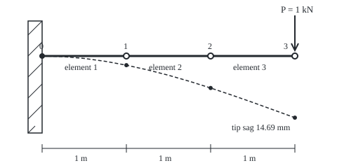

# Finite elements: cut the shape into pieces and solve one stiffness matrix

[Syllabus](../../../SYLLABUS.md) → [Engineering mathematics](../README.md) → [Fluids and Heat](../README.md#s08) → Finite elements

---

## General Overview

A steel beam sticks 3 m out of a warehouse wall over a loading bay. It is built solidly into the wall at one end and free at the other: a **cantilever**. A chain hoist hangs from its tip and lifts a 102.0 kg crate, a load of 1000 N (1 kN). The beam is the 120 mm deep I-section from [Stress, strain and bending](../07-Mechanics%20and%20Structures/07-stress-strain-and-beam-bending.md).

The engineer wants one number: how far does the tip drop? The design here allows span/180, which is 16.67 mm.

This beam has a textbook formula. A wing, a car door or a boiler bracket does not. The finite element method handles all of them the same way. Cut the shape into a few simple pieces, called **elements**, joined at points called **nodes**. Work out, once, how one piece pushes back when its ends move. Add those pieces up into one big table of push-backs, the **stiffness matrix**. Fix whatever is held, put on the loads, and solve one linear system. Here three 1 m elements give a tip drop of 14.69 mm, under the limit. With the beam's own weight added it is 16.32 mm, still under.

**Cut the structure into pieces whose behaviour is known exactly, add each piece's stiffness into one matrix wherever pieces share a node, fix the supports, and solve K u = F for how every node moves.**

**What kind of fact this is:** a method. For this beam, the answer at the nodes is exact; that is a theorem, proved on this card in Why it works. For a general shape the method gives an approximation that improves as the pieces shrink, and this card only states that.

### The picture: the cantilever in three pieces

<p align="center"></p>

To scale: 120 px per metre along the beam, and 6 px per millimetre of drop, so the bend is greatly exaggerated. The dots on the dashed curve are the three free nodes, the only places the method computes directly.

### The four steps


---

## The formula

Each node can move in two ways: drop by a distance $v$ (positive down) and turn by a small angle $\theta$, the slope of the beam there. One element with end nodes 1 and 2 therefore has four end movements, $(v_1, \theta_1, v_2, \theta_2)$. Its **element stiffness matrix** $k$ gives the four end forces and moments that hold it in that shape:

$$
\begin{pmatrix} F_1 \\ M_1 \\ F_2 \\ M_2 \end{pmatrix}
= \frac{EI}{\ell^3}
\begin{pmatrix}
12 & 6\ell & -12 & 6\ell \\
6\ell & 4\ell^2 & -6\ell & 2\ell^2 \\
-12 & -6\ell & 12 & -6\ell \\
6\ell & 2\ell^2 & -6\ell & 4\ell^2
\end{pmatrix}
\begin{pmatrix} v_1 \\ \theta_1 \\ v_2 \\ \theta_2 \end{pmatrix}
$$

**Read it aloud:** the forces at a piece's ends are its bending stiffness over its length cubed, times a fixed table of numbers, times how its ends have moved.

Adding every element's $k$ into the rows and columns of its own two nodes gives the whole structure's stiffness matrix $K$, and

$$K\,u = F, \qquad u = (v_1, \theta_1, v_2, \theta_2, v_3, \theta_3), \qquad F = (0, 0, 0, 0, P, 0).$$

**Read it aloud:** the whole beam's stiffness times the list of every node's movement equals the list of loads put on the nodes.

The wall node is left out of $u$ because it cannot move. Solving $K u = F$ is the job of [Solving A x = b](../../03-Algebra/05-Solving%20Systems/01-matrix-equation-ax-b.md); the code here uses Gaussian elimination written out.

| Symbol | Plain meaning | In our example | Push it up and the answer… |
| --- | --- | --- | --- |
| $P$ | load at the tip, N | 1000 N | every movement grows in proportion |
| $L$, $x$ | length of the cantilever, and distance from the wall, m | $L$ = 3 m | tip drop grows as $L^3$ |
| $\ell$, $s$ | length of one element, m; $s = x/\ell$, position along one element, 0 to 1 | $\ell$ = 1 m | at the nodes, nothing here: the answer is exact for any $\ell$ |
| $E$, $I$, $EI$ | Young's modulus, second moment of area, and their product, the bending stiffness, N m² | 200 GPa, 306.31 cm⁴, 612626 N m² | every movement shrinks |
| $v$, $\theta$ | drop of a node (m, down positive) and its slope (rad) | tip: 14.69 mm, 0.007345 rad | — |
| $k$ | element stiffness matrix: end forces per unit end movement | the 4 by 4 above, units of $EI/\ell^3$ = 612626 N/m | — |
| $K$ | the assembled stiffness matrix of the whole beam | 6 by 6 after the wall is fixed | — |
| $u$, $d$ | list of all free node movements; $d$, the four end movements of one element | 6 numbers; 4 numbers | — |
| $F$; $F_1, M_1, F_2, M_2$ | list of loads on the free nodes; the end forces (N) and moments (N m) of one element | $P$ at the tip, zeros elsewhere | $u$ grows in proportion |
| $N_1 \dots N_4$ | shape functions: the four cubic curves an element can be bent into | used in Why it works | — |
| $w$ | the beam's own weight per metre, N/m | 98.46 N/m | adds $wL^4/8EI$ to the tip |
| $M$, $W$, $c$, $\sigma$ | bending moment (N m); section modulus $I/c$ (m³), with $c$ the distance to the outer face; bending stress (Pa) | at the wall $M$ = 3000 N m, $W$ = 51.05 cm³, $c$ = half the 120 mm depth, $\sigma$ = 58.76 MPa | stress grows with $P$ and $L$ |

### When it holds

- **Linear elastic steel.** $K$ is a fixed matrix only while stress stays in proportion to strain. Counting the tip load alone, without the beam's own weight, it yields at a tip load of 4680 N. At 10000 N the method still reports 146.9 mm and 588 MPa, but the steel is past the 275 MPa yield stress of grade S275 (EN 1993-1-1, Table 3.1, cited on [Stress, strain and bending](../07-Mechanics%20and%20Structures/07-stress-strain-and-beam-bending.md)) and both numbers are wrong.
- **Small slopes.** The tip turns 0.007345 rad, well under a degree, so treating slope as the angle is safe. A fishing rod bent into a curve breaks this, and the matrix must be rebuilt as the shape changes.
- **Loads put on the nodes the right way.** Between nodes this beam carries no load, so its true shape on each piece is a cubic, and the element's cubics contain it: the nodes are exact. A spread load such as the beam's own weight bends each piece into a quartic instead. It goes onto the nodes as **consistent loads** (the four end loads $\int_0^\ell w\,N_i\,dx$, which do the same work on the element's shapes as the spread load): $w\ell/2$, $w\ell^2/12$, $w\ell/2$, $-w\ell^2/12$ per element. With them a beam's node answers stay exact, 1.627 mm, and only the cubic between nodes approximates the quartic. Putting the weight on as plain forces drops the end moments $\pm w\ell^2/12$ and gives 1.687 mm.
- **A rigid wall.** The model fixes both the drop and the slope at the wall. A real bolted end plate lets the beam turn a little, which adds drop the model misses.
- **A slender beam.** The elements use the bending equation from [Stress, strain and bending](../07-Mechanics%20and%20Structures/07-stress-strain-and-beam-bending.md), which ignores shear. A 3 m beam that is 0.12 m deep is slender enough.

---

## Why it works

### Step 0: a piece only has to know how its ends push back

Cut the beam at a node. The two pieces meeting there each push on the node with some force and twist it with some moment. The node is still, so those pushes plus the outside load add to zero. If each piece's push is known in terms of how its ends moved, every node gives one equation, and the whole structure becomes a linear system. That is the method. Everything else is finding the pushes.

### Step 1: an unloaded piece of beam bends into a cubic

The beam card gives $EI\,v'' = -M(x)$: curvature is moment over bending stiffness. With no load between its ends, the moment along a piece changes in a straight line, so $v''$ is a straight line and $v$ is a cubic. A cubic has four coefficients, and four end values fix it: $v_1, \theta_1, v_2, \theta_2$.

Write $s = x/\ell$ for the position along the element, 0 at the left end and 1 at the right. The four **shape functions** are the cubics that are 1 in one end value and 0 in the other three:

$$N_1 = 1 - 3s^2 + 2s^3,\quad N_2 = \ell(s - 2s^2 + s^3),\quad N_3 = 3s^2 - 2s^3,\quad N_4 = \ell(s^3 - s^2).$$

Any shape of the element is $v = N_1 v_1 + N_2 \theta_1 + N_3 v_2 + N_4 \theta_2$.

### Step 2: the stiffness matrix comes from the stored energy

A bent beam stores energy $\tfrac12 \int EI\,(v'')^2\,dx$. Put the element's cubic in, and the energy becomes $\tfrac12 d^{\mathsf T} k\, d$, where $d$ is the list of four end values and the entry in row $i$, column $j$ of $k$ is

$$k_{ij} = \int_0^\ell EI\,N_i''\,N_j''\,dx.$$

One entry by hand: $N_1'' = (-6 + 12s)/\ell^2$, so $k_{11} = \dfrac{EI}{\ell^3}\int_0^1 (12s - 6)^2\,ds = \dfrac{EI}{\ell^3}\cdot 12$. The other fifteen follow the same way and give the matrix in The formula. The code computes all sixteen by numerical integration and checks them against the table.

Each column has a physical reading. Column 1 is the set of end forces and moments needed to drop the left end by 1 m while holding the other three end values at zero.

### Step 3: assembly is adding, because energies add

The beam's total energy is the sum of its elements' energies. Node 1 belongs to element 1 (as its right end) and element 2 (as its left end), so its movements appear in both, and their entries add. Node 1's up-down diagonal entry is $12 + 12 = 24$. Its turning diagonal entry is $4 + 4 = 8$. The coupling between its drop and its turn is $-6 + 6 = 0$. The loads do work $F^{\mathsf T} u$. The beam settles where the total, $\tfrac12 u^{\mathsf T} K u - F^{\mathsf T} u$, is least, and setting its slope to zero gives $K u = F$. The same equation is the force balance of Step 0, node by node.

### Step 4: supports make the matrix solvable

Before the wall is fixed, $K$ is 8 by 8 and has no inverse. Lift the whole beam 1 m without bending it, or turn it as a rigid stick: $K$ times either movement is 0 N, so no force resists it, and a load would push the beam away without limit. Fixing $v_0 = \theta_0 = 0$ removes those two rows and columns. What is left, 6 by 6, has an inverse, and the solve gives one answer.

### Step 5: why the nodes are exact here, and not in general

The loads act only at nodes, so the true shape on each piece is a cubic (Step 1), which is one of the shapes the element can take. Among all the shapes built from these pieces, the method picks the one of least total energy. The true shape is among them and is the least of all, so the method returns it. That is why one, two, three or six elements all give 14.6909 mm at the tip.

For a plate, a solid or a heat-conducting fin, the true shape is not a polynomial on each piece. The method then returns the best shape the pieces allow, measured by energy, and that best shape closes in on the truth as the pieces shrink. How fast it closes in is the subject of [Assembly and error](../../16-Numerical%20analysis/07-PDE%20Solvers/08-finite-element-assembly-and-error.md).

### The contrast: finite differences

[Finite differences](../../08-Differential%20equations%20and%20dynamics/07-Series%20Solutions%20and%20Boundary%20Problems/07-finite-differences-for-boundary-problems.md) replace each derivative at a grid point by a difference of neighbouring values. Finite elements replace the shape itself by simple pieces, and for this tip-loaded beam they keep the physics exact on each piece. On the same three 1 m pieces, finite differences give a tip drop of 15.51 mm against the true 14.69 mm. Their error falls as the spacing squared: 14.6990 mm with 30 steps, 14.6909 mm with 300. Finite elements also bend to any shape of mesh, which a regular grid cannot.

### What this outline leaves out

Triangles, bricks and curved elements; the general recipe for turning any differential equation into element matrices (the weak form); building meshes; error bounds; and solvers for matrices with millions of rows. [Continuity and Bernoulli](01-continuity-and-bernoulli.md) and [Assembly and error](../../16-Numerical%20analysis/07-PDE%20Solvers/08-finite-element-assembly-and-error.md) take these up. The mathematics of convergence belongs to the partial differential equations wing, and large sparse solvers to the numerical analysis wing.

---

## Worked numbers, by hand

| Step | Arithmetic | Value |
| --- | --- | --- |
| bending stiffness | $EI \approx$ 200 GPa × 306.31 cm⁴ | 612626 N m² |
| one element, $\ell$ = 1 m | $EI/\ell^3$ | 612626 N/m |
| first row of $k$ | in units of $EI/\ell^3$ | 12, 6, −12, 6 |
| node 1, shared by elements 1 and 2 | drop 12 + 12, turn 4 + 4, coupling −6 + 6 | 24, 8, 0 |
| free $K$, units $EI/\ell^3$ | rows listed below | 6 by 6 |
| unit of movement | $P\ell^3/EI$ = 1000 / 612626 m | 1.6323 mm |
| solve $Ku = F$ | $u$ in units of $P\ell^3/EI$ | 1.3333, 2.5000, 4.6667, 4.0000, 9.0000, 4.5000 |
| check row 1 (node 1 drop) | 24 × 1.3333 − 12 × 4.6667 + 6 × 4.0000 = 32 − 56 + 24 | 0 P |
| check row 5 (tip drop) | −56 − 24 + 12 × 9.0000 − 6 × 4.5000 = −56 − 24 + 108 − 27 | 1 P |
| tip drop | 9.0000 × 1.6323 mm | **14.69 mm** |
| against the formula | $PL^3/3EI$ | 14.69 mm |
| own weight added | $wL^4/8EI$ = 1.627 mm | 16.32 mm, limit 16.67 mm |
| stress at the wall | $PL/W$ = 3000 N m / 51.05 cm³ | 58.76 MPa |

The six free rows of $K$, in units of $EI/\ell^3$, ordered $v_1, \theta_1, v_2, \theta_2, v_3, \theta_3$:

```
 24   0  -12   6    0   0
  0   8   -6   2    0   0
-12  -6   24   0  -12   6
  6   2    0   8   -6   2
  0   0  -12  -6   12  -6
  0   0    6   2   -6   4
```

Check rows 1 and 5 equal the loads, 0 and $P$: the solve is right. The tip drops 14.69 mm under the crate and 16.32 mm with the beam's own weight, inside the 16.67 mm limit, and under the crate alone the steel at the wall works at 58.76 MPa, far below yield. The hoist beam passes, and drop, not strength, is the tighter limit.

### What breaks if you drop a piece

| Mistake | Comes out at | What went wrong |
| --- | --- | --- |
| No supports | $K$ × rigid lift = 0.0 N, no answer | Nothing holds the beam, so $K$ has no inverse |
| Assemble by overwriting, not adding | tip −3.26 mm, rising | Node 1 and node 2 lose one element's stiffness each |
| Own weight lumped as nodal forces only | 1.687 mm against 1.627 mm | The end moments $\pm w\ell^2/12$ of each element are dropped |
| Finite differences on the same 3 pieces | 15.51 mm against 14.69 mm | Differences approximate the derivatives; elements keep each piece exact |
| Load past yield, 10000 N | 146.9 mm, 588 MPa | Yield is at 4680 N; beyond it $K$ no longer describes the steel |

---

## Code, from first principles, and it actually runs

The code builds the element matrix from the formula, then again by integrating $EI\,N_i''\,N_j''$ by Simpson's rule (a weighted sum of the integrand at evenly spaced points), and checks the two agree. It assembles $K$, fixes the wall and solves by Gaussian elimination. The tip drop is then reached four independent ways: the elements; the closed form $PL^3/3EI$; an energy integral of the bending moment, by Simpson's rule; and finite differences on 300 steps. It also checks the wall reactions against the load, repeats the solve with 1, 2 and 6 elements, and prints every number on the card.

### Python

```python
# Finite elements in outline -- the check behind the card.  Standard library only.
# A 3 m steel cantilever (the 120 mm I) holds 1 kN at its tip.  Cut it into three
# 1 m beam elements, assemble one stiffness matrix, fix the wall, solve K u = F.
L, NE, P, E, G, RHO = 3.0, 3, 1000.0, 200e9, 9.80665, 7850.0  # m, pieces, N, Pa, m/s^2, kg/m^3
SIGMA_Y = 275e6                                               # S275 yield stress, Pa
h, b, tf, tw = 120.0, 64.0, 6.3, 4.4                          # the 120 mm I, mm
I = (2 * (b * tf**3 / 12 + b * tf * ((h - tf) / 2) ** 2) + tw * (h - 2 * tf) ** 3 / 12) * 1e-12
EI, W = E * I, I / (h / 2 * 1e-3)                             # N m^2, section modulus m^3
w_self = (2 * b * tf + (h - 2 * tf) * tw) * 1e-6 * RHO * G    # own weight, N per m

def k_formula(le):             # element stiffness, unknowns (v1, th1, v2, th2): road 1
    a, l = EI / le**3, le
    return [[12*a, 6*l*a, -12*a, 6*l*a], [6*l*a, 4*l*l*a, -6*l*a, 2*l*l*a],
            [-12*a, -6*l*a, 12*a, -6*l*a], [6*l*a, 2*l*l*a, -6*l*a, 4*l*l*a]]

def curv(s, le):               # second derivatives of the four cubic shape functions
    return [(-6 + 12*s) / le**2, (-4 + 6*s) / le, (6 - 12*s) / le**2, (-2 + 6*s) / le]

def k_energy(le, n=100):       # road 2: k_ij = integral of EI N_i'' N_j'' dx, by Simpson
    k = [[0.0] * 4 for _ in range(4)]
    for m in range(n + 1):
        wt, c = (1 if m in (0, n) else 4 if m % 2 else 2) * le / n / 3, curv(m / n, le)
        for i in range(4):
            for j in range(4):
                k[i][j] += wt * EI * c[i] * c[j]
    return k

def assemble(ne, le, add=True):  # each element adds its 4x4 block at its two nodes
    n = 2 * (ne + 1)
    K, ke = [[0.0] * n for _ in range(n)], k_formula(le)
    for e in range(ne):
        for i in range(4):
            for j in range(4):
                K[2*e+i][2*e+j] = (K[2*e+i][2*e+j] if add else 0.0) + ke[i][j]
    return K

def solve(A, rhs):             # Gaussian elimination with row swaps, then back substitution
    n = len(rhs)
    M = [A[i][:] + [rhs[i]] for i in range(n)]
    for c in range(n):
        p = max(range(c, n), key=lambda r: abs(M[r][c]))
        M[c], M[p] = M[p], M[c]
        for r in range(c + 1, n):
            f = M[r][c] / M[c][c]
            M[r] = [M[r][k] - f * M[c][k] for k in range(n + 1)]
    x = [0.0] * n
    for i in range(n - 1, -1, -1):
        x[i] = (M[i][n] - sum(M[i][k] * x[k] for k in range(i + 1, n))) / M[i][i]
    return x

def fem(ne, loads, add=True):  # fix the wall (drop v0, th0), solve for the free 2*ne
    K = assemble(ne, L / ne, add)
    return [0.0, 0.0] + solve([row[2:] for row in K[2:]], loads[2:]), K

def fd_tip(n):                 # finite differences on v'' = P(L - x)/EI, ghost point at the wall
    hh, v = L / n, [0.0, 0.0]
    v[1] = hh * hh * P * L / EI / 2
    for i in range(1, n):
        v.append(2 * v[i] - v[i - 1] + hh * hh * P * (L - i * hh) / EI)
    return v[n]

def exact(x): return P * x * x * (3 * L - x) / (6 * EI)        # closed-form sag, m
def tip_load(ne): return [0.0] * (2 * ne) + [P, 0.0]

print(f"cantilever: {L:.0f} m, 120 mm I, I = {I * 1e8:.2f} cm^4, EI = {EI:.0f} N m^2, tip load {P:.0f} N = {P / G:.1f} kg")
ke, k2 = k_formula(1.0), k_energy(1.0)
print("element k for 1 m, in units of EI/m^3:", " ".join(f"{ke[0][j] / EI:.0f}" for j in range(4)),
      "|", " ".join(f"{ke[1][j] / EI:.0f}" for j in range(4)))
assert max(abs(ke[i][j] - k2[i][j]) for i in range(4) for j in range(4)) < 1e-9 * EI
u, K = fem(NE, tip_load(NE))
print("assembled K, free rows, units EI/m^3:")
for row in K[2:]:
    print("  " + "".join(f"{x / EI:6.0f}" for x in row[2:]))
print(f"u in units of P m^3/EI = {P / EI * 1e3:.4f} mm:", " ".join(f"{x * EI / P:.4f}" for x in u[2:]))
for r in (2, 6):                               # two rows of K u = F, term by term
    print(f"row {r - 1} of K u:", " ".join(f"{K[r][c] * u[c] / P:+.0f}" for c in range(2, len(u)) if K[r][c]),
          f"= {round(sum(K[r][c] * u[c] for c in range(len(u))) / P)} P")
for i in range(1, NE + 1):
    print(f"node {i} at {i * L / NE:.2f} m: sag {u[2*i] * 1e3:6.3f} mm, slope {u[2*i+1]:.6f} rad,"
          f" exact {exact(i * L / NE) * 1e3:6.3f} mm")
tip = u[2 * NE]
d_energy, nn = 0.0, 300                                         # road 3: unit-load integral
for m in range(nn + 1):
    x = m * L / nn
    d_energy += (1 if m in (0, nn) else 4 if m % 2 else 2) * P * (L - x) ** 2 / EI * L / nn / 3
print(f"tip sag: elements {tip * 1e3:.4f} mm, PL^3/3EI {P * L**3 / (3 * EI) * 1e3:.4f} mm,"
      f" energy {d_energy * 1e3:.4f} mm")
assert abs(tip - P * L**3 / (3 * EI)) < 1e-9 and abs(d_energy - tip) < 1e-9
assert max(abs(u[2*i] - exact(i * L / NE)) for i in range(NE + 1)) < 1e-12
fw = [sum(K[r][c] * u[c] for c in range(len(u))) for r in range(2)]
print(f"wall reaction from K u: {-fw[0]:.1f} N up, {-fw[1]:.1f} N m; W = {W * 1e6:.2f} cm^3, stress at wall {-fw[1] / W / 1e6:.2f} MPa")
assert abs(-fw[0] - P) < 1e-6 and abs(-fw[1] - P * L) < 1e-6
for ne in (1, 2, 6):
    print(f"elements: {ne}, tip {fem(ne, tip_load(ne))[0][2 * ne] * 1e3:.4f} mm")
for n in (3, 30, 300):
    print(f"finite differences, {n} steps: tip {fd_tip(n) * 1e3:.4f} mm")
assert abs(fd_tip(300) - tip) / tip < 1e-4 and 0.01 < abs(fd_tip(3) - tip) / tip
def weight_tips(ne):           # own weight w per metre: consistent loads, and nodal forces only
    le, fq = L / ne, [0.0] * (2 * ne + 2)
    fl = fq[:]
    for e in range(ne):
        for i, f in enumerate((w_self * le / 2, w_self * le * le / 12, w_self * le / 2, -w_self * le * le / 12)):
            fq[2 * e + i] += f
        fl[2 * e] += w_self * le / 2
        fl[2 * e + 2] += w_self * le / 2
    return fem(ne, fq)[0][2 * ne], fem(ne, fl)[0][2 * ne]
le, (uw, ul) = L / NE, weight_tips(NE)
uw_exact = w_self * L**4 / (8 * EI)
print(f"own weight {w_self:.2f} N/m: tip {uw * 1e3:.3f} mm (consistent loads), exact wL^4/8EI {uw_exact * 1e3:.3f} mm")
assert abs(uw - uw_exact) < 1e-12
print(f"total tip {(tip + uw) * 1e3:.2f} mm against limit L/180 = {L / 180 * 1e3:.2f} mm")
rigid = [1.0, 0.0] * (NE + 1)
spin = [v for i in range(NE + 1) for v in (i * le, 1.0)]
for name, z in (("lift", rigid), ("spin", spin)):
    print(f"wrong: no supports, K times rigid {name} = {max(abs(sum(r[c] * z[c] for c in range(len(z)))) for r in K):.1f} N")
u_over = fem(NE, tip_load(NE), add=False)[0][2 * NE]
print(f"wrong: assembled by overwriting, not adding: tip {u_over * 1e3:.2f} mm")
print(f"wrong: own weight lumped as nodal forces only: tip {ul * 1e3:.3f} mm against {uw_exact * 1e3:.3f} mm")
print(f"wrong: finite differences on the same 3 pieces: tip {fd_tip(3) * 1e3:.2f} mm")
assert u_over < 0 < tip and abs(ul - uw_exact) > 0.02 * uw_exact
P_y = SIGMA_Y * W / L
print(f"outside the model: yield at P = {P_y:.0f} N; at 10000 N it says {10000 * L**3 / (3 * EI) * 1e3:.1f} mm,"
      f" {10000 * L / W / 1e6:.0f} MPa")
print(f"try: 5000 N tip {5 * tip * 1e3:.2f} mm, {5000 * L / W / 1e6:.0f} MPa;"
      f" L = 4 m tip {P * 64 / (3 * EI) * 1e3:.2f} mm against {4 / 180 * 1e3:.2f} mm;"
      f" 6 elements, own weight lumped {weight_tips(6)[1] * 1e3:.3f} mm")
print("figure, 120 px/m, 6 px/mm, sag px at 0.25 m steps:",
      " ".join(f"{exact(0.25 * k) * 6e3:.1f}" for k in range(13)))
print("ALL CHECKS PASS")
```

**Ran 2026-11-11 on macOS, Python 3.14.10, standard library only. All checks passed. Output, pasted from the run:**

```
cantilever: 3 m, 120 mm I, I = 306.31 cm^4, EI = 612626 N m^2, tip load 1000 N = 102.0 kg
element k for 1 m, in units of EI/m^3: 12 6 -12 6 | 6 4 -6 2
assembled K, free rows, units EI/m^3:
      24     0   -12     6     0     0
       0     8    -6     2     0     0
     -12    -6    24     0   -12     6
       6     2     0     8    -6     2
       0     0   -12    -6    12    -6
       0     0     6     2    -6     4
u in units of P m^3/EI = 1.6323 mm: 1.3333 2.5000 4.6667 4.0000 9.0000 4.5000
row 1 of K u: +32 -56 +24 = 0 P
row 5 of K u: -56 -24 +108 -27 = 1 P
node 1 at 1.00 m: sag  2.176 mm, slope 0.004081 rad, exact  2.176 mm
node 2 at 2.00 m: sag  7.617 mm, slope 0.006529 rad, exact  7.617 mm
node 3 at 3.00 m: sag 14.691 mm, slope 0.007345 rad, exact 14.691 mm
tip sag: elements 14.6909 mm, PL^3/3EI 14.6909 mm, energy 14.6909 mm
wall reaction from K u: 1000.0 N up, 3000.0 N m; W = 51.05 cm^3, stress at wall 58.76 MPa
elements: 1, tip 14.6909 mm
elements: 2, tip 14.6909 mm
elements: 6, tip 14.6909 mm
finite differences, 3 steps: tip 15.5070 mm
finite differences, 30 steps: tip 14.6990 mm
finite differences, 300 steps: tip 14.6909 mm
own weight 98.46 N/m: tip 1.627 mm (consistent loads), exact wL^4/8EI 1.627 mm
total tip 16.32 mm against limit L/180 = 16.67 mm
wrong: no supports, K times rigid lift = 0.0 N
wrong: no supports, K times rigid spin = 0.0 N
wrong: assembled by overwriting, not adding: tip -3.26 mm
wrong: own weight lumped as nodal forces only: tip 1.687 mm against 1.627 mm
wrong: finite differences on the same 3 pieces: tip 15.51 mm
outside the model: yield at P = 4680 N; at 10000 N it says 146.9 mm, 588 MPa
try: 5000 N tip 73.45 mm, 294 MPa; L = 4 m tip 34.82 mm against 22.22 mm; 6 elements, own weight lumped 1.642 mm
figure, 120 px/m, 6 px/mm, sag px at 0.25 m steps: 0.0 0.9 3.5 7.6 13.1 19.8 27.5 36.2 45.7 55.8 66.3 77.2 88.1
ALL CHECKS PASS
```

### Rust

Same numbers, same labels, built with `rustc --edition 2021 -O`.

```rust
// Finite elements in outline -- the same check as the Python, in Rust.  No crates.
// A 3 m steel cantilever (the 120 mm I) holds 1 kN at its tip.  Cut it into three
// 1 m beam elements, assemble one stiffness matrix, fix the wall, solve K u = F.
const L: f64 = 3.0; const NE: usize = 3; const P: f64 = 1000.0; const E: f64 = 200e9;
const G: f64 = 9.80665; const RHO: f64 = 7850.0; const SIGMA_Y: f64 = 275e6;
const H: f64 = 120.0; const B: f64 = 64.0; const TF: f64 = 6.3; const TW: f64 = 4.4; // mm

fn ei() -> f64 {
    let i = 2.0 * (B * TF.powi(3) / 12.0 + B * TF * ((H - TF) / 2.0).powi(2)) + TW * (H - 2.0 * TF).powi(3) / 12.0;
    E * i * 1e-12
}
fn k_formula(le: f64) -> Vec<Vec<f64>> {     // element stiffness, unknowns (v1, th1, v2, th2): road 1
    let (a, l) = (ei() / le.powi(3), le);
    vec![vec![12.0*a, 6.0*l*a, -12.0*a, 6.0*l*a], vec![6.0*l*a, 4.0*l*l*a, -6.0*l*a, 2.0*l*l*a],
         vec![-12.0*a, -6.0*l*a, 12.0*a, -6.0*l*a], vec![6.0*l*a, 2.0*l*l*a, -6.0*l*a, 4.0*l*l*a]]
}
fn curv(s: f64, le: f64) -> [f64; 4] {        // second derivatives of the four cubic shape functions
    [(-6.0 + 12.0*s) / le.powi(2), (-4.0 + 6.0*s) / le, (6.0 - 12.0*s) / le.powi(2), (-2.0 + 6.0*s) / le]
}
fn simpson_w(m: usize, n: usize) -> f64 { if m == 0 || m == n { 1.0 } else if m % 2 == 1 { 4.0 } else { 2.0 } }
fn k_energy(le: f64, n: usize) -> Vec<Vec<f64>> { // road 2: k_ij = integral of EI N_i'' N_j'' dx
    let mut k = vec![vec![0.0; 4]; 4];
    for m in 0..=n {
        let (wt, c) = (simpson_w(m, n) * le / n as f64 / 3.0, curv(m as f64 / n as f64, le));
        for i in 0..4 { for j in 0..4 { k[i][j] += wt * ei() * c[i] * c[j]; } }
    }
    k
}
fn assemble(ne: usize, le: f64, add: bool) -> Vec<Vec<f64>> { // each element adds its 4x4 block
    let n = 2 * (ne + 1);
    let (mut k, ke) = (vec![vec![0.0; n]; n], k_formula(le));
    for e in 0..ne { for i in 0..4 { for j in 0..4 {
        k[2*e+i][2*e+j] = (if add { k[2*e+i][2*e+j] } else { 0.0 }) + ke[i][j];
    } } }
    k
}
fn solve(a: &Vec<Vec<f64>>, rhs: &[f64]) -> Vec<f64> { // Gaussian elimination with row swaps
    let n = rhs.len();
    let mut m: Vec<Vec<f64>> = (0..n).map(|i| { let mut r = a[i].clone(); r.push(rhs[i]); r }).collect();
    for c in 0..n {
        let mut p = c;
        for r in c..n { if m[r][c].abs() > m[p][c].abs() { p = r; } }
        m.swap(c, p);
        for r in c + 1..n {
            let f = m[r][c] / m[c][c];
            m[r] = (0..=n).map(|k| m[r][k] - f * m[c][k]).collect();
        }
    }
    let mut x = vec![0.0; n];
    for i in (0..n).rev() {
        let mut s = 0.0;
        for k in i + 1..n { s += m[i][k] * x[k]; }
        x[i] = (m[i][n] - s) / m[i][i];
    }
    x
}
fn fem(ne: usize, loads: &[f64], add: bool) -> (Vec<f64>, Vec<Vec<f64>>) { // fix the wall, solve
    let k = assemble(ne, L / ne as f64, add);
    let free: Vec<Vec<f64>> = k[2..].iter().map(|r| r[2..].to_vec()).collect();
    let mut u = vec![0.0, 0.0];
    u.extend(solve(&free, &loads[2..]));
    (u, k)
}
fn fd_tip(n: usize) -> f64 {                  // finite differences on v'' = P(L - x)/EI, ghost point
    let hh = L / n as f64;
    let mut v = vec![0.0, hh * hh * P * L / ei() / 2.0];
    for i in 1..n { let nv = 2.0 * v[i] - v[i - 1] + hh * hh * P * (L - i as f64 * hh) / ei(); v.push(nv); }
    v[n]
}
fn exact(x: f64) -> f64 { P * x * x * (3.0 * L - x) / (6.0 * ei()) }
fn tip_load(ne: usize) -> Vec<f64> { let mut f = vec![0.0; 2 * ne + 2]; f[2 * ne] = P; f }

fn main() {
    let ei = ei();
    let i_m4 = ei / E;
    let w = i_m4 / (H / 2.0 * 1e-3);
    let w_self = (2.0 * B * TF + (H - 2.0 * TF) * TW) * 1e-6 * RHO * G;
    println!("cantilever: {:.0} m, 120 mm I, I = {:.2} cm^4, EI = {:.0} N m^2, tip load {:.0} N = {:.1} kg", L, i_m4 * 1e8, ei, P, P / G);
    let (ke, k2) = (k_formula(1.0), k_energy(1.0, 100));
    let r0: Vec<String> = (0..4).map(|j| format!("{:.0}", ke[0][j] / ei)).collect();
    let r1: Vec<String> = (0..4).map(|j| format!("{:.0}", ke[1][j] / ei)).collect();
    println!("element k for 1 m, in units of EI/m^3: {} | {}", r0.join(" "), r1.join(" "));
    let mut dk: f64 = 0.0;
    for i in 0..4 { for j in 0..4 { dk = dk.max((ke[i][j] - k2[i][j]).abs()); } }
    assert!(dk < 1e-9 * ei);
    let (u, k) = fem(NE, &tip_load(NE), true);
    println!("assembled K, free rows, units EI/m^3:");
    for row in &k[2..] { println!("  {}", row[2..].iter().map(|x| format!("{:6.0}", x / ei)).collect::<String>()); }
    println!("u in units of P m^3/EI = {:.4} mm: {}", P / ei * 1e3, u[2..].iter().map(|x| format!("{:.4}", x * ei / P)).collect::<Vec<_>>().join(" "));
    for r in [2, 6] {                          // two rows of K u = F, term by term
        let terms: Vec<String> = (2..u.len()).filter(|&c| k[r][c] != 0.0).map(|c| format!("{:+.0}", k[r][c] * u[c] / P)).collect();
        let mut s = 0.0;
        for c in 0..u.len() { s += k[r][c] * u[c]; }
        println!("row {} of K u: {} = {} P", r - 1, terms.join(" "), (s / P).round() as i64);
    }
    for i in 1..=NE {
        let x = i as f64 * L / NE as f64;
        println!("node {} at {:.2} m: sag {:6.3} mm, slope {:.6} rad, exact {:6.3} mm", i, x, u[2*i] * 1e3, u[2*i+1], exact(x) * 1e3);
    }
    let tip = u[2 * NE];
    let (mut d_energy, nn) = (0.0, 300);       // road 3: unit-load integral
    for m in 0..=nn {
        let x = m as f64 * L / nn as f64;
        d_energy += simpson_w(m, nn) * P * (L - x).powi(2) / ei * L / nn as f64 / 3.0;
    }
    println!("tip sag: elements {:.4} mm, PL^3/3EI {:.4} mm, energy {:.4} mm", tip * 1e3, P * L.powi(3) / (3.0 * ei) * 1e3, d_energy * 1e3);
    assert!((tip - P * L.powi(3) / (3.0 * ei)).abs() < 1e-9 && (d_energy - tip).abs() < 1e-9);
    assert!((0..=NE).all(|i| (u[2*i] - exact(i as f64 * L / NE as f64)).abs() < 1e-12));
    let fw: Vec<f64> = (0..2).map(|r| { let mut s = 0.0; for c in 0..u.len() { s += k[r][c] * u[c]; } s }).collect();
    println!("wall reaction from K u: {:.1} N up, {:.1} N m; W = {:.2} cm^3, stress at wall {:.2} MPa", -fw[0], -fw[1], w * 1e6, -fw[1] / w / 1e6);
    assert!((-fw[0] - P).abs() < 1e-6 && (-fw[1] - P * L).abs() < 1e-6);
    for ne in [1, 2, 6] { println!("elements: {}, tip {:.4} mm", ne, fem(ne, &tip_load(ne), true).0[2 * ne] * 1e3); }
    for n in [3, 30, 300] { println!("finite differences, {} steps: tip {:.4} mm", n, fd_tip(n) * 1e3); }
    assert!((fd_tip(300) - tip).abs() / tip < 1e-4 && 0.01 < (fd_tip(3) - tip).abs() / tip);
    let weight_tips = |ne: usize| -> (f64, f64) { // own weight: consistent loads, and nodal forces only
        let le = L / ne as f64;
        let (mut fq, mut fl) = (vec![0.0; 2 * ne + 2], vec![0.0; 2 * ne + 2]);
        for e in 0..ne {
            let parts = [w_self * le / 2.0, w_self * le * le / 12.0, w_self * le / 2.0, -w_self * le * le / 12.0];
            for i in 0..4 { fq[2 * e + i] += parts[i]; }
            fl[2 * e] += w_self * le / 2.0;
            fl[2 * e + 2] += w_self * le / 2.0;
        }
        (fem(ne, &fq, true).0[2 * ne], fem(ne, &fl, true).0[2 * ne])
    };
    let (le, (uw, ul)) = (L / NE as f64, weight_tips(NE));
    let uw_exact = w_self * L.powi(4) / (8.0 * ei);
    println!("own weight {:.2} N/m: tip {:.3} mm (consistent loads), exact wL^4/8EI {:.3} mm", w_self, uw * 1e3, uw_exact * 1e3);
    assert!((uw - uw_exact).abs() < 1e-12);
    println!("total tip {:.2} mm against limit L/180 = {:.2} mm", (tip + uw) * 1e3, L / 180.0 * 1e3);
    let rigid: Vec<f64> = (0..=NE).flat_map(|_| [1.0, 0.0]).collect();
    let spin: Vec<f64> = (0..=NE).flat_map(|i| [i as f64 * le, 1.0]).collect();
    for (name, z) in [("lift", &rigid), ("spin", &spin)] {
        let mut worst: f64 = 0.0;
        for r in &k { let mut s = 0.0; for c in 0..z.len() { s += r[c] * z[c]; } worst = worst.max(s.abs()); }
        println!("wrong: no supports, K times rigid {} = {:.1} N", name, worst);
    }
    let u_over = fem(NE, &tip_load(NE), false).0[2 * NE];
    println!("wrong: assembled by overwriting, not adding: tip {:.2} mm", u_over * 1e3);
    println!("wrong: own weight lumped as nodal forces only: tip {:.3} mm against {:.3} mm", ul * 1e3, uw_exact * 1e3);
    println!("wrong: finite differences on the same 3 pieces: tip {:.2} mm", fd_tip(3) * 1e3);
    assert!(u_over < 0.0 && 0.0 < tip && (ul - uw_exact).abs() > 0.02 * uw_exact);
    let p_y = SIGMA_Y * w / L;
    println!("outside the model: yield at P = {:.0} N; at 10000 N it says {:.1} mm, {:.0} MPa", p_y, 10000.0 * L.powi(3) / (3.0 * ei) * 1e3, 10000.0 * L / w / 1e6);
    println!("try: 5000 N tip {:.2} mm, {:.0} MPa; L = 4 m tip {:.2} mm against {:.2} mm; 6 elements, own weight lumped {:.3} mm",
             5.0 * tip * 1e3, 5000.0 * L / w / 1e6, P * 64.0 / (3.0 * ei) * 1e3, 4.0 / 180.0 * 1e3, weight_tips(6).1 * 1e3);
    println!("figure, 120 px/m, 6 px/mm, sag px at 0.25 m steps: {}", (0..13).map(|k| format!("{:.1}", exact(0.25 * k as f64) * 6e3)).collect::<Vec<_>>().join(" "));
    println!("ALL CHECKS PASS");
}
```

**Ran 2026-11-11 on macOS, rustc 1.98.1, no crates. All checks passed. Output, pasted from the run:**

```
cantilever: 3 m, 120 mm I, I = 306.31 cm^4, EI = 612626 N m^2, tip load 1000 N = 102.0 kg
element k for 1 m, in units of EI/m^3: 12 6 -12 6 | 6 4 -6 2
assembled K, free rows, units EI/m^3:
      24     0   -12     6     0     0
       0     8    -6     2     0     0
     -12    -6    24     0   -12     6
       6     2     0     8    -6     2
       0     0   -12    -6    12    -6
       0     0     6     2    -6     4
u in units of P m^3/EI = 1.6323 mm: 1.3333 2.5000 4.6667 4.0000 9.0000 4.5000
row 1 of K u: +32 -56 +24 = 0 P
row 5 of K u: -56 -24 +108 -27 = 1 P
node 1 at 1.00 m: sag  2.176 mm, slope 0.004081 rad, exact  2.176 mm
node 2 at 2.00 m: sag  7.617 mm, slope 0.006529 rad, exact  7.617 mm
node 3 at 3.00 m: sag 14.691 mm, slope 0.007345 rad, exact 14.691 mm
tip sag: elements 14.6909 mm, PL^3/3EI 14.6909 mm, energy 14.6909 mm
wall reaction from K u: 1000.0 N up, 3000.0 N m; W = 51.05 cm^3, stress at wall 58.76 MPa
elements: 1, tip 14.6909 mm
elements: 2, tip 14.6909 mm
elements: 6, tip 14.6909 mm
finite differences, 3 steps: tip 15.5070 mm
finite differences, 30 steps: tip 14.6990 mm
finite differences, 300 steps: tip 14.6909 mm
own weight 98.46 N/m: tip 1.627 mm (consistent loads), exact wL^4/8EI 1.627 mm
total tip 16.32 mm against limit L/180 = 16.67 mm
wrong: no supports, K times rigid lift = 0.0 N
wrong: no supports, K times rigid spin = 0.0 N
wrong: assembled by overwriting, not adding: tip -3.26 mm
wrong: own weight lumped as nodal forces only: tip 1.687 mm against 1.627 mm
wrong: finite differences on the same 3 pieces: tip 15.51 mm
outside the model: yield at P = 4680 N; at 10000 N it says 146.9 mm, 588 MPa
try: 5000 N tip 73.45 mm, 294 MPa; L = 4 m tip 34.82 mm against 22.22 mm; 6 elements, own weight lumped 1.642 mm
figure, 120 px/m, 6 px/mm, sag px at 0.25 m steps: 0.0 0.9 3.5 7.6 13.1 19.8 27.5 36.2 45.7 55.8 66.3 77.2 88.1
ALL CHECKS PASS
```

The two outputs match line for line.

> [!TIP]
> **Try changing**
> An assert is a line that stops the program if a number comes out wrong. Guess first, then run it.
> - **Guess first:** do six elements beat three? Set `NE = 6`. The tip is still 14.6909 mm: when the true shape is a cubic on each piece, more pieces add nothing at the nodes. But the lumped own-weight answer moves from 1.687 mm to 1.642 mm, closer to the true 1.627 mm, and the assert that expects a large lumping error stops the program. Smaller pieces fix an approximate load; they cannot improve an exact one.
> - **Guess first:** what does a 5000 N load do? Set `P = 5000.0`. The tip drops 73.45 mm and the wall stress is 294 MPa, past the 275 MPa yield. The code reports both without complaint; only the engineer knows the model has left its range.
> - **Guess first:** what does a 4 m beam need? Set `L = 4.0`. The tip drops 34.82 mm against a limit of 22.22 mm: drop grows as the cube of length, the limit only in proportion.
> - **Guess first:** what happens if the matrix is overwritten instead of added? In `fem`, change `add=True` to `add=False`. The tip moves up, −3.26 mm, and the assert that compares it with $PL^3/3EI$ stops the program.

---

## The usual mistake

> [!warning]
> **Forgetting the supports.** Without the wall, $K$ times a rigid lift or a rigid turn is 0.0 N: the beam can float away for free, $K$ has no inverse, and a solver either stops on a zero pivot or prints meaningless large numbers. Every model needs enough supports to stop all rigid movement before the solve.
>
> - **Overwriting shared entries instead of adding them.** The tip comes out at −3.26 mm, moving up under a downward load.
> - **Putting a spread load on the nodes as forces only.** The own-weight drop comes out 1.687 mm instead of 1.627 mm; the element end moments carry the rest.
> - **Trusting an exact-looking answer outside the model.** At 10000 N the elements give 146.9 mm and 588 MPa with full precision, for a beam that has already yielded at 4680 N.

---

## Where you meet it in real life

- **Aircraft.** The method grew out of 1950s work on jet aircraft wings, where a skin with stiffeners was cut into triangles and bars and assembled into one stiffness matrix exactly as here (the 1956 paper in Sources).
- **Bridges and buildings.** Frame programs treat every beam and column as elements like the three on this card, with six movements per node in 3D instead of two.
- **Heat in a radiator panel.** Replace drop by temperature and stiffness by heat conductance, and the same assembly gives the temperatures inside a radiator or a boiler wall: [Fourier's law](05-heat-conduction-and-fouriers-law.md) sets the element matrix.
- **Car crashes and implants.** The same four steps run on millions of solid elements, with materials that yield, which is where the linear $K$ of this card is replaced step by step.

> **Say it back**
> Cut the structure into elements joined at nodes. For a beam element, the four end movements fix a cubic shape, and its stored energy gives a 4 by 4 stiffness matrix. Add each element's matrix into one big K wherever elements share a node, fix the supports, and solve K u = F. For the 3 m cantilever with 1 kN at the tip, three elements give 14.69 mm, exactly the formula, because the true shape is a cubic on each piece. For general shapes the answer is approximate and improves as the pieces shrink.

---

## What this builds on

- [Stress, strain and bending](../07-Mechanics%20and%20Structures/07-stress-strain-and-beam-bending.md): the bending equation $EI\,v'' = -M$, the stored energy, and the 120 mm I-section with its 306.31 cm⁴.
- [Solving A x = b](../../03-Algebra/05-Solving%20Systems/01-matrix-equation-ax-b.md): when a square system has exactly one answer, and why a missing support leaves none.
- [Finite differences](../../08-Differential%20equations%20and%20dynamics/07-Series%20Solutions%20and%20Boundary%20Problems/07-finite-differences-for-boundary-problems.md): the grid method this one is contrasted with, and the 300-step check on the tip drop.

## Where this goes next

- Finite elements (planned): triangles and bricks, the weak form that turns any boundary problem into element matrices, and heat as well as stress.
- [Assembly and error](../../16-Numerical%20analysis/07-PDE%20Solvers/08-finite-element-assembly-and-error.md): how big sparse matrices (mostly zeros) are assembled and solved, and how fast the answer improves as the mesh is refined.

This card used elements whose shapes contain the truth; how good the answer is when they do not, and how to tell from the computed numbers alone, is the question it leaves open.

---

## Sources

Verified 2026-11-11: every link below resolves to the publisher's page.

- Cook, Robert D., David S. Malkus, Michael E. Plesha and Robert J. Witt. *Concepts and Applications of Finite Element Analysis*, 4th ed. Wiley, 2001. [Publisher's page](https://www.wiley.com/en-us/Concepts+and+Applications+of+Finite+Element+Analysis%2C+4th+Edition-p-9780471356059). The beam element, its cubic shape functions, assembly, supports and consistent loads.
- Turner, M. J., R. W. Clough, H. C. Martin and L. J. Topp. "Stiffness and Deflection Analysis of Complex Structures." *Journal of the Aeronautical Sciences* 23 (1956): 805–823. [doi:10.2514/8.3664](https://doi.org/10.2514/8.3664). The direct stiffness method: element matrices added into one structure matrix.
- Courant, R. "Variational methods for the solution of problems of equilibrium and vibrations." *Bulletin of the American Mathematical Society* 49 (1943): 1–23. [doi:10.1090/S0002-9904-1943-07818-4](https://doi.org/10.1090/S0002-9904-1943-07818-4). Least energy over piecewise polynomial shapes, the idea behind Step 5.
- Goodno, Barry J., and James M. Gere. *Mechanics of Materials*, 9th ed. Cengage, 2018. [Publisher's page](https://www.cengage.com/c/mechanics-of-materials-9e-goodno-gere/9781337093347). The cantilever formulas $PL^3/3EI$ and $wL^4/8EI$, and steel at E = 200 GPa and 7850 kg/m³.
- NIST. "Standard acceleration of gravity." CODATA recommended values. [NIST page](https://physics.nist.gov/cgi-bin/cuu/Value?gn). The 9.80665 m/s² that turns 1000 N into 102.0 kg and the beam's mass into 98.46 N/m.
