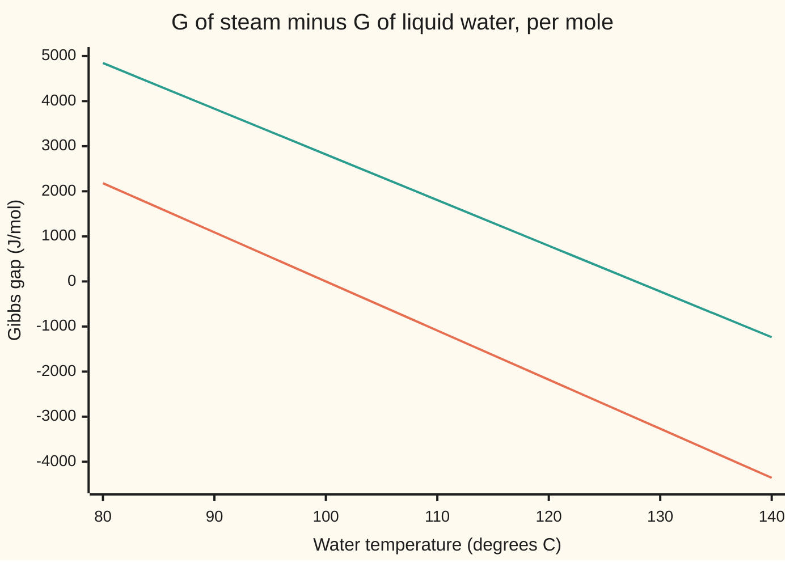
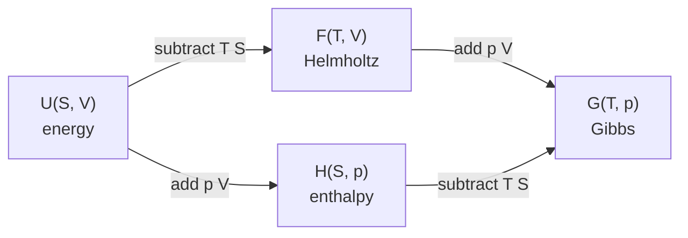

# Free energies: the right potential for each pair of held-fixed variables

[Syllabus](../../../SYLLABUS.md) → [Engineering mathematics](../README.md) → [Fluids and Heat](../README.md#s08) → Free energies

---

## General Overview

A pan of water on a stove at sea level boils at 100 °C. One mole of it (18 g) takes 40.65 kJ of heat to turn into steam. The steam has 108.9 J/K more entropy than the liquid. Entropy, from [The thermodynamic laws](07-thermodynamic-laws-and-entropy.md), is the quantity that heat divided by temperature adds up to.

A central-heating boiler sends water out at 90 °C. An engineer needs to know how far that is from boiling. Boiling inside a boiler's heat exchanger makes a kettle-like rumble and stresses the metal. An open loop at 1 atm has a 10.0 K margin. A sealed loop pressurised to 1.5 bar on its gauge has a 37.8 K margin: it boils at 127.80 °C.

Two questions decide it: why does water boil at one exact temperature, and how does that temperature move with pressure? Energy alone cannot answer, because the steam always holds more. The deciding quantity is the **Gibbs free energy** $`G`$: stored energy, plus the room the substance takes up, minus temperature times entropy. At fixed temperature and pressure, whichever phase has the lower $`G`$ wins. Below 100 °C the liquid's is lower. Above 100 °C the steam's is.

**Each pair of quantities an engineer holds fixed has its own energy-like function that only falls; swapping a variable for its slope builds it, and the equal mixed partials of these functions give the Maxwell relations, which turn entropy changes nobody can measure into pressure and volume changes anybody can.**

**What kind of fact this is:** the free energies are definitions. That $`G`$ only falls, the four Maxwell relations and the Clapeyron slope are theorems, proved on this card from the two laws of thermodynamics. Clausius–Clapeyron, which treats the steam as an ideal gas, is a model: its slope is 1.7% low at 100 °C, and its integrated form is 14.1% high at 300 °C.

### The picture: the Gibbs gap between steam and liquid



Orange: an open pan at 1 atm. Green: the sealed loop at 1.5 bar gauge (251.3 kPa absolute). Above zero the liquid is stable; below zero the water boils. Raising the pressure lifts the steam's Gibbs energy by 2,818 J/mol, so the green line crosses zero 27.80 K later. The chart uses $`\Delta S`$, the entropy gained per mole boiled, at 108.937 J/(mol K): the value that puts the open-pan crossing at exactly 100 °C (Step 4); with the rounded 108.9 the 90 °C gap is +1,103.0 J/mol instead of +1,089.

---

## The formula

Notation first, in words. $`U`$ is the energy stored in the substance. $`S`$ is its entropy, $`T`$ its absolute temperature, $`p`$ its pressure and $`V`$ its volume. A subscript on a partial derivative names what is held fixed: $`(\partial S/\partial V)_T`$ is how fast entropy grows with volume while temperature stays put. The **enthalpy** $`H = U + pV`$ is stored energy plus the work $`pV`$ it took to push the surroundings back to make room.

The four potentials, each built from $`U`$ by swapping a variable for its slope:

```math
F = U - TS, \qquad H = U + pV, \qquad G = U - TS + pV = H - TS
```

Their small changes come from one starting point, $`dU = T\,dS - p\,dV`$:

| Held fixed | Potential | Small change | Maxwell relation | Where it is used |
| --- | --- | --- | --- | --- |
| $`S`$, $`V`$ | $`U`$, energy | $`dU = T\,dS - p\,dV`$ | $`(\partial T/\partial V)_S = -(\partial p/\partial S)_V`$ | a sealed, insulated, rigid box |
| $`S`$, $`p`$ | $`H`$, enthalpy | $`dH = T\,dS + V\,dp`$ | $`(\partial T/\partial p)_S = (\partial V/\partial S)_p`$ | steady flow: turbines, nozzles, pumps |
| $`T`$, $`V`$ | $`F`$, Helmholtz free energy | $`dF = -S\,dT - p\,dV`$ | $`(\partial S/\partial V)_T = (\partial p/\partial T)_V`$ | a rigid tank in a bath |
| $`T`$, $`p`$ | $`G`$, Gibbs free energy | $`dG = -S\,dT + V\,dp`$ | $`-(\partial S/\partial p)_T = (\partial V/\partial T)_p`$ | an open pan, the heating loop, chemistry |

Boiling is where the two phases have equal $`G`$. Along that line the pressure and temperature move together at the **Clapeyron slope**:

```math
\frac{dp}{dT} = \frac{\Delta S}{\Delta v} = \frac{\Delta H}{T\,\Delta v} \;\approx\; \frac{\Delta H\, p}{R\,T^2}
```

**Read it aloud:** the boiling pressure climbs with temperature at the entropy gained per mole boiled divided by the volume gained per mole boiled; treat the steam as an ideal gas and ignore the liquid's volume, and that is the heat of boiling times the pressure, over the gas constant times temperature squared.

The last form is the **Clausius–Clapeyron** equation. With $`\Delta H`$ held constant it integrates to

```math
\ln\frac{p}{p_0} = -\frac{\Delta H}{R}\left(\frac{1}{T} - \frac{1}{T_b}\right)
```

| Symbol | Plain meaning | In our example | Push it up and the answer… |
| --- | --- | --- | --- |
| $`U`$, $`H`$; $`Q`$ | stored energy; enthalpy, $`U + pV`$; heat taken in, J | steam holds 40.65 kJ/mol more $`H`$ | — |
| $`F`$, $`G`$ | Helmholtz and Gibbs free energy, J | steam's $`G`$ rises 2,818.39 J/mol from 1 atm to the loop | the phase with lower $`G`$ wins |
| $`S`$; $`S_{\text{gen}}`$ | entropy; entropy generated by a change, J/K | steam has 108.9 J/(mol K) more | — |
| $`T`$; $`T_b`$; $`T_0`$ | absolute temperature, K; boiling point at 1 atm; surroundings | $`T_b`$ = 373.15 K | — |
| $`p`$; $`p_0`$ | absolute pressure, Pa; one atmosphere (the surroundings in Step 3) | loop 251,325 Pa; $`p_0`$ = 101,325 Pa | higher boiling point |
| $`V`$; $`v`$, $`s`$; $`v_l`$ | volume, m^3; volume and entropy per mole ($`l`$ liquid, $`g`$ gas); liquid's volume per mole | 1 mol of steam at 1 atm: 30.620 L; $`v_l`$ = 18.80 cm³/mol | — |
| $`\Delta H`$ | heat to boil one mole at fixed pressure, J/mol | 40,650 J/mol | steeper boiling curve |
| $`\Delta S`$ | entropy gained by boiling one mole, J/(mol K) | 108.9, or 108.937 to match 373.15 K exactly | lower boiling point |
| $`\Delta v`$ | volume gained by boiling one mole, m^3/mol | about 30.6 L/mol | gentler boiling curve |
| $`\Delta G`$ | Gibbs gap, $`\Delta H - T\Delta S`$, J/mol | +1,103.0 at 90 °C; −1,075.0 at 110 °C | positive: stays liquid |
| $`R`$ | gas constant, J/(mol K), CODATA 2018, exact | 8.314462618 | — |
| $`c_v`$, $`c_p`$ | heat to warm one mole by 1 K at fixed volume, at fixed pressure | steam modelled as $`3R`$ and $`4R`$ | changes only the entropy-held relations (from $`U`$ and $`H`$) and $`(\partial S/\partial V)_p`$ |



Schematic. Each arrow swaps one variable for its slope: $`S`$ for $`T`$, or $`V`$ for $`p`$. Both routes reach the same $`G`$.

### When it holds

- **Equilibrium states.** Temperature and pressure are uniform through the substance. A boiler surface hot enough to make bubbles before the bulk reaches 127.80 °C is not in one state; local boiling there needs the wall temperature, which [Convection and radiation](06-convection-and-radiation.md) estimates.
- **Smooth potentials.** The mixed partials agree only where the second derivatives are continuous. At the boiling line itself $`G`$ has a kink, so the relations hold in each phase separately and in the two-phase mixture (Step 6), not across the line.
- **Ideal vapour, for Clausius–Clapeyron.** The ideal slope, 3,557.8 Pa/K, is 1.7% below real water's 3,619.2 Pa/K. Run Clapeyron backwards and real water at 100 °C gains about 30.100 L/mol of volume on boiling, not the ideal 30.620.
- **Constant heat of boiling, for the integrated form.** From 100 °C to 150 °C the formula's pressure stays within 0.68% of real water's; the worst error is −0.68%, at 122 °C. Steam's real volume, smaller than ideal, makes the formula read low, and the shrinking $`\Delta H`$ makes it read high. The two errors partly cancel, so 150 °C happens to show only +0.1%. At 300 °C the formula says 9,801.8 kPa against the real 8,587.7 kPa: 14.1% high, because $`\Delta H`$ shrinks as the liquid nears the critical point.
- **Only pressure–volume work.** A battery, a stretched film or a magnet adds terms to $`dU`$, and each new pair of variables brings its own Maxwell relations.

---

## Why it works

### Step 0: one bookkeeping function per pair of held-fixed variables

[The thermodynamic laws](07-thermodynamic-laws-and-entropy.md) gave two ledgers: energy, kept; entropy, only growing. Tracking both, plus the surroundings, is clumsy. If the engineer holds two quantities fixed, the two ledgers fold into one function of the substance alone, and that function only falls.

Which function depends on which pair is held fixed. The tool that builds each one is the **Legendre transform**: replace a variable by the slope of the function with respect to it. The same move turns a Lagrangian into a Hamiltonian in [Hamilton's equations](../../08-Differential%20equations%20and%20dynamics/12-Calculus%20of%20Variations%20and%20Optimal%20Control/05-hamiltons-equations.md).

### Step 1: the starting function, energy in entropy and volume

For a gentle (reversible) change, the heat in is $`T\,dS`$ and the work on the substance is $`-p\,dV`$, both from [The thermodynamic laws](07-thermodynamic-laws-and-entropy.md). The first law then reads

```math
dU = T\,dS - p\,dV.
```

So $`U`$ is naturally a function of $`S`$ and $`V`$, with slopes $`T = (\partial U/\partial S)_V`$ and $`-p = (\partial U/\partial V)_S`$. Volume is easy to fix. Entropy is not: no dial holds it constant. Temperature, the slope, is what a bath or a thermostat holds.

### Step 2: swap entropy for its slope, temperature

Define $`F = U - TS`$. Its change is

```math
dF = dU - T\,dS - S\,dT = -S\,dT - p\,dV.
```

The $`T\,dS`$ terms cancel. That cancellation is the reason for subtracting $`TS`$ and not something else. Now $`F`$ is naturally a function of $`T`$ and $`V`$.

Seen as geometry, a curve that bends one way is fixed equally well by its tangent lines. $`F(T)`$ is where the tangent of slope $`T`$ crosses the axis: the minimum over $`S`$ of $`U - TS`$.

Swap volume for its slope, $`-p`$, the same way: $`G = F + pV`$ gives $`dG = -S\,dT + V\,dp`$. As a minimum, $`G(T, p)`$ is the lowest value of $`F(T, V) + pV`$ over all volumes. For one mole of steam at 373.15 K, the code searches over volume and finds the minimum at 30.620 L at 1 atm and at 12.345 L at the loop's pressure, which is $`RT/p`$ both times.

The search also gives the steam's rise in $`G`$ between the two pressures: 2,818.39 J/mol, matching $`RT\ln(p/p_0)`$. The liquid's rise, $`v_l\,\Delta p`$ = 2.82 J/mol, is 999 times smaller. That difference moves the boiling point.

### Step 3: at fixed temperature and pressure, G only falls

Put the substance in surroundings at temperature $`T_0`$ and pressure $`p_0`$ (for an open pan, one atmosphere). Heat $`Q`$ flows in, and the only work is the atmosphere pushing, $`-p_0\,\Delta V`$. The first law gives $`Q = \Delta U + p_0\,\Delta V`$. The second law says the total entropy change, called $`S_{\text{gen}}`$ (entropy generated), is positive or zero:

```math
S_{\text{gen}} = \Delta S - \frac{Q}{T_0} \ge 0 \quad\Longrightarrow\quad \Delta U + p_0\,\Delta V - T_0\,\Delta S = -T_0\,S_{\text{gen}} \le 0.
```

If the substance starts and ends at $`T_0`$ and $`p_0`$, the left side is exactly $`\Delta G`$. So any change that happens on its own lowers $`G`$, and equilibrium is the lowest $`G`$. With fixed $`T`$ and $`V`$ the same argument gives $`\Delta F \le 0`$.

### Step 4: boiling is a contest of Gibbs energies

Per mole, the Gibbs gap between steam and liquid at 1 atm is

```math
\Delta G = \Delta H - T\,\Delta S.
```

The $`\Delta H`$ term favours the liquid: steam costs 40.65 kJ/mol more. The $`T\Delta S`$ term favours the steam, and it grows with temperature. At 90 °C the gap is +1,103.0 J/mol: steam would raise $`G`$, so by Step 3 the liquid stays. At 110 °C it is −1,075.0 J/mol: the water boils. At 100 °C it is +14.0 J/mol, zero to the four figures of the tabulated $`\Delta S`$.

At the boiling point $`\Delta G = 0`$, so $`\Delta S = \Delta H/T_b`$ = 108.937 J/(mol K). The table's 108.9 is this number rounded. Rounded, it puts the crossing at $`\Delta H/\Delta S`$ = 373.28 K, 0.13 K off. A gap of two large, nearly equal terms is sensitive to their fourth figure.

### Step 5: equal mixed partials give the Maxwell relations

From $`dF = -S\,dT - p\,dV`$, the two first slopes of $`F`$ are $`-S`$ and $`-p`$:

```math
S = -\left(\frac{\partial F}{\partial T}\right)_V, \qquad p = -\left(\frac{\partial F}{\partial V}\right)_T.
```

Take the slope of the first along $`V`$ and the slope of the second along $`T`$. Both are the mixed second partial of $`F`$, and mixed partials agree when they are continuous ([Partial derivatives](../../06-Calculus%20and%20analysis/07-Several%20Variables/01-partial-derivatives.md)). So

```math
\left(\frac{\partial S}{\partial V}\right)_T = \left(\frac{\partial p}{\partial T}\right)_V.
```

In the language of the [Hessian](../../06-Calculus%20and%20analysis/07-Several%20Variables/05-hessian-and-second-order-approximation.md), a Maxwell relation says the table of second derivatives of a potential is symmetric. Each of the four potentials gives one relation, listed in the formula table.

The left side is hard to measure: there is no entropy meter. The right side is easy: seal a tank, warm it, read the gauge. For one mole of ideal-gas steam at 373.15 K and 30.620 L, both sides are $`R/V`$ = 271.54 Pa/K. The code finds each side by finite differences, from the ideal-gas entropy formula in [The thermodynamic laws](07-thermodynamic-laws-and-entropy.md) and from $`p = RT/V`$.

<details>
<summary>Detailed proof: the other three relations, and the steam numbers for each</summary>

Each relation comes from one potential's small change. Read off its two first slopes, then equate the mixed second partials.

From $`dU = T\,dS - p\,dV`$: $`T = (\partial U/\partial S)_V`$ and $`-p = (\partial U/\partial V)_S`$, so

$`\displaystyle \left(\frac{\partial T}{\partial V}\right)_S = -\left(\frac{\partial p}{\partial S}\right)_V`$

For the steam, both sides are $`-RT/(c_v V)`$ = −4,062.199 K/m³: an insulated, sealed expansion cools it.

From $`dH = T\,dS + V\,dp`$: $`T = (\partial H/\partial S)_p`$ and $`V = (\partial H/\partial p)_S`$, so

$`\displaystyle \left(\frac{\partial T}{\partial p}\right)_S = \left(\frac{\partial V}{\partial S}\right)_p`$

For the steam, both sides are $`RT/(c_p\, p)`$ = 9.206760 × 10^−4 K/Pa: an insulated squeeze warms it.

From $`dG = -S\,dT + V\,dp`$: $`-S = (\partial G/\partial T)_p`$ and $`V = (\partial G/\partial p)_T`$, so

$`\displaystyle -\left(\frac{\partial S}{\partial p}\right)_T = \left(\frac{\partial V}{\partial T}\right)_p`$

For the steam, both sides are $`R/p`$ = 8.205737 × 10^−5 m³/K: warmed at fixed pressure, it expands.

</details>

### Step 6: the Clapeyron slope is a Maxwell relation

Hold a closed tank of water and steam at a fixed temperature. While both phases are present, the pressure is the boiling pressure at that temperature. Make the tank bigger: more water boils and the pressure does not change. So in the two-phase region, $`(\partial p/\partial T)_V`$ is the slope of the boiling curve, $`dp/dT`$.

Each mole that boils adds $`\Delta S`$ of entropy and $`\Delta v`$ of volume, so $`(\partial S/\partial V)_T = \Delta S/\Delta v`$. In $`(T, V)`$ the mixture is a smooth region of its own: at fixed temperature $`F`$ falls along a straight line in $`V`$ there, so the relation from $`F`$ still holds, even though $`G(T, p)`$ has a kink. The Maxwell relation from $`F`$ sets the two equal:

```math
\frac{dp}{dT} = \frac{\Delta S}{\Delta v} = \frac{\Delta H}{T\,\Delta v}.
```

Now treat the steam as an ideal gas, $`\Delta v \approx RT/p`$, and ignore the liquid's 18.80 cm³/mol against the steam's 30,620. That gives Clausius–Clapeyron, $`\Delta H\,p/(RT^2)`$ = 3,557.8 Pa/K at 1 atm. Keeping the liquid's volume moves it to 3,559.9 Pa/K.

Integrating at constant $`\Delta H`$ gives the formula's log form. It is the same as setting the Gibbs gap at pressure $`p`$ to zero:

```math
\Delta H\left(1 - \frac{T}{T_b}\right) + RT\ln\frac{p}{p_0} = 0.
```

The second term is the steam's rise in $`G`$ from Step 2. The code solves this by bisection and by the closed form, and both give 127.80 °C for the loop.

<details>
<summary>A second road to Clapeyron: equal Gibbs energies all along the boiling line</summary>

On the boiling line the two phases have equal $`G`$ per mole. Move a small step along the line. Both $`G`$ values must change by the same amount, or the line would end. Per mole, $`dG = -s\,dT + v\,dp`$ for each phase, so

$`\displaystyle -s_l\,dT + v_l\,dp = -s_g\,dT + v_g\,dp`$

where $`s`$ and $`v`$ are entropy and volume per mole, $`l`$ for liquid and $`g`$ for gas. Collect terms: $`dp/dT = (s_g - s_l)/(v_g - v_l) = \Delta S/\Delta v`$ again. The code takes this road numerically, 10 Pa either side of 1 atm, and gets 3,557.8 Pa/K.

</details>

---

## Worked numbers, by hand

The sealed loop: 1.5 bar on the gauge plus one atmosphere, $`p`$ = 251,325 Pa. Water data: $`\Delta H`$ = 40,650 J/mol, $`T_b`$ = 373.15 K at $`p_0`$ = 101,325 Pa.

| Step | Arithmetic | Value |
| --- | --- | --- |
| Gibbs gap at 90 °C, 1 atm | $`40{,}650 - 363.15 \times 108.9`$ | +1,103.0 J/mol: stays liquid |
| Gibbs gap at 100 °C, 1 atm | $`40{,}650 - 373.15 \times 108.9`$ | +14.0 J/mol: zero to four figures |
| entropy of boiling that fits 373.15 K | $`40{,}650 / 373.15`$ | 108.937 J/(mol K) |
| slope at 1 atm: top | $`\Delta H\,p_0 = 40{,}650 \times 101{,}325`$ | 4.1189 × 10^9 |
| slope at 1 atm: bottom | $`R\,T_b^2 = 8.314462618 \times 373.15^2`$ | 1,157,713 |
| Clausius–Clapeyron slope | $`4.1189 \times 10^9 / 1{,}157{,}713`$ | 3,557.8 Pa/K |
| pressure ratio, logged | $`\ln(251{,}325 / 101{,}325)`$ | 0.90841 |
| shift in $`1/T`$ | $`8.314462618 \times 0.90841 / 40{,}650`$ | 1.8580 × 10^−4 1/K |
| $`1/T_b`$ | $`1 / 373.15`$ | 2.6799 × 10^−3 1/K |
| boiling point in the loop | $`1 / (2.6799 - 0.1858) \times 10^{3}`$ | 400.95 K |
| **in Celsius** | $`400.95 - 273.15`$ | **127.80 °C** |

The sealed loop boils at 127.80 °C, so a 90 °C flow sits 37.8 K below boiling. The real-water formulation IAPWS-IF97 says 127.59 °C, 0.21 K lower.

### What breaks if you drop a piece

| Mistake | Comes out at | What went wrong |
| --- | --- | --- |
| Celsius in the slope, $`T`$ = 100 | 49.5 kPa/K, against 3,557.8 Pa/K | the formula came from $`dS = \delta Q/T`$ ($`\delta Q`$, a small amount of heat taken in), which needs absolute temperature |
| Compare enthalpy alone | liquid wins at 140 °C by 40,650 J/mol, so water never boils | at fixed $`T`$ and $`p`$ the falling quantity is $`G`$; the true gap at 140 °C is −4,357 J/mol |
| Straight line at the 1 atm slope out to 251.3 kPa | 142.2 °C | a linearisation used 150 kPa from its operating point; the curve bends, and real water boils at 127.59 °C |
| Integrated formula at 300 °C | 9,801.8 kPa, against 8,587.7 kPa | constant $`\Delta H`$ and ideal steam fail near the critical point: 14.1% high |

---

## Code, from first principles, and it actually runs

The code computes every number on the card. Items 1, 3 and 4 are three independent roads. Item 2 solves the same equation as the closed forms, so it checks their algebra, not their physics. Item 5 checks everything against measured water.

1. Closed forms: the Gibbs gap, the Clapeyron slope and the integrated boiling curve.
2. Bisection: it finds where the Gibbs gap is zero, a numerical check on the closed forms. It gives the boiling points and, 10 Pa either side of 1 atm, the slope.
3. Legendre's minimum by search: it finds $`G = \min_V (F + pV)`$ by golden-section search (narrowing an interval by a fixed ratio each step).
4. Finite differences: it finds the two sides of each Maxwell relation from separate formulas.
5. The measured-water reference, IAPWS-IF97's saturation curve, written out. It reproduces the formulation's published test values.

### Python

```python
# Free energies and Maxwell relations -- the check behind the card.  Standard
# library only.  Water boiling at 1 atm, then a sealed heating loop at 1.5 bar gauge.
# Roads: closed forms; bisection on the Gibbs gap; Legendre's minimum found by
# golden-section search; finite differences on explicit state functions; and the
# IAPWS-IF97 saturation curve as a measured-water reference.
from math import log, sqrt

R = 8.314462618        # molar gas constant, J/(mol K), NIST CODATA 2018 (exact)
K0 = 273.15            # kelvin = degrees Celsius + 273.15
P0 = 101325.0          # one atmosphere, Pa
DH = 40650.0           # heat to boil one mole at 1 atm (enthalpy of boiling), J/mol
DS = 108.9             # entropy of boiling, J/(mol K), as tabulated (four figures)
TB = 373.15            # measured boiling point at 1 atm, K
P_LOOP = P0 + 150000.0 # sealed loop: 1.5 bar on the gauge, absolute Pa
CV = 3.0 * R           # steam as a rigid ideal gas: 3R per mole at fixed volume
CP = CV + R            # ... and 4R at fixed pressure
VL = 18.80e-6          # liquid water at 100 C, m^3/mol (958.4 kg/m^3)

def if97_psat(t):      # IAPWS-IF97 region 4: saturation pressure of real water, Pa
    n = [0.11670521452767e4, -0.72421316703206e6, -0.17073846940092e2,
         0.12020824702470e5, -0.32325550322333e7, 0.14915108613530e2,
         -0.48232657361591e4, 0.40511340542057e6, -0.23855557567849, 0.65017534844798e3]
    th = t + n[8] / (t - n[9])
    a, b, c = th*th + n[0]*th + n[1], n[2]*th*th + n[3]*th + n[4], n[5]*th*th + n[6]*th + n[7]
    return (2.0 * c / (-b + sqrt(b*b - 4.0*a*c))) ** 4 * 1e6

def bisect(f, lo, hi):  # root of f between lo and hi, f(lo) and f(hi) of opposite sign
    for _ in range(200):
        mid = 0.5 * (lo + hi)
        lo, hi = (mid, hi) if (f(mid) > 0) == (f(lo) > 0) else (lo, mid)
    return 0.5 * (lo + hi)

def gap(t, p, ds=DH / TB):  # G(vapour) - G(liquid) per mole, J/mol; vapour ideal
    return DH - t * ds + R * t * log(p / P0)

# ---- 1. boiling at 1 atm: the lower Gibbs energy wins ----
for tc in (90.0, 100.0, 110.0):
    print(f"gap at 1 atm, {tc:.0f} C: {DH - (tc + K0) * DS:+.1f} J/mol")
t_cross = DH / DS
t_cross_bis = bisect(lambda t: gap(t, P0, DS), 300.0, 450.0)
print(f"crossing with DS = 108.9: {t_cross:.2f} K; entropy that puts it at 373.15 K: {DH / TB:.3f} J/(mol K)")

# ---- 2. Legendre: G(T, p) = min over V of F(T, V) + p V, one mole of steam ----
V0 = R * TB / P0
def helm(t, v):         # F = U - T S, with U = CV T and S = CV ln(T/TB) + R ln(V/V0)
    return CV * t - t * (CV * log(t / TB) + R * log(v / V0))
def legendre_g(t, p):   # golden-section search for the minimising volume
    lo, hi, g = 1e-4, 1.0, (sqrt(5.0) - 1.0) / 2.0
    for _ in range(200):
        a, b = hi - g * (hi - lo), lo + g * (hi - lo)
        lo, hi = (lo, b) if helm(t, a) + p * a < helm(t, b) + p * b else (a, hi)
    v = 0.5 * (lo + hi)
    return helm(t, v) + p * v, v
g0, v_atm = legendre_g(TB, P0)
g1, v_loop = legendre_g(TB, P_LOOP)
print(f"Legendre minimum: V at 1 atm = {v_atm * 1e3:.3f} L, at the loop = {v_loop * 1e3:.3f} L")
print(f"G(loop) - G(1 atm), vapour: search {g1 - g0:.2f} J/mol, R T ln(p/p0) {R * TB * log(P_LOOP / P0):.2f} J/mol")
print(f"G(loop) - G(1 atm), liquid: v dp = {VL * (P_LOOP - P0):.2f} J/mol")

# ---- 3. the four Maxwell relations for the steam, by finite differences ----
def T_SV(s, v): return TB * ((v / V0) ** (-R / CV)) * 2.718281828459045 ** (s / CV)
def T_Sp(s, p): return TB * ((p / P0) ** (R / CP)) * 2.718281828459045 ** (s / CP)
def S_TV(t, v): return CV * log(t / TB) + R * log(v / V0)
def S_Tp(t, p): return CP * log(t / TB) - R * log(p / P0)
def d(f, x, h): return (f(x + h) - f(x - h)) / (2.0 * h)
hs, hv, hp, ht = 1e-4, 1e-8, 1e-2, 1e-4
rel = [("(dT/dV)_S = -(dp/dS)_V, K/m^3", d(lambda v: T_SV(0.0, v), V0, hv),
        -d(lambda s: R * T_SV(s, V0) / V0, 0.0, hs), -R * TB / (CV * V0)),
       ("(dT/dp)_S = (dV/dS)_p, K/Pa", d(lambda p: T_Sp(0.0, p), P0, hp),
        d(lambda s: R * T_Sp(s, P0) / P0, 0.0, hs), R * TB / (CP * P0)),
       ("(dS/dV)_T = (dp/dT)_V, Pa/K", d(lambda v: S_TV(TB, v), V0, hv),
        d(lambda t: R * t / V0, TB, ht), R / V0),
       ("-(dS/dp)_T = (dV/dT)_p, m^3/K", -d(lambda p: S_Tp(TB, p), P0, hp),
        d(lambda t: R * t / P0, TB, ht), R / P0)]
for name, left, right, exact in rel:
    print(f"{name}: {left:.6e} | {right:.6e} | formula {exact:.6e}")
    assert abs(left - exact) < 1e-6 * abs(exact) and abs(right - exact) < 1e-6 * abs(exact)

# ---- 4. Clapeyron slope at 1 atm, three ways ----
cc = DH * P0 / (R * TB * TB)                         # Clausius-Clapeyron
clap = (DH / TB) / (R * TB / P0 - VL)                # Clapeyron, liquid volume kept
dp = 10.0                                            # slope of the gap = 0 curve
t_up, t_dn = (bisect(lambda t: gap(t, P0 + s * dp), 300.0, 450.0) for s in (1, -1))
curve = 2.0 * dp / (t_up - t_dn)
real = (if97_psat(TB + 0.01) - if97_psat(TB - 0.01)) / 0.02
print(f"dp/dT: Clausius-Clapeyron {cc:.1f} Pa/K, Clapeyron {clap:.1f}, gap curve {curve:.1f}, IF97 {real:.1f}")
print(f"IF97 boiling point at 1 atm: {bisect(lambda t: if97_psat(t) - P0, 360.0, 380.0) - K0:.3f} C; "
      f"volume gained on boiling, from IF97 slope: {(DH / TB) / real * 1e3:.3f} L/mol (ideal gas {V0 * 1e3:.3f})")

# ---- 5. the sealed loop at 1.5 bar gauge ----
t_closed = 1.0 / (1.0 / TB - R * log(P_LOOP / P0) / DH)
t_bis = bisect(lambda t: gap(t, P_LOOP), 300.0, 450.0)
t_if97 = bisect(lambda t: if97_psat(t) - P_LOOP, 373.0, 450.0)
t_lin = TB + (P_LOOP - P0) / cc
print(f"loop boils at: formula {t_closed - K0:.2f} C, Gibbs bisection {t_bis - K0:.2f} C, IF97 {t_if97 - K0:.2f} C")
print(f"margin over 90 C flow: {t_closed - K0 - 90.0:.1f} K sealed, {TB - K0 - 90.0:.1f} K open at 1 atm")

print(f"hand: ln(p/p0) = {log(P_LOOP / P0):.5f}; R ln(p/p0)/DH = {R * log(P_LOOP / P0) / DH:.4e} 1/K; "
      f"1/TB = {1.0 / TB:.4e} 1/K; T = {t_closed:.2f} K; DH p0 = {DH * P0:.4e}; R TB^2 = {R * TB * TB:.0f}")

# ---- 6. the integrated formula against real water, inside and outside the range ----
def p_cc(t): return P0 * 2.718281828459045 ** (-DH / R * (1.0 / t - 1.0 / TB))
def err(tc): return 100.0 * (p_cc(tc + K0) / if97_psat(tc + K0) - 1.0)   # pressure error, %
worst = max(range(100, 151), key=lambda tc: abs(err(tc)))
print(f"integrated formula, worst error from 100 to 150 C: {err(worst):+.2f}% at {worst} C")
for tc in (150.0, 200.0, 300.0):
    print(f"p_sat at {tc:.0f} C: formula {p_cc(tc + K0) / 1e3:.1f} kPa, IF97 {if97_psat(tc + K0) / 1e3:.1f} kPa, "
          f"error {err(tc):+.1f}%")

# ---- 7. chart points: the Gibbs gap from 80 C to 140 C ----
temps = [80.0 + 10.0 * i for i in range(7)]
print("chart, C       " + "".join(f"{tc:8.0f}" for tc in temps))
print("chart, 1 atm   " + "".join(f"{gap(tc + K0, P0):8.0f}" for tc in temps))
print("chart, loop    " + "".join(f"{gap(tc + K0, P_LOOP):8.0f}" for tc in temps))

# ---- 8. what breaks, and try changing ----
s_vp = d(lambda v: S_Tp(v * P0 / R, P0), V0, hv)     # (dS/dV) holding p, not T
print(f"held fixed: (dS/dV)_T = {R / V0:.2f} Pa/K, (dS/dV)_p = {s_vp:.2f} Pa/K")
def boil(p): return 1.0 / (1.0 / TB - R * log(p / P0) / DH) - K0, bisect(lambda t: if97_psat(t) - p, 300.0, 500.0) - K0
for name, p in (("loop at 3 bar gauge", P0 + 3e5), ("cooker at 1 bar gauge", P0 + 1e5), ("1600 m up, 84 kPa", 84000.0)):
    print("try, %s: formula %.2f C, IF97 %.2f C" % ((name,) + boil(p)))
print(f"try, IF97 vapour pressure rise per K at 15 C: {100 * (if97_psat(288.16) - if97_psat(288.14)) / 0.02 / if97_psat(288.15):.2f}%")
bad_c = DH * P0 / (R * 100.0 * 100.0)
print(f"break: Celsius in the slope {bad_c / 1e3:.1f} kPa/K; enthalpy alone at 140 C {DH:+.0f} J/mol "
      f"(Gibbs {gap(140.0 + K0, P0):+.0f}); straight-line loop {t_lin - K0:.1f} C")
print(f"derived: ideal slope {100 * (1 - cc / real):.1f}% low; crossing {t_cross - TB:.2f} K off; loop {t_closed - TB:.2f} K "
      f"above 1 atm, {t_closed - t_if97:.2f} K above IF97; Celsius slope x{bad_c / cc:.1f}; "
      f"(dS/dV) ratio {s_vp * V0 / R:.2f}; G rise ratio {(g1 - g0) / (VL * (P_LOOP - P0)):.0f}")

assert abs(t_cross_bis - t_cross) < 1e-9                      # bisection = DH/DS
assert abs((g1 - g0) - R * TB * log(P_LOOP / P0)) < 1e-6      # Legendre search = closed form
assert abs(v_atm - V0) < 1e-9 and abs(v_loop - R * TB / P_LOOP) < 1e-9
assert abs(curve - cc) < 1e-3 * cc                            # gap = 0 curve slope = formula
assert abs(t_bis - t_closed) < 1e-9                           # bisection = integrated formula
assert abs(if97_psat(300.0) / 1e6 - 0.353658941e-2) < 1e-11   # IF97 published test values
assert abs(if97_psat(500.0) / 1e6 - 0.263889776e1) < 1e-8
assert abs(t_closed - t_if97) < 0.5 and 0.01 < (real - cc) / real < 0.03 and abs(err(worst)) < 1.0
assert t_lin - t_if97 > 10.0                                  # the straight line overshoots
assert abs(s_vp - CP / V0) < 1e-6 * s_vp                      # at fixed p: c_p / V
print("ALL CHECKS PASS")
```

**Ran 2026-11-23 on macOS, Python 3.14.10, standard library only. All checks passed. Output, pasted from the run:**

```
gap at 1 atm, 90 C: +1103.0 J/mol
gap at 1 atm, 100 C: +14.0 J/mol
gap at 1 atm, 110 C: -1075.0 J/mol
crossing with DS = 108.9: 373.28 K; entropy that puts it at 373.15 K: 108.937 J/(mol K)
Legendre minimum: V at 1 atm = 30.620 L, at the loop = 12.345 L
G(loop) - G(1 atm), vapour: search 2818.39 J/mol, R T ln(p/p0) 2818.39 J/mol
G(loop) - G(1 atm), liquid: v dp = 2.82 J/mol
(dT/dV)_S = -(dp/dS)_V, K/m^3: -4.062199e+03 | -4.062199e+03 | formula -4.062199e+03
(dT/dp)_S = (dV/dS)_p, K/Pa: 9.206760e-04 | 9.206760e-04 | formula 9.206760e-04
(dS/dV)_T = (dp/dT)_V, Pa/K: 2.715396e+02 | 2.715396e+02 | formula 2.715396e+02
-(dS/dp)_T = (dV/dT)_p, m^3/K: 8.205737e-05 | 8.205737e-05 | formula 8.205737e-05
dp/dT: Clausius-Clapeyron 3557.8 Pa/K, Clapeyron 3559.9, gap curve 3557.8, IF97 3619.2
IF97 boiling point at 1 atm: 99.974 C; volume gained on boiling, from IF97 slope: 30.100 L/mol (ideal gas 30.620)
loop boils at: formula 127.80 C, Gibbs bisection 127.80 C, IF97 127.59 C
margin over 90 C flow: 37.8 K sealed, 10.0 K open at 1 atm
hand: ln(p/p0) = 0.90841; R ln(p/p0)/DH = 1.8580e-04 1/K; 1/TB = 2.6799e-03 1/K; T = 400.95 K; DH p0 = 4.1189e+09; R TB^2 = 1157713
integrated formula, worst error from 100 to 150 C: -0.68% at 122 C
p_sat at 150 C: formula 476.5 kPa, IF97 476.1 kPa, error +0.1%
p_sat at 200 C: formula 1615.6 kPa, IF97 1554.7 kPa, error +3.9%
p_sat at 300 C: formula 9801.8 kPa, IF97 8587.7 kPa, error +14.1%
chart, C             80      90     100     110     120     130     140
chart, 1 atm       2179    1089       0   -1089   -2179   -3268   -4357
chart, loop        4846    3832    2818    1805     791    -223   -1237
held fixed: (dS/dV)_T = 271.54 Pa/K, (dS/dV)_p = 1086.16 Pa/K
try, loop at 3 bar gauge: formula 143.80 C, IF97 143.73 C
try, cooker at 1 bar gauge: formula 120.64 C, IF97 120.42 C
try, 1600 m up, 84 kPa: formula 94.73 C, IF97 94.80 C
try, IF97 vapour pressure rise per K at 15 C: 6.44%
break: Celsius in the slope 49.5 kPa/K; enthalpy alone at 140 C +40650 J/mol (Gibbs -4357); straight-line loop 142.2 C
derived: ideal slope 1.7% low; crossing 0.13 K off; loop 27.80 K above 1 atm, 0.21 K above IF97; Celsius slope x13.9; (dS/dV) ratio 4.00; G rise ratio 999
ALL CHECKS PASS
```

### Rust

```rust
// Free energies and Maxwell relations -- the check behind the card.  std only.
// Water boiling at 1 atm, then a sealed heating loop at 1.5 bar gauge.
// Roads: closed forms; bisection on the Gibbs gap; Legendre's minimum found by
// golden-section search; finite differences on explicit state functions; and the
// IAPWS-IF97 saturation curve as a measured-water reference.

const R: f64 = 8.314462618; // molar gas constant, J/(mol K), NIST CODATA 2018 (exact)
const K0: f64 = 273.15; // kelvin = degrees Celsius + 273.15
const P0: f64 = 101325.0; // one atmosphere, Pa
const DH: f64 = 40650.0; // heat to boil one mole at 1 atm (enthalpy of boiling), J/mol
const DS: f64 = 108.9; // entropy of boiling, J/(mol K), as tabulated (four figures)
const TB: f64 = 373.15; // measured boiling point at 1 atm, K
const P_LOOP: f64 = P0 + 150000.0; // sealed loop: 1.5 bar on the gauge, absolute Pa
const CV: f64 = 3.0 * R; // steam as a rigid ideal gas: 3R per mole at fixed volume
const CP: f64 = CV + R; // ... and 4R at fixed pressure
const VL: f64 = 18.80e-6; // liquid water at 100 C, m^3/mol (958.4 kg/m^3)
const E: f64 = 2.718281828459045;

fn if97_psat(t: f64) -> f64 {
    // IAPWS-IF97 region 4: saturation pressure of real water, Pa
    let n = [0.11670521452767e4, -0.72421316703206e6, -0.17073846940092e2,
             0.12020824702470e5, -0.32325550322333e7, 0.14915108613530e2,
             -0.48232657361591e4, 0.40511340542057e6, -0.23855557567849, 0.65017534844798e3];
    let th = t + n[8] / (t - n[9]);
    let a = th * th + n[0] * th + n[1];
    let b = n[2] * th * th + n[3] * th + n[4];
    let c = n[5] * th * th + n[6] * th + n[7];
    (2.0 * c / (-b + (b * b - 4.0 * a * c).sqrt())).powf(4.0) * 1e6
}

fn bisect(f: &dyn Fn(f64) -> f64, lo0: f64, hi0: f64) -> f64 {
    let (mut lo, mut hi) = (lo0, hi0);
    for _ in 0..200 {
        let mid = 0.5 * (lo + hi);
        if (f(mid) > 0.0) == (f(lo) > 0.0) { lo = mid } else { hi = mid }
    }
    0.5 * (lo + hi)
}

fn gap_ds(t: f64, p: f64, ds: f64) -> f64 { DH - t * ds + R * t * (p / P0).ln() }
fn gap(t: f64, p: f64) -> f64 { gap_ds(t, p, DH / TB) } // G(vapour) - G(liquid), J/mol

fn v0() -> f64 { R * TB / P0 }
fn helm(t: f64, v: f64) -> f64 { CV * t - t * (CV * (t / TB).ln() + R * (v / v0()).ln()) }
fn legendre_g(t: f64, p: f64) -> (f64, f64) {
    let (mut lo, mut hi, g) = (1e-4, 1.0, (5.0f64.sqrt() - 1.0) / 2.0);
    for _ in 0..200 {
        let (a, b) = (hi - g * (hi - lo), lo + g * (hi - lo));
        if helm(t, a) + p * a < helm(t, b) + p * b { hi = b } else { lo = a }
    }
    let v = 0.5 * (lo + hi);
    (helm(t, v) + p * v, v)
}

fn t_sv(s: f64, v: f64) -> f64 { TB * (v / v0()).powf(-R / CV) * E.powf(s / CV) }
fn t_sp(s: f64, p: f64) -> f64 { TB * (p / P0).powf(R / CP) * E.powf(s / CP) }
fn s_tv(t: f64, v: f64) -> f64 { CV * (t / TB).ln() + R * (v / v0()).ln() }
fn s_tp(t: f64, p: f64) -> f64 { CP * (t / TB).ln() - R * (p / P0).ln() }
fn d(f: &dyn Fn(f64) -> f64, x: f64, h: f64) -> f64 { (f(x + h) - f(x - h)) / (2.0 * h) }

fn sci(x: f64) -> String { sci_p(x, 6) }
fn sci4(x: f64) -> String { sci_p(x, 4) }
fn sci_p(x: f64, prec: usize) -> String {
    // Python's {:.Ne}: two-digit signed exponent
    let s = format!("{:.*e}", prec, x);
    let (m, e) = s.split_once('e').unwrap();
    let k: i32 = e.parse().unwrap();
    format!("{}e{}{:02}", m, if k < 0 { '-' } else { '+' }, k.abs())
}

fn main() {
    // ---- 1. boiling at 1 atm: the lower Gibbs energy wins ----
    for tc in [90.0, 100.0, 110.0] {
        println!("gap at 1 atm, {:.0} C: {:+.1} J/mol", tc, DH - (tc + K0) * DS);
    }
    let t_cross = DH / DS;
    let t_cross_bis = bisect(&|t| gap_ds(t, P0, DS), 300.0, 450.0);
    println!("crossing with DS = 108.9: {:.2} K; entropy that puts it at 373.15 K: {:.3} J/(mol K)", t_cross, DH / TB);

    // ---- 2. Legendre: G(T, p) = min over V of F(T, V) + p V, one mole of steam ----
    let (g0, v_atm) = legendre_g(TB, P0);
    let (g1, v_loop) = legendre_g(TB, P_LOOP);
    println!("Legendre minimum: V at 1 atm = {:.3} L, at the loop = {:.3} L", v_atm * 1e3, v_loop * 1e3);
    println!("G(loop) - G(1 atm), vapour: search {:.2} J/mol, R T ln(p/p0) {:.2} J/mol", g1 - g0, R * TB * (P_LOOP / P0).ln());
    println!("G(loop) - G(1 atm), liquid: v dp = {:.2} J/mol", VL * (P_LOOP - P0));

    // ---- 3. the four Maxwell relations for the steam, by finite differences ----
    let (hs, hv, hp, ht) = (1e-4, 1e-8, 1e-2, 1e-4);
    let v0 = v0();
    let rel = [
        ("(dT/dV)_S = -(dp/dS)_V, K/m^3", d(&|v| t_sv(0.0, v), v0, hv),
         -d(&|s| R * t_sv(s, v0) / v0, 0.0, hs), -R * TB / (CV * v0)),
        ("(dT/dp)_S = (dV/dS)_p, K/Pa", d(&|p| t_sp(0.0, p), P0, hp),
         d(&|s| R * t_sp(s, P0) / P0, 0.0, hs), R * TB / (CP * P0)),
        ("(dS/dV)_T = (dp/dT)_V, Pa/K", d(&|v| s_tv(TB, v), v0, hv),
         d(&|t| R * t / v0, TB, ht), R / v0),
        ("-(dS/dp)_T = (dV/dT)_p, m^3/K", -d(&|p| s_tp(TB, p), P0, hp),
         d(&|t| R * t / P0, TB, ht), R / P0),
    ];
    for (name, left, right, exact) in rel {
        println!("{}: {} | {} | formula {}", name, sci(left), sci(right), sci(exact));
        assert!((left - exact).abs() < 1e-6 * exact.abs() && (right - exact).abs() < 1e-6 * exact.abs());
    }

    // ---- 4. Clapeyron slope at 1 atm, three ways ----
    let cc = DH * P0 / (R * TB * TB); // Clausius-Clapeyron
    let clap = (DH / TB) / (R * TB / P0 - VL); // Clapeyron, liquid volume kept
    let dp = 10.0; // slope of the gap = 0 curve
    let t_up = bisect(&|t| gap(t, P0 + dp), 300.0, 450.0);
    let t_dn = bisect(&|t| gap(t, P0 - dp), 300.0, 450.0);
    let curve = 2.0 * dp / (t_up - t_dn);
    let real = (if97_psat(TB + 0.01) - if97_psat(TB - 0.01)) / 0.02;
    println!("dp/dT: Clausius-Clapeyron {:.1} Pa/K, Clapeyron {:.1}, gap curve {:.1}, IF97 {:.1}", cc, clap, curve, real);
    println!("IF97 boiling point at 1 atm: {:.3} C; volume gained on boiling, from IF97 slope: {:.3} L/mol (ideal gas {:.3})",
             bisect(&|t| if97_psat(t) - P0, 360.0, 380.0) - K0, (DH / TB) / real * 1e3, v0 * 1e3);

    // ---- 5. the sealed loop at 1.5 bar gauge ----
    let t_closed = 1.0 / (1.0 / TB - R * (P_LOOP / P0).ln() / DH);
    let t_bis = bisect(&|t| gap(t, P_LOOP), 300.0, 450.0);
    let t_if97 = bisect(&|t| if97_psat(t) - P_LOOP, 373.0, 450.0);
    let t_lin = TB + (P_LOOP - P0) / cc;
    println!("loop boils at: formula {:.2} C, Gibbs bisection {:.2} C, IF97 {:.2} C", t_closed - K0, t_bis - K0, t_if97 - K0);
    println!("margin over 90 C flow: {:.1} K sealed, {:.1} K open at 1 atm", t_closed - K0 - 90.0, TB - K0 - 90.0);

    println!("hand: ln(p/p0) = {:.5}; R ln(p/p0)/DH = {} 1/K; 1/TB = {} 1/K; T = {:.2} K; DH p0 = {}; R TB^2 = {:.0}",
             (P_LOOP / P0).ln(), sci4(R * (P_LOOP / P0).ln() / DH), sci4(1.0 / TB), t_closed, sci4(DH * P0), R * TB * TB);

    // ---- 6. the integrated formula against real water, inside and outside the range ----
    let p_cc = |t: f64| P0 * E.powf(-DH / R * (1.0 / t - 1.0 / TB));
    let err = |tc: f64| 100.0 * (p_cc(tc + K0) / if97_psat(tc + K0) - 1.0); // pressure error, %
    let worst = (100..151).map(|c| c as f64).fold(100.0, |w, c| if err(c).abs() > err(w).abs() { c } else { w });
    println!("integrated formula, worst error from 100 to 150 C: {:+.2}% at {:.0} C", err(worst), worst);
    for tc in [150.0, 200.0, 300.0] {
        println!("p_sat at {:.0} C: formula {:.1} kPa, IF97 {:.1} kPa, error {:+.1}%",
                 tc, p_cc(tc + K0) / 1e3, if97_psat(tc + K0) / 1e3, err(tc));
    }

    // ---- 7. chart points: the Gibbs gap from 80 C to 140 C ----
    let temps: Vec<f64> = (0..7).map(|i| 80.0 + 10.0 * i as f64).collect();
    println!("chart, C       {}", temps.iter().map(|tc| format!("{:8.0}", tc)).collect::<String>());
    println!("chart, 1 atm   {}", temps.iter().map(|tc| format!("{:8.0}", gap(tc + K0, P0))).collect::<String>());
    println!("chart, loop    {}", temps.iter().map(|tc| format!("{:8.0}", gap(tc + K0, P_LOOP))).collect::<String>());

    // ---- 8. what breaks, and try changing ----
    let s_vp = d(&|v| s_tp(v * P0 / R, P0), v0, hv); // (dS/dV) holding p, not T
    println!("held fixed: (dS/dV)_T = {:.2} Pa/K, (dS/dV)_p = {:.2} Pa/K", R / v0, s_vp);
    let boil = |p: f64| (1.0 / (1.0 / TB - R * (p / P0).ln() / DH) - K0, bisect(&|t| if97_psat(t) - p, 300.0, 500.0) - K0);
    for (name, p) in [("loop at 3 bar gauge", P0 + 3e5), ("cooker at 1 bar gauge", P0 + 1e5), ("1600 m up, 84 kPa", 84000.0)] {
        let (a, b) = boil(p);
        println!("try, {}: formula {:.2} C, IF97 {:.2} C", name, a, b);
    }
    println!("try, IF97 vapour pressure rise per K at 15 C: {:.2}%",
             100.0 * (if97_psat(288.16) - if97_psat(288.14)) / 0.02 / if97_psat(288.15));
    let bad_c = DH * P0 / (R * 100.0 * 100.0);
    println!("break: Celsius in the slope {:.1} kPa/K; enthalpy alone at 140 C {:+.0} J/mol (Gibbs {:+.0}); straight-line loop {:.1} C",
             bad_c / 1e3, DH, gap(140.0 + K0, P0), t_lin - K0);
    println!("derived: ideal slope {:.1}% low; crossing {:.2} K off; loop {:.2} K above 1 atm, {:.2} K above IF97; Celsius slope x{:.1}; (dS/dV) ratio {:.2}; G rise ratio {:.0}",
             100.0 * (1.0 - cc / real), t_cross - TB, t_closed - TB, t_closed - t_if97, bad_c / cc, s_vp * v0 / R, (g1 - g0) / (VL * (P_LOOP - P0)));
    assert!((t_cross_bis - t_cross).abs() < 1e-9); // bisection = DH/DS
    assert!(((g1 - g0) - R * TB * (P_LOOP / P0).ln()).abs() < 1e-6); // Legendre search = closed form
    assert!((v_atm - v0).abs() < 1e-9 && (v_loop - R * TB / P_LOOP).abs() < 1e-9);
    assert!((curve - cc).abs() < 1e-3 * cc); // gap = 0 curve slope = formula
    assert!((t_bis - t_closed).abs() < 1e-9); // bisection = integrated formula
    assert!((if97_psat(300.0) / 1e6 - 0.353658941e-2).abs() < 1e-11); // IF97 published test values
    assert!((if97_psat(500.0) / 1e6 - 0.263889776e1).abs() < 1e-8);
    assert!((t_closed - t_if97).abs() < 0.5 && 0.01 < (real - cc) / real && (real - cc) / real < 0.03 && err(worst).abs() < 1.0);
    assert!(t_lin - t_if97 > 10.0); // the straight line overshoots
    assert!((s_vp - CP / v0).abs() < 1e-6 * s_vp); // at fixed p: c_p / V
    println!("ALL CHECKS PASS");
}
```

**Ran 2026-11-23 on macOS, rustc 1.98.1, no crates. All checks passed. Output, pasted from the run:**

```
gap at 1 atm, 90 C: +1103.0 J/mol
gap at 1 atm, 100 C: +14.0 J/mol
gap at 1 atm, 110 C: -1075.0 J/mol
crossing with DS = 108.9: 373.28 K; entropy that puts it at 373.15 K: 108.937 J/(mol K)
Legendre minimum: V at 1 atm = 30.620 L, at the loop = 12.345 L
G(loop) - G(1 atm), vapour: search 2818.39 J/mol, R T ln(p/p0) 2818.39 J/mol
G(loop) - G(1 atm), liquid: v dp = 2.82 J/mol
(dT/dV)_S = -(dp/dS)_V, K/m^3: -4.062199e+03 | -4.062199e+03 | formula -4.062199e+03
(dT/dp)_S = (dV/dS)_p, K/Pa: 9.206760e-04 | 9.206760e-04 | formula 9.206760e-04
(dS/dV)_T = (dp/dT)_V, Pa/K: 2.715396e+02 | 2.715396e+02 | formula 2.715396e+02
-(dS/dp)_T = (dV/dT)_p, m^3/K: 8.205737e-05 | 8.205737e-05 | formula 8.205737e-05
dp/dT: Clausius-Clapeyron 3557.8 Pa/K, Clapeyron 3559.9, gap curve 3557.8, IF97 3619.2
IF97 boiling point at 1 atm: 99.974 C; volume gained on boiling, from IF97 slope: 30.100 L/mol (ideal gas 30.620)
loop boils at: formula 127.80 C, Gibbs bisection 127.80 C, IF97 127.59 C
margin over 90 C flow: 37.8 K sealed, 10.0 K open at 1 atm
hand: ln(p/p0) = 0.90841; R ln(p/p0)/DH = 1.8580e-04 1/K; 1/TB = 2.6799e-03 1/K; T = 400.95 K; DH p0 = 4.1189e+09; R TB^2 = 1157713
integrated formula, worst error from 100 to 150 C: -0.68% at 122 C
p_sat at 150 C: formula 476.5 kPa, IF97 476.1 kPa, error +0.1%
p_sat at 200 C: formula 1615.6 kPa, IF97 1554.7 kPa, error +3.9%
p_sat at 300 C: formula 9801.8 kPa, IF97 8587.7 kPa, error +14.1%
chart, C             80      90     100     110     120     130     140
chart, 1 atm       2179    1089       0   -1089   -2179   -3268   -4357
chart, loop        4846    3832    2818    1805     791    -223   -1237
held fixed: (dS/dV)_T = 271.54 Pa/K, (dS/dV)_p = 1086.16 Pa/K
try, loop at 3 bar gauge: formula 143.80 C, IF97 143.73 C
try, cooker at 1 bar gauge: formula 120.64 C, IF97 120.42 C
try, 1600 m up, 84 kPa: formula 94.73 C, IF97 94.80 C
try, IF97 vapour pressure rise per K at 15 C: 6.44%
break: Celsius in the slope 49.5 kPa/K; enthalpy alone at 140 C +40650 J/mol (Gibbs -4357); straight-line loop 142.2 C
derived: ideal slope 1.7% low; crossing 0.13 K off; loop 27.80 K above 1 atm, 0.21 K above IF97; Celsius slope x13.9; (dS/dV) ratio 4.00; G rise ratio 999
ALL CHECKS PASS
```

### Lean

Lean proves one Maxwell relation, that $`G`$ only falls, and the Clapeyron slope, in general rather than for water's numbers.

- Suppose $`F(T, V)`$ has continuous second derivatives on an open region, and its two first slopes are $`-S`$ and $`-p`$. Then $`(\partial S/\partial V)_T = (\partial p/\partial T)_V`$ at every state in that region.
- Suppose a change starts and ends at the surroundings' $`T_0 > 0`$ and $`p_0`$, and obeys both laws as in Step 3. Then $`\Delta G \le 0`$: the Gibbs energy does not rise.
- Suppose liquid and steam have equal $`G`$ per mole along the boiling curve, with $`v_g \ne v_l`$, and every slope used exists. Then $`dp/dT = (s_g - s_l)/(v_g - v_l)`$.

The other three Maxwell relations, Clausius–Clapeyron and all the numbers are left to the Python and Rust checks.

```lean
-- Free energies: the Helmholtz Maxwell relation (∂S/∂V)_T = (∂p/∂T)_V holds wherever F is twice continuously differentiable, G cannot rise in a change at fixed surrounding temperature and pressure, and equal Gibbs energies along the boiling line give the Clapeyron slope dp/dT = Δs/Δv.
import Mathlib.Analysis.Calculus.FDeriv.Symmetric
import Mathlib.Analysis.Calculus.Deriv.Basic
import Mathlib.Analysis.Calculus.Deriv.Comp
import Mathlib.Analysis.Calculus.FDeriv.Prod
import Mathlib.Tactic.Linarith
import Mathlib.Tactic.FieldSimp
import Mathlib.Analysis.Calculus.Deriv.Prod
import Mathlib.Analysis.Calculus.ContDiff.Comp

open Topology

/-- Maxwell relation from the Helmholtz free energy. Let `F(T, V)` be twice continuously
differentiable on an open region of temperature–volume states (the card's "smooth
potentials", one phase at a time). Define the entropy `S = -(∂F/∂T)_V` and the pressure
`p = -(∂F/∂V)_T`. Then at every state in the region, `(∂S/∂V)_T = (∂p/∂T)_V`:
the entropy change nobody can measure equals the pressure change anybody can. -/
theorem maxwell_relation_helmholtz (F S p : ℝ → ℝ → ℝ) (Ω : Set (ℝ × ℝ))
    (hΩ : IsOpen Ω) (hF : ContDiffOn ℝ 2 (fun x : ℝ × ℝ => F x.1 x.2) Ω)
    (hS : ∀ T V, S T V = -deriv (fun T' => F T' V) T)
    (hp : ∀ T V, p T V = -deriv (fun V' => F T V') V)
    {T V : ℝ} (hTV : (T, V) ∈ Ω) :
    deriv (fun V' => S T V') V = deriv (fun T' => p T' V) T := by
  set f : ℝ × ℝ → ℝ := fun x => F x.1 x.2 with hfdef
  -- partial derivatives as values of the full derivative
  have hpart : ∀ x : ℝ × ℝ, x ∈ Ω →
      deriv (fun T' => F T' x.2) x.1 = fderiv ℝ f x (1, 0) ∧
      deriv (fun V' => F x.1 V') x.2 = fderiv ℝ f x (0, 1) := by
    intro x hx
    have hd : DifferentiableAt ℝ f x :=
      ((hF.contDiffAt (hΩ.mem_nhds hx)).differentiableAt (by norm_num))
    have h1 : HasDerivAt (fun t : ℝ => (t, x.2)) ((1 : ℝ), (0 : ℝ)) x.1 :=
      (hasDerivAt_id x.1).prodMk (hasDerivAt_const x.1 x.2)
    have h2 : HasDerivAt (fun t : ℝ => (x.1, t)) ((0 : ℝ), (1 : ℝ)) x.2 :=
      (hasDerivAt_const x.2 x.1).prodMk (hasDerivAt_id x.2)
    have e1 := hd.hasFDerivAt.comp_hasDerivAt x.1 (by simpa using h1)
    have e2 := hd.hasFDerivAt.comp_hasDerivAt x.2 (by simpa using h2)
    exact ⟨e1.deriv, e2.deriv⟩
  have hc : ContDiffAt ℝ 2 f (T, V) := hF.contDiffAt (hΩ.mem_nhds hTV)
  have hsymm : IsSymmSndFDerivAt ℝ f (T, V) := hc.isSymmSndFDerivAt (by simp)
  have hD : DifferentiableAt ℝ (fderiv ℝ f) (T, V) :=
    (hc.fderiv_right (m := 1) (by norm_num)).differentiableAt (by norm_num)
  set D := fderiv ℝ (fderiv ℝ f) (T, V) with hDdef
  -- derivative of x ↦ fderiv f x w along a line
  have hline : ∀ (w : ℝ × ℝ) (g : ℝ → ℝ × ℝ) (g' : ℝ × ℝ) (t : ℝ),
      g t = (T, V) → HasDerivAt g g' t →
      HasDerivAt (fun s => fderiv ℝ f (g s) w) (D g' w) t := by
    intro w g g' t hgt hg
    have hA : HasFDerivAt (fun x => fderiv ℝ f x w)
        ((ContinuousLinearMap.apply ℝ ℝ w).comp D) (T, V) :=
      (ContinuousLinearMap.apply ℝ ℝ w).hasFDerivAt.comp (T, V) hD.hasFDerivAt
    rw [← hgt] at hA
    exact hA.comp_hasDerivAt t hg
  have hU : ∀ᶠ x in 𝓝 (T, V), x ∈ Ω := hΩ.mem_nhds hTV
  -- left side
  have hL : deriv (fun V' => S T V') V = -(D (0, 1) (1, 0)) := by
    have hev : (fun V' => S T V') =ᶠ[𝓝 V] fun V' => -(fderiv ℝ f (T, V') (1, 0)) := by
      have hcont : Continuous (fun V' : ℝ => (T, V')) := by fun_prop
      have := hcont.continuousAt.preimage_mem_nhds (x := V) hU
      filter_upwards [this] with V' hV'
      rw [hS, (hpart (T, V') hV').1]
    rw [hev.deriv_eq]
    have h2 : HasDerivAt (fun t : ℝ => (T, t)) ((0 : ℝ), (1 : ℝ)) V :=
      (hasDerivAt_const V T).prodMk (hasDerivAt_id V)
    exact (hline (1, 0) _ _ V rfl h2).neg.deriv
  have hR : deriv (fun T' => p T' V) T = -(D (1, 0) (0, 1)) := by
    have hev : (fun T' => p T' V) =ᶠ[𝓝 T] fun T' => -(fderiv ℝ f (T', V) (0, 1)) := by
      have hcont : Continuous (fun T' : ℝ => (T', V)) := by fun_prop
      have := hcont.continuousAt.preimage_mem_nhds (x := T) hU
      filter_upwards [this] with T' hT'
      rw [hp, (hpart (T', V) hT').2]
    rw [hev.deriv_eq]
    have h1 : HasDerivAt (fun t : ℝ => (t, V)) ((1 : ℝ), (0 : ℝ)) T :=
      (hasDerivAt_id T).prodMk (hasDerivAt_const T V)
    exact (hline (0, 1) _ _ T rfl h1).neg.deriv
  rw [hL, hR, hsymm]

/-- At fixed temperature and pressure, `G` only falls. A substance starts and ends at the
surroundings' temperature `T₀ > 0` and pressure `p₀`. The first law gives the heat taken in
as `Q = ΔU + p₀ ΔV`, and the second law says the entropy generated, `ΔS - Q/T₀`, is not
negative. Then the Gibbs energy `G = U - T₀ S + p₀ V` does not rise. -/
theorem gibbs_energy_only_falls (U₁ U₂ S₁ S₂ V₁ V₂ Q T₀ p₀ : ℝ) (hT₀ : 0 < T₀)
    (hfirst : Q = (U₂ - U₁) + p₀ * (V₂ - V₁))
    (hsecond : 0 ≤ (S₂ - S₁) - Q / T₀) :
    (U₂ - T₀ * S₂ + p₀ * V₂) - (U₁ - T₀ * S₁ + p₀ * V₁) ≤ 0 := by
  have h : Q / T₀ ≤ S₂ - S₁ := by linarith
  rw [div_le_iff₀ hT₀] at h
  nlinarith

/-- The Clapeyron slope. Let `gₗ(T, p)` and `g_g(T, p)` be the Gibbs energies per mole of
liquid and vapour, each differentiable at the point `(T, p_b(T))` of a differentiable
boiling curve `p_b`, and let the two phases have equal Gibbs energy all along the curve
near `T`. With entropies per mole `s = -(∂g/∂T)_p` and volumes per mole `v = (∂g/∂p)_T`,
and the vapour taking up a different volume from the liquid, the boiling pressure climbs
at `dp_b/dT = (s_g - sₗ)/(v_g - vₗ) = Δs/Δv`. -/
theorem clapeyron_slope (gl gg : ℝ → ℝ → ℝ) (pb : ℝ → ℝ) (T sl sg vl vg : ℝ)
    (hgl : DifferentiableAt ℝ (fun x : ℝ × ℝ => gl x.1 x.2) (T, pb T))
    (hgg : DifferentiableAt ℝ (fun x : ℝ × ℝ => gg x.1 x.2) (T, pb T))
    (hpb : DifferentiableAt ℝ pb T)
    (hline : ∀ᶠ t in 𝓝 T, gl t (pb t) = gg t (pb t))
    (hsl : sl = -deriv (fun t => gl t (pb T)) T)
    (hsg : sg = -deriv (fun t => gg t (pb T)) T)
    (hvl : vl = deriv (fun q => gl T q) (pb T))
    (hvg : vg = deriv (fun q => gg T q) (pb T))
    (hΔv : vg ≠ vl) :
    deriv pb T = (sg - sl) / (vg - vl) := by
  set fl : ℝ × ℝ → ℝ := fun x => gl x.1 x.2
  set fg : ℝ × ℝ → ℝ := fun x => gg x.1 x.2
  have hpath : HasDerivAt (fun t : ℝ => (t, pb t)) ((1 : ℝ), deriv pb T) T :=
    (hasDerivAt_id T).prodMk hpb.hasDerivAt
  have hT1 : HasDerivAt (fun t : ℝ => (t, pb T)) ((1 : ℝ), (0 : ℝ)) T :=
    (hasDerivAt_id T).prodMk (hasDerivAt_const T (pb T))
  have hP1 : HasDerivAt (fun q : ℝ => (T, q)) ((0 : ℝ), (1 : ℝ)) (pb T) :=
    (hasDerivAt_const (pb T) T).prodMk (hasDerivAt_id (pb T))
  have al := hgl.hasFDerivAt.comp_hasDerivAt T hpath
  have ag := hgg.hasFDerivAt.comp_hasDerivAt T hpath
  have bl := (hgl.hasFDerivAt.comp_hasDerivAt T hT1)
  have bg := (hgg.hasFDerivAt.comp_hasDerivAt T hT1)
  have cl := (hgl.hasFDerivAt.comp_hasDerivAt (pb T) hP1)
  have cg := (hgg.hasFDerivAt.comp_hasDerivAt (pb T) hP1)
  have esl : sl = -(fderiv ℝ fl (T, pb T) (1, 0)) := by rw [hsl]; exact congrArg _ bl.deriv
  have esg : sg = -(fderiv ℝ fg (T, pb T) (1, 0)) := by rw [hsg]; exact congrArg _ bg.deriv
  have evl : vl = fderiv ℝ fl (T, pb T) (0, 1) := by rw [hvl]; exact cl.deriv
  have evg : vg = fderiv ℝ fg (T, pb T) (0, 1) := by rw [hvg]; exact cg.deriv
  have hdiff := al.sub ag
  have hzero : deriv (fun t => gl t (pb t) - gg t (pb t)) T = 0 := by
    have hev : (fun t => gl t (pb t) - gg t (pb t)) =ᶠ[𝓝 T] fun _ => (0 : ℝ) := by
      filter_upwards [hline] with t ht
      rw [ht, sub_self]
    rw [hev.deriv_eq]; simp
  have key : fderiv ℝ fl (T, pb T) ((1 : ℝ), deriv pb T) -
      fderiv ℝ fg (T, pb T) ((1 : ℝ), deriv pb T) = 0 := by
    rw [← hzero]; exact hdiff.deriv.symm
  have split : ∀ (L : ℝ × ℝ →L[ℝ] ℝ), L ((1 : ℝ), deriv pb T) = L (1, 0) + deriv pb T * L (0, 1) := by
    intro L
    have : ((1 : ℝ), deriv pb T) = ((1 : ℝ), (0 : ℝ)) + deriv pb T • ((0 : ℝ), (1 : ℝ)) := by
      ext <;> simp
    rw [this, map_add, map_smul, smul_eq_mul]
  rw [split, split] at key
  have hne : vg - vl ≠ 0 := sub_ne_zero.mpr hΔv
  rw [eq_div_iff hne, esl, esg, evl, evg]
  linarith

#print axioms maxwell_relation_helmholtz
#print axioms gibbs_energy_only_falls
#print axioms clapeyron_slope
```

**Checked 2026-11-23 on macOS, Lean 4.36.0-rc2, Mathlib v4.36.0-rc2. Every proof is complete and uses only Lean's standard axioms. Output, pasted from the run:**

```
'maxwell_relation_helmholtz' depends on axioms: [propext, Classical.choice, Quot.sound]
'gibbs_energy_only_falls' depends on axioms: [propext, Classical.choice, Quot.sound]
'clapeyron_slope' depends on axioms: [propext, Classical.choice, Quot.sound]
```

> [!TIP]
> **Try changing**
> - Guess first: how hot can a loop at 3 bar on the gauge run before it boils? Set `P_LOOP = P0 + 300000.0`. The formula gives 143.80 °C and real water 143.73 °C.
> - Guess first: a pressure cooker at 1 bar on its gauge. Its line in the `try` list prints 120.64 °C by the formula and 120.42 °C for real water: that is why it cooks faster.
> - Guess first: a kitchen 1,600 m up, where the air is at 84 kPa. Its `try` line prints 94.73 °C (IF97: 94.80 °C), so pasta takes longer. Add any pressure in pascals to the `try` list to get its boiling point.
> - Guess first: does giving steam more heat capacity change the boiling point? Set `CV = 4.0 * R`. Every boiling number stays the same, because $`c_v`$ never enters the Gibbs gap. Only the first two Maxwell lines, the `held fixed` line and the `(dS/dV) ratio` in the `derived` line change.

---

## The usual mistake

> [!warning]
> **Dropping the held-fixed subscript.** A thermodynamic partial derivative means nothing until it says what stays fixed. For one mole of steam at 373.15 K and 30.620 L, $`(\partial S/\partial V)_T`$ = 271.54 Pa/K. With pressure held instead, $`(\partial S/\partial V)_p`$ = 1,086.16 Pa/K, four times larger, because the gas must also warm up to grow at fixed pressure. Pick the potential whose natural variables are the ones held fixed, and the subscripts come out right.
>
> Smaller traps:
> - **Celsius in the formula.** $`T`$ = 100 instead of 373.15 K makes the slope 49.5 kPa/K, 13.9 times too steep.
> - **Asking which phase has less energy.** The liquid always does, by 40,650 J/mol, so that test says water never boils. At 140 °C the Gibbs gap is −4,357 J/mol: it boils.
> - **Extending the slope in a straight line.** At 3,557.8 Pa/K, 150 kPa more pressure suggests 142.2 °C. The curve bends; the answer is 127.80 °C.
> - **Trusting the ideal-gas slope to the last digit.** It is 3,557.8 Pa/K against the real 3,619.2 Pa/K, 1.7% low, because real water gains only about 30.100 L/mol on boiling, not the ideal 30.620.

---

## Where you meet it in real life

- **Sealed heating systems.** The expansion vessel's pre-charge sets the loop pressure, and Clapeyron sets how hot the boiler may run: 127.80 °C at 1.5 bar gauge, against 10.0 K of margin on an open loop.
- **Pressure cookers and autoclaves.** One bar on the gauge lifts boiling to 120.42 °C. Hospital autoclaves sterilise instruments with steam held near that temperature.
- **Steam tables and power stations.** Turbine calculations use enthalpy, the potential of entropy and pressure. The steam tables themselves come from one fitted Helmholtz function; every other property is a derivative of it.
- **Batteries and fuel cells.** The most electrical work a reaction can give at fixed temperature and pressure is the fall in $`G`$, which sets a cell's voltage.
- **Weather.** Near 15 °C, the most water vapour air can hold rises 6.44% per kelvin (IF97); the Clapeyron slope is the reason it climbs so fast. This sets how much heavier rain gets as climate warms.

> **Say it back**
> At fixed temperature and pressure, the quantity that only falls is the Gibbs energy, $`G = H - TS`$, and water boils where steam's $`G`$ drops below the liquid's. Each pair of held-fixed variables has its own potential, built from the energy by swapping a variable for its slope. The equal mixed partials of each potential give a Maxwell relation, which trades an entropy change for a measurable pressure or volume change. Applied to a tank of boiling water, one of them gives the Clapeyron slope, 3.56 kPa per kelvin at 1 atm. Followed up to 1.5 bar on the gauge, it puts a sealed heating loop's boiling point at 127.80 °C.

---

## What this builds on

- [The thermodynamic laws](07-thermodynamic-laws-and-entropy.md): the two ledgers, entropy as reversible heat over temperature, and the lost-work rule that Step 3 turns into "$`G`$ only falls".
- [Heat engines](08-heat-engines-and-carnot-efficiency.md): the same heating loop and the same habit of reading entropy balances as limits on what a machine can do.
- [Partial derivatives](../../06-Calculus%20and%20analysis/07-Several%20Variables/01-partial-derivatives.md): the rate with other inputs held fixed, and the theorem that the mixed partials agree, which is all a Maxwell relation is.
- [Hessian](../../06-Calculus%20and%20analysis/07-Several%20Variables/05-hessian-and-second-order-approximation.md): the table of second derivatives and its symmetry; each Maxwell relation is one off-diagonal pair of a potential's Hessian.
- [Hamilton's equations](../../08-Differential%20equations%20and%20dynamics/12-Calculus%20of%20Variations%20and%20Optimal%20Control/05-hamiltons-equations.md): the Legendre transform in mechanics, the same swap of a variable for its slope.

## Where this goes next

- [Compressible flow](11-compressible-flow-nozzles-and-shocks.md): the next card. Gas through a nozzle holds entropy fixed and trades enthalpy for speed, so $`H`$ is the potential it works in.
- Partition functions (planned, statistical mechanics): count a substance's molecular states and $`F`$ comes out directly, so the tables this card read become calculations.

This card took $`\Delta H`$ as constant and steam as ideal; how to build one Helmholtz function that holds for water at every temperature and pressure, up to the critical point, is the question it leaves open.

---

## Sources

Verified 2026-11-23: every link below resolves to the publisher's page.

- Callen, Herbert B. *Thermodynamics and an Introduction to Thermostatistics*, 2nd ed. Wiley, 1985. [Publisher's page](https://www.wiley.com/en-us/Thermodynamics+and+an+Introduction+to+Thermostatistics%2C+2nd+Edition-p-9780471862567). The potentials as Legendre transforms of the energy, their minimum principles, and the Maxwell relations.
- Zia, R. K. P., Edward F. Redish, and Susan R. McKay. "Making Sense of the Legendre Transform." *American Journal of Physics* 77, no. 7 (2009): 614–622. [doi:10.1119/1.3119512](https://doi.org/10.1119/1.3119512). The Legendre transform as tangent lines, in both mechanics and thermodynamics.
- Wagner, W., et al. "The IAPWS Industrial Formulation 1997 for the Thermodynamic Properties of Water and Steam." *Journal of Engineering for Gas Turbines and Power* 122, no. 1 (2000): 150–184. [doi:10.1115/1.483186](https://doi.org/10.1115/1.483186). The saturation-pressure equation the code uses as real water, with its test values.
- National Institute of Standards and Technology. *NIST Chemistry WebBook*, "Thermophysical Properties of Fluid Systems." [Fluid properties](https://webbook.nist.gov/chemistry/fluid/). Saturated water at 100 °C: the 40.65 kJ/mol heat of boiling and the liquid's 18.80 cm³/mol.
- Tiesinga, E., P. J. Mohr, D. B. Newell, and B. N. Taylor. "CODATA Recommended Values of the Fundamental Physical Constants: 2018." *Reviews of Modern Physics* 93 (2021): 025010. [doi:10.1103/RevModPhys.93.025010](https://doi.org/10.1103/RevModPhys.93.025010). The gas constant $`R`$ = 8.314462618 J/(mol K), exact.
