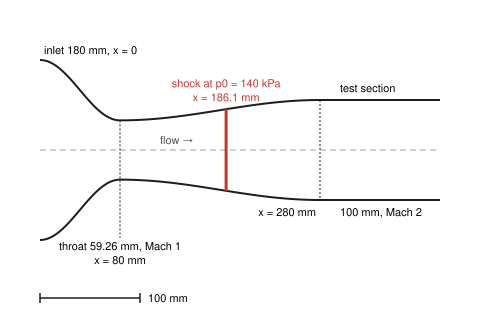
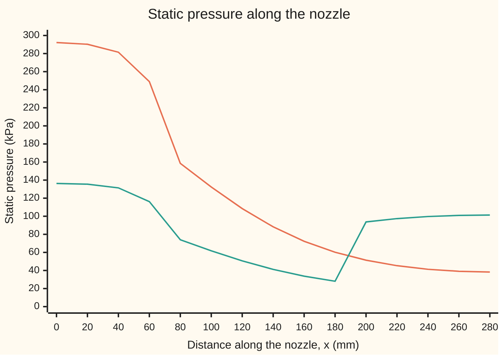

# Compressible flow: past Mach 1 a nozzle must widen, and a shock can stand still

[Syllabus](../../../SYLLABUS.md) → [Engineering mathematics](../README.md) → [Fluids and Heat](../README.md#s08) → Compressible flow

---

## General Overview

A small supersonic wind tunnel. Dry air waits in a settling chamber (a wide, calm box) at 300 kPa and 20 °C. A nozzle carries it into a test section 100 mm by 100 mm at Mach 2, then out to the room at 101.325 kPa. The Mach number is the air's speed divided by the local speed of sound.

The engineer wants to know three things. How small must the nozzle's narrowest point, the **throat**, be? How much air does the tunnel use? And what does a **shock** (a pressure jump far thinner than a millimetre) cost during start-up?

Water speeds up where a pipe narrows, as [Continuity and Bernoulli](01-continuity-and-bernoulli.md) shows. Air faster than sound does the opposite: it speeds up where the duct **widens**. So the nozzle narrows to a 59.26 cm² throat, where the air reaches exactly Mach 1, then widens to 100 cm² for Mach 2.

There the air moves at 511.7 m/s, at 162.86 K (−110.29 °C) and 38.34 kPa. The tunnel uses 4.196 kg of air per second, and nothing downstream can raise that: the throat is **choked**.

A shock at Mach 2 drops the air to Mach 0.5774 and raises its pressure 4.5 times. It keeps only 72.09% of the **stagnation pressure** (the pressure the air would reach if brought gently to rest). That loss sets the size of the tunnel's **second throat** (in the diffuser that slows the air after the test section): 82.20 cm².

<p align="center"></p>

To scale, side view. The nozzle is 100 mm deep everywhere, so area is height times 100 mm. Red: the shock standing still during start-up, with the chamber at 140 kPa and no diffuser fitted.

**In a gas, density falls faster than speed rises once the flow passes Mach 1, so a supersonic flow needs a widening duct to go faster; the throat between the two regimes runs at exactly Mach 1 and caps the mass flow; and a shock is the one abrupt way back from supersonic to subsonic, keeping mass, momentum and energy but destroying stagnation pressure.**

**What kind of fact this is:** a model (one-dimensional flow of an ideal gas, no friction, no heat transfer) that fits a well-made nozzle closely. Inside it, the area rule, choking and the shock jumps are theorems, proved in Why it works from mass, momentum and energy conservation. The second law, a law of physics, picks the shock's direction.

---

## The formula

Notation first, in words. $`M`$ is the Mach number. $`\gamma`$ (say "gamma") is the gas's ratio of heat capacities, 1.4 for air. A subscript 0 marks **stagnation** values: the temperature $`T_0`$ and pressure $`p_0`$ the air has when it is at rest in the chamber. $`A^*`$ is the area where the flow is exactly at Mach 1. Subscripts 1 and 2 mark the air just before and just after a shock.

```math
\frac{T_0}{T} = 1 + \frac{\gamma - 1}{2} M^2, \qquad \frac{p_0}{p} = \left(\frac{T_0}{T}\right)^{\gamma/(\gamma - 1)}, \qquad \frac{A}{A^*} = \frac{1}{M}\left[\frac{2}{\gamma + 1}\left(1 + \frac{\gamma - 1}{2} M^2\right)\right]^{\frac{\gamma + 1}{2(\gamma - 1)}}
```

```math
\dot m_{\max} = A^* p_0 \sqrt{\frac{\gamma}{R T_0}} \left(\frac{2}{\gamma + 1}\right)^{\frac{\gamma + 1}{2(\gamma - 1)}}
```

```math
M_2^2 = \frac{1 + \frac{\gamma - 1}{2} M_1^2}{\gamma M_1^2 - \frac{\gamma - 1}{2}}, \qquad \frac{p_2}{p_1} = 1 + \frac{2\gamma}{\gamma + 1}\left(M_1^2 - 1\right), \qquad \frac{\rho_2}{\rho_1} = \frac{(\gamma + 1) M_1^2}{(\gamma - 1) M_1^2 + 2}
```

**Read it aloud:** the faster the gas, the colder it is compared with the chamber, and its pressure falls with a steeper power of that same ratio; each Mach number needs one particular area compared with the throat; the throat lets through at most this much mass per second; and a shock turns Mach $`M_1`$ into Mach $`M_2`$, multiplying pressure and density by fixed amounts.

For air, with $`\gamma = 1.4`$, the area rule shrinks to $`A/A^* = \tfrac{1}{M}\big(\tfrac{1 + 0.2M^2}{1.2}\big)^3`$. At Mach 2 that is $`\tfrac12 \times 1.5^3`$ = 1.6875.

| Symbol | Plain meaning | In our example | Push it up and the answer… |
| --- | --- | --- | --- |
| $`M`$ | Mach number: air speed over the local speed of sound | 1 at the throat; 2 in the test section | a bigger area ratio, colder and thinner air |
| $`V`$; $`a`$ | air speed, m/s; speed of sound $`\sqrt{\gamma R T}`$, m/s | 511.7 and 255.8 m/s in the test section | — |
| $`\gamma`$ | ratio of heat capacities: heat to warm the gas at fixed pressure over heat at fixed volume, $`c_p/c_v`$ | 1.4 for air | higher $`\gamma`$: a smaller area ratio for the same Mach |
| $`R`$; $`c_p`$; $`h`$ | gas constant of air, J/(kg K); heat to warm 1 kg by 1 K at fixed pressure, $`\gamma R/(\gamma - 1)`$; enthalpy per kg, $`c_p T`$ | 287.05 J/(kg K) | — |
| $`T_0`$; $`T`$ | stagnation temperature, K; static temperature, felt by a thermometer moving with the air, K | 293.15 K; 162.86 K | higher $`T_0`$: faster air, less mass flow |
| $`p_0`$; $`p`$ | stagnation pressure, Pa; static pressure, felt by a wall the air slides along, Pa | 300 kPa; 38.34 kPa | higher $`p_0`$: more mass flow, same Mach |
| $`\rho`$ | density, kg/m³ | rises 2.6667 times across the shock | — |
| $`A`$; $`A^*`$, $`\rho^*`$, $`a^*`$ | flow area, m²; the area, density and sound speed where $`M = 1`$ | 100 cm² test section; 59.26 cm² throat; $`a^*`$ = 313.3 m/s | — |
| $`\dot m`$ | mass flow, kg/s | 4.196 kg/s | — |
| $`M_1`$, $`M_2`$; $`p_{01}`$, $`p_{02}`$ | Mach number just before and just after a shock (subscripts 1 and 2 mark every quantity that way); stagnation pressure before and after | 2 and 0.5774; $`p_{02}/p_{01}`$ = 72.09% | stronger $`M_1`$: lower $`M_2`$, bigger loss |
| $`s`$, $`\Delta s`$ | entropy per kg, J/(kg K); its rise across the shock | 93.95 J/(kg K) | bigger rise, more stagnation pressure lost |
| $`p_b`$; $`x`$ | back pressure: what the flow leaves into, Pa; distance along the nozzle, mm | 101.325 kPa; throat at 80 mm | pushes a shock upstream |

The gas constant of air is the U.S. Standard Atmosphere 1976's value of the universal gas constant, 8,314.32 J/(kmol K), over air's 28.9644 kg/kmol from the same standard. Today's exact value, used in [Free energies](10-thermodynamic-potentials-and-maxwell-relations.md), is a little higher; it moves only the last printed digit of $`R`$.

### When it holds

- **One-dimensional flow:** one speed, pressure and temperature per cross-section. This needs a gently changing area. Sharp corners send waves across the stream and spoil the test section.
- **No friction, no heat through the walls**, so the gas is **isentropic** (its entropy stays fixed) except inside a shock. A slow layer of air clings to each wall and makes a real nozzle act a little narrower; designers enlarge the contour to make up for it.
- **An ideal gas with fixed $`\gamma`$.** A Mach 5 nozzle fed from 20 °C would cool the air to 48.86 K, cold enough for its nitrogen and oxygen to start condensing. Then the formulas fail, so hypersonic tunnels heat their supply air.
- **A thin, steady shock.** Inside its few molecular collision lengths, viscosity and heat conduction rule ([Navier-Stokes](03-navier-stokes-and-the-reynolds-number.md)). The jump relations only compare the two sides.
- **Compressibility matters.** Below Mach 0.3 density changes by at most 4.36%, and the water rules of [Continuity and Bernoulli](01-continuity-and-bernoulli.md) do well. At Mach 2, fixed-density Bernoulli predicts a test-section pressure of −166.7 kPa.

---

## Why it works

### Step 0: in a gas, speeding up thins the gas

Two effects compete as a gas speeds up. Higher speed needs less area for the same mass flow. Lower density (faster gas is colder and at lower pressure) needs more area. Below Mach 1 speed wins, so the duct narrows. Above Mach 1 density falls faster than speed rises, so the duct widens. At Mach 1 they cancel, which can only happen where the area stops changing: the throat.

### Step 1: the energy count fixes temperature and pressure

Take 1 kg of air flowing steadily with no heat added and no machine doing work. The first law of [The thermodynamic laws](07-thermodynamic-laws-and-entropy.md), written for a flowing gas, keeps **enthalpy** plus kinetic energy fixed. Enthalpy is stored energy plus the push work, pressure times volume ($`p/\rho`$ per kilogram), as [Free energies](10-thermodynamic-potentials-and-maxwell-relations.md) defines it; per kilogram of ideal gas it is $`h = c_p T`$. The push work is there because each kilogram must shove the gas ahead of it to move along:

```math
c_p T + \tfrac12 V^2 = c_p T_0.
```

Write $`V = M a`$ with $`a^2 = \gamma R T`$, and use $`c_p = \gamma R/(\gamma - 1)`$. Dividing by $`c_p T`$ gives $`T_0/T = 1 + \tfrac{\gamma - 1}{2} M^2`$. At Mach 2 this is 1 + 0.2 × 4 = 1.8.

With no friction or heat the gas also obeys the adiabatic rule from the same card, $`p \propto \rho^\gamma`$. Combined with $`p = \rho R T`$, this makes $`p \propto T^{\gamma/(\gamma - 1)}`$, so $`p_0/p = 1.8^{3.5}`$ = 7.8244.

### Step 2: three laws give the area–velocity rule

Three facts hold for each short slice of the duct:

1. **Mass.** $`\rho A V`$ is the same at every section, so its small changes add to zero: $`d\rho/\rho + dA/A + dV/V = 0`$.
2. **Momentum.** Along the flow, a pressure drop is what speeds the gas up: $`dp = -\rho V\, dV`$. This is Euler's equation from [Continuity and Bernoulli](01-continuity-and-bernoulli.md), Step 2.
3. **Sound.** A small pressure change at fixed entropy brings a density change $`dp = a^2\, d\rho`$, where $`a`$ is the speed of sound. For $`p \propto \rho^\gamma`$ this gives $`a^2 = \gamma p/\rho = \gamma R T`$.

Put 2 and 3 together: $`d\rho/\rho = -M^2\, dV/V`$. A 1% gain in speed costs $`M^2`$ per cent of density. Put that into 1:

```math
\frac{dA}{A} = (M^2 - 1)\,\frac{dV}{V}.
```

Read it with numbers. At Mach 0.5, a 1% speed gain needs $`0.5^2 - 1 = -0.75`$, so 0.75% less area. At Mach 2 it needs $`2^2 - 1 = 3`$, so 3% more area. At Mach 1 the right side is zero for any speed change, so Mach 1 can only occur where $`dA = 0`$, at the throat.

### Step 3: integrate to get the area ratio

The mass flux $`\rho V`$ is mass per square metre per second. From Step 1, $`\rho/\rho_0 = (T/T_0)^{1/(\gamma - 1)}`$ and $`V = M\sqrt{\gamma R T}`$. So

```math
\rho V \;\propto\; M \left(1 + \tfrac{\gamma - 1}{2} M^2\right)^{-\frac{\gamma + 1}{2(\gamma - 1)}}.
```

Mass flow is fixed, so the area goes as $`1/(\rho V)`$. Divide by its value at Mach 1 and the area rule of The formula appears. For air the power is 3, and Mach 2 gives $`\tfrac12 (1.8/1.2)^3`$ = 1.6875. The test section is 100 cm², so the throat is 100/1.6875 = 59.26 cm².

<details>
<summary>Detailed step: Step 2 rewritten in terms of the Mach number</summary>

From $`V = M a`$ and $`a^2 \propto T`$: $`dV/V = dM/M + \tfrac12\, dT/T`$. From Step 1, $`dT/T = -(\gamma - 1) M\, dM / \big(1 + \tfrac{\gamma - 1}{2}M^2\big)`$. Together:

$`\displaystyle \frac{dV}{V} = \frac{dM}{M\left(1 + \frac{\gamma - 1}{2} M^2\right)}, \qquad \ln\frac{A}{A^*} = \int_1^M \frac{(m^2 - 1)\, dm}{m\left(1 + \frac{\gamma - 1}{2} m^2\right)}.`$

With $`\gamma = 1.4`$ and $`M = 2`$, Simpson's rule on 2,000 strips gives 1.6875 after taking the exponential.

</details>

### Step 4: the throat caps the mass flow

Step 3 shows $`\rho V`$ is largest at Mach 1. No section can carry more mass per square metre than a sonic one. So once the throat reaches Mach 1, the mass flow is $`\dot m = \rho^* a^* A^*`$, set by the chamber alone. Here $`\rho^*`$ and $`a^*`$ are the density and sound speed at Mach 1; $`a^*`$ = 313.3 m/s. With the formula:

```math
\dot m = 59.26\times10^{-4} \times 300{,}000 \times \sqrt{\frac{1.4}{287.05 \times 293.15}} \times \left(\frac{1}{1.2}\right)^3 = 4.196\ \text{kg/s}.
```

Why can't a lower room pressure pull more air through? Pressure changes travel through a gas at the speed of sound, relative to the gas. At the throat the gas itself moves downstream at the speed of sound, so a pressure signal from the room makes no headway upstream. The chamber never learns that the room pressure fell. This is **choking**.

A golden-section search in the code finds the same peak: at a throat pressure of 0.5283 $`p_0`$, where the speed equals the local sound speed.

### Step 5: a shock keeps mass, momentum and energy

A shock is so thin that nothing between its two faces matters except what crosses it. Draw a thin box around it. Per square metre per second:

```math
\rho_1 V_1 = \rho_2 V_2, \qquad p_1 + \rho_1 V_1^2 = p_2 + \rho_2 V_2^2, \qquad c_p T_1 + \tfrac12 V_1^2 = c_p T_2 + \tfrac12 V_2^2.
```

These three equations have two solutions. One is "nothing happens". The other is the jump in The formula. At $`M_1`$ = 2:

- $`M_2^2 = (1 + 0.8)/(5.6 - 0.2) = 1/3`$, so $`M_2`$ = 0.5774.
- $`p_2/p_1 = 1 + (2.8/2.4) \times 3`$ = 4.5000.
- $`\rho_2/\rho_1 = 9.6/3.6`$ = 2.6667, and $`T_2/T_1 = 4.5/2.6667`$ = 1.6875. It is a coincidence of Mach 2 that this matches the area ratio.

Solving the three laws directly for the test-section air, as the code does, gives 191.9 m/s, 172.54 kPa and 274.83 K after the shock: Mach 0.5774 again.

<details>
<summary>Detailed step: from the three laws to the jump in Mach number</summary>

Divide the momentum law by the mass law and use $`p/\rho = a^2/\gamma`$:

$`\displaystyle \frac{a_1^2}{\gamma V_1} + V_1 = \frac{a_2^2}{\gamma V_2} + V_2.`$

The energy law says $`\frac{a^2}{\gamma - 1} + \frac{V^2}{2}`$ is the same on both sides. It equals $`\frac{\gamma + 1}{2(\gamma - 1)} a^{*2}`$, its value where the flow would be sonic. Use this to replace $`a_1^2`$ and $`a_2^2`$. Then either $`V_1 = V_2`$ (no shock) or

$`\displaystyle V_1 V_2 = a^{*2}.`$

So one side is faster than $`a^*`$ and the other slower. Writing $`V/a^*`$ in terms of $`M`$ with Step 1 turns this into the $`M_2^2`$ formula. The pressure ratio then follows from the momentum law, and the density ratio from the mass law.

</details>

### Step 6: the second law picks the direction, and charges for it

The energy law keeps the stagnation temperature: $`T_0`$ is 293.15 K on both sides. The stagnation pressure is not kept. Bring the air after the shock gently to rest and it reaches only 72.09% of the chamber's 300 kPa.

That loss is entropy. For an ideal gas, the entropy change per kilogram is $`\Delta s = c_p \ln(T_2/T_1) - R \ln(p_2/p_1)`$, from the entropy formula in [The thermodynamic laws](07-thermodynamic-laws-and-entropy.md), rewritten per kilogram with pressure in place of volume. Comparing the two rest states, which share $`T_0`$, leaves only the pressure term:

```math
\Delta s = -R \ln\frac{p_{02}}{p_{01}} = 93.95\ \text{J/(kg K)}.
```

Now run the jump backwards, from Mach 0.5774 up to Mach 2. Mass, momentum and energy are still balanced, but entropy would fall by 93.95 J/(kg K). The second law forbids that. So a shock only ever takes supersonic flow to subsonic flow, and always compresses.

### Step 7: why a shock can stand still

A shock is a pressure wave that runs into the gas ahead of it faster than sound. In the nozzle the gas rushes at it, at exactly the speed the shock runs upstream, so it stays put.

Where it stands is set by the exit. The air after the shock is subsonic, so it slows and gains pressure in the rest of the widening section (Step 2 with $`M < 1`$). It must leave at the room's pressure. Only one shock position makes that come out right. The code finds that position by bisection: for the chamber at 140 kPa it is x = 186.1 mm.

---

## Worked numbers, by hand

Air, $`\gamma`$ = 1.4, $`R`$ = 287.05 J/(kg K); chamber at 300 kPa and 293.15 K; test section at Mach 2, 100 cm².

| Step | Arithmetic | Value |
| --- | --- | --- |
| temperature ratio | $`1 + 0.2 \times 2^2`$ | 1.8000 |
| test-section temperature | $`293.15 / 1.8`$ | 162.86 K |
| pressure ratio | $`1.8^{3.5}`$ | 7.8244 |
| test-section pressure | $`300 / 7.8244`$ | 38.34 kPa |
| speed of sound | $`\sqrt{1.4 \times 287.05 \times 162.86}`$ | 255.8 m/s |
| air speed | $`2 \times 255.8`$ | 511.7 m/s |
| area ratio | $`\tfrac12 \times 1.5^3`$ | 1.6875 |
| throat area | $`100 / 1.6875`$ | 59.26 cm² |
| mass flow | Step 4 | 4.196 kg/s |
| Mach after a shock | $`\sqrt{1.8/5.4}`$ | 0.5774 |
| pressure after a shock | $`4.5 \times p_1`$ | 172.54 kPa |
| stagnation pressure kept | $`4.5 \times \big((1 + 0.2/3)/1.8\big)^{3.5}`$ | 72.09% |
| entropy rise | $`-287.05 \ln(p_{02}/p_{01})`$ | 93.95 J/(kg K) |
| **second throat** | $`59.26 / 0.7209`$ | **82.20 cm²** |

The last line is the one the tunnel builder acts on. Past the test section, a **diffuser** (a duct that slows the air back down) has its own throat, the second throat. While the tunnel starts, the starting shock has to pass through it. Behind a shock the air has only 72.09% of its stagnation pressure, so by the choking formula it needs 1/0.7209 times the area to pass the same mass: at least 82.20 cm².

### What breaks if you drop a piece

| Mistake | Comes out at | What went wrong |
| --- | --- | --- |
| Water's rule $`A V`$ = constant from throat to test section | 185.7 m/s, not 511.7 m/s | Past Mach 1 the density falls faster than the speed rises, so the widening speeds the air up |
| Bernoulli with fixed density at Mach 2 | −166.7 kPa, not 38.34 kPa | A negative pressure: Mach 2 is far outside the incompressible range |
| Shock treated as loss-free when sizing the second throat | 59.26 cm², not 82.20 cm² | The shock keeps only 72.09% of $`p_0`$; with the smaller throat the shock never gets through and the tunnel never reaches Mach 2 |
| Static pressure 38.34 kPa used for $`p_0`$ in the choking formula | 0.536 kg/s, not 4.196 kg/s | The formula needs the chamber's pressure at rest |

---

## Starting the tunnel: the shock walks down the nozzle

This table leaves the diffuser off: the test section blows straight into the room. The valve opens and the chamber pressure $`p_0`$ climbs while the room stays at 101.325 kPa. Each row is a steady state the tunnel passes through. "Exit Mach" is measured at the nozzle exit, x = 280 mm.

| Chamber $`p_0`$ | Throat Mach | Mass flow | Shock at | Exit Mach | What is happening |
| --- | --- | --- | --- | --- | --- |
| 105.00 kPa | 0.4085 | 0.940 kg/s | none | 0.2262 | subsonic throughout |
| 111.50 kPa | 1.0000 | 1.560 kg/s | none | 0.3722 | just choked |
| 120.00 kPa | 1.0000 | 1.679 kg/s | 141.6 mm | 0.3998 | shock appears |
| 140.00 kPa | 1.0000 | 1.958 kg/s | 186.1 mm | 0.4640 | the figure's shock |
| 160.00 kPa | 1.0000 | 2.238 kg/s | 223.6 mm | 0.5271 | shock moves on |
| 176.18 kPa | 1.0000 | 2.464 kg/s | 280.0 mm | 2.0000 | shock at the exit |
| 300.00 kPa | 1.0000 | 4.196 kg/s | none | 2.0000 | running |
| 792.81 kPa | 1.0000 | 11.090 kg/s | none | 2.0000 | exit pressure equals the room's |

Two things to see. Once choked, the mass flow grows in proportion to $`p_0`$: 4.196 × 140/300 = 1.958 kg/s. And at 300 kPa the exit pressure, 38.34 kPa, is below the room's. The jet meets the room through slanted shocks outside the nozzle. Supersonic air cannot hear the room, so the nozzle and test section do not notice.

A diffuser changes the start. With a second throat of at least 82.20 cm², the starting shock can pass through the test section and the second throat. An ideal diffuser then slows the air behind the shock back to the room's pressure. That needs the 72.09% of $`p_0`$ kept by the shock to reach 101.325 kPa, so the tunnel starts from 140.56 kPa in the chamber, not 176.18 kPa.



Orange: running, chamber at 300 kPa; the pressure falls smoothly to 38.3 kPa at the exit. Green: start-up, chamber at 140 kPa; the pressure jumps at the shock at 186.1 mm, then the subsonic air recovers pressure and leaves at the room's 101.3 kPa.

---

## Code, from first principles, and it actually runs

The script reaches each key number by two or three independent roads:

- **Area ratio:** the closed form, against Simpson's rule on Step 2's $`dA/A`$ from Mach 1 to Mach 2.
- **Mass flow:** the choking formula, against a golden-section search (one that keeps narrowing a bracket around a peak) for the throat pressure with the biggest mass flux. The search uses only the energy count and the adiabatic rule, and confirms the peak is at Mach 1.
- **Shock:** the closed forms, against a bisection solve of raw mass, momentum and energy conservation. The stagnation pressure kept is found a third way, as $`e^{-\Delta s/R}`$.
- **Start-up:** a bisection finds where the shock must stand so the exit pressure equals the room's. A second road checks every row: the mass flow worked out directly from pressure, Mach number and area, at the throat and at the exit, must equal the row's mass flow. The chart's post-shock pressure must also reach the room's at the exit.

It also prints the chart points, the figure's coordinates and the "what breaks" and "try changing" numbers.

### Python

```python
# Compressible flow -- the check behind the card.  Standard library only.  A Mach 2 wind-tunnel nozzle,
# 20 C chamber air, 100 mm x 100 mm test section, room at 101.325 kPa.  Roads: closed forms; Simpson on
# dA/A; a search for the biggest mass flux; the shock from raw conservation laws; the entropy rise.
from math import sqrt, log, exp, cos, pi

G = 1.4                              # ratio of heat capacities, air
R = 8314.32 / 28.9644                # J/(kg K): US Standard Atmosphere 1976, R* / M0
CP = G * R / (G - 1)                 # J/(kg K)
T0, P0, PB = 293.15, 300e3, 101325.0 # chamber K, chamber Pa, room Pa
W, HT, HE, HIN = 0.100, 0.100 / 1.6875, 0.100, 0.180  # span, throat, exit, inlet heights, m

def out(label, v, d, unit=""):
    print(f"{label:<44}{v:>11.{d}f} {unit}")

def tt(m, g=G): return 1 + (g - 1) / 2 * m * m                 # T0/T
def pr(m, g=G): return tt(m, g) ** (-g / (g - 1))               # p/p0
def area(m, g=G): return (2 / (g + 1) * tt(m, g)) ** ((g + 1) / (2 * (g - 1))) / m  # A/A*

def bisect(f, lo, hi, n=200):        # f(lo) and f(hi) of opposite sign
    flo = f(lo)
    for _ in range(n):
        mid = (lo + hi) / 2
        if (f(mid) > 0) == (flo > 0): lo, flo = mid, f(mid)
        else: hi = mid
    return (lo + hi) / 2

def mach(ar, sup, g=G): return bisect(lambda m: area(m, g) - ar, *((1.0, 50.0) if sup else (1e-9, 1.0)))

def shock(m, g=G):                   # closed forms: M2, p2/p1, rho2/rho1, T2/T1, p02/p01
    m2 = sqrt(tt(m, g) / (g * m * m - (g - 1) / 2))
    pp = 1 + 2 * g / (g + 1) * (m * m - 1)
    rr = (g + 1) * m * m / ((g - 1) * m * m + 2)
    return m2, pp, rr, pp / rr, pp * (tt(m2, g) / tt(m, g)) ** (g / (g - 1))

def simpson(f, a, b, n=2000):
    h = (b - a) / n; return h / 3 * (f(a) + f(b) + sum((4 if i % 2 else 2) * f(a + i * h) for i in range(1, n)))

def height(x):                       # nozzle wall, x in m: converge 0-80 mm, diverge 80-280 mm
    if x <= 0.08: return HT + (HIN - HT) * (1 + cos(pi * x / 0.08)) / 2
    return HT + (HE - HT) * (1 - cos(pi * (min(x, 0.28) - 0.08) / 0.2)) / 2
def shock_place(p0):                 # area ratio where the shock stands so the exit meets the room
    def exit_gap(a): r = shock(mach(a, True))[4]; return r * p0 * pr(mach(1.6875 * r, False)) - PB
    a = bisect(exit_gap, 1.0 + 1e-9, 1.6875)
    return a, bisect(lambda x: height(x) / HT - a, 0.08, 0.28)

# ---- the nozzle at its design Mach 2 ----
AR = area(2.0)
ar_int = exp(simpson(lambda m: (m * m - 1) / (m * tt(m)), 1.0, 2.0))  # road 2: integrate dA/A
assert abs(AR - 0.5 * 1.5 ** 3) < 1e-12 and abs(ar_int - AR) < 1e-9
T1, p1 = T0 / tt(2.0), P0 * pr(2.0)
a1 = sqrt(G * R * T1); u1 = 2.0 * a1; astar = sqrt(G * R * T0 / tt(1.0))
for lab, v, d, u in [("gas constant of air", R, 2, "J/(kg K)"), ("area ratio A/A* at Mach 2", AR, 4, ""),
                     ("area ratio, Simpson on (M^2-1)/(M(1+0.2M^2))", ar_int, 4, ""),
                     ("throat area, 100 mm span", HT * W * 1e4, 2, "cm^2"),
                     ("T0/T at Mach 2", tt(2.0), 4, ""), ("p0/p at Mach 2", 1 / pr(2.0), 4, ""),
                     ("test section: static temperature", T1, 2, "K"), ("test section: static temperature", T1 - 273.15, 2, "C"),
                     ("test section: static pressure", p1 / 1e3, 2, "kPa"), ("test section: speed of sound", a1, 1, "m/s"),
                     ("test section: air speed", u1, 1, "m/s"), ("throat: air speed = sound speed", astar, 1, "m/s")]:
    out(lab, v, d, u)

# ---- choking: the formula against a golden-section search over throat pressure ----
mdot = HT * W * P0 * sqrt(G / (R * T0)) * (2 / (G + 1)) ** ((G + 1) / (2 * (G - 1)))
def flux(p):                         # energy equation + isentropic law only, no Mach number
    t = T0 * (p / P0) ** ((G - 1) / G); return p / (R * t) * sqrt(2 * CP * (T0 - t))
lo, hi = 0.01 * P0, 0.99 * P0        # golden-section search for the biggest flux
for _ in range(200):
    c, d = hi - 0.618034 * (hi - lo), lo + 0.618034 * (hi - lo)
    lo, hi = (lo, d) if flux(c) > flux(d) else (c, hi)
pst = (lo + hi) / 2; tst = T0 * (pst / P0) ** ((G - 1) / G)
assert abs(flux(pst) * HT * W - mdot) < 1e-6 * mdot and abs(pst / P0 - pr(1.0)) < 1e-6 and abs(sqrt(2 * CP * (T0 - tst)) / sqrt(G * R * tst) - 1) < 1e-5
for lab, v, d, u in [("mass flow, choked formula", mdot, 3, "kg/s"), ("mass flow, search for biggest flux", flux(pst) * HT * W, 3, "kg/s"),
                     ("pressure at the peak, p*/p0", pst / P0, 4, ""), ("Mach number at the peak", sqrt(2 * CP * (T0 - tst) / (G * R * tst)), 4, "")]:
    out(lab, v, d, u)

# ---- the normal shock at Mach 2: closed form, raw conservation laws, entropy ----
m2, pp, rr, tr, keep = shock(2.0)
rho1 = p1 / (R * T1); J = rho1 * u1; H = CP * T1 + u1 * u1 / 2
def energy_gap(u):                   # mass and momentum fix p2 and rho2 for a trial u2
    p2 = p1 + J * (u1 - u); return G / (G - 1) * p2 * u / J + u * u / 2 - H
u2 = bisect(energy_gap, 1e-6, 0.999 * u1)
p2 = p1 + J * (u1 - u2); T2 = p2 * u2 / (J * R); M2c = u2 / sqrt(G * R * T2)
keep_c = p2 * tt(M2c) ** (G / (G - 1)) / P0
ds = CP * log(T2 / T1) - R * log(p2 / p1)
assert abs(M2c - m2) < 1e-9 and abs(p2 / p1 - pp) < 1e-9 and abs(keep_c - keep) < 1e-9
assert abs(exp(-ds / R) - keep) < 1e-9 and abs(u1 * u2 - astar ** 2) < 1e-6 * u1 * u2  # Prandtl: u1 u2 = a*^2
for lab, v, d, u in [("shock: Mach after, formula", m2, 4, ""), ("shock: Mach after, conservation", M2c, 4, ""),
                     ("shock: p2/p1", pp, 4, ""), ("shock: rho2/rho1", rr, 4, ""), ("shock: T2/T1", tr, 4, ""),
                     ("shock: stagnation pressure kept, formula", 100 * keep, 2, "%"),
                     ("shock: kept, conservation", 100 * keep_c, 2, "%"), ("shock: kept, exp(-ds/R)", 100 * exp(-ds / R), 2, "%"),
                     ("shock: entropy rise", ds, 2, "J/(kg K)"), ("after shock: pressure", p2 / 1e3, 2, "kPa"),
                     ("after shock: temperature", T2, 2, "K"), ("after shock: speed", u2, 1, "m/s"),
                     ("diffuser second throat, A*/kept", HT * W * 1e4 / keep, 2, "cm^2"),
                     ("lowest p0 to start, diffuser after shock", PB / keep / 1e3, 2, "kPa")]:
    out(lab, v, d, u)

# ---- start-up: the chamber pressure climbs and the shock walks down the nozzle ----
msub = mach(AR, False); p0c1, p0c2, p0d = PB / pr(msub), PB / (pr(2.0) * pp), PB / pr(2.0)
assert 0 < p0c1 < 120e3 and 160e3 < p0c2 < p0d and abs(msub - 0.3722) < 1e-4
def flow(p, m, h): return p * m * sqrt(G * tt(m) / (R * T0)) * h * W   # mass flow, kg/s, from static p, Mach, height
print("start-up: p0 kPa, throat Mach, mass flow kg/s, shock x mm, exit Mach")
for p0 in [105e3, p0c1, 120e3, 140e3, 160e3, p0c2, 300e3, p0d]:
    if p0 < p0c1 + 1e-6:             # not choked: exit at room pressure, subsonic all through
        me = sqrt(((p0 / PB) ** ((G - 1) / G) - 1) / (G / 2 - 0.5)); mt = mach(area(me) / AR, False)
        mf = PB / (R * T0 / tt(me)) * me * sqrt(G * R * T0 / tt(me)) * HE * W; xs, me_s = "none", me
    else:
        mt, mf = 1.0, mdot * p0 / P0
        if p0 < p0c2 - 1e-6:
            a, x = shock_place(p0); r = shock(mach(a, True))[4]; xs, me_s = f"{x * 1e3:.1f}", mach(AR * r, False)
        else: xs, me_s = ("280.0" if p0 < p0c2 + 1 else "none"), 2.0
    assert abs(flow(p0 * pr(mt), mt, HT) / mf - 1) < 1e-9 and abs(flow(PB if me_s < 1 else p0 * pr(me_s), me_s, HE) / mf - 1) < 1e-9
    print(f"  {p0 / 1e3:7.2f} {mt:9.4f} {mf:9.3f} {xs:>8} {me_s:9.4f}")

# ---- chart: static pressure along the nozzle, running and with the shock standing at p0 = 140 kPa ----
a140, x140 = shock_place(140e3); r140 = shock(mach(a140, True))[4]
xs = [i * 0.02 for i in range(15)]
def p_at(x, p0, xsh, r):
    ar = height(x) / HT
    if x <= 0.08: return p0 * pr(mach(ar, False))
    if x < xsh: return p0 * pr(mach(ar, True))
    return r * p0 * pr(mach(ar * r, False))
assert abs(p_at(0.28, 140e3, x140, r140) / PB - 1) < 1e-9 and abs(height(x140) / HT - a140) < 1e-9   # leaves at room pressure
print("chart, x mm      " + " ".join(f"{x * 1e3:5.0f}" for x in xs))
print("chart, 300 kPa   " + " ".join(f"{p_at(x, 300e3, 9, 1) / 1e3:5.1f}" for x in xs))
print("chart, 140 kPa   " + " ".join(f"{p_at(x, 140e3, x140, r140) / 1e3:5.1f}" for x in xs))
print(f"figure, throat x 80 h {HT * 1e3:.2f}; exit x 280 h 100.00; inlet h 180.00; shock at 140 kPa x {x140 * 1e3:.1f} h {height(x140) * 1e3:.2f}")

# ---- what breaks, honesty numbers, try changing ----
rho0 = P0 / (R * T0)
for lab, v, d, u in [("wrong: A V constant, speed at the exit", astar / AR, 1, "m/s"),
                     ("wrong: Bernoulli, fixed density, exit p", (P0 - rho0 * u1 * u1 / 2) / 1e3, 1, "kPa"),
                     ("wrong: loss-free shock, second throat", HT * W * 1e4, 2, "cm^2"),
                     ("wrong: static p in choked formula", mdot * p1 / P0, 3, "kg/s"),
                     ("density drop at Mach 0.3", 100 * (1 - tt(0.3) ** (-1 / (G - 1))), 2, "%"),
                     ("Mach 5 from 20 C: static temperature", T0 / tt(5.0), 2, "K"),
                     ("try: Mach 3, throat area", W * HE * 1e4 / area(3.0), 2, "cm^2"), ("try: Mach 3, design p0", PB / pr(3.0) / 1e6, 3, "MPa"),
                     ("try: helium, area ratio at Mach 2", area(2.0, 5 / 3), 4, ""),
                     ("try: helium, stagnation pressure kept", 100 * shock(2.0, 5 / 3)[4], 2, "%"),
                     ("try: shock at Mach 1.2, kept", 100 * shock(1.2)[4], 2, "%")]:
    out(lab, v, d, u)
print("ALL CHECKS PASS")
```

**Ran 2026-11-23 on macOS, Python 3.14.10, standard library only. All checks passed. Output, pasted from the run:**

```
gas constant of air                              287.05 J/(kg K)
area ratio A/A* at Mach 2                        1.6875 
area ratio, Simpson on (M^2-1)/(M(1+0.2M^2))     1.6875 
throat area, 100 mm span                          59.26 cm^2
T0/T at Mach 2                                   1.8000 
p0/p at Mach 2                                   7.8244 
test section: static temperature                 162.86 K
test section: static temperature                -110.29 C
test section: static pressure                     38.34 kPa
test section: speed of sound                      255.8 m/s
test section: air speed                           511.7 m/s
throat: air speed = sound speed                   313.3 m/s
mass flow, choked formula                         4.196 kg/s
mass flow, search for biggest flux                4.196 kg/s
pressure at the peak, p*/p0                      0.5283 
Mach number at the peak                          1.0000 
shock: Mach after, formula                       0.5774 
shock: Mach after, conservation                  0.5774 
shock: p2/p1                                     4.5000 
shock: rho2/rho1                                 2.6667 
shock: T2/T1                                     1.6875 
shock: stagnation pressure kept, formula          72.09 %
shock: kept, conservation                         72.09 %
shock: kept, exp(-ds/R)                           72.09 %
shock: entropy rise                               93.95 J/(kg K)
after shock: pressure                            172.54 kPa
after shock: temperature                         274.83 K
after shock: speed                                191.9 m/s
diffuser second throat, A*/kept                   82.20 cm^2
lowest p0 to start, diffuser after shock         140.56 kPa
start-up: p0 kPa, throat Mach, mass flow kg/s, shock x mm, exit Mach
   105.00    0.4085     0.940     none    0.2262
   111.50    1.0000     1.560     none    0.3722
   120.00    1.0000     1.679    141.6    0.3998
   140.00    1.0000     1.958    186.1    0.4640
   160.00    1.0000     2.238    223.6    0.5271
   176.18    1.0000     2.464    280.0    2.0000
   300.00    1.0000     4.196     none    2.0000
   792.81    1.0000    11.090     none    2.0000
chart, x mm          0    20    40    60    80   100   120   140   160   180   200   220   240   260   280
chart, 300 kPa   292.2 290.3 281.5 249.0 158.5 132.4 108.5  88.3  72.3  60.2  51.4  45.3  41.3  39.1  38.3
chart, 140 kPa   136.3 135.5 131.4 116.2  74.0  61.8  50.6  41.2  33.7  28.1  93.7  97.4  99.7 100.9 101.3
figure, throat x 80 h 59.26; exit x 280 h 100.00; inlet h 180.00; shock at 140 kPa x 186.1 h 81.58
wrong: A V constant, speed at the exit            185.7 m/s
wrong: Bernoulli, fixed density, exit p          -166.7 kPa
wrong: loss-free shock, second throat             59.26 cm^2
wrong: static p in choked formula                 0.536 kg/s
density drop at Mach 0.3                           4.36 %
Mach 5 from 20 C: static temperature              48.86 K
try: Mach 3, throat area                          23.62 cm^2
try: Mach 3, design p0                            3.722 MPa
try: helium, area ratio at Mach 2                1.5312 
try: helium, stagnation pressure kept             76.30 %
try: shock at Mach 1.2, kept                      99.28 %
ALL CHECKS PASS
```

### Rust

```rust
// Compressible flow -- the check behind the card.  std only.  A Mach 2 wind-tunnel nozzle,
// 20 C chamber air, 100 mm x 100 mm test section, room at 101.325 kPa.  Roads: closed forms; Simpson on
// dA/A; a search for the biggest mass flux; the shock from raw conservation laws; the entropy rise.
use std::f64::consts::PI;

const G: f64 = 1.4; const T0: f64 = 293.15; const P0: f64 = 300e3; const PB: f64 = 101325.0; // gamma; K; Pa; Pa
const W: f64 = 0.100; const HE: f64 = 0.100; const HIN: f64 = 0.180; // span, exit and inlet heights, m

fn r_air() -> f64 { 8314.32 / 28.9644 } // J/(kg K): US Standard Atmosphere 1976, R* / M0
fn cp() -> f64 { G * r_air() / (G - 1.0) }
fn ht() -> f64 { 0.100 / 1.6875 } // throat height, m

fn out(label: &str, v: f64, d: usize, unit: &str) {
    println!("{:<44}{:>11.*} {}", label, d, v, unit);
}

fn tt(m: f64, g: f64) -> f64 { 1.0 + (g - 1.0) / 2.0 * m * m } // T0/T
fn pr(m: f64, g: f64) -> f64 { tt(m, g).powf(-g / (g - 1.0)) } // p/p0
fn area(m: f64, g: f64) -> f64 { (2.0 / (g + 1.0) * tt(m, g)).powf((g + 1.0) / (2.0 * (g - 1.0))) / m }

fn bisect<F: Fn(f64) -> f64>(f: F, mut lo: f64, mut hi: f64) -> f64 {
    let mut flo = f(lo);
    for _ in 0..200 {
        let (mid, fm) = ((lo + hi) / 2.0, f((lo + hi) / 2.0));
        if (fm > 0.0) == (flo > 0.0) { lo = mid; flo = fm; } else { hi = mid; }
    }
    (lo + hi) / 2.0
}

fn mach(ar: f64, sup: bool, g: f64) -> f64 { let (lo, hi) = if sup { (1.0, 50.0) } else { (1e-9, 1.0) }; bisect(|m| area(m, g) - ar, lo, hi) }

// closed forms: M2, p2/p1, rho2/rho1, T2/T1, p02/p01
fn shock(m: f64, g: f64) -> (f64, f64, f64, f64, f64) {
    let m2 = (tt(m, g) / (g * m * m - (g - 1.0) / 2.0)).sqrt();
    let pp = 1.0 + 2.0 * g / (g + 1.0) * (m * m - 1.0);
    let rr = (g + 1.0) * m * m / ((g - 1.0) * m * m + 2.0);
    (m2, pp, rr, pp / rr, pp * (tt(m2, g) / tt(m, g)).powf(g / (g - 1.0)))
}

fn simpson<F: Fn(f64) -> f64>(f: F, a: f64, b: f64, n: usize) -> f64 {
    let h = (b - a) / n as f64;
    let mut s = f(a) + f(b);
    for i in 1..n { s += if i % 2 == 1 { 4.0 } else { 2.0 } * f(a + i as f64 * h); }
    h / 3.0 * s
}

fn height(x: f64) -> f64 { // nozzle wall, x in m: converge 0-80 mm, diverge 80-280 mm
    if x <= 0.08 { return ht() + (HIN - ht()) * (1.0 + (PI * x / 0.08).cos()) / 2.0; }
    ht() + (HE - ht()) * (1.0 - (PI * (x.min(0.28) - 0.08) / 0.2).cos()) / 2.0
}

fn shock_place(p0: f64) -> (f64, f64) { // area ratio and x where the shock stands
    let exit_gap = |a: f64| { let r = shock(mach(a, true, G), G).4; r * p0 * pr(mach(1.6875 * r, false, G), G) - PB };
    let a = bisect(exit_gap, 1.0 + 1e-9, 1.6875);
    (a, bisect(|x| height(x) / ht() - a, 0.08, 0.28))
}

fn main() {
    let (r, cpa, hta) = (r_air(), cp(), ht());
    // ---- the nozzle at its design Mach 2 ----
    let ar = area(2.0, G);
    let ar_int = simpson(|m| (m * m - 1.0) / (m * tt(m, G)), 1.0, 2.0, 2000).exp(); // road 2
    assert!((ar - 0.5 * 1.5f64.powi(3)).abs() < 1e-12 && (ar_int - ar).abs() < 1e-9);
    let (t1, p1) = (T0 / tt(2.0, G), P0 * pr(2.0, G));
    let a1 = (G * r * t1).sqrt(); let u1 = 2.0 * a1;
    let astar = (G * r * T0 / tt(1.0, G)).sqrt();
    for (lab, v, d, u) in [("gas constant of air", r, 2, "J/(kg K)"), ("area ratio A/A* at Mach 2", ar, 4, ""),
        ("area ratio, Simpson on (M^2-1)/(M(1+0.2M^2))", ar_int, 4, ""),
        ("throat area, 100 mm span", hta * W * 1e4, 2, "cm^2"),
        ("T0/T at Mach 2", tt(2.0, G), 4, ""), ("p0/p at Mach 2", 1.0 / pr(2.0, G), 4, ""),
        ("test section: static temperature", t1, 2, "K"), ("test section: static temperature", t1 - 273.15, 2, "C"),
        ("test section: static pressure", p1 / 1e3, 2, "kPa"), ("test section: speed of sound", a1, 1, "m/s"),
        ("test section: air speed", u1, 1, "m/s"), ("throat: air speed = sound speed", astar, 1, "m/s")] {
        out(lab, v, d, u);
    }

    // ---- choking: the formula against a golden-section search over throat pressure ----
    let mdot = hta * W * P0 * (G / (r * T0)).sqrt() * (2.0 / (G + 1.0)).powf((G + 1.0) / (2.0 * (G - 1.0)));
    let flux = |p: f64| { let t = T0 * (p / P0).powf((G - 1.0) / G); p / (r * t) * (2.0 * cpa * (T0 - t)).sqrt() };
    let (mut lo, mut hi) = (0.01 * P0, 0.99 * P0); // golden-section search for the biggest flux
    for _ in 0..200 {
        let (c, d) = (hi - 0.618034 * (hi - lo), lo + 0.618034 * (hi - lo));
        if flux(c) > flux(d) { hi = d; } else { lo = c; }
    }
    let pst = (lo + hi) / 2.0; let tst = T0 * (pst / P0).powf((G - 1.0) / G);
    assert!((flux(pst) * hta * W - mdot).abs() < 1e-6 * mdot && (pst / P0 - pr(1.0, G)).abs() < 1e-6);
    assert!(((2.0 * cpa * (T0 - tst)).sqrt() / (G * r * tst).sqrt() - 1.0).abs() < 1e-5); // peak at Mach 1
    for (lab, v, d, u) in [("mass flow, choked formula", mdot, 3, "kg/s"), ("mass flow, search for biggest flux", flux(pst) * hta * W, 3, "kg/s"),
        ("pressure at the peak, p*/p0", pst / P0, 4, ""), ("Mach number at the peak", (2.0 * cpa * (T0 - tst) / (G * r * tst)).sqrt(), 4, "")] {
        out(lab, v, d, u);
    }

    // ---- the normal shock at Mach 2: closed form, raw conservation laws, entropy ----
    let (m2, pp, rr, tr, keep) = shock(2.0, G);
    let (j, h) = (p1 / (r * t1) * u1, cpa * t1 + u1 * u1 / 2.0); // mass flux, total enthalpy
    let energy_gap = |u: f64| { let p2 = p1 + j * (u1 - u); G / (G - 1.0) * p2 * u / j + u * u / 2.0 - h };
    let u2 = bisect(energy_gap, 1e-6, 0.999 * u1);
    let p2 = p1 + j * (u1 - u2); let t2 = p2 * u2 / (j * r); let m2c = u2 / (G * r * t2).sqrt();
    let keep_c = p2 * tt(m2c, G).powf(G / (G - 1.0)) / P0;
    let ds = cpa * (t2 / t1).ln() - r * (p2 / p1).ln();
    assert!((m2c - m2).abs() < 1e-9 && (p2 / p1 - pp).abs() < 1e-9 && (keep_c - keep).abs() < 1e-9);
    assert!(((-ds / r).exp() - keep).abs() < 1e-9 && (u1 * u2 - astar * astar).abs() < 1e-6 * u1 * u2); // Prandtl
    for (lab, v, d, u) in [("shock: Mach after, formula", m2, 4, ""), ("shock: Mach after, conservation", m2c, 4, ""),
        ("shock: p2/p1", pp, 4, ""), ("shock: rho2/rho1", rr, 4, ""), ("shock: T2/T1", tr, 4, ""),
        ("shock: stagnation pressure kept, formula", 100.0 * keep, 2, "%"),
        ("shock: kept, conservation", 100.0 * keep_c, 2, "%"), ("shock: kept, exp(-ds/R)", 100.0 * (-ds / r).exp(), 2, "%"),
        ("shock: entropy rise", ds, 2, "J/(kg K)"), ("after shock: pressure", p2 / 1e3, 2, "kPa"),
        ("after shock: temperature", t2, 2, "K"), ("after shock: speed", u2, 1, "m/s"),
        ("diffuser second throat, A*/kept", hta * W * 1e4 / keep, 2, "cm^2"),
        ("lowest p0 to start, diffuser after shock", PB / keep / 1e3, 2, "kPa")] {
        out(lab, v, d, u);
    }

    // ---- start-up: the chamber pressure climbs and the shock walks down the nozzle ----
    let msub = mach(ar, false, G);
    let (p0c1, p0c2, p0d) = (PB / pr(msub, G), PB / (pr(2.0, G) * pp), PB / pr(2.0, G));
    assert!(0.0 < p0c1 && p0c1 < 120e3 && 160e3 < p0c2 && p0c2 < p0d && (msub - 0.3722).abs() < 1e-4);
    let flow = |p: f64, m: f64, h: f64| p * m * (G * tt(m, G) / (r * T0)).sqrt() * h * W; // mass flow, kg/s, from static p, Mach, height
    println!("start-up: p0 kPa, throat Mach, mass flow kg/s, shock x mm, exit Mach");
    for p0 in [105e3, p0c1, 120e3, 140e3, 160e3, p0c2, 300e3, p0d] {
        let (mt, mf, xs, me_s);
        if p0 < p0c1 + 1e-6 { // not choked: exit at room pressure, subsonic all through
            let me = (((p0 / PB).powf((G - 1.0) / G) - 1.0) / (G / 2.0 - 0.5)).sqrt();
            mt = mach(area(me, G) / ar, false, G);
            mf = PB / (r * T0 / tt(me, G)) * me * (G * r * T0 / tt(me, G)).sqrt() * HE * W;
            xs = "none".to_string(); me_s = me;
        } else {
            mt = 1.0; mf = mdot * p0 / P0;
            if p0 < p0c2 - 1e-6 {
                let (a, x) = shock_place(p0); let rk = shock(mach(a, true, G), G).4;
                xs = format!("{:.1}", x * 1e3); me_s = mach(ar * rk, false, G);
            } else { xs = (if p0 < p0c2 + 1.0 { "280.0" } else { "none" }).to_string(); me_s = 2.0; }
        }
        assert!((flow(p0 * pr(mt, G), mt, hta) / mf - 1.0).abs() < 1e-9 && (flow(if me_s < 1.0 { PB } else { p0 * pr(me_s, G) }, me_s, HE) / mf - 1.0).abs() < 1e-9);
        println!("  {:7.2} {:9.4} {:9.3} {:>8} {:9.4}", p0 / 1e3, mt, mf, xs, me_s);
    }

    // ---- chart: static pressure along the nozzle, running and with the shock standing at p0 = 140 kPa ----
    let (a140, x140) = shock_place(140e3); let r140 = shock(mach(a140, true, G), G).4;
    let p_at = |x: f64, p0: f64, xsh: f64, rk: f64| -> f64 {
        let arx = height(x) / hta;
        if x <= 0.08 { return p0 * pr(mach(arx, false, G), G); }
        if x < xsh { return p0 * pr(mach(arx, true, G), G); }
        rk * p0 * pr(mach(arx * rk, false, G), G)
    };
    assert!((p_at(0.28, 140e3, x140, r140) / PB - 1.0).abs() < 1e-9 && (height(x140) / hta - a140).abs() < 1e-9); // leaves at room pressure
    let xs: Vec<f64> = (0..15).map(|i| i as f64 * 0.02).collect();
    let row = |f: &dyn Fn(f64) -> String| xs.iter().map(|&x| f(x)).collect::<Vec<_>>().join(" ");
    println!("chart, x mm      {}", row(&|x| format!("{:5.0}", x * 1e3)));
    println!("chart, 300 kPa   {}", row(&|x| format!("{:5.1}", p_at(x, 300e3, 9.0, 1.0) / 1e3)));
    println!("chart, 140 kPa   {}", row(&|x| format!("{:5.1}", p_at(x, 140e3, x140, r140) / 1e3)));
    println!("figure, throat x 80 h {:.2}; exit x 280 h 100.00; inlet h 180.00; shock at 140 kPa x {:.1} h {:.2}",
        hta * 1e3, x140 * 1e3, height(x140) * 1e3);

    // ---- what breaks, honesty numbers, try changing ----
    let rho0 = P0 / (r * T0);
    for (lab, v, d, u) in [("wrong: A V constant, speed at the exit", astar / ar, 1, "m/s"),
        ("wrong: Bernoulli, fixed density, exit p", (P0 - rho0 * u1 * u1 / 2.0) / 1e3, 1, "kPa"),
        ("wrong: loss-free shock, second throat", hta * W * 1e4, 2, "cm^2"),
        ("wrong: static p in choked formula", mdot * p1 / P0, 3, "kg/s"),
        ("density drop at Mach 0.3", 100.0 * (1.0 - tt(0.3, G).powf(-1.0 / (G - 1.0))), 2, "%"),
        ("Mach 5 from 20 C: static temperature", T0 / tt(5.0, G), 2, "K"),
        ("try: Mach 3, throat area", W * HE * 1e4 / area(3.0, G), 2, "cm^2"), ("try: Mach 3, design p0", PB / pr(3.0, G) / 1e6, 3, "MPa"),
        ("try: helium, area ratio at Mach 2", area(2.0, 5.0 / 3.0), 4, ""),
        ("try: helium, stagnation pressure kept", 100.0 * shock(2.0, 5.0 / 3.0).4, 2, "%"),
        ("try: shock at Mach 1.2, kept", 100.0 * shock(1.2, G).4, 2, "%")] {
        out(lab, v, d, u);
    }
    println!("ALL CHECKS PASS");
}
```

**Ran 2026-11-23 on macOS, rustc 1.98.1, no crates. All checks passed. Output, pasted from the run:**

```
gas constant of air                              287.05 J/(kg K)
area ratio A/A* at Mach 2                        1.6875 
area ratio, Simpson on (M^2-1)/(M(1+0.2M^2))     1.6875 
throat area, 100 mm span                          59.26 cm^2
T0/T at Mach 2                                   1.8000 
p0/p at Mach 2                                   7.8244 
test section: static temperature                 162.86 K
test section: static temperature                -110.29 C
test section: static pressure                     38.34 kPa
test section: speed of sound                      255.8 m/s
test section: air speed                           511.7 m/s
throat: air speed = sound speed                   313.3 m/s
mass flow, choked formula                         4.196 kg/s
mass flow, search for biggest flux                4.196 kg/s
pressure at the peak, p*/p0                      0.5283 
Mach number at the peak                          1.0000 
shock: Mach after, formula                       0.5774 
shock: Mach after, conservation                  0.5774 
shock: p2/p1                                     4.5000 
shock: rho2/rho1                                 2.6667 
shock: T2/T1                                     1.6875 
shock: stagnation pressure kept, formula          72.09 %
shock: kept, conservation                         72.09 %
shock: kept, exp(-ds/R)                           72.09 %
shock: entropy rise                               93.95 J/(kg K)
after shock: pressure                            172.54 kPa
after shock: temperature                         274.83 K
after shock: speed                                191.9 m/s
diffuser second throat, A*/kept                   82.20 cm^2
lowest p0 to start, diffuser after shock         140.56 kPa
start-up: p0 kPa, throat Mach, mass flow kg/s, shock x mm, exit Mach
   105.00    0.4085     0.940     none    0.2262
   111.50    1.0000     1.560     none    0.3722
   120.00    1.0000     1.679    141.6    0.3998
   140.00    1.0000     1.958    186.1    0.4640
   160.00    1.0000     2.238    223.6    0.5271
   176.18    1.0000     2.464    280.0    2.0000
   300.00    1.0000     4.196     none    2.0000
   792.81    1.0000    11.090     none    2.0000
chart, x mm          0    20    40    60    80   100   120   140   160   180   200   220   240   260   280
chart, 300 kPa   292.2 290.3 281.5 249.0 158.5 132.4 108.5  88.3  72.3  60.2  51.4  45.3  41.3  39.1  38.3
chart, 140 kPa   136.3 135.5 131.4 116.2  74.0  61.8  50.6  41.2  33.7  28.1  93.7  97.4  99.7 100.9 101.3
figure, throat x 80 h 59.26; exit x 280 h 100.00; inlet h 180.00; shock at 140 kPa x 186.1 h 81.58
wrong: A V constant, speed at the exit            185.7 m/s
wrong: Bernoulli, fixed density, exit p          -166.7 kPa
wrong: loss-free shock, second throat             59.26 cm^2
wrong: static p in choked formula                 0.536 kg/s
density drop at Mach 0.3                           4.36 %
Mach 5 from 20 C: static temperature              48.86 K
try: Mach 3, throat area                          23.62 cm^2
try: Mach 3, design p0                            3.722 MPa
try: helium, area ratio at Mach 2                1.5312 
try: helium, stagnation pressure kept             76.30 %
try: shock at Mach 1.2, kept                      99.28 %
ALL CHECKS PASS
```

The two outputs match line for line.

### Lean

Lean proves the nozzle's area rule and the shock relations for any fixed $`\gamma > 1`$, under each bullet's conditions.

- Take any $`\gamma > 1`$. Then $`A/A^*`$ = 1 at Mach 1. It falls as $`M`$ climbs to 1 and rises as $`M`$ climbs past 1. So no section is narrower than the throat: $`A/A^* \ge 1`$ for every $`M > 0`$.
- Suppose an ideal gas with $`\gamma > 1`$ keeps mass, momentum and energy across a thin, steady shock, with positive speeds, densities and temperatures. Then either nothing happens, $`V_1 = V_2`$, or $`V_1 V_2 = a^{*2}`$. In the second case all three jump formulas of The formula hold.
- Suppose $`M_1 > 1`$. Then $`0 < M_2^2 < 1`$, the pressure and density rise, and the stagnation pressure falls: $`p_{02}/p_{01} < 1`$.
- Take air, $`\gamma = 1.4`$. Then $`A/A^*`$ = 27/16 = 1.6875 at Mach 2 and 343/81 at Mach 3. For helium, $`\gamma = 5/3`$, Mach 2 gives 49/32.
- Take a shock in air at $`M_1 = 2`$. Then $`M_2^2`$ = 1/3, $`p_2/p_1`$ = 9/2 and $`\rho_2/\rho_1`$ = 8/3.

The 72.09% stagnation pressure kept, the 4.196 kg/s mass flow and the start-up shock positions are left to the Python and Rust checks.

```lean
-- Compressible flow: for an ideal gas with fixed γ > 1, the area a nozzle needs shrinks with Mach number below Mach 1 and grows above it, with its smallest value A* at exactly Mach 1, and the three conservation laws across a normal shock give either no change or the card's jump, which takes supersonic flow to subsonic, compresses it and loses stagnation pressure.
import Mathlib.Analysis.SpecialFunctions.Pow.Real
import Mathlib.Analysis.SpecialFunctions.Sqrt
import Mathlib.Order.Monotone.Defs
import Mathlib.Tactic.NormNum
import Mathlib.Tactic.Ring
import Mathlib.Tactic.Linarith
import Mathlib.Analysis.SpecialFunctions.Pow.Deriv
import Mathlib.Analysis.SpecialFunctions.Log.Deriv
import Mathlib.Analysis.Calculus.Deriv.MeanValue
import Mathlib.Tactic.FieldSimp
import Mathlib.Tactic.LinearCombination
import Mathlib.Tactic.Positivity

open Real

/-- The temperature ratio T0/T = 1 + ((γ - 1)/2) M² at Mach number M. -/
noncomputable def stagTempRatio (γ M : ℝ) : ℝ := 1 + (γ - 1) / 2 * M ^ 2

/-- The area rule: A/A* = (1/M) · [(2/(γ + 1)) (1 + ((γ - 1)/2) M²)]^((γ + 1)/(2(γ - 1))),
the flow area needed at Mach number M compared with the area A* where the flow is at Mach 1. -/
noncomputable def areaRatio (γ M : ℝ) : ℝ :=
  1 / M * (2 / (γ + 1) * stagTempRatio γ M) ^ ((γ + 1) / (2 * (γ - 1)))

/-- The Mach number squared just after a normal shock:
M₂² = (1 + ((γ - 1)/2) M₁²) / (γ M₁² - (γ - 1)/2). -/
noncomputable def shockMach2Sq (γ M₁ : ℝ) : ℝ :=
  (1 + (γ - 1) / 2 * M₁ ^ 2) / (γ * M₁ ^ 2 - (γ - 1) / 2)

/-- The static pressure ratio across a normal shock: p₂/p₁ = 1 + (2γ/(γ + 1)) (M₁² - 1). -/
noncomputable def shockPressureRatio (γ M₁ : ℝ) : ℝ := 1 + 2 * γ / (γ + 1) * (M₁ ^ 2 - 1)

/-- The density ratio across a normal shock: ρ₂/ρ₁ = (γ + 1) M₁² / ((γ - 1) M₁² + 2). -/
noncomputable def shockDensityRatio (γ M₁ : ℝ) : ℝ := (γ + 1) * M₁ ^ 2 / ((γ - 1) * M₁ ^ 2 + 2)

/-- The share of stagnation pressure a normal shock keeps, p₀₂/p₀₁. The stagnation temperature is
the same on both sides, so p₀₂/p₀₁ = (p₂/p₁) · ((T₀/T₂)/(T₀/T₁))^(γ/(γ - 1))
= (p₂/p₁) · (stagTempRatio γ M₂ / stagTempRatio γ M₁)^(γ/(γ - 1)). -/
noncomputable def shockStagPressureKept (γ M₁ : ℝ) : ℝ :=
  shockPressureRatio γ M₁ *
    ((1 + (γ - 1) / 2 * shockMach2Sq γ M₁) / stagTempRatio γ M₁) ^ (γ / (γ - 1))

lemma areaRatio_hasDerivAt (γ M : ℝ) (hγ : 1 < γ) (hM : 0 < M) :
    HasDerivAt (areaRatio γ)
      ((2 / (γ + 1) * stagTempRatio γ M) ^ ((γ + 1) / (2 * (γ - 1)) - 1) * (2 / (γ + 1)) *
        ((M ^ 2 - 1) / M ^ 2)) M := by
  have hY : HasDerivAt (fun x => 2 / (γ + 1) * stagTempRatio γ x)
      (2 / (γ + 1) * ((γ - 1) / 2 * (2 * M))) M := by
    unfold stagTempRatio
    have := (((hasDerivAt_pow 2 M).const_mul ((γ - 1) / 2)).const_add 1).const_mul (2 / (γ + 1))
    convert this using 1
    push_cast; ring
  have hk : 0 < (γ - 1) / 2 := by linarith
  have hc : 0 < 2 / (γ + 1) := by positivity
  have hYpos : 0 < 2 / (γ + 1) * stagTempRatio γ M := by
    unfold stagTempRatio; positivity
  have hR := hY.rpow_const (p := (γ + 1) / (2 * (γ - 1))) (Or.inl hYpos.ne')
  have hP := (hasDerivAt_inv hM.ne').mul hR
  have heq : areaRatio γ = fun y => y⁻¹ * (2 / (γ + 1) * stagTempRatio γ y) ^ ((γ + 1) / (2 * (γ - 1))) := by
    funext y; simp [areaRatio, one_div]
  rw [heq]
  convert hP using 1
  rw [Real.rpow_sub_one hYpos.ne']
  generalize (2 / (γ + 1) * stagTempRatio γ M) ^ ((γ + 1) / (2 * (γ - 1))) = Z
  have hγ1 : γ - 1 ≠ 0 := by linarith
  have hγ2 : γ + 1 ≠ 0 := by linarith
  unfold stagTempRatio at hYpos ⊢
  field_simp
  ring

#print axioms areaRatio_hasDerivAt

lemma areaRatio_deriv_factor_pos (γ M : ℝ) (hγ : 1 < γ) (hM : 0 < M) :
    0 < (2 / (γ + 1) * stagTempRatio γ M) ^ ((γ + 1) / (2 * (γ - 1)) - 1) * (2 / (γ + 1)) := by
  have hk : 0 < (γ - 1) / 2 := by linarith
  have hc : 0 < 2 / (γ + 1) := by positivity
  have hYpos : 0 < 2 / (γ + 1) * stagTempRatio γ M := by
    unfold stagTempRatio; positivity
  exact mul_pos (Real.rpow_pos_of_pos hYpos _) hc

#print axioms areaRatio_deriv_factor_pos

lemma shock_entropy_pos (γ m : ℝ) (hγ : 1 < γ) (hm : 1 < m) :
    γ * Real.log ((γ + 1) * m) - γ * Real.log ((γ - 1) * m + 2) <
      Real.log (1 + 2 * γ / (γ + 1) * (m - 1)) := by
  have hγ0 : 0 < γ := by linarith
  have hγ1 : 0 < γ - 1 := by linarith
  have hderiv : ∀ x : ℝ, 1 ≤ x → HasDerivAt
      (fun x : ℝ => Real.log (1 + 2 * γ / (γ + 1) * (x - 1)) - γ * Real.log ((γ + 1) * x) +
        γ * Real.log ((γ - 1) * x + 2))
      (2 * γ * (γ - 1) * (x - 1) ^ 2 /
        ((2 * γ * x - γ + 1) * x * ((γ - 1) * x + 2))) x := by
    intro x hx
    have hP : 0 < 1 + 2 * γ / (γ + 1) * (x - 1) := by
      have : 0 ≤ 2 * γ / (γ + 1) * (x - 1) := mul_nonneg (by positivity) (by linarith)
      linarith
    have hA : 0 < (γ + 1) * x := by nlinarith
    have hB : 0 < (γ - 1) * x + 2 := by nlinarith
    have h1 : HasDerivAt (fun x : ℝ => 1 + 2 * γ / (γ + 1) * (x - 1)) (2 * γ / (γ + 1) * 1) x :=
      (((hasDerivAt_id x).sub_const 1).const_mul (2 * γ / (γ + 1))).const_add 1
    have h2 : HasDerivAt (fun x : ℝ => (γ + 1) * x) ((γ + 1) * 1) x :=
      (hasDerivAt_id x).const_mul (γ + 1)
    have h3 : HasDerivAt (fun x : ℝ => (γ - 1) * x + 2) ((γ - 1) * 1) x :=
      ((hasDerivAt_id x).const_mul (γ - 1)).add_const 2
    have h := ((h1.log hP.ne').sub ((h2.log hA.ne').const_mul γ)).add ((h3.log hB.ne').const_mul γ)
    convert h using 1
    have hx0 : 0 < x := by linarith
    have hQ : 0 < 2 * γ * x - γ + 1 := by nlinarith
    have hPeq : 1 + 2 * γ / (γ + 1) * (x - 1) = (2 * γ * x - γ + 1) / (γ + 1) := by
      field_simp; ring
    rw [hPeq]
    have hQ' : 2 * γ * x - γ + 1 ≠ 0 := hQ.ne'
    have hA' : γ + 1 ≠ 0 := by linarith
    rw [div_div_eq_mul_div, mul_one, mul_one, mul_one]
    have hx' : x ≠ 0 := hx0.ne'
    have hB' : (γ - 1) * x + 2 ≠ 0 := hB.ne'
    rw [div_mul_cancel₀ (2 * γ) hA', show (γ + 1) / ((γ + 1) * x) = 1 / x by field_simp,
      mul_one_div, ← mul_div_assoc, div_sub_div _ _ hQ' hx',
      div_add_div _ _ (mul_ne_zero hQ' hx') hB',
      div_eq_div_iff (mul_ne_zero (mul_ne_zero hQ' hx') hB') (mul_ne_zero (mul_ne_zero hQ' hx') hB')]
    ring
  have hmono : StrictMonoOn
      (fun x : ℝ => Real.log (1 + 2 * γ / (γ + 1) * (x - 1)) - γ * Real.log ((γ + 1) * x) +
        γ * Real.log ((γ - 1) * x + 2)) (Set.Ici 1) := by
    apply strictMonoOn_of_deriv_pos (convex_Ici 1)
    · intro x hx
      exact (hderiv x hx).continuousAt.continuousWithinAt
    · intro x hx
      rw [interior_Ici] at hx
      have hx1 : 1 < x := hx
      rw [(hderiv x hx1.le).deriv]
      have hQ : 0 < 2 * γ * x - γ + 1 := by nlinarith
      have hB : 0 < (γ - 1) * x + 2 := by nlinarith
      have hx0 : 0 < x := by linarith
      have : 0 < (x - 1) ^ 2 := by nlinarith
      positivity
  have h := hmono (Set.mem_Ici.mpr (le_refl 1)) (Set.mem_Ici.mpr hm.le) hm
  simp only at h
  rw [show (γ - 1) * 1 + 2 = (γ + 1) * 1 by ring] at h
  simp at h
  linarith

#print axioms shock_entropy_pos

/-- Past Mach 1 a nozzle must widen. For an ideal gas with fixed ratio of heat capacities γ > 1,
in one-dimensional isentropic flow, the area ratio A/A* is 1 at Mach 1; below Mach 1 a faster flow
needs a smaller area (A/A* falls as M rises on 0 < M ≤ 1); above Mach 1 a faster flow needs a
larger area (A/A* rises as M rises on M ≥ 1); so no section is smaller than the sonic throat A*,
which is why the throat runs at exactly Mach 1 and caps the mass flow. -/
theorem supersonic_nozzle_must_widen (γ : ℝ) (hγ : 1 < γ) :
    areaRatio γ 1 = 1 ∧
    StrictAntiOn (areaRatio γ) (Set.Ioc 0 1) ∧
    StrictMonoOn (areaRatio γ) (Set.Ici 1) ∧
    ∀ M : ℝ, 0 < M → 1 ≤ areaRatio γ M := by
  have h1 : areaRatio γ 1 = 1 := by
    have : 2 / (γ + 1) * stagTempRatio γ 1 = 1 := by
      unfold stagTempRatio
      field_simp
      ring
    rw [areaRatio, this, Real.one_rpow]
    norm_num
  have hanti : StrictAntiOn (areaRatio γ) (Set.Ioc 0 1) := by
    apply strictAntiOn_of_deriv_neg (convex_Ioc 0 1)
    · intro M hM
      exact (areaRatio_hasDerivAt γ M hγ hM.1).continuousAt.continuousWithinAt
    · intro M hM
      rw [interior_Ioc] at hM
      rw [(areaRatio_hasDerivAt γ M hγ hM.1).deriv]
      apply mul_neg_of_pos_of_neg (areaRatio_deriv_factor_pos γ M hγ hM.1)
      apply div_neg_of_neg_of_pos
      · nlinarith [hM.1, hM.2]
      · nlinarith [hM.1]
  have hmono : StrictMonoOn (areaRatio γ) (Set.Ici 1) := by
    apply strictMonoOn_of_deriv_pos (convex_Ici 1)
    · intro M hM
      exact (areaRatio_hasDerivAt γ M hγ (lt_of_lt_of_le one_pos hM)).continuousAt.continuousWithinAt
    · intro M hM
      rw [interior_Ici] at hM
      have hM0 : 0 < M := lt_trans one_pos hM
      rw [(areaRatio_hasDerivAt γ M hγ hM0).deriv]
      apply mul_pos (areaRatio_deriv_factor_pos γ M hγ hM0)
      apply div_pos
      · have hM1 : 1 < M := hM
        nlinarith [hM1]
      · positivity
  refine ⟨h1, hanti, hmono, ?_⟩
  intro M hM
  rcases le_total M 1 with h | h
  · rw [← h1]
    exact hanti.antitoneOn ⟨hM, h⟩ ⟨one_pos, le_refl 1⟩ h
  · rw [← h1]
    exact hmono.monotoneOn (Set.mem_Ici.mpr (le_refl 1)) h h

/-- A shock keeps mass, momentum and energy, and that forces the jump. Take an ideal gas,
p = ρ R T with R > 0, fixed γ > 1 and c_p = γR/(γ - 1), flowing at speeds V₁, V₂ > 0 with
densities ρ₁, ρ₂ > 0 and temperatures T₁, T₂ > 0 on the two sides of a thin, steady shock. If
ρ₁V₁ = ρ₂V₂, p₁ + ρ₁V₁² = p₂ + ρ₂V₂² and c_p T₁ + V₁²/2 = c_p T₂ + V₂²/2, then either nothing
happens (V₁ = V₂), or V₁V₂ = a*² (Prandtl's relation, with a*² the sound speed squared where the
flow would be sonic, from a²/(γ - 1) + V²/2 = ((γ + 1)/(2(γ - 1))) a*²) and, with Mach numbers
M = V/√(γRT), the card's jump relations hold: M₂² = (1 + ((γ - 1)/2)M₁²)/(γM₁² - (γ - 1)/2),
p₂/p₁ = 1 + (2γ/(γ + 1))(M₁² - 1) and ρ₂/ρ₁ = (γ + 1)M₁²/((γ - 1)M₁² + 2). -/
theorem normal_shock_jump_from_conservation_laws
    (γ R ρ₁ ρ₂ V₁ V₂ T₁ T₂ p₁ p₂ : ℝ) (hγ : 1 < γ) (hR : 0 < R)
    (hρ₁ : 0 < ρ₁) (hρ₂ : 0 < ρ₂) (hV₁ : 0 < V₁) (hV₂ : 0 < V₂) (hT₁ : 0 < T₁) (hT₂ : 0 < T₂)
    (hp₁ : p₁ = ρ₁ * R * T₁) (hp₂ : p₂ = ρ₂ * R * T₂)
    (hmass : ρ₁ * V₁ = ρ₂ * V₂)
    (hmom : p₁ + ρ₁ * V₁ ^ 2 = p₂ + ρ₂ * V₂ ^ 2)
    (henergy : γ * R / (γ - 1) * T₁ + V₁ ^ 2 / 2 = γ * R / (γ - 1) * T₂ + V₂ ^ 2 / 2) :
    let aStarSq := 2 * (γ - 1) / (γ + 1) * (γ * R * T₁ / (γ - 1) + V₁ ^ 2 / 2)
    let M₁ := V₁ / Real.sqrt (γ * R * T₁)
    let M₂ := V₂ / Real.sqrt (γ * R * T₂)
    V₁ = V₂ ∨
      (V₁ * V₂ = aStarSq ∧
        M₂ ^ 2 = shockMach2Sq γ M₁ ∧
        p₂ / p₁ = shockPressureRatio γ M₁ ∧
        ρ₂ / ρ₁ = shockDensityRatio γ M₁) := by
  intro aStarSq M₁ M₂
  have _hρ₂ := hρ₂
  have hγ1 : γ - 1 ≠ 0 := by linarith
  have hγ0 : 0 < γ := by linarith
  have hs : 0 < γ * R * T₁ := by positivity
  have ht : 0 < γ * R * T₂ := by positivity
  -- momentum, divided by the mass flux
  have hMo : V₂ * (R * T₁ + V₁ ^ 2) = V₁ * (R * T₂ + V₂ ^ 2) := by
    have h1 : ρ₁ * (R * T₁ + V₁ ^ 2) = ρ₂ * (R * T₂ + V₂ ^ 2) := by
      rw [hp₁, hp₂] at hmom; linarith
    have h : ρ₁ * ((R * T₁ + V₁ ^ 2) * V₂ - V₁ * (R * T₂ + V₂ ^ 2)) = 0 := by
      linear_combination V₂ * h1 - (R * T₂ + V₂ ^ 2) * hmass
    rcases mul_eq_zero.mp h with h0 | h0
    · exact absurd h0 hρ₁.ne'
    · linarith
  -- energy, cleared of fractions
  have hEn : 2 * (γ * R * T₁) + (γ - 1) * V₁ ^ 2 = 2 * (γ * R * T₂) + (γ - 1) * V₂ ^ 2 := by
    field_simp at henergy
    linear_combination henergy
  have hfac : (V₂ - V₁) * (2 * (γ * R * T₁) + (γ - 1) * V₁ ^ 2 - (γ + 1) * V₁ * V₂) = 0 := by
    linear_combination (2 * γ) * hMo - V₁ * hEn
  rcases mul_eq_zero.mp hfac with h | hP
  · left; linarith
  right
  have hPr : (γ + 1) * V₁ * V₂ = 2 * (γ * R * T₁) + (γ - 1) * V₁ ^ 2 := by linarith
  have hM1 : M₁ ^ 2 = V₁ ^ 2 / (γ * R * T₁) := by
    simp only [M₁]; rw [div_pow, Real.sq_sqrt hs.le]
  have hM2 : M₂ ^ 2 = V₂ ^ 2 / (γ * R * T₂) := by
    simp only [M₂]; rw [div_pow, Real.sq_sqrt ht.le]
  -- the key identity behind M₂²
  have hkey : V₂ * (2 * γ * V₁ ^ 2 - (γ - 1) * (γ * R * T₁)) = (γ + 1) * V₁ * (γ * R * T₂) := by
    linear_combination (γ + 1) * V₁ / 2 * hEn + ((γ - 1) * V₂ + (γ + 1) * V₁) / 2 * hPr
  have hden : 0 < 2 * γ * V₁ ^ 2 - (γ - 1) * (γ * R * T₁) := by
    have h := hkey
    have : 0 < (γ + 1) * V₁ * (γ * R * T₂) := by positivity
    rw [← h] at this
    exact pos_of_mul_pos_right this hV₂.le
  refine ⟨?_, ?_, ?_, ?_⟩
  · simp only [aStarSq]
    field_simp
    linear_combination hPr
  · rw [hM2, shockMach2Sq, hM1]
    have hn2 : 1 + (γ - 1) / 2 * (V₁ ^ 2 / (γ * R * T₁)) =
        (2 * (γ * R * T₁) + (γ - 1) * V₁ ^ 2) / (2 * (γ * R * T₁)) := by
      field_simp
    have hd2 : γ * (V₁ ^ 2 / (γ * R * T₁)) - (γ - 1) / 2 =
        (2 * γ * V₁ ^ 2 - (γ - 1) * (γ * R * T₁)) / (2 * (γ * R * T₁)) := by
      field_simp
    rw [hn2, hd2, div_div_div_cancel_right₀ (by positivity)]
    rw [div_eq_div_iff ht.ne' hden.ne']
    linear_combination V₂ * hkey + (γ * R * T₂) * hPr
  · rw [shockPressureRatio, hM1]
    have hp1 : 0 < p₁ := by rw [hp₁]; positivity
    have hG : p₂ * ((γ + 1) * (γ * R * T₁)) = ((γ + 1) * (γ * R * T₁) + 2 * γ * (V₁ ^ 2 - γ * R * T₁)) * p₁ := by
      subst hp₁ hp₂
      linear_combination (-(γ * R * T₁ * ρ₁)) * hPr + ((γ + 1) * (γ * R * T₁) * V₂) * hmass - ((γ + 1) * (γ * R * T₁)) * hmom
    have hr : 1 + 2 * γ / (γ + 1) * (V₁ ^ 2 / (γ * R * T₁) - 1) =
        ((γ + 1) * (γ * R * T₁) + 2 * γ * (V₁ ^ 2 - γ * R * T₁)) / ((γ + 1) * (γ * R * T₁)) := by
      field_simp
    rw [hr, div_eq_div_iff hp1.ne' (by positivity)]
    linear_combination hG
  · rw [shockDensityRatio, hM1]
    have hr : (γ + 1) * (V₁ ^ 2 / (γ * R * T₁)) / ((γ - 1) * (V₁ ^ 2 / (γ * R * T₁)) + 2) =
        (γ + 1) * V₁ ^ 2 / ((γ - 1) * V₁ ^ 2 + 2 * (γ * R * T₁)) := by
      field_simp
    have hd : 0 < (γ - 1) * V₁ ^ 2 + 2 * (γ * R * T₁) := by
      have : 0 < (γ - 1) * V₁ ^ 2 := mul_pos (by linarith) (by positivity)
      linarith
    rw [hr, div_eq_div_iff hρ₁.ne' hd.ne']
    linear_combination (-(γ + 1) * V₁) * hmass - ρ₂ * hPr

/-- A shock is the one abrupt way back from supersonic to subsonic, and it charges for it. For
fixed γ > 1 and a flow arriving at Mach M₁ > 1, the jump relations give a subsonic flow after the
shock (0 < M₂² < 1), a rise in static pressure (p₂/p₁ > 1) and in density (ρ₂/ρ₁ > 1), and a loss
of stagnation pressure (p₀₂/p₀₁ < 1). -/
theorem normal_shock_slows_compresses_and_loses_stagnation_pressure
    (γ M₁ : ℝ) (hγ : 1 < γ) (hM₁ : 1 < M₁) :
    0 < shockMach2Sq γ M₁ ∧ shockMach2Sq γ M₁ < 1 ∧
    1 < shockPressureRatio γ M₁ ∧ 1 < shockDensityRatio γ M₁ ∧
    shockStagPressureKept γ M₁ < 1 := by
  have hγ0 : 0 < γ := by linarith
  have hγ1 : 0 < γ - 1 := by linarith
  have hk : 0 < (γ - 1) / 2 := by linarith
  have hm : 1 < M₁ ^ 2 := by nlinarith
  have hden : 0 < γ * M₁ ^ 2 - (γ - 1) / 2 := by nlinarith
  have hnum : 0 < 1 + (γ - 1) / 2 * M₁ ^ 2 := by
    have := mul_pos hk (by positivity : 0 < M₁ ^ 2); linarith
  have hDden : 0 < (γ - 1) * M₁ ^ 2 + 2 := by
    have := mul_pos hγ1 (by positivity : 0 < M₁ ^ 2); linarith
  have hP : 1 < shockPressureRatio γ M₁ := by
    unfold shockPressureRatio
    have : 0 < 2 * γ / (γ + 1) * (M₁ ^ 2 - 1) := mul_pos (by positivity) (by linarith)
    linarith
  have hD : 1 < shockDensityRatio γ M₁ := by
    unfold shockDensityRatio
    rw [one_lt_div hDden]
    nlinarith
  refine ⟨div_pos hnum hden, (div_lt_one hden).mpr (by nlinarith), hP, hD, ?_⟩
  have hP0 : 0 < shockPressureRatio γ M₁ := by linarith
  have hD0 : 0 < shockDensityRatio γ M₁ := by linarith
  -- the temperature ratio T₁/T₂ is (ρ₂/ρ₁)/(p₂/p₁)
  have hr : (1 + (γ - 1) / 2 * shockMach2Sq γ M₁) / stagTempRatio γ M₁ =
      shockDensityRatio γ M₁ / shockPressureRatio γ M₁ := by
    have hPeq : shockPressureRatio γ M₁ = (2 * γ * M₁ ^ 2 - γ + 1) / (γ + 1) := by
      unfold shockPressureRatio; field_simp; ring
    have hQ : 0 < 2 * γ * M₁ ^ 2 - γ + 1 := by nlinarith
    have hB : 0 < stagTempRatio γ M₁ := hnum
    have hS : shockMach2Sq γ M₁ = 2 * (1 + (γ - 1) / 2 * M₁ ^ 2) / (2 * γ * M₁ ^ 2 - γ + 1) := by
      rw [shockMach2Sq, div_eq_div_iff hden.ne' hQ.ne']; ring
    have hA : 1 + (γ - 1) / 2 * shockMach2Sq γ M₁ =
        (γ + 1) ^ 2 * M₁ ^ 2 / (2 * (2 * γ * M₁ ^ 2 - γ + 1)) := by
      rw [hS, eq_div_iff (by positivity)]
      have hc := div_mul_cancel₀ (2 * (1 + (γ - 1) / 2 * M₁ ^ 2)) hQ.ne'
      linear_combination (γ - 1) * hc
    rw [hA, hPeq, div_eq_div_iff hB.ne' (by positivity), shockDensityRatio, stagTempRatio]
    rw [div_mul_div_comm, div_mul_eq_mul_div, div_eq_div_iff (by positivity) (by positivity)]
    ring
  have hkept : 0 < shockStagPressureKept γ M₁ := by
    unfold shockStagPressureKept
    rw [hr]
    exact mul_pos hP0 (Real.rpow_pos_of_pos (div_pos hD0 hP0) _)
  have hent := shock_entropy_pos γ (M₁ ^ 2) hγ hm
  have hlogD : Real.log (shockDensityRatio γ M₁) =
      Real.log ((γ + 1) * M₁ ^ 2) - Real.log ((γ - 1) * M₁ ^ 2 + 2) := by
    unfold shockDensityRatio
    exact Real.log_div (by positivity) hDden.ne'
  have hlog : Real.log (shockStagPressureKept γ M₁) =
      (γ * Real.log ((γ + 1) * M₁ ^ 2) - γ * Real.log ((γ - 1) * M₁ ^ 2 + 2) -
        Real.log (shockPressureRatio γ M₁)) / (γ - 1) := by
    unfold shockStagPressureKept
    rw [hr, Real.log_mul hP0.ne' (Real.rpow_pos_of_pos (div_pos hD0 hP0) _).ne',
      Real.log_rpow (div_pos hD0 hP0), Real.log_div hD0.ne' hP0.ne', hlogD]
    field_simp
    ring
  rw [← Real.log_neg_iff hkept, hlog]
  apply div_neg_of_neg_of_pos _ hγ1
  unfold shockPressureRatio
  linarith

-- Air, γ = 7/5, at Mach 2: T0/T = 1 + 0.2 × 4 = 9/5 = 1.8.
example : stagTempRatio (7 / 5) 2 = 9 / 5 := by
  norm_num [stagTempRatio]

-- Air at Mach 2: the power (γ + 1)/(2(γ - 1)) is 3 and A/A* = (1/2) × 1.5³ = 27/16 = 1.6875.
example : areaRatio (7 / 5) 2 = 27 / 16 := by
  have h : ((7 / 5 : ℝ) + 1) / (2 * (7 / 5 - 1)) = ((3 : ℕ) : ℝ) := by norm_num
  rw [areaRatio, h, Real.rpow_natCast]
  norm_num [stagTempRatio]

-- Air at Mach 3: A/A* = (1/3) × (7/3)³ = 343/81, so a 100 cm² test section needs a
-- 100 × 81/343 cm² throat, about 23.62 cm².
example : areaRatio (7 / 5) 3 = 343 / 81 := by
  have h : ((7 / 5 : ℝ) + 1) / (2 * (7 / 5 - 1)) = ((3 : ℕ) : ℝ) := by norm_num
  rw [areaRatio, h, Real.rpow_natCast]
  norm_num [stagTempRatio]

-- Helium, γ = 5/3, at Mach 2: the power is 2 and A/A* = (1/2) × (7/4)² = 49/32 = 1.53125.
example : areaRatio (5 / 3) 2 = 49 / 32 := by
  have h : ((5 / 3 : ℝ) + 1) / (2 * (5 / 3 - 1)) = ((2 : ℕ) : ℝ) := by norm_num
  rw [areaRatio, h, Real.rpow_natCast]
  norm_num [stagTempRatio]

-- Step 2's area-velocity rule at Mach 0.5 and Mach 2: M² - 1 is -3/4 and 3.
example : (1 / 2 : ℚ) ^ 2 - 1 = -3 / 4 ∧ (2 : ℚ) ^ 2 - 1 = 3 := by norm_num

-- A normal shock in air at Mach 2: M₂² = 1.8/5.4 = 1/3, p₂/p₁ = 9/2, ρ₂/ρ₁ = 8/3,
-- and T₂/T₁ = (9/2)/(8/3) = 27/16.
example : shockMach2Sq (7 / 5) 2 = 1 / 3 ∧ shockPressureRatio (7 / 5) 2 = 9 / 2 ∧
    shockDensityRatio (7 / 5) 2 = 8 / 3 ∧
    shockPressureRatio (7 / 5) 2 / shockDensityRatio (7 / 5) 2 = 27 / 16 := by
  norm_num [shockMach2Sq, shockPressureRatio, shockDensityRatio]

-- The stagnation pressure kept at Mach 2 is 4.5 × ((1 + 0.2/3)/1.8)^3.5: the base is 16/27.
example : (1 + (7 / 5 - 1) / 2 * shockMach2Sq (7 / 5) 2) / stagTempRatio (7 / 5) 2 = 16 / 27 ∧
    (7 / 5 : ℝ) / (7 / 5 - 1) = 7 / 2 := by
  norm_num [shockMach2Sq, stagTempRatio]

#print axioms supersonic_nozzle_must_widen
#print axioms normal_shock_jump_from_conservation_laws
#print axioms normal_shock_slows_compresses_and_loses_stagnation_pressure
```

**Checked 2026-11-23 on macOS, Lean 4.36.0-rc2, Mathlib v4.36.0-rc2. Every proof is complete and uses only Lean's standard axioms. Output, pasted from the run:**

```
'areaRatio_hasDerivAt' depends on axioms: [propext, Classical.choice, Quot.sound]
'areaRatio_deriv_factor_pos' depends on axioms: [propext, Classical.choice, Quot.sound]
'shock_entropy_pos' depends on axioms: [propext, Classical.choice, Quot.sound]
'supersonic_nozzle_must_widen' depends on axioms: [propext, Classical.choice, Quot.sound]
'normal_shock_jump_from_conservation_laws' depends on axioms: [propext, Classical.choice, Quot.sound]
'normal_shock_slows_compresses_and_loses_stagnation_pressure' depends on axioms: [propext, Classical.choice, Quot.sound]
```

> [!TIP]
> **Try changing**
> - Guess first: a Mach 3 test section. Does the throat shrink to half of Mach 2's? The `try: Mach 3` lines give a throat of 23.62 cm², against 59.26 cm² for Mach 2: well under half. The chamber needs 3.722 MPa to match the room at the exit. Change the 3.0 in both `try: Mach 3` entries to try other Mach numbers.
> - Guess first: run the tunnel on helium, whose $`\gamma`$ is 5/3. Is the throat bigger or smaller for Mach 2? Pass `g=5/3` to `area`. The ratio is 1.5312, smaller than air's 1.6875. A Mach 2 shock in helium keeps 76.30% of the stagnation pressure, against 72.09% in air.
> - Guess first: a much weaker shock, at Mach 1.2. How much stagnation pressure does it keep? Call `shock(1.2)`. It keeps 99.28%. For weak shocks the entropy rise grows with the cube of $`M_1^2 - 1`$, so a chain of weak shocks costs far less than one strong one.

---

## The usual mistake

> [!warning]
> **"A narrower duct makes the flow faster."** True only below Mach 1. Above it, the rule flips: from Step 2, $`dA/A = (M^2 - 1)\,dV/V`$, and at Mach 2 every 1% of speed needs 3% more area. Applying the water rule from the throat to the test section predicts 185.7 m/s when the air really leaves at 511.7 m/s.
>
> - **Taking the throat to be at Mach 1 always.** It is only at Mach 1 once choked. At a chamber pressure of 105 kPa the throat runs at Mach 0.4085.
> - **Taking the wrong root of the area rule.** $`A/A^*`$ = 1.6875 has two answers: Mach 2 and Mach 0.3722. Which one the flow takes depends on the back pressure, not on the shape.
> - **Assuming stagnation pressure survives a shock.** It keeps 72.09% at Mach 2. A second throat sized as if no loss occurred, 59.26 cm², stops the tunnel from starting; it needs 82.20 cm².
> - **Reading "choked" as "the flow cannot grow".** Lowering the back pressure cannot raise it. Raising the chamber pressure does: 4.196 kg/s at 300 kPa becomes 11.090 kg/s at 792.81 kPa.

---

## Where you meet it in real life

- **Supersonic wind tunnels.** Each Mach number needs its own nozzle, set by the area rule, and a larger second throat to let the starting shock through: 82.20 cm² against 59.26 cm² here.
- **Rocket engines.** The bell nozzle is the widening half of this one. Many are **overexpanded** at sea level (exit pressure below the outside air's, like this tunnel's 38.34 kPa against 101.325 kPa). The diamond pattern in the exhaust is the jet's shocks meeting the outside pressure.
- **Supersonic aircraft inlets.** A plain inlet at Mach 2 stands a normal shock in front of the engine and keeps only 72.09% of the stagnation pressure. Ramps and cones slow the air through several weaker shocks instead; one at Mach 1.2 keeps 99.28%.
- **Gas meters and safety valves.** A choked nozzle's mass flow depends only on upstream pressure and temperature. Sonic-nozzle flow meters rely on this, and relief valves are sized with it.

> **Say it back**
> In a gas, speeding up lowers density, and above Mach 1 the density falls faster than the speed rises. So a supersonic flow speeds up in a widening duct, and a nozzle to Mach 2 narrows to a throat at Mach 1, then widens to 1.6875 times the throat area. The throat caps the mass flow: 4.196 kg/s for this tunnel, whatever the room pressure. A normal shock is the abrupt way back to subsonic: at Mach 2 it gives Mach 0.5774 and 4.5 times the pressure, but keeps only 72.09% of the stagnation pressure. The second law allows only that direction, and the lost stagnation pressure fixes the 82.20 cm² second throat.

---

## What this builds on

- [Continuity and Bernoulli](01-continuity-and-bernoulli.md): the mass balance and Euler's momentum law along a streamline. This card keeps both and drops the fixed density.
- [The thermodynamic laws](07-thermodynamic-laws-and-entropy.md): the first law for the energy count, the adiabatic rule $`p \propto \rho^\gamma`$, and the entropy count that decides which way a shock can go.
- [Free energies](10-thermodynamic-potentials-and-maxwell-relations.md): enthalpy, stored energy plus pressure times volume, which becomes the energy count for a gas that flows.

## Where this goes next

- [Conservation laws](../../19-Partial%20differential%20equations/02-First-Order%20Equations%20and%20Characteristics/02-conservation-laws-and-shocks.md): the theory behind shocks as solutions of conservation laws. It shows why smooth compressions steepen into jumps, and gives the jump-speed rule (Rankine–Hugoniot) for shocks that move.
- [Flow problems](../../16-Numerical%20analysis/07-PDE%20Solvers/06-upwind-schemes-and-conservation-laws.md): computing flows on a grid when they carry jumps like the one on this card.

This card kept every shock straight across the duct; what happens when a shock meets the flow at a slant, as at a rocket's exit or an inlet ramp, is the question it leaves open.

---

## Sources

Verified 2026-11-23: every link below resolves to the publisher's page.

- Ames Research Staff. *Equations, Tables, and Charts for Compressible Flow.* NACA Report 1135 (1953). [NASA Technical Reports Server](https://ntrs.nasa.gov/citations/19930091059). The isentropic and normal-shock relations in this card's notation, with tables to cross-check 1.6875, 0.5774, 4.5 and 0.7209.
- Liepmann, H. W., and A. Roshko. *Elements of Gasdynamics.* Dover, reprint of the 1957 edition. [Publisher's page](https://store.doverpublications.com/products/9780486419633). The derivations of the area–velocity rule, choking and the normal shock from the conservation laws.
- Rankine, W. J. M. "On the Thermodynamic Theory of Waves of Finite Longitudinal Disturbance." *Philosophical Transactions of the Royal Society of London* 160 (1870): 277–288. [doi:10.1098/rstl.1870.0015](https://doi.org/10.1098/rstl.1870.0015). The first jump conditions across a shock from conservation of mass, momentum and energy.
- *U.S. Standard Atmosphere, 1976.* NOAA, NASA and the U.S. Air Force (1976). [NASA Technical Reports Server](https://ntrs.nasa.gov/citations/19770009539). The gas constant 8,314.32 J/(kmol K) and air's molar mass 28.9644 kg/kmol, giving 287.05 J/(kg K).
