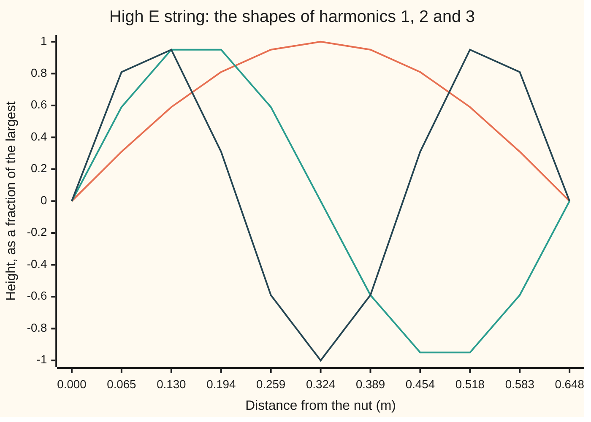
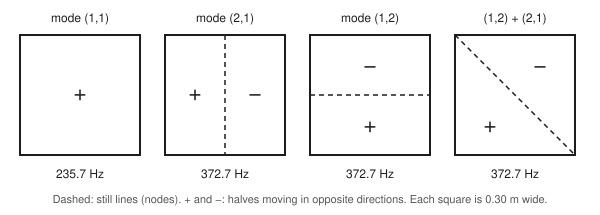

# Waves on strings and drums: standing patterns and the frequencies they pick

[Syllabus](../../../SYLLABUS.md) → [Engineering mathematics](../README.md) → [Quantum Mechanics in Outline](../README.md#s09) → Waves on strings and drums

---

## General Overview

The thinnest string on a guitar, the high E, is plain steel 0.254 mm thick, stretched 0.648 m from the nut to the bridge. Plucked open, it sounds 329.63 Hz (hertz: vibrations per second).

Rest a fingertip lightly on the string right over the 12th fret, halfway along. Pluck, lift the finger, and the note jumps an octave, to 659.26 Hz. Over the 7th fret, a third of the way along, it jumps to 988.89 Hz. Guitarists call these **harmonics**. The finger does not shorten the string. It holds one point still, and the string can only go on ringing in the patterns that already had a still point there.

So the string does not ring at any frequency it likes. Its two fixed ends allow a list of shapes, each a whole number of half-waves long, and each shape carries its own frequency: 329.63, 659.26, 988.89, 1318.52 Hz. A square drum head allows a list too, but a stranger one: 235.7, 372.7, 471.4 Hz, not whole-number steps. One method finds both lists. [Schrodinger's equation](03-schrodinger-equation-and-the-particle-in-a-box.md) runs the same method on an electron in a box one nanometre wide, and gets the electron's energy levels.

**Holding the edges still turns the wave equation into a search for shapes that bending only rescales; only a countable list of shapes fits, each rings at its own frequency, and so a string or a drum can sound only those notes.**

**What kind of fact this is:** a theorem about the wave equation, proved on this card in Why it works. The wave equation itself is a model of a thin, flexible, evenly stretched string or sheet swinging a little: it fits well in that range, and the card shows where it stops fitting.

### The picture: the string's first three shapes



Orange: harmonic 1, one arch, 329.63 Hz. Teal: harmonic 2, two arches with a still point at 0.324 m, 659.26 Hz. Dark blue: harmonic 3, three arches with still points a third and two thirds of the way along, 988.89 Hz. A finger at 0.324 m stops orange and dark blue, and teal rings on.

---

## The formula

Reminder: the height of a string, $u(x,t)$, obeys the wave equation $u_{tt} = c^2 u_{xx}$. A subscript is a rate with the other variable held still: $u_{tt}$ is a point's acceleration, $u_{xx}$ the string's bending ([Standing waves](../../08-Differential%20equations%20and%20dynamics/10-The%20Classical%20PDEs/06-standing-waves-on-a-string.md)). A drum head has height $u(x,y,t)$ and bends two ways: $u_{tt} = c^2(u_{xx} + u_{yy})$. Holding the edges still means $u = 0$ there at every moment.

The patterns the edges allow, and their frequencies:

$$\text{string:}\quad u = \sin\frac{n\pi x}{L}\,\cos(2\pi f_n t), \qquad f_n = \frac{n\,c}{2L}, \qquad c = \sqrt{T/\mu}$$

$$\text{drum, } a \text{ by } b\text{:}\quad u = \sin\frac{m\pi x}{a}\,\sin\frac{n\pi y}{b}\,\cos(2\pi f_{mn} t), \qquad f_{mn} = \frac{c}{2}\sqrt{\frac{m^2}{a^2} + \frac{n^2}{b^2}}$$

**Read it aloud:** a string rings only in shapes with a whole number of half-waves, at that number times the speed over twice the length; a rectangular drum rings in a whole number of half-waves each way, and its frequency combines the two directions like the sides of a right triangle.

For a square drum, $a = b$, the second formula is $f_{mn} = \frac{c}{2a}\sqrt{m^2 + n^2}$. A head's wave speed is the square root of its tension per metre of edge over its mass per square metre. The 100 m/s used here is a round value chosen for the example, not measured on a real head.

| Symbol | Plain meaning | In our example | Push it up and the answer… |
| --- | --- | --- | --- |
| $u$ | height of the string or head above rest | a fraction of the largest | — |
| $x$, $y$, $t$ | position along the string or across the head; time, s | 0 to 0.648 m; 0 to 0.30 m | — |
| $c$ | wave speed: how fast a ripple travels | 427.20 m/s string; 100 m/s head, a round value | every note rises in step |
| $L$; $a$, $b$ | string length, nut to bridge; the head's two sides | 0.648 m; 0.30 m and 0.30 m | every note falls |
| $T$, $\mu$ | string tension, N; string mass per metre | 72.6 N; 0.3978 g/m | $T$ up: notes rise as its square root |
| $n$, $m$ | mode numbers: half-waves along each direction | 1, 2, 3 | higher note, more still lines |
| $f_n$, $f_{mn}$ | a mode's frequency, Hz | 329.63 Hz; 235.70 Hz for (1,1) | — |
| $k$, $\omega$ | wavenumber, radians of shape per metre, $2\pi f/c$; angular frequency $2\pi f$, rad/s | $n\pi/L$ on the string | higher frequency |
| $p$, $r$ | the wavenumber's parts along $x$ and along $y$ | $m\pi/a$, $n\pi/b$ | — |
| $X$, $Y$, $W$, $q$ | shape along $x$; shape along $y$; shape over the head; time factor | sines; cosines | — |
| $A$, $v$, $\lambda$ | a matrix, its eigenvector and eigenvalue, for comparison only | — | — |
| $c_{mn}$ | the share of mode (m, n) in a shape, in the fold | — | — |

A **mode** is one of these patterns: every point swings in step at one frequency, and the shape never changes. Mode (m, n) on the drum has m half-waves across and n up.

### When it holds

- **Edges held still.** Free one end of the string (a ring that slides on a rod) and the list changes to 164.82 Hz, 494.45 Hz and on: odd multiples of a quarter-wave note, half the pitch.
- **Small swings.** A swing stretches the string and raises its tension. The extra tension comes and goes twice each cycle, so the pitch rises by three eighths of $f_1$ times the peak rise over $T$, not the half a steady rise would give. At 1 mm in harmonic 1 the pitch rises 0.10 Hz, 0.03%, too little to hear. At 5 mm, a hard pluck, the tension peaks 1.49 N higher and the pitch rises 2.54 Hz, 0.77%: outside the model. A hard-picked note starts sharp and settles as it fades; that is this error.
- **A thin, even, flexible string or sheet.** A stiff string pushes its high harmonics slightly sharp; a thick plate obeys a different, fourth-order equation with differently spaced modes.
- **Straight edges for the drum formula.** A round head needs the zeros of Bessel's function instead ([Bessel's equation](../../08-Differential%20equations%20and%20dynamics/07-Series%20Solutions%20and%20Boundary%20Problems/03-bessels-equation-and-the-drum.md)).
- **No air and no losses.** Real modes fade, high ones first, and air pressing on a drum head shifts its notes; the list of shapes survives, the exact numbers move.

---

## Why it works

### Step 0: look for motions that keep their shape

The wave equation is linear: add two motions and the sum is a motion. So find the simplest motions, ones where the shape stays fixed and only its size swings, and build everything else from them. [Standing waves](../../08-Differential%20equations%20and%20dynamics/10-The%20Classical%20PDEs/06-standing-waves-on-a-string.md) does this for a plucked string in full, pluck shape included. This card keeps to the part the quantum shelf needs: why the list of shapes is a list, and what it looks like in two dimensions.

### Step 1: split off time, and an eigenvalue problem is left

Try $u = X(x)\,q(t)$: a fixed shape $X$ times a swinging size $q$. The wave equation becomes $q''/q = c^2 X''/X$. The left side depends only on time, the right only on place, so both equal one constant, written $-\omega^2$, with $\omega = 2\pi f$ the angular frequency in rad/s. Time then obeys $q'' = -\omega^2 q$, a plain oscillator: $q = \cos\omega t$. Shape obeys

$$-X'' = k^2 X, \qquad k = \omega / c.$$

Bend the shape (take $-X''$) and the same shape comes back, scaled by $k^2$. A shape with that property is an **eigenfunction** of bending, and $k^2$ is its **eigenvalue**: the same idea as a matrix eigenvector, $A v = \lambda v$, with "bend it" in place of the matrix ([Eigenvalue problems](../../08-Differential%20equations%20and%20dynamics/07-Series%20Solutions%20and%20Boundary%20Problems/08-eigenvalues-and-eigenfunctions.md)).

### Step 2: the ends pick the numbers

Without ends, every $k$ works: $\sin kx$ and $\cos kx$ both satisfy $-X'' = k^2X$. The nut demands $X(0) = 0$, which removes the cosine. The bridge demands $X(L) = \sin kL = 0$, which happens only when $kL$ is a whole multiple of $\pi$:

$$k = \frac{n\pi}{L}, \qquad f = \frac{c\,k}{2\pi} = \frac{n\,c}{2L}.$$

Try a frequency that is not on the list, 400 Hz. The shape that starts at the nut reaches the bridge at $\sin kL = -0.6215$ of its full height, not 0. The bridge cannot hold that, so 400 Hz cannot ring. This is what **quantised** means: the allowed values form a list with gaps, and the gaps come from the edges, not from the equation.

The light finger in the overview adds one more still point. Mode n has still points at $L/n$, $2L/n$ and on, so a finger at $L/3$ keeps modes 3, 6, 9 and silences the rest.

### Step 3: the drum splits into two strings

On the head, try $u = W(x,y)\,q(t)$. Time behaves as before, and shape obeys

$$-(W_{xx} + W_{yy}) = k^2 W, \qquad W = 0 \text{ on all four edges.}$$

Try one more split, $W = X(x)\,Y(y)$. Divide by $W$: $X''/X + Y''/Y = -k^2$. The first term depends only on $x$ and the second only on $y$, so each is constant: $-X'' = p^2 X$ and $-Y'' = r^2 Y$, with $p^2 + r^2 = k^2$. Each is the string problem of Step 2, with the edges at $0$ and $a$, or $0$ and $b$. So $p = m\pi/a$, $r = n\pi/b$, and

$$k^2 = \left(\frac{m\pi}{a}\right)^2 + \left(\frac{n\pi}{b}\right)^2.$$

The wavenumbers add like the sides of a right triangle, so frequencies do not stack in whole-number steps. On the 0.30 m square head the ratios run 1, 1.581, 2.000, 2.236, 2.550. No single pitch fits them all, which is why a drum thuds where a string sings.

### Step 4: one note, two shapes

On a square, mode (1,2) and mode (2,1) have the same $m^2 + n^2 = 5$, so both ring at 372.68 Hz. Any mix of the two also rings at 372.68 Hz, because the equation is linear and both have the same $k^2$. Their sum has its still line along a diagonal, a shape neither one has alone.

<p align="center"></p>

To scale: 400 px per metre, each square 120 px. Dashed lines are the still lines (nodes). A plus and a minus mark halves moving in opposite directions at each instant.

Several shapes sharing one frequency is called **degeneracy**. Here it comes from a symmetry: turning the square a quarter turn swaps (1,2) and (2,1). Squeeze the head to 0.30 m by 0.20 m and the symmetry breaks: (2,1) moves to 416.7 Hz and (1,2) to 527.0 Hz. The same bookkeeping, shapes sharing a level because of a symmetry, explains the shells of [Hydrogen in outline](07-the-hydrogen-atom-in-outline.md).

### Step 5: nothing else rings

A drum struck anywhere rings at a mix of these modes and at no other frequency. The reason is that the products $\sin(m\pi x/a)\sin(n\pi y/b)$ can build any reasonable starting shape, and they do not overlap (orthogonality), so each one carries its own share of the start. The proof is the one-dimensional sine series used in both directions; [Standing waves](../../08-Differential%20equations%20and%20dynamics/10-The%20Classical%20PDEs/06-standing-waves-on-a-string.md) proves it for the string.

<details>
<summary>Why the split in Step 3 finds every mode on a rectangle</summary>

Suppose some shape $W$, zero on the edges, satisfies $-(W_{xx} + W_{yy}) = k^2 W$. Expand it as a double sine series, $W = \sum c_{mn} \sin(m\pi x/a)\sin(n\pi y/b)$, which is possible because each one-dimensional sine series is complete. Bending each product multiplies it by $(m\pi/a)^2 + (n\pi/b)^2$. Matching both sides term by term gives $c_{mn}\left[(m\pi/a)^2 + (n\pi/b)^2 - k^2\right] = 0$. So every product with a nonzero share has exactly the eigenvalue $k^2$. Every mode is a mix of products from the list, and every frequency is on the list.

</details>

Road 3 in the code tests this: a simulated tap rings at the listed notes and nothing between.

---

## Worked numbers, by hand

Steel's density, 7850 kg/m³, and its stiffness (Young's modulus), 200 GPa, are the handbook values from the property tables of *Mechanics of Materials*, cited on [Stress, strain and bending](../07-Mechanics%20and%20Structures/07-stress-strain-and-beam-bending.md).

| Step | Arithmetic | Value |
| --- | --- | --- |
| string mass per metre, $\mu$ | 7850 kg/m³ × π × (0.254 mm)² / 4 | 0.3978 g/m |
| wave speed, from $f_1 = c/(2L)$ | 2 × 0.648 × 329.63 | 427.20 m/s |
| tension, $T = \mu c^2$ | 0.0003978 × 427.20² | 72.6 N |
| harmonics 2, 3, 4 | 2, 3, 4 × 329.63 | 659.26, 988.89, 1318.52 Hz |
| finger at the 7th fret | 0.648 / 3 = 0.216 m: lowest mode with a still point there is 3 | 988.89 Hz |
| drum mode (1,1) | 100 / (2 × 0.30) × √2 | 235.70 Hz |
| drum modes (1,2) and (2,1) | 100 / (2 × 0.30) × √5 | 372.68 Hz |
| drum mode (2,2) | 100 / (2 × 0.30) × √8 | 471.40 Hz |
| ratio of second note to first | 372.68 / 235.70 | **1.581** |

The guitar's second note is exactly twice its first; the square drum's is 1.581 times. Whole-number ratios give a clear pitch; 1.581 does not.

### What breaks if you drop a piece

| Mistake | Comes out at | What went wrong |
| --- | --- | --- |
| Drum's next note taken as 2 × 235.70 Hz | 471.4 Hz, but the true next note is 372.7 Hz | String habits: in two dimensions frequencies combine as squares |
| Mode numbers added, $\tfrac{c}{2a}(1+2)$ | 500.0 Hz for (1,2), true 372.7 Hz | Directions combine like a right triangle's sides, not end to end |
| The 2 dropped, $f_1 = c/L$ | 659.26 Hz for the open string | Harmonic 1 is half a wave, not a whole one |
| One end free, but fixed-end formula used | 329.63, 659.26 Hz; true 164.82, 494.45 Hz | The edge condition picks the list, so a new edge gives a new list |

---

## Code, from first principles, and it actually runs

The scripts take three independent roads to the same lists. Road 1 is the formulas. Road 2 is **shooting**: start the string's shape at the nut, march it to the bridge with RK4 (the classic fourth-order step-by-step solver), and adjust $k$ by bisection (halving the bracket) until the shape lands on zero there. Nothing in it knows about sines. Road 3 simulates the whole square head on a 30 by 30 grid of points, steps it forward in time after an off-centre tap, records one point for 0.2 s, and scans that recording frequency by frequency with a written-out Fourier sum (a weighted sum of the recording against a cosine and a sine) to see where it rings. The grid shifts each note a little, so road 3 agrees to within 0.3%, and the check allows 1%.

### Python

```python
# Waves on strings and drums -- the check behind the card.  Standard library only.
# Road 1: the mode formulas.  Road 2: shooting (RK4 + bisection) on the string's
# shape equation.  Road 3: a time simulation of the square drum, then a written-out
# Fourier scan of one point's motion, to see which frequencies it actually rings at.
from math import pi, sin, cos, sqrt, exp

L, f1 = 0.648, 329.63                  # guitar high E: scale length m, open note Hz
d, rho, E_steel = 0.254e-3, 7850.0, 200e9   # plain steel string: diameter m, kg/m^3, Pa
area = pi * d * d / 4
mu = rho * area                        # mass per metre, kg/m
c = 2 * L * f1                         # wave speed, from f1 = c / (2L)
T = mu * c * c                         # tension, from c = sqrt(T / mu)
print(f"string: {L} m long, open {f1} Hz, steel {d * 1000:.3f} mm thick, {rho:.0f} kg/m^3, {E_steel / 1e9:.0f} GPa")
print(f"string: mass per metre {mu * 1000:.4f} g/m, wave speed {c:.2f} m/s, tension {T:.1f} N")

def shoot(k, free_end=False, steps=400):
    # Road 2: march X'' = -k^2 X from X(0) = 0, X'(0) = 1 with RK4; return X(L) (or X'(L))
    h, x, v = L / steps, 0.0, 1.0
    for _ in range(steps):
        a1, b1 = v, -k * k * x
        a2, b2 = v + h / 2 * b1, -k * k * (x + h / 2 * a1)
        a3, b3 = v + h / 2 * b2, -k * k * (x + h / 2 * a2)
        a4, b4 = v + h * b3, -k * k * (x + h * a3)
        x, v = x + h / 6 * (a1 + 2 * a2 + 2 * a3 + a4), v + h / 6 * (b1 + 2 * b2 + 2 * b3 + b4)
    return v if free_end else x

def allowed_k(count, free_end=False):
    # scan k for sign changes of the end value, then bisect each one
    found, k, dk = [], 0.5, 0.5
    prev = shoot(k, free_end)
    while len(found) < count:
        nxt = shoot(k + dk, free_end)
        if prev * nxt < 0:
            lo, hi = k, k + dk
            for _ in range(50):
                mid = (lo + hi) / 2
                if shoot(lo, free_end) * shoot(mid, free_end) <= 0: hi = mid
                else: lo = mid
            found.append((lo + hi) / 2)
        k, prev = k + dk, nxt
    return found

print("string harmonics: n, formula n c/(2L), shooting, nodes inside the string")
for n, k in enumerate(allowed_k(4), start=1):
    fs, fn = c * k / (2 * pi), n * c / (2 * L)
    assert abs(fs - fn) < 1e-6 * fn, (n, fs, fn)
    print(f"  {n}  {fn:8.2f} Hz  {fs:8.2f} Hz  {n - 1}")
print("touch lightly at a point: lowest harmonic with a node there")
for name, frac in (("1/2 (12th fret)", 1 / 2), ("1/3 (7th fret)", 1 / 3), ("1/4 (5th fret)", 1 / 4), ("1/5 (4th fret)", 1 / 5)):
    n = next(m for m in range(1, 20) if abs(sin(m * pi * frac)) < 1e-9)
    print(f"  {name:<16} at {frac * L:.3f} m: harmonic {n}, {n * f1:.2f} Hz")
assert next(m for m in range(1, 20) if abs(sin(m * pi / 3)) < 1e-9) == 3
k400 = 2 * pi * 400 / c                # a frequency not on the list
print(f"try 400 Hz: shape at the bridge sin(kL) = {sin(k400 * L):.4f}, by shooting {k400 * shoot(k400):.4f}, not 0")
xs = [L * i / 10 for i in range(11)]
print("chart, position m       " + " ".join(f"{x:5.3f}" for x in xs))
for n in (1, 2, 3):
    print(f"chart, harmonic {n} shape " + " ".join(f"{round(sin(n * pi * x / L), 2) + 0.0:5.2f}" for x in xs))

# ---- the square drum: side a, wave speed c_d ----
a, cd = 0.30, 100.0
f_mn = lambda m, n: cd / (2 * a) * sqrt(m * m + n * n)
modes = sorted(((f_mn(m, n), m, n) for m in range(1, 5) for n in range(1, 5)))
print(f"square drum, side {a} m, wave speed {cd} m/s: modes up to 650 Hz")
for f, m, n in modes:
    if f < 650: print(f"  ({m},{n})  {f:7.2f} Hz  ratio {f / modes[0][0]:.3f}")
rect = sorted((50 * sqrt((m / 0.3) ** 2 + (n / 0.2) ** 2), m, n) for m in range(1, 4) for n in range(1, 4))
print("try: 0.30 x 0.20 m head, first notes " + ", ".join(f"({m},{n}) {f:.1f} Hz" for f, m, n in rect[:4]))
notes = sorted({round(f, 6) for f, m, n in modes if f < 650})

# Road 3: leapfrog simulation of u_tt = c^2 (u_xx + u_yy), edges clamped, released from rest
N, dt, steps, keep = 30, 5e-5, 4000, 4
dx = a / N
r2 = (cd * dt / dx) ** 2              # (c dt / dx)^2 = 0.25, inside the stability limit 0.5
u = [[0.0] * (N + 1) for _ in range(N + 1)]
for i in range(1, N):
    for j in range(1, N):
        u[i][j] = exp(-((i * dx - 0.09) ** 2 + (j * dx - 0.06) ** 2) / (2 * 0.03 ** 2))
lap = lambda w, i, j: w[i + 1][j] + w[i - 1][j] + w[i][j + 1] + w[i][j - 1] - 4 * w[i][j]
prev = u
u = [[0.0] * (N + 1)] + [[0.0] + [prev[i][j] + 0.5 * r2 * lap(prev, i, j) for j in range(1, N)] + [0.0]
                         for i in range(1, N)] + [[0.0] * (N + 1)]
rec = []
for s in range(1, steps):
    if s % keep == 0: rec.append(u[21][13])                  # the point (0.21 m, 0.13 m)
    nxt = [[0.0] * (N + 1)] + [[0.0] + [2 * u[i][j] - prev[i][j] + r2 * lap(u, i, j) for j in range(1, N)] + [0.0]
                               for i in range(1, N)] + [[0.0] * (N + 1)]
    prev, u = u, nxt
M, ts = len(rec), keep * dt
win = [r * (0.5 - 0.5 * cos(2 * pi * k / (M - 1))) for k, r in enumerate(rec)]   # Hann window
def power(f):
    re = sum(w * cos(2 * pi * f * k * ts) for k, w in enumerate(win))
    im = sum(w * sin(2 * pi * f * k * ts) for k, w in enumerate(win))
    return re * re + im * im
grid = [(f, power(f)) for f in range(100, 651)]
top = max(p for f, p in grid)
peaks = []
for (fa, pa), (fb, pb), (fc, pc) in zip(grid, grid[1:], grid[2:]):
    if pb > pa and pb >= pc and pb > 1e-3 * top:
        peaks.append(max((fb - 1 + 0.01 * q for q in range(201)), key=power))
print(f"simulation: {N} x {N} grid, {steps} steps of {dt * 1e6:.0f} us; peaks heard at (0.21, 0.13) m")
assert len(peaks) == len(notes), (peaks, notes)
for p, f in zip(peaks, notes):
    assert abs(p - f) < 0.01 * f, (p, f)
    print(f"  peak {p:7.1f} Hz   formula {f:7.1f} Hz   off by {100 * (p - f) / f:+.2f}%")

print("figure, 400 px per m, panel 120 px = 0.30 m; node lines: (2,1) x = 60; (1,2) y = 60; "
      "(1,2)+(2,1) from (0,120) to (120,0), y measured up")
# the mix of (1,2) and (2,1) vanishes on the anti-diagonal x + y = a
mix = lambda x, y: sin(pi * x / a) * sin(2 * pi * y / a) + sin(2 * pi * x / a) * sin(pi * y / a)
assert max(abs(mix(t, a - t)) for t in (0.03, 0.11, 0.2)) < 1e-12 and abs(mix(0.1, 0.1)) > 0.5

# ---- what breaks, and outside the range ----
print(f"wrong: drum overtone taken as 2 x f11: {2 * modes[0][0]:.1f} Hz, true next mode {modes[1][0]:.1f} Hz")
print(f"wrong: frequencies add, c/(2a) (1+2): {cd / (2 * a) * 3:.1f} Hz, true (1,2) {f_mn(1, 2):.1f} Hz")
print(f"wrong: dropped the 2, f1 = c/L: {c / L:.2f} Hz")
kf = allowed_k(2, free_end=True)
ff = [c * k / (2 * pi) for k in kf]
assert abs(ff[0] - c / (4 * L)) < 1e-6 * ff[0] and abs(ff[1] / ff[0] - 3) < 1e-6
print(f"wrong: one end free: notes {ff[0]:.2f} Hz, {ff[1]:.2f} Hz (odd multiples only)")
for A in (1e-3, 5e-3):                 # big swing in harmonic 1 stretches the string
    dT = E_steel * area * (pi * A / L) ** 2 / 4    # peak tension rise = EA x mean strain at full swing
    rise = 3 / 8 * f1 * dT / T         # the rise comes and goes twice a cycle: 3/8 of f1 dT/T, not 1/2
    print(f"swing {A * 1000:.0f} mm: peak tension +{dT:.2f} N, pitch +{rise:.2f} Hz, {100 * rise / f1:.2f}%")

# ---- beside it: an electron in a 1 nm box (CODATA 2022) ----
h, me, eV, Lb = 6.62607015e-34, 9.1093837139e-31, 1.602176634e-19, 1e-9
E1 = h * h / (8 * me * Lb * Lb)
print(f"electron, 1 nm box: E1 {E1:.4e} J; levels " + ", ".join(f"{n * n * E1 / eV:.3f}" for n in (1, 2, 3))
      + " eV; ratios 1 : 4 : 9 against the string's 1 : 2 : 3")
print("ALL CHECKS PASS")
```

**Ran 2026-11-11 on macOS, Python 3.14.10, standard library only. All checks passed. Output, pasted from the run:**

```
string: 0.648 m long, open 329.63 Hz, steel 0.254 mm thick, 7850 kg/m^3, 200 GPa
string: mass per metre 0.3978 g/m, wave speed 427.20 m/s, tension 72.6 N
string harmonics: n, formula n c/(2L), shooting, nodes inside the string
  1    329.63 Hz    329.63 Hz  0
  2    659.26 Hz    659.26 Hz  1
  3    988.89 Hz    988.89 Hz  2
  4   1318.52 Hz   1318.52 Hz  3
touch lightly at a point: lowest harmonic with a node there
  1/2 (12th fret)  at 0.324 m: harmonic 2, 659.26 Hz
  1/3 (7th fret)   at 0.216 m: harmonic 3, 988.89 Hz
  1/4 (5th fret)   at 0.162 m: harmonic 4, 1318.52 Hz
  1/5 (4th fret)   at 0.130 m: harmonic 5, 1648.15 Hz
try 400 Hz: shape at the bridge sin(kL) = -0.6215, by shooting -0.6215, not 0
chart, position m       0.000 0.065 0.130 0.194 0.259 0.324 0.389 0.454 0.518 0.583 0.648
chart, harmonic 1 shape  0.00  0.31  0.59  0.81  0.95  1.00  0.95  0.81  0.59  0.31  0.00
chart, harmonic 2 shape  0.00  0.59  0.95  0.95  0.59  0.00 -0.59 -0.95 -0.95 -0.59  0.00
chart, harmonic 3 shape  0.00  0.81  0.95  0.31 -0.59 -1.00 -0.59  0.31  0.95  0.81  0.00
square drum, side 0.3 m, wave speed 100.0 m/s: modes up to 650 Hz
  (1,1)   235.70 Hz  ratio 1.000
  (1,2)   372.68 Hz  ratio 1.581
  (2,1)   372.68 Hz  ratio 1.581
  (2,2)   471.40 Hz  ratio 2.000
  (1,3)   527.05 Hz  ratio 2.236
  (3,1)   527.05 Hz  ratio 2.236
  (2,3)   600.93 Hz  ratio 2.550
  (3,2)   600.93 Hz  ratio 2.550
try: 0.30 x 0.20 m head, first notes (1,1) 300.5 Hz, (2,1) 416.7 Hz, (1,2) 527.0 Hz, (3,1) 559.0 Hz
simulation: 30 x 30 grid, 4000 steps of 50 us; peaks heard at (0.21, 0.13) m
  peak   235.7 Hz   formula   235.7 Hz   off by -0.02%
  peak   372.3 Hz   formula   372.7 Hz   off by -0.10%
  peak   471.0 Hz   formula   471.4 Hz   off by -0.09%
  peak   525.7 Hz   formula   527.0 Hz   off by -0.26%
  peak   599.8 Hz   formula   600.9 Hz   off by -0.19%
figure, 400 px per m, panel 120 px = 0.30 m; node lines: (2,1) x = 60; (1,2) y = 60; (1,2)+(2,1) from (0,120) to (120,0), y measured up
wrong: drum overtone taken as 2 x f11: 471.4 Hz, true next mode 372.7 Hz
wrong: frequencies add, c/(2a) (1+2): 500.0 Hz, true (1,2) 372.7 Hz
wrong: dropped the 2, f1 = c/L: 659.26 Hz
wrong: one end free: notes 164.82 Hz, 494.45 Hz (odd multiples only)
swing 1 mm: peak tension +0.06 N, pitch +0.10 Hz, 0.03%
swing 5 mm: peak tension +1.49 N, pitch +2.54 Hz, 0.77%
electron, 1 nm box: E1 6.0247e-20 J; levels 0.376, 1.504, 3.384 eV; ratios 1 : 4 : 9 against the string's 1 : 2 : 3
ALL CHECKS PASS
```

### Rust

```rust
// Waves on strings and drums -- the check behind the card.  Rust std only, no crates.
// Road 1: the mode formulas.  Road 2: shooting (RK4 + bisection) on the string's
// shape equation.  Road 3: a time simulation of the square drum, then a written-out
// Fourier scan of one point's motion, to see which frequencies it actually rings at.
use std::f64::consts::PI;

const L: f64 = 0.648; // guitar high E: scale length, m
const F1: f64 = 329.63; // open note, Hz

// Road 2: march X'' = -k^2 X from X(0) = 0, X'(0) = 1 with RK4; return X(L) (or X'(L))
fn shoot(k: f64, free_end: bool) -> f64 {
    let steps = 400;
    let h = L / steps as f64;
    let (mut x, mut v) = (0.0f64, 1.0f64);
    for _ in 0..steps {
        let (a1, b1) = (v, -k * k * x);
        let (a2, b2) = (v + h / 2.0 * b1, -k * k * (x + h / 2.0 * a1));
        let (a3, b3) = (v + h / 2.0 * b2, -k * k * (x + h / 2.0 * a2));
        let (a4, b4) = (v + h * b3, -k * k * (x + h * a3));
        (x, v) = (x + h / 6.0 * (a1 + 2.0 * a2 + 2.0 * a3 + a4), v + h / 6.0 * (b1 + 2.0 * b2 + 2.0 * b3 + b4));
    }
    if free_end { v } else { x }
}

// scan k for sign changes of the end value, then bisect each one
fn allowed_k(count: usize, free_end: bool) -> Vec<f64> {
    let (mut found, mut k, dk) = (Vec::new(), 0.5f64, 0.5f64);
    let mut prev = shoot(k, free_end);
    while found.len() < count {
        let nxt = shoot(k + dk, free_end);
        if prev * nxt < 0.0 {
            let (mut lo, mut hi) = (k, k + dk);
            for _ in 0..50 {
                let mid = (lo + hi) / 2.0;
                if shoot(lo, free_end) * shoot(mid, free_end) <= 0.0 { hi = mid; } else { lo = mid; }
            }
            found.push((lo + hi) / 2.0);
        }
        (k, prev) = (k + dk, nxt);
    }
    found
}

fn lap(w: &Vec<Vec<f64>>, i: usize, j: usize) -> f64 {
    w[i + 1][j] + w[i - 1][j] + w[i][j + 1] + w[i][j - 1] - 4.0 * w[i][j]
}

fn sorted_modes(f: impl Fn(f64, f64) -> f64, top: i32) -> Vec<(f64, i32, i32)> {
    let mut v: Vec<(f64, i32, i32)> = Vec::new();
    for m in 1..top { for n in 1..top { v.push((f(m as f64, n as f64), m, n)); } }
    v.sort_by(|p, q| p.0.partial_cmp(&q.0).unwrap().then(p.1.cmp(&q.1)).then(p.2.cmp(&q.2)));
    v
}

fn main() {
    let (d, rho, e_steel) = (0.254e-3f64, 7850.0f64, 200e9f64);
    let area = PI * d * d / 4.0;
    let (mu, c) = (rho * area, 2.0 * L * F1);
    let t = mu * c * c;
    println!("string: {} m long, open {} Hz, steel {:.3} mm thick, {:.0} kg/m^3, {:.0} GPa", L, F1, d * 1000.0, rho, e_steel / 1e9);
    println!("string: mass per metre {:.4} g/m, wave speed {:.2} m/s, tension {:.1} N", mu * 1000.0, c, t);

    println!("string harmonics: n, formula n c/(2L), shooting, nodes inside the string");
    for (i, k) in allowed_k(4, false).iter().enumerate() {
        let n = (i + 1) as f64;
        let (fs, fnn) = (c * k / (2.0 * PI), n * c / (2.0 * L));
        assert!((fs - fnn).abs() < 1e-6 * fnn);
        println!("  {}  {:8.2} Hz  {:8.2} Hz  {}", i + 1, fnn, fs, i);
    }
    println!("touch lightly at a point: lowest harmonic with a node there");
    for (name, frac) in [("1/2 (12th fret)", 0.5f64), ("1/3 (7th fret)", 1.0 / 3.0), ("1/4 (5th fret)", 0.25), ("1/5 (4th fret)", 0.2)] {
        let n = (1..20).find(|&m| (m as f64 * PI * frac).sin().abs() < 1e-9).unwrap();
        println!("  {:<16} at {:.3} m: harmonic {}, {:.2} Hz", name, frac * L, n, n as f64 * F1);
    }
    assert_eq!((1..20).find(|&m| (m as f64 * PI / 3.0).sin().abs() < 1e-9).unwrap(), 3);
    let k400 = 2.0 * PI * 400.0 / c; // a frequency not on the list
    println!("try 400 Hz: shape at the bridge sin(kL) = {:.4}, by shooting {:.4}, not 0", (k400 * L).sin(), k400 * shoot(k400, false));
    let xs: Vec<String> = (0..11).map(|i| format!("{:5.3}", L * i as f64 / 10.0)).collect();
    println!("chart, position m       {}", xs.join(" "));
    for n in 1..=3 {
        let pts: Vec<String> = (0..11).map(|i| L * i as f64 / 10.0)
            .map(|x| format!("{:5.2}", ((n as f64 * PI * x / L).sin() * 100.0).round() / 100.0 + 0.0)).collect();
        println!("chart, harmonic {} shape {}", n, pts.join(" "));
    }

    // ---- the square drum: side a, wave speed cd ----
    let (a, cd) = (0.30f64, 100.0f64);
    let f_mn = |m: f64, n: f64| cd / (2.0 * a) * (m * m + n * n).sqrt();
    let modes = sorted_modes(f_mn, 5);
    println!("square drum, side 0.3 m, wave speed 100.0 m/s: modes up to 650 Hz");
    let mut notes: Vec<f64> = Vec::new();
    for &(f, m, n) in &modes {
        if f < 650.0 {
            println!("  ({},{})  {:7.2} Hz  ratio {:.3}", m, n, f, f / modes[0].0);
            let rf = (f * 1e6).round() / 1e6;
            if notes.last() != Some(&rf) { notes.push(rf); }
        }
    }
    let rect = sorted_modes(|m, n| 50.0 * ((m / 0.3).powi(2) + (n / 0.2).powi(2)).sqrt(), 4);
    let rs: Vec<String> = rect[..4].iter().map(|&(f, m, n)| format!("({},{}) {:.1} Hz", m, n, f)).collect();
    println!("try: 0.30 x 0.20 m head, first notes {}", rs.join(", "));

    // Road 3: leapfrog simulation of u_tt = c^2 (u_xx + u_yy), edges clamped, released from rest
    let (nn, dt, steps, keep) = (30usize, 5e-5f64, 4000usize, 4usize);
    let dx = a / nn as f64;
    let r2 = (cd * dt / dx).powi(2); // (c dt / dx)^2 = 0.25, inside the stability limit 0.5
    let mut prev = vec![vec![0.0f64; nn + 1]; nn + 1];
    for i in 1..nn { for j in 1..nn {
        let (x, y) = (i as f64 * dx - 0.09, j as f64 * dx - 0.06);
        prev[i][j] = (-(x * x + y * y) / (2.0 * 0.03f64.powi(2))).exp();
    } }
    let mut u = vec![vec![0.0f64; nn + 1]; nn + 1];
    for i in 1..nn { for j in 1..nn { u[i][j] = prev[i][j] + 0.5 * r2 * lap(&prev, i, j); } }
    let mut rec: Vec<f64> = Vec::new();
    for s in 1..steps {
        if s % keep == 0 { rec.push(u[21][13]); } // the point (0.21 m, 0.13 m)
        let mut nxt = vec![vec![0.0f64; nn + 1]; nn + 1];
        for i in 1..nn { for j in 1..nn { nxt[i][j] = 2.0 * u[i][j] - prev[i][j] + r2 * lap(&u, i, j); } }
        (prev, u) = (u, nxt);
    }
    let (mlen, ts) = (rec.len(), keep as f64 * dt);
    let win: Vec<f64> = rec.iter().enumerate()
        .map(|(k, r)| r * (0.5 - 0.5 * (2.0 * PI * k as f64 / (mlen - 1) as f64).cos())).collect();
    let power = |f: f64| -> f64 {
        let (re, im) = win.iter().enumerate().fold((0.0f64, 0.0f64), |(re, im), (k, w)| {
            let ph = 2.0 * PI * f * k as f64 * ts; (re + w * ph.cos(), im + w * ph.sin()) });
        re * re + im * im
    };
    let grid: Vec<(i32, f64)> = (100..651).map(|f| (f, power(f as f64))).collect();
    let top = grid.iter().map(|g| g.1).fold(f64::MIN, f64::max);
    let mut peaks: Vec<f64> = Vec::new();
    for w in grid.windows(3) {
        let ((_, pa), (fb, pb), (_, pc)) = (w[0], w[1], w[2]);
        if pb > pa && pb >= pc && pb > 1e-3 * top {
            let cand = (0..201).map(|q| (fb - 1) as f64 + 0.01 * q as f64).map(|f| (f, power(f)));
            peaks.push(cand.fold((0.0f64, f64::MIN), |b, x| if x.1 > b.1 { x } else { b }).0);
        }
    }
    println!("simulation: {} x {} grid, {} steps of {:.0} us; peaks heard at (0.21, 0.13) m", nn, nn, steps, dt * 1e6);
    assert_eq!(peaks.len(), notes.len());
    for (p, f) in peaks.iter().zip(notes.iter()) {
        assert!((p - f).abs() < 0.01 * f);
        println!("  peak {:7.1} Hz   formula {:7.1} Hz   off by {:+.2}%", p, f, 100.0 * (p - f) / f);
    }

    println!("figure, 400 px per m, panel 120 px = 0.30 m; node lines: (2,1) x = 60; (1,2) y = 60; (1,2)+(2,1) from (0,120) to (120,0), y measured up");
    // the mix of (1,2) and (2,1) vanishes on the anti-diagonal x + y = a
    let mix = |x: f64, y: f64| (PI * x / a).sin() * (2.0 * PI * y / a).sin() + (2.0 * PI * x / a).sin() * (PI * y / a).sin();
    assert!([0.03f64, 0.11, 0.2].iter().map(|&s| mix(s, a - s).abs()).fold(0.0, f64::max) < 1e-12 && mix(0.1, 0.1).abs() > 0.5);

    // ---- what breaks, and outside the range ----
    println!("wrong: drum overtone taken as 2 x f11: {:.1} Hz, true next mode {:.1} Hz", 2.0 * modes[0].0, modes[1].0);
    println!("wrong: frequencies add, c/(2a) (1+2): {:.1} Hz, true (1,2) {:.1} Hz", cd / (2.0 * a) * 3.0, f_mn(1.0, 2.0));
    println!("wrong: dropped the 2, f1 = c/L: {:.2} Hz", c / L);
    let ff: Vec<f64> = allowed_k(2, true).iter().map(|k| c * k / (2.0 * PI)).collect();
    assert!((ff[0] - c / (4.0 * L)).abs() < 1e-6 * ff[0] && (ff[1] / ff[0] - 3.0).abs() < 1e-6);
    println!("wrong: one end free: notes {:.2} Hz, {:.2} Hz (odd multiples only)", ff[0], ff[1]);
    for amp in [1e-3f64, 5e-3] { // big swing in harmonic 1 stretches the string
        let dt_n = e_steel * area * (PI * amp / L).powi(2) / 4.0; // peak tension rise = EA x mean strain at full swing
        let rise = 3.0 / 8.0 * F1 * dt_n / t; // the rise comes and goes twice a cycle: 3/8 of f1 dT/T, not 1/2
        println!("swing {:.0} mm: peak tension +{:.2} N, pitch +{:.2} Hz, {:.2}%", amp * 1000.0, dt_n, rise, 100.0 * rise / F1);
    }

    // ---- beside it: an electron in a 1 nm box (CODATA 2022) ----
    let (h, me, ev, lb) = (6.62607015e-34f64, 9.1093837139e-31f64, 1.602176634e-19f64, 1e-9f64);
    let e1 = h * h / (8.0 * me * lb * lb);
    let lv: Vec<String> = [1.0f64, 2.0, 3.0].iter().map(|n| format!("{:.3}", n * n * e1 / ev)).collect();
    println!("electron, 1 nm box: E1 {:.4e} J; levels {} eV; ratios 1 : 4 : 9 against the string's 1 : 2 : 3", e1, lv.join(", "));
    println!("ALL CHECKS PASS");
}
```

**Ran 2026-11-11 on macOS, rustc 1.98.1, no crates. All checks passed. Output, pasted from the run:**

```
string: 0.648 m long, open 329.63 Hz, steel 0.254 mm thick, 7850 kg/m^3, 200 GPa
string: mass per metre 0.3978 g/m, wave speed 427.20 m/s, tension 72.6 N
string harmonics: n, formula n c/(2L), shooting, nodes inside the string
  1    329.63 Hz    329.63 Hz  0
  2    659.26 Hz    659.26 Hz  1
  3    988.89 Hz    988.89 Hz  2
  4   1318.52 Hz   1318.52 Hz  3
touch lightly at a point: lowest harmonic with a node there
  1/2 (12th fret)  at 0.324 m: harmonic 2, 659.26 Hz
  1/3 (7th fret)   at 0.216 m: harmonic 3, 988.89 Hz
  1/4 (5th fret)   at 0.162 m: harmonic 4, 1318.52 Hz
  1/5 (4th fret)   at 0.130 m: harmonic 5, 1648.15 Hz
try 400 Hz: shape at the bridge sin(kL) = -0.6215, by shooting -0.6215, not 0
chart, position m       0.000 0.065 0.130 0.194 0.259 0.324 0.389 0.454 0.518 0.583 0.648
chart, harmonic 1 shape  0.00  0.31  0.59  0.81  0.95  1.00  0.95  0.81  0.59  0.31  0.00
chart, harmonic 2 shape  0.00  0.59  0.95  0.95  0.59  0.00 -0.59 -0.95 -0.95 -0.59  0.00
chart, harmonic 3 shape  0.00  0.81  0.95  0.31 -0.59 -1.00 -0.59  0.31  0.95  0.81  0.00
square drum, side 0.3 m, wave speed 100.0 m/s: modes up to 650 Hz
  (1,1)   235.70 Hz  ratio 1.000
  (1,2)   372.68 Hz  ratio 1.581
  (2,1)   372.68 Hz  ratio 1.581
  (2,2)   471.40 Hz  ratio 2.000
  (1,3)   527.05 Hz  ratio 2.236
  (3,1)   527.05 Hz  ratio 2.236
  (2,3)   600.93 Hz  ratio 2.550
  (3,2)   600.93 Hz  ratio 2.550
try: 0.30 x 0.20 m head, first notes (1,1) 300.5 Hz, (2,1) 416.7 Hz, (1,2) 527.0 Hz, (3,1) 559.0 Hz
simulation: 30 x 30 grid, 4000 steps of 50 us; peaks heard at (0.21, 0.13) m
  peak   235.7 Hz   formula   235.7 Hz   off by -0.02%
  peak   372.3 Hz   formula   372.7 Hz   off by -0.10%
  peak   471.0 Hz   formula   471.4 Hz   off by -0.09%
  peak   525.7 Hz   formula   527.0 Hz   off by -0.26%
  peak   599.8 Hz   formula   600.9 Hz   off by -0.19%
figure, 400 px per m, panel 120 px = 0.30 m; node lines: (2,1) x = 60; (1,2) y = 60; (1,2)+(2,1) from (0,120) to (120,0), y measured up
wrong: drum overtone taken as 2 x f11: 471.4 Hz, true next mode 372.7 Hz
wrong: frequencies add, c/(2a) (1+2): 500.0 Hz, true (1,2) 372.7 Hz
wrong: dropped the 2, f1 = c/L: 659.26 Hz
wrong: one end free: notes 164.82 Hz, 494.45 Hz (odd multiples only)
swing 1 mm: peak tension +0.06 N, pitch +0.10 Hz, 0.03%
swing 5 mm: peak tension +1.49 N, pitch +2.54 Hz, 0.77%
electron, 1 nm box: E1 6.0247e-20 J; levels 0.376, 1.504, 3.384 eV; ratios 1 : 4 : 9 against the string's 1 : 2 : 3
ALL CHECKS PASS
```

> [!TIP]
> **Try changing**
> Guess first, then look at the output.
> - **Guess first: a finger a fifth of the way along, at 0.130 m, just short of the 4th fret.** Mode 5 is the lowest with a still point there: 1648.15 Hz.
> - **Guess first: a frequency between two harmonics.** Change 400 in `k400` to any value not on the list. The shape never lands on zero at the bridge; at 400 Hz it ends at −0.6215.
> - **Guess first: a 0.30 m by 0.20 m head.** The pairs split apart: (1,1) 300.5 Hz, (2,1) 416.7 Hz, (1,2) 527.0 Hz, (3,1) 559.0 Hz. No two modes share a note now.
> - **Guess first: four times the head tension.** Wave speed goes as the square root of tension, so `cd = 200.0` doubles every note: (1,1) becomes 471.4 Hz, where (2,2) used to be.

---

## The usual mistake

> [!warning]
> **Expecting a drum's overtones to be whole-number multiples, like a string's.** A string's still points are evenly spaced because it has one direction. A head has two, and its frequencies combine as $\sqrt{m^2 + n^2}$, so the square head's second note is 1.581 times its first, not 2. Guess 471.4 Hz and the real 372.7 Hz is missing from the list.
>
> Smaller traps:
> - **Adding the mode numbers.** $\tfrac{c}{2a}(m + n)$ puts mode (1,2) at 500.0 Hz instead of 372.7 Hz.
> - **Forgetting the half-wave.** $f_1 = c/L$ gives 659.26 Hz, one octave too high for the open string.
> - **Assuming an edge is fixed when it is free.** A free end gives 164.82 Hz and 494.45 Hz, a different list, not a small correction.
> - **Counting a shared note twice.** Modes (1,2) and (2,1) are two shapes but one frequency. Eight modes lie below 650 Hz on the square head, and the recording shows five peaks.

---

## Where you meet it in real life

- **Guitar and violin harmonics.** A light touch at a half, a third or a quarter of the string picks out 659.26, 988.89 or 1318.52 Hz on the high E, exactly the modes with a still point under the finger.
- **Tuning pegs.** Turning a peg changes tension $T$, so $c = \sqrt{T/\mu}$ and every mode move together. The high E needs about 72.6 N to sit on 329.63 Hz.
- **Drums and why they thud.** Uneven ratios, 1, 1.581, 2.000, 2.236, give a cloud of notes rather than one pitch. In a timpani, the kettle's air pulls the round head's modes nearer to whole-number ratios, which is why it has a pitch.
- **Circuit boards, screens and panels.** Engineers list a panel's lowest modes and keep them away from the frequencies of fans, motors and road noise, because a mode driven at its own frequency resonates.
- **An electron in a box.** Confine an electron to 1 nm and its allowed states are the guitar string's shapes, $\sin(n\pi x/L)$, with energies 0.376, 1.504 and 3.384 eV (electronvolts). The ladder runs 1 : 4 : 9 rather than 1 : 2 : 3, because the quantum equation has one time derivative where the wave equation has two. [Schrodinger's equation](03-schrodinger-equation-and-the-particle-in-a-box.md) works it out.

> **Say it back**
> A string or drum held still at its edges can ring only in special shapes, its modes, each with its own frequency.
> Splitting off time leaves an eigenvalue problem: shapes that bending only rescales.
> The fixed edges allow only a whole number of half-waves, so the frequencies form a list: n c/(2L) on a string.
> On a rectangular head the two directions combine as squares, so the notes are not whole-number steps, and on a square, pairs of shapes share one note.
> The same shapes, with a different rule for the frequency, are the energy levels of an electron in a box.

---

## What this builds on

- [Vibration modes](../07-Mechanics%20and%20Structures/06-vibration-modes-and-resonance.md): modes of a structure with a few masses, found as matrix eigenvectors. A string is that idea with infinitely many masses.
- [Standing waves](../../08-Differential%20equations%20and%20dynamics/10-The%20Classical%20PDEs/06-standing-waves-on-a-string.md): the string solved in full, with the pluck shape, the sine series and energy. This card takes its modes as given and asks why they form a list.
- [Bessel's equation](../../08-Differential%20equations%20and%20dynamics/07-Series%20Solutions%20and%20Boundary%20Problems/03-bessels-equation-and-the-drum.md): the round drum, whose modes need a new function. The square head on this card is the case where sines are enough.

## Where this goes next

- [Schrodinger's equation](03-schrodinger-equation-and-the-particle-in-a-box.md): the same eigenvalue problem, with bending now measuring an electron's kinetic energy, so the modes become energy levels.

The question this card leaves: does the list of notes pin down the drum's shape? Kac asked it in 1966, and in 1992 Gordon, Webb and Wolpert answered no, with two differently shaped drums that have the same notes.

---

## Sources

Verified 2026-11-11: every link below resolves to the publisher's page.

- Strutt, John William (Lord Rayleigh). *The Theory of Sound*, Volume 1. Cambridge University Press, 2011 reissue; first published 1877. [doi:10.1017/CBO9781139058087](https://doi.org/10.1017/CBO9781139058087). Strings and membranes, including the rectangular head and its paired modes.
- Fletcher, Neville H., and Thomas D. Rossing. *The Physics of Musical Instruments*, 2nd ed. Springer, 1998. [doi:10.1007/978-0-387-21603-4](https://doi.org/10.1007/978-0-387-21603-4). Guitar strings, drum heads, and how real instruments depart from the ideal modes.
- Kac, Mark. "Can One Hear the Shape of a Drum?" *The American Mathematical Monthly* 73, no. 4, part 2 (1966): 1–23. [doi:10.1080/00029890.1966.11970915](https://doi.org/10.1080/00029890.1966.11970915). The question that closes the card.
- Gordon, Carolyn, David L. Webb, and Scott Wolpert. "One Cannot Hear the Shape of a Drum." *Bulletin of the American Mathematical Society* 27, no. 1 (1992): 134–138. [doi:10.1090/S0273-0979-1992-00289-6](https://doi.org/10.1090/S0273-0979-1992-00289-6). Two differently shaped drums with the same notes, the answer to Kac's question.
- Mohr, Peter J., and others. "CODATA Recommended Values of the Fundamental Physical Constants: 2022." *Reviews of Modern Physics* 97, no. 2 (2025): 025002. [doi:10.1103/RevModPhys.97.025002](https://doi.org/10.1103/RevModPhys.97.025002). The Planck constant, electron mass and electronvolt used for the box.
