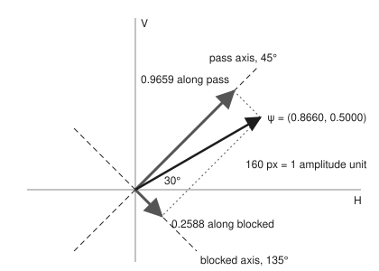
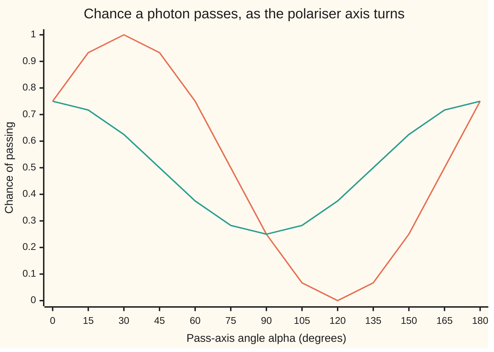

# States as vectors: operators for observables, eigenvalues for the outcomes

[Syllabus](../../../SYLLABUS.md) → [Engineering mathematics](../README.md) → [Quantum Mechanics in Outline](../README.md#s09) → States as vectors

---

## General Overview

A quantum key link sends single photons, particles of light, one at a time: 1,000,000 a second. Each leaves the sender polarised at 45° from horizontal, meaning its electric field swings along a line tilted 45°. A slow twist in the fibre has turned it to 30° by the time it arrives. At the receiver it meets a polarising beam splitter whose axis sits at 45°, the sender's angle. The splitter has two exits, "pass" and "blocked", with a single-photon detector on each.

A photon cannot split. Each one lands on exactly one detector, and nothing in the photon decides which in advance. What the engineer can know is the chance: 93.30% pass, 6.70% blocked. Over one second the pass detector counts about 933,013 photons and the blocked one about 66,987. Each blocked photon is an error in the key, so 6.70% is the error rate the link must detect and correct. Shine a 1.000 mW laser through the same splitter instead and 0.9330 mW comes out of the pass exit: the same number, now as a share of power.

This card shows where 0.9330 comes from, by a recipe that works for every quantum measurement. Write the photon's state as a short list of numbers, a vector. Write the device as a matrix. The matrix's eigenvalues are the readings the device can show; its eigenvectors are the directions those readings belong to; the squared length of the state along each direction is that reading's chance.

**A state is a unit vector, a measuring device is a Hermitian matrix, its eigenvalues are the only readings it can give, and the chance of each reading is the squared length of the state's component along that reading's eigenvector.**

**What kind of fact this is:** a model: the measurement rules of quantum mechanics, assumed and never yet contradicted by experiment. That the chances add to 1, and that the average reading is $\psi^*\hat A\psi$, are theorems proved on this card in Why it works.

### The picture: the state split along the device's two directions

<p align="center"></p>

To scale, 160 pixels per unit. The black arrow is the state. The two grey arrows are its pieces along the splitter's two axes, at right angles to each other: 0.9659 along "pass", 0.2588 along "blocked". Square them: 0.9330 and 0.0670. Pythagoras makes them add to 1, which is why they can be chances.

---

## The formula

Notation first, in words. $\psi$, read "psi", is the **state**: everything that can be known about the system, as a vector. When the state describes a wave spread over space, as for an electron in a box, $\psi$ is called the **wavefunction**. A hat on a letter, as in $\hat A$, marks an **operator**: a matrix that stands for something you can measure. In the statistics wing a hat meant an estimate; here it means an operator. And $\hbar$, read "h-bar", is the reduced Planck constant, the exchange rate between a frequency and an energy. The star is the conjugate transpose from [Complex vectors and matrices](../../07-Complex%20analysis/01-Complex%20Numbers%20and%20the%20Plane/07-complex-vectors-and-matrices.md): flip a column into a row and conjugate every entry.

$$\hat A\,u_k = \lambda_k\,u_k, \qquad p_k = \bigl\lvert u_k^*\,\psi\bigr\rvert^2, \qquad \langle\hat A\rangle = \sum_k \lambda_k\,p_k = \psi^*\hat A\,\psi$$

**Read it aloud:** the device's eigenvalues are the readings it can show; the chance of reading $\lambda_k$ is the squared size of the state's component along that reading's eigenvector; the average reading over many repeats is the state, times the matrix, times the state again.

For a polariser with its pass axis at angle $\alpha$, reading $+1$ for "pass" and $-1$ for "blocked", the matrix is

$$\hat A_\alpha = \begin{pmatrix}\cos 2\alpha & \sin 2\alpha \\ \sin 2\alpha & -\cos 2\alpha\end{pmatrix}, \qquad \hat A_{45^\circ} = \begin{pmatrix}0 & 1\\ 1 & 0\end{pmatrix}$$

| Symbol | Plain meaning | In our example | Push it up and the answer… |
| --- | --- | --- | --- |
| $\psi$, $\psi_c$, $i$ | the state: a unit column of complex numbers; $\psi_c$ is a second state; $i$ is the square root of −1 | (0.8660, 0.5000), the 30° photon; (0.8660, 0.5000$i$) | — |
| $e_H$, $e_V$ | the basis: horizontal (1, 0) and vertical (0, 1) | the lab's two reference directions | — |
| $c_H$, $c_V$ | amplitudes: the state's entries in that basis, $\psi = c_H e_H + c_V e_V$ | 0.8660 and 0.5000 | more horizontal light |
| $\theta$, $\alpha$ | the photon's polarisation angle; the device's pass-axis angle | 30° and 45° | the pass chance follows $\cos^2(\alpha - \theta)$ |
| $\hat A$, $\hat A_\alpha$ | the observable: a Hermitian matrix for the device | `[[0, 1], [1, 0]]` at 45° | — |
| $\lambda_k$, $k$ | the eigenvalues, one per exit $k$ (+ or −): the only readings | +1 pass, −1 blocked | a different scale of readings |
| $u_k$ | the eigenvectors: the state each exit leaves behind | (0.7071, 0.7071) and (0.7071, −0.7071) | — |
| $p_k$ | the chance of reading $\lambda_k$ | 0.9330 and 0.0670 | — |
| $\langle\hat A\rangle$ | the expected value: the long-run average reading | 0.8660 | rises as $\theta$ nears $\alpha$ |
| $u^*\psi$, $\langle u\vert\psi\rangle$ | the complex dot product; physicists write it with angle brackets | 0.9659 on the pass exit | — |
| $\hbar$, $\omega$, $E$ | reduced Planck constant; angular frequency; photon energy $E = \hbar\omega$ | 1.054572 × 10⁻³⁴ J s; 2.9758 × 10¹⁵ rad/s; 3.1381 × 10⁻¹⁹ J | bluer light, more energy per photon |
| $N$ | a look-alike matrix that is not Hermitian | `[[1, 2], [0, -1]]` | — |

### When it holds

- **The state is one unit vector.** A laser or a single-photon source gives one. Circular light, equal horizontal and vertical swings a quarter cycle out of step, passes with chance 0.5000 at every polariser axis too, but a quarter-wave plate (a crystal that delays one direction of swing by a quarter cycle) turns it into a straight-line state that the right polariser passes for certain. Unpolarised light, such as sunlight, is a random mix: it passes half the time whatever comes first, and no single vector does that, so it needs a density matrix (a matrix that describes a random mix of states), which this outline leaves out.
- **The device is Hermitian: it equals its own conjugate transpose.** Then its readings are real and its exits are perpendicular. Use the non-Hermitian $N$ and the "chances" add to 0.8170, while the "average reading" comes out at 1.3660, above the largest reading the device can show.
- **The device is ideal.** A real splitter absorbs a little light and leaks a little into the wrong exit; a real detector misses some photons. Multiply by measured efficiencies afterwards; the model gives the physics ceiling.
- **Each photon is measured once, fresh.** The chances are per photon. A count over a second fluctuates around $p_k$ times the number sent, by about the square root of (number sent × $p_k$ × $(1 - p_k)$): 250 photons for the pass count.
- **Nothing changes during the measurement.** How a state moves between measurements is [Schrodinger's equation](03-schrodinger-equation-and-the-particle-in-a-box.md).

---

## Why it works

### Step 0: a measuring device is a choice of perpendicular directions

A polarising splitter has two exits, and a photon polarised exactly along one axis always takes that exit. So the device picks out two directions at right angles. Any state can be split into a piece along each, like a force split into components. The pieces' squared lengths add to the state's squared length, 1, by Pythagoras. Numbers that are never negative and add to 1 can be chances. The rule of quantum mechanics is that they are.

### Step 1: the state is a unit vector of amplitudes

Pick a basis: here horizontal $e_H = (1, 0)$ and vertical $e_V = (0, 1)$. A photon at angle $\theta$ is $\psi = (\cos\theta, \sin\theta)$, so the 30° photon is (0.8660, 0.5000). Its length squared, $\psi^*\psi = 0.75 + 0.25$, is 1.0000. Every state is scaled to length 1.

Entries may be complex. Elliptically polarised light, where the vertical swing runs a quarter cycle out of step with the horizontal one, is $\psi_c = (0.8660, 0.5000\,i)$. The factor $i$ records that delay. Multiplying the whole vector by one complex number of size 1 changes nothing measurable. Changing one entry's phase against the other does, as Step 5 shows.

### Step 2: a device becomes a Hermitian matrix

Give each exit a reading $\lambda_k$ and a unit direction $u_k$, the directions perpendicular. Package them as one matrix:

$$\hat A = \lambda_+\,u_+u_+^* + \lambda_-\,u_-u_-^*$$

Each $u_k u_k^*$ is a projector: it keeps a vector's piece along $u_k$ and drops the rest. So $\hat A u_+ = \lambda_+ u_+$: the directions are eigenvectors and the readings are eigenvalues. The star of each term is itself, so $\hat A^* = \hat A$: the matrix is Hermitian.

The road also runs backwards. The spectral theorem says every Hermitian matrix is exactly such a package, with real eigenvalues on perpendicular eigenvectors ([The spectral theorem](../../03-Algebra/07-Eigenvalues%20and%20Symmetric%20Matrices/04-spectral-theorem.md), with every transpose starred). So "observable" and "Hermitian matrix" mean the same thing.

For the polariser, $u_+ = (\cos\alpha, \sin\alpha)$ and $u_- = (-\sin\alpha, \cos\alpha)$. Multiplying out $u_+u_+^* - u_-u_-^*$ entry by entry gives $\cos^2\alpha - \sin^2\alpha = \cos 2\alpha$ on the top left and $2\sin\alpha\cos\alpha = \sin 2\alpha$ off the diagonal: the matrix $\hat A_\alpha$ above. The doubled angle is not a choice. A polariser turned through 180° is the same polariser.

### Step 3: finding the readings from the matrix

Given only the matrix, the readings come from its eigenvalues. For a 2 × 2 Hermitian matrix with diagonal $a$, $d$ and corner $b$, they are $\tfrac12(a + d) \pm \sqrt{\tfrac14(a - d)^2 + \lvert b\rvert^2}$, and $(b, \lambda - a)$ is an eigenvector. For $\hat A_{45^\circ}$, $a = d = 0$ and $b = 1$, so the readings are +1 and −1, with eigenvectors (1, 1) and (1, −1), scaled to length 1 as (0.7071, 0.7071) and (0.7071, −0.7071). The square root is of a sum of squares, so it is never imaginary: real readings, as Step 2 promised.

### Step 4: the Born rule, and why the chances add to 1

The chance of reading $\lambda_k$ is $p_k = \lvert u_k^*\psi\rvert^2$, the **Born rule**. Here $u_+^*\psi = 0.7071 \times 0.8660 + 0.7071 \times 0.5000 = 0.9659$, so $p_+ = 0.9330$.

The two eigenvectors are perpendicular unit vectors, so they are a new basis, and the amplitudes $u_+^*\psi$ and $u_-^*\psi$ are $\psi$'s entries in it. Changing to a perpendicular basis keeps length, so $p_+ + p_- = \psi^*\psi = 1$. For the photon, $0.9330 + 0.0670 = 1.0000$.

### Step 5: the average reading is the matrix sandwiched by the state

Write $\psi$ in the eigenvector basis and apply $\hat A$: each piece is multiplied by its reading. Then

$$\psi^*\hat A\,\psi = \sum_k \lambda_k\,(\psi^* u_k)(u_k^*\psi) = \sum_k \lambda_k\,\lvert u_k^*\psi\rvert^2 = \sum_k \lambda_k\,p_k$$

For the photon, $\psi^*\hat A_{45^\circ}\psi = 2 \times 0.8660 \times 0.5000 = 0.8660$, and $(+1)(0.9330) + (-1)(0.0670) = 0.8660$. The sandwich needs no eigenvectors.

The angles give a third road. $u_+^*\psi = \cos\alpha\cos\theta + \sin\alpha\sin\theta = \cos(\alpha - \theta)$, so $p_+ = \cos^2(\alpha - \theta) = \cos^2 15^\circ = 0.9330$. That is **Malus's law** for a light beam's power through a polariser, measured long before photons were known. The quantum rule reproduces it photon by photon.

Now the complex state. In the horizontal–vertical basis $\psi_c$ gives 0.7500 and 0.2500, the same as $\psi$. At 45° it gives 0.5000, not 0.9330, and its average reading is 0.0000. The phase $i$ was invisible on one axis and decisive on another.



Orange: the 30° photon $\psi$, certain to pass at 30° and certain to be blocked at 120°. Green: the elliptical photon $\psi_c$, never certain at any angle. The two agree at 0° and 90°, the only axes a horizontal–vertical measurement uses.

### Step 6: after the reading, the state is the eigenvector

A photon that leaves by the pass exit is now polarised at 45°: its state is $u_+$. Measure it again at 45° and it passes with chance 1. This collapse is a rule of the model, not a theorem. The next section shows the numbers it predicts.

<details>
<summary>Detailed proof: real readings and perpendicular exits for any Hermitian matrix</summary>

**Real readings.** Let $\hat A u = \lambda u$ with $u$ non-zero. Then $u^*\hat A u = \lambda\,u^*u$. The conjugate of the number $u^*\hat A u$ is $u^*\hat A^* u = u^*\hat A u$, so it is real, and $u^*u > 0$, so $\lambda$ is real.

**Perpendicular exits.** Let $\hat A u = \lambda u$ and $\hat A w = \mu w$ with $\lambda \ne \mu$. Then $\mu\,w^*u = (\hat A w)^* u = w^*\hat A u = \lambda\,w^*u$, so $w^*u = 0$.

**Chances add to 1 in any dimension.** With perpendicular unit eigenvectors $u_1, \dots, u_n$, $\psi = \sum_k (u_k^*\psi)\,u_k$. Its length squared is $\sum_k \lvert u_k^*\psi\rvert^2$, because the cross terms $u_j^* u_k$ vanish. That sum is $\psi^*\psi = 1$.

</details>

---

## Worked numbers, by hand

The 30° photon at a 45° polarising splitter, 1,000,000 photons a second.

| Step | Arithmetic | Value |
| --- | --- | --- |
| state $\psi$ | $(\cos 30^\circ, \sin 30^\circ)$ | (0.8660, 0.5000) |
| length squared | $0.8660^2 + 0.5000^2$ | 1.0000 |
| device $\hat A_{45^\circ}$ | $\cos 90^\circ = 0$, $\sin 90^\circ = 1$ | `[[0, 1], [1, 0]]` |
| readings | $\pm\sqrt{0 + 1^2}$ | +1 and −1 |
| eigenvectors | $(1, \pm 1)$ over $\sqrt 2$ | (0.7071, 0.7071), (0.7071, −0.7071) |
| pass amplitude $u_+^*\psi$ | $0.7071 \times 0.8660 + 0.7071 \times 0.5000$ | 0.9659 |
| blocked amplitude $u_-^*\psi$ | $0.7071 \times 0.8660 - 0.7071 \times 0.5000$ | 0.2588 |
| chances | $0.9659^2$ and $0.2588^2$ | 0.9330 and 0.0670 |
| expected value, by readings | $0.9330 - 0.0670$ | 0.8660 |
| expected value, by sandwich | $2 \times 0.8660 \times 0.5000$ | 0.8660 |
| counts per second | $1{,}000{,}000 \times 0.9330$ and $\times 0.0670$ | 933,013 and 66,987 |
| **pass chance, Malus check** | $\cos^2(45^\circ - 30^\circ)$ | **0.9330** |

So each photon passes with chance 0.9330, and the pass detector should log about 933,000 counts a second. A simulated run of 100,000 photons gave 93,305 passes, 0.9331, well inside its band of four standard errors, ±0.0032.

The same splitter on a bright beam: red light of wavelength 633 nm has angular frequency $\omega$ = 2π × (speed of light) / (wavelength) = 2.9758 × 10¹⁵ rad/s. With $\hbar$ = 1.054572 × 10⁻³⁴ J s (the Planck constant over 2π, from its exact SI value in CODATA 2018), each photon carries $E = \hbar\omega$ = 3.1381 × 10⁻¹⁹ J, or 1.9587 eV. A 1.000 mW beam is 3.1866 × 10¹⁵ photons a second, and 0.9330 mW leaves by the pass exit: Malus's law, one photon at a time.

### What breaks if you drop a piece

| Mistake | Comes out at | What went wrong |
| --- | --- | --- |
| Use the amplitude, not its square | pass "chance" 0.9659; the two add to 1.2247 | Amplitudes add like sides of a right triangle, not like chances |
| Write the state as (1.7321, 1) and skip scaling | pass "chance" 3.7321 | A state must have length 1 before the Born rule applies |
| Leave out the conjugate: $\psi_c^T\hat A\psi_c$, a plain transpose $T$ | "average reading" 0.8660$i$ | Without the star the length can cancel; the right answer is 0.0000 |
| Drop the phase, treating $\psi_c$ as (0.8660, 0.5000) | pass chance 0.9330, right answer 0.5000 | Relative phase is measurable along a tilted axis |
| Use the non-Hermitian $N$ = `[[1, 2], [0, -1]]` as a device | "chances" add to 0.8170; "average" 1.3660 | Its eigenvectors are not perpendicular, so Pythagoras fails |

---

## What a measurement does to the state

A photon at 30° meets a polariser at 120°, at right angles to it. It is blocked for certain: chance 0.0000. Now slip a 45° polariser in front. Adding a filter lets light through.

At 45° a photon passes with chance 0.9330, and if it passes its state is now $u_+$, polarised at 45°. The 30° history is gone. At 120° it meets an axis 75° away from 45°, so it passes with chance $\cos^2 75^\circ$ = 0.0670.

| Stage | State going in | Chance of passing | Fraction still going |
| --- | --- | --- | --- |
| source | 30° | — | 1.0000 |
| polariser at 45° | 30° | 0.9330 | 0.9330 |
| polariser at 120° | 45°, after collapse | 0.0670 | **0.0625** |

Simulating 100,000 photons through the pair gave 6,303 through, a fraction of 0.0630, inside its band of ±0.0031 around 0.0625. Without the collapse, the second polariser would see the original 30° state and stop everything.

Turn the middle polariser and the fraction through all three changes:

```
middle axis   fraction through 30° → middle → 120°
    30°                                          0.0000
    45°   ██████████                             0.0625
    60°   ██████████████████████████████         0.1875
    75°   ████████████████████████████████████████  0.2500
    90°   ██████████████████████████████         0.1875
   105°   ██████████                             0.0625
   120°                                          0.0000
```

The best middle axis is 75°, halfway between, with a quarter of the photons through. Each measurement replaces the state with one of its own eigenvectors.

---

## Code, from first principles, and it actually runs

The script builds the state and the polariser matrix, finds the eigenvalues and eigenvectors by the 2 × 2 quadratic written out, and applies the Born rule. Complex numbers are Python's built-in type and a small struct in Rust; nothing imported knows any quantum mechanics. It reaches the pass chance four independent ways: eigenvectors and the Born rule, the sandwich $\psi^*\hat A\psi$ against the reading-weighted average, Malus's law from the angles alone, and 100,000 photons simulated one by one with a SplitMix64 generator, seed 2026, the same in both languages. It also prints every other number on the card, including a second simulation (seed 7) for the polariser chain.

### Python

```python
# States as vectors -- the check behind the card.  Standard library only.
# A photon polarised at 30 degrees meets a polariser whose axis is at 45 degrees.
# Roads to the pass probability: (1) eigenvectors of the Hermitian matrix, found
# by the 2x2 quadratic written out, then the Born rule; (2) the expected value
# psi* A psi against the eigenvalue average; (3) Malus's law from the angles
# alone; (4) photons simulated one at a time with a seeded generator.
from math import cos, sin, sqrt, pi, radians

def dot(u, v):  # conjugate the first vector, multiply matching entries, add
    return sum(a.conjugate() * b for a, b in zip(u, v))

def apply(A, v):
    return [A[0][0] * v[0] + A[0][1] * v[1], A[1][0] * v[0] + A[1][1] * v[1]]

def polariser(alpha):  # reading +1 along the axis at angle alpha, -1 across it
    c, s = round(cos(2 * alpha), 12) + 0.0, round(sin(2 * alpha), 12) + 0.0  # 0, not -6e-17
    return [[complex(c), complex(s)], [complex(s), complex(0.0 - c)]]

def eigen(A):  # 2x2 Hermitian [[a, b], [conj b, d]]: the quadratic, written out
    a, b, d = A[0][0].real, A[0][1], A[1][1].real
    r = sqrt(((a - d) / 2) ** 2 + abs(b) ** 2)
    out = []
    for lam in ((a + d) / 2 + r, (a + d) / 2 - r):
        if abs(b) > 1e-12:
            v = [b, complex(lam - a)]
        else:
            v = [1j * 0 + 1, 0j] if abs(lam - a) < 1e-12 else [0j, 1j * 0 + 1]
        n = sqrt(dot(v, v).real)
        out.append((lam, [x / n for x in v]))
    return out

def measure(A, psi):  # Born rule: (reading, probability, state afterwards)
    return [(lam, abs(dot(u, psi)) ** 2, u) for lam, u in eigen(A)]

def splitmix(seed):  # SplitMix64, so Python and Rust draw the same numbers
    M = (1 << 64) - 1
    while True:
        seed = (seed + 0x9E3779B97F4A7C15) & M
        z = seed
        z = ((z ^ (z >> 30)) * 0xBF58476D1CE4E5B9) & M
        z = ((z ^ (z >> 27)) * 0x94D049BB133111EB) & M
        yield ((z ^ (z >> 31)) >> 11) / 2.0 ** 53

def sim(psi, alphas, n, rng):  # photons pass a chain of polarisers, or are stopped
    passed = 0
    for _ in range(n):
        state = psi
        for al in alphas:
            (lp, pp, up), _ = measure(polariser(al), state)
            if next(rng) >= pp:
                break
            state = up  # a photon that got through now carries the axis's state
        else:
            passed += 1
    return passed

th, al = radians(30), radians(45)
psi = [complex(cos(th)), complex(sin(th))]
A = polariser(al)
(lp, pp, up), (lm, pm, um) = measure(A, psi)
print(f"state psi at 30 deg: ({psi[0].real:.4f}, {psi[1].real:.4f}), length squared {dot(psi, psi).real:.4f}")
print("polariser at 45 deg: A = [[%.4f, %.4f], [%.4f, %.4f]]" % tuple(A[i][j].real for i in (0, 1) for j in (0, 1)))
for lam, u in ((lp, up), (lm, um)):
    Au = apply(A, u)
    assert max(abs(Au[k] - lam * u[k]) for k in (0, 1)) < 1e-12  # it really is an eigenvector
    print(f"eigenvalue {lam:+.4f}, eigenvector ({u[0].real:.4f}, {u[1].real:.4f})")
print(f"amplitudes: pass port {dot(up, psi).real:.4f}, blocked port {dot(um, psi).real:.4f}")
print(f"P(pass) {pp:.4f}, P(blocked) {pm:.4f}, sum {pp + pm:.4f}")
assert abs(pp + pm - 1) < 1e-12
ev_sandwich, ev_average = dot(psi, apply(A, psi)).real, lp * pp + lm * pm
malus = cos(al - th) ** 2
print(f"expected value: psi* A psi {ev_sandwich:.4f}, sum of reading x chance {ev_average:.4f}")
print(f"Malus's law from the angles: cos^2(15 deg) {malus:.4f}")
assert abs(ev_sandwich - ev_average) < 1e-12 and abs(pp - malus) < 1e-12
rate = 1_000_000
print(f"of {rate} photons a second: pass {round(rate * pp)}, blocked {round(rate * pm)}, spread {sqrt(rate * pp * pm):.0f}")
n = 100_000
k = sim(psi, [al], n, splitmix(2026))
se = sqrt(pp * (1 - pp) / n)
print(f"simulated {n} photons: {k} passed, fraction {k / n:.4f}, 4 standard errors {4 * se:.4f}")
assert abs(k / n - pp) < 4 * se
h, c, e = 6.62607015e-34, 299792458.0, 1.602176634e-19  # exact SI values (CODATA)
hbar, lam_m, power = h / (2 * pi), 633e-9, 1e-3
omega = 2 * pi * c / lam_m
E = hbar * omega
print(f"hbar {hbar * 1e34:.6f}e-34 J s; 633 nm light: omega {omega / 1e15:.4f}e15 rad/s, photon energy {E * 1e19:.4f}e-19 J = {E / e:.4f} eV")
flux = power / E
print(f"1.000 mW beam = {flux / 1e15:.4f}e15 photons/s; through the polariser {flux * pp * E * 1e3:.4f} mW")
assert abs(flux * pp * E - power * malus) < 1e-15 and abs(E - h * c / lam_m) < 1e-30
psic = [complex(cos(th)), 1j * sin(th)]
pH = measure(polariser(0.0), psic)[0][1]
(_, pc, _), _ = measure(A, psic)
evc = dot(psic, apply(A, psic))
print(f"complex state (0.8660, 0.5000i): P(H) {pH:.4f}; at 45 deg P(pass) {pc:.4f}, expected value {evc.real:.4f}")
assert abs(pH - cos(th) ** 2) < 1e-12 and abs(pc - (cos(th) * cos(al)) ** 2 - (sin(th) * sin(al)) ** 2) < 1e-12
assert abs(evc - cos(2 * th) * cos(2 * al)) < 1e-12  # elliptical light: cos 2theta cos 2alpha, real
pcirc = [measure(polariser(radians(a)), [complex(sqrt(0.5)), 1j * sqrt(0.5)])[0][1] for a in range(0, 180, 5)]
assert all(abs(p - 0.5) < 1e-12 for p in pcirc)  # circular light: one half at every axis, like unpolarised light
print(f"circular state (0.7071, 0.7071i): P(pass) {min(pcirc):.4f} to {max(pcirc):.4f} at every axis, 0 to 175 deg")
# what breaks
print(f"breaks, amplitude not squared: {dot(up, psi).real:.4f}, two 'chances' sum {dot(up, psi).real + dot(um, psi).real:.4f}")
raw = [complex(sqrt(3)), complex(1)]
print(f"breaks, state (1.7321, 1) not normalised: P(pass) {abs(dot(up, raw)) ** 2:.4f}")
noconj = psic[0] * (A[0][0] * psic[0] + A[0][1] * psic[1]) + psic[1] * (A[1][0] * psic[0] + A[1][1] * psic[1])
print(f"breaks, no conjugate on the complex state: 'expected value' {noconj.real:.4f} + {noconj.imag:.4f}i")
print(f"breaks, alpha in place of 2 alpha: P(pass) {measure(polariser(al / 2), psi)[0][1]:.4f}")
print(f"breaks, phase i dropped: P(pass) {abs(dot(up, [psic[0], complex(abs(psic[1]))])) ** 2:.4f} instead of {pc:.4f}")
N = [[1 + 0j, 2 + 0j], [0j, -1 + 0j]]  # not Hermitian, readings still +1 and -1
vecs = [[1 + 0j, 0j], [complex(1 / sqrt(2)), complex(-1 / sqrt(2))]]
for lam, v in zip((1, -1), vecs):
    Nv = apply(N, v)
    assert max(abs(Nv[k] - lam * v[k]) for k in (0, 1)) < 1e-12
fake = sum(abs(dot(v, psi)) ** 2 for v in vecs)
fev = dot(psi, apply(N, psi)).real
print(f"breaks, non-Hermitian [[1, 2], [0, -1]]: 'chances' sum {fake:.4f}, 'expected value' {fev:.4f}")
assert abs(fake - 1) > 0.1 and fev > 1
# a chain of polarisers: 30 deg photon, then 45 deg, then 120 deg
direct = measure(polariser(radians(120)), psi)[0][1]
two = pp * measure(polariser(radians(120)), up)[0][1]
print(f"chain: straight to 120 deg {direct:.4f}; via 45 deg {pp:.4f} x {two / pp:.4f} = {two:.4f}")
assert abs(two - (cos(al - th) * cos(radians(120) - al)) ** 2) < 1e-12
k2 = sim(psi, [al, radians(120)], n, splitmix(7))
print(f"chain simulated {n} photons: {k2} passed, fraction {k2 / n:.4f}, 4 standard errors {4 * sqrt(two * (1 - two) / n):.4f}")
assert abs(k2 / n - two) < 4 * sqrt(two * (1 - two) / n)
mids = range(30, 121, 15)
bars = [measure(polariser(radians(m)), psi)[0][1] * measure(polariser(radians(120)), measure(polariser(radians(m)), psi)[0][2])[0][1] for m in mids]
print("bars, middle axis deg : fraction through all three  " + "  ".join(f"{m}:{b:.4f}" for m, b in zip(mids, bars)))
angles = range(0, 181, 15)
print("chart, axis deg      " + " ".join(f"{a:5d}" for a in angles))
print("chart, linear 30 deg " + " ".join(f"{measure(polariser(radians(a)), psi)[0][1]:5.3f}" for a in angles))
print("chart, complex state " + " ".join(f"{measure(polariser(radians(a)), psic)[0][1]:5.3f}" for a in angles))
S, ox, oy = 160, 150, 210  # figure: 160 px per unit, origin of the plane
pts = [("psi", psi[0].real, psi[1].real), ("pass", *(dot(up, psi).real * x.real for x in up)),
       ("blocked", *(dot(um, psi).real * x.real for x in um))]
print("figure, px " + "  ".join(f"{nm}:({ox + S * x:.1f}, {oy - S * y:.1f})" for nm, x, y in pts))
psi40, m75, k1 = [complex(cos(radians(40))), complex(sin(radians(40)))], measure(polariser(radians(75)), psi), sim(psi, [al], n, splitmix(1))
print(f"try: photon at 40 deg P(pass) {measure(A, psi40)[0][1]:.4f}, simulated {sim(psi40, [al], n, splitmix(2026))} passed")
print(f"try: splitter at 75 deg P(pass) {m75[0][1]:.4f}, P(blocked) {m75[1][1]:.4f}, beam {flux * m75[0][1] * E * 1e3:.4f} mW")
print(f"try: n = 1000, {sim(psi, [al], 1000, splitmix(2026))} passed, 4 standard errors {4 * sqrt(pp * pm / 1000):.4f}; seed 1, {k1} passed, fraction {k1 / n:.4f}")
print("ALL CHECKS PASS")
```

**Ran 2026-11-11 on macOS, Python 3.14.10, standard library only. All checks passed. Output, pasted from the run:**

```text
state psi at 30 deg: (0.8660, 0.5000), length squared 1.0000
polariser at 45 deg: A = [[0.0000, 1.0000], [1.0000, 0.0000]]
eigenvalue +1.0000, eigenvector (0.7071, 0.7071)
eigenvalue -1.0000, eigenvector (0.7071, -0.7071)
amplitudes: pass port 0.9659, blocked port 0.2588
P(pass) 0.9330, P(blocked) 0.0670, sum 1.0000
expected value: psi* A psi 0.8660, sum of reading x chance 0.8660
Malus's law from the angles: cos^2(15 deg) 0.9330
of 1000000 photons a second: pass 933013, blocked 66987, spread 250
simulated 100000 photons: 93305 passed, fraction 0.9331, 4 standard errors 0.0032
hbar 1.054572e-34 J s; 633 nm light: omega 2.9758e15 rad/s, photon energy 3.1381e-19 J = 1.9587 eV
1.000 mW beam = 3.1866e15 photons/s; through the polariser 0.9330 mW
complex state (0.8660, 0.5000i): P(H) 0.7500; at 45 deg P(pass) 0.5000, expected value 0.0000
circular state (0.7071, 0.7071i): P(pass) 0.5000 to 0.5000 at every axis, 0 to 175 deg
breaks, amplitude not squared: 0.9659, two 'chances' sum 1.2247
breaks, state (1.7321, 1) not normalised: P(pass) 3.7321
breaks, no conjugate on the complex state: 'expected value' 0.0000 + 0.8660i
breaks, alpha in place of 2 alpha: P(pass) 0.9830
breaks, phase i dropped: P(pass) 0.9330 instead of 0.5000
breaks, non-Hermitian [[1, 2], [0, -1]]: 'chances' sum 0.8170, 'expected value' 1.3660
chain: straight to 120 deg 0.0000; via 45 deg 0.9330 x 0.0670 = 0.0625
chain simulated 100000 photons: 6303 passed, fraction 0.0630, 4 standard errors 0.0031
bars, middle axis deg : fraction through all three  30:0.0000  45:0.0625  60:0.1875  75:0.2500  90:0.1875  105:0.0625  120:0.0000
chart, axis deg          0    15    30    45    60    75    90   105   120   135   150   165   180
chart, linear 30 deg 0.750 0.933 1.000 0.933 0.750 0.500 0.250 0.067 0.000 0.067 0.250 0.500 0.750
chart, complex state 0.750 0.717 0.625 0.500 0.375 0.283 0.250 0.283 0.375 0.500 0.625 0.717 0.750
figure, px psi:(288.6, 130.0)  pass:(259.3, 100.7)  blocked:(179.3, 239.3)
try: photon at 40 deg P(pass) 0.9924, simulated 99237 passed
try: splitter at 75 deg P(pass) 0.5000, P(blocked) 0.5000, beam 0.5000 mW
try: n = 1000, 936 passed, 4 standard errors 0.0316; seed 1, 93280 passed, fraction 0.9328
ALL CHECKS PASS
```

### Rust

```rust
// States as vectors -- the check behind the card.  Rust std only, no crates.
// A photon polarised at 30 degrees meets a polariser whose axis is at 45 degrees.
// Roads to the pass probability: (1) eigenvectors of the Hermitian matrix, found
// by the 2x2 quadratic written out, then the Born rule; (2) the expected value
// psi* A psi against the eigenvalue average; (3) Malus's law from the angles
// alone; (4) photons simulated one at a time with a seeded generator.
use std::f64::consts::PI;

#[derive(Clone, Copy)]
struct C { re: f64, im: f64 } // a complex number, written out
fn c(re: f64, im: f64) -> C { C { re, im } }
impl C {
    fn add(self, o: C) -> C { c(self.re + o.re, self.im + o.im) }
    fn sub(self, o: C) -> C { c(self.re - o.re, self.im - o.im) }
    fn mul(self, o: C) -> C { c(self.re * o.re - self.im * o.im, self.re * o.im + self.im * o.re) }
    fn conj(self) -> C { c(self.re, -self.im) }
    fn scale(self, k: f64) -> C { c(self.re * k, self.im * k) }
    fn abs(self) -> f64 { (self.re * self.re + self.im * self.im).sqrt() }
}
type V = [C; 2];
type M = [[C; 2]; 2];

fn dot(u: &V, v: &V) -> C { u[0].conj().mul(v[0]).add(u[1].conj().mul(v[1])) } // conjugate the first
fn apply(a: &M, v: &V) -> V {
    [a[0][0].mul(v[0]).add(a[0][1].mul(v[1])), a[1][0].mul(v[0]).add(a[1][1].mul(v[1]))]
}
fn rnd(x: f64) -> f64 { (x * 1e12).round() / 1e12 + 0.0 } // 0, not -6e-17
fn polariser(alpha: f64) -> M { // reading +1 along the axis at angle alpha, -1 across it
    let (co, si) = (rnd((2.0 * alpha).cos()), rnd((2.0 * alpha).sin()));
    [[c(co, 0.0), c(si, 0.0)], [c(si, 0.0), c(0.0 - co, 0.0)]]
}
fn eigen(a: &M) -> Vec<(f64, V)> { // 2x2 Hermitian [[a, b], [conj b, d]]: the quadratic
    let (aa, b, d) = (a[0][0].re, a[0][1], a[1][1].re);
    let r = (((aa - d) / 2.0).powi(2) + b.abs().powi(2)).sqrt();
    let mut out = Vec::new();
    for lam in [(aa + d) / 2.0 + r, (aa + d) / 2.0 - r] {
        let v: V = if b.abs() > 1e-12 { [b, c(lam - aa, 0.0)] }
            else if (lam - aa).abs() < 1e-12 { [c(1.0, 0.0), c(0.0, 0.0)] } else { [c(0.0, 0.0), c(1.0, 0.0)] };
        let n = dot(&v, &v).re.sqrt();
        out.push((lam, [v[0].scale(1.0 / n), v[1].scale(1.0 / n)]));
    }
    out
}
fn measure(a: &M, psi: &V) -> Vec<(f64, f64, V)> { // Born rule: reading, probability, state after
    eigen(a).into_iter().map(|(lam, u)| (lam, dot(&u, psi).abs().powi(2), u)).collect()
}
struct Rng(u64); // SplitMix64, so Python and Rust draw the same numbers
impl Rng {
    fn next(&mut self) -> f64 {
        self.0 = self.0.wrapping_add(0x9E3779B97F4A7C15);
        let mut z = self.0;
        z = (z ^ (z >> 30)).wrapping_mul(0xBF58476D1CE4E5B9);
        z = (z ^ (z >> 27)).wrapping_mul(0x94D049BB133111EB);
        ((z ^ (z >> 31)) >> 11) as f64 / 2f64.powi(53)
    }
}
fn sim(psi: &V, alphas: &[f64], n: usize, rng: &mut Rng) -> usize { // through a chain of polarisers
    let mut passed = 0;
    for _ in 0..n {
        let mut state = *psi;
        let mut through = true;
        for &al in alphas {
            let m = measure(&polariser(al), &state);
            if rng.next() >= m[0].1 { through = false; break; }
            state = m[0].2; // a photon that got through now carries the axis's state
        }
        if through { passed += 1; }
    }
    passed
}
fn rad(d: f64) -> f64 { d * PI / 180.0 }

fn main() {
    let (th, al) = (rad(30.0), rad(45.0));
    let psi: V = [c(th.cos(), 0.0), c(th.sin(), 0.0)];
    let a = polariser(al);
    let m = measure(&a, &psi);
    let ((lp, pp, up), (lm, pm, um)) = (m[0], m[1]);
    println!("state psi at 30 deg: ({:.4}, {:.4}), length squared {:.4}", psi[0].re, psi[1].re, dot(&psi, &psi).re);
    println!("polariser at 45 deg: A = [[{:.4}, {:.4}], [{:.4}, {:.4}]]", a[0][0].re, a[0][1].re, a[1][0].re, a[1][1].re);
    for (lam, u) in [(lp, up), (lm, um)] {
        let au = apply(&a, &u);
        assert!((0..2).all(|k| au[k].sub(u[k].scale(lam)).abs() < 1e-12)); // it really is an eigenvector
        println!("eigenvalue {:+.4}, eigenvector ({:.4}, {:.4})", lam, u[0].re, u[1].re);
    }
    println!("amplitudes: pass port {:.4}, blocked port {:.4}", dot(&up, &psi).re, dot(&um, &psi).re);
    println!("P(pass) {:.4}, P(blocked) {:.4}, sum {:.4}", pp, pm, pp + pm);
    assert!((pp + pm - 1.0).abs() < 1e-12);
    let (ev_sandwich, ev_average) = (dot(&psi, &apply(&a, &psi)).re, lp * pp + lm * pm);
    let malus = (al - th).cos().powi(2);
    println!("expected value: psi* A psi {:.4}, sum of reading x chance {:.4}", ev_sandwich, ev_average);
    println!("Malus's law from the angles: cos^2(15 deg) {:.4}", malus);
    assert!((ev_sandwich - ev_average).abs() < 1e-12 && (pp - malus).abs() < 1e-12);
    let rate = 1_000_000.0;
    println!("of {} photons a second: pass {}, blocked {}, spread {:.0}", rate as u64, (rate * pp).round() as u64, (rate * pm).round() as u64, (rate * pp * pm).sqrt());
    let n = 100_000;
    let k = sim(&psi, &[al], n, &mut Rng(2026));
    let (se, f) = ((pp * (1.0 - pp) / n as f64).sqrt(), k as f64 / n as f64);
    println!("simulated {} photons: {} passed, fraction {:.4}, 4 standard errors {:.4}", n, k, f, 4.0 * se);
    assert!((f - pp).abs() < 4.0 * se);
    let (h, cl, e) = (6.62607015e-34, 299792458.0, 1.602176634e-19); // exact SI values (CODATA)
    let (hbar, lam_m, power) = (h / (2.0 * PI), 633e-9, 1e-3);
    let omega = 2.0 * PI * cl / lam_m;
    let en = hbar * omega;
    println!("hbar {:.6}e-34 J s; 633 nm light: omega {:.4}e15 rad/s, photon energy {:.4}e-19 J = {:.4} eV",
        hbar * 1e34, omega / 1e15, en * 1e19, en / e);
    let flux = power / en;
    println!("1.000 mW beam = {:.4}e15 photons/s; through the polariser {:.4} mW", flux / 1e15, flux * pp * en * 1e3);
    assert!((flux * pp * en - power * malus).abs() < 1e-15 && (en - h * cl / lam_m).abs() < 1e-30);
    let psic: V = [c(th.cos(), 0.0), c(0.0, th.sin())];
    let ph = measure(&polariser(0.0), &psic)[0].1;
    let pc = measure(&a, &psic)[0].1;
    let evc = dot(&psic, &apply(&a, &psic));
    println!("complex state (0.8660, 0.5000i): P(H) {:.4}; at 45 deg P(pass) {:.4}, expected value {:.4}", ph, pc, evc.re);
    assert!((ph - th.cos().powi(2)).abs() < 1e-12 && (pc - (th.cos() * al.cos()).powi(2) - (th.sin() * al.sin()).powi(2)).abs() < 1e-12);
    assert!(evc.sub(c((2.0 * th).cos() * (2.0 * al).cos(), 0.0)).abs() < 1e-12); // elliptical: cos 2theta cos 2alpha
    let pcirc: Vec<f64> = (0..36).map(|i| measure(&polariser(rad(5.0 * i as f64)), &[c(0.5f64.sqrt(), 0.0), c(0.0, 0.5f64.sqrt())])[0].1).collect();
    assert!(pcirc.iter().all(|p| (p - 0.5).abs() < 1e-12)); // circular light: one half at every axis, like unpolarised light
    println!("circular state (0.7071, 0.7071i): P(pass) {:.4} to {:.4} at every axis, 0 to 175 deg", pcirc.iter().cloned().fold(1.0, f64::min), pcirc.iter().cloned().fold(0.0, f64::max));
    // what breaks
    let (ap, am) = (dot(&up, &psi).re, dot(&um, &psi).re);
    println!("breaks, amplitude not squared: {:.4}, two 'chances' sum {:.4}", ap, ap + am);
    let raw: V = [c(3f64.sqrt(), 0.0), c(1.0, 0.0)];
    println!("breaks, state (1.7321, 1) not normalised: P(pass) {:.4}", dot(&up, &raw).abs().powi(2));
    let av = apply(&a, &psic);
    let noconj = psic[0].mul(av[0]).add(psic[1].mul(av[1]));
    println!("breaks, no conjugate on the complex state: 'expected value' {:.4} + {:.4}i", noconj.re, noconj.im);
    println!("breaks, alpha in place of 2 alpha: P(pass) {:.4}", measure(&polariser(al / 2.0), &psi)[0].1);
    let dropped: V = [psic[0], c(psic[1].abs(), 0.0)];
    println!("breaks, phase i dropped: P(pass) {:.4} instead of {:.4}", dot(&up, &dropped).abs().powi(2), pc);
    let nm: M = [[c(1.0, 0.0), c(2.0, 0.0)], [c(0.0, 0.0), c(-1.0, 0.0)]]; // not Hermitian
    let s = 1.0 / 2f64.sqrt();
    let vecs: [V; 2] = [[c(1.0, 0.0), c(0.0, 0.0)], [c(s, 0.0), c(-s, 0.0)]];
    for (lam, v) in [(1.0, vecs[0]), (-1.0, vecs[1])] {
        let nv = apply(&nm, &v);
        assert!((0..2).all(|k| nv[k].sub(v[k].scale(lam)).abs() < 1e-12));
    }
    let fake: f64 = vecs.iter().map(|v| dot(v, &psi).abs().powi(2)).sum();
    let fev = dot(&psi, &apply(&nm, &psi)).re;
    println!("breaks, non-Hermitian [[1, 2], [0, -1]]: 'chances' sum {:.4}, 'expected value' {:.4}", fake, fev);
    assert!((fake - 1.0).abs() > 0.1 && fev > 1.0);
    // a chain of polarisers: 30 deg photon, then 45 deg, then 120 deg
    let p120 = polariser(rad(120.0));
    let (direct, two) = (measure(&p120, &psi)[0].1, pp * measure(&p120, &up)[0].1);
    println!("chain: straight to 120 deg {:.4}; via 45 deg {:.4} x {:.4} = {:.4}", direct, pp, two / pp, two);
    assert!((two - ((al - th).cos() * (rad(120.0) - al).cos()).powi(2)).abs() < 1e-12);
    let k2 = sim(&psi, &[al, rad(120.0)], n, &mut Rng(7));
    let (f2, se2) = (k2 as f64 / n as f64, (two * (1.0 - two) / n as f64).sqrt());
    println!("chain simulated {} photons: {} passed, fraction {:.4}, 4 standard errors {:.4}", n, k2, f2, 4.0 * se2);
    assert!((f2 - two).abs() < 4.0 * se2);
    let bars: Vec<String> = (0..7).map(|i| {
        let md = 30 + 15 * i;
        let first = measure(&polariser(rad(md as f64)), &psi);
        format!("{}:{:.4}", md, first[0].1 * measure(&p120, &first[0].2)[0].1)
    }).collect();
    println!("bars, middle axis deg : fraction through all three  {}", bars.join("  "));
    let angles: Vec<i32> = (0..13).map(|i| 15 * i).collect();
    let row = |st: &V| angles.iter().map(|&d| format!("{:5.3}", measure(&polariser(rad(d as f64)), st)[0].1)).collect::<Vec<_>>().join(" ");
    println!("chart, axis deg      {}", angles.iter().map(|d| format!("{:5}", d)).collect::<Vec<_>>().join(" "));
    println!("chart, linear 30 deg {}", row(&psi));
    println!("chart, complex state {}", row(&psic));
    let (sc, ox, oy) = (160.0, 150.0, 210.0); // figure: 160 px per unit, origin of the plane
    let pts = [("psi", psi[0].re, psi[1].re), ("pass", ap * up[0].re, ap * up[1].re), ("blocked", am * um[0].re, am * um[1].re)];
    println!("figure, px {}", pts.iter().map(|(nm, x, y)| format!("{}:({:.1}, {:.1})", nm, ox + sc * x, oy - sc * y)).collect::<Vec<_>>().join("  "));
    let (p40, m75, k1): (V, _, _) = ([c(rad(40.0).cos(), 0.0), c(rad(40.0).sin(), 0.0)], measure(&polariser(rad(75.0)), &psi), sim(&psi, &[al], n, &mut Rng(1)));
    println!("try: photon at 40 deg P(pass) {:.4}, simulated {} passed", measure(&a, &p40)[0].1, sim(&p40, &[al], n, &mut Rng(2026)));
    println!("try: splitter at 75 deg P(pass) {:.4}, P(blocked) {:.4}, beam {:.4} mW", m75[0].1, m75[1].1, flux * m75[0].1 * en * 1e3);
    println!("try: n = 1000, {} passed, 4 standard errors {:.4}; seed 1, {} passed, fraction {:.4}", sim(&psi, &[al], 1000, &mut Rng(2026)), 4.0 * (pp * pm / 1000.0).sqrt(), k1, k1 as f64 / n as f64);
    println!("ALL CHECKS PASS");
}
```

**Ran 2026-11-11 on macOS, rustc 1.98.1, no crates. All checks passed. Output, pasted from the run:**

```text
state psi at 30 deg: (0.8660, 0.5000), length squared 1.0000
polariser at 45 deg: A = [[0.0000, 1.0000], [1.0000, 0.0000]]
eigenvalue +1.0000, eigenvector (0.7071, 0.7071)
eigenvalue -1.0000, eigenvector (0.7071, -0.7071)
amplitudes: pass port 0.9659, blocked port 0.2588
P(pass) 0.9330, P(blocked) 0.0670, sum 1.0000
expected value: psi* A psi 0.8660, sum of reading x chance 0.8660
Malus's law from the angles: cos^2(15 deg) 0.9330
of 1000000 photons a second: pass 933013, blocked 66987, spread 250
simulated 100000 photons: 93305 passed, fraction 0.9331, 4 standard errors 0.0032
hbar 1.054572e-34 J s; 633 nm light: omega 2.9758e15 rad/s, photon energy 3.1381e-19 J = 1.9587 eV
1.000 mW beam = 3.1866e15 photons/s; through the polariser 0.9330 mW
complex state (0.8660, 0.5000i): P(H) 0.7500; at 45 deg P(pass) 0.5000, expected value 0.0000
circular state (0.7071, 0.7071i): P(pass) 0.5000 to 0.5000 at every axis, 0 to 175 deg
breaks, amplitude not squared: 0.9659, two 'chances' sum 1.2247
breaks, state (1.7321, 1) not normalised: P(pass) 3.7321
breaks, no conjugate on the complex state: 'expected value' 0.0000 + 0.8660i
breaks, alpha in place of 2 alpha: P(pass) 0.9830
breaks, phase i dropped: P(pass) 0.9330 instead of 0.5000
breaks, non-Hermitian [[1, 2], [0, -1]]: 'chances' sum 0.8170, 'expected value' 1.3660
chain: straight to 120 deg 0.0000; via 45 deg 0.9330 x 0.0670 = 0.0625
chain simulated 100000 photons: 6303 passed, fraction 0.0630, 4 standard errors 0.0031
bars, middle axis deg : fraction through all three  30:0.0000  45:0.0625  60:0.1875  75:0.2500  90:0.1875  105:0.0625  120:0.0000
chart, axis deg          0    15    30    45    60    75    90   105   120   135   150   165   180
chart, linear 30 deg 0.750 0.933 1.000 0.933 0.750 0.500 0.250 0.067 0.000 0.067 0.250 0.500 0.750
chart, complex state 0.750 0.717 0.625 0.500 0.375 0.283 0.250 0.283 0.375 0.500 0.625 0.717 0.750
figure, px psi:(288.6, 130.0)  pass:(259.3, 100.7)  blocked:(179.3, 239.3)
try: photon at 40 deg P(pass) 0.9924, simulated 99237 passed
try: splitter at 75 deg P(pass) 0.5000, P(blocked) 0.5000, beam 0.5000 mW
try: n = 1000, 936 passed, 4 standard errors 0.0316; seed 1, 93280 passed, fraction 0.9328
ALL CHECKS PASS
```

The two outputs are identical, digit for digit, including the simulated counts.

> [!TIP]
> **Try changing**
> The `try:` lines in the output print each answer below.
> - Guess first: turn the photon to 40°, nearer the 45° axis. Set `th = radians(40)`. The pass chance rises to **0.9924**, and the simulation counts 99,237 of 100,000.
> - Guess first: turn the splitter to 75°, 45° away from the photon. Set `al = radians(75)`. Pass and blocked are **0.5000** each: a fair coin. The 1.000 mW beam gives 0.5000 mW.
> - Guess first: how wide is the band for only 1,000 photons? Set `n = 1_000`. Four standard errors become **±0.0316**, ten times wider, and the run counts 936 passes. Ten times the precision costs a hundred times the photons.
> - Guess first: change the seed to `splitmix(1)`. The count moves to 93,280, a fraction of 0.9328. The chance did not change; only the luck did.

---

## The usual mistake

> [!warning]
> **Reading the amplitude as the chance.** The pass amplitude is 0.9659; the chance is its square, 0.9330. Amplitudes are lengths of perpendicular pieces, so they add by Pythagoras, not by plain addition: 0.9659 + 0.2588 is 1.2247, more than certainty. Square first, then add.
>
> Smaller traps:
> - **The expected value is not a reading.** The average is 0.8660, but every photon reads +1 or −1. No detector ever shows 0.8660.
> - **Dropping the conjugate.** With complex states, $\psi^T\hat A\psi$, flipping the column without conjugating, gives 0.8660$i$ for $\psi_c$, an "average" that is not even real. The star is what keeps it real: 0.0000.
> - **Calling the phase decoration.** $\psi$ and $\psi_c$ agree on the horizontal–vertical axis, 0.7500 and 0.2500, and disagree at 45°: 0.9330 against 0.5000.
> - **Halving the doubled angle.** A polariser at $\alpha$ has $2\alpha$ in its matrix, because turning it through 180° changes nothing. Put $\alpha$ in place of $2\alpha$ and the 45° device becomes a 22.5° device: the 30° photon passes with chance 0.9830, not 0.9330.

---

## Where you meet it in real life

- **Quantum key distribution.** The sender encodes bits on photons at 0°, 90°, 45° or 135°. A receiver who measures on the wrong pair of axes gets a fair coin, 0.5000, as in the Try box. An eavesdropper who guesses the axes wrong must collapse the state, and that shows up as errors the two ends can count.
- **Photon counters, sunglasses and LCD screens.** Single-photon detectors in lidar report clicks, not power: each click rate is a Born-rule chance times a photon rate. Polarising sunglasses and LCD pixels use Malus's law, the same chance applied to billions of photons a second.
- **Qubits in quantum computers.** A qubit is a two-state system written exactly like $\psi$. Each run ends in one reading, so a computation is repeated thousands of times and the counts estimate the $p_k$, with the error band of the simulation above.
- **Electron spin in a magnetic field.** The same two-by-two algebra describes a spin measured along an axis: [Spin one-half](06-spin-and-two-state-systems.md).
- **The electron in a box.** The shelf's house example: an electron in a 1 nm box has an energy operator whose eigenvalues are its allowed energies. Measuring the energy follows this card's recipe: [Schrodinger's equation](03-schrodinger-equation-and-the-particle-in-a-box.md).

> **Say it back**
> A quantum state is a unit vector of complex amplitudes, written in a chosen basis. A measuring device is a Hermitian matrix; its eigenvalues are the only readings it can give and its eigenvectors are the states those readings leave behind. The chance of each reading is the squared length of the state's piece along that eigenvector, and the pieces' squares add to 1 by Pythagoras. The average reading is $\psi^*\hat A\psi$. A 30° photon at a 45° polariser passes with chance 0.9330, which is Malus's law one photon at a time.

---

## What this builds on

- [The spectral theorem](../../03-Algebra/07-Eigenvalues%20and%20Symmetric%20Matrices/04-spectral-theorem.md): a symmetric matrix is a set of real stretches along perpendicular axes. That is exactly a measuring device: readings on perpendicular exits.
- [Complex vectors and matrices](../../07-Complex%20analysis/01-Complex%20Numbers%20and%20the%20Plane/07-complex-vectors-and-matrices.md): the starred dot product, Hermitian matrices and their real eigenvalues. This card gives them a physical meaning.
- [The dot product](../../03-Algebra/06-Dot%20Products%20and%20Best%20Fits/01-dot-product.md): components, lengths and right angles. An amplitude is a dot product, and the Born rule is Pythagoras.

## Where this goes next

- [Schrodinger's equation](03-schrodinger-equation-and-the-particle-in-a-box.md): how a state moves between measurements, driven by the energy operator, and the electron in a box whose energy eigenvalues are its levels.
- [Uncertainty](05-uncertainty-principle.md): two devices whose matrices do not commute, such as the 0° and 45° polarisers, cannot both give certain readings on one state.
- [Spin one-half](06-spin-and-two-state-systems.md): the two-state system in full, with three matrices for the three axes.

This card measured a two-state system with two exits; how the recipe stretches to position, which has a continuum of possible readings, is the open question.

---

## Sources

Verified 2026-11-11: every link below resolves to the publisher's page.

- Born, Max. "Zur Quantenmechanik der Stoßvorgänge." *Zeitschrift für Physik* 37 (1926): 863–867. [doi:10.1007/BF01397477](https://doi.org/10.1007/BF01397477). The rule that squared amplitudes are probabilities.
- Griffiths, David J., and Darrell F. Schroeter. *Introduction to Quantum Mechanics*, 3rd ed. Cambridge University Press, 2018. [doi:10.1017/9781316995433](https://doi.org/10.1017/9781316995433). Hermitian observables, the generalised statistical interpretation, and the expected value as a sandwich.
- Nielsen, Michael A., and Isaac L. Chuang. *Quantum Computation and Quantum Information*, 10th anniversary ed. Cambridge University Press, 2010. [doi:10.1017/CBO9780511976667](https://doi.org/10.1017/CBO9780511976667). The measurement postulates for finite systems, written as projectors, and two-state systems as qubits.
- Bennett, Charles H., and Gilles Brassard. "Quantum cryptography: Public key distribution and coin tossing." *Theoretical Computer Science* 560 (2014): 7–11. [doi:10.1016/j.tcs.2014.05.025](https://doi.org/10.1016/j.tcs.2014.05.025). The four-polarisation key distribution scheme behind the overview's link.
- Tiesinga, Eite, Peter J. Mohr, David B. Newell, and Barry N. Taylor. "CODATA recommended values of the fundamental physical constants: 2018." *Reviews of Modern Physics* 93 (2021): 025010. [doi:10.1103/RevModPhys.93.025010](https://doi.org/10.1103/RevModPhys.93.025010). The exact values of $h$, $c$ and the electron charge used for $\hbar$ and the photon energy.
