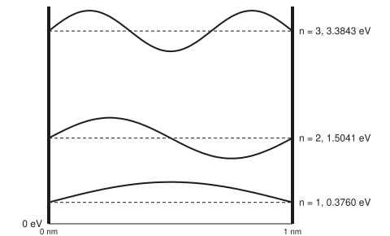
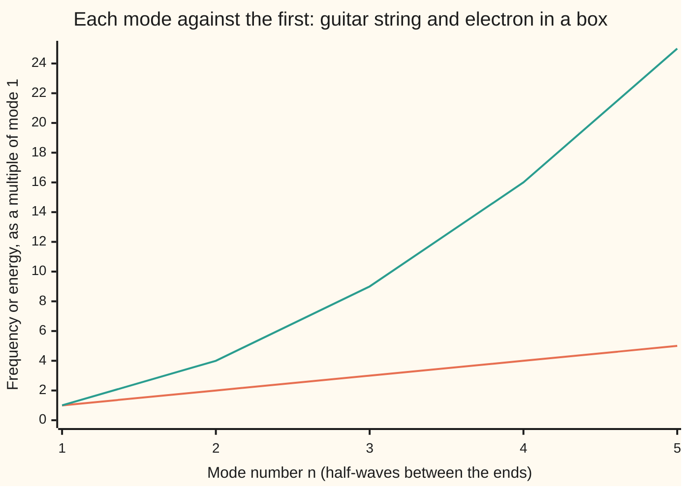

# Schrodinger's equation: a wave equation whose standing modes are energy levels

[Syllabus](../../../SYLLABUS.md) → [Engineering mathematics](../README.md) → [Quantum Mechanics in Outline](../README.md#s09) → Schrodinger's equation

---

## General Overview

A guitar's A string is 0.65 m long and pinned at both ends. It can only ring at notes whose waves fit between the pins: 110 Hz, 220 Hz, 330 Hz, and so on up in equal steps. Nothing in between.

Now trap one electron in a strip 1 nm wide (a millionth of a millimetre, a few atoms across), with walls it cannot get through. A thin semiconductor layer in a laser, or a small quantum dot in a display, is close to this. An electron behaves as a wave, so it too must fit between its walls.

It can only hold certain energies: 0.3760 eV, 1.5041 eV, 3.3843 eV (an electronvolt, eV, is the energy an electron gains crossing one volt). These are its **energy levels**. When it drops from the second level to the first it gives out light of wavelength 1099 nm, in the near infrared.

Make the strip narrower and the light moves toward blue. That is how engineers pick a laser's colour by picking a layer's thickness.

A quantum cascade laser uses jumps between levels like this one. An ordinary diode laser's light crosses the crystal's band gap (the fixed energy step from its filled states to its empty ones). The layer's thickness shifts that light by raising the lowest levels.

The shapes are the same as the string's. The spacing is not. The string's notes go 1 : 2 : 3. The electron's levels go 1 : 4 : 9. This card finds the levels, sets the waves' size, and explains why the two ladders differ.

**Schrodinger's equation is a wave equation for a particle; walls force its waves to be standing waves, and each standing wave that fits carries one allowed energy, which for a box grows with the square of the number of half-waves.**

**What kind of fact this is:** a model, then a theorem inside it. Schrodinger's equation is a law of physics at speeds well below light's, accepted because it predicts measurements, not proved. Given the equation and perfect walls, the levels below are a theorem, proved on this card in Why it works.

### The picture: three standing waves at their own heights

<p align="center"></p>

To scale: 300 px per nm across, and energy upward at 70 px per eV. Each wave is drawn 25 px high about its level. Its height up the page is only for display; the wave itself has no energy axis.

---

## The formula

Notation reminder: ψ (psi) is the **wavefunction**, the wave that describes the electron ([States as vectors](02-state-vectors-operators-and-measurement.md)). ħ (h-bar) is Planck's constant divided by 2π. A curly ∂ is a rate of change with only one variable moving: ∂ψ/∂t with time moving, ∂²ψ/∂x² the bending along x.

$$i\hbar\,\frac{\partial \psi}{\partial t} \;=\; -\frac{\hbar^2}{2m}\,\frac{\partial^2 \psi}{\partial x^2} \;+\; V\,\psi$$

**Read it aloud:** how fast the wave turns in time is set by how sharply it bends in space, which is its kinetic energy, plus the potential energy where it sits.

Inside a box of width L with walls the electron cannot cross, the answer is a list:

$$E_n = \frac{n^2 h^2}{8\,m\,L^2} = \frac{n^2 \pi^2 \hbar^2}{2\,m\,L^2}, \qquad \varphi_n(x) = \sqrt{\frac{2}{L}}\,\sin\frac{n\pi x}{L}, \qquad n = 1, 2, 3, \dots$$

**Read it aloud:** the n-th level is n squared times one fixed energy, and its shape is a sine with n half-waves between the walls, scaled so the chances add up to one.

| Symbol | Plain meaning | In our example | Push it up and the answer… |
| --- | --- | --- | --- |
| $x$, $t$ | position across the box from one wall, in m; time, in s | 0 to 1 nm | — |
| $L$ | the box's width, in m | 1 nm | every level falls as 1/L²: 2 nm gives E₁ = 0.0940 eV |
| $\psi$, $\varphi_n$ | the wavefunction ψ(x, t); $\varphi_n(x)$ (phi) the n-th standing shape. $\lvert\psi\rvert^2$ is the chance per metre of finding the electron at x | $\varphi_1$ peaks at 44721 per root metre | — |
| $V$ | potential energy at x, in J: zero inside the box, too high to climb at the walls | 0 inside | levels rise if the floor rises |
| $m$ | the particle's mass, in kg | 9.1093837139 × 10⁻³¹ kg, the electron | every level falls as 1/m |
| $h$, $\hbar$, $c$ | Planck's constant, J s; ħ = h/(2π); c the speed of light, m/s | h = 6.62607015 × 10⁻³⁴, ħ = 1.054571818 × 10⁻³⁴; hc = 1.9864 × 10⁻²⁵ J m | — |
| $E$, $E_n$ | energy, in J or eV; $E_n$ the n-th allowed level | E₁ = 6.0247 × 10⁻²⁰ J = 0.37603 eV | — |
| $n$ | the level number: how many half-waves fit | 1, 2, 3 | energy grows as n² |
| $A$ | the wave's size; the normaliser $A = \sqrt{2/L}$ makes the total chance one | 44721 per root metre | — |
| $i$ | the square root of −1 | — | — |
| $f$, $\omega$ | frequency in Hz (a string's note, or a level's E/h); ω = 2πf, in rad/s | 110 Hz; 90.9 THz | — |
| $p$, $k$, $\lambda$ | momentum, in kg m/s; wavenumber k = 2π/λ, in rad/m; wavelength λ, in m | level n: λ = 2L/n | — |

### When it holds

- **Walls that cannot be crossed.** Real walls have a height. A well 1 nm wide but only 1 eV deep has its ground level at 0.1908 eV; the box model says 0.3760 eV, 97% high. At 10 eV deep it is 0.2976 eV, at 100 eV deep 0.3483 eV: the model is a ceiling the real well climbs toward.
- **Speeds well below light's.** The kinetic energy p²/2m (p is momentum) is Newton's. These levels are tiny beside the electron's rest energy, mc² with c the speed of light, so the error is tiny. A heavy atom's inner electrons break this.
- **One particle alone.** A second electron in the box pushes on the first, and the levels shift. The equation here has no term for that.
- **The free electron's mass.** Inside a crystal an electron moves as if it had a different mass, the **effective mass**, often far lighter. Levels scale as 1/m, so a lighter effective mass raises them in the same proportion.

---

## Why it works

### Step 0: a trapped wave can only stand, and standing waves come in a list

A wave trapped between two walls bounces back and forth. Most wavelengths cancel themselves after a few bounces. Only those that fit a whole number of half-waves between the walls survive, as **standing waves**: shapes that stay put and only pulse. The string does this ([Waves on strings and drums](01-wave-equation-for-strings-and-membranes.md)). The electron does the same. What differs is the rule linking a wave's shape to its frequency, and that rule is what Schrodinger's equation supplies.

### Step 1: where the equation comes from

Two experimental facts. Electrons diffract like waves, with wavelength λ = h/p (momentum p). And a wave's energy is E = hf, its frequency times h. Write a travelling wave as $e^{i(kx - \omega t)}$, with k = 2π/λ and ω = 2πf. Then p = ħk and E = ħω.

Taking ∂/∂t of this wave multiplies it by −iω. Taking ∂²/∂x² multiplies it by −k². So

$$i\hbar\,\frac{\partial\psi}{\partial t} = \hbar\omega\,\psi = E\,\psi, \qquad -\frac{\hbar^2}{2m}\frac{\partial^2\psi}{\partial x^2} = \frac{\hbar^2k^2}{2m}\,\psi = \frac{p^2}{2m}\,\psi.$$

Energy is kinetic plus potential, E = p²/2m + V. Ask the equation to say that for every wave at once, and it is the formula above. This is a motivation, not a proof: the equation is a postulate (a starting assumption), kept because its predictions match experiment.

### Step 2: split off time

Try a wave that keeps one shape and only turns in time: $\psi(x,t) = \varphi(x)\,e^{-iEt/\hbar}$. The time derivative brings down −iE/ħ, and the equation becomes

$$-\frac{\hbar^2}{2m}\,\varphi'' + V\varphi = E\,\varphi .$$

Here φ'' is the bending of the shape, its second derivative along x. This is the **time-independent** equation. The factor $e^{-iEt/\hbar}$ spins at frequency E/h but has size one, so |ψ|² does not change: a state with one energy sits still. That is why such a state is called **stationary**.

### Step 3: the walls turn the energy into an eigenvalue

Inside the box V = 0. At the walls the wave must be zero: a wave that leaked out would need infinite energy. So

$$-\varphi'' = \frac{2mE}{\hbar^2}\,\varphi, \qquad \varphi(0) = 0, \qquad \varphi(L) = 0 .$$

This is the pinned string's problem, already solved: minus the bending equals a constant times the shape, zero at both ends. A constant that allows a nonzero shape is an **eigenvalue** (an allowed value of that constant). A nonzero shape exists only when the constant is (nπ/L)², and the shape is then sin(nπx/L) ([Eigenvalue problems](../../08-Differential%20equations%20and%20dynamics/07-Series%20Solutions%20and%20Boundary%20Problems/08-eigenvalues-and-eigenfunctions.md)). Set 2mE/ħ² = (nπ/L)² and solve for E:

$$E_n = \frac{n^2\pi^2\hbar^2}{2mL^2}.$$

Replace ħ by h/(2π) and it is n²h²/(8mL²). Units check: J² s² over kg m² is J. Energy is **quantised** (allowed only on a list) for the same reason the string has a lowest note: the second wall rejects every shape that does not close up on it.

n = 0 gives sin(0) = 0 everywhere, no electron at all. So the lowest level is n = 1, at 0.3760 eV, not zero. A trapped electron cannot sit still. This is the **zero-point energy**.

### Step 4: set the size, so the chances add up to one

The equation fixes the shape and leaves the size free: any multiple of a solution is a solution. Physics fixes the size. |φ|² is the chance per metre of finding the electron at x, and the electron is somewhere in the box, so

$$\int_0^L A^2 \sin^2\frac{n\pi x}{L}\,dx = A^2\,\frac{L}{2} = 1 \quad\Longrightarrow\quad A = \sqrt{\frac{2}{L}}.$$

The integral is L/2 because sin² averages one half over whole half-waves. For L = 1 nm, A is 44721 per root metre. Different levels are perpendicular: the product of two different shapes integrates to zero. That is the Sturm-Liouville theorem for this equation ([Sturm-Liouville](../../08-Differential%20equations%20and%20dynamics/07-Series%20Solutions%20and%20Boundary%20Problems/09-sturm-liouville-and-orthogonality.md)), and the code confirms it by numerical integration.

### Step 5: why the string goes 1 : 2 : 3 and the electron 1 : 4 : 9

Both have the shape sin(nπx/L), so both have wavelength 2L/n. Only the frequency rule differs.

The string's equation has two time derivatives and two space derivatives. A wave's frequency is then its wave speed divided by its wavelength. Halve the wavelength and the frequency doubles: f ∝ n (∝ reads "grows in proportion to").

Schrodinger's equation has one time derivative and two space derivatives. So frequency goes as one over wavelength *squared*: f = E/h ∝ n². Halve the wavelength and the energy goes up four times.

Read in frequency, the electron's ladder is 90.9, 363.7, 818.3 THz. The string's is 110, 220, 330 Hz. Same shapes, different rule.



The lower, straight line is the string: 110, 220, 330, 440, 550 Hz. The upper, bending line is the electron: 0.3760, 1.5041, 3.3843, 6.0165, 9.4008 eV.

---

## Worked numbers, by hand

An electron, m = 9.1093837139 × 10⁻³¹ kg (CODATA 2022), in a box L = 1 nm wide. h = 6.62607015 × 10⁻³⁴ J s exactly, and 1 eV = 1.602176634 × 10⁻¹⁹ J exactly, by the definition of the SI units.

| Step | Arithmetic | Value |
| --- | --- | --- |
| h² | (6.62607015 × 10⁻³⁴)² | 4.3905 × 10⁻⁶⁷ J² s² |
| 8mL² | 8 × 9.1093837139 × 10⁻³¹ × (10⁻⁹)² | 7.2875 × 10⁻⁴⁸ kg m² |
| E₁ in joules | 4.3905 × 10⁻⁶⁷ ÷ 7.2875 × 10⁻⁴⁸ | 6.0247 × 10⁻²⁰ J |
| E₁ in eV | 6.0247 × 10⁻²⁰ ÷ 1.602176634 × 10⁻¹⁹ | 0.37603 eV |
| E₂, E₃ | 4 × 0.37603; 9 × 0.37603 | 1.5041 eV; 3.3843 eV |
| gap from 2 to 1 | 1.5041 − 0.3760 | 1.1281 eV |
| photon wavelength | hc ÷ gap = 1.9864 × 10⁻²⁵ J m ÷ (1.1281 eV in J) | **1099 nm** |
| normaliser | √(2 ÷ 10⁻⁹ m) | 44721 per root metre |
| chance in the middle third, n = 1 | 1/3 + √3/(2π) | 0.6090 |

An electron that drops from level 2 to level 1 in this box gives out near-infrared light at 1099 nm. An electron in level 1 is found in the middle third of the box with chance 0.6090, against 0.3333 for a ball bouncing evenly between the walls.

In level 2 the middle-third chance falls to 0.1955, because level 2 has a **node** (a point where the wave is always zero) right at the centre. The gaps 1.128, 1.880, 2.632 eV go 3 : 5 : 7, each next odd number, because n² steps by odd numbers.

### What breaks if you drop a piece

| Mistake | Comes out at | What went wrong |
| --- | --- | --- |
| h used where ħ belongs | E₁ = 14.85 eV, not 0.3760 eV | ħ = h/(2π), and squaring the slip makes the answer 4π² times too big |
| Levels spaced like a string's notes | E₃ = 1.128 eV, not 3.384 eV | One time derivative, not two: energy goes as n², not n |
| Normaliser √(1/L) | total chance 0.5000 | sin² averages a half, so the size needs √2 more |
| Infinite walls for a 1 eV deep well | 0.3760 eV, not 0.1908 eV | A shallow wall lets the wave leak out, so the wave is longer and the energy lower: 97% high |

The code prints all four.

---

## Code, from first principles, and it actually runs

The code finds the levels by three roads.

- The first is the closed form, n²h²/(8mL²).
- The second solves the time-independent equation directly by **shooting**: start the wave at zero at one wall, step it across the box with RK4 (a standard step-by-step solver), and adjust the energy by halving the gap until the wave lands at zero on the far wall. It knows nothing of sines.
- The third builds a well of finite depth, finds its ground level by halving the gap on the well's matching condition (the inside and outside waves must join smoothly at the wall), and raises the walls from 1 to 100 eV to watch the level climb toward the box's 0.3760 eV from below.

Numerical integration (Simpson's rule) then checks the normaliser, that different levels are perpendicular, and the middle-third chances.

### Python

```python
# Schrodinger's equation and the particle in a box -- the check behind the card.
# Standard library only.  An electron in a box 1 nm wide, walls it cannot cross,
# set beside a guitar string.  Three roads to the energy levels: the closed
# form, a shooting solve of the equation itself (RK4 plus bisection), and a
# finite well whose walls are raised until it becomes the box.
import math

H = 6.62607015e-34          # Planck constant, J s (exact in SI)
HBAR = H / (2 * math.pi)    # reduced Planck constant, J s
ME = 9.1093837139e-31       # electron mass, kg (CODATA 2022)
EV = 1.602176634e-19        # one electronvolt, J (exact in SI)
C = 299792458.0             # speed of light, m/s (exact in SI)
L = 1e-9                    # box width, m
K = 2 * ME * EV * (1e-9) ** 2 / HBAR ** 2   # phi'' = -K E phi, x in nm, E in eV

def level(n, width=L):      # road 1: E_n = n^2 h^2 / (8 m L^2), in eV
    return n * n * H * H / (8 * ME * width * width) / EV

def shoot(E, steps=2000, w=1.0):  # phi(0)=0, phi'(0)=1, RK4 across w nm; returns phi(w)
    dx, y, v = w / steps, 0.0, 1.0
    for _ in range(steps):
        k1y, k1v = v, -K * E * y
        k2y, k2v = v + dx / 2 * k1v, -K * E * (y + dx / 2 * k1y)
        k3y, k3v = v + dx / 2 * k2v, -K * E * (y + dx / 2 * k2y)
        k4y, k4v = v + dx * k3v, -K * E * (y + dx * k3y)
        y += dx / 6 * (k1y + 2 * k2y + 2 * k3y + k4y)
        v += dx / 6 * (k1v + 2 * k2v + 2 * k3v + k4v)
    return y

def bisect(f, a, b, iters=60):
    fa = f(a)
    for _ in range(iters):
        m = (a + b) / 2
        if (f(m) < 0) == (fa < 0): a, fa = m, f(m)
        else: b = m
    return (a + b) / 2

def shot_levels(count):     # road 2: scan E for sign changes of phi(1 nm), then bisect
    found, E, prev = [], 0.02, shoot(0.02)
    while len(found) < count:
        nxt = shoot(E + 0.02)
        if (prev < 0) != (nxt < 0): found.append(bisect(shoot, E, E + 0.02))
        E, prev = E + 0.02, nxt
    return found

def finite_well(V0, a=1.0): # road 3: even ground state of a well a nm wide, V0 eV deep
    z0 = a / 2 * math.sqrt(K * V0)
    z = bisect(lambda z: z * math.tan(z) - math.sqrt(z0 * z0 - z * z), 1e-9, min(z0, math.pi / 2) - 1e-12)
    return 4 * z * z / (K * a * a)

def simpson(f, a, b, n=1000):
    h = (b - a) / n
    s = f(a) + f(b) + sum((4 if i % 2 else 2) * f(a + i * h) for i in range(1, n))
    return s * h / 3

E = [level(n) for n in range(1, 6)]
S = shot_levels(5)
print("constants: h 6.62607015 x 10^-34 J s, hbar %.9f x 10^-34 J s, m_e %.10f x 10^-31 kg"
      % (HBAR * 1e34, ME * 1e31))
print("box width L = 1.000 nm; K = 2 m_e (1 eV)(1 nm)^2 / hbar^2 = %.4f" % K)
print("n   E_n formula   E_n shooting   E_n/E_1   E_n/h")
for n in range(5):
    print("%d   %8.4f eV   %9.4f eV   %7.2f   %6.1f THz" % (n + 1, E[n], S[n], E[n] / E[0], E[n] * EV / H / 1e12))
print("hand route: h^2 = %.4f x 10^-67 J^2 s^2, 8 m_e L^2 = %.4f x 10^-48 kg m^2, h c = %.4f x 10^-25 J m"
      % (H * H * 1e67, 8 * ME * L * L * 1e48, H * C * 1e25))
print("E_1 = %.4f x 10^-20 J = %.5f eV" % (E[0] * EV * 1e20, E[0]))
gaps = [E[i + 1] - E[i] for i in range(3)]
print("gaps E2-E1, E3-E2, E4-E3: %.3f, %.3f, %.3f eV, ratio %.0f : %.0f : %.0f"
      % (*gaps, *(g / E[0] for g in gaps)))
lam = H * C / (gaps[0] * EV)
print("photon from level 2 to level 1: %.4f eV, wavelength %.0f nm" % (gaps[0], lam * 1e9))
A = math.sqrt(2 / L)
print("normaliser sqrt(2/L) = %.0f per root metre = %.4f per root nm" % (A, math.sqrt(2.0)))
phi = lambda n: (lambda x: math.sqrt(2.0) * math.sin(n * math.pi * x))   # x in nm
norm = simpson(lambda x: phi(1)(x) ** 2, 0, 1)
o12 = simpson(lambda x: phi(1)(x) * phi(2)(x), 0, 1)
o13 = simpson(lambda x: phi(1)(x) * phi(3)(x), 0, 1)
print("Simpson: total probability n=1 %.6f; overlap(1,2) %.6f; overlap(1,3) %.6f" % (norm, abs(o12), abs(o13)))
mid = [simpson(lambda x: phi(n)(x) ** 2, 1 / 3, 2 / 3) for n in (1, 2)]
f1 = 1 / 3 + math.sqrt(3) / (2 * math.pi)
f2 = 1 / 3 - math.sqrt(3) / (4 * math.pi)
print("P(middle third): n=1 %.4f (formula %.4f), n=2 %.4f (formula %.4f), classical 0.3333"
      % (mid[0], f1, mid[1], f2))
Ls, f1s = 0.65, 110.0
print("guitar A string: %.2f m, wave speed %.0f m/s, harmonics %s Hz"
      % (Ls, 2 * Ls * f1s, " ".join("%.0f" % (n * f1s) for n in range(1, 6))))
print("chart, string ratio: %s; electron ratio: %s" % (" ".join("%.0f" % (n * f1s / f1s) for n in range(1, 6)),
      " ".join("%.0f" % (e / E[0]) for e in E)))
print("box width scan: L 0.5, 1, 2 nm -> E_1 %.4f, %.4f, %.4f eV"
      % (level(1, 0.5e-9), level(1, 1e-9), level(1, 2e-9)))
fw = [finite_well(V) for V in (1.0, 10.0, 100.0)]
print("finite well 1 nm wide, ground level: depth 1 eV %.4f, 10 eV %.4f, 100 eV %.4f eV"
      % tuple(fw))
print("mistake, h in place of hbar: E_1 = %.2f eV" % (level(1) * 4 * math.pi ** 2))
print("mistake, levels in step like a string: E_3 = %.3f eV (right %.3f eV)" % (3 * E[0], E[2]))
print("mistake, normaliser sqrt(1/L): total probability %.4f" % (norm / 2))
print("mistake, infinite walls for a 1 eV well: %.4f eV against %.4f eV, %.0f%% high"
      % (E[0], fw[0], 100 * (E[0] / fw[0] - 1)))
print("figure, walls x_px 60 360, 300 px per nm, 70 px per eV, levels y_px %.2f %.2f %.2f, amplitude 25 px"
      % tuple(275 - 70 * e for e in E[:3]))
starved = [bisect(lambda e: shoot(e, 20), lo, hi) for lo, hi in ((0.3, 0.45), (9.0, 10.0))]
print("try: steps=20, level 1 %.4f eV, level 5 %.4f eV; well 1000 eV deep, ground level %.4f eV"
      % (*starved, finite_well(1000.0)))

assert all(abs(S[i] - E[i]) / E[i] < 1e-6 for i in range(5))     # shooting meets formula
assert abs(math.pi ** 2 / K - E[0]) / E[0] < 1e-12                # hbar form meets h form
assert fw[0] < fw[1] < fw[2] < E[0] and (E[0] - fw[2]) / E[0] < 0.25  # walls raised -> box
assert abs(norm - 1) < 1e-9 and abs(o12) < 1e-9 and abs(o13) < 1e-9
assert abs(mid[0] - f1) < 1e-9 and abs(mid[1] - f2) < 1e-9
assert abs(lam - H * C / ((S[1] - S[0]) * EV)) / lam < 1e-6       # wavelength, by the shooting road
assert abs(bisect(lambda e: shoot(e, w=2.0), 0.05, 0.15) / level(1, 2e-9) - 1) < 1e-6  # 1/L^2: shoot a 2 nm box
print("ALL CHECKS PASS")
```

**Ran 2026-11-11 on macOS, Python 3.14.10, standard library only. All checks passed. Output, pasted from the run:**

```
constants: h 6.62607015 x 10^-34 J s, hbar 1.054571818 x 10^-34 J s, m_e 9.1093837139 x 10^-31 kg
box width L = 1.000 nm; K = 2 m_e (1 eV)(1 nm)^2 / hbar^2 = 26.2468
n   E_n formula   E_n shooting   E_n/E_1   E_n/h
1     0.3760 eV      0.3760 eV      1.00     90.9 THz
2     1.5041 eV      1.5041 eV      4.00    363.7 THz
3     3.3843 eV      3.3843 eV      9.00    818.3 THz
4     6.0165 eV      6.0165 eV     16.00   1454.8 THz
5     9.4008 eV      9.4008 eV     25.00   2273.1 THz
hand route: h^2 = 4.3905 x 10^-67 J^2 s^2, 8 m_e L^2 = 7.2875 x 10^-48 kg m^2, h c = 1.9864 x 10^-25 J m
E_1 = 6.0247 x 10^-20 J = 0.37603 eV
gaps E2-E1, E3-E2, E4-E3: 1.128, 1.880, 2.632 eV, ratio 3 : 5 : 7
photon from level 2 to level 1: 1.1281 eV, wavelength 1099 nm
normaliser sqrt(2/L) = 44721 per root metre = 1.4142 per root nm
Simpson: total probability n=1 1.000000; overlap(1,2) 0.000000; overlap(1,3) 0.000000
P(middle third): n=1 0.6090 (formula 0.6090), n=2 0.1955 (formula 0.1955), classical 0.3333
guitar A string: 0.65 m, wave speed 143 m/s, harmonics 110 220 330 440 550 Hz
chart, string ratio: 1 2 3 4 5; electron ratio: 1 4 9 16 25
box width scan: L 0.5, 1, 2 nm -> E_1 1.5041, 0.3760, 0.0940 eV
finite well 1 nm wide, ground level: depth 1 eV 0.1908, 10 eV 0.2976, 100 eV 0.3483 eV
mistake, h in place of hbar: E_1 = 14.85 eV
mistake, levels in step like a string: E_3 = 1.128 eV (right 3.384 eV)
mistake, normaliser sqrt(1/L): total probability 0.5000
mistake, infinite walls for a 1 eV well: 0.3760 eV against 0.1908 eV, 97% high
figure, walls x_px 60 360, 300 px per nm, 70 px per eV, levels y_px 248.68 169.71 38.10, amplitude 25 px
try: steps=20, level 1 0.3760 eV, level 5 9.4484 eV; well 1000 eV deep, ground level 0.3669 eV
ALL CHECKS PASS
```

### Rust

Same numbers, same labels, built with `rustc --edition 2021 -O`.

```rust
// Schrodinger's equation and the particle in a box -- the same check in Rust.
// No crates.  An electron in a box 1 nm wide, walls it cannot cross, set
// beside a guitar string.  Three roads to the energy levels: the closed form,
// a shooting solve of the equation itself (RK4 plus bisection), and a finite
// well whose walls are raised until it becomes the box.
use std::f64::consts::PI;

const H: f64 = 6.62607015e-34;      // Planck constant, J s (exact in SI)
const ME: f64 = 9.1093837139e-31;   // electron mass, kg (CODATA 2022)
const EV: f64 = 1.602176634e-19;    // one electronvolt, J (exact in SI)
const C: f64 = 299792458.0;         // speed of light, m/s (exact in SI)
const L: f64 = 1e-9;                // box width, m

fn hbar() -> f64 { H / (2.0 * PI) }
fn kk() -> f64 { 2.0 * ME * EV * 1e-9 * 1e-9 / (hbar() * hbar()) } // phi'' = -K E phi

fn level(n: f64, width: f64) -> f64 { n * n * H * H / (8.0 * ME * width * width) / EV }

fn shoot(e: f64, steps: usize, w: f64) -> f64 { // phi(0)=0, phi'(0)=1, RK4 across w nm
    let (dx, k) = (w / steps as f64, kk());
    let (mut y, mut v) = (0.0f64, 1.0f64);
    for _ in 0..steps {
        let (k1y, k1v) = (v, -k * e * y);
        let (k2y, k2v) = (v + dx / 2.0 * k1v, -k * e * (y + dx / 2.0 * k1y));
        let (k3y, k3v) = (v + dx / 2.0 * k2v, -k * e * (y + dx / 2.0 * k2y));
        let (k4y, k4v) = (v + dx * k3v, -k * e * (y + dx * k3y));
        y += dx / 6.0 * (k1y + 2.0 * k2y + 2.0 * k3y + k4y);
        v += dx / 6.0 * (k1v + 2.0 * k2v + 2.0 * k3v + k4v);
    }
    y
}

fn bisect<F: Fn(f64) -> f64>(f: F, mut a: f64, mut b: f64) -> f64 {
    let mut fa = f(a);
    for _ in 0..60 {
        let m = (a + b) / 2.0;
        if (f(m) < 0.0) == (fa < 0.0) { a = m; fa = f(m); } else { b = m; }
    }
    (a + b) / 2.0
}

fn shot_levels(count: usize) -> Vec<f64> {   // scan E for sign changes, then bisect
    let (mut found, mut e) = (Vec::new(), 0.02f64);
    let mut prev = shoot(e, 2000, 1.0);
    while found.len() < count {
        let nxt = shoot(e + 0.02, 2000, 1.0);
        if (prev < 0.0) != (nxt < 0.0) { found.push(bisect(|x| shoot(x, 2000, 1.0), e, e + 0.02)); }
        e += 0.02;
        prev = nxt;
    }
    found
}

fn finite_well(v0: f64, a: f64) -> f64 {     // even ground state, a nm wide, v0 eV deep
    let k = kk();
    let z0 = a / 2.0 * (k * v0).sqrt();
    let z = bisect(|z: f64| z * z.tan() - (z0 * z0 - z * z).sqrt(), 1e-9, z0.min(PI / 2.0) - 1e-12);
    4.0 * z * z / (k * a * a)
}

fn simpson<F: Fn(f64) -> f64>(f: F, a: f64, b: f64) -> f64 {
    let n = 1000;
    let h = (b - a) / n as f64;
    let mut s = f(a) + f(b);
    for i in 1..n { s += if i % 2 == 1 { 4.0 } else { 2.0 } * f(a + i as f64 * h); }
    s * h / 3.0
}

fn phi(n: f64, x: f64) -> f64 { 2.0f64.sqrt() * (n * PI * x).sin() }   // x in nm

fn main() {
    let k = kk();
    let e: Vec<f64> = (1..6).map(|n| level(n as f64, L)).collect();
    let s = shot_levels(5);
    println!("constants: h 6.62607015 x 10^-34 J s, hbar {:.9} x 10^-34 J s, m_e {:.10} x 10^-31 kg",
             hbar() * 1e34, ME * 1e31);
    println!("box width L = 1.000 nm; K = 2 m_e (1 eV)(1 nm)^2 / hbar^2 = {:.4}", k);
    println!("n   E_n formula   E_n shooting   E_n/E_1   E_n/h");
    for n in 0..5 {
        println!("{}   {:8.4} eV   {:9.4} eV   {:7.2}   {:6.1} THz",
                 n + 1, e[n], s[n], e[n] / e[0], e[n] * EV / H / 1e12);
    }
    println!("hand route: h^2 = {:.4} x 10^-67 J^2 s^2, 8 m_e L^2 = {:.4} x 10^-48 kg m^2, h c = {:.4} x 10^-25 J m",
             H * H * 1e67, 8.0 * ME * L * L * 1e48, H * C * 1e25);
    println!("E_1 = {:.4} x 10^-20 J = {:.5} eV", e[0] * EV * 1e20, e[0]);
    let g: Vec<f64> = (0..3).map(|i| e[i + 1] - e[i]).collect();
    println!("gaps E2-E1, E3-E2, E4-E3: {:.3}, {:.3}, {:.3} eV, ratio {:.0} : {:.0} : {:.0}",
             g[0], g[1], g[2], g[0] / e[0], g[1] / e[0], g[2] / e[0]);
    let lam = H * C / (g[0] * EV);
    println!("photon from level 2 to level 1: {:.4} eV, wavelength {:.0} nm", g[0], lam * 1e9);
    println!("normaliser sqrt(2/L) = {:.0} per root metre = {:.4} per root nm", (2.0 / L).sqrt(), 2.0f64.sqrt());
    let norm = simpson(|x| phi(1.0, x).powi(2), 0.0, 1.0);
    let o12 = simpson(|x| phi(1.0, x) * phi(2.0, x), 0.0, 1.0);
    let o13 = simpson(|x| phi(1.0, x) * phi(3.0, x), 0.0, 1.0);
    println!("Simpson: total probability n=1 {:.6}; overlap(1,2) {:.6}; overlap(1,3) {:.6}", norm, o12.abs(), o13.abs());
    let mid: Vec<f64> = [1.0, 2.0].iter().map(|&n| simpson(|x| phi(n, x).powi(2), 1.0 / 3.0, 2.0 / 3.0)).collect();
    let f1 = 1.0 / 3.0 + 3.0f64.sqrt() / (2.0 * PI);
    let f2 = 1.0 / 3.0 - 3.0f64.sqrt() / (4.0 * PI);
    println!("P(middle third): n=1 {:.4} (formula {:.4}), n=2 {:.4} (formula {:.4}), classical 0.3333",
             mid[0], f1, mid[1], f2);
    let (ls, f1s) = (0.65f64, 110.0f64);
    let harm: Vec<String> = (1..6).map(|n| format!("{:.0}", n as f64 * f1s)).collect();
    println!("guitar A string: {:.2} m, wave speed {:.0} m/s, harmonics {} Hz", ls, 2.0 * ls * f1s, harm.join(" "));
    let sr: Vec<String> = (1..6).map(|n| format!("{:.0}", n as f64 * f1s / f1s)).collect();
    let er: Vec<String> = e.iter().map(|x| format!("{:.0}", x / e[0])).collect();
    println!("chart, string ratio: {}; electron ratio: {}", sr.join(" "), er.join(" "));
    println!("box width scan: L 0.5, 1, 2 nm -> E_1 {:.4}, {:.4}, {:.4} eV",
             level(1.0, 0.5e-9), level(1.0, 1e-9), level(1.0, 2e-9));
    let fw: Vec<f64> = [1.0, 10.0, 100.0].iter().map(|&v| finite_well(v, 1.0)).collect();
    println!("finite well 1 nm wide, ground level: depth 1 eV {:.4}, 10 eV {:.4}, 100 eV {:.4} eV", fw[0], fw[1], fw[2]);
    println!("mistake, h in place of hbar: E_1 = {:.2} eV", e[0] * 4.0 * PI * PI);
    println!("mistake, levels in step like a string: E_3 = {:.3} eV (right {:.3} eV)", 3.0 * e[0], e[2]);
    println!("mistake, normaliser sqrt(1/L): total probability {:.4}", norm / 2.0);
    println!("mistake, infinite walls for a 1 eV well: {:.4} eV against {:.4} eV, {:.0}% high",
             e[0], fw[0], 100.0 * (e[0] / fw[0] - 1.0));
    println!("figure, walls x_px 60 360, 300 px per nm, 70 px per eV, levels y_px {:.2} {:.2} {:.2}, amplitude 25 px",
             275.0 - 70.0 * e[0], 275.0 - 70.0 * e[1], 275.0 - 70.0 * e[2]);
    let starved: Vec<f64> = [(0.3, 0.45), (9.0, 10.0)].iter().map(|&(lo, hi)| bisect(|x| shoot(x, 20, 1.0), lo, hi)).collect();
    println!("try: steps=20, level 1 {:.4} eV, level 5 {:.4} eV; well 1000 eV deep, ground level {:.4} eV",
             starved[0], starved[1], finite_well(1000.0, 1.0));

    assert!((0..5).all(|i| (s[i] - e[i]).abs() / e[i] < 1e-6));       // shooting meets formula
    assert!((PI * PI / k - e[0]).abs() / e[0] < 1e-12);                // hbar form meets h form
    assert!(fw[0] < fw[1] && fw[1] < fw[2] && fw[2] < e[0] && (e[0] - fw[2]) / e[0] < 0.25);
    assert!((norm - 1.0).abs() < 1e-9 && o12.abs() < 1e-9 && o13.abs() < 1e-9);
    assert!((mid[0] - f1).abs() < 1e-9 && (mid[1] - f2).abs() < 1e-9);
    assert!((lam - H * C / ((s[1] - s[0]) * EV)).abs() / lam < 1e-6);   // wavelength, by the shooting road
    assert!((bisect(|x| shoot(x, 2000, 2.0), 0.05, 0.15) / level(1.0, 2e-9) - 1.0).abs() < 1e-6); // 1/L^2: shoot a 2 nm box
    println!("ALL CHECKS PASS");
}
```

**Ran 2026-11-11 on macOS, rustc 1.98.1, no crates. All checks passed. Output, pasted from the run:**

```
constants: h 6.62607015 x 10^-34 J s, hbar 1.054571818 x 10^-34 J s, m_e 9.1093837139 x 10^-31 kg
box width L = 1.000 nm; K = 2 m_e (1 eV)(1 nm)^2 / hbar^2 = 26.2468
n   E_n formula   E_n shooting   E_n/E_1   E_n/h
1     0.3760 eV      0.3760 eV      1.00     90.9 THz
2     1.5041 eV      1.5041 eV      4.00    363.7 THz
3     3.3843 eV      3.3843 eV      9.00    818.3 THz
4     6.0165 eV      6.0165 eV     16.00   1454.8 THz
5     9.4008 eV      9.4008 eV     25.00   2273.1 THz
hand route: h^2 = 4.3905 x 10^-67 J^2 s^2, 8 m_e L^2 = 7.2875 x 10^-48 kg m^2, h c = 1.9864 x 10^-25 J m
E_1 = 6.0247 x 10^-20 J = 0.37603 eV
gaps E2-E1, E3-E2, E4-E3: 1.128, 1.880, 2.632 eV, ratio 3 : 5 : 7
photon from level 2 to level 1: 1.1281 eV, wavelength 1099 nm
normaliser sqrt(2/L) = 44721 per root metre = 1.4142 per root nm
Simpson: total probability n=1 1.000000; overlap(1,2) 0.000000; overlap(1,3) 0.000000
P(middle third): n=1 0.6090 (formula 0.6090), n=2 0.1955 (formula 0.1955), classical 0.3333
guitar A string: 0.65 m, wave speed 143 m/s, harmonics 110 220 330 440 550 Hz
chart, string ratio: 1 2 3 4 5; electron ratio: 1 4 9 16 25
box width scan: L 0.5, 1, 2 nm -> E_1 1.5041, 0.3760, 0.0940 eV
finite well 1 nm wide, ground level: depth 1 eV 0.1908, 10 eV 0.2976, 100 eV 0.3483 eV
mistake, h in place of hbar: E_1 = 14.85 eV
mistake, levels in step like a string: E_3 = 1.128 eV (right 3.384 eV)
mistake, normaliser sqrt(1/L): total probability 0.5000
mistake, infinite walls for a 1 eV well: 0.3760 eV against 0.1908 eV, 97% high
figure, walls x_px 60 360, 300 px per nm, 70 px per eV, levels y_px 248.68 169.71 38.10, amplitude 25 px
try: steps=20, level 1 0.3760 eV, level 5 9.4484 eV; well 1000 eV deep, ground level 0.3669 eV
ALL CHECKS PASS
```

The two outputs match line for line.

### Lean

Lean proves the box's energy levels, its normaliser and its middle-third chances, for every width, mass and level number.

- Take m, L and ħ above zero, and solve the time-independent equation with V = 0, zero at both walls. Then a nonzero solution exists exactly when $E = n^2\pi^2\hbar^2/(2mL^2)$ for some $n \ge 1$.
- Take levels j and k, both at least 1. Then the integral of $\varphi_j\varphi_k$ from 0 to L is 1 when j = k, and 0 otherwise. So each total chance is one, and different levels are perpendicular.
- Take any box width L. Then the chance in the middle third for level 1 is $1/3 + \sqrt{3}/(2\pi)$. For level 2 it is $1/3 - \sqrt{3}/(4\pi)$.
- The levels go 1 : 4 : 9 : 16 : 25, and their gaps go 3 : 5 : 7. The string's notes go 110, 220, 330, 440, 550 Hz.

The eV values, the shooting solve, the finite well and the 1099 nm light are left to the Python and Rust checks.

```lean
-- Schrodinger's equation: in a box with walls that cannot be crossed, the time-independent equation has a nonzero solution exactly at the energies n^2 pi^2 hbar^2 / (2 m L^2), and the sine shapes sqrt(2/L) sin(n pi x / L) have total chance one and are perpendicular.
import Mathlib.Analysis.SpecialFunctions.Trigonometric.Basic
import Mathlib.Analysis.Calculus.Deriv.Basic
import Mathlib.Analysis.Complex.Basic
import Mathlib.MeasureTheory.Integral.IntervalIntegral.Basic
import Mathlib

open Real Set

/-- The card's standing shape: the n-th wave in a box of width `L`,
`φ_n(x) = √(2/L) · sin(nπx/L)`. -/
noncomputable def boxShape (L : ℝ) (n : ℕ) (x : ℝ) : ℝ :=
  Real.sqrt (2 / L) * Real.sin (n * π * x / L)

lemma box_integral_cos_mul {c : ℝ} (hc : c ≠ 0) (a b : ℝ) :
    ∫ x in a..b, Real.cos (c * x) = (Real.sin (c * b) - Real.sin (c * a)) / c := by
  rw [intervalIntegral.integral_eq_sub_of_hasDerivAt (f := fun x => Real.sin (c * x) / c)]
  · ring
  · intro x _
    have h := (((hasDerivAt_id x).const_mul c).sin).div_const c
    simp only [id_eq, mul_one] at h
    convert h using 1
    field_simp
  · exact (by fun_prop : Continuous fun x => Real.cos (c * x)).intervalIntegrable _ _

#print axioms box_integral_cos_mul

lemma box_const_of_hasDerivAt_zero {L : ℝ} {g : ℝ → ℂ}
    (h : ∀ x ∈ Ioo 0 L, HasDerivAt g 0 x) : ∃ A, ∀ x ∈ Ioo 0 L, g x = A :=
  isOpen_Ioo.exists_is_const_of_deriv_eq_zero isPreconnected_Ioo
    (fun x hx => (h x hx).differentiableAt.differentiableWithinAt)
    (fun x hx => (h x hx).deriv)

#print axioms box_const_of_hasDerivAt_zero

lemma box_hasDerivAt_ofReal (x : ℝ) : HasDerivAt (fun y : ℝ => (y : ℂ)) 1 x := by
  simpa using (hasDerivAt_id x).ofReal_comp

#print axioms box_hasDerivAt_ofReal

lemma box_hasDerivAt_cexp (c : ℂ) (x : ℝ) :
    HasDerivAt (fun y : ℝ => Complex.exp (c * y)) (Complex.exp (c * x) * c) x := by
  simpa using ((box_hasDerivAt_ofReal x).const_mul c).cexp

#print axioms box_hasDerivAt_cexp

lemma box_eq_on_Icc {L : ℝ} (hL : 0 < L) {φ f : ℝ → ℂ} (hφ : ContinuousOn φ (Icc 0 L))
    (hf : Continuous f) (h : ∀ x ∈ Ioo 0 L, φ x = f x) : φ 0 = f 0 ∧ φ L = f L := by
  have := Set.EqOn.of_subset_closure h hφ hf.continuousOn Ioo_subset_Icc_self
    (closure_Ioo hL.ne).superset
  exact ⟨this (left_mem_Icc.2 hL.le), this (right_mem_Icc.2 hL.le)⟩

#print axioms box_eq_on_Icc

lemma box_middle_third_general {L : ℝ} (hL : 0 < L) {n : ℕ} (hn : 1 ≤ n) :
    (∫ x in L / 3..2 * L / 3, boxShape L n x ^ 2) =
      1 / 3 - (Real.sin (4 * n * π / 3) - Real.sin (2 * n * π / 3)) / (2 * n * π) := by
  set a : ℝ := n * π / L with ha
  have h2 : √(2 / L) * √(2 / L) = 2 / L := Real.mul_self_sqrt (by positivity)
  have hpt : ∀ x, boxShape L n x ^ 2 = 1 / L * (1 - Real.cos ((2 * a) * x)) := by
    intro x
    simp only [boxShape]
    rw [show (2 * a) * x = 2 * (n * π * x / L) by rw [ha]; ring, Real.cos_two_mul,
      Real.cos_sq']
    linear_combination (Real.sin (n * π * x / L)) ^ 2 * h2
  have hn' : (1 : ℝ) ≤ n := by exact_mod_cast hn
  have ha0 : 2 * a ≠ 0 := by
    have : 0 < 2 * a := by rw [ha]; positivity
    exact this.ne'
  simp_rw [hpt]
  rw [intervalIntegral.integral_const_mul, intervalIntegral.integral_sub
    intervalIntegrable_const
    ((by fun_prop : Continuous fun x => Real.cos ((2 * a) * x)).intervalIntegrable _ _),
    box_integral_cos_mul ha0]
  rw [show 2 * a * (2 * L / 3) = 4 * n * π / 3 by rw [ha]; field_simp; ring,
    show 2 * a * (L / 3) = 2 * n * π / 3 by rw [ha]; field_simp]
  simp only [intervalIntegral.integral_const, smul_eq_mul, mul_one]
  rw [ha]
  field_simp
  ring

#print axioms box_middle_third_general

/-- Energy levels of a particle in a box. Take a particle of mass `m > 0` in a box of
width `L > 0` with walls it cannot cross, and `ħ > 0`. Inside the box `V = 0`, so the
time-independent Schrodinger equation is `-(ħ²/2m) φ'' = E φ`, and the walls force
`φ(0) = 0` and `φ(L) = 0`. A wavefunction `φ` that is not zero everywhere in the box
solves this exactly when `E = n²π²ħ²/(2mL²)` for some whole number `n ≥ 1`. -/
theorem particle_in_box_energy_levels {ħ m L E : ℝ} (hħ : 0 < ħ) (hm : 0 < m)
    (hL : 0 < L) :
    (∃ φ : ℝ → ℂ, ContinuousOn φ (Icc 0 L) ∧
        DifferentiableOn ℝ φ (Ioo 0 L) ∧
        DifferentiableOn ℝ (deriv φ) (Ioo 0 L) ∧
        (∀ x ∈ Ioo 0 L,
          ((-(ħ ^ 2 / (2 * m)) : ℝ) : ℂ) * deriv (deriv φ) x = (E : ℂ) * φ x) ∧
        φ 0 = 0 ∧ φ L = 0 ∧
        ∃ x ∈ Ioo 0 L, φ x ≠ 0) ↔
      ∃ n : ℕ, 1 ≤ n ∧ E = (n : ℝ) ^ 2 * π ^ 2 * ħ ^ 2 / (2 * m * L ^ 2) := by
  have hħc : (ħ : ℂ) ≠ 0 := by exact_mod_cast hħ.ne'
  have hmc : (m : ℂ) ≠ 0 := by exact_mod_cast hm.ne'
  have hLc : (L : ℂ) ≠ 0 := by exact_mod_cast hL.ne'
  constructor
  · rintro ⟨φ, hcont, hd1, hd2, hode, h0, hφL, x0, hx0, hne⟩
    obtain ⟨c, hc⟩ := IsAlgClosed.exists_pow_nat_eq
      (((-(2 * m * E / ħ ^ 2)) : ℝ) : ℂ) (n := 2) (by norm_num)
    have hode' : ∀ x ∈ Ioo 0 L, deriv (deriv φ) x = c ^ 2 * φ x := by
      intro x hx
      have h := hode x hx
      have ha : ((-(ħ ^ 2 / (2 * m)) : ℝ) : ℂ) ≠ 0 := by
        have : 0 < ħ ^ 2 / (2 * m) := by positivity
        have : -(ħ ^ 2 / (2 * m)) ≠ 0 := by linarith
        exact_mod_cast this
      apply mul_left_cancel₀ ha
      rw [h, hc, ← mul_assoc]
      congr 1
      push_cast
      field_simp
    have hφd : ∀ x ∈ Ioo 0 L, HasDerivAt φ (deriv φ x) x := fun x hx =>
      ((hd1 x hx).differentiableAt (isOpen_Ioo.mem_nhds hx)).hasDerivAt
    have hφdd : ∀ x ∈ Ioo 0 L, HasDerivAt (deriv φ) (deriv (deriv φ) x) x := fun x hx =>
      ((hd2 x hx).differentiableAt (isOpen_Ioo.mem_nhds hx)).hasDerivAt
    obtain ⟨A, hA⟩ := box_const_of_hasDerivAt_zero (L := L)
      (g := fun x : ℝ => (deriv φ x - c * φ x) * Complex.exp (c * x)) (by
        intro x hx
        have := ((hφdd x hx).sub ((hφd x hx).const_mul c)).mul (box_hasDerivAt_cexp c x)
        convert this using 1
        rw [hode' x hx]; simp only [Pi.sub_apply]; ring)
    obtain ⟨B, hB⟩ := box_const_of_hasDerivAt_zero (L := L)
      (g := fun x : ℝ => (deriv φ x + c * φ x) * Complex.exp (-c * x)) (by
        intro x hx
        have := ((hφdd x hx).add ((hφd x hx).const_mul c)).mul (box_hasDerivAt_cexp (-c) x)
        convert this using 1
        rw [hode' x hx]; simp only [Pi.add_apply]; ring)
    by_cases hc0 : c = 0
    · subst hc0
      have hd : ∀ x ∈ Ioo 0 L, deriv φ x = A := by
        intro x hx
        have := hA x hx
        simpa using this
      obtain ⟨C, hC⟩ := box_const_of_hasDerivAt_zero (L := L)
        (g := fun x : ℝ => φ x - A * x) (by
          intro x hx
          have := (hφd x hx).sub ((box_hasDerivAt_ofReal x).const_mul A)
          convert this using 1
          rw [hd x hx]; ring)
      obtain ⟨e0, eL⟩ := box_eq_on_Icc hL hcont (f := fun x : ℝ => A * x + C) (by fun_prop)
        (by
          intro x hx
          have := hC x hx
          beta_reduce at this
          linear_combination this)
      rw [h0] at e0
      rw [hφL] at eL
      have hC0 : C = 0 := by simpa using e0.symm
      have hA0 : A = 0 := by
        rw [hC0, add_zero] at eL
        rcases mul_eq_zero.mp eL.symm with h | h
        · exact h
        · exact absurd h hLc
      exfalso
      apply hne
      have := hC x0 hx0
      beta_reduce at this
      rw [hA0, hC0] at this
      simpa using this
    · have hform : ∀ x ∈ Ioo 0 L, φ x =
          (B * Complex.exp (c * x) - A * Complex.exp (-c * x)) / (2 * c) := by
        intro x hx
        have h1 := hA x hx
        have h2 := hB x hx
        beta_reduce at h1 h2
        have hexp : Complex.exp (c * x) * Complex.exp (-c * x) = 1 := by
          rw [← Complex.exp_add]; simp
        rw [eq_div_iff (mul_ne_zero two_ne_zero hc0)]
        linear_combination Complex.exp (c * x) * h2 - Complex.exp (-c * x) * h1
          - 2 * c * φ x * hexp
      obtain ⟨e0, eL⟩ := box_eq_on_Icc hL hcont
        (f := fun x : ℝ => (B * Complex.exp (c * x) - A * Complex.exp (-c * x)) / (2 * c))
        (by fun_prop) hform
      rw [h0] at e0
      rw [hφL] at eL
      have hBA : B = A := by
        rw [eq_comm, div_eq_zero_iff] at e0
        rcases e0 with h | h
        · simpa [sub_eq_zero] using h
        · exact absurd h (mul_ne_zero two_ne_zero hc0)
      have hA0 : A ≠ 0 := by
        intro hA0
        apply hne
        rw [hform x0 hx0, hBA, hA0]
        simp
      have hEL : Complex.exp (c * L) = Complex.exp (-c * L) := by
        rw [eq_comm, div_eq_zero_iff] at eL
        rcases eL with h | h
        · have h' : A * (Complex.exp (c * L) - Complex.exp (-c * L)) = 0 := by
            rw [← h, hBA]; ring
          rcases mul_eq_zero.mp h' with h'' | h''
          · exact absurd h'' hA0
          · exact sub_eq_zero.mp h''
        · exact absurd h (mul_ne_zero two_ne_zero hc0)
      have h2 : Complex.exp (2 * c * L) = 1 := by
        rw [show 2 * c * L = c * L - -c * L by ring, Complex.exp_sub, hEL,
          div_self (Complex.exp_ne_zero _)]
      obtain ⟨n, hn⟩ := Complex.exp_eq_one_iff.mp h2
      have hc' : c = n * π * Complex.I / L := by
        rw [eq_div_iff hLc]
        linear_combination hn / 2
      have hn0 : n ≠ 0 := by
        rintro rfl
        apply hc0
        rw [hc']
        simp
      have key : (2 * m * E / ħ ^ 2 : ℝ) = (n : ℝ) ^ 2 * π ^ 2 / L ^ 2 := by
        have h3 : ((-(2 * m * E / ħ ^ 2) : ℝ) : ℂ) = ((-((n : ℝ) ^ 2 * π ^ 2 / L ^ 2)) : ℝ) := by
          rw [← hc, hc']
          simp only [div_pow, mul_pow, Complex.I_sq]
          push_cast
          ring
        have := Complex.ofReal_injective h3
        linarith
      refine ⟨n.natAbs, Int.natAbs_pos.mpr hn0, ?_⟩
      have hnn : ((n.natAbs : ℕ) : ℝ) ^ 2 = (n : ℝ) ^ 2 := by
        rw [Nat.cast_natAbs, Int.cast_abs, sq_abs]
      rw [hnn]
      field_simp at key ⊢
      linarith
  · rintro ⟨n, hn, rfl⟩
    set k : ℝ := n * π / L with hk
    have hn' : (1 : ℝ) ≤ n := by exact_mod_cast hn
    have hd1 : ∀ x : ℝ, HasDerivAt (fun x : ℝ => ((Real.sin (k * x) : ℝ) : ℂ))
        ((k * Real.cos (k * x) : ℝ) : ℂ) x := by
      intro x
      have h := (((hasDerivAt_id x).const_mul k).sin).ofReal_comp
      simp only [id_eq, mul_one] at h
      convert h using 2
      ring
    have hd2 : ∀ x : ℝ, HasDerivAt (fun x : ℝ => ((k * Real.cos (k * x) : ℝ) : ℂ))
        ((-(k ^ 2 * Real.sin (k * x)) : ℝ) : ℂ) x := by
      intro x
      have h := ((((hasDerivAt_id x).const_mul k).cos).const_mul k).ofReal_comp
      simp only [id_eq, mul_one] at h
      convert h using 2
      ring
    have hderiv : deriv (fun x : ℝ => ((Real.sin (k * x) : ℝ) : ℂ))
        = fun x : ℝ => ((k * Real.cos (k * x) : ℝ) : ℂ) := funext fun x => (hd1 x).deriv
    refine ⟨fun x : ℝ => ((Real.sin (k * x) : ℝ) : ℂ), by fun_prop,
      fun x _ => (hd1 x).differentiableAt.differentiableWithinAt, ?_, ?_, by simp, ?_, ?_⟩
    · rw [hderiv]
      exact fun x _ => (hd2 x).differentiableAt.differentiableWithinAt
    · intro x _
      rw [hderiv, (hd2 x).deriv, ← Complex.ofReal_mul, ← Complex.ofReal_mul]
      congr 1
      rw [hk]
      field_simp
    · simp only
      rw [show k * L = (n : ℝ) * π by rw [hk]; field_simp, Real.sin_nat_mul_pi]
      simp
    · refine ⟨L / (2 * n), ⟨by positivity, ?_⟩, ?_⟩
      · rw [div_lt_iff₀ (by positivity)]
        nlinarith
      · simp only
        rw [show k * (L / (2 * n)) = π / 2 by rw [hk]; field_simp, Real.sin_pi_div_two]
        simp


/-- The normaliser `√(2/L)` makes the total chance one, and different levels are
perpendicular: for levels `j, k ≥ 1`, `∫₀ᴸ φ_j φ_k dx` is `1` when `j = k` and `0`
otherwise. -/
theorem box_shapes_orthonormal {L : ℝ} (hL : 0 < L) {j k : ℕ} (hj : 1 ≤ j)
    (hk : 1 ≤ k) :
    ∫ x in (0 : ℝ)..L, boxShape L j x * boxShape L k x = if j = k then 1 else 0 := by
  set a : ℝ := j * π / L with ha
  set b : ℝ := k * π / L with hb
  have h2 : √(2 / L) * √(2 / L) = 2 / L := Real.mul_self_sqrt (by positivity)
  have hpt : ∀ x, boxShape L j x * boxShape L k x
      = 1 / L * (Real.cos ((a - b) * x) - Real.cos ((a + b) * x)) := by
    intro x
    simp only [boxShape]
    rw [show (a - b) * x = j * π * x / L - k * π * x / L by rw [ha, hb]; ring,
      show (a + b) * x = j * π * x / L + k * π * x / L by rw [ha, hb]; ring,
      Real.cos_sub, Real.cos_add]
    linear_combination (Real.sin (j * π * x / L) * Real.sin (k * π * x / L)) * h2
  simp_rw [hpt]
  rw [intervalIntegral.integral_const_mul, intervalIntegral.integral_sub
    ((by fun_prop : Continuous fun x => Real.cos ((a - b) * x)).intervalIntegrable _ _)
    ((by fun_prop : Continuous fun x => Real.cos ((a + b) * x)).intervalIntegrable _ _)]
  have hapb : a + b ≠ 0 := by
    have : 0 < a + b := by
      rw [ha, hb]
      have : (1:ℝ) ≤ j := by exact_mod_cast hj
      positivity
    exact this.ne'
  have hs2 : Real.sin ((a + b) * L) = 0 := by
    rw [show (a + b) * L = ((j + k : ℕ) : ℝ) * π by rw [ha, hb]; push_cast; field_simp]
    exact Real.sin_nat_mul_pi _
  rw [box_integral_cos_mul hapb, hs2]
  split_ifs with hjk
  · rw [show a - b = 0 by rw [ha, hb, hjk]; ring]
    simp
    field_simp
  · have hamb : a - b ≠ 0 := by
      intro h
      apply hjk
      have : (j : ℝ) = k := by
        have h' : a = b := sub_eq_zero.mp h
        rw [ha, hb] at h'
        field_simp at h'
        exact h'
      exact_mod_cast this
    have hs1 : Real.sin ((a - b) * L) = 0 := by
      rw [show (a - b) * L = (((j : ℤ) - k : ℤ) : ℝ) * π by rw [ha, hb]; push_cast; field_simp]
      exact Real.sin_int_mul_pi _
    rw [box_integral_cos_mul hamb, hs1]
    simp

/-- The chance of finding the particle in the middle third of the box is
`1/3 + √3/(2π)` in level 1 and `1/3 - √3/(4π)` in level 2. -/
theorem box_middle_third_chance {L : ℝ} (hL : 0 < L) :
    (∫ x in L / 3..2 * L / 3, boxShape L 1 x ^ 2) = 1 / 3 + Real.sqrt 3 / (2 * π) ∧
    (∫ x in L / 3..2 * L / 3, boxShape L 2 x ^ 2) = 1 / 3 - Real.sqrt 3 / (4 * π) := by
  have s1 : Real.sin (2 * π / 3) = √3 / 2 := by
    rw [show 2 * π / 3 = π - π / 3 by ring, Real.sin_pi_sub, Real.sin_pi_div_three]
  have s2 : Real.sin (4 * π / 3) = -(√3 / 2) := by
    rw [show 4 * π / 3 = π / 3 + π by ring, Real.sin_add_pi, Real.sin_pi_div_three]
  have s3 : Real.sin (8 * π / 3) = √3 / 2 := by
    rw [show 8 * π / 3 = 2 * π / 3 + 2 * π by ring, Real.sin_add_two_pi, s1]
  have hπ : π ≠ 0 := Real.pi_ne_zero
  constructor
  · rw [box_middle_third_general hL le_rfl]
    push_cast
    rw [show 4 * (1 : ℝ) * π / 3 = 4 * π / 3 by ring, show 2 * (1 : ℝ) * π / 3 = 2 * π / 3 by ring,
      s1, s2]
    field_simp
    ring
  · rw [box_middle_third_general hL (by norm_num)]
    push_cast
    rw [show 4 * (2 : ℝ) * π / 3 = 8 * π / 3 by ring, show 2 * (2 : ℝ) * π / 3 = 4 * π / 3 by ring,
      s3, s2]
    field_simp
    ring

-- The electron's levels climb as n²: 1 : 4 : 9 : 16 : 25.
example : (List.range 5).map (fun n => (n + 1) ^ 2) = [1, 4, 9, 16, 25] := by decide

-- The gaps between neighbouring levels go 3 : 5 : 7, each next odd number.
example : (2 ^ 2 - 1 ^ 2, 3 ^ 2 - 2 ^ 2, 4 ^ 2 - 3 ^ 2) = (3, 5, 7) := by decide

-- The string's notes climb as n: 110, 220, 330, 440, 550 Hz.
example : (List.range 5).map (fun n => (n + 1) * 110) = [110, 220, 330, 440, 550] := by
  decide

#print axioms particle_in_box_energy_levels
#print axioms box_shapes_orthonormal
#print axioms box_middle_third_chance
```

**Checked 2026-11-14 on macOS, Lean 4.36.0-rc2, Mathlib v4.36.0-rc2. Every proof is complete and uses only Lean's standard axioms. Output, pasted from the run:**

```
'box_integral_cos_mul' depends on axioms: [propext, Classical.choice, Quot.sound]
'box_const_of_hasDerivAt_zero' depends on axioms: [propext, Classical.choice, Quot.sound]
'box_hasDerivAt_ofReal' depends on axioms: [propext, Classical.choice, Quot.sound]
'box_hasDerivAt_cexp' depends on axioms: [propext, Classical.choice, Quot.sound]
'box_eq_on_Icc' depends on axioms: [propext, Classical.choice, Quot.sound]
'box_middle_third_general' depends on axioms: [propext, Classical.choice, Quot.sound]
'particle_in_box_energy_levels' depends on axioms: [propext, Classical.choice, Quot.sound]
'box_shapes_orthonormal' depends on axioms: [propext, Classical.choice, Quot.sound]
'box_middle_third_chance' depends on axioms: [propext, Classical.choice, Quot.sound]
```

> [!TIP]
> **Try changing**
> Guess first, then run it. An assert is a line that stops the program when a number comes out wrong.
> - **Halve the box.** Guess first: what happens to E₁? Set `L = 0.5e-9`. The formula gives 1.5041 eV, four times as much, the old E₂. The shooting road still crosses 1 nm, so the first assert stops it.
> - **Starve the solver.** Guess first: which level suffers most? Set `steps=20` in `shoot`, or read the `try:` line. Level 1 still reads 0.3760 eV, but level 5 lands at 9.4484 eV against 9.4008 eV: twenty steps cannot follow five half-waves. The first assert stops it.
> - **Deepen the well.** Guess first: does the ground level reach 0.3760 eV? Change the depth 100 to 1000, or read the `try:` line. It reads 0.3669 eV: closer, never over. The wave always leaks a little into a finite wall.
> - **Drop the √2.** In `phi`, replace `math.sqrt(2.0)` by `1.0`. The total chance becomes 0.5000 and the normalisation assert stops it.

---

## The usual mistake

> [!warning]
> **Treating the electron's levels like a string's harmonics.** The shapes are the same, so it is tempting to space the levels evenly. They are not even. Schrodinger's equation has one time derivative, so energy goes as the square of the number of half-waves. Even spacing puts level 3 at 1.128 eV; it is at 3.384 eV.
>
> - **h for ħ.** E₁ comes out at 14.85 eV, 4π² times too big. The form with h has an 8 underneath; the form with ħ has π² on top and a 2 underneath.
> - **Starting at n = 0.** sin(0) is zero everywhere: no electron. The ground level is n = 1, at 0.3760 eV, never zero.
> - **Skipping the normaliser.** A sine of height one gives a total chance of L/2, not 1. With √(1/L) the total is 0.5000. Every probability read from it is then half what it should be.
> - **Trusting infinite walls.** For a well 1 eV deep the box model reads 0.3760 eV where the truth is 0.1908 eV, 97% high. Use the box only when the walls are many times higher than the levels in question.

---

## Where you meet it in real life

- **Quantum-well lasers.** A semiconductor layer a few nanometres thick traps electrons in a box like this one. In a diode laser the light crosses the band gap, and the layer's thickness adds the lowest levels on top of it. In a quantum cascade laser the light is a jump between levels, as on this card, and usually lands in the mid-infrared. Narrower layer, shorter wavelength.
- **Quantum dots in displays.** Tiny crystals trap electrons in all three directions. The same 1/L² rule means a smaller dot gives bluer light, so the size of the dot picks the colour of the pixel.
- **Dye molecules.** A chain of carbon atoms about a nanometre long holds electrons that roam along it. Treating the chain as a box gives a rough first estimate of the colour the dye absorbs.
- **Every later quantum problem.** The atom, the vibrating molecule and the transistor channel are all "solve the time-independent equation, keep the solutions that fit". Only V changes.

> **Say it back**
> Schrodinger's equation is a wave equation for a particle, with one time derivative and two space derivatives. Walls force the wave to be zero at both ends, so only standing waves with a whole number of half-waves fit, the same shapes as a pinned string. Each shape carries one allowed energy, n²h²/(8mL²): 0.3760, 1.5041, 3.3843 eV for an electron in a 1 nm box. The normaliser √(2/L) makes the total chance one. The string's notes climb as n because its equation has two time derivatives; the electron's levels climb as n² because its equation has one.

---

## What this builds on

- [Waves on strings and drums](01-wave-equation-for-strings-and-membranes.md): the guitar string's wave equation and its harmonics, the 1 : 2 : 3 ladder this card sets beside the electron's.
- [States as vectors](02-state-vectors-operators-and-measurement.md): the wavefunction ψ, ħ, and the Born rule (a chance is the square of the wave's size) for a device with two exits. Step 4 here stretches that rule to position, as a chance per metre.
- [Eigenvalue problems](../../08-Differential%20equations%20and%20dynamics/07-Series%20Solutions%20and%20Boundary%20Problems/08-eigenvalues-and-eigenfunctions.md): minus the bending equals a constant times the shape, pinned at both ends, solved there. Step 3 of this card is that solution, with the constant 2mE/ħ².
- [Sturm-Liouville](../../08-Differential%20equations%20and%20dynamics/07-Series%20Solutions%20and%20Boundary%20Problems/09-sturm-liouville-and-orthogonality.md): why different levels are perpendicular, and why any shape is a sum of them.

## Where this goes next

- [The quantum oscillator](04-quantum-harmonic-oscillator.md): replace the walls by a spring-like V that rises as x². The levels become evenly spaced, and the ground level is again above zero.
- [Hydrogen in outline](07-the-hydrogen-atom-in-outline.md): the same equation in three dimensions with the electric pull of a nucleus as V. The levels crowd together as they rise.
- Mass gap (planned): why some systems have a lowest level strictly above zero, the zero-point energy of Step 3, asked as a general question.

This card left the walls perfectly hard. What happens to the levels, and to the electron, when the wall is thin enough for the wave to reach through it is the question it leaves open.

---

## Sources

Verified 2026-11-11: every link below resolves to the publisher's page.

- Schrödinger, E. "Quantisierung als Eigenwertproblem." *Annalen der Physik* 384, no. 4 (1926). [doi:10.1002/andp.19263840404](https://doi.org/10.1002/andp.19263840404). The equation, introduced as an eigenvalue problem: the view this card takes.
- Davisson, C., and L. H. Germer. "Diffraction of Electrons by a Crystal of Nickel." *Physical Review* 30, no. 6 (1927). [doi:10.1103/PhysRev.30.705](https://doi.org/10.1103/PhysRev.30.705). The experiment showing electrons diffract as waves, the fact behind Step 1.
- Mohr, P. J., et al. "CODATA Recommended Values of the Fundamental Physical Constants: 2022." *Reviews of Modern Physics* 97, 025002 (2025). [doi:10.1103/RevModPhys.97.025002](https://doi.org/10.1103/RevModPhys.97.025002). The electron mass used throughout.
- NIST, "CODATA Value: electron mass." [NIST reference page](https://physics.nist.gov/cgi-bin/cuu/Value?me). The same value, 9.1093837139 × 10⁻³¹ kg, online with its uncertainty.
- Griffiths, D. J., and D. F. Schroeter. *Introduction to Quantum Mechanics*, 3rd ed. Cambridge University Press, 2018. [Publisher page](https://www.cambridge.org/highereducation/books/introduction-to-quantum-mechanics/990799CA07A83FC5312402AF6860311E). The standard route through the box, its normalisation and the finite well.
