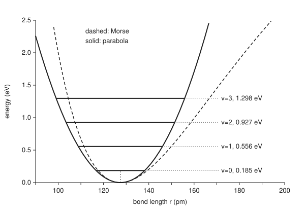

# The quantum oscillator: evenly spaced levels and a floor you cannot get below

[Syllabus](../../../SYLLABUS.md) → [Engineering mathematics](../README.md) → [Quantum Mechanics in Outline](../README.md#s09) → The quantum oscillator

---

## General Overview

A molecule of hydrogen chloride, HCl, is one hydrogen atom bonded to one chlorine atom, 127.5 pm apart (a picometre, pm, is a millionth of a millionth of a metre). The bond behaves like a stiff spring. Stretch it and it pulls back; squeeze it and it pushes out. Its stiffness works out at 516.3 N/m.

An engineer building a gas sensor for HCl in a chimney wants one number: which colour of infrared light does the molecule soak up? The answer is the energy needed to lift the bond's vibration by one step. A classical spring could take any amount of energy. A quantum spring cannot.

Its energies form a ladder of evenly spaced rungs, 0.37083 eV apart for HCl (an electronvolt, eV, is the energy one electron gains crossing one volt, $1.602\times10^{-19}$ J). So it absorbs light at one wavelength, 3.34 µm (micrometres) in the spring model, and ignores the rest. The first correction for the bond's softening moves the line to 3.4658 µm; the card shows where that 3.5 % gap comes from.

The ladder has a second surprise. Its lowest rung is not at zero. Even at absolute zero the bond keeps half a rung, 0.18542 eV, and the bond length keeps a spread of 7.585 pm. Nothing can take that energy out.

**A quantum spring's energy comes only in equal steps of $\hbar\omega$, starting half a step above the bottom of the well, and two operators that step up and down the ladder prove it.**

**What kind of fact this is:** a theorem inside a model. The levels are proved on this card in Why it works. The parabola-shaped well is a model of the bond that holds near its bottom, and the card shows where it fails.

### The picture: the well and its first four rungs

<p align="center"></p>

Solid curve: the spring model, energy rising with the square of the stretch. Dashed curve: the Morse model, a better fit that flattens out as the bond nears breaking. Each level is drawn between its classical turning points: the ground level from 116.7 pm to 138.2 pm, the fourth from 99.1 pm to 155.8 pm. The rungs are equally spaced and the lowest sits 0.185 eV above the bottom. Drawn to scale.

---

## The formula

A hat marks an operator, a rule that turns one function into another, as on [States as vectors](02-state-vectors-operators-and-measurement.md). The energy operator for the bond is

$$\hat H = -\frac{\hbar^2}{2\mu}\frac{d^2}{dx^2} + \frac12 k x^2 = \hbar\omega\left(a^\dagger a + \tfrac12\right),$$

and its allowed energies are

$$E_n = \left(n + \tfrac12\right)\hbar\omega, \qquad n = 0, 1, 2, \ldots, \qquad \omega = \sqrt{k/\mu}.$$

**Read it aloud:** the energy is a whole number of steps, each the size of the classical vibration frequency times the reduced Planck constant, plus a half step that is always there.

| Symbol | Plain meaning | In our example | Push it up and the answer… |
| --- | --- | --- | --- |
| $\hat H$ | the energy operator: kinetic part (the second derivative) plus spring part | the HCl bond | — |
| $E_n$ | the energy of level $n$ | $E_0 = 0.18542$ eV, $E_1 = 0.55625$ eV | — |
| $n$ | the level number, counting from 0; spectroscopists write $v$ | 0 for nearly every molecule at room temperature | adds one rung of $\hbar\omega$ |
| $\hbar$ | the reduced Planck constant, $h/2\pi$, with $h = 6.62607015\times10^{-34}$ J s | $1.0546\times10^{-34}$ J s | every rung and the floor scale with it |
| $\omega$ | the classical angular frequency of the spring, $\sqrt{k/\mu}$ | $5.63390\times10^{14}$ rad/s | rungs spread apart |
| $\mu$; $m_{\rm H}$, $m_{\rm Cl}$ | reduced mass $m_{\rm H}m_{\rm Cl}/(m_{\rm H}+m_{\rm Cl})$; the two atoms' masses, in u (atomic mass units, a twelfth of a carbon-12 atom) | 0.979593 u; 1.00782503223 u, 34.968852682 u | rungs close up |
| $k$ | the bond's stiffness, force per metre of stretch | 516.3 N/m | rungs spread apart |
| $x$, $\xi$ | stretch from the rest length; the same stretch in units of $x_0$, $\xi = x/x_0$ | $\xi = 1$ is 10.727 pm | — |
| $x_0$ | the natural length, $\sqrt{\hbar/(\mu\omega)}$ | 10.727 pm | the ground state spreads wider |
| $a$, $a^\dagger$ | the lowering and raising operators, "a" and "a dagger"; $a^\dagger$ is $a$'s star, its conjugate transpose | $a$ turns level $n$ into level $n-1$ | — |
| $\psi_n$, $\psi$ | the wavefunction of level $n$, or of any state: its square is the chance of each stretch | $\psi_0 = e^{-\xi^2/2}$, a bell curve | — |
| $\varepsilon$; $y$, $a_j$ | a trial energy in units of $\hbar\omega$; the polynomial part of $\psi$ and its coefficient of $\xi^j$ | $\varepsilon$ allowed only at 0.5, 1.5, 2.5, …; at 2.5, $y = 1 - 2\xi^2$ | — |

### When it holds

- **The well is a parabola.** True only near the bottom. A real bond softens as it stretches, so the rungs close up. For HCl the first correction for this softening makes even the first gap 3.5 % smaller than the model's. The gap from level 9 to level 10 shrinks to 1934.6 cm⁻¹ (waves per centimetre, the unit spectroscopists quote), not 2990.9 cm⁻¹. The real molecule breaks apart after a few dozen levels, where the model has infinitely many.
- **The bond only vibrates.** A gas molecule also rotates, which splits each absorption line into a comb of lines about 21 cm⁻¹ apart for HCl. This card leaves rotation out.
- **The two atoms move about their common centre.** Using the hydrogen mass alone instead of the reduced mass puts the line at 3.3913 µm instead of 3.3434 µm.
- **The molecule is isolated.** In a liquid or a crowded gas, neighbours push on the bond and broaden the lines.

---

## Why it works

### Step 0: the energy factors, with a half left over

Kinetic plus spring energy has the shape "square plus square". With ordinary numbers, a sum of two squares factors into two brackets, one with a plus and one with a minus, using the square root of −1.

Do the same with the operators, and it almost works. The operators do not commute: "multiply by $\xi$ then take the slope" differs from "take the slope then multiply by $\xi$".

The difference is exactly one, so factoring leaves a constant behind. That constant is the half step. The two factors then turn out to move a state up or down the ladder by exactly one rung.

### Step 1: measure stretch in the bond's own length

Put $x = x_0\xi$. The kinetic part carries $\hbar^2/(\mu x_0^2)$ and the spring part $\mu\omega^2 x_0^2$. Choosing $x_0 = \sqrt{\hbar/(\mu\omega)}$ makes both equal to $\hbar\omega$:

$$\hat H = \hbar\omega\left(-\frac12\frac{d^2}{d\xi^2} + \frac12\xi^2\right).$$

For HCl, $x_0$ is 10.727 pm. All the physics now sits in the bracket, and energies come in units of $\hbar\omega$, 0.37083 eV.

### Step 2: build the two factors

Define

$$a = \frac{1}{\sqrt2}\left(\xi + \frac{d}{d\xi}\right), \qquad a^\dagger = \frac{1}{\sqrt2}\left(\xi - \frac{d}{d\xi}\right).$$

Apply $a^\dagger a$ to any function $\psi$ (a prime marks a slope: $\psi'$ is $d\psi/d\xi$, and $\psi''$ is the slope of the slope). The cross terms $\xi\psi'$ cancel, and the slope of $\xi\psi$ leaves an extra $\psi$:

$$a^\dagger a\, \psi = \tfrac12\left(\xi^2 \psi - \psi'' - \psi\right).$$

So $a^\dagger a = \hat H/\hbar\omega - \tfrac12$, which is the formula's $\hat H = \hbar\omega(a^\dagger a + \tfrac12)$. The same work in the other order gives $a a^\dagger = \hat H/\hbar\omega + \tfrac12$. Subtracting, $a a^\dagger - a^\dagger a = 1$.

### Step 3: the factors are a ladder

Suppose $\hat H\psi = E\psi$. Using $a a^\dagger = a^\dagger a + 1$,

$$\hat H\,(a^\dagger\psi) = \hbar\omega\, a^\dagger\left(a a^\dagger + \tfrac12\right)\psi = a^\dagger\left(\hat H + \hbar\omega\right)\psi = (E + \hbar\omega)\,a^\dagger\psi.$$

So $a^\dagger\psi$ is another level, one rung higher. The same steps show $a\psi$ is one rung lower. The rungs are equally spaced because the step is the same operator every time.

### Step 4: the floor

Stepping down cannot go on for ever. Moving $d/d\xi$ from one function onto the other inside an integral flips its sign (integration by parts; the ends add nothing, because $\psi$ dies away far out).

So $a^\dagger$ is $a$'s star, the conjugate transpose of [States as vectors](02-state-vectors-operators-and-measurement.md), and $\int \psi^*\,a^\dagger a\,\psi\,d\xi = \int (a\psi)^*(a\psi)\,d\xi$. For a level of energy $E$, the average of $a^\dagger a$ therefore equals the squared size of $a\psi$, which is never negative. So $E - \tfrac12\hbar\omega \ge 0$. The only way the descent stops is a state that $a$ wipes out:

$$\left(\xi + \frac{d}{d\xi}\right)\psi_0 = 0 \quad\Longrightarrow\quad \psi_0 = e^{-\xi^2/2}.$$

That first-order equation has one solution, a bell curve. Put it into $\hat H$ and its energy is exactly $\tfrac12\hbar\omega$. Every other level is $\psi_0$ raised $n$ times, so $E_n = (n + \tfrac12)\hbar\omega$. No level hides between rungs: stepping down from it would have to end on a state wiped out by $a$, and the bell curve is the only one.

The floor is the bell curve's width at work. A state with no spread in stretch would need unlimited spread in momentum, and kinetic energy would blow up. The bell curve is the best compromise, and its energy is the half step. [Uncertainty](05-uncertainty-principle.md) makes this trade exact.

### Step 5: the second road, a series forced to stop

The same levels come out of [Series solutions](../../08-Differential%20equations%20and%20dynamics/07-Series%20Solutions%20and%20Boundary%20Problems/01-power-series-at-an-ordinary-point.md). Write $\psi = y(\xi)\,e^{-\xi^2/2}$ and try energy $\varepsilon\hbar\omega$. The equation for $y$ is Hermite's equation, $y'' - 2\xi y' + (2\varepsilon - 1)y = 0$. A power series $y = \sum a_j\xi^j$ gives the rule

$$a_{j+2} = \frac{2j + 1 - 2\varepsilon}{(j+1)(j+2)}\,a_j.$$

If the series never stops, its late coefficients shrink like those of $e^{\xi^2}$. Then $\psi$ grows like $e^{\xi^2/2}$ and cannot describe a molecule that stays together. The series stops only if a numerator hits zero, $2j + 1 = 2\varepsilon$ for some even or odd $j = n$. That is $\varepsilon = n + \tfrac12$ again.

At $\varepsilon = 2.5$ the coefficients run 1, −2, 0, 0, …, so $y = 1 - 2\xi^2$, a Hermite polynomial. Read in matrix language, the levels are the eigenvalues of $\hat H$ ([Eigenvalues and eigenvectors](../../03-Algebra/07-Eigenvalues%20and%20Symmetric%20Matrices/02-eigenvalues-and-eigenvectors.md)), which the code's third road finds directly.

---

## Worked numbers, by hand

H-35Cl: masses 1.00782503223 u and 34.968852682 u, vibration wavenumber 2990.9463 cm⁻¹, with $1\text{ u} = 1.66053906892\times10^{-27}$ kg.

| Step | Arithmetic | Value |
| --- | --- | --- |
| reduced mass $\mu$ | $1.00783 \times 34.96885 / 35.97668$ | 0.979593 u |
| angular frequency $\omega$ | $2\pi \times 2.99792458\times10^{10}$ cm/s $\times 2990.9463$ cm⁻¹ | $5.63390\times10^{14}$ rad/s |
| stiffness $k = \mu\omega^2$ | $1.6267\times10^{-27}$ kg $\times (5.63390\times10^{14})^2$ | 516.3 N/m |
| one rung, $\hbar\omega$ | $1.0546\times10^{-34} \times 5.63390\times10^{14}$ J, over $1.602\times10^{-19}$ J/eV | 0.37083 eV |
| absorption wavelength, spring model | $10^4 / 2990.9463$ | 3.3434 µm |
| natural length $x_0$ | $\sqrt{\hbar/(\mu\omega)}$ | 10.727 pm |
| spread of the bond length, $x_0/\sqrt2$ | $10.727 / 1.4142$ | 7.585 pm, 5.95 % of 127.4552 pm |
| thermal energy at 298.15 K | Boltzmann's constant $1.380649\times10^{-23}$ J/K times 298.15 K | 0.02569 eV |
| rung over thermal energy | $0.37083 / 0.02569$ | 14.433 |
| **the floor, $E_0 = \tfrac12\hbar\omega$** | $0.37083 / 2$ | **0.18542 eV** |

A rung is 14.433 times the thermal energy at room temperature, so only a share of $5.391\times10^{-7}$ of molecules sit above the ground level. Almost every HCl molecule in the chimney is on the floor, still vibrating with 0.18542 eV it cannot give up. A sensor tuned to their line sees all of them make the same jump.

### What breaks if you drop a piece

| Mistake | Comes out at | What went wrong |
| --- | --- | --- |
| Drop the half step | floor at 0.00000 eV | The bond would sit still at exactly 127.5 pm, a state with no spread, which Step 4 rules out |
| Use $h$ where $\hbar$ belongs | floor at 1.1650 eV | $h = 2\pi\hbar$: every energy comes out 6.28 times too large |
| Hydrogen's mass instead of the reduced mass | 2948.8 cm⁻¹, 3.3913 µm | The chlorine moves too; the sensor filter would sit beside the line |
| A box's ladder, fitted to the first gap | 0→2 line at 7975.9 cm⁻¹, not 5981.9 cm⁻¹ | A box's levels grow as the square of the level number ([Schrodinger's equation](03-schrodinger-equation-and-the-particle-in-a-box.md)); a parabola's are even |

### Outside its range: the real rungs close up

The spring model's gaps never change. The measured constants of HCl include an anharmonic correction (a correction for the well not being a pure parabola) of 52.8186 cm⁻¹, which shrinks each gap by twice that much per level. Gaps from level v to v+1, in cm⁻¹:

```
v   spring model                                      with the correction
0   ████████████████████████████████████████  2990.9  ██████████████████████████████████████  2885.3
1   ████████████████████████████████████████  2990.9  █████████████████████████████████████   2779.7
2   ████████████████████████████████████████  2990.9  ███████████████████████████████████     2674.0
3   ████████████████████████████████████████  2990.9  ██████████████████████████████████      2568.4
4   ████████████████████████████████████████  2990.9  ████████████████████████████████        2462.8
5   ████████████████████████████████████████  2990.9  ███████████████████████████████         2357.1
9   ████████████████████████████████████████  2990.9  █████████████████████████               1934.6
```

At the bottom the model is off by 3.5 %: with the correction the first jump is 2885.3 cm⁻¹, light at 3.4658 µm, not 3.3434 µm. A sensor filter must sit near there. By level 9 it is off by more than a third.

The Morse curve in the picture, built from the same two constants, has its last bound level at v = 27 and breaks the bond at 42342 cm⁻¹, 5.250 eV. The spring model never breaks. Use it for the first few rungs and nothing more.

---

## Code, from first principles, and it actually runs

The scripts compute every number on the card from the constants above and reach the five lowest levels by four roads:

- Road one is the formula $n + \tfrac12$.
- Road two applies $a^\dagger$ to the bell curve on a grid of points 0.01 $x_0$ apart, using differences for slopes, and measures each state's energy.
- Road three writes the same energy operator as a matrix on that grid and finds its eigenvalues by Sturm counting: for any trial energy, a pass down the matrix counts how many levels lie below it, and halving the interval homes in.
- Road four sums the power series out to $\xi = 6$ and halves the trial energy until the tail flips sign.

Roads two and three share one grid, so they agree to every printed digit and both sit slightly low, by at most 0.00013. Road four uses no grid and lands on the formula to nine decimals.

### Python

```python
# Quantum oscillator check: the vibration of one H-35Cl molecule.  Standard library only.
# Levels in units of hbar*omega reached four ways: the ladder formula n + 1/2, ladder steps
# applied to a Gaussian on a grid, the grid matrix's eigenvalues by Sturm counting, and the
# power series shot out to xi = 6 with the energy found by bisection.
from math import pi, sqrt, exp, floor

h, c, u, eV, kB = 6.62607015e-34, 299792458.0, 1.66053906892e-27, 1.602176634e-19, 1.380649e-23
hbar = h / (2 * pi)                                       # CODATA 2022; h, c, e, kB exact
mH, mCl, mD = 1.00782503223, 34.968852682, 2.01410177812  # atomic masses, u (NIST)
we, wexe, re, Be = 2990.9463, 52.8186, 127.4552, 10.593416  # cm^-1, cm^-1, pm, cm^-1 (NIST WebBook)
wN2, wO2 = 2358.57, 1580.193                              # N2 and O2 vibration, cm^-1 (NIST WebBook)
mu_u = mH * mCl / (mH + mCl)                              # reduced mass, u
mu = mu_u * u
omega = 2 * pi * c * we * 100                             # angular frequency, rad/s
k = mu * omega ** 2                                       # bond stiffness, N/m
gap = hbar * omega / eV                                   # one rung, eV
x0 = sqrt(hbar / (mu * omega)) * 1e12                     # natural length, pm
kT = kB * 298.15 / eV                                     # thermal energy at 25 C, eV

L, dx = 8.0, 0.01                                         # grid in xi = x / x0
N = int(round(2 * L / dx)) + 1
xs = [-L + i * dx for i in range(N)]
def slope(f): return [0.0] + [(f[i + 1] - f[i - 1]) / (2 * dx) for i in range(1, N - 1)] + [0.0]
def up(f):   g = slope(f); return [(xs[i] * f[i] - g[i]) / sqrt(2) for i in range(N)]   # a-dagger
def down(f): g = slope(f); return [(xs[i] * f[i] + g[i]) / sqrt(2) for i in range(N)]   # a
def size(f): return sqrt(sum(v * v for v in f) * dx)
def energy(f):                                            # <f|H|f>/<f|f>, H = -1/2 d2 + 1/2 xi^2
    top = sum(f[i] * (-(f[i + 1] - 2 * f[i] + f[i - 1]) / (2 * dx * dx) + 0.5 * xs[i] ** 2 * f[i])
              for i in range(1, N - 1))
    return top / sum(v * v for v in f)
psi = [exp(-x * x / 2) for x in xs]
kill = size(down(psi)) / size(psi)                        # a on the ground state: should be 0
grow = size(up(up(psi))) / size(up(psi))                  # a-dagger on state 1: size grows by sqrt 2
ladder, f = [], psi
for n in range(5):
    ladder.append(energy(f)); f = up(f)

diag = [1 / (dx * dx) + 0.5 * x * x for x in xs[1:-1]]    # the same H as a tridiagonal matrix
off2 = (0.5 / (dx * dx)) ** 2
def count_below(lam):                                     # Sturm count: eigenvalues below lam
    cnt, q = 0, 1.0
    for i, d in enumerate(diag):
        q = d - lam - (off2 / q if i else 0.0)
        if q == 0.0: q = 1e-300
        if q < 0: cnt += 1
    return cnt
def matrix_level(n):
    lo, hi = 0.0, 20.0
    for _ in range(50):
        mid = (lo + hi) / 2
        if count_below(mid) > n: hi = mid
        else: lo = mid
    return (lo + hi) / 2
matrix = [matrix_level(n) for n in range(5)]

def series(eps, start, xi):                               # y(xi) = sum a_j xi^j, psi = y e^(-xi^2/2)
    a, total = 1.0, 0.0
    for j in range(start, 300, 2):
        total += a * xi ** j
        a *= (2 * j + 1 - 2 * eps) / ((j + 1) * (j + 2))  # the recurrence from Hermite's equation
    return total
def shoot(n, xi=6.0):                                     # find eps where the tail at xi flips sign
    lo, hi = n + 0.1, n + 2.1                             # the only root of level n's parity in here
    s_lo = series(lo, n % 2, xi) > 0
    assert s_lo != (series(hi, n % 2, xi) > 0), "no sign change: the root is outside the bracket"
    for _ in range(60):
        mid = (lo + hi) / 2
        if (series(mid, n % 2, xi) > 0) == s_lo: lo = mid
        else: hi = mid
    return (lo + hi) / 2
shot = [shoot(n) for n in range(5)]

print(f"reduced mass {mu_u:.6f} u   omega {omega:.5e} rad/s   stiffness {k:.1f} N/m")
print(f"rung hbar*omega {gap:.5f} eV   floor E0 {gap / 2:.5f} eV   wavelength {1e4 / we:.4f} um")
print(f"natural length x0 {x0:.3f} pm   ground spread x0/sqrt2 {x0 / sqrt(2):.3f} pm"
      f" = {100 * x0 / sqrt(2) / re:.2f} % of {re} pm")
print(f"hbar {hbar:.4e} J s   mu {mu:.4e} kg   h/hbar {2 * pi:.2f}   bond {re:.1f} pm   xi=2.5 is {2.5 * x0:.1f} pm")
print(f"kT at 298.15 K {kT:.5f} eV   rung/kT {gap / kT:.3f}   share above v=0 {exp(-gap / kT):.3e}")
print(f"N2 rung {wN2:.1f} cm^-1 = {wN2 / we * gap / kT:.1f} kT   O2 rung {wO2:.1f} cm^-1 = {wO2 / we * gap / kT:.1f} kT"
      f"   HCl rotation comb 2 Be {2 * Be:.0f} cm^-1")
print(f"a on ground state, size ratio {kill:.2e};  a-dagger on state 1, size ratio {grow:.6f}")
print(" n   formula   ladder grid   matrix grid   series shot   level eV")
for n in range(5):
    print(f"{n:2d} {n + 0.5:9.4f} {ladder[n]:13.6f} {matrix[n]:13.6f} {shot[n]:13.9f} {(n + 0.5) * gap:10.5f}")
a_s = [1.0]
for j in (0, 2, 4): a_s.append(a_s[-1] * (2 * j + 1 - 5) / ((j + 1) * (j + 2)) + 0.0)
print("series at eps 2.5: a0 a2 a4 a6 " + " ".join(f"{v:.1f}" for v in a_s)
      + f";  psi(6) {series(2.5, 0, 6) * exp(-18):.3e}")
print(f"series at eps 2.6: psi(6) {series(2.6, 0, 6) * exp(-18):.3e}")
print("gaps v->v+1, cm^-1: v  harmonic  anharmonic")
anh = [we - 2 * wexe * (v + 1) for v in range(10)]
for v in (0, 1, 2, 3, 4, 5, 9):
    print(f"  {v:2d} {we:9.1f} {anh[v]:10.1f}")
De = we * we / (4 * wexe)
print(f"v=0 gap below the spring model by {100 * (we - anh[0]) / we:.1f} %;  corrected line {1e4 / anh[0]:.4f} um")
print(f"Morse: top bound level v={floor(we / (2 * wexe) - 0.5)}   De {De:.0f} cm^-1 = {De * 100 * h * c / eV:.3f} eV")
print(f"wrong: drop the half, E0 {0.0:.5f} eV;  h for hbar, E0 {gap / 2 * 2 * pi:.4f} eV")
print(f"wrong: H mass alone {we * sqrt(mu_u / mH):.1f} cm^-1 = {1e4 / (we * sqrt(mu_u / mH)):.4f} um")
print(f"wrong: box ladder, 0->2 line {we * 8 / 3:.1f} cm^-1 vs oscillator {2 * we:.1f} cm^-1")
muD = mD * mCl / (mD + mCl)
print(f"try: D-35Cl {we * sqrt(mu_u / muD):.1f} cm^-1 = {1e4 / (we * sqrt(mu_u / muD)):.4f} um;"
      f"  share above v=0 at 1000 K {exp(-gap * eV / (kB * 1000)):.4f}")
walled = [shoot(n, 2.5) for n in (0, 4)]
print(f"try: shoot to xi=2.5, levels {walled[0]:.4f} {walled[1]:.4f}, rises {walled[0] - 0.5:.4f} {walled[1] - 4.5:.4f}")
Ve = lambda r: 0.5 * k * ((r - re) * 1e-12) ** 2 / eV
a_m = sqrt(k / (2 * De * 100 * h * c)) * 1e-12            # Morse width, 1/pm
Vm = lambda r: De * 100 * h * c / eV * (1 - exp(-a_m * (r - re))) ** 2
print("figure, r pm   " + " ".join(f"{r:5d}" for r in range(100, 200, 10)))
print("figure, V harm " + " ".join(f"{Ve(r):5.2f}" for r in range(100, 200, 10)))
print("figure, Morse  " + " ".join(f"{Vm(r):5.2f}" for r in range(100, 200, 10)))
for v in range(4):
    w = sqrt(2 * (v + 0.5) * gap * eV / k) * 1e12
    print(f"figure, v={v} at {(v + 0.5) * gap:.3f} eV, turning points {re - w:.1f} {re + w:.1f} pm")

assert all(abs(ladder[n] - (n + 0.5)) < 2e-3 for n in range(5)), "ladder steps on the grid"
assert all(abs(matrix[n] - (n + 0.5)) < 1e-3 for n in range(5)), "matrix eigenvalues"
assert all(abs(shot[n] - (n + 0.5)) < 1e-6 for n in range(5)), "series shooting"
assert kill < 1e-3, "lowering operator must kill the Gaussian"
assert abs(grow - sqrt(2)) < 1e-3, "raising state 1 multiplies its size by sqrt(2)"
print("ALL CHECKS PASS")
```

**Ran 2026-11-11 on macOS, Python 3.14.10, standard library only. All checks passed. Output, pasted from the run:**

```
reduced mass 0.979593 u   omega 5.63390e+14 rad/s   stiffness 516.3 N/m
rung hbar*omega 0.37083 eV   floor E0 0.18542 eV   wavelength 3.3434 um
natural length x0 10.727 pm   ground spread x0/sqrt2 7.585 pm = 5.95 % of 127.4552 pm
hbar 1.0546e-34 J s   mu 1.6267e-27 kg   h/hbar 6.28   bond 127.5 pm   xi=2.5 is 26.8 pm
kT at 298.15 K 0.02569 eV   rung/kT 14.433   share above v=0 5.391e-07
N2 rung 2358.6 cm^-1 = 11.4 kT   O2 rung 1580.2 cm^-1 = 7.6 kT   HCl rotation comb 2 Be 21 cm^-1
a on ground state, size ratio 1.61e-05;  a-dagger on state 1, size ratio 1.414178
 n   formula   ladder grid   matrix grid   series shot   level eV
 0    0.5000      0.499997      0.499997   0.500000000    0.18542
 1    1.5000      1.499984      1.499984   1.500000000    0.55625
 2    2.5000      2.499959      2.499959   2.500000000    0.92708
 3    3.5000      3.499922      3.499922   3.500000000    1.29791
 4    4.5000      4.499872      4.499872   4.500000001    1.66874
series at eps 2.5: a0 a2 a4 a6 1.0 -2.0 0.0 0.0;  psi(6) -1.081e-06
series at eps 2.6: psi(6) 2.520e+04
gaps v->v+1, cm^-1: v  harmonic  anharmonic
   0    2990.9     2885.3
   1    2990.9     2779.7
   2    2990.9     2674.0
   3    2990.9     2568.4
   4    2990.9     2462.8
   5    2990.9     2357.1
   9    2990.9     1934.6
v=0 gap below the spring model by 3.5 %;  corrected line 3.4658 um
Morse: top bound level v=27   De 42342 cm^-1 = 5.250 eV
wrong: drop the half, E0 0.00000 eV;  h for hbar, E0 1.1650 eV
wrong: H mass alone 2948.8 cm^-1 = 3.3913 um
wrong: box ladder, 0->2 line 7975.9 cm^-1 vs oscillator 5981.9 cm^-1
try: D-35Cl 2145.1 cm^-1 = 4.6618 um;  share above v=0 at 1000 K 0.0135
try: shoot to xi=2.5, levels 0.5050 5.9784, rises 0.0050 1.4784
figure, r pm     100   110   120   130   140   150   160   170   180   190
figure, V harm  1.21  0.49  0.09  0.01  0.25  0.82  1.71  2.92  4.45  6.30
figure, Morse   2.00  0.67  0.10  0.01  0.20  0.56  0.99  1.45  1.90  2.33
figure, v=0 at 0.185 eV, turning points 116.7 138.2 pm
figure, v=1 at 0.556 eV, turning points 108.9 146.0 pm
figure, v=2 at 0.927 eV, turning points 103.5 151.4 pm
figure, v=3 at 1.298 eV, turning points 99.1 155.8 pm
ALL CHECKS PASS
```

### Rust

```rust
// Quantum oscillator check: the vibration of one H-35Cl molecule.  Standard library only, no crates.
// Levels in units of hbar*omega reached four ways: the ladder formula n + 1/2, ladder steps
// applied to a Gaussian on a grid, the grid matrix's eigenvalues by Sturm counting, and the
// power series shot out to xi = 6 with the energy found by bisection.
use std::f64::consts::PI;

const L: f64 = 8.0;
const DX: f64 = 0.01;

fn sci(x: f64, p: usize) -> String {                      // 5.391e-07, the way Python prints it
    let s = format!("{:.*e}", p, x);
    let (m, e) = s.split_once('e').unwrap();
    let ev: i32 = e.parse().unwrap();
    format!("{}e{}{:02}", m, if ev < 0 { '-' } else { '+' }, ev.abs())
}
fn slope(f: &[f64]) -> Vec<f64> {
    let n = f.len();
    let mut g = vec![0.0; n];
    for i in 1..n - 1 { g[i] = (f[i + 1] - f[i - 1]) / (2.0 * DX); }
    g
}
fn up(f: &[f64], xs: &[f64]) -> Vec<f64> {                // a-dagger
    let g = slope(f);
    (0..f.len()).map(|i| (xs[i] * f[i] - g[i]) / 2f64.sqrt()).collect()
}
fn down(f: &[f64], xs: &[f64]) -> Vec<f64> {              // a
    let g = slope(f);
    (0..f.len()).map(|i| (xs[i] * f[i] + g[i]) / 2f64.sqrt()).collect()
}
fn size(f: &[f64]) -> f64 { (f.iter().map(|v| v * v).sum::<f64>() * DX).sqrt() }
fn energy(f: &[f64], xs: &[f64]) -> f64 {                 // <f|H|f>/<f|f>, H = -1/2 d2 + 1/2 xi^2
    let mut top = 0.0;
    for i in 1..f.len() - 1 {
        top += f[i] * (-(f[i + 1] - 2.0 * f[i] + f[i - 1]) / (2.0 * DX * DX) + 0.5 * xs[i].powi(2) * f[i]);
    }
    top / f.iter().map(|v| v * v).sum::<f64>()
}
fn count_below(diag: &[f64], off2: f64, lam: f64) -> usize { // Sturm count: eigenvalues below lam
    let (mut cnt, mut q) = (0, 1.0);
    for (i, d) in diag.iter().enumerate() {
        q = d - lam - if i > 0 { off2 / q } else { 0.0 };
        if q == 0.0 { q = 1e-300; }
        if q < 0.0 { cnt += 1; }
    }
    cnt
}
fn matrix_level(diag: &[f64], off2: f64, n: usize) -> f64 {
    let (mut lo, mut hi) = (0.0, 20.0);
    for _ in 0..50 {
        let mid = (lo + hi) / 2.0;
        if count_below(diag, off2, mid) > n { hi = mid; } else { lo = mid; }
    }
    (lo + hi) / 2.0
}
fn series(eps: f64, start: usize, xi: f64) -> f64 {       // y(xi) = sum a_j xi^j, psi = y e^(-xi^2/2)
    let (mut a, mut total) = (1.0, 0.0);
    let mut j = start;
    while j < 300 {
        total += a * xi.powi(j as i32);
        a *= (2.0 * j as f64 + 1.0 - 2.0 * eps) / (((j + 1) * (j + 2)) as f64);
        j += 2;
    }
    total
}
fn shoot(n: usize, xi: f64) -> f64 {                      // find eps where the tail at xi flips sign
    let (mut lo, mut hi) = (n as f64 + 0.1, n as f64 + 2.1); // the only root of level n's parity in here
    let s_lo = series(lo, n % 2, xi) > 0.0;
    assert!(s_lo != (series(hi, n % 2, xi) > 0.0), "no sign change: the root is outside the bracket");
    for _ in 0..60 {
        let mid = (lo + hi) / 2.0;
        if (series(mid, n % 2, xi) > 0.0) == s_lo { lo = mid; } else { hi = mid; }
    }
    (lo + hi) / 2.0
}

fn main() {
    let (h, c, u, ev, kb) = (6.62607015e-34, 299792458.0, 1.66053906892e-27, 1.602176634e-19, 1.380649e-23);
    let hbar = h / (2.0 * PI);
    let (mh, mcl, md) = (1.00782503223, 34.968852682, 2.01410177812);
    let (we, wexe, re, be) = (2990.9463_f64, 52.8186, 127.4552, 10.593416); // cm^-1, cm^-1, pm, cm^-1 (NIST WebBook)
    let (wn2, wo2) = (2358.57_f64, 1580.193_f64); // N2 and O2 vibration, cm^-1 (NIST WebBook)
    let mu_u = mh * mcl / (mh + mcl);
    let mu = mu_u * u;
    let omega = 2.0 * PI * c * we * 100.0;
    let k = mu * omega * omega;
    let gap = hbar * omega / ev;
    let x0 = (hbar / (mu * omega)).sqrt() * 1e12;
    let kt = kb * 298.15 / ev;

    let n_pts = (2.0 * L / DX).round() as usize + 1;
    let xs: Vec<f64> = (0..n_pts).map(|i| -L + i as f64 * DX).collect();
    let psi: Vec<f64> = xs.iter().map(|x| (-x * x / 2.0).exp()).collect();
    let kill = size(&down(&psi, &xs)) / size(&psi);
    let p1 = up(&psi, &xs);
    let grow = size(&up(&p1, &xs)) / size(&p1);
    let mut ladder = vec![];
    let mut f = psi.clone();
    for _ in 0..5 { ladder.push(energy(&f, &xs)); f = up(&f, &xs); }
    let diag: Vec<f64> = xs[1..n_pts - 1].iter().map(|x| 1.0 / (DX * DX) + 0.5 * x * x).collect();
    let off2 = (0.5 / (DX * DX)).powi(2);
    let matrix: Vec<f64> = (0..5).map(|n| matrix_level(&diag, off2, n)).collect();
    let shot: Vec<f64> = (0..5).map(|n| shoot(n, 6.0)).collect();

    println!("reduced mass {:.6} u   omega {} rad/s   stiffness {:.1} N/m", mu_u, sci(omega, 5), k);
    println!("rung hbar*omega {:.5} eV   floor E0 {:.5} eV   wavelength {:.4} um", gap, gap / 2.0, 1e4 / we);
    println!("natural length x0 {:.3} pm   ground spread x0/sqrt2 {:.3} pm = {:.2} % of {} pm",
             x0, x0 / 2f64.sqrt(), 100.0 * x0 / 2f64.sqrt() / re, re);
    println!("hbar {} J s   mu {} kg   h/hbar {:.2}   bond {:.1} pm   xi=2.5 is {:.1} pm", sci(hbar, 4), sci(mu, 4), 2.0 * PI, re, 2.5 * x0);
    println!("kT at 298.15 K {:.5} eV   rung/kT {:.3}   share above v=0 {}", kt, gap / kt, sci((-gap / kt).exp(), 3));
    println!("N2 rung {:.1} cm^-1 = {:.1} kT   O2 rung {:.1} cm^-1 = {:.1} kT   HCl rotation comb 2 Be {:.0} cm^-1",
             wn2, wn2 / we * gap / kt, wo2, wo2 / we * gap / kt, 2.0 * be);
    println!("a on ground state, size ratio {};  a-dagger on state 1, size ratio {:.6}", sci(kill, 2), grow);
    println!(" n   formula   ladder grid   matrix grid   series shot   level eV");
    for n in 0..5 {
        let e = n as f64 + 0.5;
        println!("{:2} {:9.4} {:13.6} {:13.6} {:13.9} {:10.5}", n, e, ladder[n], matrix[n], shot[n], e * gap);
    }
    let mut a_s = vec![1.0_f64];
    for j in [0.0_f64, 2.0, 4.0] { let last = *a_s.last().unwrap(); a_s.push(last * (2.0 * j + 1.0 - 5.0) / ((j + 1.0) * (j + 2.0)) + 0.0); }
    let a_txt: Vec<String> = a_s.iter().map(|v| format!("{:.1}", v)).collect();
    println!("series at eps 2.5: a0 a2 a4 a6 {};  psi(6) {}", a_txt.join(" "), sci(series(2.5, 0, 6.0) * (-18f64).exp(), 3));
    println!("series at eps 2.6: psi(6) {}", sci(series(2.6, 0, 6.0) * (-18f64).exp(), 3));
    println!("gaps v->v+1, cm^-1: v  harmonic  anharmonic");
    let anh: Vec<f64> = (0..10).map(|v| we - 2.0 * wexe * (v as f64 + 1.0)).collect();
    for v in [0usize, 1, 2, 3, 4, 5, 9] { println!("  {:2} {:9.1} {:10.1}", v, we, anh[v]); }
    println!("v=0 gap below the spring model by {:.1} %;  corrected line {:.4} um", 100.0 * (we - anh[0]) / we, 1e4 / anh[0]);
    let de = we * we / (4.0 * wexe);
    println!("Morse: top bound level v={}   De {:.0} cm^-1 = {:.3} eV", (we / (2.0 * wexe) - 0.5).floor() as i64, de, de * 100.0 * h * c / ev);
    println!("wrong: drop the half, E0 {:.5} eV;  h for hbar, E0 {:.4} eV", 0.0, gap / 2.0 * 2.0 * PI);
    let wh = we * (mu_u / mh).sqrt();
    println!("wrong: H mass alone {:.1} cm^-1 = {:.4} um", wh, 1e4 / wh);
    println!("wrong: box ladder, 0->2 line {:.1} cm^-1 vs oscillator {:.1} cm^-1", we * 8.0 / 3.0, 2.0 * we);
    let mu_d = md * mcl / (md + mcl);
    let wd = we * (mu_u / mu_d).sqrt();
    println!("try: D-35Cl {:.1} cm^-1 = {:.4} um;  share above v=0 at 1000 K {:.4}", wd, 1e4 / wd, (-gap * ev / (kb * 1000.0)).exp());
    let walled = [shoot(0, 2.5), shoot(4, 2.5)];
    println!("try: shoot to xi=2.5, levels {:.4} {:.4}, rises {:.4} {:.4}", walled[0], walled[1], walled[0] - 0.5, walled[1] - 4.5);
    let ve = |r: f64| 0.5 * k * ((r - re) * 1e-12).powi(2) / ev;
    let a_m = (k / (2.0 * de * 100.0 * h * c)).sqrt() * 1e-12;
    let vm = |r: f64| de * 100.0 * h * c / ev * (1.0 - (-a_m * (r - re)).exp()).powi(2);
    let rs: Vec<f64> = (0..10).map(|i| 100.0 + 10.0 * i as f64).collect();
    let row = |g: &dyn Fn(f64) -> f64| rs.iter().map(|r| format!("{:5.2}", g(*r))).collect::<Vec<_>>().join(" ");
    println!("figure, r pm   {}", rs.iter().map(|r| format!("{:5}", *r as i64)).collect::<Vec<_>>().join(" "));
    println!("figure, V harm {}", row(&ve));
    println!("figure, Morse  {}", row(&vm));
    for v in 0..4 {
        let e = (v as f64 + 0.5) * gap;
        let w = (2.0 * e * ev / k).sqrt() * 1e12;
        println!("figure, v={} at {:.3} eV, turning points {:.1} {:.1} pm", v, e, re - w, re + w);
    }

    assert!((0..5).all(|n| (ladder[n] - (n as f64 + 0.5)).abs() < 2e-3), "ladder steps on the grid");
    assert!((0..5).all(|n| (matrix[n] - (n as f64 + 0.5)).abs() < 1e-3), "matrix eigenvalues");
    assert!((0..5).all(|n| (shot[n] - (n as f64 + 0.5)).abs() < 1e-6), "series shooting");
    assert!(kill < 1e-3, "lowering operator must kill the Gaussian");
    assert!((grow - 2f64.sqrt()).abs() < 1e-3, "raising state 1 multiplies its size by sqrt(2)");
    println!("ALL CHECKS PASS");
}
```

**Ran 2026-11-11 on macOS, rustc 1.98.1, no crates. All checks passed. Output, pasted from the run:**

```
reduced mass 0.979593 u   omega 5.63390e+14 rad/s   stiffness 516.3 N/m
rung hbar*omega 0.37083 eV   floor E0 0.18542 eV   wavelength 3.3434 um
natural length x0 10.727 pm   ground spread x0/sqrt2 7.585 pm = 5.95 % of 127.4552 pm
hbar 1.0546e-34 J s   mu 1.6267e-27 kg   h/hbar 6.28   bond 127.5 pm   xi=2.5 is 26.8 pm
kT at 298.15 K 0.02569 eV   rung/kT 14.433   share above v=0 5.391e-07
N2 rung 2358.6 cm^-1 = 11.4 kT   O2 rung 1580.2 cm^-1 = 7.6 kT   HCl rotation comb 2 Be 21 cm^-1
a on ground state, size ratio 1.61e-05;  a-dagger on state 1, size ratio 1.414178
 n   formula   ladder grid   matrix grid   series shot   level eV
 0    0.5000      0.499997      0.499997   0.500000000    0.18542
 1    1.5000      1.499984      1.499984   1.500000000    0.55625
 2    2.5000      2.499959      2.499959   2.500000000    0.92708
 3    3.5000      3.499922      3.499922   3.500000000    1.29791
 4    4.5000      4.499872      4.499872   4.500000001    1.66874
series at eps 2.5: a0 a2 a4 a6 1.0 -2.0 0.0 0.0;  psi(6) -1.081e-06
series at eps 2.6: psi(6) 2.520e+04
gaps v->v+1, cm^-1: v  harmonic  anharmonic
   0    2990.9     2885.3
   1    2990.9     2779.7
   2    2990.9     2674.0
   3    2990.9     2568.4
   4    2990.9     2462.8
   5    2990.9     2357.1
   9    2990.9     1934.6
v=0 gap below the spring model by 3.5 %;  corrected line 3.4658 um
Morse: top bound level v=27   De 42342 cm^-1 = 5.250 eV
wrong: drop the half, E0 0.00000 eV;  h for hbar, E0 1.1650 eV
wrong: H mass alone 2948.8 cm^-1 = 3.3913 um
wrong: box ladder, 0->2 line 7975.9 cm^-1 vs oscillator 5981.9 cm^-1
try: D-35Cl 2145.1 cm^-1 = 4.6618 um;  share above v=0 at 1000 K 0.0135
try: shoot to xi=2.5, levels 0.5050 5.9784, rises 0.0050 1.4784
figure, r pm     100   110   120   130   140   150   160   170   180   190
figure, V harm  1.21  0.49  0.09  0.01  0.25  0.82  1.71  2.92  4.45  6.30
figure, Morse   2.00  0.67  0.10  0.01  0.20  0.56  0.99  1.45  1.90  2.33
figure, v=0 at 0.185 eV, turning points 116.7 138.2 pm
figure, v=1 at 0.556 eV, turning points 108.9 146.0 pm
figure, v=2 at 0.927 eV, turning points 103.5 151.4 pm
figure, v=3 at 1.298 eV, turning points 99.1 155.8 pm
ALL CHECKS PASS
```

The two outputs are identical line for line.

### Lean

Lean proves the evenly spaced levels, the ladder factoring and the bell-curve floor, for any positive $\hbar$, $\mu$ and $k$.

- Take $\hbar$, $\mu$ and $k$ positive, and states that die away far out. Then a nonzero state of energy $E$ exists exactly when $E = (n + \tfrac12)\hbar\omega$ for some level $n$.
- Take any $\psi$ with a continuous slope of the slope, $\psi''$. Then $a^\dagger a = \hat H/\hbar\omega - \tfrac12$ and $a a^\dagger = \hat H/\hbar\omega + \tfrac12$.
- Take the same $\psi$. Then the two orders differ by exactly one: $a a^\dagger\psi - a^\dagger a\,\psi = \psi$.
- Take any $\psi$ with a slope everywhere. Then $a$ wipes out $\psi$ exactly when $\psi$ is a multiple of the bell curve $e^{-\xi^2/2}$.
- The bell curve $e^{-\xi^2/2}$ has energy exactly $\tfrac12\hbar\omega$.
- Take $\varepsilon = 2.5$ and $a_0 = 1$. Then the coefficient rule gives $a_2 = -2$ and $a_4 = 0$.
- Take $\varepsilon = 2.5$. Then $y = 1 - 2\xi^2$ solves Hermite's equation.
- Counting from 1 puts the floor at three times its true height.
- A box's ladder fitted to the first gap puts the 0→2 line at $8/3$ of that gap, against 2 for the oscillator.

Lean works in exact algebra, so the HCl numbers, the grid roads and the anharmonic correction are left to the Python and Rust checks.

```lean
-- The quantum oscillator: a spring's quantum energy levels are exactly (n + 1/2) ħω for n = 0, 1, 2, …, the ladder operators factor the energy operator with a half left over, and the bell curve e^(−ξ²/2) is the floor state with energy 1/2 in units of ħω.
import Mathlib.Analysis.Distribution.SchwartzSpace.Basic
import Mathlib.Analysis.SpecialFunctions.Sqrt
import Mathlib.Analysis.SpecialFunctions.ExpDeriv
import Mathlib.Analysis.Calculus.ContDiff.Basic
import Mathlib.Analysis.Distribution.SchwartzSpace.Deriv
import Mathlib.Analysis.Calculus.DerivativeTest
import Mathlib.Analysis.SpecialFunctions.Gaussian.PoissonSummation
import Mathlib.RingTheory.Polynomial.Hermite.Gaussian
import Mathlib.Analysis.Polynomial.Basic

open SchwartzMap

/-- The lowering operator a = (ξ + d/dξ)/√2, acting on a function of the scaled stretch ξ. -/
noncomputable def lower (f : ℝ → ℝ) : ℝ → ℝ := fun ξ => (ξ * f ξ + deriv f ξ) / Real.sqrt 2

/-- The raising operator a† = (ξ − d/dξ)/√2. -/
noncomputable def raise (f : ℝ → ℝ) : ℝ → ℝ := fun ξ => (ξ * f ξ - deriv f ξ) / Real.sqrt 2

/-- The energy operator in units of ħω, with the stretch measured in units of x₀:
H/ħω = −½ d²/dξ² + ½ ξ². -/
noncomputable def oscH (f : ℝ → ℝ) : ℝ → ℝ := fun ξ => -(1 / 2) * deriv (deriv f) ξ + 1 / 2 * ξ ^ 2 * f ξ

open Filter Topology in
/-- A polynomial times a Gaussian, times any power of |x|, is bounded. -/
lemma qho_poly_gauss_bounded (P : Polynomial ℤ) (k : ℕ) :
    ∃ C : ℝ, ∀ x : ℝ, |x| ^ k * |Polynomial.aeval x P| * Real.exp (-(x ^ 2 / 2)) ≤ C := by
  set P' : Polynomial ℝ := P.map (algebraMap ℤ ℝ) with hP'
  have hev : ∀ x : ℝ, Polynomial.aeval x P = P'.eval x := fun x => by
    rw [hP', Polynomial.eval_map_algebraMap]
  set d := P'.natDegree
  set q : ℝ → ℝ := fun x => |x| ^ k * |Polynomial.aeval x P| * Real.exp (-(x ^ 2 / 2)) with hq
  have h1 : (fun x => P'.eval x) =O[cocompact ℝ] (fun x => x ^ d) := by
    rw [← Metric.cobounded_eq_cocompact]
    exact Polynomial.isBigO_cobounded_pow_natDegree P'
  have h2 : (fun x : ℝ => x ^ k * P'.eval x * Real.exp (-(x ^ 2 / 2))) =O[cocompact ℝ]
      (fun x : ℝ => x ^ k * x ^ d * Real.exp (-(x ^ 2 / 2))) :=
    ((Asymptotics.isBigO_refl _ _).mul h1).mul (Asymptotics.isBigO_refl _ _)
  have h3 : q =O[cocompact ℝ]
      (fun x : ℝ => |x| ^ ((k + d : ℕ) : ℝ) * Real.exp (-(1 / 2) * x ^ 2)) := by
    have := h2.norm_left.norm_right
    refine this.congr (fun x => ?_) (fun x => ?_)
    · simp only [hq, Real.norm_eq_abs, abs_mul, abs_pow, hev, abs_of_pos (Real.exp_pos _)]
    · simp only [Real.norm_eq_abs, abs_mul, abs_pow, abs_of_pos (Real.exp_pos _),
        Real.rpow_natCast, pow_add]
      ring_nf
  have ht : Tendsto q (cocompact ℝ) (𝓝 0) :=
    h3.trans_tendsto (tendsto_rpow_abs_mul_exp_neg_mul_sq_cocompact (by norm_num) _)
  have hev1 : ∀ᶠ x in cocompact ℝ, q x ≤ 1 :=
    ht.eventually (ge_mem_nhds (by norm_num))
  have hqc : Continuous q := by
    have : Continuous fun x : ℝ => P'.eval x := P'.continuous
    simp only [hq, hev]
    fun_prop
  set r : ℝ → ℝ := fun x => max (q x) 1 with hr
  have hrc : Continuous r := hqc.max continuous_const
  obtain ⟨xm, hxm⟩ := hrc.exists_forall_ge' 0 (by
    filter_upwards [hev1] with x hx
    simp only [hr, max_eq_right hx]
    exact le_max_right _ _)
  exact ⟨r xm, fun x => (le_max_left _ _).trans (hxm x)⟩

/-- The bell curve e^(−y²/2) as a Schwartz function. -/
noncomputable def qhoGauss : 𝓢(ℝ, ℝ) where
  toFun := fun y => Real.exp (-(y ^ 2 / 2))
  smooth' := by fun_prop
  decay' := by
    intro k n
    obtain ⟨C, hC⟩ := qho_poly_gauss_bounded (Polynomial.hermite n) k
    refine ⟨C, fun x => ?_⟩
    rw [norm_iteratedFDeriv_eq_norm_iteratedDeriv, iteratedDeriv_eq_iterate,
      Polynomial.deriv_gaussian_eq_hermite_mul_gaussian]
    simp only [Real.norm_eq_abs, abs_mul, abs_pow, abs_neg, abs_one, one_pow, one_mul,
      abs_of_pos (Real.exp_pos _)]
    simpa [mul_assoc] using hC x

lemma qhoGauss_apply (y : ℝ) : qhoGauss y = Real.exp (-(y ^ 2 / 2)) := rfl


/-- The ladder step φ ↦ l x φ + s φ' on Schwartz functions (s = 1 lowers, s = −1 raises). -/
noncomputable def qhoLadder (l s : ℝ) (φ : 𝓢(ℝ, ℝ)) : 𝓢(ℝ, ℝ) :=
  smulLeftCLM ℝ (fun x : ℝ => l * x) φ + s • derivCLM ℝ ℝ φ

lemma qhoLadder_apply (l s : ℝ) (φ : 𝓢(ℝ, ℝ)) (x : ℝ) :
    qhoLadder l s φ x = l * x * φ x + s * deriv φ x := by
  have hg : (fun x : ℝ => l * x).HasTemperateGrowth := by fun_prop
  simp [qhoLadder, smulLeftCLM_apply_apply hg]

/-- The scaled eigen-equation φ'' = l² x² φ − Λ φ. -/
def QhoEig (l Λ : ℝ) (φ : 𝓢(ℝ, ℝ)) : Prop :=
  ∀ x, deriv (deriv φ) x = l ^ 2 * x ^ 2 * φ x - Λ * φ x

lemma qho_deriv_hasDerivAt (φ : 𝓢(ℝ, ℝ)) (x : ℝ) :
    HasDerivAt (deriv φ) (deriv (deriv φ) x) x := by
  have h := (derivCLM ℝ ℝ φ).hasDerivAt x
  have hc : ⇑(derivCLM ℝ ℝ φ) = deriv φ := funext fun y => derivCLM_apply ℝ φ y
  rwa [hc] at h

lemma qhoLadder_eig (l s Λ : ℝ) (hs : s ^ 2 = 1) (φ : 𝓢(ℝ, ℝ)) (h : QhoEig l Λ φ) :
    QhoEig l (Λ - 2 * s * l) (qhoLadder l s φ) := by
  have e2 : deriv (deriv φ) = fun x => l ^ 2 * x ^ 2 * φ x - Λ * φ x := funext h
  have hd1 : ∀ x, HasDerivAt φ (deriv φ x) x := fun x => φ.hasDerivAt x
  have hd2 : ∀ x, HasDerivAt (deriv φ) (l ^ 2 * x ^ 2 * φ x - Λ * φ x) x := fun x => by
    rw [← h x]; exact qho_deriv_hasDerivAt φ x
  have hd3 : ∀ x, HasDerivAt (fun x => l ^ 2 * x ^ 2 * φ x - Λ * φ x)
      (l ^ 2 * (2 * x) * φ x + l ^ 2 * x ^ 2 * deriv φ x - Λ * deriv φ x) x := fun x => by
    have := ((((hasDerivAt_pow 2 x).const_mul (l ^ 2)).mul (hd1 x)).sub
      ((hd1 x).const_mul Λ))
    convert this using 1; push_cast; ring
  have hc : ⇑(qhoLadder l s φ) = fun x => l * x * φ x + s * deriv φ x :=
    funext (qhoLadder_apply l s φ)
  have hL1 : ∀ x, HasDerivAt (fun x => l * x * φ x + s * deriv φ x)
      (l * φ x + l * x * deriv φ x + s * (l ^ 2 * x ^ 2 * φ x - Λ * φ x)) x := fun x => by
    have := (((hasDerivAt_id' x).const_mul l).mul (hd1 x)).add ((hd2 x).const_mul s)
    convert this using 1; ring
  have dL1 : deriv (fun x => l * x * φ x + s * deriv φ x) =
      fun x => l * φ x + l * x * deriv φ x + s * (l ^ 2 * x ^ 2 * φ x - Λ * φ x) :=
    funext fun x => (hL1 x).deriv
  intro x
  rw [hc, dL1]
  have hL2 : HasDerivAt
      (fun x => l * φ x + l * x * deriv φ x + s * (l ^ 2 * x ^ 2 * φ x - Λ * φ x))
      (l * deriv φ x + (l * 1 * deriv φ x + l * x * (l ^ 2 * x ^ 2 * φ x - Λ * φ x)) +
        s * (l ^ 2 * (2 * x) * φ x + l ^ 2 * x ^ 2 * deriv φ x - Λ * deriv φ x)) x :=
    ((((hd1 x).const_mul l).add (((hasDerivAt_id' x).const_mul l).mul (hd2 x))).add
      ((hd3 x).const_mul s))
  rw [hL2.deriv]
  linear_combination (-2 * l * deriv φ x) * hs

lemma qhoLadder_kill (l s Λ : ℝ) (hs : s ^ 2 = 1) (φ : 𝓢(ℝ, ℝ)) (h : QhoEig l Λ φ)
    (h0 : qhoLadder l s φ = 0) : ∀ x, (Λ - s * l) * φ x = 0 := by
  have hz : ∀ x, l * x * φ x + s * deriv φ x = 0 := fun x => by
    rw [← qhoLadder_apply, h0]; rfl
  have hd : deriv φ = fun x => -s * l * x * φ x := funext fun x => by
    linear_combination s * hz x - deriv φ x * hs
  have hd2 : ∀ x, HasDerivAt (fun x => -s * l * x * φ x)
      (-s * l * φ x + -s * l * x * deriv φ x) x := fun x => by
    have := ((hasDerivAt_id' x).const_mul (-s * l)).mul (φ.hasDerivAt x)
    convert this using 1; ring
  intro x
  have e := h x
  rw [hd, (hd2 x).deriv, hd] at e
  linear_combination e - l ^ 2 * x ^ 2 * φ x * hs

open Filter Topology in
/-- Maximum principle: a function vanishing at infinity with f'' = q f, q > 0, is never positive. -/
lemma qho_max_principle (f : ℝ → ℝ) (hc : Continuous f) (ht : Tendsto f (cocompact ℝ) (𝓝 0))
    (q : ℝ → ℝ) (hq : ∀ x, 0 < q x) (he : ∀ x, deriv (deriv f) x = q x * f x) :
    ∀ x, f x ≤ 0 := by
  by_contra hne
  push Not at hne
  obtain ⟨x1, hx1⟩ := hne
  obtain ⟨x0, hx0⟩ := hc.exists_forall_ge' x1 (ht.eventually (gt_mem_nhds hx1) |>.mono
    fun x hx => hx.le)
  have hpos : 0 < f x0 := hx1.trans_le (hx0 x1)
  have hmax : IsLocalMax f x0 := Filter.Eventually.of_forall hx0
  have hd : deriv f x0 = 0 := hmax.deriv_eq_zero
  have hdd : deriv (deriv f) x0 > 0 := by rw [he]; exact mul_pos (hq x0) hpos
  have hmin : IsLocalMin f x0 := isLocalMin_of_deriv_deriv_pos hdd hd hc.continuousAt
  have hloc : f =ᶠ[𝓝 x0] fun _ => f x0 := by
    filter_upwards [hmin, hmax] with y h1 h2 using le_antisymm h2 h1
  have := hloc.deriv.deriv_eq
  simp only [deriv_const'] at this
  have h00 : deriv (deriv f) x0 = 0 := by rw [this]
  linarith

lemma qho_no_negative (l Λ : ℝ) (hΛ : Λ < 0) (φ : 𝓢(ℝ, ℝ)) (h : QhoEig l Λ φ) : φ = 0 := by
  have hq : ∀ x, 0 < l ^ 2 * x ^ 2 - Λ := fun x => by nlinarith [sq_nonneg (l * x)]
  have A := qho_max_principle φ φ.continuous φ.tendsto_cocompact (fun x => l ^ 2 * x ^ 2 - Λ) hq
    (fun x => by rw [h x]; ring)
  have hnd : deriv (fun x => -φ x) = fun x => -deriv φ x := funext fun x => deriv.fun_neg
  have hnd2 : deriv (fun x => -deriv φ x) = fun x => -deriv (deriv φ) x :=
    funext fun x => deriv.fun_neg
  have B := qho_max_principle (fun x => -φ x) φ.continuous.neg (by
      simpa using φ.tendsto_cocompact.neg) (fun x => l ^ 2 * x ^ 2 - Λ) hq
    (fun x => by rw [hnd, hnd2]; simp only; rw [h x]; ring)
  ext x
  have := A x
  have := B x
  simp only [zero_apply]
  linarith


/-- The scaled ground state e^(−l x²/2) as a Schwartz function. -/
noncomputable def qhoGround (l : ℝ) (hl : 0 < l) : 𝓢(ℝ, ℝ) :=
  compCLMOfContinuousLinearEquiv ℝ
    (ContinuousLinearEquiv.unitsEquivAut ℝ (Units.mk0 (Real.sqrt l) (Real.sqrt_pos.2 hl).ne'))
    qhoGauss

lemma qhoGround_coe (l : ℝ) (hl : 0 < l) :
    ⇑(qhoGround l hl) = fun x => Real.exp (-(l * x ^ 2 / 2)) := by
  funext x
  simp only [qhoGround, compCLMOfContinuousLinearEquiv_apply, Function.comp_apply,
    ContinuousLinearEquiv.unitsEquivAut_apply, Units.val_mk0, qhoGauss_apply, mul_pow,
    Real.sq_sqrt hl.le]
  ring_nf

lemma qhoGround_eig (l : ℝ) (hl : 0 < l) : QhoEig l l (qhoGround l hl) := by
  have hg : ∀ x : ℝ, HasDerivAt (fun x => Real.exp (-(l * x ^ 2 / 2)))
      (-l * x * Real.exp (-(l * x ^ 2 / 2))) x := fun x => by
    have h0 : HasDerivAt (fun x : ℝ => -(l * x ^ 2 / 2)) (-l * x) x := by
      have := (((hasDerivAt_pow 2 x).const_mul l).div_const 2).neg
      convert this using 1; push_cast; ring
    convert h0.exp using 1; ring
  have dg : deriv (fun x => Real.exp (-(l * x ^ 2 / 2))) =
      fun x => -l * x * Real.exp (-(l * x ^ 2 / 2)) := funext fun x => (hg x).deriv
  intro x
  rw [qhoGround_coe, dg]
  have e : HasDerivAt (fun x => -l * x * Real.exp (-(l * x ^ 2 / 2)))
      (-l * 1 * Real.exp (-(l * x ^ 2 / 2)) + -l * x * (-l * x * Real.exp (-(l * x ^ 2 / 2)))) x :=
    ((hasDerivAt_id' x).const_mul (-l)).mul (hg x)
  rw [e.deriv]
  ring

lemma qhoGround_ne (l : ℝ) (hl : 0 < l) : qhoGround l hl ≠ 0 := by
  intro h
  have := congrArg (fun φ : 𝓢(ℝ, ℝ) => φ 0) h
  simp only [qhoGround_coe, zero_apply] at this
  norm_num at this

lemma qho_ne_zero_iff (φ : 𝓢(ℝ, ℝ)) : φ ≠ 0 ↔ ∃ x, φ x ≠ 0 := by
  constructor
  · intro h
    by_contra h'
    push Not at h'
    exact h (by ext x; simp [h' x])
  · rintro ⟨x, hx⟩ h
    exact hx (by simp [h])

/-- The scaled spectrum: φ'' = l² x² φ − Λ φ has a nonzero Schwartz solution iff
Λ = l (2n + 1). -/
lemma qho_scaled_spectrum (l Λ : ℝ) (hl : 0 < l) :
    (∃ φ : 𝓢(ℝ, ℝ), φ ≠ 0 ∧ QhoEig l Λ φ) ↔ ∃ n : ℕ, Λ = l * (2 * n + 1) := by
  constructor
  · rintro ⟨φ, hne, hφ⟩
    have hiter : ∀ j : ℕ, QhoEig l (Λ - 2 * l * j) ((qhoLadder l 1)^[j] φ) := by
      intro j
      induction j with
      | zero => simpa using hφ
      | succ j ih =>
        rw [Function.iterate_succ_apply']
        have := qhoLadder_eig l 1 _ (by norm_num) _ ih
        convert this using 1
        push_cast; ring
    have hex : ∃ j, (qhoLadder l 1)^[j] φ = 0 := by
      refine ⟨⌈Λ / (2 * l)⌉₊ + 1, qho_no_negative l _ ?_ _ (hiter _)⟩
      have h1 := Nat.le_ceil (Λ / (2 * l))
      have h2 : Λ ≤ 2 * l * (⌈Λ / (2 * l)⌉₊ : ℝ) := by
        rw [div_le_iff₀ (by positivity)] at h1; linarith
      push_cast
      nlinarith
    classical
    set j0 := Nat.find hex with hj0
    have hj0spec : (qhoLadder l 1)^[j0] φ = 0 := Nat.find_spec hex
    have hj0pos : j0 ≠ 0 := by
      intro h; rw [h] at hj0spec; exact hne hj0spec
    obtain ⟨j, hj⟩ := Nat.exists_eq_succ_of_ne_zero hj0pos
    have hjlt : j < Nat.find hex := by omega
    have hjne : (qhoLadder l 1)^[j] φ ≠ 0 := Nat.find_min hex hjlt
    rw [hj] at hj0spec
    rw [Function.iterate_succ_apply'] at hj0spec
    have hk := qhoLadder_kill l 1 _ (by norm_num) _ (hiter j) hj0spec
    obtain ⟨x, hx⟩ := (qho_ne_zero_iff _).1 hjne
    have := hk x
    rcases mul_eq_zero.1 this with h | h
    · exact ⟨j, by linarith⟩
    · exact absurd h hx
  · rintro ⟨n, rfl⟩
    have hiter : ∀ j : ℕ, (qhoLadder l (-1))^[j] (qhoGround l hl) ≠ 0 ∧
        QhoEig l (l * (2 * j + 1)) ((qhoLadder l (-1))^[j] (qhoGround l hl)) := by
      intro j
      induction j with
      | zero =>
        refine ⟨qhoGround_ne l hl, ?_⟩
        simpa using qhoGround_eig l hl
      | succ j ih =>
        rw [Function.iterate_succ_apply']
        have he := qhoLadder_eig l (-1) _ (by norm_num) _ ih.2
        refine ⟨fun h0 => ?_, ?_⟩
        · have hk := qhoLadder_kill l (-1) _ (by norm_num) _ ih.2 h0
          obtain ⟨x, hx⟩ := (qho_ne_zero_iff _).1 ih.1
          have := hk x
          rcases mul_eq_zero.1 this with h | h
          · have hj0 : (0 : ℝ) ≤ j := Nat.cast_nonneg j
            have : (0 : ℝ) < l * (2 * j + 1) - -1 * l := by nlinarith
            linarith
          · exact hx h
        · convert he using 1
          push_cast; ring
    exact ⟨_, (hiter n).1, (hiter n).2⟩

#print axioms qho_poly_gauss_bounded
#print axioms qhoGauss_apply
#print axioms qhoLadder_apply
#print axioms qho_deriv_hasDerivAt
#print axioms qhoLadder_eig
#print axioms qhoLadder_kill
#print axioms qho_max_principle
#print axioms qho_no_negative
#print axioms qhoGround_coe
#print axioms qhoGround_eig
#print axioms qhoGround_ne
#print axioms qho_ne_zero_iff
#print axioms qho_scaled_spectrum

/-- The card's main claim. A particle of (reduced) mass μ > 0 on a spring of stiffness k > 0
has energy operator Ĥ = −(ħ²/2μ) d²/dx² + ½ k x². Its allowed energies, for states that die
away far out (smooth functions that fall off faster than any power, Schwartz functions), are
exactly E = (n + ½) ħω with n = 0, 1, 2, … and ω = √(k/μ): every such energy has a nonzero
state, and no other energy does. So the levels are evenly spaced by ħω and the lowest sits half
a step above the bottom of the well. -/
theorem oscillator_energies_are_n_plus_half_hbar_omega (hbar μ k E : ℝ)
    (hhbar : 0 < hbar) (hμ : 0 < μ) (hk : 0 < k) :
    (∃ ψ : 𝓢(ℝ, ℝ), ψ ≠ 0 ∧
        ∀ x : ℝ, -(hbar ^ 2 / (2 * μ)) * deriv (deriv ψ) x + 1 / 2 * k * x ^ 2 * ψ x = E * ψ x) ↔
      ∃ n : ℕ, E = ((n : ℝ) + 1 / 2) * hbar * Real.sqrt (k / μ) := by
  set ω := Real.sqrt (k / μ) with hωdef
  have hω : 0 < ω := Real.sqrt_pos.2 (div_pos hk hμ)
  have hω2 : ω ^ 2 = k / μ := Real.sq_sqrt (div_pos hk hμ).le
  set l := μ * ω / hbar with hldef
  have hl : 0 < l := by positivity
  have hl2 : l ^ 2 = μ * k / hbar ^ 2 := by
    rw [hldef, div_pow, mul_pow, hω2]; field_simp
  have heq : ∀ ψ : 𝓢(ℝ, ℝ), (∀ x : ℝ, -(hbar ^ 2 / (2 * μ)) * deriv (deriv ψ) x +
      1 / 2 * k * x ^ 2 * ψ x = E * ψ x) ↔ QhoEig l (2 * μ * E / hbar ^ 2) ψ := by
    intro ψ
    unfold QhoEig
    refine forall_congr' fun x => ?_
    rw [hl2]
    constructor
    · intro h
      field_simp at h ⊢
      linarith
    · intro h
      field_simp at h ⊢
      linarith
  have hiff : (∃ ψ : 𝓢(ℝ, ℝ), ψ ≠ 0 ∧ ∀ x : ℝ, -(hbar ^ 2 / (2 * μ)) * deriv (deriv ψ) x +
      1 / 2 * k * x ^ 2 * ψ x = E * ψ x) ↔
      ∃ ψ : 𝓢(ℝ, ℝ), ψ ≠ 0 ∧ QhoEig l (2 * μ * E / hbar ^ 2) ψ :=
    exists_congr fun ψ => and_congr_right' (heq ψ)
  rw [hiff, qho_scaled_spectrum _ _ hl]
  refine exists_congr fun n => ?_
  rw [hldef]
  constructor
  · intro h
    have hE : E = (2 * μ * E / hbar ^ 2) * hbar ^ 2 / (2 * μ) := by field_simp
    rw [hE, h]
    field_simp
  · intro h
    rw [h]
    field_simp

/-- Step 2 of the card. For any twice-differentiable ψ, the ladder operators factor the energy
with a half left over: a†a ψ = (H/ħω − ½) ψ and a a† ψ = (H/ħω + ½) ψ, so a a† − a†a = 1. -/
theorem ladder_operators_factor_energy (f : ℝ → ℝ) (hf : ContDiff ℝ 2 f) :
    (∀ ξ, raise (lower f) ξ = oscH f ξ - 1 / 2 * f ξ) ∧
      (∀ ξ, lower (raise f) ξ = oscH f ξ + 1 / 2 * f ξ) ∧
      ∀ ξ, lower (raise f) ξ - raise (lower f) ξ = f ξ := by
  have h1 : Differentiable ℝ f := hf.differentiable (by norm_num)
  have h2 : Differentiable ℝ (deriv f) :=
    (contDiff_succ_iff_deriv.mp (show ContDiff ℝ (1 + 1) f from hf)).2.2.differentiable
      (by norm_num)
  have hs : Real.sqrt 2 * Real.sqrt 2 = 2 := Real.mul_self_sqrt (by norm_num)
  have hs0 : Real.sqrt 2 ≠ 0 := by positivity
  have dl : ∀ ξ, deriv (lower f) ξ = (f ξ + ξ * deriv f ξ + deriv (deriv f) ξ) / Real.sqrt 2 := by
    intro ξ
    have := (((hasDerivAt_id ξ).mul (h1 ξ).hasDerivAt).add (h2 ξ).hasDerivAt).div_const
      (Real.sqrt 2)
    simp only [id, one_mul] at this
    exact this.deriv
  have dr : ∀ ξ, deriv (raise f) ξ = (f ξ + ξ * deriv f ξ - deriv (deriv f) ξ) / Real.sqrt 2 := by
    intro ξ
    have := (((hasDerivAt_id ξ).mul (h1 ξ).hasDerivAt).sub (h2 ξ).hasDerivAt).div_const
      (Real.sqrt 2)
    simp only [id, one_mul] at this
    exact this.deriv
  have A : ∀ ξ, raise (lower f) ξ = oscH f ξ - 1 / 2 * f ξ := by
    intro ξ
    simp only [raise, dl, oscH]
    simp only [lower]
    field_simp
    rw [Real.sq_sqrt (by norm_num : (0:ℝ) ≤ 2)]
    ring
  have B : ∀ ξ, lower (raise f) ξ = oscH f ξ + 1 / 2 * f ξ := by
    intro ξ
    simp only [lower, dr, oscH]
    simp only [raise]
    field_simp
    rw [Real.sq_sqrt (by norm_num : (0:ℝ) ≤ 2)]
    ring
  refine ⟨A, B, fun ξ => ?_⟩
  rw [A, B]
  ring

/-- Step 4 of the card, the floor. A differentiable state is wiped out by the lowering operator,
(ξ + d/dξ) ψ = 0, exactly when it is a multiple of the bell curve e^(−ξ²/2); and the bell curve
has energy exactly ½ in units of ħω. -/
theorem ground_state_is_bell_curve_with_half_step :
    (∀ ψ : ℝ → ℝ, Differentiable ℝ ψ →
        ((∀ ξ, lower ψ ξ = 0) ↔ ∃ c : ℝ, ψ = fun ξ => c * Real.exp (-ξ ^ 2 / 2))) ∧
      ∀ ξ, oscH (fun ξ => Real.exp (-ξ ^ 2 / 2)) ξ = 1 / 2 * Real.exp (-ξ ^ 2 / 2) := by
  have hg : ∀ ξ : ℝ, HasDerivAt (fun ξ => Real.exp (-ξ ^ 2 / 2))
      (-ξ * Real.exp (-ξ ^ 2 / 2)) ξ := by
    intro ξ
    have h0 : HasDerivAt (fun ξ : ℝ => -ξ ^ 2 / 2) (-ξ) ξ := by
      have := ((hasDerivAt_pow 2 ξ).neg).div_const 2
      convert this using 1; push_cast; ring
    convert h0.exp using 1; ring
  have dg : deriv (fun ξ => Real.exp (-ξ ^ 2 / 2)) = fun ξ => -ξ * Real.exp (-ξ ^ 2 / 2) :=
    funext fun ξ => (hg ξ).deriv
  have hs0 : Real.sqrt 2 ≠ 0 := by positivity
  refine ⟨fun ψ hψ => ⟨fun h => ?_, fun ⟨c, hc⟩ => ?_⟩, fun ξ => ?_⟩
  · -- ψ * exp(ξ²/2) is constant
    have hd : ∀ ξ, deriv ψ ξ = -ξ * ψ ξ := by
      intro ξ
      have := h ξ
      simp only [lower, div_eq_zero_iff, hs0, or_false] at this
      linarith
    set u : ℝ → ℝ := fun ξ => ψ ξ * Real.exp (ξ ^ 2 / 2) with hu
    have hu' : ∀ ξ, HasDerivAt u 0 ξ := by
      intro ξ
      have h0 : HasDerivAt (fun ξ : ℝ => ξ ^ 2 / 2) ξ ξ := by
        have := (hasDerivAt_pow 2 ξ).div_const 2
        convert this using 1; push_cast; ring
      have := (hψ ξ).hasDerivAt.mul h0.exp
      convert this using 1
      rw [hd]; ring
    have hconst : ∀ ξ, u ξ = u 0 := fun ξ =>
      is_const_of_deriv_eq_zero (fun x => (hu' x).differentiableAt) (fun x => (hu' x).deriv) ξ 0
    refine ⟨ψ 0, funext fun ξ => ?_⟩
    have := hconst ξ
    simp only [hu] at this
    simp only [ne_eq, OfNat.ofNat_ne_zero, not_false_eq_true, zero_pow, zero_div,
      Real.exp_zero, mul_one] at this
    rw [← this, mul_assoc, ← Real.exp_add,
      show ξ ^ 2 / 2 + -ξ ^ 2 / 2 = 0 by ring, Real.exp_zero, mul_one]
  · intro ξ
    subst hc
    simp only [lower]
    rw [deriv_const_mul _ (hg ξ).differentiableAt, (hg ξ).deriv]
    ring
  · simp only [oscH, dg]
    have e : deriv (fun ξ => -ξ * Real.exp (-ξ ^ 2 / 2)) ξ =
        -1 * Real.exp (-ξ ^ 2 / 2) + -ξ * (-ξ * Real.exp (-ξ ^ 2 / 2)) :=
      ((hasDerivAt_id' ξ).neg.mul (hg ξ)).deriv
    rw [e]; ring

-- Step 5: at ε = 5/2 the rule a_{j+2} = (2j + 1 − 2ε)/((j+1)(j+2)) a_j, from a₀ = 1, gives a₂ = −2, a₄ = 0.
example : (2 * 0 + 1 - 2 * (5 / 2 : ℚ)) / ((0 + 1) * (0 + 2)) * 1 = -2 := by norm_num
example : (2 * 2 + 1 - 2 * (5 / 2 : ℚ)) / ((2 + 1) * (2 + 2)) * (-2) = 0 := by norm_num
-- So y = 1 − 2ξ² (y' = −4ξ, y'' = −4) solves Hermite's equation y'' − 2ξy' + (2ε − 1)y = 0 at ε = 5/2.
example (ξ : ℝ) : -4 - 2 * ξ * (-4 * ξ) + (2 * (5 / 2) - 1) * (1 - 2 * ξ ^ 2) = 0 := by ring
-- Counting from 1 puts the floor at 3/2 instead of 1/2 rungs: three times too high.
example : ((1 : ℚ) + 1 / 2) / (0 + 1 / 2) = 3 := by norm_num
-- A box's ladder (levels grow as n²) fitted to the first gap puts the 0→2 line at 8/3 gaps, not 2.
example : ((3 : ℚ) ^ 2 - 1 ^ 2) / (2 ^ 2 - 1 ^ 2) = 8 / 3 := by norm_num
example : ((2 : ℚ) + 1 / 2) - (0 + 1 / 2) = 2 := by norm_num

#print axioms oscillator_energies_are_n_plus_half_hbar_omega
#print axioms ladder_operators_factor_energy
#print axioms ground_state_is_bell_curve_with_half_step
```

**Checked 2026-11-14 on macOS, Lean 4.36.0-rc2, Mathlib v4.36.0-rc2. Every proof is complete and uses only Lean's standard axioms. Output, pasted from the run:**

```
'qho_poly_gauss_bounded' depends on axioms: [propext, Classical.choice, Quot.sound]
'qhoGauss_apply' depends on axioms: [propext, Classical.choice, Quot.sound]
'qhoLadder_apply' depends on axioms: [propext, Classical.choice, Quot.sound]
'qho_deriv_hasDerivAt' depends on axioms: [propext, Classical.choice, Quot.sound]
'qhoLadder_eig' depends on axioms: [propext, Classical.choice, Quot.sound]
'qhoLadder_kill' depends on axioms: [propext, Classical.choice, Quot.sound]
'qho_max_principle' depends on axioms: [propext, Classical.choice, Quot.sound]
'qho_no_negative' depends on axioms: [propext, Classical.choice, Quot.sound]
'qhoGround_coe' depends on axioms: [propext, Classical.choice, Quot.sound]
'qhoGround_eig' depends on axioms: [propext, Classical.choice, Quot.sound]
'qhoGround_ne' depends on axioms: [propext, Classical.choice, Quot.sound]
'qho_ne_zero_iff' depends on axioms: [propext, Classical.choice, Quot.sound]
'qho_scaled_spectrum' depends on axioms: [propext, Classical.choice, Quot.sound]
'oscillator_energies_are_n_plus_half_hbar_omega' depends on axioms: [propext, Classical.choice, Quot.sound]
'ladder_operators_factor_energy' depends on axioms: [propext, Classical.choice, Quot.sound]
'ground_state_is_bell_curve_with_half_step' depends on axioms: [propext, Classical.choice, Quot.sound]
```

> [!TIP]
> **Try changing**
> - Guess first: swap hydrogen for deuterium, twice as heavy. Does the line move by half, by a factor of 1.41, or less? Read the `try: D-35Cl` line: 2145.1 cm⁻¹, 4.6618 µm. The bond's stiffness stays the same and only the reduced mass changes, by less than a factor of two because the chlorine is heavy.
> - Guess first: heat the gas to 1000 K. What share of molecules leaves the floor? The `try` line gives 0.0135, against $5.391\times10^{-7}$ at room temperature.
> - Guess first: stop the series shot at $\xi = 2.5$ instead of 6, which walls the bond in at 26.8 pm either side. Do all levels rise by the same amount? Call `shoot(n, 2.5)`, or read the `try: shoot` line: level 0 rises to 0.5050, level 4 to 5.9784. The wall lifts level 0 by only 0.0050 of a rung and level 4 by 1.4784 rungs: the high levels reach further out, so the wall pinches them most.

---

## The usual mistake

> [!warning]
> **Thinking the lowest state is a bond at rest.** It is not. The ground state has energy 0.18542 eV and a bell-curve spread of 7.585 pm in bond length. Cooling cannot remove it, because there is no rung below to fall to. Chemists see it directly: bond energies measured from the floor are smaller than the depth of the well by the floor's energy.
>
> Smaller traps:
> - **$h$ for $\hbar$.** The floor comes out at 1.1650 eV instead of 0.18542 eV. Frequency in hertz pairs with $h$; angular frequency in rad/s pairs with $\hbar$.
> - **The lighter atom's mass.** The line lands at 3.3913 µm instead of 3.3434 µm. Use the reduced mass, 0.979593 u.
> - **Equal rungs all the way up.** With the first correction the gap from level 9 to 10 is 1934.6 cm⁻¹, not 2990.9 cm⁻¹. Equal spacing is a property of the parabola, and real wells are parabolas only near the bottom.
> - **Counting from 1.** The oscillator's levels start at $n = 0$, unlike the box's. Starting at 1 puts the floor at 0.55625 eV instead of 0.18542 eV, a rung too high.

---

## Where you meet it in real life

- **Gas sensors.** Infrared detectors for HCl, CO and CO₂ in exhaust stacks pass light through the gas and filter it at the molecule's vibration wavelength, near 3.4658 µm for HCl. The rung spacing chooses the filter, once the 3.5 % softening correction is added to the spring model's 3.3434 µm.
- **Isotope labelling.** Swapping hydrogen for deuterium moves the HCl line, in the spring model, from 3.3434 µm to 4.6618 µm. Chemists use the shift to track which bond a reaction touches.
- **Reaction rates.** A C–H bond carries more zero-point energy (the floor's energy, $\tfrac12\hbar\omega$) than a C–D bond, so it needs less extra energy to break. Deuterated drugs use this to slow their breakdown in the body.
- **Heat capacity of gases.** At room temperature an HCl rung is 14.433 times the thermal energy, so its vibration barely takes up heat. Nitrogen's and oxygen's rungs are narrower, 2358.6 and 1580.2 cm⁻¹, but still 11.4 and 7.6 times the thermal energy. So their vibration takes up little heat, and air's heat capacity is nearly all motion and rotation.
- **Light in a cavity.** Each mode of a laser cavity or a microwave resonator is an oscillator, and $n$ counts its photons. Superconducting qubits are oscillators made deliberately lopsided, so their two lowest rungs can be addressed alone.

> **Say it back**
> A bond near its rest length is a spring, and a quantum spring takes energy only in equal steps of $\hbar\omega$. The energy operator factors into a raising and a lowering operator, and because they fail to commute by exactly one, a half step is left over. Lowering must stop at a bell-curve state, whose energy is that half step: the floor. For HCl the step is 0.37083 eV, so the model puts the absorption at 3.34 µm, and the floor is 0.18542 eV. Real bonds soften as they stretch, so the equal spacing holds only for the first few rungs.

---

## What this builds on

- [Schrodinger's equation](03-schrodinger-equation-and-the-particle-in-a-box.md): the energy operator and its allowed levels, shown for a box whose levels grow as the square of the level number; here the well is a parabola.
- [Eigenvalues and eigenvectors](../../03-Algebra/07-Eigenvalues%20and%20Symmetric%20Matrices/02-eigenvalues-and-eigenvectors.md): the levels are the eigenvalues of the energy operator, and the code finds them as a matrix's eigenvalues.
- [Series solutions](../../08-Differential%20equations%20and%20dynamics/07-Series%20Solutions%20and%20Boundary%20Problems/01-power-series-at-an-ordinary-point.md): the coefficient rule of Step 5, and why a series must stop to stay finite.

## Where this goes next

- [Uncertainty](05-uncertainty-principle.md): the next card makes the floor's trade between spread in position and spread in momentum exact; the oscillator's bell curve meets the bound with equality.
- [Hydrogen in outline](07-the-hydrogen-atom-in-outline.md): another well, the electric pull of a nucleus, whose levels crowd together instead of staying even.
- [Symmetry and conservation](08-symmetry-and-conserved-quantities.md): each continuous symmetry of a system's rules comes with a quantity the motion cannot change. The bond's rules do not change with time, so a molecule left on one rung keeps its energy.

The open question this card leaves: how fast a molecule moves between rungs when light shines on it, and why the step from level 0 straight to level 2 is so much weaker than the step to level 1.

---

## Sources

Verified 2026-11-11: every link below resolves to the publisher's page.

- Griffiths, David J., and Darrell F. Schroeter. *Introduction to Quantum Mechanics*, 3rd ed. Cambridge University Press, 2018. [doi:10.1017/9781316995433](https://doi.org/10.1017/9781316995433). The ladder operators and the power-series road to the oscillator, in that order.
- Morse, Philip M. "Diatomic Molecules According to the Wave Mechanics. II. Vibrational Levels." *Physical Review* 34, no. 1 (1929): 57–64. [doi:10.1103/PhysRev.34.57](https://doi.org/10.1103/PhysRev.34.57). The Morse curve and its shrinking gaps, used for the out-of-range comparison.
- NIST Chemistry WebBook, SRD 69, constants of diatomic molecules for [hydrogen chloride](https://webbook.nist.gov/cgi/cbook.cgi?ID=C7647010&Mask=1000), [nitrogen](https://webbook.nist.gov/cgi/cbook.cgi?ID=C7727379&Mask=1000) and [oxygen](https://webbook.nist.gov/cgi/cbook.cgi?ID=C7782447&Mask=1000). The H-35Cl vibration constants 2990.9463 cm⁻¹ and 52.8186 cm⁻¹, its rotational constant 10.593416 cm⁻¹ and bond length 1.274552 Å; the N2 and O2 vibration constants 2358.57 and 1580.193 cm⁻¹.
- NIST, [Fundamental Physical Constants](https://physics.nist.gov/cuu/Constants/index.html), CODATA 2022. The Planck constant, the speed of light, the electron volt, the Boltzmann constant and the atomic mass unit.
- NIST, [Atomic Weights and Isotopic Compositions](https://physics.nist.gov/cgi-bin/Compositions/stand_alone.pl?ele=&ascii=html&isotype=some). The masses of hydrogen-1, deuterium and chlorine-35.
