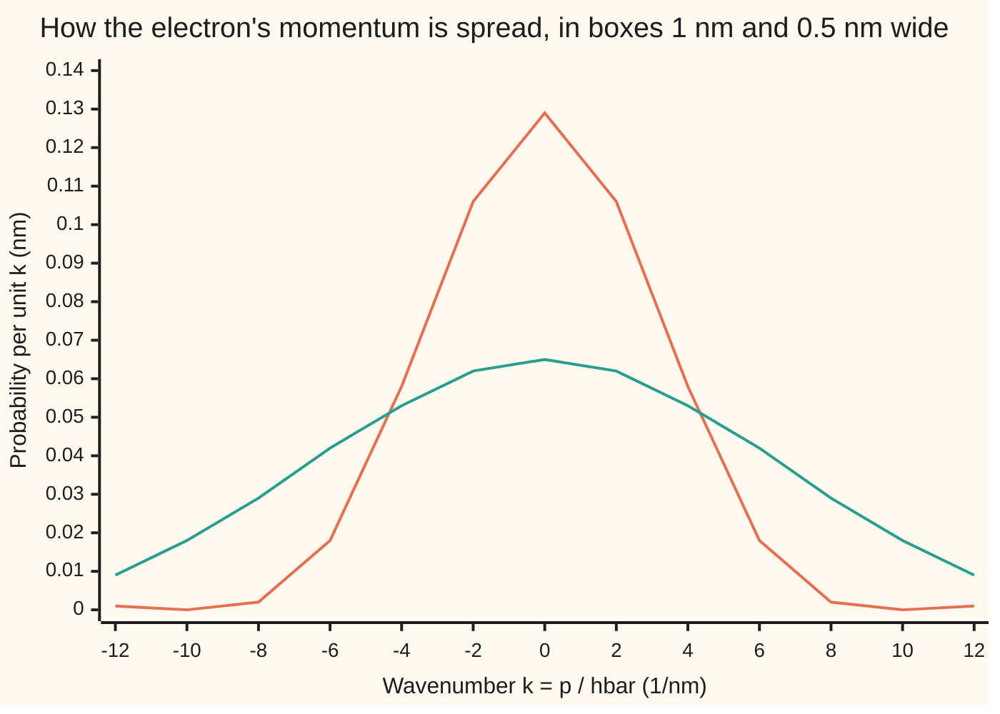

# Uncertainty: sharp position and sharp momentum cannot happen at once

[Syllabus](../../../SYLLABUS.md) → [Engineering mathematics](../README.md) → [Quantum Mechanics in Outline](../README.md#s09) → Uncertainty

---

## General Overview

An electron is trapped in a box 1 nm (one nanometre, a billionth of a metre) wide. That is a little smaller than the smallest quantum dots, specks of semiconductor 2 to 10 nm across. The walls are taken to be perfectly hard, and the electron sits in its lowest state.

Its position is known well: it is somewhere in that nanometre, spread with a standard deviation of 0.1808 nm. So how fast is it moving? Its average momentum is zero, since it goes left as often as right. But it is not at rest. Its momentum spreads with a standard deviation of 3.313 × 10⁻²⁵ kg m/s, which is a speed spread of 363.69 km/s. That motion carries 0.376 eV of energy (an electronvolt, eV, is the energy one electron gains across one volt), 14.55 times the thermal energy at room temperature. Squeeze the box and this motion grows. It is the reason the colour of a quantum dot depends on its size.

The rule behind it is the uncertainty principle. No state of any particle has both a small position spread and a small momentum spread. The product of the two spreads can never fall below a fixed floor, ħ/2, where ħ ("h-bar") is Planck's constant divided by 2π. The electron in the box has a product of 0.567862 ħ, a little above the floor of 0.5 ħ.

**The position spread times the momentum spread is at least ħ/2, because the operators for position and momentum do not commute; it is the same trade-off that stops a sound from being both short and pure in pitch.**

**What kind of fact this is:** a theorem, proved on this card in Why it works, true for every state of a particle on a line; the hard-walled box it is applied to is a model, since real walls are finite.

### The picture: squeeze the box and the momentum spreads out



The orange line is the electron in the 1 nm box. The green line is the same electron in a box half as wide. Halving the box halves the position spread and doubles the width of the momentum curve, so the green line is twice as wide and half as tall. The area under each line is 1.

---

## The formula

A reminder from [States as vectors](02-state-vectors-operators-and-measurement.md): the state is a wavefunction ψ(x), and $|\psi(x)|^2$ is the probability density of finding the particle at $x$. Each measurable quantity is an operator, written with a hat. Here a hat means an operator, not an estimate (as in wing 09) and not a transform. Position $\hat x$ multiplies ψ by $x$. Momentum $\hat p$ takes the slope, $\hat p\,\psi = -i\hbar\,\psi'$, where $i$ is the square root of −1 (the signals shelf writes $j$).

$$\sigma_x\,\sigma_p \;\ge\; \frac{\hbar}{2}, \qquad\text{because}\qquad [\hat x,\hat p] = \hat x\hat p - \hat p\hat x = i\hbar .$$

**Read it aloud:** the spread in position times the spread in momentum is at least half of h-bar, because applying position then momentum, or momentum then position, to a state gives answers that differ by $i\hbar$ times the state.

The spreads are standard deviations, the root-mean-square distance from the mean:

$$\sigma_x^2 = \int (x-\bar x)^2\,|\psi|^2\,dx, \qquad \sigma_p^2 = \big\|(\hat p-\bar p)\,\psi\big\|^2 .$$

The same theorem in signal language, with time $t$ for position and frequency $f$ for momentum, is Gabor's limit, used on [Spectrograms](../05-Signals/09-short-time-fourier-and-spectrograms.md):

$$\sigma_t\,\sigma_f \;\ge\; \frac{1}{4\pi}.$$

| Symbol | Plain meaning | In our example | Push it up and the answer… |
| --- | --- | --- | --- |
| $\psi(x)$ | the wavefunction; $\lvert\psi\rvert^2$ is where the electron is likely to be | $\sqrt{2/L}\,\sin(\pi x/L)$ inside the box | — |
| $\hat x$, $\hat p$, $i$ | position operator (multiply by $x$); momentum operator ($-i\hbar$ times the slope); the square root of −1 | — | — |
| $\hbar$ | reduced Planck constant, $h/2\pi$, exact in SI | 1.054572 × 10⁻³⁴ J s | the floor rises |
| $L$, $a$ | the box width; $a = \pi/L$, the lowest state's wavenumber | 1 nm; 3.141593 per nm | $L$ up: $\sigma_x$ up, $\sigma_p$ down, product unchanged |
| $m_e$, $E$, $k_BT$ | electron mass; kinetic energy $\langle p^2\rangle/2m_e$; thermal energy at 300 K | 9.109384 × 10⁻³¹ kg; 0.376030 eV; 0.025852 eV | — |
| $\bar x$, $\bar p$ | mean position, mean momentum | $L/2$; 0 | — |
| $\sigma_x$, $\sigma_p$ | position spread, momentum spread (standard deviations) | 0.180756 nm; 3.313035 × 10⁻²⁵ kg m/s | the other may shrink, down to the floor |
| $[\hat A,\hat B]$ | the commutator $\hat A\hat B-\hat B\hat A$: how much order matters | $[\hat x,\hat p]=i\hbar$ | — |
| $\langle u,v\rangle$, $\lVert u\rVert$ | inner product $\int u^\ast v\,dx$ ($u^\ast$ is the complex conjugate); length $\sqrt{\langle u,u\rangle}$ | — | — |
| $u$, $v$, $\mu$ | the two vectors in the proof: $(\hat x-\bar x)\psi$ and $(\hat p-\bar p)\psi$; $\mu$, the positive number with $v = i\mu u$ on the floor | lengths 0.180756 nm and 3.313035 × 10⁻²⁵ kg m/s | — |
| $k$, $\varphi(k)$ | wavenumber, $p/\hbar$; the Fourier transform of ψ, the amplitude for wavenumber $k$ | $\lvert\varphi(0)\rvert^2$ = 0.810569 nm | — |
| $t$, $f$, $\omega$, $\sigma_t$, $\sigma_f$ | time; frequency in hertz; angular frequency $2\pi f$ in rad/s; the spreads of time and frequency for a sound | 32.48 ms; 2.45 Hz | one up, the other may come down |

### When it holds

- **Spreads are standard deviations.** The box's full width is not its spread. Use 1 nm as $\sigma_x$ and the floor drops to 0.527 × 10⁻²⁵ kg m/s, far below the true 3.313.
- **The particle lives on a line, or the wavefunction is zero at the walls.** On a ring there is no honest "multiply by $x$", because $x$ jumps where the ring closes. An electron carrying one whole wave round a 1 nm ring has $\sigma_p = 0$ and $\sigma_x$ = 0.288675 nm, a product of 0. The ring needs an angle version of the theorem.
- **Both spreads exist.** A wavefunction with a jump, such as a flat ψ that switches on at the walls, has an infinite momentum spread. The theorem then holds trivially and says nothing.
- **Slow electrons.** The kinetic energy $\langle p^2\rangle/2m_e$ assumes speeds far below light. Shrink the box to 1 fm (a nucleus) and the same formula gives a speed spread of 1213 times the speed of light: the theorem still holds, but the energy needs relativity.
- **This outline leaves out** the careful treatment of the domains of $\hat x$ and $\hat p$, mixed states, and the energy–time relation, which is a different statement because time is not an operator.

---

## Why it works

### Step 0: two spreads are two lengths, and order matters

The position spread is the length of one vector, $u = (\hat x - \bar x)\psi$. The momentum spread is the length of another, $v = (\hat p - \bar p)\psi$. The Cauchy–Schwarz inequality says the product of two lengths is at least the size of their inner product. So the whole proof comes down to showing that $\langle u, v\rangle$ can never be small. It cannot, because swapping the order of $\hat x$ and $\hat p$ changes the answer by a fixed amount, $i\hbar$, and that fixed amount ends up as the imaginary part of $\langle u, v\rangle$.

### Step 1: position and momentum do not commute

Apply both orders to any ψ. Taking the slope of $x\psi$ uses the product rule:

$$\hat x\hat p\,\psi = -i\hbar\,x\psi', \qquad \hat p\hat x\,\psi = -i\hbar\,(x\psi)' = -i\hbar\,(\psi + x\psi').$$

Subtract: $[\hat x,\hat p]\,\psi = i\hbar\,\psi$. The $x\psi'$ terms cancel, and what is left is the extra ψ the product rule produced. Shifting $\hat x$ and $\hat p$ by the constants $\bar x$ and $\bar p$ changes nothing, so $[\hat x-\bar x,\ \hat p-\bar p] = i\hbar$ too.

### Step 2: each spread is the length of a vector

$\sigma_x^2 = \int (x-\bar x)^2|\psi|^2 dx = \langle u,u\rangle$ straight from the definition. For momentum, $\hat p$ can be moved from one side of an inner product to the other: integrate by parts, and the boundary terms vanish because ψ is zero at the walls. So $\sigma_p^2 = \langle\psi,(\hat p-\bar p)^2\psi\rangle = \langle v,v\rangle$. In the box, the code finds these two lengths as 0.180756 nm and 3.313035 × 10⁻²⁵ kg m/s, by sums on a grid, matching the formulas $\sigma_x = L\sqrt{1/12 - 1/(2\pi^2)}$ and $\sigma_p = \pi\hbar/L$.

### Step 3: the commutator fixes the imaginary part of the pairing

Move each operator across in the same way as Step 2:

$$\langle u,v\rangle - \langle v,u\rangle = \langle\psi,\,[\hat x-\bar x,\ \hat p-\bar p]\,\psi\rangle = i\hbar.$$

Swapping the two sides of an inner product conjugates it, $\langle v,u\rangle = \langle u,v\rangle^\ast$. A number minus its conjugate is $2i$ times its imaginary part. So

$$\operatorname{Im}\langle u,v\rangle = \frac{\hbar}{2}\quad\text{for every state.}$$

For the box the code computes the pairing directly, $-\hbar\int (x-\bar x)\,\psi\,\psi'\,dx$, and gets 0.500000 ħ.

### Step 4: Cauchy–Schwarz finishes it

$$\sigma_x\,\sigma_p = \lVert u\rVert\,\lVert v\rVert \;\ge\; |\langle u,v\rangle| \;\ge\; |\operatorname{Im}\langle u,v\rangle| = \frac{\hbar}{2}.$$

The first step is Cauchy–Schwarz, proved for ordinary arrows on [The dot product](../../03-Algebra/06-Dot%20Products%20and%20Best%20Fits/01-dot-product.md); the same proof runs for this complex inner product. The second says a complex number is at least as large as its imaginary part. In the box, the left side is 0.567862 ħ. There the pairing is purely imaginary, so the whole gap above 0.5 ħ comes from the first step: $u$ and $v$ do not point the same way.

<details>
<summary>The same proof for any two quantities (Robertson, 1929)</summary>

Replace $\hat x$ and $\hat p$ by any two operators $\hat A$ and $\hat B$ that can be moved across an inner product. Steps 2 to 4 run unchanged and give

$$\sigma_A\,\sigma_B \;\ge\; \tfrac12\,\big|\langle\psi,[\hat A,\hat B]\,\psi\rangle\big| .$$

When the commutator is a constant, as for position and momentum, the floor is the same for every state. When it is another operator, as for two components of spin on [Spin one-half](06-spin-and-two-state-systems.md), the floor depends on the state. When the two operators commute, the floor is zero and both can be sharp together.

</details>

### Step 5: the Gaussian, and only the Gaussian, sits on the floor

Both inequalities in Step 4 become equalities only if $v$ is a purely imaginary multiple of $u$: $v = i\mu\,u$ with $\mu > 0$. Written out, that is $-i\hbar\psi' - \bar p\psi = i\mu(x-\bar x)\psi$, a first-order equation whose solution is a bell curve:

$$\psi(x) \propto \exp\!\Big(-\frac{(x-\bar x)^2}{4\sigma_x^2} + \frac{i\,\bar p\,x}{\hbar}\Big).$$

Give the Gaussian the box state's position spread, 0.180756 nm. Its momentum spread comes out at 2.917114 × 10⁻²⁵ kg m/s, exactly the floor ħ/(2σ_x), and its product is 0.500000 ħ. Every other shape sits above:

```
spread product, in units of hbar (floor 0.5)
Gaussian            ##########                                            0.500000
box, lowest level   ###########                                           0.567862
box, level 2        #################################                     1.670290
box, level 3        ##################################################### 2.627204
```

Higher levels have more wiggles, so more momentum for the same box. [The quantum oscillator](04-quantum-harmonic-oscillator.md) has a Gaussian as its lowest level, which is why its floor energy is the least the uncertainty principle allows.

### Step 6: the Fourier reading, and the guitar string

A wave $e^{ikx}$ is a state of definite momentum: $\hat p\,e^{ikx} = \hbar k\,e^{ikx}$. Any ψ is a blend of these waves, and the amount of each is the Fourier transform ([The Fourier transform](../../07-Complex%20analysis/08-Transforms%20in%20Outline/03-fourier-transform.md)):

$$\varphi(k) = \int \psi(x)\,e^{-ikx}\,dx, \qquad \text{probability per unit } k = \frac{|\varphi(k)|^2}{2\pi}.$$

So the momentum spread is $\hbar$ times the spread of the transform. The code takes this road too: it sums $k^2|\varphi(k)|^2$ (adding the far tail, beyond $k = 400a$, in closed form) and gets 3.313035 × 10⁻²⁵ kg m/s again. The uncertainty principle is therefore a fact about Fourier transforms: a function narrow in $x$ has a transform wide in $k$, with $\sigma_x\sigma_k \ge 1/2$.

Now set the electron beside a guitar string. Rename $x$ as time $t$ and $k$ as angular frequency $\omega = 2\pi f$. "Multiply by $t$" and "$-i$ times the slope in time" fail to commute by exactly $i$, and Steps 1 to 4 give $\sigma_t\,\sigma_\omega \ge 1/2$, that is $\sigma_t\,\sigma_f \ge 1/(4\pi)$ = 0.079577. A note heard for a short time cannot have a sharp pitch.

The low E string of a guitar is 82.41 Hz. The next fret up, F, is 87.31 Hz. To keep a note's frequency spread to half that gap, 2.45 Hz, the note must last with a time spread of at least 32.48 ms. The code builds a Gaussian-shaped 82.41 Hz burst with exactly that time spread, takes its spectrum by direct sums, and measures a frequency spread of 2.450084 Hz: on the floor, as the Gaussian should be. Take a shorter slice of sound and its spectrum blurs E and F into one hump, however good the electronics. A tuner can still name a single clean note from less sound, but only by assuming it is one pure tone and fitting it, not by a sharper spectrum.

---

## Worked numbers, by hand

Electron in a hard-walled box, $L$ = 1 nm, lowest state $\psi = \sqrt{2/L}\,\sin(\pi x/L)$. Constants from CODATA 2022.

| Step | Arithmetic | Value |
| --- | --- | --- |
| mean position $\bar x$ | the state is symmetric about the middle | $L/2$ |
| $\sigma_x$ | $L\sqrt{1/12 - 1/(2\pi^2)} = 1\text{ nm}\times\sqrt{0.032673}$ | 0.180756 nm |
| mean momentum $\bar p$ | left and right equally likely | 0 |
| $\sigma_p$ | $\pi\hbar/L = 3.141593 \times 1.054572\times10^{-34} / 10^{-9}$ | 3.313035 × 10⁻²⁵ kg m/s |
| product | $0.180756\times10^{-9} \times 3.313035\times10^{-25} / \hbar$ | 0.567862 ħ |
| floor for this $\sigma_x$ | $\hbar / (2 \times 0.180756\times10^{-9})$ | 2.917114 × 10⁻²⁵ kg m/s |
| actual over floor | $3.313035 / 2.917114$ | 1.135724 |
| speed spread | $\sigma_p / m_e = 3.313035\times10^{-25} / 9.109384\times10^{-31}$ | 363.69 km/s |
| **kinetic energy** | $\sigma_p^2 / 2m_e$, in eV | **0.376030 eV** |
| against room heat | $0.376030 / 0.025852$ | 14.55 |

So holding an electron in one nanometre forces it to move, with 0.376 eV of energy that cannot be removed. That is 14.55 times the thermal energy at room temperature, so heat does not wash it out: the size of the box, not the temperature, sets the electron's energy. It is the lowest level on [Schrodinger's equation](03-schrodinger-equation-and-the-particle-in-a-box.md), reached here from the momentum spread alone.

### What breaks if you drop a piece

| Mistake | Comes out at | What went wrong |
| --- | --- | --- |
| The box width 1 nm used as $\sigma_x$ | floor 0.527286 × 10⁻²⁵ kg m/s | The width is not a standard deviation; the floor is far too low to be useful |
| $h$ written for $\hbar$ | floor 18.328767 × 10⁻²⁵ kg m/s | Larger than the real 3.313035: the actual state would break the "law", so the law was copied wrong |
| Mean momentum used for the spread | energy 0.000000 eV | $\bar p = 0$, but $\sigma_p$ is not; the electron is never at rest |
| Ring instead of a line (a hypothesis fails) | product 0.000000 ħ | On a ring, multiplying by $x$ is not a proper operator, and $[\hat x,\hat p] = i\hbar$ breaks at the seam |
| Box shrunk to 1 fm, energy as $p^2/2m_e$ | speed spread 1213.155118 × light | The theorem holds; the slow-electron energy formula does not |

---

## Code, from first principles, and it actually runs

The script takes three independent roads to the electron's momentum spread: the formula $\pi\hbar/L$; sums in position space, with the slope taken by a finite difference; and sums in momentum space over the Fourier transform, whose closed form is first checked against a direct numerical transform. It also computes the commutator pairing directly, finds the ring's momentum spread by the same sums, puts a Gaussian on the floor, measures the guitar burst's spectrum by direct sums, and works every number in "What breaks". Simpson's rule (adding thin slices of area, weighted 1, 4, 2, 4, …) is written out; nothing imported knows the answer.

### Python

```python
# Uncertainty -- the check behind the card.  Standard library only.
# An electron in a 1 nm box: its position spread and momentum spread, reached
# three ways (formula, position-space sums, momentum-space sums), then the
# commutator pairing, the Gaussian that sits on the floor, and the guitar note.
from math import sin, cos, exp, pi, sqrt

HBAR = 6.62607015e-34 / (2 * pi)       # J s, exact since the 2019 SI (CODATA 2022)
ME   = 9.1093837139e-31                # electron mass, kg (CODATA 2022)
EV   = 1.602176634e-19                 # J per eV, exact
KB   = 1.380649e-23                    # Boltzmann constant, J/K, exact
EPS0 = 8.8541878188e-12                # F/m (CODATA 2022)
C    = 299792458.0                     # m/s, exact
NM, P25 = 1e-9, 1e-25                  # print lengths in nm, momenta in units of 1e-25 kg m/s

def simpson(f, a, b, n):               # Simpson's rule, n even
    h = (b - a) / n
    s = f(a) + f(b) + sum((4 if i % 2 else 2) * f(a + i * h) for i in range(1, n))
    return s * h / 3

L = 1.0 * NM                           # the box
a = pi / L                             # ground state's wavenumber, rad/m
psi = lambda x: sqrt(2 / L) * sin(a * x)

# ---- road 1: the formulas ----
sx = L * sqrt(1 / 12 - 1 / (2 * pi ** 2))
sp = pi * HBAR / L
floor = HBAR / (2 * sx)

# ---- road 2: sums in position space; the slope by a finite difference ----
n, d = 4000, L * 1e-6
dpsi = lambda x: (psi(x + d) - psi(x - d)) / (2 * d)
norm = simpson(lambda x: psi(x) ** 2, 0, L, n)
xbar = simpson(lambda x: x * psi(x) ** 2, 0, L, n)
sx2  = sqrt(simpson(lambda x: (x - xbar) ** 2 * psi(x) ** 2, 0, L, n))
sp2  = HBAR * sqrt(simpson(lambda x: dpsi(x) ** 2, 0, L, n))          # <p> = 0 for a real psi
pbar = HBAR * simpson(lambda x: psi(x) * dpsi(x), 0, L, n)            # <p> = -i hbar times this
pair = -HBAR * simpson(lambda x: (x - xbar) * psi(x) * dpsi(x), 0, L, n)  # Im <(x - xbar)psi, p psi>

# ---- road 3: momentum space.  phi(k) = integral of psi e^(-ikx); check it, then sum k^2 |phi|^2 ----
def phi2(k):                           # |phi(k)|^2 in closed form; L/2 at k = a
    return L / 2 if abs(k * k - a * a) < 1e-9 * a * a else (2 / L) * a * a * 4 * cos(k * L / 2) ** 2 / (a * a - k * k) ** 2
def phi2_direct(k):                    # the same, by doing the integral numerically
    return simpson(lambda x: psi(x) * cos(k * x), 0, L, n) ** 2 + simpson(lambda x: psi(x) * sin(k * x), 0, L, n) ** 2
assert all(abs(phi2_direct(k) - phi2(k)) < 1e-6 * phi2(k) for k in (0, 2 * a)), "closed-form |phi|^2 against the direct transform"
K = 400 * a
mass = 2 * simpson(lambda k: phi2(k), 0, K, 40000) / (2 * pi)
k2 = 2 * simpson(lambda k: k * k * phi2(k), 0, K, 40000) / (2 * pi) + 4 * a * a / (pi * L * K)
sp3 = HBAR * sqrt(k2)
E, kT = sp ** 2 / (2 * ME) / EV, KB * 300 / EV     # kinetic energy and kT at 300 K, eV

# ---- the Gaussian with the same position spread sits exactly on the floor ----
g = lambda x: (2 * pi * sx * sx) ** -0.25 * exp(-x * x / (4 * sx * sx))
dg = lambda x: (g(x + d) - g(x - d)) / (2 * d)
gx = sqrt(simpson(lambda x: x * x * g(x) ** 2, -12 * sx, 12 * sx, n))
gp = HBAR * sqrt(simpson(lambda x: dg(x) ** 2, -12 * sx, 12 * sx, n))

# ---- other states, product in units of hbar: box level m, and a ring ----
def box_product(m): return m * pi * sqrt(1 / 12 - 1 / (2 * m * m * pi * pi))
ring = lambda x: (cos(2 * pi * x / L) + 1j * sin(2 * pi * x / L)) / sqrt(L)   # one wave round a 1 nm ring
pring = lambda x: -1j * HBAR * (ring(x + d) - ring(x - d)) / (2 * d)         # p acting on it, slope by finite difference
ring_pbar = simpson(lambda x: (ring(x).conjugate() * pring(x)).real, 0, L, n)
ring_sx, ring_sp = L / sqrt(12), sqrt(simpson(lambda x: abs(pring(x) - ring_pbar * ring(x)) ** 2, 0, L, n))

# ---- what breaks ----
wrong_width = HBAR / (2 * L)           # box width used as the spread
wrong_h     = 2 * pi * HBAR / (2 * sx) # h in place of hbar
fermi_v     = pi * HBAR / 1e-15 / ME   # the same box shrunk to 1 fm, speed spread m/s

# ---- the guitar: E2 and F2, and the shortest note that tells them apart ----
fE, fF = 440 * 2 ** (-29 / 12), 440 * 2 ** (-28 / 12)
sf_need = (fF - fE) / 2; st_need = 1 / (4 * pi * sf_need)
burst = lambda t: exp(-t * t / (4 * st_need ** 2)) * cos(2 * pi * fE * t)
dt = 12 * st_need / 1200; ts = [-6 * st_need + i * dt for i in range(1201)]
def power(f):                          # |X(f)|^2 by a direct sum over the burst
    re = sum(burst(t) * cos(2 * pi * f * t) for t in ts) * dt
    im = sum(burst(t) * sin(2 * pi * f * t) for t in ts) * dt
    return re * re + im * im
sb = 1 / (4 * pi * st_need); fs = [fE - 6 * sb + i * 12 * sb / 240 for i in range(241)]   # +-6 of the burst's own spread
P = [power(f) for f in fs]; fmean = sum(f * p for f, p in zip(fs, P)) / sum(P)
sf_meas = sqrt(sum((f - fmean) ** 2 * p for f, p in zip(fs, P)) / sum(P))

# ---- hydrogen: minimise hbar^2/(2 m r^2) - e^2/(4 pi eps0 r) ----
r0 = 4 * pi * EPS0 * HBAR ** 2 / (ME * EV ** 2)
EH = HBAR ** 2 / (2 * ME * r0 ** 2) / EV - EV / (4 * pi * EPS0 * r0)

rows = [
    ("hbar, 1e-34 J s", HBAR / 1e-34), ("electron mass, 1e-31 kg", ME / 1e-31),
    ("1/12 - 1/(2 pi^2)", 1 / 12 - 1 / (2 * pi ** 2)), ("a = pi/L, 1/nm", a * NM),
    ("1 position spread sx, formula, nm", sx / NM), ("2 position spread sx, sums, nm", sx2 / NM),
    ("  norm of psi, sums", norm),
    ("1 momentum spread sp, formula, 1e-25 kg m/s", sp / P25),
    ("2 momentum spread sp, slope sums, 1e-25", sp2 / P25),
    ("3 momentum spread sp, from phi(k), 1e-25", sp3 / P25),
    ("  norm of phi, sums", mass),
    ("  |phi(0)|^2 closed form, nm", phi2(0) / NM), ("  |phi(0)|^2 direct integral, nm", phi2_direct(0) / NM),
    ("  |phi(2a)|^2 closed form, nm", phi2(2 * a) / NM), ("  |phi(2a)|^2 direct integral, nm", phi2_direct(2 * a) / NM),
    ("Im pairing / hbar", pair / HBAR), ("product sx sp / hbar", sx * sp / HBAR),
    ("floor hbar/(2 sx), 1e-25", floor / P25),
    ("sp over floor", sp / floor),
    ("speed spread sp/m, km/s", sp / ME / 1e3),
    ("kinetic energy <p^2>/2m, eV", E),
    ("kT at 300 K, eV", kT), ("energy over kT", E / kT),
    ("Gaussian sx, nm", gx / NM),
    ("Gaussian sp, 1e-25", gp / P25),
    ("Gaussian product / hbar", gx * gp / HBAR),
    ("box level 2 product / hbar", box_product(2)), ("box level 3 product / hbar", box_product(3)),
    ("ring sx, nm", ring_sx / NM),
    ("ring product / hbar", ring_sx * ring_sp / HBAR),
    ("wrong: width as spread, 1e-25", wrong_width / P25),
    ("wrong: h for hbar, 1e-25", wrong_h / P25),
    ("wrong: mean for spread, energy eV", pbar ** 2 / (2 * ME) / EV),
    ("wrong: 1 fm box, speed over c", fermi_v / C),
    ("guitar E2, Hz", fE), ("guitar F2, Hz", fF),
    ("half the gap, Hz", sf_need),
    ("time spread needed st, ms", st_need * 1e3), ("  burst length, about 4 st, ms", 4 * st_need * 1e3),
    ("burst spread sf, measured, Hz", sf_meas),
    ("st sf, against 1/(4 pi)", st_need * sf_meas), ("1/(4 pi)", 1 / (4 * pi)),
    ("hydrogen radius, nm", r0 / NM), ("hydrogen energy, eV", EH),
]
for name, v in rows:
    print(f"{name:<44}{v:12.6f}")

print("chart, k in 1/nm      " + " ".join(f"{k:5d}" for k in range(-12, 13, 2)))
for w in (1.0, 0.5):
    a = pi / (w * NM); L = w * NM      # phi2 reads a and L
    print(f"chart, L = {w:.1f} nm, nm " + " ".join(f"{phi2(k / NM) / (2 * pi) / NM:5.3f}" for k in range(-12, 13, 2)))

assert abs(sx2 - sx) < 1e-6 * sx,      "position spread: sums against formula"
assert abs(sp2 - sp) < 1e-5 * sp,      "momentum spread: slope sums against formula"
assert abs(sp3 - sp) < 1e-4 * sp,      "momentum spread: momentum space against formula"
assert abs(pair / HBAR - 0.5) < 1e-6,  "commutator fixes Im pairing at hbar/2"
assert sx * sp >= HBAR / 2,            "the box obeys the bound"
assert ring_sx * ring_sp < 1e-6 * HBAR, "the ring escapes the line's floor: one definite momentum"
assert abs(gx * gp / HBAR - 0.5) < 1e-6, "the Gaussian sits on the floor"
assert abs(st_need * sf_meas - 1 / (4 * pi)) < 1e-4, "time-frequency floor, measured"
assert abs(sf_meas - sf_need) < 1e-4 * sf_need, "burst spread: measured against target"
assert abs(EH + 13.6057) < 1e-3,       "hydrogen ground energy"
print("ALL CHECKS PASS")
```

**Ran 2026-11-11 on macOS, Python 3.14.10, standard library only. All checks passed. Output, pasted from the run:**

```
hbar, 1e-34 J s                                 1.054572
electron mass, 1e-31 kg                         9.109384
1/12 - 1/(2 pi^2)                               0.032673
a = pi/L, 1/nm                                  3.141593
1 position spread sx, formula, nm               0.180756
2 position spread sx, sums, nm                  0.180756
  norm of psi, sums                             1.000000
1 momentum spread sp, formula, 1e-25 kg m/s     3.313035
2 momentum spread sp, slope sums, 1e-25         3.313035
3 momentum spread sp, from phi(k), 1e-25        3.313035
  norm of phi, sums                             1.000000
  |phi(0)|^2 closed form, nm                    0.810569
  |phi(0)|^2 direct integral, nm                0.810569
  |phi(2a)|^2 closed form, nm                   0.090063
  |phi(2a)|^2 direct integral, nm               0.090063
Im pairing / hbar                               0.500000
product sx sp / hbar                            0.567862
floor hbar/(2 sx), 1e-25                        2.917114
sp over floor                                   1.135724
speed spread sp/m, km/s                       363.694755
kinetic energy <p^2>/2m, eV                     0.376030
kT at 300 K, eV                                 0.025852
energy over kT                                 14.545496
Gaussian sx, nm                                 0.180756
Gaussian sp, 1e-25                              2.917114
Gaussian product / hbar                         0.500000
box level 2 product / hbar                      1.670290
box level 3 product / hbar                      2.627204
ring sx, nm                                     0.288675
ring product / hbar                             0.000000
wrong: width as spread, 1e-25                   0.527286
wrong: h for hbar, 1e-25                       18.328767
wrong: mean for spread, energy eV               0.000000
wrong: 1 fm box, speed over c                1213.155118
guitar E2, Hz                                  82.406889
guitar F2, Hz                                  87.307058
half the gap, Hz                                2.450084
time spread needed st, ms                      32.479483
  burst length, about 4 st, ms                129.917931
burst spread sf, measured, Hz                   2.450084
st sf, against 1/(4 pi)                         0.079577
1/(4 pi)                                        0.079577
hydrogen radius, nm                             0.052918
hydrogen energy, eV                           -13.605693
chart, k in 1/nm        -12   -10    -8    -6    -4    -2     0     2     4     6     8    10    12
chart, L = 1.0 nm, nm 0.001 0.000 0.002 0.018 0.058 0.106 0.129 0.106 0.058 0.018 0.002 0.000 0.001
chart, L = 0.5 nm, nm 0.009 0.018 0.029 0.042 0.053 0.062 0.065 0.062 0.053 0.042 0.029 0.018 0.009
ALL CHECKS PASS
```

Three roads, one momentum spread: 3.313035 in each. The commutator pairing lands on 0.500000 ħ, and the Gaussian product on 0.500000 ħ, the floor itself.

### Rust

The same checks and the same printed lines, with the complex transform done as separate cosine and sine sums. No crates.

```rust
// Uncertainty -- the same check as uncertainty_principle_check.py, in Rust.
// Standard library only, no crates.  An electron in a 1 nm box: its position
// spread and momentum spread, reached three ways (formula, position-space sums,
// momentum-space sums), then the commutator pairing, the Gaussian that sits on
// the floor, and the guitar note.
// Compile: rustc --edition 2021 -O uncertainty_principle_check.rs -o /tmp/uncertainty
use std::f64::consts::PI;

const H: f64 = 6.62607015e-34;          // Planck constant, J s, exact (CODATA 2022)
const ME: f64 = 9.1093837139e-31;       // electron mass, kg (CODATA 2022)
const EV: f64 = 1.602176634e-19;        // J per eV, exact
const KB: f64 = 1.380649e-23;           // Boltzmann constant, J/K, exact
const EPS0: f64 = 8.8541878188e-12;     // F/m (CODATA 2022)
const C: f64 = 299792458.0;             // m/s, exact
const NM: f64 = 1e-9;                   // print lengths in nm
const P25: f64 = 1e-25;                 // print momenta in units of 1e-25 kg m/s

fn simpson<F: Fn(f64) -> f64>(f: F, a: f64, b: f64, n: usize) -> f64 {   // n even
    let h = (b - a) / n as f64;
    let mut s = f(a) + f(b);
    for i in 1..n {
        s += (if i % 2 == 1 { 4.0 } else { 2.0 }) * f(a + i as f64 * h);
    }
    s * h / 3.0
}

fn phi2(k: f64, a: f64, l: f64) -> f64 {   // |phi(k)|^2 in closed form; L/2 at k = a
    if (k * k - a * a).abs() < 1e-9 * a * a { l / 2.0 }
    else { (2.0 / l) * a * a * 4.0 * (k * l / 2.0).cos().powi(2) / (a * a - k * k).powi(2) }
}

fn box_product(m: f64) -> f64 { m * PI * (1.0 / 12.0 - 1.0 / (2.0 * m * m * PI * PI)).sqrt() }

fn main() {
    let hbar = H / (2.0 * PI);
    let l = 1.0 * NM;                                   // the box
    let a = PI / l;                                     // ground state's wavenumber, rad/m
    let psi = |x: f64| (2.0 / l).sqrt() * (a * x).sin();

    // road 1: the formulas
    let sx = l * (1.0 / 12.0 - 1.0 / (2.0 * PI * PI)).sqrt();
    let sp = PI * hbar / l;
    let floor = hbar / (2.0 * sx);

    // road 2: sums in position space; the slope by a finite difference
    let (n, d) = (4000usize, l * 1e-6);
    let dpsi = |x: f64| (psi(x + d) - psi(x - d)) / (2.0 * d);
    let norm = simpson(|x| psi(x).powi(2), 0.0, l, n);
    let xbar = simpson(|x| x * psi(x).powi(2), 0.0, l, n);
    let sx2 = simpson(|x| (x - xbar).powi(2) * psi(x).powi(2), 0.0, l, n).sqrt();
    let sp2 = hbar * simpson(|x| dpsi(x).powi(2), 0.0, l, n).sqrt();      // <p> = 0 for a real psi
    let pbar = hbar * simpson(|x| psi(x) * dpsi(x), 0.0, l, n);           // <p> = -i hbar times this
    let pair = -hbar * simpson(|x| (x - xbar) * psi(x) * dpsi(x), 0.0, l, n); // Im <(x - xbar)psi, p psi>

    // road 3: momentum space.  phi(k) = integral of psi e^(-ikx); check it, then sum k^2 |phi|^2
    let phi2_direct = |k: f64| simpson(|x| psi(x) * (k * x).cos(), 0.0, l, n).powi(2)
        + simpson(|x| psi(x) * (k * x).sin(), 0.0, l, n).powi(2);
    assert!([0.0, 2.0 * a].iter().all(|&k| (phi2_direct(k) - phi2(k, a, l)).abs() < 1e-6 * phi2(k, a, l)), "closed-form |phi|^2 against the direct transform");
    let kk = 400.0 * a;
    let mass = 2.0 * simpson(|k| phi2(k, a, l), 0.0, kk, 40000) / (2.0 * PI);
    let k2 = 2.0 * simpson(|k| k * k * phi2(k, a, l), 0.0, kk, 40000) / (2.0 * PI) + 4.0 * a * a / (PI * l * kk);
    let sp3 = hbar * k2.sqrt();
    let (e, kt) = (sp * sp / (2.0 * ME) / EV, KB * 300.0 / EV);   // kinetic energy and kT at 300 K, eV

    // the Gaussian with the same position spread sits exactly on the floor
    let g = |x: f64| (2.0 * PI * sx * sx).powf(-0.25) * (-x * x / (4.0 * sx * sx)).exp();
    let dg = |x: f64| (g(x + d) - g(x - d)) / (2.0 * d);
    let gx = simpson(|x| x * x * g(x).powi(2), -12.0 * sx, 12.0 * sx, n).sqrt();
    let gp = hbar * simpson(|x| dg(x).powi(2), -12.0 * sx, 12.0 * sx, n).sqrt();

    // other states: one wave round a 1 nm ring, psi = (cr + i sr); its momentum spread by sums
    let (cr, sr) = (|x: f64| (2.0 * PI * x / l).cos() / l.sqrt(), |x: f64| (2.0 * PI * x / l).sin() / l.sqrt());
    let (dc, ds) = (|x: f64| (cr(x + d) - cr(x - d)) / (2.0 * d), |x: f64| (sr(x + d) - sr(x - d)) / (2.0 * d));
    let ring_pbar = hbar * simpson(|x| cr(x) * ds(x) - sr(x) * dc(x), 0.0, l, n);    // Re <psi, p psi>
    let ring_sp = simpson(|x| (hbar * ds(x) - ring_pbar * cr(x)).powi(2) + (hbar * dc(x) + ring_pbar * sr(x)).powi(2), 0.0, l, n).sqrt();
    let ring_sx = l / 12f64.sqrt();

    // what breaks
    let wrong_width = hbar / (2.0 * l);                 // box width used as the spread
    let wrong_h = 2.0 * PI * hbar / (2.0 * sx);         // h in place of hbar
    let fermi_v = PI * hbar / 1e-15 / ME;               // the same box shrunk to 1 fm, speed spread m/s

    // the guitar: E2 and F2, and the shortest note that tells them apart
    let (fe, ff) = (440.0 * 2f64.powf(-29.0 / 12.0), 440.0 * 2f64.powf(-28.0 / 12.0));
    let sf_need = (ff - fe) / 2.0;
    let st_need = 1.0 / (4.0 * PI * sf_need);
    let burst = |t: f64| (-t * t / (4.0 * st_need * st_need)).exp() * (2.0 * PI * fe * t).cos();
    let dt = 12.0 * st_need / 1200.0;
    let ts: Vec<f64> = (0..1201).map(|i| -6.0 * st_need + i as f64 * dt).collect();
    let power = |f: f64| {                              // |X(f)|^2 by a direct sum over the burst
        let re: f64 = ts.iter().map(|&t| burst(t) * (2.0 * PI * f * t).cos()).sum::<f64>() * dt;
        let im: f64 = ts.iter().map(|&t| burst(t) * (2.0 * PI * f * t).sin()).sum::<f64>() * dt;
        re * re + im * im
    };
    let sb = 1.0 / (4.0 * PI * st_need);                // +-6 of the burst's own spread
    let fs: Vec<f64> = (0..241).map(|i| fe - 6.0 * sb + i as f64 * 12.0 * sb / 240.0).collect();
    let p: Vec<f64> = fs.iter().map(|&f| power(f)).collect();
    let tot: f64 = p.iter().sum();
    let fmean = fs.iter().zip(&p).map(|(f, q)| f * q).sum::<f64>() / tot;
    let sf_meas = (fs.iter().zip(&p).map(|(f, q)| (f - fmean).powi(2) * q).sum::<f64>() / tot).sqrt();

    // hydrogen: minimise hbar^2/(2 m r^2) - e^2/(4 pi eps0 r)
    let r0 = 4.0 * PI * EPS0 * hbar * hbar / (ME * EV * EV);
    let eh = hbar * hbar / (2.0 * ME * r0 * r0) / EV - EV / (4.0 * PI * EPS0 * r0);

    let rows: Vec<(&str, f64)> = vec![
        ("hbar, 1e-34 J s", hbar / 1e-34), ("electron mass, 1e-31 kg", ME / 1e-31),
        ("1/12 - 1/(2 pi^2)", 1.0 / 12.0 - 1.0 / (2.0 * PI * PI)), ("a = pi/L, 1/nm", a * NM),
        ("1 position spread sx, formula, nm", sx / NM),
        ("2 position spread sx, sums, nm", sx2 / NM),
        ("  norm of psi, sums", norm),
        ("1 momentum spread sp, formula, 1e-25 kg m/s", sp / P25),
        ("2 momentum spread sp, slope sums, 1e-25", sp2 / P25),
        ("3 momentum spread sp, from phi(k), 1e-25", sp3 / P25),
        ("  norm of phi, sums", mass),
        ("  |phi(0)|^2 closed form, nm", phi2(0.0, a, l) / NM),
        ("  |phi(0)|^2 direct integral, nm", phi2_direct(0.0) / NM),
        ("  |phi(2a)|^2 closed form, nm", phi2(2.0 * a, a, l) / NM),
        ("  |phi(2a)|^2 direct integral, nm", phi2_direct(2.0 * a) / NM),
        ("Im pairing / hbar", pair / hbar),
        ("product sx sp / hbar", sx * sp / hbar),
        ("floor hbar/(2 sx), 1e-25", floor / P25),
        ("sp over floor", sp / floor),
        ("speed spread sp/m, km/s", sp / ME / 1e3),
        ("kinetic energy <p^2>/2m, eV", e),
        ("kT at 300 K, eV", kt),
        ("energy over kT", e / kt),
        ("Gaussian sx, nm", gx / NM),
        ("Gaussian sp, 1e-25", gp / P25),
        ("Gaussian product / hbar", gx * gp / hbar),
        ("box level 2 product / hbar", box_product(2.0)), ("box level 3 product / hbar", box_product(3.0)),
        ("ring sx, nm", ring_sx / NM),
        ("ring product / hbar", ring_sx * ring_sp / hbar),
        ("wrong: width as spread, 1e-25", wrong_width / P25),
        ("wrong: h for hbar, 1e-25", wrong_h / P25),
        ("wrong: mean for spread, energy eV", pbar * pbar / (2.0 * ME) / EV),
        ("wrong: 1 fm box, speed over c", fermi_v / C),
        ("guitar E2, Hz", fe), ("guitar F2, Hz", ff),
        ("half the gap, Hz", sf_need),
        ("time spread needed st, ms", st_need * 1e3),
        ("  burst length, about 4 st, ms", 4.0 * st_need * 1e3),
        ("burst spread sf, measured, Hz", sf_meas),
        ("st sf, against 1/(4 pi)", st_need * sf_meas), ("1/(4 pi)", 1.0 / (4.0 * PI)),
        ("hydrogen radius, nm", r0 / NM), ("hydrogen energy, eV", eh),
    ];
    for (name, v) in &rows {
        println!("{:<44}{:12.6}", name, v);
    }

    let ks: Vec<i32> = (-6..=6).map(|i| 2 * i).collect();
    println!("chart, k in 1/nm      {}", ks.iter().map(|k| format!("{:5}", k)).collect::<Vec<_>>().join(" "));
    for w in [1.0f64, 0.5] {
        let (lw, aw) = (w * NM, PI / (w * NM));
        let vals: Vec<String> = ks.iter().map(|&k| format!("{:5.3}", phi2(k as f64 / NM, aw, lw) / (2.0 * PI) / NM)).collect();
        println!("chart, L = {:.1} nm, nm {}", w, vals.join(" "));
    }

    assert!((sx2 - sx).abs() < 1e-6 * sx, "position spread: sums against formula");
    assert!((sp2 - sp).abs() < 1e-5 * sp, "momentum spread: slope sums against formula");
    assert!((sp3 - sp).abs() < 1e-4 * sp, "momentum spread: momentum space against formula");
    assert!((pair / hbar - 0.5).abs() < 1e-6, "commutator fixes Im pairing at hbar/2");
    assert!(sx * sp >= hbar / 2.0, "the box obeys the bound");
    assert!(ring_sx * ring_sp < 1e-6 * hbar, "the ring escapes the line's floor: one definite momentum");
    assert!((gx * gp / hbar - 0.5).abs() < 1e-6, "the Gaussian sits on the floor");
    assert!((st_need * sf_meas - 1.0 / (4.0 * PI)).abs() < 1e-4, "time-frequency floor, measured");
    assert!((sf_meas - sf_need).abs() < 1e-4 * sf_need, "burst spread: measured against target");
    assert!((eh + 13.6057).abs() < 1e-3, "hydrogen ground energy");
    println!("ALL CHECKS PASS");
}
```

**Ran 2026-11-11 on macOS, rustc 1.98.1, no crates. All checks passed. Output, pasted from the run:**

```
hbar, 1e-34 J s                                 1.054572
electron mass, 1e-31 kg                         9.109384
1/12 - 1/(2 pi^2)                               0.032673
a = pi/L, 1/nm                                  3.141593
1 position spread sx, formula, nm               0.180756
2 position spread sx, sums, nm                  0.180756
  norm of psi, sums                             1.000000
1 momentum spread sp, formula, 1e-25 kg m/s     3.313035
2 momentum spread sp, slope sums, 1e-25         3.313035
3 momentum spread sp, from phi(k), 1e-25        3.313035
  norm of phi, sums                             1.000000
  |phi(0)|^2 closed form, nm                    0.810569
  |phi(0)|^2 direct integral, nm                0.810569
  |phi(2a)|^2 closed form, nm                   0.090063
  |phi(2a)|^2 direct integral, nm               0.090063
Im pairing / hbar                               0.500000
product sx sp / hbar                            0.567862
floor hbar/(2 sx), 1e-25                        2.917114
sp over floor                                   1.135724
speed spread sp/m, km/s                       363.694755
kinetic energy <p^2>/2m, eV                     0.376030
kT at 300 K, eV                                 0.025852
energy over kT                                 14.545496
Gaussian sx, nm                                 0.180756
Gaussian sp, 1e-25                              2.917114
Gaussian product / hbar                         0.500000
box level 2 product / hbar                      1.670290
box level 3 product / hbar                      2.627204
ring sx, nm                                     0.288675
ring product / hbar                             0.000000
wrong: width as spread, 1e-25                   0.527286
wrong: h for hbar, 1e-25                       18.328767
wrong: mean for spread, energy eV               0.000000
wrong: 1 fm box, speed over c                1213.155118
guitar E2, Hz                                  82.406889
guitar F2, Hz                                  87.307058
half the gap, Hz                                2.450084
time spread needed st, ms                      32.479483
  burst length, about 4 st, ms                129.917931
burst spread sf, measured, Hz                   2.450084
st sf, against 1/(4 pi)                         0.079577
1/(4 pi)                                        0.079577
hydrogen radius, nm                             0.052918
hydrogen energy, eV                           -13.605693
chart, k in 1/nm        -12   -10    -8    -6    -4    -2     0     2     4     6     8    10    12
chart, L = 1.0 nm, nm 0.001 0.000 0.002 0.018 0.058 0.106 0.129 0.106 0.058 0.018 0.002 0.000 0.001
chart, L = 0.5 nm, nm 0.009 0.018 0.029 0.042 0.053 0.062 0.065 0.062 0.053 0.042 0.029 0.018 0.009
ALL CHECKS PASS
```

> [!TIP]
> **Try changing**
> - Guess first: the box's second level has two humps. Is its spread product nearer 0.5 ħ or 2 ħ? The `box_product(2)` line says 1.670290 ħ, and `box_product(3)` gives 2.627204 ħ. Each extra wiggle adds momentum without narrowing the position.
> - Guess first: does the Gaussian stay on the floor if you make it wider? Replace `sx` in the Gaussian's lines by `2 * sx`. Its momentum spread halves and the product stays at 0.500000 ħ.
> - Guess first: how fast does an electron squeezed into 1 fm, the size of a nucleus, spread? The `fermi_v` line answers: 1213 times the speed of light, by the slow-particle formula. The theorem is fine; that formula is not.
> - Guess first: halve the guitar note's time spread, `st_need = 0.5 / (4 * pi * sf_need)`. The measured frequency spread doubles and the product stays at 0.079577, on the floor. Then the assert against the 2.45 Hz target stops the script, as it should: so short a burst cannot separate E from F.

---

## The usual mistake

> [!warning]
> **Reading it as clumsy measurement.** The principle is often told as "looking at the electron knocks it". That is not what the proof uses. The spreads $\sigma_x$ and $\sigma_p$ belong to the state itself: measure position on many identical boxes and you get one spread, measure momentum on many others and you get the other. No measurement disturbs anything in Steps 1 to 4. The 0.376030 eV of motion is there whether or not anyone looks.
>
> Four smaller traps:
> - **Using the width for the spread.** 1 nm is the box, not $\sigma_x$. The floor then comes out at 0.527286 × 10⁻²⁵ kg m/s instead of 2.917114.
> - **$h$ for $\hbar$.** The floor jumps to 18.328767 × 10⁻²⁵ kg m/s, which the real electron, at 3.313035, would break.
> - **Zero mean, so zero motion.** $\bar p = 0$ gives a kinetic energy of 0.000000 eV if you use the mean. The spread gives 0.376030 eV.
> - **Applying it to angles on a ring.** One wave round a 1 nm ring has a product of 0.000000 ħ. That breaks nothing: the position operator on a ring is not the one in the proof.

---

## Where you meet it in real life

- **Quantum dots.** The colour of a nanocrystal in a display is set by its size, because squeezing the electron raises its confinement energy: 0.376 eV at 1 nm, against 0.025852 eV of room heat.
- **Why atoms have a size.** An electron pulled toward a proton gains energy by getting closer, but pays in momentum spread. Held within a distance $r$ of the proton, its confinement energy is about $\hbar^2/(2m_er^2)$. Balancing that against the electric pull gives a radius of 0.052918 nm and an energy of −13.605693 eV: the Bohr radius, and hydrogen's binding energy of 13.6 eV to three figures. Both hold the proton still; [Hydrogen in outline](07-the-hydrogen-atom-in-outline.md) lets it move too, which changes the fourth figure.
- **Tuners and spectrograms.** Telling E2 from F2 in a spectrum needs a time spread of at least 32.48 ms, a burst lasting about four time spreads, 129.92 ms. At exactly that spread the two peaks only just merge into one flat-topped hump; a dip between them needs a longer burst still. A spectrogram's slice length trades time detail against pitch detail by the same floor ([Spectrograms](../05-Signals/09-short-time-fourier-and-spectrograms.md)).
- **Radar, sonar and lasers.** A short pulse locates a target sharply in range but spreads over a wide band of frequencies. A laser pulse on the Gaussian floor is called transform-limited.

> **Say it back**
> Position and momentum are operators that give different answers in different orders: $\hat x\hat p - \hat p\hat x = i\hbar$. That fixed difference becomes the imaginary part of a pairing between two vectors whose lengths are the two spreads, and Cauchy–Schwarz then forces $\sigma_x\sigma_p \ge \hbar/2$. An electron held in 1 nm therefore has a momentum spread of 3.313 × 10⁻²⁵ kg m/s and 0.376 eV of motion it cannot lose. Because momentum amplitudes are the Fourier transform of the wavefunction, the same floor, written $\sigma_t\sigma_f \ge 1/(4\pi)$, limits how short and how pure a guitar note can be. Only a Gaussian sits exactly on the floor.

---

## What this builds on

- [States as vectors](02-state-vectors-operators-and-measurement.md): the wavefunction as a vector, the inner product, and operators for position and momentum. This card uses all three and adds what happens when two operators do not commute.
- [Spectrograms](../05-Signals/09-short-time-fourier-and-spectrograms.md): the time–frequency floor $\sigma_t\sigma_f \ge 1/(4\pi)$ was stated there and used to bound a spectrogram's blur; Step 6 here proves it.
- [The Fourier transform](../../07-Complex%20analysis/08-Transforms%20in%20Outline/03-fourier-transform.md): the transform that turns a wavefunction into momentum amplitudes, and the Gaussian that comes back as a Gaussian.

## Where this goes next

- The uncertainty principle (planned): the full mathematical treatment, with the operators' domains handled properly and the sharper forms of the floor.
- [Spin one-half](06-spin-and-two-state-systems.md): the 2 × 2 spin matrices for different axes, which do not commute, so the Robertson form in Step 4's fold gives them a floor that depends on the state.
- [Symmetry and conservation](08-symmetry-and-conserved-quantities.md): commutators again, this time between an operator and the energy, deciding what is conserved.

This card leaves open how the floor bends when the particle is not on a line but on a ring or a sphere, where the position operator itself must change.

---

## Sources

Verified 2026-11-11: every link below resolves to the publisher's page.

- Heisenberg, W. "Über den anschaulichen Inhalt der quantentheoretischen Kinematik und Mechanik." *Zeitschrift für Physik* 43 (1927): 172–198. [doi:10.1007/BF01397280](https://doi.org/10.1007/BF01397280). The original argument, from the measurement of an electron's position by light.
- Kennard, E. H. "Zur Quantenmechanik einfacher Bewegungstypen." *Zeitschrift für Physik* 44 (1927): 326–352. [doi:10.1007/BF01391200](https://doi.org/10.1007/BF01391200). The exact inequality $\sigma_x\sigma_p \ge \hbar/2$ with standard deviations, and the Gaussian as the case of equality.
- Robertson, H. P. "The Uncertainty Principle." *Physical Review* 34 (1929): 163–164. [doi:10.1103/PhysRev.34.163](https://doi.org/10.1103/PhysRev.34.163). The commutator form for any two quantities, the proof in Steps 1 to 4.
- Gabor, D. "Theory of communication. Part 1: The analysis of information." *Journal of the Institution of Electrical Engineers, Part III* 93 (1946): 429–441. [doi:10.1049/ji-3-2.1946.0074](https://doi.org/10.1049/ji-3-2.1946.0074). The same floor for signals, time against frequency, and the Gaussian pulse that meets it.
- Mohr, P. J., et al. "CODATA recommended values of the fundamental physical constants: 2022." *Reviews of Modern Physics* 97 (2025). [doi:10.1103/RevModPhys.97.025002](https://doi.org/10.1103/RevModPhys.97.025002). The values of ħ, the electron mass, the electronvolt, the Boltzmann constant and the electric constant used here.
