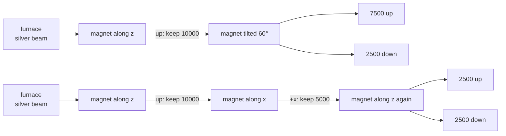
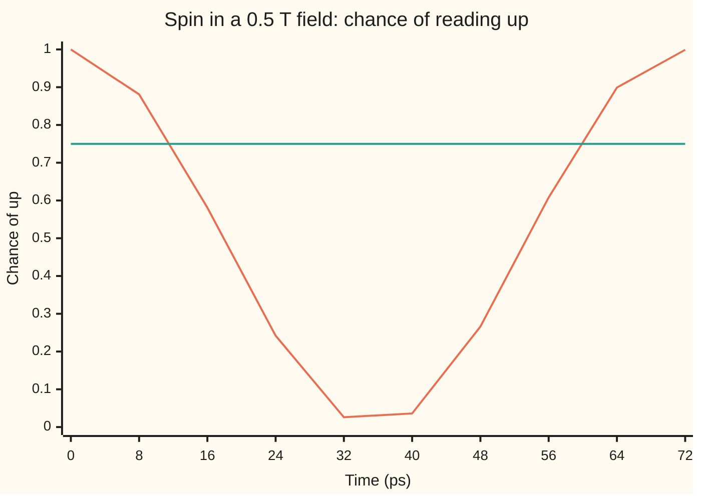

# Spin one-half: the smallest quantum system, run by three two-by-two matrices

[Syllabus](../../../SYLLABUS.md) → [Engineering mathematics](../README.md) → [Quantum Mechanics in Outline](../README.md#s09) → Spin one-half

---

## General Overview

Heat silver in a furnace and let the atoms stream out through a slit, at about 500 m/s. Send the beam between the poles of a magnet shaped so the field is much stronger near one pole than the other. Each silver atom is a tiny magnet, so the uneven field pushes it up or down. Then let the beam land on a glass plate.

A little bar magnet can point any way. If the atoms were like that, the plate would show a smear: every push between full up and full down. With this card's bench magnet the smear would run from 0.1270 mm above the centre line to 0.1270 mm below it. The plate shows something else: **two thin spots, 0.2540 mm apart, and nothing between them.** Gerlach and Stern saw this in 1922. Each atom answers a yes-or-no question: up or down along the magnet's axis.

Now keep only the "up" atoms and send them through a second magnet turned 60° from the first. They split again: out of 10000 atoms, 7500 go up and 2500 go down. Turn the second magnet 90° and the split is 50/50. Nothing is decided in advance about the new axis. Only the *chances* are fixed.

This card computes those chances, and shows how they swing in time when the atom sits in a steady field.

**A spin one-half is a column of two complex numbers; each magnet axis has a 2 × 2 matrix built from three fixed Pauli matrices, the matrix's two eigenvectors are the two spots, and the chance of a spot is the squared overlap with its eigenvector, which works out to cos² of half the tilt angle.**

**What kind of fact this is:** a model that fits every spin measurement made so far, inside the limits listed under "When it holds"; the half-angle rule and the turning formula are theorems inside it, proved on this card in Why it works.

### The picture: magnets in a row



Two separate runs; the first magnet's "down" atoms are blocked in both. Top row: a tilted magnet splits 75/25. Bottom row: after the x magnet, half the atoms come out "down along z" again, though every one of them was "up along z" two magnets earlier. Asking about x erased the answer about z.

---

## The formula

The [States as vectors](02-state-vectors-operators-and-measurement.md) card gave the rules: a state is a column of complex numbers of length 1, a measurement is a matrix, its eigenvalues are the possible readings, and a reading's chance is the squared overlap with its eigenvector. A hat marks an operator (here a matrix acting on the state), not an estimate. Here the column has two entries, because there are two spots. The three Pauli matrices (after Wolfgang Pauli, 1927) do all the work:

$$\sigma_x=\begin{pmatrix}0&1\\1&0\end{pmatrix},\quad \sigma_y=\begin{pmatrix}0&-i\\i&0\end{pmatrix},\quad \sigma_z=\begin{pmatrix}1&0\\0&-1\end{pmatrix},\qquad \hat S_{\mathbf n}=\frac{\hbar}{2}\,\sigma_{\mathbf n},\quad \sigma_{\mathbf n}=n_x\sigma_x+n_y\sigma_y+n_z\sigma_z$$

$$P_+=\bigl|\langle \mathbf n_+|\psi\rangle\bigr|^2=\cos^2\frac{\alpha}{2}$$

$$U(t)=\cos\frac{\omega t}{2}\,I-i\,\sin\frac{\omega t}{2}\,\sigma_{\mathbf n},\qquad \omega=\frac{g\,\mu_B\,B}{\hbar}$$

**Read it aloud:** a magnet along the direction n asks the question "σ along n", whose answers are up and down; an atom prepared up along one axis lands up along a magnet tilted by α with chance cos² of half α; and a steady field B turns the spin about the field's direction at ω radians per second.

Here σ is the Pauli matrix, not a stress or a standard deviation. $\langle \mathbf n_+|\psi\rangle$ is the complex dot product from [States as vectors](02-state-vectors-operators-and-measurement.md): conjugate the first column's entries, multiply entry by entry, add.

| Symbol | Plain meaning | In our example | Push it up and the answer… |
| --- | --- | --- | --- |
| $\psi$ | the atom's spin state: a column of two complex numbers $(a, b)$ with $\lvert a\rvert^2+\lvert b\rvert^2=1$ | up along z: $(1, 0)$ | — |
| $\sigma_x,\sigma_y,\sigma_z$, $I$, $i$ | the three Pauli matrices; the identity matrix; $i=\sqrt{-1}$ | above | — |
| $\mathbf n$, $\sigma_{\mathbf n}$, $\lvert\mathbf n_\pm\rangle$ | the magnet's axis as a unit arrow $(n_x,n_y,n_z)$; its 2 × 2 matrix; that matrix's eigenvectors, the "up" and "down along n" columns | 60° from z towards x: $(0.866, 0, 0.5)$ | — |
| $\alpha$ | the angle between the axis the atom was prepared along and the magnet's axis | 60° ($\pi/3$ rad) | the up chance falls, to 0 at 180° |
| $P_+$, $P_-$ | the chance of the up spot and of the down spot; they add to 1 | 0.75 and 0.25 | — |
| $\hbar$, $\hat S_{\mathbf n}$ | the reduced Planck constant, $h/2\pi$ = 1.054571818 × 10⁻³⁴ J s; the spin along n, whose only readings are $\pm\hbar/2$ | $\pm\hbar/2$ along every axis | — |
| $g$, $\mu_B$ | the electron's g factor, 2.00231930436: how much stronger the magnet made by its spin is than the same amount of orbiting motion would make, about 2; the Bohr magneton, 9.2740100657 × 10⁻²⁴ J/T: the natural unit of an electron's magnetism. The atom's moment is $(g/2)\mu_B$ | moment 9.2848 × 10⁻²⁴ J/T | the push and the turning rate rise |
| $B$, $\partial B/\partial z$ | the magnetic field, in tesla; how fast it changes across the gap, in T/m | 0.5 T; 1000 T/m | $B$ turns the spin faster; the gradient splits the spots wider |
| $m$, $L$, $v$, $F$ | one silver atom's mass; the magnet's length; the atom's speed; the push on it | 1.7912 × 10⁻²⁵ kg, 0.035 m, 500 m/s, 9.2848 × 10⁻²¹ N | heavier or faster atoms split less |
| $\hat H$ | the energy matrix (the Hamiltonian): $\frac{g\mu_B}{2}B\,\sigma_{\mathbf n}$ for a field along n | $\frac{g\mu_B}{2}(0.5\ \text{T})\,\sigma_z$ | — |
| $\omega$, $t$ | the Larmor rate, in rad/s; time | 88.0430 × 10⁹ rad/s, which as a frequency, $\omega/2\pi$, is 14.0125 GHz; 0 to 72 ps | faster swinging |
| $U(t)$ | the turning matrix: it carries the state from time 0 to time $t$ | $U(2\pi/\omega)=-I$ | — |

### When it holds

- **One spin one-half carries the magnetism.** Silver has 47 electrons; 46 pair off with no net moment, and the outer one has no orbital motion, so its spin is the whole magnet. An atom with spin 1 makes three spots and needs 3 × 3 matrices.
- **The field is strong compared with the electron's magnetic coupling to the nucleus.** The silver nucleus has a small spin of its own, also one-half. In a weak field the two spins lock into one combined spin of 1. Nearly all the magnetism is still the electron's, but it now rides on twice the spin, so it turns at half the rate: in Earth's 50 μT the electron-alone formula says 1.4012 MHz, but the silver atom turns at about 0.7006 MHz. In the 0.5 T magnet the electron goes its own way and the two-state model holds.
- **The atom flies like a ball, and has no charge.** A silver atom is heavy and neutral, so its path through the magnet is a classical one with one of two forces. Free electrons cannot be sorted this way: their charge feels a far larger sideways force from the field, and its spread across the beam's width blurs the two spots together.
- **Nothing disturbs the phase.** The swinging chance in time assumes an isolated spin. Collisions and field noise blur the relative phase of $a$ and $b$, and the swing dies away; that loss is the central problem of Qubits (planned).

---

## Why it works

### Step 0: two spots means two numbers

Each spot is one answer, so the state needs one complex number per answer: $\psi=(a,b)$, with $\lvert a\rvert^2$ the chance of up along z and $\lvert b\rvert^2$ the chance of down. "Up along z" is $(1,0)$ and "down along z" is $(0,1)$. The z magnet's matrix must have these as eigenvectors, with readings $+1$ and $-1$ (in units of $\hbar/2$). That is $\sigma_z$.

Every other axis must also be a 2 × 2 matrix with readings $\pm1$, because every axis gives two spots. The experiments fix which matrices.

### Step 1: the x axis from a 50/50 split

Up-along-z atoms split 50/50 at an x magnet. So "up along x" must overlap $(1,0)$ with squared size $\tfrac12$, and also $(0,1)$ with squared size $\tfrac12$. The real choice is $\tfrac{1}{\sqrt2}(1,1)$ for up and $\tfrac{1}{\sqrt2}(1,-1)$ for down. The matrix with these eigenvectors and readings $\pm1$ is `[[0, 1], [1, 0]]`: that is $\sigma_x$. It swaps the two entries, so $(1,1)$ comes back as itself and $(1,-1)$ as its negative.

### Step 2: the y axis forces complex numbers

A y magnet also splits up-along-z atoms 50/50, and it splits up-along-x atoms 50/50 too. So "up along y" must have overlap $\tfrac12$ (squared) with all four columns above. A real column $(c, d)$ cannot: overlap $\tfrac12$ with $(1,0)$ and $(0,1)$ means $c^2=d^2=\tfrac12$, so $d = \pm c$, and then it *is* up or down along x. The way out is a complex entry: $\tfrac{1}{\sqrt2}(1, i)$. Its squared overlap with $\tfrac1{\sqrt2}(1,1)$ is $\lvert 1+i\rvert^2/4 = 2/4 = \tfrac12$. The matrix with eigenvectors $\tfrac{1}{\sqrt2}(1,\pm i)$ and readings $\pm1$ is $\sigma_y$. Three axes at right angles need complex numbers: this is where quantum mechanics stops being real-valued ([Complex vectors and matrices](../../07-Complex%20analysis/01-Complex%20Numbers%20and%20the%20Plane/07-complex-vectors-and-matrices.md)).

The three matrices then obey $\sigma_x\sigma_y=i\sigma_z$, each squares to $I$, and any two different ones *anticommute*: $\sigma_x\sigma_y=-\sigma_y\sigma_x$. The checks multiply them out.

### Step 3: any axis, and the half angle

For an axis $\mathbf n$ the matrix is $\sigma_{\mathbf n}=n_x\sigma_x+n_y\sigma_y+n_z\sigma_z$. Square it. The cross terms cancel in pairs because the Pauli matrices anticommute, and each $\sigma^2$ is $I$, so $\sigma_{\mathbf n}^2=(n_x^2+n_y^2+n_z^2)I=I$. A matrix that squares to $I$ can only have eigenvalues $+1$ or $-1$ ([Eigenvalues and eigenvectors](../../03-Algebra/07-Eigenvalues%20and%20Symmetric%20Matrices/02-eigenvalues-and-eigenvectors.md)). So **every** axis gives exactly two spots, as the experiment says.

Take the axis tilted by $\alpha$ from z towards x: $\mathbf n=(\sin\alpha,0,\cos\alpha)$. Then $\sigma_{\mathbf n}$ = `[[cos α, sin α], [sin α, −cos α]]`. Its up eigenvector is $(\cos\tfrac\alpha2,\ \sin\tfrac\alpha2)$; multiplying out, with the angle-difference rules for sine and cosine, returns the same column. The overlap with up-along-z is $\cos\tfrac\alpha2$, so

$$P_+=\cos^2\frac{\alpha}{2},\qquad P_-=\sin^2\frac{\alpha}{2}.$$

Why half the angle? Up and down along one axis point opposite ways in space, 180° apart. As columns they share no overlap, so they are 90° apart. Every angle in space is halved in the column space. At $\alpha = 60°$, $\cos^2 30° = 0.75$. The polarizer on [States as vectors](02-state-vectors-operators-and-measurement.md) runs the other way: its matrix carries $2\alpha$, because light's polarization repeats after 180°.

### Step 4: the spin turns in a steady field

The energy of a magnet in a field is $-(\text{moment})\cdot B$. The electron's moment is $(g/2)\mu_B$ and points opposite its spin, so for a field along n the energy matrix is $\hat H=\frac{g\mu_B}{2}B\,\sigma_{\mathbf n}$. Schrödinger's equation ([Schrodinger's equation](03-schrodinger-equation-and-the-particle-in-a-box.md)) says $i\hbar\,\frac{d\psi}{dt}=\hat H\psi$, so $\psi(t)=e^{-i\hat Ht/\hbar}\psi(0)$ ([The matrix exponential](../../08-Differential%20equations%20and%20dynamics/04-Systems%20and%20the%20Matrix%20Exponential/04-the-matrix-exponential.md)).

Because $\sigma_{\mathbf n}^2=I$, that exponential collapses to two terms:

$$U(t)=e^{-i\omega t\,\sigma_{\mathbf n}/2}=\cos\frac{\omega t}{2}\,I-i\sin\frac{\omega t}{2}\,\sigma_{\mathbf n},\qquad \omega=\frac{g\mu_B B}{\hbar}.$$

<details>
<summary>Why the exponential collapses</summary>

Write $x=\omega t/2$. The power series is $e^{-ix\sigma}=\sum_k (-ix)^k\sigma^k/k!$. Even powers of $\sigma$ are $I$ and odd powers are $\sigma$. So the even terms add to $(1-x^2/2!+x^4/4!-\dots)I=\cos x\,I$ and the odd terms to $-i(x-x^3/3!+\dots)\sigma=-i\sin x\,\sigma$. The code sums 40 terms of the series and compares.

</details>

For a field along z, $U(t)$ only multiplies $a$ by $e^{-i\omega t/2}$ and $b$ by $e^{+i\omega t/2}$. The sizes $\lvert a\rvert$ and $\lvert b\rvert$ never change, so the chance of up along z never changes. Only the *relative phase* of $a$ and $b$ (the angle between them as arrows in the complex plane) turns, at rate $\omega$. That phase is what an x or y magnet reads. Start up along x, $\tfrac1{\sqrt2}(1,1)$, and the chance of still finding up along x is

$$P_{+x}(t)=\cos^2\frac{\omega t}{2}.$$

In space this is the spin's arrow sweeping round the field at $\omega$: **Larmor precession**, the quantum version of a gyroscope's wobble ([Precession](../07-Mechanics%20and%20Structures/03-gyroscopes-and-precession.md)). The turning matrix after one full turn, $\omega t = 2\pi$, is $-I$, not $I$. Every probability is unchanged, but the sign of the column has flipped. It takes two full turns, 720°, to bring the column back.

### Step 5: why the magnet splits the beam

In the magnet the field is mostly along z and grows across the gap. The energy is $\pm\frac{g\mu_B}{2}B$, so the force, the downhill slope of energy, is $F=\pm\frac{g\mu_B}{2}\,\partial B/\partial z$. The x and y parts of the spin precess around z at 14.0125 GHz and average out to nothing over the flight: 980873 turns in 70 μs. Only the z part survives, and it has two values. Two forces, two spots.

---

## Worked numbers, by hand

The bench magnet: gradient 1000 T/m, 0.035 m long, field 0.5 T at the beam. Silver atoms at 500 m/s, mass $107.8682 \times 1.66053906892\times10^{-27}$ kg.

| Step | Arithmetic | Value |
| --- | --- | --- |
| moment of one atom | $\frac{2.00232}{2}\times 9.27401\times10^{-24}$ | 9.2848 × 10⁻²⁴ J/T |
| push, $F$ | moment × 1000 T/m | 9.2848 × 10⁻²¹ N |
| acceleration | $F / 1.7912\times10^{-25}$ kg | 51835.6 m/s² |
| time in magnet | 0.035 m / 500 m/s | 70.0 μs |
| sideways drift | $\tfrac12 \times 51835.6 \times (70.0\times10^{-6})^2$ | 0.1270 mm |
| gap between spots | 2 × 0.1270 mm | 0.2540 mm |
| up chance at 60° tilt | $\cos^2 30° = (0.866025)^2$ | 0.750000 |
| of 10000 atoms | 10000 × 0.75 | 7500 up, 2500 down |
| Larmor rate at 0.5 T | $2.00232 \times 9.27401\times10^{-24} \times 0.5 / 1.054572\times10^{-34}$ | 88.0430 × 10⁹ rad/s |
| as a frequency | ω / 2π | **14.0125 GHz, one turn every 71.3650 ps** |

So the spots sit a quarter of a millimetre apart, wide enough to see with a microscope, and a 60° magnet sends three atoms in four up.

### What breaks if you drop a piece

| Mistake | Comes out at | What went wrong |
| --- | --- | --- |
| Full angle: $\cos^2 60°$ | 0.250000, not 0.750000 | Angles in space are halved in the column space |
| Amplitudes used as chances: $\cos 30° + \sin 30°$ | 1.366025 total chance | Chances are the *squares* of the overlaps; unsquared they add to more than 1 |
| The g factor left out | 6.9981 GHz, not 14.0125 GHz | The energy gap between up and down is $g\mu_B B$, and $g$ is about 2: dropping it halves the rate |
| Assume z is remembered after the x magnet | 5000 up, 0 down, not 2500 and 2500 | The x magnet leaves the atom up along x, which is 50/50 along z |
| Electron-alone formula in Earth's 50 μT | 1.4012 MHz, but the atom turns at about 0.7006 MHz | Outside the model's range: in a weak field the nucleus's spin locks on, and the combined spin of 1 turns at half the rate |

---

## The spin swings while it flies

The puzzle: a spin up along x sits in a field along z. Nothing pushes it towards down. Yet a measurement along x, made a few picoseconds later, finds "down" more and more often, and then less again. No second magnet could be placed that soon: at 500 m/s an atom moves only 36.0 nm in 72 ps. Laboratories read this swing with short microwave pulses, as electron spin resonance does; here it is a thought experiment, followed exactly by the formula and the code.

Follow one atom, prepared up along x, in the 0.5 T field along z. The field turns the phase between the two entries of its column at ω, and the chance of reading up along x is cos² of half that phase:

| Time | Phase turned, ωt | Chance of up along x | Chance of up along z, atom started at 60° |
| --- | --- | --- | --- |
| 0 ps | 0° | 1.000 | 0.750 |
| 16 ps | 81° | 0.581 | 0.750 |
| 32 ps | 161° | 0.026 | 0.750 |
| 48 ps | 242° | 0.266 | 0.750 |
| 72 ps | 363° | 0.999 | 0.750 |

The chance of up along x falls from 1.000 to 0.026 at 32 ps and climbs back to 0.999 at 72 ps: one swing every 71.3650 ps. A second atom, started 60° from z, keeps its chance of up along z at 0.750 the whole time. The field along z turns the phase between the two parts of the column, never their sizes.



Orange: up along x, for an atom started up along x; the formula and the RK4 solution of Schrödinger's equation agree to three decimals at every point. Green: up along z, for an atom started 60° from z; flat, because the field is along z.

---

## Code, from first principles, and it actually runs

The scripts build the Pauli matrices by hand and multiply them out. The 60° chance takes three independent roads: the half-angle formula; the eigenvector of the tilted magnet's matrix, found from its quadratic with no angle used; and the column (1, 0) turned 60° about y by the matrix exponential's power series, $e^{-i(\pi/6)\sigma_y}$, whose first entry squared is the chance. Then 100000 atoms drawn with that chance from a SplitMix64 generator, seed 2026, show the scatter a real count has; they are a demonstration, not a fourth road. The turning in time takes three roads: the closed form, an RK4 solution of Schrödinger's equation in 0.008 ps steps, and the same power series to 40 terms. The Larmor rate per tesla is checked against CODATA's electron gyromagnetic ratio, and the drift through the magnet against a stepped flight. Rust writes its own small complex type.

### Python

```python
# Spin one-half -- the check behind the card.  Standard library only.
# Silver atoms through Stern-Gerlach magnets.  The chance of "up" along a
# tilted magnet comes three ways: the half-angle formula, the eigenvector of
# a 2x2 matrix found from its quadratic, and the column (1, 0) turned 60 deg by
# the power series of the matrix exponential.  The turning in time comes three
# ways: the closed form, RK4 on Schrodinger's equation, and the same series.
from math import cos, sin, pi, sqrt

h = 6.62607015e-34; hbar = h / (2 * pi)   # Planck constant, exact in SI, J s
muB = 9.2740100657e-24                    # Bohr magneton, J/T (CODATA 2022)
g = 2.00231930436092                      # electron g factor, size (CODATA 2022)
m_Ag = 107.8682 * 1.66053906892e-27       # one silver atom, kg (IUPAC, CODATA)
GAM_E = 28024.9513861                     # electron gyromagnetic ratio / 2 pi, MHz/T (CODATA 2022)

I2 = ((1, 0), (0, 1))
SX = ((0, 1), (1, 0)); SY = ((0, -1j), (1j, 0)); SZ = ((1, 0), (0, -1))
def mul(A, B): return tuple(tuple(sum(A[r][k] * B[k][c] for k in range(2)) for c in range(2)) for r in range(2))
def comb(a, A, b, B): return tuple(tuple(a * A[r][c] + b * B[r][c] for c in range(2)) for r in range(2))
def gap(A, B): return max(abs(A[r][c] - B[r][c]) for r in range(2) for c in range(2))
def sig(n): return comb(1, comb(n[0], SX, n[1], SY), n[2], SZ)          # n . sigma
def app(A, v): return (A[0][0] * v[0] + A[0][1] * v[1], A[1][0] * v[0] + A[1][1] * v[1])
def prob(u, v): return abs(u[0].conjugate() * v[0] + u[1].conjugate() * v[1]) ** 2
def axis(deg): t = deg * pi / 180; return (sin(t), 0.0, cos(t))      # tilted from z towards x
def U(theta, n): return comb(cos(theta / 2), I2, -1j * sin(theta / 2), sig(n))   # closed form
def U_series(theta, n):                                   # road 3: sum of (-i theta n.s / 2)^k / k!
    X = comb(-0.5j * theta, sig(n), 0, I2); term, tot = I2, I2
    for k in range(1, 40): term = comb(1 / k, mul(term, X), 0, I2); tot = comb(1, tot, 1, term)
    return tot

def up_vector(M):        # road 2: eigenvector for the + root of lambda^2 = p^2 + |q|^2
    p, q = M[0][0].real, M[0][1]
    lam = sqrt(p * p + abs(q) ** 2)
    if abs(q) < 1e-15: return (1, 0) if p > 0 else (0, 1)
    v = (q, lam - p); s = sqrt(abs(v[0]) ** 2 + abs(v[1]) ** 2)
    return (v[0] / s, v[1] / s)

class SplitMix64:        # a small seeded generator, written out
    def __init__(self, seed): self.s = seed
    def next(self):
        self.s = (self.s + 0x9E3779B97F4A7C15) & 0xFFFFFFFFFFFFFFFF
        z = self.s
        z = ((z ^ (z >> 30)) * 0xBF58476D1CE4E5B9) & 0xFFFFFFFFFFFFFFFF
        z = ((z ^ (z >> 27)) * 0x94D049BB133111EB) & 0xFFFFFFFFFFFFFFFF
        return ((z ^ (z >> 31)) >> 11) / 9007199254740992.0

up_z, up_x = (1, 0), (1 / sqrt(2), 1 / sqrt(2))
assert gap(mul(SX, SY), comb(1j, SZ, 0, I2)) < 1e-15                        # sx sy = i sz
assert max(gap(mul(S, S), I2) for S in (SX, SY, SZ, sig(axis(60)))) < 1e-15  # each squares to I
print("sigma_x sigma_y = i sigma_z, and every n.sigma squares to I: yes")

# ---- the split: the force, the drift through the magnet, the gap at its exit ----
dBdz, L, v = 1000.0, 0.035, 500.0           # T/m, m, m/s
F = 0.5 * g * muB * dBdz; a = F / m_Ag; tm = L / v
z1 = 0.5 * a * tm * tm
print(f"moment {0.5 * g * muB * 1e24:.4f} x 10^-24 J/T, atom {m_Ag * 1e25:.4f} x 10^-25 kg, hbar {hbar * 1e34:.9f} x 10^-34 J s")
print(f"force on one atom      {F * 1e21:.4f} x 10^-21 N")
print(f"acceleration           {a:.1f} m/s^2, time in magnet {tm * 1e6:.1f} us")
print(f"each beam moves        {z1 * 1e3:.4f} mm, gap between spots {2 * z1 * 1e3:.4f} mm")
zs, vs, K = 0.0, 0.0, 1000                # road 2 for the drift: step the flight (half kick, drift, half kick)
for _ in range(K): vs += a * tm / K / 2; zs += vs * tm / K; vs += a * tm / K / 2
assert abs(zs - z1) < 1e-9 * z1

# ---- a second magnet tilted 60 degrees: three roads to P(up) ----
P_formula = cos(60 * pi / 360) ** 2
P_eig = prob(up_vector(sig(axis(60))), up_z)
P_turn = abs(app(U_series(pi / 3, (0, 1, 0)), up_z)[0]) ** 2   # road 3: turn (1, 0) by 60 deg about y
rng, N = SplitMix64(2026), 100000         # not a road: atoms drawn with that chance show a real count's scatter
hits = sum(1 for _ in range(N) if rng.next() < P_eig)
print(f"P(up) tilt 60 deg      formula {P_formula:.6f}  eigenvector {P_eig:.6f}  turned {P_turn:.6f}  simulated {hits / N:.5f}")
print(f"of 10000 atoms         {10000 * P_formula:.0f} up, {10000 * (1 - P_formula):.0f} down")
print(f"overlap at 60 deg      {sqrt(P_eig):.6f}, axis (n_x, n_z) = ({axis(60)[0]:.6f}, {axis(60)[2]:.6f})")
assert abs(P_formula - P_eig) < 1e-12
assert abs(P_formula - P_turn) < 1e-12
assert abs(hits - N * P_formula) < 4 * sqrt(N * P_formula * (1 - P_formula))
for d in (0, 90, 120, 180):
    print(f"P(up) tilt {d:3d} deg     {prob(up_vector(sig(axis(d))), up_z):.6f}")

# ---- z, then x, keep +x, then z again: the first answer is erased ----
p1 = prob(up_vector(sig(axis(90))), up_z); p2 = prob(up_z, up_vector(sig(axis(90))))
print(f"z -> x -> z            10000 -> {10000 * p1:.0f} kept -> {10000 * p1 * p2:.0f} up, {10000 * p1 * (1 - p2):.0f} down")
assert abs(p2 - 0.5) < 1e-12

# ---- turning in time: field B along z, energy matrix H = (g muB B / 2) sigma_z ----
B = 0.5
w = g * muB * B / hbar                                    # rad/s
print(f"Larmor rate at {B:.3f} T {w / 1e9:.4f} x 10^9 rad/s; f = w/2pi = {w / 2 / pi / 1e9:.4f} GHz, period {2 * pi / w * 1e12:.4f} ps")
assert abs(w / (2 * pi * B) / 1e6 - GAM_E) < 1e-3          # against CODATA's gamma_e / 2 pi
print(f"turns in the magnet    {w / 2 / pi * tm:.0f};  beam moves in 72 ps  {v * 72e-12 * 1e9:.1f} nm")
psi, dt, n_steps = up_x, 0.008, 9000                      # RK4 in picoseconds, 72 ps
f = lambda y: app(comb(-0.5j * w * 1e-12, SZ, 0, I2), y)
row_cf, row_rk, row_z, tilt = [], [], [], up_vector(sig(axis(60)))
for k in range(n_steps + 1):
    if k % 1000 == 0:
        t = k * dt * 1e-12
        row_cf.append(cos(w * t / 2) ** 2); row_rk.append(prob(up_x, psi))
        assert gap(U(w * t, (0, 0, 1)), U_series(w * t, (0, 0, 1))) < 1e-12
        row_z.append(prob(up_z, app(U(w * t, (0, 0, 1)), tilt)))      # start tilted 60 deg
    k1 = f(psi); k2 = f(tuple(p + dt / 2 * q for p, q in zip(psi, k1)))
    k3 = f(tuple(p + dt / 2 * q for p, q in zip(psi, k2))); k4 = f(tuple(p + dt * q for p, q in zip(psi, k3)))
    psi = tuple(p + dt / 6 * (q1 + 2 * q2 + 2 * q3 + q4) for p, q1, q2, q3, q4 in zip(psi, k1, k2, k3, k4))
assert max(abs(x - y) for x, y in zip(row_cf, row_rk)) < 1e-8
assert max(abs(x - P_formula) for x in row_z) < 1e-12                    # z-chance never moves
print("chart, t (ps)          " + " ".join(f"{8 * i:5d}" for i in range(10)))
print("chart, phase wt (deg)  " + " ".join(f"{w * 8e-12 * i * 180 / pi:5.0f}" for i in range(10)))
print("chart, P(+x) formula   " + " ".join(f"{x:5.3f}" for x in row_cf))
print("chart, P(+x) RK4       " + " ".join(f"{x:5.3f}" for x in row_rk))
print("chart, P(+z) from 60   " + " ".join(f"{x:5.3f}" for x in row_z))
print(f"one full turn          U(2 pi) = {U(2 * pi, (0, 0, 1))[0][0].real:.6f} I, U(4 pi) = {U(4 * pi, (0, 0, 1))[0][0].real:.6f} I")
assert gap(U_series(2 * pi, axis(60)), comb(-1, I2, 0, I2)) < 1e-12

# ---- what breaks, and where the numbers are used ----
f_true = w / 2 / pi
print(f"wrong: cos^2(60 deg)   {cos(60 * pi / 180) ** 2:.6f}   (right {P_formula:.6f})")
print(f"wrong: amplitudes      {cos(pi / 6) + sin(pi / 6):.6f} total chance")
print(f"wrong: g left out      {muB * B / h / 1e9:.4f} GHz   (right {f_true / 1e9:.4f})")
print(f"wrong: z remembered    {10000 * p1:.0f} up, 0 down   (right {10000 * p1 * p2:.0f}, {10000 * p1 * (1 - p2):.0f})")
fE = g * muB * 50e-6 / h                  # weak field: electron and nucleus lock into spin 1, rate halves
print(f"Earth 50 uT, electron  {fE / 1e6:.4f} MHz, silver atom weak field ~{fE / 2e6:.4f} MHz")
print(f"ESR at 9.5 GHz needs   {h * 9.5e9 / (g * muB):.4f} T;  at 0.339 T  {g * muB * 0.339 / h / 1e9:.4f} GHz")
print(f"MRI proton at 1.5 T    {42.577478461 * 1.5:.4f} MHz")
print("ALL CHECKS PASS")
```

**Ran 2026-11-11 on macOS, Python 3.14.10, standard library only. All checks passed. Output, pasted from the run:**

```
sigma_x sigma_y = i sigma_z, and every n.sigma squares to I: yes
moment 9.2848 x 10^-24 J/T, atom 1.7912 x 10^-25 kg, hbar 1.054571818 x 10^-34 J s
force on one atom      9.2848 x 10^-21 N
acceleration           51835.6 m/s^2, time in magnet 70.0 us
each beam moves        0.1270 mm, gap between spots 0.2540 mm
P(up) tilt 60 deg      formula 0.750000  eigenvector 0.750000  turned 0.750000  simulated 0.75265
of 10000 atoms         7500 up, 2500 down
overlap at 60 deg      0.866025, axis (n_x, n_z) = (0.866025, 0.500000)
P(up) tilt   0 deg     1.000000
P(up) tilt  90 deg     0.500000
P(up) tilt 120 deg     0.250000
P(up) tilt 180 deg     0.000000
z -> x -> z            10000 -> 5000 kept -> 2500 up, 2500 down
Larmor rate at 0.500 T 88.0430 x 10^9 rad/s; f = w/2pi = 14.0125 GHz, period 71.3650 ps
turns in the magnet    980873;  beam moves in 72 ps  36.0 nm
chart, t (ps)              0     8    16    24    32    40    48    56    64    72
chart, phase wt (deg)      0    40    81   121   161   202   242   282   323   363
chart, P(+x) formula   1.000 0.881 0.581 0.242 0.026 0.036 0.266 0.608 0.899 0.999
chart, P(+x) RK4       1.000 0.881 0.581 0.242 0.026 0.036 0.266 0.608 0.899 0.999
chart, P(+z) from 60   0.750 0.750 0.750 0.750 0.750 0.750 0.750 0.750 0.750 0.750
one full turn          U(2 pi) = -1.000000 I, U(4 pi) = 1.000000 I
wrong: cos^2(60 deg)   0.250000   (right 0.750000)
wrong: amplitudes      1.366025 total chance
wrong: g left out      6.9981 GHz   (right 14.0125)
wrong: z remembered    5000 up, 0 down   (right 2500, 2500)
Earth 50 uT, electron  1.4012 MHz, silver atom weak field ~0.7006 MHz
ESR at 9.5 GHz needs   0.3390 T;  at 0.339 T  9.5005 GHz
MRI proton at 1.5 T    63.8662 MHz
ALL CHECKS PASS
```

### Rust

```rust
// Spin one-half -- the check behind the card.  Rust std only, no crates.
// Silver atoms through Stern-Gerlach magnets.  The chance of "up" along a
// tilted magnet comes three ways: the half-angle formula, the eigenvector of
// a 2x2 matrix found from its quadratic, and the column (1, 0) turned 60 deg by
// the power series of the matrix exponential.  The turning in time comes three
// ways: the closed form, RK4 on Schrodinger's equation, and the same series.
use std::f64::consts::PI;
use std::ops::{Add, Mul};

#[derive(Clone, Copy)]
struct C { re: f64, im: f64 }                       // a complex number, written out
fn c(re: f64, im: f64) -> C { C { re, im } }
impl Add for C { type Output = C; fn add(self, o: C) -> C { c(self.re + o.re, self.im + o.im) } }
impl Mul for C { type Output = C; fn mul(self, o: C) -> C { c(self.re * o.re - self.im * o.im, self.re * o.im + self.im * o.re) } }
impl C { fn conj(self) -> C { c(self.re, -self.im) } fn abs(self) -> f64 { (self.re * self.re + self.im * self.im).sqrt() } }

type M = [[C; 2]; 2];
type V = [C; 2];
const Z: C = C { re: 0.0, im: 0.0 };
const O: C = C { re: 1.0, im: 0.0 };
const I2: M = [[O, Z], [Z, O]];
const SX: M = [[Z, O], [O, Z]];
const SY: M = [[Z, C { re: 0.0, im: -1.0 }], [C { re: 0.0, im: 1.0 }, Z]];
const SZ: M = [[O, Z], [Z, C { re: -1.0, im: 0.0 }]];
fn mul(a: &M, b: &M) -> M { let mut r = [[Z; 2]; 2]; for i in 0..2 { for j in 0..2 { r[i][j] = a[i][0] * b[0][j] + a[i][1] * b[1][j]; } } r }
fn comb(a: C, x: &M, b: C, y: &M) -> M { let mut r = [[Z; 2]; 2]; for i in 0..2 { for j in 0..2 { r[i][j] = a * x[i][j] + b * y[i][j]; } } r }
fn gap(a: &M, b: &M) -> f64 { let mut g = 0.0f64; for i in 0..2 { for j in 0..2 { g = g.max((a[i][j] + c(-1.0, 0.0) * b[i][j]).abs()); } } g }
fn sig(n: [f64; 3]) -> M { comb(O, &comb(c(n[0], 0.0), &SX, c(n[1], 0.0), &SY), c(n[2], 0.0), &SZ) }
fn app(a: &M, v: V) -> V { [a[0][0] * v[0] + a[0][1] * v[1], a[1][0] * v[0] + a[1][1] * v[1]] }
fn prob(u: V, v: V) -> f64 { let s = u[0].conj() * v[0] + u[1].conj() * v[1]; s.abs().powi(2) }
fn axis(deg: f64) -> [f64; 3] { let t = deg * PI / 180.0; [t.sin(), 0.0, t.cos()] }
fn re(x: f64) -> C { c(x, 0.0) }

fn up_vector(m: &M) -> V {      // road 2: eigenvector for the + root of lambda^2 = p^2 + |q|^2
    let (p, q) = (m[0][0].re, m[0][1]);
    let lam = (p * p + q.abs().powi(2)).sqrt();
    if q.abs() < 1e-15 { return if p > 0.0 { [O, Z] } else { [Z, O] }; }
    let v = [q, re(lam - p)]; let s = (v[0].abs().powi(2) + v[1].abs().powi(2)).sqrt();
    [v[0] * re(1.0 / s), v[1] * re(1.0 / s)]
}

struct SplitMix64 { s: u64 }    // a small seeded generator, written out
impl SplitMix64 {
    fn next(&mut self) -> f64 {
        self.s = self.s.wrapping_add(0x9E3779B97F4A7C15);
        let mut z = self.s;
        z = (z ^ (z >> 30)).wrapping_mul(0xBF58476D1CE4E5B9);
        z = (z ^ (z >> 27)).wrapping_mul(0x94D049BB133111EB);
        ((z ^ (z >> 31)) >> 11) as f64 / 9007199254740992.0
    }
}

fn u(theta: f64, n: [f64; 3]) -> M { comb(re((theta / 2.0).cos()), &I2, c(0.0, -(theta / 2.0).sin()), &sig(n)) }
fn u_series(theta: f64, n: [f64; 3]) -> M {   // road 3: sum of (-i theta n.s / 2)^k / k!
    let x = comb(c(0.0, -0.5 * theta), &sig(n), Z, &I2);
    let (mut term, mut tot) = (I2, I2);
    for k in 1..40 { term = comb(re(1.0 / k as f64), &mul(&term, &x), Z, &I2); tot = comb(O, &tot, O, &term); }
    tot
}

fn main() {
    let h = 6.62607015e-34; let hbar = h / (2.0 * PI);   // Planck constant, exact in SI, J s
    let mub = 9.2740100657e-24;                          // Bohr magneton, J/T (CODATA 2022)
    let g = 2.00231930436092;                            // electron g factor, size (CODATA 2022)
    let m_ag = 107.8682 * 1.66053906892e-27;             // one silver atom, kg (IUPAC, CODATA)
    let gam_e = 28024.9513861;                           // electron gyromagnetic ratio / 2 pi, MHz/T (CODATA 2022)
    let up_z: V = [O, Z];
    let r2 = 1.0 / 2f64.sqrt(); let up_x: V = [re(r2), re(r2)];
    assert!(gap(&mul(&SX, &SY), &comb(c(0.0, 1.0), &SZ, Z, &I2)) < 1e-15);
    for s in [SX, SY, SZ, sig(axis(60.0))] { assert!(gap(&mul(&s, &s), &I2) < 1e-15); }
    println!("sigma_x sigma_y = i sigma_z, and every n.sigma squares to I: yes");

    let (dbdz, l, v) = (1000.0, 0.035, 500.0);
    let f = 0.5 * g * mub * dbdz; let a = f / m_ag; let tm = l / v;
    let z1 = 0.5 * a * tm * tm;
    println!("moment {:.4} x 10^-24 J/T, atom {:.4} x 10^-25 kg, hbar {:.9} x 10^-34 J s", 0.5 * g * mub * 1e24, m_ag * 1e25, hbar * 1e34);
    println!("force on one atom      {:.4} x 10^-21 N", f * 1e21);
    println!("acceleration           {:.1} m/s^2, time in magnet {:.1} us", a, tm * 1e6);
    println!("each beam moves        {:.4} mm, gap between spots {:.4} mm", z1 * 1e3, 2.0 * z1 * 1e3);
    let (mut zs, mut vs, kk) = (0.0f64, 0.0f64, 1000.0); // road 2 for the drift: step the flight (half kick, drift, half kick)
    for _ in 0..1000 { vs += a * tm / kk / 2.0; zs += vs * tm / kk; vs += a * tm / kk / 2.0; }
    assert!((zs - z1).abs() < 1e-9 * z1);

    let p_formula = (60.0 * PI / 360.0).cos().powi(2);
    let p_eig = prob(up_vector(&sig(axis(60.0))), up_z);
    let p_turn = app(&u_series(PI / 3.0, [0.0, 1.0, 0.0]), up_z)[0].abs().powi(2); // road 3: turn (1, 0) by 60 deg about y
    let (mut rng, n) = (SplitMix64 { s: 2026 }, 100000usize); // not a road: atoms drawn with that chance show a real count's scatter
    let hits = (0..n).filter(|_| rng.next() < p_eig).count();
    println!("P(up) tilt 60 deg      formula {:.6}  eigenvector {:.6}  turned {:.6}  simulated {:.5}", p_formula, p_eig, p_turn, hits as f64 / n as f64);
    println!("of 10000 atoms         {:.0} up, {:.0} down", 10000.0 * p_formula, 10000.0 * (1.0 - p_formula));
    println!("overlap at 60 deg      {:.6}, axis (n_x, n_z) = ({:.6}, {:.6})", p_eig.sqrt(), axis(60.0)[0], axis(60.0)[2]);
    assert!((p_formula - p_eig).abs() < 1e-12);
    assert!((p_formula - p_turn).abs() < 1e-12);
    let nf = n as f64;
    assert!((hits as f64 - nf * p_formula).abs() < 4.0 * (nf * p_formula * (1.0 - p_formula)).sqrt());
    for d in [0.0, 90.0, 120.0, 180.0] {
        println!("P(up) tilt {:3} deg     {:.6}", d as i32, prob(up_vector(&sig(axis(d))), up_z));
    }

    let p1 = prob(up_vector(&sig(axis(90.0))), up_z); let p2 = prob(up_z, up_vector(&sig(axis(90.0))));
    println!("z -> x -> z            10000 -> {:.0} kept -> {:.0} up, {:.0} down", 10000.0 * p1, 10000.0 * p1 * p2, 10000.0 * p1 * (1.0 - p2));
    assert!((p2 - 0.5).abs() < 1e-12);

    let b = 0.5;
    let w = g * mub * b / hbar;
    println!("Larmor rate at {:.3} T {:.4} x 10^9 rad/s; f = w/2pi = {:.4} GHz, period {:.4} ps", b, w / 1e9, w / 2.0 / PI / 1e9, 2.0 * PI / w * 1e12);
    assert!((w / (2.0 * PI * b) / 1e6 - gam_e).abs() < 1e-3); // against CODATA's gamma_e / 2 pi
    println!("turns in the magnet    {:.0};  beam moves in 72 ps  {:.1} nm", w / 2.0 / PI * tm, v * 72e-12 * 1e9);
    let (mut psi, dt, n_steps) = (up_x, 0.008, 9000);
    let hm = comb(c(0.0, -0.5 * w * 1e-12), &SZ, Z, &I2);
    let fv = |y: V| app(&hm, y);
    let step = |p: V, k: V, s: f64| [p[0] + re(s) * k[0], p[1] + re(s) * k[1]];
    let (mut row_cf, mut row_rk, mut row_z) = (Vec::new(), Vec::new(), Vec::new());
    let tilt = up_vector(&sig(axis(60.0)));
    for k in 0..=n_steps {
        if k % 1000 == 0 {
            let t = k as f64 * dt * 1e-12;
            row_cf.push((w * t / 2.0).cos().powi(2)); row_rk.push(prob(up_x, psi));
            assert!(gap(&u(w * t, [0.0, 0.0, 1.0]), &u_series(w * t, [0.0, 0.0, 1.0])) < 1e-12);
            row_z.push(prob(up_z, app(&u(w * t, [0.0, 0.0, 1.0]), tilt)));   // start tilted 60 deg
        }
        let k1 = fv(psi); let k2 = fv(step(psi, k1, dt / 2.0));
        let k3 = fv(step(psi, k2, dt / 2.0)); let k4 = fv(step(psi, k3, dt));
        for i in 0..2 { psi[i] = psi[i] + re(dt / 6.0) * (k1[i] + re(2.0) * k2[i] + re(2.0) * k3[i] + k4[i]); }
    }
    assert!(row_cf.iter().zip(&row_rk).all(|(x, y)| (x - y).abs() < 1e-8));
    assert!(row_z.iter().all(|x| (x - p_formula).abs() < 1e-12));          // z-chance never moves
    let ts: Vec<String> = (0..10).map(|i| format!("{:5}", 8 * i)).collect();
    println!("chart, t (ps)          {}", ts.join(" "));
    println!("chart, phase wt (deg)  {}", (0..10).map(|i| format!("{:5.0}", w * 8e-12 * i as f64 * 180.0 / PI)).collect::<Vec<_>>().join(" "));
    let fmt = |r: &Vec<f64>| r.iter().map(|x| format!("{:5.3}", x)).collect::<Vec<_>>().join(" ");
    println!("chart, P(+x) formula   {}", fmt(&row_cf));
    println!("chart, P(+x) RK4       {}", fmt(&row_rk));
    println!("chart, P(+z) from 60   {}", fmt(&row_z));
    println!("one full turn          U(2 pi) = {:.6} I, U(4 pi) = {:.6} I", u(2.0 * PI, [0.0, 0.0, 1.0])[0][0].re, u(4.0 * PI, [0.0, 0.0, 1.0])[0][0].re);
    assert!(gap(&u_series(2.0 * PI, axis(60.0)), &comb(re(-1.0), &I2, Z, &I2)) < 1e-12);

    let f_true = w / 2.0 / PI;
    println!("wrong: cos^2(60 deg)   {:.6}   (right {:.6})", (60.0 * PI / 180.0).cos().powi(2), p_formula);
    println!("wrong: amplitudes      {:.6} total chance", (PI / 6.0).cos() + (PI / 6.0).sin());
    println!("wrong: g left out      {:.4} GHz   (right {:.4})", mub * b / h / 1e9, f_true / 1e9);
    println!("wrong: z remembered    {:.0} up, 0 down   (right {:.0}, {:.0})", 10000.0 * p1, 10000.0 * p1 * p2, 10000.0 * p1 * (1.0 - p2));
    let fe = g * mub * 50e-6 / h;                        // weak field: electron and nucleus lock into spin 1, rate halves
    println!("Earth 50 uT, electron  {:.4} MHz, silver atom weak field ~{:.4} MHz", fe / 1e6, fe / 2e6);
    println!("ESR at 9.5 GHz needs   {:.4} T;  at 0.339 T  {:.4} GHz", h * 9.5e9 / (g * mub), g * mub * 0.339 / h / 1e9);
    println!("MRI proton at 1.5 T    {:.4} MHz", 42.577478461 * 1.5);
    println!("ALL CHECKS PASS");
}
```

**Ran 2026-11-11 on macOS, rustc 1.98.1, no crates. All checks passed. Output, pasted from the run:**

```
sigma_x sigma_y = i sigma_z, and every n.sigma squares to I: yes
moment 9.2848 x 10^-24 J/T, atom 1.7912 x 10^-25 kg, hbar 1.054571818 x 10^-34 J s
force on one atom      9.2848 x 10^-21 N
acceleration           51835.6 m/s^2, time in magnet 70.0 us
each beam moves        0.1270 mm, gap between spots 0.2540 mm
P(up) tilt 60 deg      formula 0.750000  eigenvector 0.750000  turned 0.750000  simulated 0.75265
of 10000 atoms         7500 up, 2500 down
overlap at 60 deg      0.866025, axis (n_x, n_z) = (0.866025, 0.500000)
P(up) tilt   0 deg     1.000000
P(up) tilt  90 deg     0.500000
P(up) tilt 120 deg     0.250000
P(up) tilt 180 deg     0.000000
z -> x -> z            10000 -> 5000 kept -> 2500 up, 2500 down
Larmor rate at 0.500 T 88.0430 x 10^9 rad/s; f = w/2pi = 14.0125 GHz, period 71.3650 ps
turns in the magnet    980873;  beam moves in 72 ps  36.0 nm
chart, t (ps)              0     8    16    24    32    40    48    56    64    72
chart, phase wt (deg)      0    40    81   121   161   202   242   282   323   363
chart, P(+x) formula   1.000 0.881 0.581 0.242 0.026 0.036 0.266 0.608 0.899 0.999
chart, P(+x) RK4       1.000 0.881 0.581 0.242 0.026 0.036 0.266 0.608 0.899 0.999
chart, P(+z) from 60   0.750 0.750 0.750 0.750 0.750 0.750 0.750 0.750 0.750 0.750
one full turn          U(2 pi) = -1.000000 I, U(4 pi) = 1.000000 I
wrong: cos^2(60 deg)   0.250000   (right 0.750000)
wrong: amplitudes      1.366025 total chance
wrong: g left out      6.9981 GHz   (right 14.0125)
wrong: z remembered    5000 up, 0 down   (right 2500, 2500)
Earth 50 uT, electron  1.4012 MHz, silver atom weak field ~0.7006 MHz
ESR at 9.5 GHz needs   0.3390 T;  at 0.339 T  9.5005 GHz
MRI proton at 1.5 T    63.8662 MHz
ALL CHECKS PASS
```

The two outputs agree line for line, including the simulated count, because both generators produce the same stream from seed 2026.

> [!TIP]
> **Try changing**
> - Guess first: what share goes up if the second magnet is tilted 90°? Then 120°? Then 180°? The loop prints **0.500000**, **0.250000** and **0.000000**. At 180° the magnet is the first one upside down, so every atom lands "down".
> - Guess first: what field puts the electron's turning at 9.5 GHz, the frequency of a common microwave bench? Solve $\omega/2\pi = 9.5$ GHz for $B$: **0.3390 T**. Put `B = 0.339` and the rate prints **9.5005 GHz**.
> - Guess first: after exactly one Larmor period, is the column back where it started? `U(2 pi)` prints **−1.000000 I**: same chances, opposite sign. `U(4 pi)` prints **1.000000 I**.

---

## The usual mistake

> [!warning]
> **Picturing spin as a little arrow with a definite direction that the magnet reads off.** An arrow at 60° to the magnet would give every atom the same middle-sized push, one spot in the middle. The atoms land in two spots, and which spot each one takes is a chance, 0.75 against 0.25. Up along z says nothing definite about x: ask about x and the z answer is gone, 2500 up and 2500 down at the third magnet.
>
> - **The full angle in place of the half angle.** $\cos^2 60°$ gives 0.250000; the truth is 0.750000.
> - **Adding the overlaps instead of their squares.** 0.866 + 0.5 = 1.366025, a "probability" above 1.
> - **Forgetting $g$.** The spin rate comes out 6.9981 GHz instead of 14.0125 GHz.
> - **Using the electron-alone model in a weak field.** In Earth's 50 μT a silver atom turns at about 0.7006 MHz, half the 1.4012 MHz the two-state model gives.

---

## Where you meet it in real life

- **Electron spin resonance.** A lab spectrometer tunes a microwave source near 9.5 GHz and sweeps a magnet through 0.3390 T. When the field makes the spin's rate match the microwaves, the sample absorbs. It finds unpaired electrons, for instance in reactive molecule fragments, catalysts and irradiated materials.
- **MRI scanners.** The hydrogen nucleus, a proton, is also spin one-half, with a far smaller moment. In a 1.5 T scanner it turns at 63.8662 MHz, and the scanner listens for that radio signal from water in the body.
- **Atomic magnetometers.** The swinging rate is proportional to $B$, so timing it measures the field. Atomic magnetometers time it to read fields far weaker than Earth's 50 μT, for instance from the heart and brain.
- **Qubits.** A quantum computer's basic unit is any two-state system run by exactly these matrices: Qubits (planned).

> **Say it back**
> A silver atom in an uneven magnetic field lands in one of two spots, so its spin is a column of two complex numbers. Each magnet axis has a 2 × 2 matrix built from the three Pauli matrices; its two eigenvectors are the two spots, and the chance of a spot is the squared overlap with its eigenvector. For a magnet tilted α from the prepared axis that chance is cos² of α/2: 0.75 at 60°. In a steady field the spin turns about the field at ω = gμ_B B / ħ, 14.0125 GHz at 0.5 T, which swings the chances for axes across the field and leaves the chance along the field fixed.

---

## What this builds on

- [States as vectors](02-state-vectors-operators-and-measurement.md): the rules this card runs on. A state is a column, a measurement is a matrix, the readings are its eigenvalues, and chances are squared overlaps.
- [Eigenvalues and eigenvectors](../../03-Algebra/07-Eigenvalues%20and%20Symmetric%20Matrices/02-eigenvalues-and-eigenvectors.md): how a 2 × 2 matrix's special directions and stretch factors come out of a quadratic, which is how the check finds the tilted magnet's spots.
- [Moving shapes with matrices](../../05-Geometry%20and%20trig/05-Vectors%20in%20Space/04-transformations-with-matrices.md): rotation by a matrix. $U(t)$ is a rotation too, written in the two-number column space at half the angle.

## Where this goes next

- [Hydrogen in outline](07-the-hydrogen-atom-in-outline.md): spin joins the electron's orbit to make the full set of quantum numbers, and its magnet splits the spectral lines.
- [Symmetry and conservation](08-symmetry-and-conserved-quantities.md): turning matrices like $U(t)$ as symmetries, and what they conserve. A field along z leaves the spin along z unchanged, as the flat green line shows.
- Mass gap (planned): the gauge theories built on the same 2 × 2 matrices.
- Qubits (planned): two-state systems as computing units, gates as turning matrices, and the loss of phase that limits them.

What this card leaves open is two spins together: a pair of spin one-half particles needs four complex numbers, not two, and some of its states cannot be split into one column per particle.

---

## Sources

Verified 2026-11-11: every link below resolves to the publisher's page.

- Gerlach, Walther, and Otto Stern. "Der experimentelle Nachweis der Richtungsquantelung im Magnetfeld." *Zeitschrift für Physik* 9 (1922): 349–352. [doi:10.1007/BF01326983](https://doi.org/10.1007/BF01326983). The silver-beam experiment and its two spots.
- Pauli, Wolfgang. "Zur Quantenmechanik des magnetischen Elektrons." *Zeitschrift für Physik* 43 (1927): 601–623. [doi:10.1007/BF01397326](https://doi.org/10.1007/BF01397326). The two-component state and the three matrices.
- Griffiths, David J., and Darrell F. Schroeter. *Introduction to Quantum Mechanics*, 3rd ed. Cambridge University Press, 2018. [Publisher page](https://www.cambridge.org/highereducation/books/introduction-to-quantum-mechanics/990799CA07A83FC5312402AF6860311E). Spin one-half, Larmor precession and the Stern–Gerlach analysis, at this card's level.
- NIST. *CODATA Internationally Recommended 2022 Values of the Fundamental Physical Constants*. [Bohr magneton](https://physics.nist.gov/cgi-bin/cuu/Value?mub). Source of $\mu_B$, the electron g factor, $\hbar$, the atomic mass constant and the proton's 42.577478461 MHz/T; the electron's gyromagnetic ratio ([NIST page](https://physics.nist.gov/cgi-bin/cuu/Value?gammaebar)) checks the Larmor rate.
- Commission on Isotopic Abundances and Atomic Weights. "Atomic Weight of Silver." [ciaaw.org](https://www.ciaaw.org/silver.htm). The standard atomic weight of silver, 107.8682.
