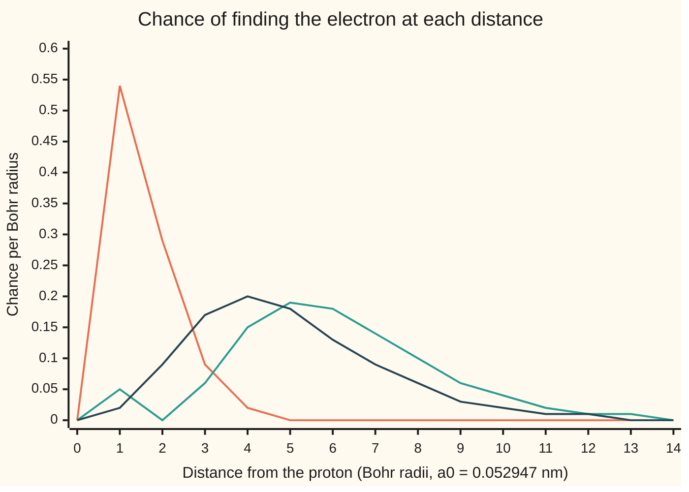

# Hydrogen in outline: separate the angles and shells with quantum numbers appear

[Syllabus](../../../SYLLABUS.md) → [Engineering mathematics](../README.md) → [Quantum Mechanics in Outline](../README.md#s09) → Hydrogen in outline

---

## General Overview

A glass tube of hydrogen gas, with a high voltage across it, glows pink-red. Pass that light through a prism and it is not a smear of colours. It is a few sharp lines, and the brightest is red, measured at a wavelength of 656.460 nm (nanometres, in vacuum; 656.279 nm in air). Solar telescopes carry filters tuned to that one line. Astronomers find hydrogen in a galaxy by looking for it, shifted.

An engineer wants to predict those lines before building the filter. The answer is that the electron in hydrogen can only hold certain energies, and they follow one rule: **minus 13.6 electronvolts divided by n squared**, with n = 1, 2, 3, and so on. An electronvolt (eV) is the energy one electron gains crossing one volt. The red line is the electron dropping from n = 3 to n = 2 and throwing away the difference, 1.888651 eV, as one particle of light.

The rule comes from Schrödinger's equation, the same equation that gave the levels of an electron in a 1 nm box ([Schrodinger's equation](03-schrodinger-equation-and-the-particle-in-a-box.md)). The new difficulty is three dimensions. The trick is that the proton pulls the same way in every direction. So the wave splits into a part that depends only on distance and a part that depends only on direction. Each part gives one whole number, and the up-down axis gives a third. Those three whole numbers, n, l and m, are the **quantum numbers**: the labels on every state of the atom, and the reason chemistry has shells.

**Because the pull depends only on distance, the hydrogen wave splits into a radial factor and an angular factor; the angular factor is allowed only for whole numbers l and m with m from −l to l, the radial factor only for whole n above l, and the energy depends on n alone, as −13.598287 eV divided by n squared.**

**What kind of fact this is:** a theorem inside a model. Given Schrödinger's equation with a pure electric pull and no relativity, the levels and the three quantum numbers are derived on this card in Why it works. The model is an outline: it misses the measured binding energy by 0.000147 eV, and "When it holds" says why.

### The picture: the ladder, set beside the box

The five lowest hydrogen levels, as the size of the energy that holds the electron, next to the 1 nm box from the earlier card:

```
level        hydrogen |E_n|                                     1 nm box
n = 1   ########################################  13.60 eV      0.376 eV
n = 2   ##########                                 3.40 eV      1.504 eV
n = 3   ####                                       1.51 eV      3.384 eV
n = 4   ##                                         0.85 eV
n = 5   #                                          0.54 eV
```

The box levels grow as n squared and spread apart. The hydrogen levels shrink as one over n squared and crowd together towards zero, the energy of an electron pulled free. The hydrogen electron is held far harder than the boxed one, because the proton's pull squeezes it into a region a few Bohr radii across. The standard Bohr radius, with the proton held still, is 0.052918 nm; this card lets the proton move too, so its Bohr radius $a_0$ is 0.052947 nm.

---

## The formula

Here θ ("theta") is the angle down from the north pole and φ ("phi") the angle around the axis. This is the physics habit, the swap of the letters in [Cylindrical and spherical coordinates](../../05-Geometry%20and%20trig/04-Coordinates%20and%20Curves/07-cylindrical-and-spherical-coordinates.md), and it matches [Legendre's equation](../../08-Differential%20equations%20and%20dynamics/07-Series%20Solutions%20and%20Boundary%20Problems/04-legendre-polynomials.md).

The equation to solve, with the electric pull of the proton written out:

$$-\frac{\hbar^2}{2\mu}\nabla^2\psi \;-\; \frac{e^2}{4\pi\varepsilon_0\, r}\,\psi \;=\; E\,\psi$$

Its solutions, and their energies:

$$\psi_{nlm}(r,\theta,\phi) = R_{nl}(r)\,Y_l^m(\theta,\phi), \qquad E_n = -\frac{\mu e^4}{8\varepsilon_0^2 h^2}\,\frac{1}{n^2} = -\frac{13.598287\ \text{eV}}{n^2}$$

$$n = 1, 2, 3, \dots \qquad l = 0, 1, \dots, n-1 \qquad m = -l, \dots, 0, \dots, l$$

**Read it aloud:** each state is a distance part times a direction part; the shell number n fixes the energy; l counts the turning of the wave and runs below n; m says how that turning is tilted against the axis and runs from minus l to l.

| Symbol | Plain meaning | In our example | Push it up and the answer… |
| --- | --- | --- | --- |
| $E_n$ | energy of shell n, measured from an electron at rest far away; negative means held | $E_2 = -3.399572$ eV, $E_3 = -1.510921$ eV | rises towards 0 as n grows |
| $n$, $k$ | **shell number**, any whole number from 1; $k$ counts terms in the radial series, which stops at $k = n - l - 1$ | red line: from $n = 3$ to $n = 2$ | energy rises, wave spreads to about $n^2 a_0$ |
| $l$ | **orbital number**: how much the wave turns, 0 to n − 1; angular momentum $\sqrt{l(l+1)}\,\hbar$ | $l = 0$ or $1$ in shell 2 | in hydrogen, no change of energy |
| $m$ | **magnetic number**: the turning about the up-down axis, in units of $\hbar$, from −l to l | $m = -1, 0, 1$ when $l = 1$ | no change of energy unless a magnet is near |
| $\psi$, $R_{nl}$, $Y_l^m$ | the wave; its radial factor (distance only); its angular factor (direction only) | 1s: $R_{10} = 2e^{-r/a_0}$ (in units of $a_0^{-3/2}$), $Y$ round | |
| $r$, $\theta$, $\phi$, $x$ | distance from the proton; angle down from the pole; angle around the axis; $x = \cos\theta$ | $r$ in Bohr radii | |
| $\mu$, $m_e$, $m_p$ | **reduced mass** $m_e m_p/(m_e + m_p)$: electron and proton both swing about their centre | $0.99945568\,m_e$ | levels deepen in proportion |
| $h$, $\hbar$, $c$ | Planck's constant; $\hbar = h/2\pi$; speed of light | $hc = 1239.841984$ eV nm | |
| $e$, $\varepsilon_0$ | size of the electron's charge (but in $e^{-r/a_0}$, e is 2.718…, the exponential); electric constant | $e$ exact in SI; $\varepsilon_0$ = 8.8541878188 × 10⁻¹² F/m | larger $e$: much deeper levels, as $e^4$ |
| $a_0$ | **Bohr radius** with the reduced mass, $4\pi\varepsilon_0\hbar^2/(\mu e^2)$: the atom's natural length. CODATA's Bohr radius has $m_e$ in place of $\mu$ | 0.052947 nm; CODATA's, 0.052918 nm | |
| $\nabla^2$ | the Laplacian: how much the wave's value differs from its average nearby | | |
| $\lambda$ | wavelength of the light from a jump, $hc$ over the energy given up | 656.470 nm | |

The letters s, p, d stand for l = 0, 1, 2, so "2p" means n = 2, l = 1.

### When it holds

- **One electron.** True for hydrogen, and for any atom stripped to one electron. With two or more, the electrons push each other apart, the energy starts to depend on l too, and the periodic table's third row holds 8 elements, not the 18 of hydrogen's third shell.
- **Slow electron, no relativity.** The electron moves slowly compared with light, so the error is small but real: the outline gives 13.598287 eV to free the electron, the measured value is 13.598435 eV. Most of that gap is relativity; a smaller shift from quantum electrodynamics, the Lamb shift, pulls the other way.
- **Spin left out of the equation.** Spin ([Spin one-half](06-spin-and-two-state-systems.md)) doubles each count, so shell n holds 2n² electrons, and relativity, with spin's magnetic coupling to the orbit, splits shell 2 by 45.26 micro-eV. The code takes that number from the relativistic formula; this card does not derive it.
- **No outside field.** A magnet splits the states with different m; an electric field mixes l. The formula is for a free atom.
- **Bound states only.** Above zero energy the electron flies off, and the levels become a continuous range, not covered here.

---

## Why it works

### Step 0: a pull that ignores direction lets direction and distance separate

The proton pulls with the same strength at the same distance in every direction. So turning the atom changes nothing about its equation. That one fact means the directional shape of a state can be found once, for every round pull, and only the distance part depends on the pull being electric. Distance and direction are solved as two separate, smaller problems. Distance gives a one-variable equation; direction has two angles and splits once more, one equation per angle. Each is a one-dimensional equation of the kind wing 08 solves.

### Step 1: split the wave into a distance part times a direction part

In round coordinates the Laplacian is (its derivation is the planned card The Laplacian in round coordinates):

$$\nabla^2\psi = \frac{1}{r^2}\frac{\partial}{\partial r}\Big(r^2\frac{\partial\psi}{\partial r}\Big) + \frac{1}{r^2}\Big[\frac{1}{\sin\theta}\frac{\partial}{\partial\theta}\Big(\sin\theta\,\frac{\partial\psi}{\partial\theta}\Big) + \frac{1}{\sin^2\theta}\frac{\partial^2\psi}{\partial\phi^2}\Big]$$

Try $\psi = R(r)\,Y(\theta,\phi)$. Put it in the equation, multiply by $-2\mu r^2/(\hbar^2 R Y)$, and the terms sort into two groups:

$$\underbrace{\frac{1}{R}\frac{d}{dr}\Big(r^2\frac{dR}{dr}\Big) + \frac{2\mu r^2}{\hbar^2}\Big(E + \frac{e^2}{4\pi\varepsilon_0 r}\Big)}_{\text{distance only}} \;=\; \underbrace{-\frac{1}{Y}\Big[\frac{1}{\sin\theta}\frac{\partial}{\partial\theta}\Big(\sin\theta\,\frac{\partial Y}{\partial\theta}\Big) + \frac{1}{\sin^2\theta}\frac{\partial^2 Y}{\partial\phi^2}\Big]}_{\text{direction only}}$$

Move the electron outwards and only the left side could change; turn it and only the right side could. They are always equal, so neither changes: both are one constant. Write it as $l(l+1)$; Step 2 shows why that form.

### Step 2: the direction part allows only whole l and m

The φ part must be $\cos m\phi$ or $\sin m\phi$. Going once round the axis brings the electron back to the same place, so the wave must repeat: m is a whole number.

With $m = 0$, write $x = \cos\theta$. The direction equation becomes exactly Legendre's equation, with l in the place of its n. Its power series stays finite at both poles only if it stops, and it stops only when l is a whole number ([Legendre's equation](../../08-Differential%20equations%20and%20dynamics/07-Series%20Solutions%20and%20Boundary%20Problems/04-legendre-polynomials.md)). With m not zero the same argument, on the associated equation, adds one condition: m runs from −l to l. So each l has 2l + 1 shapes: one round s shape, three p shapes, five d shapes.

Nothing in this step used the electric pull. Every round pull, in every atom, nucleus or molecule turning in space, has these same direction shapes.

### Step 3: the distance part is a one-dimensional problem with an extra push

Set the left side of Step 1 equal to $l(l+1)$ and tidy:

$$-\frac{\hbar^2}{2\mu}\,\frac{1}{r^2}\frac{d}{dr}\Big(r^2\frac{dR}{dr}\Big) + \Big[\frac{l(l+1)\hbar^2}{2\mu r^2} - \frac{e^2}{4\pi\varepsilon_0 r}\Big]R = E\,R$$

This is a wave on a line with an effective pull: the electric pull inward, plus an outward push $l(l+1)\hbar^2/(2\mu r^2)$ from the turning. Two ends constrain it. Near the proton the push wins, so $R$ behaves like $r^l$. Far away the pull fades, and a held electron (E below zero) must die off. Write the energy as $E = -13.598287\ \text{eV}/n^2$, with n for now any positive number. Then far out $R$ dies as $e^{-r/(n a_0)}$.

### Step 4: the series must stop, and that makes n whole

Try $R = r^l e^{-r/(n a_0)}$ times a power series in $r/a_0$. Putting it in Step 3 gives a rule for each term from the one before:

$$\frac{\text{term } k+1}{\text{term } k} = \frac{2\,(k + l + 1 - n)}{n\,(k+1)(k + 2l + 2)}\cdot\frac{r}{a_0}$$

If no term is ever zero, then far out the ratio tends to $2r/(n k a_0)$. That is the series for $e^{2r/(n a_0)}$, so $R$ grows like $e^{+r/(n a_0)}$: the electron would sit at infinity, not in an atom. The only escape is a top bracket of zero: $k + l + 1 - n = 0$ for some whole $k \ge 0$. So **n is a whole number, at least l + 1**, and the series is a polynomial with $n - l - 1$ terms after the first. The checks build these series: n = 2, l = 0 gives $1 - 0.5\,r/a_0$; n = 3, l = 0 gives $1 - 0.666667\,r/a_0 + 0.074074\,(r/a_0)^2$, the textbook $2/27$. With n = 2.5, $R$ at $40a_0$ has a base-10 logarithm of 1.44, against −7.41 for n = 2. The first is the growing wave; the second has died away.

<details>
<summary>The algebra behind the term rule, and where 13.6 eV comes from</summary>

Measure r in units of $a_0$ and energy in units of $\hbar^2/(\mu a_0^2)$. Because $a_0 = 4\pi\varepsilon_0\hbar^2/(\mu e^2)$, the pull $e^2/(4\pi\varepsilon_0 r)$ becomes exactly $1/r$ in these units, and Step 3 reads

$$-\tfrac12\Big(R'' + \tfrac{2}{r}R'\Big) + \Big[\frac{l(l+1)}{2r^2} - \frac1r\Big]R = E\,R.$$

Far out only $-\tfrac12 R'' = E R$ survives, so $R$ dies as $e^{-r\sqrt{-2E}}$. Writing $\sqrt{-2E} = 1/n$ means $E = -1/(2n^2)$ in these units. Put $R = r^l e^{-r/n}\,(\text{series})$ in the equation; the series satisfies

$$(\text{series})'' + 2\Big(\frac{l+1}{r} - \frac1n\Big)(\text{series})' + \frac2r\Big(1 - \frac{l+1}{n}\Big)(\text{series}) = 0.$$

Collect the coefficient of $r^{k-1}$. Term $k+1$ arrives multiplied by $(k+1)k + 2(l+1)(k+1) = (k+1)(k+2l+2)$, and term $k$ by $-2k/n + 2 - 2(l+1)/n = -2(k+l+1-n)/n$. Their sum is zero, which is the rule in Step 4.

Back in SI units the energy unit $\hbar^2/(\mu a_0^2)$ is $\mu e^4/(4\varepsilon_0^2 h^2)$, so $E_n = -\mu e^4/(8\varepsilon_0^2 h^2 n^2)$: the formula on this card.

</details>

### Step 5: count the states in a shell

For each n, l runs from 0 to n − 1, and each l brings 2l + 1 values of m. Shell 2 has $1 + 3 = 4$ states, shell 3 has $1 + 3 + 5 = 9$: shell n has n² states, all at the same energy, because the energy contains n and nothing else. Spin doubles that to 2, 8, 18, 32 places for electrons. The energy ignoring l is special to the pure 1/r electric pull. It comes from a second kept quantity that only this pull has, the Laplace–Runge–Lenz vector: an arrow that, for a classical orbit, points from the proton to the orbit's nearest point and never turns. This outline names it and does not derive it; [Symmetry and conservation](08-symmetry-and-conserved-quantities.md) gives the general rule that pairs a symmetry with a kept quantity.

---

## Worked numbers, by hand

The red line, from n = 3 to n = 2, with the CODATA 2022 constants (in the code).

| Step | Arithmetic | Value |
| --- | --- | --- |
| reduced mass | $\mu/m_e = 1/(1 + 9.1093837139\times10^{-31}/1.67262192595\times10^{-27})$ | 0.99945568 |
| energy unit, electron mass | $m_e e^4/(8\varepsilon_0^2 h^2)$ | 13.605693 eV |
| with the reduced mass | $13.605693 \times 0.99945568$ | 13.598287 eV |
| shell 2 | $-13.598287/4$ | −3.399572 eV |
| shell 3 | $-13.598287/9$ | −1.510921 eV |
| energy given up | $3.399572 - 1.510921$ | 1.888651 eV |
| wavelength | $hc/1.888651 = 1239.841984/1.888651$ | **656.470 nm** |

This outline puts the light from that jump at 656.470 nm in vacuum: red, the colour of the glowing tube. The measured line is 656.460 nm in vacuum, so the outline is 0.010 nm long; H-alpha filter makers quote the air wavelength, 656.279 nm. The same rule gives 486.27 nm (blue-green, n = 4 to 2), 121.57 nm (ultraviolet, n = 2 to 1) and the Balmer series limit, 364.71 nm, which the red line's family crowds towards as n runs to infinity.

### Where the electron is: the radial picture

The chance of finding the electron at distance r grows with the area $4\pi r^2$ of a shell of that radius times the square of $R$. For the three lowest states:



Orange: 1s (n = 1, l = 0), peaked at one Bohr radius, with mean distance 1.5 Bohr radii. Green: 2s (n = 2, l = 0), with one empty sphere at 2 Bohr radii where its series $1 - 0.5\,r/a_0$ is zero. Dark: 2p (n = 2, l = 1), no empty sphere, peaked at 4. The radial series has $n - l - 1$ terms after the first, so it has $n - l - 1$ empty spheres: that is the count k in the symbol table.

### What breaks if you drop a piece

| Mistake | Comes out at | What went wrong |
| --- | --- | --- |
| Electron mass in place of the reduced mass | 13.605693 eV; red line 656.112 nm | The proton moves too. The error is about twice the 0.179 nm gap between hydrogen and deuterium, which spectrometers resolve easily. |
| Energy as 1/n, not 1/n² | red line 547.06 nm, green | The far-away decay fixes $E \propto -1/n^2$; with 1/n the colours are wrong. |
| Forget m: one shape per l | shell 2 holds 4 electrons, not 8 | Each l has 2l + 1 tilted shapes; neon's full second shell needs all 8. |
| Trust the outline below 0.0001 eV | one level at n = 2 | Relativity splits shell 2 by 45.26 micro-eV, so the red line is really split into components about 0.0157 nm apart. Outside the model. |

---

## Code, from first principles, and it actually runs

The code reaches the levels by three independent roads. Road 1 is the closed form from the CODATA constants, checked against CODATA's own Rydberg energy and Bohr radius; its red line is checked against the measured one. Road 2 builds the radial series term by term and shows it stops only for whole n. Road 3 never uses the formula: it integrates the radial equation outward from the proton (Numerov's method, a careful step-by-step rule for equations like $u'' = f(r)\,u$, here with $u = rR$) and bisects on the energy until the wave dies far away. It finds each level for l = 0, 1, 2, and finds none below n = l + 1. Simpson's rule then checks the normalisation, the 1.5 Bohr radius mean distance and the zero overlap of 1s with 2s.

### Python

```python
# Hydrogen in outline -- the check behind the card.  Standard library only.
# One electron, one proton, the Coulomb pull.  Three roads to the levels:
# 1 the closed form from SI constants, 2 the radial power series that must
# stop, 3 a shooting solve of the radial equation itself (Numerov, bisection).
import math

H = 6.62607015e-34          # Planck constant, J s (exact in SI)
Q = 1.602176634e-19         # elementary charge, C (exact); also 1 eV in J
C = 299792458.0             # speed of light, m/s (exact)
EPS0 = 8.8541878188e-12     # electric constant, F/m (CODATA 2022)
ME = 9.1093837139e-31       # electron mass, kg (CODATA 2022)
MP = 1.67262192595e-27      # proton mass, kg (CODATA 2022)
MD = 3.3435837768e-27       # deuteron mass, kg (CODATA 2022)
ALPHA = 7.2973525643e-3     # fine-structure constant (CODATA 2022)
RYD_CODATA = 13.605693122990  # R_inf h c in eV, electron mass (CODATA 2022)
IE_NIST = 13.598434599702   # measured ionization energy of H, eV (NIST ASD)
A0_CODATA = 0.0529177210544 # Bohr radius in nm, electron mass (CODATA 2022)
HA_NIST = (656.460, 656.279)  # H-alpha, observed blend, vacuum and air, nm (NIST ASD)

def ryd(m):                 # road 1: |E_1| = m e^4 / (8 eps0^2 h^2), in eV
    return m * Q ** 4 / (8 * EPS0 * EPS0 * H * H) / Q
def bohr(m):                # 4 pi eps0 hbar^2 / (m e^2), in nm
    return 4 * math.pi * EPS0 * (H / (2 * math.pi)) ** 2 / (m * Q * Q) * 1e9
def reduced(M):             # reduced mass of an electron and a nucleus of mass M
    return ME * M / (ME + M)
def lam(E1, hi, lo):        # wavelength in nm of the light from the jump hi -> lo
    return H * C / (E1 * (1 / (lo * lo) - 1 / (hi * hi)) * Q) * 1e9
def series(nu, l, terms=200):  # road 2: R = r^l e^(-r/nu) (c0 + c1 r + ...), r in Bohr radii
    c = [1.0]
    for k in range(terms):
        c.append(c[-1] * 2 * (k + l + 1 - nu) / (nu * (k + 1) * (k + 2 * l + 2)))
    return c
def R_series(nu, l, r, terms=200):  # the same series summed term by term
    total, t = 0.0, 1.0
    for k in range(terms):
        total += t
        t *= 2 * (k + l + 1 - nu) / (nu * (k + 1) * (k + 2 * l + 2)) * r
    return r ** l * math.exp(-r / nu) * total

def shoot(En, l, rmax=50.0, h=0.01):  # road 3: u = r R, u'' = (l(l+1)/r^2 - 2/r - 2E) u
    w, ll = h * h / 12, l * (l + 1)
    r0, r1 = h, 2 * h
    a = -1 / (l + 1); b = (-2 * a - 2 * En) / (4 * l + 6)   # u = r^(l+1) (1 + a r + b r^2) near 0
    u0, u1 = r0 ** (l + 1) * (1 + a * r0 + b * r0 * r0), r1 ** (l + 1) * (1 + a * r1 + b * r1 * r1)
    f0, f1 = ll / (r0 * r0) - 2 / r0 - 2 * En, ll / (r1 * r1) - 2 / r1 - 2 * En
    for i in range(2, int(round(rmax / h))):
        r2 = (i + 1) * h
        f2 = ll / (r2 * r2) - 2 / r2 - 2 * En
        u2 = (2 * u1 * (1 + 5 * w * f1) - u0 * (1 - w * f0)) / (1 - w * f2)
        u0, u1, f0, f1 = u1, u2, f1, f2
    return u1
def levels(l, lo=-0.6, hi=-0.04, step=0.01):  # scan for sign changes, then bisect
    out, E, prev = [], lo, shoot(lo, l)
    while E + step <= hi + 1e-12:
        nxt = shoot(E + step, l)
        if (prev < 0) != (nxt < 0):
            a, b, fa = E, E + step, prev
            for _ in range(45):
                m = (a + b) / 2
                fm = shoot(m, l)
                if (fm < 0) == (fa < 0): a, fa = m, fm
                else: b = m
            out.append((a + b) / 2)
        E, prev = E + step, nxt
    return out
def simpson(f, a, b, n=2000):
    h = (b - a) / n
    return (f(a) + f(b) + sum((4 if i % 2 else 2) * f(a + i * h) for i in range(1, n))) * h / 3

mu = reduced(MP)
E1e, E1 = ryd(ME), ryd(mu)
a0 = bohr(mu)               # Bohr radius with the reduced mass, nm
En = [-E1 / (n * n) for n in range(1, 6)]
print("constants: m_e 9.1093837139e-31 kg, m_p 1.67262192595e-27 kg, eps0 8.8541878188e-12 F/m")
print("reduced mass mu / m_e                %.8f" % (mu / ME))
print("hc                                   %.6f eV nm" % (H * C / Q * 1e9))
print("|E_1| electron mass, from constants  %.6f eV" % E1e)
print("|E_1| electron mass, CODATA R_inf hc %.6f eV" % RYD_CODATA)
print("|E_1| reduced mass                   %.6f eV" % E1)
print("levels n = 1..5 (eV)  " + " ".join("%.6f" % e for e in En))
print("bars |E_n| (eV)       " + " ".join("%.2f" % -e for e in En))
print("Bohr radius a0 with mu               %.6f nm" % a0)
print("Bohr radius with m_e                 %.6f nm (CODATA %.6f nm)" % (bohr(ME), A0_CODATA))
print("H-alpha 3->2: energy %.6f eV, wavelength %.3f nm" % (E1 * (1 / 4 - 1 / 9), lam(E1, 3, 2)))
print("H-beta 4->2 %.2f nm, Lyman-alpha 2->1 %.2f nm, Balmer limit %.2f nm"
      % (lam(E1, 4, 2), lam(E1, 2, 1), lam(E1, 1e9, 2)))
print("measured ionization energy %.6f eV, outline misses by %.6f eV" % (IE_NIST, IE_NIST - E1))
print("H-alpha measured %.3f nm vacuum, %.3f nm air; outline is %.3f nm long" % (HA_NIST + (lam(E1, 3, 2) - HA_NIST[0],)))
for nu, l in ((2, 0), (3, 0), (3, 1)):
    print("series nu=%d l=%d: " % (nu, l) + " ".join("%.6f" % (x + 0.0) for x in series(nu, l)[:4]))
print("log10 |R(40 a0)|: nu = 2.00 gives %.2f, nu = 2.50 gives %.2f"
      % (math.log10(abs(R_series(2.0, 0, 40.0))), math.log10(abs(R_series(2.5, 0, 40.0)))))
shot = {l: levels(l) for l in (0, 1, 2)}
for l in (0, 1, 2):
    print("shooting l=%d (eV): " % l + " ".join("%.6f" % (2 * E1 * e) for e in shot[l]))
count = [sum(1 for l in range(n) for m in range(-l, l + 1)) for n in range(1, 5)]
print("states per shell n = 1..4: " + " ".join(str(c) for c in count) +
      "; with spin " + " ".join(str(2 * c) for c in count))
P1s = lambda r: r * r * R_series(1.0, 0, r) ** 2
N1 = simpson(P1s, 0.0, 40.0)
r_mean = simpson(lambda r: r * P1s(r), 0.0, 40.0) / N1
print("1s: normalising constant squared %.6f, mean radius %.6f a0" % (1 / N1, r_mean))
norm = {(n, l): simpson(lambda r: r * r * R_series(n, l, r) ** 2, 0.0, 80.0) for n, l in ((1, 0), (2, 0), (2, 1))}
overlap = simpson(lambda r: r * r * R_series(1, 0, r) * R_series(2, 0, r), 0.0, 80.0)
print("1s-2s overlap (should be 0)          %.6f" % (overlap / math.sqrt(norm[(1, 0)] * norm[(2, 0)])))
print("chart r (a0)  " + " ".join("%5d" % r for r in range(15)))
for n, l, name in ((1, 0, "1s"), (2, 0, "2s"), (2, 1, "2p")):
    vals = [r * r * R_series(n, l, r) ** 2 / norm[(n, l)] for r in range(15)]
    print("chart P %s    " % name + " ".join("%5.2f" % v for v in vals))
grid = [i * 0.001 for i in range(1, 20001)]
peak3 = max(grid, key=lambda r: r * r * R_series(3, 2, r) ** 2)
print("3d most likely radius %.3f a0 (n^2 = 9)" % peak3)
box = [n * n * H * H / (8 * ME * 1e-18) / Q for n in (1, 2, 3)]
print("1 nm box levels (eV) " + " ".join("%.3f" % b for b in box))
print("wrong: electron mass, |E_1| %.6f eV, H-alpha %.3f nm" % (E1e, lam(E1e, 3, 2)))
print("wrong: 1/n not 1/n^2, H-alpha %.2f nm" % (H * C / (E1 * (1 / 2 - 1 / 3) * Q) * 1e9))
print("wrong: forget m, n=2 shell holds %d not %d" % (2 * 2, 2 * count[1]))
split = E1 / 4 * ALPHA * ALPHA / 4                 # Dirac: n=2, j=1/2 versus j=3/2
print("outside the outline: n=2 fine split %.2f micro-eV, %.4f nm in H-alpha"
      % (split * 1e6, lam(E1, 3, 2) ** 2 * split / (H * C / Q * 1e9)))
dD = lam(ryd(reduced(MD)), 3, 2)
print("try: deuterium H-alpha %.3f nm, %.3f nm below hydrogen" % (dD, lam(E1, 3, 2) - dD))
print("try: n=100 circular state radius %.2f nm, energy %.3f meV" % (1e4 * a0, -E1 / 1e4 * 1e3))

assert abs(E1e - RYD_CODATA) < 1e-7, "road 1: constants must give CODATA's Rydberg energy"
assert abs(IE_NIST - E1) < 2e-4 and IE_NIST > E1, "outline within 0.0002 eV of measured"
assert abs(bohr(ME) - A0_CODATA) < 1e-9, "road 1: constants must give CODATA's Bohr radius"
assert abs(lam(E1, 3, 2) - HA_NIST[0]) < 0.02, "H-alpha within 0.02 nm of the measured line"
assert series(2, 0)[1] == -0.5 and abs(series(3, 0)[2] - 2 / 27) < 1e-15, "textbook R20, R30"
assert all(abs(c) < 1e-300 for c in series(3, 1)[2:]), "series stops at k = n - l - 1"
for l in (0, 1, 2):          # road 3 against road 1: lowest n is l+1, E = -1/(2 n^2)
    want = [-0.5 / (n * n) for n in range(l + 1, 4)]
    assert len(shot[l]) == len(want) and all(abs(s - w) < 1e-6 for s, w in zip(shot[l], want))
assert count == [n * n for n in range(1, 5)], "n^2 shapes per shell"
assert abs(r_mean - 1.5) < 1e-6 and abs(N1 - 0.25) < 1e-6, "mean radius 3/2 a0, R10 = 2 e^-r"
assert abs(overlap) < 1e-6 and abs(peak3 - 9.0) < 1e-3, "orthogonal, circular peak at n^2"
print("ALL CHECKS PASS")
```

**Ran 2026-11-11 on macOS, Python 3.14.10, standard library only. All checks passed. Output, pasted from the run:**

```
constants: m_e 9.1093837139e-31 kg, m_p 1.67262192595e-27 kg, eps0 8.8541878188e-12 F/m
reduced mass mu / m_e                0.99945568
hc                                   1239.841984 eV nm
|E_1| electron mass, from constants  13.605693 eV
|E_1| electron mass, CODATA R_inf hc 13.605693 eV
|E_1| reduced mass                   13.598287 eV
levels n = 1..5 (eV)  -13.598287 -3.399572 -1.510921 -0.849893 -0.543931
bars |E_n| (eV)       13.60 3.40 1.51 0.85 0.54
Bohr radius a0 with mu               0.052947 nm
Bohr radius with m_e                 0.052918 nm (CODATA 0.052918 nm)
H-alpha 3->2: energy 1.888651 eV, wavelength 656.470 nm
H-beta 4->2 486.27 nm, Lyman-alpha 2->1 121.57 nm, Balmer limit 364.71 nm
measured ionization energy 13.598435 eV, outline misses by 0.000147 eV
H-alpha measured 656.460 nm vacuum, 656.279 nm air; outline is 0.010 nm long
series nu=2 l=0: 1.000000 -0.500000 0.000000 0.000000
series nu=3 l=0: 1.000000 -0.666667 0.074074 0.000000
series nu=3 l=1: 1.000000 -0.166667 0.000000 0.000000
log10 |R(40 a0)|: nu = 2.00 gives -7.41, nu = 2.50 gives 1.44
shooting l=0 (eV): -13.598286 -3.399572 -1.510921
shooting l=1 (eV): -3.399572 -1.510921
shooting l=2 (eV): -1.510921
states per shell n = 1..4: 1 4 9 16; with spin 2 8 18 32
1s: normalising constant squared 4.000000, mean radius 1.500000 a0
1s-2s overlap (should be 0)          0.000000
chart r (a0)      0     1     2     3     4     5     6     7     8     9    10    11    12    13    14
chart P 1s     0.00  0.54  0.29  0.09  0.02  0.00  0.00  0.00  0.00  0.00  0.00  0.00  0.00  0.00  0.00
chart P 2s     0.00  0.05  0.00  0.06  0.15  0.19  0.18  0.14  0.10  0.06  0.04  0.02  0.01  0.01  0.00
chart P 2p     0.00  0.02  0.09  0.17  0.20  0.18  0.13  0.09  0.06  0.03  0.02  0.01  0.01  0.00  0.00
3d most likely radius 9.000 a0 (n^2 = 9)
1 nm box levels (eV) 0.376 1.504 3.384
wrong: electron mass, |E_1| 13.605693 eV, H-alpha 656.112 nm
wrong: 1/n not 1/n^2, H-alpha 547.06 nm
wrong: forget m, n=2 shell holds 4 not 8
outside the outline: n=2 fine split 45.26 micro-eV, 0.0157 nm in H-alpha
try: deuterium H-alpha 656.291 nm, 0.179 nm below hydrogen
try: n=100 circular state radius 529.47 nm, energy -1.360 meV
ALL CHECKS PASS
```

### Rust

```rust
// Hydrogen in outline -- the check behind the card.  std only, no crates.
// One electron, one proton, the Coulomb pull.  Three roads to the levels:
// 1 the closed form from SI constants, 2 the radial power series that must
// stop, 3 a shooting solve of the radial equation itself (Numerov, bisection).
const H: f64 = 6.62607015e-34; // Planck constant, J s (exact in SI)
const Q: f64 = 1.602176634e-19; // elementary charge, C (exact); also 1 eV in J
const C: f64 = 299792458.0; // speed of light, m/s (exact)
const EPS0: f64 = 8.8541878188e-12; // electric constant, F/m (CODATA 2022)
const ME: f64 = 9.1093837139e-31; // electron mass, kg (CODATA 2022)
const MP: f64 = 1.67262192595e-27; // proton mass, kg (CODATA 2022)
const MD: f64 = 3.3435837768e-27; // deuteron mass, kg (CODATA 2022)
const ALPHA: f64 = 7.2973525643e-3; // fine-structure constant (CODATA 2022)
const RYD_CODATA: f64 = 13.605693122990; // R_inf h c in eV, electron mass (CODATA 2022)
const IE_NIST: f64 = 13.598434599702; // measured ionization energy of H, eV (NIST ASD)
const A0_CODATA: f64 = 0.0529177210544; // Bohr radius in nm, electron mass (CODATA 2022)
const HA_NIST: (f64, f64) = (656.460, 656.279); // H-alpha, observed blend, vacuum and air, nm (NIST ASD)

fn ryd(m: f64) -> f64 { m * Q.powi(4) / (8.0 * EPS0 * EPS0 * H * H) / Q } // road 1, eV
fn bohr(m: f64) -> f64 { let hbar = H / (2.0 * std::f64::consts::PI); 4.0 * std::f64::consts::PI * EPS0 * hbar * hbar / (m * Q * Q) * 1e9 } // nm
fn reduced(m: f64) -> f64 { ME * m / (ME + m) }
fn lam(e1: f64, hi: f64, lo: f64) -> f64 { H * C / (e1 * (1.0 / (lo * lo) - 1.0 / (hi * hi)) * Q) * 1e9 }
fn series(nu: f64, l: f64, terms: usize) -> Vec<f64> { // road 2: coefficients c_k
    let mut c = vec![1.0];
    for k in 0..terms {
        let k = k as f64;
        let last = c[c.len() - 1];
        c.push(last * 2.0 * (k + l + 1.0 - nu) / (nu * (k + 1.0) * (k + 2.0 * l + 2.0)));
    }
    c
}
fn r_series(nu: f64, l: f64, r: f64) -> f64 { // the same series summed term by term
    let (mut total, mut t) = (0.0, 1.0);
    for k in 0..200 {
        let k = k as f64;
        total += t;
        t *= 2.0 * (k + l + 1.0 - nu) / (nu * (k + 1.0) * (k + 2.0 * l + 2.0)) * r;
    }
    r.powf(l) * (-r / nu).exp() * total
}
fn shoot(en: f64, l: f64) -> f64 { // road 3: u = r R, u'' = (l(l+1)/r^2 - 2/r - 2E) u
    let (rmax, h): (f64, f64) = (50.0, 0.01);
    let (w, ll) = (h * h / 12.0, l * (l + 1.0));
    let (r0, r1) = (h, 2.0 * h);
    let a = -1.0 / (l + 1.0);
    let b = (-2.0 * a - 2.0 * en) / (4.0 * l + 6.0);
    let mut u0 = r0.powf(l + 1.0) * (1.0 + a * r0 + b * r0 * r0);
    let mut u1 = r1.powf(l + 1.0) * (1.0 + a * r1 + b * r1 * r1);
    let mut f0 = ll / (r0 * r0) - 2.0 / r0 - 2.0 * en;
    let mut f1 = ll / (r1 * r1) - 2.0 / r1 - 2.0 * en;
    let steps = (rmax / h).round() as usize;
    for i in 2..steps {
        let r2 = (i as f64 + 1.0) * h;
        let f2 = ll / (r2 * r2) - 2.0 / r2 - 2.0 * en;
        let u2 = (2.0 * u1 * (1.0 + 5.0 * w * f1) - u0 * (1.0 - w * f0)) / (1.0 - w * f2);
        u0 = u1; u1 = u2; f0 = f1; f1 = f2;
    }
    u1
}
fn levels(l: f64) -> Vec<f64> { // scan for sign changes, then bisect
    let (lo, hi, step) = (-0.6, -0.04, 0.01);
    let (mut out, mut e, mut prev) = (vec![], lo, shoot(lo, l));
    while e + step <= hi + 1e-12 {
        let nxt = shoot(e + step, l);
        if (prev < 0.0) != (nxt < 0.0) {
            let (mut a, mut b, mut fa) = (e, e + step, prev);
            for _ in 0..45 {
                let m = (a + b) / 2.0;
                let fm = shoot(m, l);
                if (fm < 0.0) == (fa < 0.0) { a = m; fa = fm; } else { b = m; }
            }
            out.push((a + b) / 2.0);
        }
        e += step; prev = nxt;
    }
    out
}
fn simpson(f: &dyn Fn(f64) -> f64, a: f64, b: f64) -> f64 {
    let n = 2000;
    let h = (b - a) / n as f64;
    let mut s = 0.0;
    for i in 1..n { s += (if i % 2 == 1 { 4.0 } else { 2.0 }) * f(a + i as f64 * h); }
    (f(a) + f(b) + s) * h / 3.0
}
fn join(v: &[f64], d: usize) -> String { v.iter().map(|x| format!("{:.*}", d, x + 0.0)).collect::<Vec<_>>().join(" ") }

fn main() {
    let mu = reduced(MP);
    let (e1e, e1) = (ryd(ME), ryd(mu));
    let a0 = bohr(mu); // Bohr radius with the reduced mass, nm
    let en: Vec<f64> = (1..6).map(|n| -e1 / (n * n) as f64).collect();
    println!("constants: m_e 9.1093837139e-31 kg, m_p 1.67262192595e-27 kg, eps0 8.8541878188e-12 F/m");
    println!("reduced mass mu / m_e                {:.8}", mu / ME);
    println!("hc                                   {:.6} eV nm", H * C / Q * 1e9);
    println!("|E_1| electron mass, from constants  {:.6} eV", e1e);
    println!("|E_1| electron mass, CODATA R_inf hc {:.6} eV", RYD_CODATA);
    println!("|E_1| reduced mass                   {:.6} eV", e1);
    println!("levels n = 1..5 (eV)  {}", join(&en, 6));
    println!("bars |E_n| (eV)       {}", join(&en.iter().map(|e| -e).collect::<Vec<_>>(), 2));
    println!("Bohr radius a0 with mu               {:.6} nm", a0);
    println!("Bohr radius with m_e                 {:.6} nm (CODATA {:.6} nm)", bohr(ME), A0_CODATA);
    println!("H-alpha 3->2: energy {:.6} eV, wavelength {:.3} nm", e1 * (1.0 / 4.0 - 1.0 / 9.0), lam(e1, 3.0, 2.0));
    println!("H-beta 4->2 {:.2} nm, Lyman-alpha 2->1 {:.2} nm, Balmer limit {:.2} nm",
        lam(e1, 4.0, 2.0), lam(e1, 2.0, 1.0), lam(e1, 1e9, 2.0));
    println!("measured ionization energy {:.6} eV, outline misses by {:.6} eV", IE_NIST, IE_NIST - e1);
    println!("H-alpha measured {:.3} nm vacuum, {:.3} nm air; outline is {:.3} nm long", HA_NIST.0, HA_NIST.1, lam(e1, 3.0, 2.0) - HA_NIST.0);
    for (nu, l) in [(2.0, 0.0), (3.0, 0.0), (3.0, 1.0)] {
        println!("series nu={} l={}: {}", nu, l, join(&series(nu, l, 200)[..4], 6));
    }
    println!("log10 |R(40 a0)|: nu = 2.00 gives {:.2}, nu = 2.50 gives {:.2}",
        r_series(2.0, 0.0, 40.0).abs().log10(), r_series(2.5, 0.0, 40.0).abs().log10());
    let shot: Vec<Vec<f64>> = (0..3).map(|l| levels(l as f64)).collect();
    for l in 0..3 {
        println!("shooting l={} (eV): {}", l, join(&shot[l].iter().map(|e| 2.0 * e1 * e).collect::<Vec<_>>(), 6));
    }
    let count: Vec<usize> = (1..5).map(|n: i64| (0..n).map(|l| (2 * l + 1) as usize).sum()).collect();
    println!("states per shell n = 1..4: {}; with spin {}",
        count.iter().map(|c| c.to_string()).collect::<Vec<_>>().join(" "),
        count.iter().map(|c| (2 * c).to_string()).collect::<Vec<_>>().join(" "));
    let p1s = |r: f64| r * r * r_series(1.0, 0.0, r).powi(2);
    let n1 = simpson(&p1s, 0.0, 40.0);
    let r_mean = simpson(&|r: f64| r * p1s(r), 0.0, 40.0) / n1;
    println!("1s: normalising constant squared {:.6}, mean radius {:.6} a0", 1.0 / n1, r_mean);
    let norm = |n: f64, l: f64| simpson(&|r: f64| r * r * r_series(n, l, r).powi(2), 0.0, 80.0);
    let (n10, n20, n21) = (norm(1.0, 0.0), norm(2.0, 0.0), norm(2.0, 1.0));
    let overlap = simpson(&|r: f64| r * r * r_series(1.0, 0.0, r) * r_series(2.0, 0.0, r), 0.0, 80.0);
    println!("1s-2s overlap (should be 0)          {:.6}", overlap / (n10 * n20).sqrt() + 0.0);
    println!("chart r (a0)  {}", (0..15).map(|r| format!("{:5}", r)).collect::<Vec<_>>().join(" "));
    for (n, l, nm, name) in [(1.0, 0.0, n10, "1s"), (2.0, 0.0, n20, "2s"), (2.0, 1.0, n21, "2p")] {
        let v: Vec<String> = (0..15).map(|r| { let r = r as f64; format!("{:5.2}", r * r * r_series(n, l, r).powi(2) / nm) }).collect();
        println!("chart P {}    {}", name, v.join(" "));
    }
    let (mut peak3, mut best) = (0.0, f64::MIN);
    for i in 1..20001 {
        let r = i as f64 * 0.001;
        let p = r * r * r_series(3.0, 2.0, r).powi(2);
        if p > best { best = p; peak3 = r; }
    }
    println!("3d most likely radius {:.3} a0 (n^2 = 9)", peak3);
    let bx: Vec<f64> = [1.0, 2.0, 3.0].iter().map(|n: &f64| n * n * H * H / (8.0 * ME * 1e-18) / Q).collect();
    println!("1 nm box levels (eV) {}", join(&bx, 3));
    println!("wrong: electron mass, |E_1| {:.6} eV, H-alpha {:.3} nm", e1e, lam(e1e, 3.0, 2.0));
    println!("wrong: 1/n not 1/n^2, H-alpha {:.2} nm", H * C / (e1 * (1.0 / 2.0 - 1.0 / 3.0) * Q) * 1e9);
    println!("wrong: forget m, n=2 shell holds {} not {}", 2 * 2, 2 * count[1]);
    let split = e1 / 4.0 * ALPHA * ALPHA / 4.0; // Dirac: n=2, j=1/2 versus j=3/2
    println!("outside the outline: n=2 fine split {:.2} micro-eV, {:.4} nm in H-alpha",
        split * 1e6, lam(e1, 3.0, 2.0).powi(2) * split / (H * C / Q * 1e9));
    let d_d = lam(ryd(reduced(MD)), 3.0, 2.0);
    println!("try: deuterium H-alpha {:.3} nm, {:.3} nm below hydrogen", d_d, lam(e1, 3.0, 2.0) - d_d);
    println!("try: n=100 circular state radius {:.2} nm, energy {:.3} meV", 1e4 * a0, -e1 / 1e4 * 1e3);

    assert!((e1e - RYD_CODATA).abs() < 1e-7, "road 1: constants must give CODATA's Rydberg energy");
    assert!((IE_NIST - e1).abs() < 2e-4 && IE_NIST > e1, "outline within 0.0002 eV of measured");
    assert!((bohr(ME) - A0_CODATA).abs() < 1e-9, "road 1: constants must give CODATA's Bohr radius");
    assert!((lam(e1, 3.0, 2.0) - HA_NIST.0).abs() < 0.02, "H-alpha within 0.02 nm of the measured line");
    assert!(series(2.0, 0.0, 200)[1] == -0.5 && (series(3.0, 0.0, 200)[2] - 2.0 / 27.0).abs() < 1e-15, "textbook R20, R30");
    assert!(series(3.0, 1.0, 200)[2..].iter().all(|c| c.abs() < 1e-300), "series stops at k = n - l - 1");
    for l in 0..3 { // road 3 against road 1: lowest n is l+1, E = -1/(2 n^2)
        let want: Vec<f64> = (l + 1..4).map(|n| -0.5 / (n * n) as f64).collect();
        assert!(shot[l].len() == want.len() && shot[l].iter().zip(&want).all(|(s, w)| (s - w).abs() < 1e-6));
    }
    assert!(count == (1..5).map(|n| n * n).collect::<Vec<usize>>(), "n^2 shapes per shell");
    assert!((r_mean - 1.5).abs() < 1e-6 && (n1 - 0.25).abs() < 1e-6, "mean radius 3/2 a0, R10 = 2 e^-r");
    assert!(overlap.abs() < 1e-6 && (peak3 - 9.0).abs() < 1e-3, "orthogonal, circular peak at n^2");
    println!("ALL CHECKS PASS");
}
```

**Ran 2026-11-11 on macOS, rustc 1.98.1, no crates. All checks passed. Output, pasted from the run:**

```
constants: m_e 9.1093837139e-31 kg, m_p 1.67262192595e-27 kg, eps0 8.8541878188e-12 F/m
reduced mass mu / m_e                0.99945568
hc                                   1239.841984 eV nm
|E_1| electron mass, from constants  13.605693 eV
|E_1| electron mass, CODATA R_inf hc 13.605693 eV
|E_1| reduced mass                   13.598287 eV
levels n = 1..5 (eV)  -13.598287 -3.399572 -1.510921 -0.849893 -0.543931
bars |E_n| (eV)       13.60 3.40 1.51 0.85 0.54
Bohr radius a0 with mu               0.052947 nm
Bohr radius with m_e                 0.052918 nm (CODATA 0.052918 nm)
H-alpha 3->2: energy 1.888651 eV, wavelength 656.470 nm
H-beta 4->2 486.27 nm, Lyman-alpha 2->1 121.57 nm, Balmer limit 364.71 nm
measured ionization energy 13.598435 eV, outline misses by 0.000147 eV
H-alpha measured 656.460 nm vacuum, 656.279 nm air; outline is 0.010 nm long
series nu=2 l=0: 1.000000 -0.500000 0.000000 0.000000
series nu=3 l=0: 1.000000 -0.666667 0.074074 0.000000
series nu=3 l=1: 1.000000 -0.166667 0.000000 0.000000
log10 |R(40 a0)|: nu = 2.00 gives -7.41, nu = 2.50 gives 1.44
shooting l=0 (eV): -13.598286 -3.399572 -1.510921
shooting l=1 (eV): -3.399572 -1.510921
shooting l=2 (eV): -1.510921
states per shell n = 1..4: 1 4 9 16; with spin 2 8 18 32
1s: normalising constant squared 4.000000, mean radius 1.500000 a0
1s-2s overlap (should be 0)          0.000000
chart r (a0)      0     1     2     3     4     5     6     7     8     9    10    11    12    13    14
chart P 1s     0.00  0.54  0.29  0.09  0.02  0.00  0.00  0.00  0.00  0.00  0.00  0.00  0.00  0.00  0.00
chart P 2s     0.00  0.05  0.00  0.06  0.15  0.19  0.18  0.14  0.10  0.06  0.04  0.02  0.01  0.01  0.00
chart P 2p     0.00  0.02  0.09  0.17  0.20  0.18  0.13  0.09  0.06  0.03  0.02  0.01  0.01  0.00  0.00
3d most likely radius 9.000 a0 (n^2 = 9)
1 nm box levels (eV) 0.376 1.504 3.384
wrong: electron mass, |E_1| 13.605693 eV, H-alpha 656.112 nm
wrong: 1/n not 1/n^2, H-alpha 547.06 nm
wrong: forget m, n=2 shell holds 4 not 8
outside the outline: n=2 fine split 45.26 micro-eV, 0.0157 nm in H-alpha
try: deuterium H-alpha 656.291 nm, 0.179 nm below hydrogen
try: n=100 circular state radius 529.47 nm, energy -1.360 meV
ALL CHECKS PASS
```

> [!TIP]
> **Try changing**
> - Guess first: does swapping the proton for a deuteron, twice as heavy, move the red line by more or less than 1 nm? The `try: deuterium` line computes it with `MD` in place of `MP`: 656.291 nm, 0.179 nm shorter, enough to discover deuterium in 1932. (Changing `mu = reduced(MP)` itself also works, and then the assert against measured hydrogen fails, as it should.)
> - Guess first: how big is a hydrogen atom with n = 100? The circular state (l = 99) peaks at n² Bohr radii, checked at n = 3 to give 9.000. At n = 100 that is 529.47 nm, the size of a wavelength of green light, with an energy of only −1.360 meV.
> - Guess first: what is the shortest wavelength in the red line's family? Change `lam(E1, 3, 2)` to `lam(E1, 1e9, 2)`: 364.71 nm.
> - Guess first: which jump gives ultraviolet light? Change `lam(E1, 3, 2)` to `lam(E1, 2, 1)`: 121.57 nm, the line that rockets carry detectors for, since air absorbs it.

---

## The usual mistake

> [!warning]
> **The electron is not on a circle of radius one Bohr radius.** The 1s state is a round cloud with no orbit at all: its turning number l is zero. The Bohr radius is where the chance per unit distance peaks, and the mean distance is 1.5 Bohr radii. The old circular-orbit picture happens to give the right energies, but it gives the ground state a turning of one $\hbar$ where the true value is zero.
>
> - **Electron mass in place of the reduced mass:** 13.605693 eV and a red line at 656.112 nm, wrong in the fourth figure.
> - **Energy depending on l:** in hydrogen 2s and 2p have the same energy, −3.399572 eV. In atoms with more electrons they differ, so hydrogen's rule must not be carried over to sodium.
> - **l allowed to equal n:** shell 1 would then hold a p state, and the shooting finds no p level below −3.399572 eV.
> - **Letters swapped:** θ here is the angle from the pole; read with the geography habit the shapes come out rotated.

---

## Where you meet it in real life

- **Solar telescopes.** H-alpha filters pass a band a fraction of a nanometre wide around the red line, to show the Sun's flares and prominences.
- **Astronomy.** The ratio of a galaxy's observed hydrogen wavelengths to their laboratory values, such as 656.460 nm for the red line, gives its speed away from us and its distance.
- **Isotope analysis.** The 0.179 nm hydrogen-deuterium gap, from the reduced mass alone, lets a spectrometer measure heavy hydrogen in water or fusion plasma.
- **Chemistry and materials.** The shell counts 2, 8, 18 and the s, p, d shapes are the vocabulary of the periodic table, of chemical bonds, and of the hydrogen-like donor atoms used to dope silicon.

> **Say it back**
> The proton pulls the same way in every direction, so the hydrogen wave splits into a distance part times a direction part. The direction part repeats only for whole numbers l and m, with m from −l to l. The distance part dies far away only if its series stops, which needs a whole n above l. The energy depends on n alone, −13.598287 eV over n squared, so the red line from shell 3 to shell 2 is at 656.470 nm. The outline leaves out relativity and smaller effects, which move the levels by about 0.0001 eV.

---

## What this builds on

- [Schrodinger's equation](03-schrodinger-equation-and-the-particle-in-a-box.md): the equation itself, and levels from a wave that must fit its boundaries. Here the boundaries are the proton and infinity.
- [Spin one-half](06-spin-and-two-state-systems.md): the electron's two spin states, which double every shell count to 2n².
- [Legendre's equation](../../08-Differential%20equations%20and%20dynamics/07-Series%20Solutions%20and%20Boundary%20Problems/04-legendre-polynomials.md): a series that must stop, giving whole l. Step 4 uses the same argument a second time, on distance.
- [Cylindrical and spherical coordinates](../../05-Geometry%20and%20trig/04-Coordinates%20and%20Curves/07-cylindrical-and-spherical-coordinates.md): a point as a distance and two angles, the coordinates in which the problem splits.

## Where this goes next

- [Symmetry and conservation](08-symmetry-and-conserved-quantities.md): the next card. Turning the atom changes nothing, so angular momentum is kept, which is why l and m are good labels.

The question this card leaves open: when relativity, the electron's spin and the proton's own magnetism are added, how do the shells split, and which of those splittings gives the radio line that maps hydrogen across the galaxy?

---

## Sources

Verified 2026-11-11: every link below resolves to the publisher's page.

- Griffiths, David J., and Darrell F. Schroeter. *Introduction to Quantum Mechanics*, 3rd ed. Cambridge University Press, 2018. [Publisher page](https://www.cambridge.org/highereducation/books/introduction-to-quantum-mechanics/990799CA07A83FC5312402AF6860311E). Chapter 4: separation in round coordinates, the radial series and the hydrogen spectrum, by the route used here.
- Mohr, Peter J., et al. "CODATA recommended values of the fundamental physical constants: 2022." *Reviews of Modern Physics* 97 (2025): 025002. [doi:10.1103/RevModPhys.97.025002](https://doi.org/10.1103/RevModPhys.97.025002). The electron, proton and deuteron masses, the electric constant, the fine-structure constant, the Rydberg energy 13.605693122990 eV and the Bohr radius 0.0529177210544 nm.
- NIST Atomic Spectra Database, Ionization Energies and Lines. [Ionization energies form](https://physics.nist.gov/PhysRefData/ASD/ionEnergy.html); [Lines form](https://physics.nist.gov/PhysRefData/ASD/lines_form.html). The measured ionization energy of hydrogen, 13.598434599702 eV, and the observed H-alpha line, 656.460 nm in vacuum and 656.279 nm in air, against which the outline is compared.
- Schrödinger, Erwin. "Quantisierung als Eigenwertproblem." *Annalen der Physik* 384, no. 4 (1926): 361–376. [doi:10.1002/andp.19263840404](https://doi.org/10.1002/andp.19263840404). The first solution of hydrogen from the wave equation: the series that must stop.
- Urey, Harold C., F. G. Brickwedde, and G. M. Murphy. "A Hydrogen Isotope of Mass 2." *Physical Review* 39 (1932): 164–165. [doi:10.1103/PhysRev.39.164](https://doi.org/10.1103/PhysRev.39.164). Deuterium found by the reduced-mass shift of its lines.
